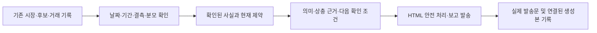

# 거래 보고서의 본문과 근거

목적은 사용자가 어떤 후보를 살펴보고, 언제 판단을 다시 하며, 보유 위험에서 무엇을
확인해야 하는지 이해하도록 돕는 것이다. 보고서는 주문 승인이나 수익 보장이 아니다.
실제 현금 부족·매수 중지 상태는 현재 대응에 반영하며 가상자금·모의투자를 만들지 않는다.

## R02 적용 계약 (운영 적용 상태는 실행 원장)

[10/27 구현·검증·운영 인수](../superpowers/plans/2026-10-27-telegram-audience.md)의 새 자동 발송 계약이 아래 기존 생성기 설명보다 우선한다.

- **시장 채널:** 한국 거래일07:40/13:10/16:40의10분 창. 공개 시장 DTO만 입력으로 받고 엔진·현금·보유·후보를 받지 않는다. 기본 텍스트1개·1,800자/35줄 이내다.
- **개인:**21:00 엔진 요약1개. 집계는 전일21:00~당일21:00이며22시 cron 결과는 다음날 요약에 들어간다. 토요일에는 같은1개가 주간/일일 자료를 함께 다룬다. 주문·체결·청산 시그널·중요 장애/위험·예산 전환은 즉시다.
- 기존07시 미국 자료·전문가·후보·연구의 **계산/보존 시각은 유지**하고 자동 발송만 통합한다. 후보/미국 생성기의 수동 명시 발송과 자동 스케줄은 별개다. 수동 후보는 개인 대상으로만 보낸다.
- `ReportStore`의 저장 성공은 발송 성공이 아니다. 정기 슬롯은 attempted→accepted/rejected/unknown/failed_validation/failed_configuration/skipped로 남고 재시작 후 자동 재시도하지 않는다. accepted는 API 수락이며 실제 휴대폰 수신은 별도 확인이다. 원문은 비공개 DB에 저장한다. 정기 입력은 같은 종류도 모두 append 보존하고 개인 요약은 유형별 건수와 최신 발췌임을 표시한다. 최근2일 미완료/불명/거절/자료 보류 영수증도 개인 요약에 표시한다.
- 새 장전 본문은 기존 미국 요약 전문을 그대로 전달한 것이 아니다. 실제 새 발송문을 아카이브에 남기고 `dispatched_brief_text=None`으로 옛 생성본/예측 평가와 잘못 연결하지 않는다. 전망 주장이 없는 실제 발송행은 예측 표본에서 제외하고 평가원장 행수와 구분한다. 적격 필드가 없던 과거 행의 표본수는 재작성하지 않고 구형 포함 건수를 표시하며, 실제 적중 분모는 축별 n이다.
- 미국 원천시각은 보고 전용 `report_market_time`/`report_market_time_kind`를 사용한다. 기존 v7 raw `market_time`과 v8 필드 부재는 거래 소비자 호환을 위해 유지한다.
- KIS 보고용 숫자는 `report_values`를 쓴다. 원천시각 미확보인 국내 지수는 장중 현재 근거로 쓰지 않는다. ETF 일봉은 한국 상장 관찰집단/1세션/실제 날짜를 표시하며 현재 업종 전체 순위로 바꾸지 않는다.
- 고정 cron 교체 전에는 구버전 발송이 남는다. 저장소 병합만으로 운영 발송량 감소를 선언하지 않는다.

### 10/29 증권 리포트형 본문

장전은 ‘한국증시 모닝브리프’, 장중은 ‘한국증시 장중시황’, 장후는 ‘한국증시 마감점검’이다. 표시 가능한 자료만으로 시장 판단·주요 지표·업종 흐름·국내 관전 포인트를 구성한다. 미국3지수의 방향과 SOX/나스닥 %p 차이는 해당 미국 거래일에 한정하며, 국내 종목 방향/업종 확산은 개장 후 확인 조건이다. 국내 장전 지수는 실제 기준일을 첫 요약에도 표시한다. SOX/나스닥 차이는 화면에 표시한 두 반올림값으로 계산하며, 차이가0이면 상대 문장을 생략한다.

ETF는 유효한 실제 기준일/최근1세션 관찰집단의 상대 상하위다. 모두 하락한 상대 상위를 강세로 표현하지 않는다. 출처는 실제 표시군에 한정하며 제공처를 확인하지 못한 문자열은 미확인으로 남긴다. 장중 KIS 참고값으로 방향을 확정하거나 장후 분 관측을 확정 종가로 바꾸지 않는다. 자료가 부족하면 그 범위까지만 설명하며 새 LLM·조회·뉴스/수급 추정은 추가하지 않는다. 로컬 길이/내용 검사와 다음 자연 발송의 실제 휴대폰 수락은 별개다. [실행/배포 상태](../operations/execution-roadmap.md#r02-securities-brief-20261029).

### R02 지수·계좌 시점 후속

[구현·검증·운영 인수](../superpowers/plans/2026-10-27-report-index-health.md).
장후16:40에는 KIS `FHKUP03500200` 첫 페이지에서 같은 행의 영업일·유효 시각·가격만
보고 전용으로 사용한다. `999999`/`888888` 등 비정상 시각, 다른 날짜/미래·충돌 값은
제외한다. 요약 output1의 등락률·전일값은 결합하지 않는다. `분 단위 참고 관측`과
`확정 종가 아님`을 표시하며 전일대비나 시장 방향은 계산하지 않는다. 장전/장중의 기존
필수 자료 조건은 유지하므로 이번 보완만으로 장중 보고 재개를 주장하지 않는다.

조회는 한국 거래일의 미소비 장후 슬롯에서만 지수2종 각1GET이며 페이지 추가·재시도가 없다.
보고 전용 HTTP 세션에서 라이브러리의 자동 GET 재시도도 끄고 종료한다. SQLite 입력
claim을 먼저 커밋하고 DB/날짜별 파일 잠금을 조회~발송까지 유지한다. 경합자는 먼저
fallback 발송하지 않으며, 중단된 입력 시도는 재조회하지 않는다. 완료 자료는 재사용한다.
거래용 캐시/HTTP 세션·주문 판단과 분리한다. 토큰 만료에 따른 기존 인증 갱신은 지수 GET
2회와 다른 경로이며 이 수치를 전체 KIS 전송 총량으로 해석하지 않는다.

개인 현재 대응에는 로컬 KIS 세션 상태(실제 통신 성공과 다름)와 마지막 성공 계좌
동기화 시각(시세 시점과 다름)을 표시한다. 현금 분류는 세션 유효·15분 이내 검증 성공·
최근 실패/보류 없음·검증 현금일 때만 허용한다. startup 검증 현금만 있고 성공 시각이
없으면 미확인이다. 실패 원문/계좌 금액은 노출하지 않는다. 일일 전문가 품질의 평균값은
유효 의견의 `confidence` 평균이며 예측 정확도가 아님을 명시하고, 유효 의견 건수에
고정 `/7` 분모를 붙이지 않는다.

아래 시간대/두 장 이미지 설명은 기존 생성기와 수동 출력 계약이다. 자동 미국07시 발송·07:30 전문가 재방송은 새 운영 적용 이후 중단된다.

## 시간대별 역할

| 보고서 | 본문에서 답할 질문 | 근거와 한계 |
|---|---|---|
| 미국 마감 / 장전 요약 | 밤사이 확인된 변화와 국내에서 더 확인할 것은? | 공급자가 준 가격일·시각. 가격만으로 뉴스 원인이나 한국 시가를 만들지 않음 |
| 전문가 장전·장중·장후 | 현재 제약은 무엇이며, 서로 다른 신호를 어떻게 읽을까? | 6개 시장 입력과 참고 의견 구분. 섹터 1세션 반등과 누적 약세를 동시에 표시 |
| 스윙 배치 후보 | 왜 뽑혔고, 유효기간 안에 무엇을 확인해야 하나? | 기존 계획 가격·돌파 조건·상한·생성/만료 시각. 체결 여부는 별도 |
| 아침 후보 관찰 | 선정 근거·위험·참고 가격은 무엇인가? | 보고용 순위. 임의 목표/손절이나 최소 10개 채우기를 사용하지 않음 |
| 장후 후보 관측 | 아침의 참고 가격 이후 어떻게 움직였나? | 평가 가능/결측 분모·조회 출처. 적중률·계좌 수익·손절 체결로 해석하지 않음 |
| 공시 요약 | 어떤 원문을 먼저 읽어야 하나? | 접수일·유형 설명·가능한 원문 링크. 피드 중요도는 호재/악재 점수가 아님 |
| 일일 거래 복기 | 기록된 청산의 손익과 다음 검증 대상은? | 거래저널 수치. 입출금·미실현·모델 비용까지 대사한 계좌 총수익과 구분 |
| 주간 매도 후 관측 | 매도 후 가격이 어떻게 변했고 어떤 대조가 필요한가? | 관측/대상 분모·조회 시각·서로 다른 경과일. 매도 성공/실패로 단정하지 않음 |
| 주간 원칙 / 패널 | 이번 주 자료로 다음에 무엇을 확인할까? | 명시 ISO 주차·분석 표본. 모델 확신을 예측 확률로 표시하지 않음 |
| 게이트·반사실 관측 | 차단/승인 미체결 이후 가격 차이는? | 후행 가격·KODEX200 대조. 체결·청산·비용이 없으면 실제 기회손익을 산출하지 않음 |

정기 팀 심의 shadow 보고도 검토했다. 기존 합의율/재현성의 프로세스 품질 표시와
실주문 승격·P&L 미입증 구분을 유지한다.

기존 TCA는 주문 결정가 대비 실제 체결가 차이를 기록하는 보조 지표다. 보고서의
후행 가격 관측과 합산해 실거래 순수익을 만들지 않는다. 오프라인 연구 원장·위험 경보는
각 정본의 완전성/실행 계약을 유지한다.

## Toss 장후 가격 연결

새 보고 helper는 기본 OFF이며 `TOSS_REPORT_API=1`에서만 고정된 trusted launcher를
실행한다. 아침 보고의 정확한 순위·종목·원생성 시각·해시를 저장하고 장후에도 같은 목록을
복원한다. 조회 완료 뒤 유효한 같은 cohort의 가격만 소비하며 목록 결측/변경·기한 초과·
자식 종료 때 기존 조회로 돌아간다. scheduler 재진입으로 helper를 새로 생성하지 않는다.
시장 기준 미확인 가격은 가격/출처/시각만 표시하고 수익률 집계에서 제외한다.

[실행·설치·검증 정본](../superpowers/plans/2026-10-24-toss-report-runtime.md).
현재 운영의 이 보고 경로에는 KIS broker가 주입되지 않아 첫 절감 대상은 pykrx/Naver다.

## 생성과 발송 흐름

후보 보고 시각은 설정을 따른다. 2026-10-22 운영 설정은 아침 **08:25**, 장후
**16:00**이며 코드의 설정 누락 시 기본값(08:00/17:00)과 다르다. 장후에 아침 후보가
없으면 본문을 만들지 않고 사유를 기록한다. 그날의 상태 날짜만으로 발송 완료를 판정하지 않는다.

### 07:00 미국시장 모바일 보고

미국 가격 조회 한 번의 스냅샷으로 두 장을 만든다. 첫 장(720×1000)은
S&P500·나스닥·다우·SOX와 별도 변동성 지표 VIX를 보여준다. 둘째 장(720×1280)은
이미 수집하는 관찰 ETF 8개와 대표 종목 8개를 한글 목록으로 보여준다.
주요 글자는 720px 원본에서 28px 이상으로, 360px 표시 시 14px 이상이다.
밝은 배경·고대비 글자·등락 부호를 사용하며 공통 가격일은 한 번만 표시한다.
시장일이 다르거나 없으면 행별 날짜/미확인 표시를 남긴다.

- ETF: SMH·XLK·XLV·XBI·XLE·URNM·LIT·ITA. 대표주: NVDA·AAPL·MSFT·GOOG·META·AMZN·TSLA·AMD.
- 고정 관찰 대상이며 전체 시장 순위나 S&P500 시총 맵이 아니다. 수집하지 않는 Russell과 ETF를 0%로 채우지 않는다.
- 유한 등락률·양수 가격이 없거나 시장 시각이 미래/오류이면 미확인이다. 실제 0%는 보존한다. 날짜가 없는 수치를 확인된 같은 거래일 평균에 넣지 않는다.
- VIX의 수준과 일간 변화는 주가와 분리한다. 하락을 주식 손실 색상이나 시장 약세로 표현하지 않는다.
- 이미지 두 장은 각각 발송을 시도하고, 이미지 성공 여부와 무관하게 읽을 수 있는 전체 HTML 본문을 보낸다. 본문에는 밤사이 사실·자료 범위·국내 장에서 재확인할 조건을 담는다.
- 일반 로그에 생성 장수와 각 이미지의 알림 API 수락을 남긴다. 생성·API 수락·사용자 수신/가독성은 별도 근거이며 오류가 없다는 이유로 사진 도착을 확정하지 않는다.
- S&P500 맵용 추가 종목 조회를 제거한다. 이 표시 개선을 위해 유료 LLM이나 새 시장 API 호출을 추가하지 않는다.

### 공통 본문과 평가 연결

미국 가격을 재서술하기 위한 모닝 요약은 외부 LLM을 호출하지 않는다.
`model=deterministic-source-summary`, `raw_text`는 빈 문자열, `body_full=text`로
기존 아카이브 형식을 유지한다. 입력에 없는 사건의 원인이나 한국 시가 예측은 생성하지 않는다.
종목 분석·판단·주간 연구의 기존 모델과 예산 정책은 유지한다.

장전 캐시는 한국 날짜가 같고 생성 후 0~6시간인 경우만 결합한다. UTC를 포함한
시간대 표기를 해석하며 미래·전날·만료 캐시는 제외한다. 평가 원장은 실제로 결합한
캐시 본문과 일치하는 생성본만 연결한다. 발송하지 않은 생성본을 평가하지 않는다.

공시 피드 조회 실패와 정상 조회에서 대상 공시가 없는 경우를 구분한다. 가공 피드의
접수일·유형 설명은 공시 원문 해석이나 전체 DART 완전성을 보장하지 않는다.

주간 원칙은 토요일 00:05~00:09에 ISO 연도·주차당 한 번 시도한다.
`report_attempts/principles-<연도>-W<주차>.json` 기록은 재시작 후 중복 유료 호출을
방지한다. 실패도 자동 재시도하지 않으며 로그 확인 후 별도 수동 처리한다.
로그·캐시 정리의 일일 일정은 유지한다.

주간 매도 후 관측은 대상 거래가 있지만 유효한 매도·조회 가격 쌍이 없으면
`no_quotes`와 관측0/대상N·미관측N을 저장하고 알린다. 이 경우 유료 분석이나 위키
교훈을 생성하지 않는다. 대상 거래 자체가 없는 `no_data`와는 다르다. 가격·변동률의
비유한 값/불리언을 관측으로 세지 않고 정상0%는 보존한다. 저널 손익 결측은 유효한
가격 관측을 없애지 않지만 해당 집단의 평균 실현 손익은 미기록으로 표시한다.
기존 주차 소비·자동 재시도 없음 정책은 유지하며 다음 대조 기준 문구는 KODEX200이다.

모델 배분·월 USD100 예산·주문 정책·매수 중지는 이 보고 개선에서 변경하지 않는다.
수익률 개선 입증은 이후 실제 자료와 비용 대사가 필요하다.

미국시장·거시·글로벌 전문가도 수집값과 판단 입력의 유한성을 확인한다. NaN·무한대·
불리언·잘못된 가격은 순위, 가점, 자료 확보 개수의 근거로 쓰지 않는다. 정상 음수/0%
변화는 유지하며 결측 봉을 지워 기준일이나 기간을 바꾸지 않는다. 거시의 핵심 5종이
확보되면 ok로 분류하는 기존 정책은 유지하고 선택 입력의 결측은 별도로 표시한다.
이 자료 상태는 예측 신뢰도가 아니며, 과거에 발송된 원본을 수정 결과로 덮어쓰지 않는다.

## 사용자에게 보이는 변화 예시

다음은 형식 설명용 합성 예시이며 실제 시세나 투자 제안이 아니다.

- 이전: `반도체 -80` → `반도체: 최근 1세션 반등과 5세션 약세 공존. 기준일·출처·수치를 함께 확인. 개별 종목의 거래대금과 수급을 재확인`.
- 이전: `정상매매` → `신규 매수 중지 — 보유 관리·후보 관찰 우선. 가용현금 없음 — 후보는 관찰용`.
- 이전: `추천 적중률` → `관측 가능 N/전체 M, 가격 미확인 K. 아침 참고가 대비 변화이며 실제 체결 수익이 아님`.
- 후보에는 `선정 근거 → 계획/참고 가격과 기준시각 → 유효기한 → 다시 확인할 조건`을 배치한다. 가격이나 조건이 없으면 만들어 채우지 않는다.
- 계획 가격에는 `계획 기준`, 스크리너 가격에는 `관측 기준`을 표시한다. 장후 비교에도 원래 참고가·출처·기준시각을 함께 넣으며 종가 결측인 후보도 원래 참고 근거를 보존한다.
- 거래 복기는 기록된 손익·수익률 상하단·손실 청산유형의 분포를 보여주고, 동일 진입에서 실제 청산과 1·3·5영업일 대조를 다음 확인 대상으로 제시한다. 보고서 자체가 대조 결과를 만들어내지는 않는다.
