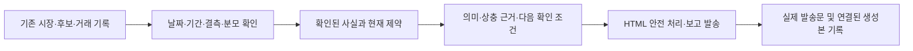

# 거래 보고서의 본문과 근거

목적은 사용자가 어떤 후보를 살펴보고, 언제 판단을 다시 하며, 보유 위험에서 무엇을
확인해야 하는지 이해하도록 돕는 것이다. 보고서는 주문 승인이나 수익 보장이 아니다.
실제 현금 부족·매수 중지 상태는 현재 대응에 반영하며 가상자금·모의투자를 만들지 않는다.

## 시간대별 역할

| 보고서 | 본문에서 답할 질문 | 근거와 한계 |
|---|---|---|
| 미국 마감 / 장전 요약 | 밤사이 확인된 변화와 국내에서 더 확인할 것은? | 공급자가 준 가격일·시각. 가격만으로 뉴스 원인이나 한국 시가를 만들지 않음 |
| 전문가 장전·장중·장후 | 현재 제약은 무엇이며, 서로 다른 신호를 어떻게 읽을까? | 6개 시장 입력과 참고 의견 구분. 섹터 1세션 반등과 누적 약세를 동시에 표시 |
| 스윙 배치 후보 | 왜 뽑혔고, 유효기간 안에 무엇을 확인해야 하나? | 기존 계획 가격·돌파 조건·상한·생성/만료 시각. 체결 여부는 별도 |
| 아침 후보 관찰 | 선정 근거·위험·참고 가격은 무엇인가? | 보고용 순위. 임의 목표/손절이나 최소 10개 채우기를 사용하지 않음 |
| 장후 후보 관측 | 아침의 참고 가격 이후 어떻게 움직였나? | 평가 가능/결측 분모·조회 출처. 적중률·계좌 수익·손절 체결로 해석하지 않음 |
| 공시 요약 | 어떤 원문을 먼저 읽어야 하나? | 접수일·유형 설명·가능한 원문 링크. 피드 중요도는 호재/악재 점수가 아님 |
| 일일 거래 복기 | 기록된 청산의 손익과 다음 검증 대상은? | 거래저널 수치. 입출금·미실현·모델 비용까지 대사한 계좌 총수익과 구분 |
| 주간 매도 후 관측 | 매도 후 가격이 어떻게 변했고 어떤 대조가 필요한가? | 관측/대상 분모·조회 시각·서로 다른 경과일. 매도 성공/실패로 단정하지 않음 |
| 주간 원칙 / 패널 | 이번 주 자료로 다음에 무엇을 확인할까? | 명시 ISO 주차·분석 표본. 모델 확신을 예측 확률로 표시하지 않음 |
| 게이트·반사실 관측 | 차단/승인 미체결 이후 가격 차이는? | 후행 가격·KODEX200 대조. 체결·청산·비용이 없으면 실제 기회손익을 산출하지 않음 |

정기 팀 심의 shadow 보고도 검토했다. 기존 합의율/재현성의 프로세스 품질 표시와
실주문 승격·P&L 미입증 구분을 유지한다.

기존 TCA는 주문 결정가 대비 실제 체결가 차이를 기록하는 보조 지표다. 보고서의
후행 가격 관측과 합산해 실거래 순수익을 만들지 않는다. 오프라인 연구 원장·위험 경보는
각 정본의 완전성/실행 계약을 유지한다.

## 생성과 발송 흐름

후보 보고 시각은 설정을 따른다. 2026-10-22 운영 설정은 아침 **08:25**, 장후
**16:00**이며 코드의 설정 누락 시 기본값(08:00/17:00)과 다르다. 장후에 아침 후보가
없으면 본문을 만들지 않고 사유를 기록한다. 그날의 상태 날짜만으로 발송 완료를 판정하지 않는다.

### 07:00 미국시장 모바일 보고

미국 가격 조회 한 번의 스냅샷으로 두 장을 만든다. 첫 장(720×1000)은
S&P500·나스닥·다우·SOX와 별도 변동성 지표 VIX를 보여준다. 둘째 장(720×1280)은
이미 수집하는 관찰 ETF 8개와 대표 종목 8개를 한글 목록으로 보여준다.
주요 글자는 720px 원본에서 28px 이상으로, 360px 표시 시 14px 이상이다.
밝은 배경·고대비 글자·등락 부호를 사용하며 공통 가격일은 한 번만 표시한다.
시장일이 다르거나 없으면 행별 날짜/미확인 표시를 남긴다.

- ETF: SMH·XLK·XLV·XBI·XLE·URNM·LIT·ITA. 대표주: NVDA·AAPL·MSFT·GOOG·META·AMZN·TSLA·AMD.
- 고정 관찰 대상이며 전체 시장 순위나 S&P500 시총 맵이 아니다. 수집하지 않는 Russell과 ETF를 0%로 채우지 않는다.
- 유한 등락률·양수 가격이 없거나 시장 시각이 미래/오류이면 미확인이다. 실제 0%는 보존한다. 날짜가 없는 수치를 확인된 같은 거래일 평균에 넣지 않는다.
- VIX의 수준과 일간 변화는 주가와 분리한다. 하락을 주식 손실 색상이나 시장 약세로 표현하지 않는다.
- 이미지 두 장은 각각 발송을 시도하고, 이미지 성공 여부와 무관하게 읽을 수 있는 전체 HTML 본문을 보낸다. 본문에는 밤사이 사실·자료 범위·국내 장에서 재확인할 조건을 담는다.
- S&P500 맵용 추가 종목 조회를 제거한다. 이 표시 개선을 위해 유료 LLM이나 새 시장 API 호출을 추가하지 않는다.

### 공통 본문과 평가 연결

미국 가격을 재서술하기 위한 모닝 요약은 외부 LLM을 호출하지 않는다.
`model=deterministic-source-summary`, `raw_text`는 빈 문자열, `body_full=text`로
기존 아카이브 형식을 유지한다. 입력에 없는 사건의 원인이나 한국 시가 예측은 생성하지 않는다.
종목 분석·판단·주간 연구의 기존 모델과 예산 정책은 유지한다.

장전 캐시는 한국 날짜가 같고 생성 후 0~6시간인 경우만 결합한다. UTC를 포함한
시간대 표기를 해석하며 미래·전날·만료 캐시는 제외한다. 평가 원장은 실제로 결합한
캐시 본문과 일치하는 생성본만 연결한다. 발송하지 않은 생성본을 평가하지 않는다.

공시 피드 조회 실패와 정상 조회에서 대상 공시가 없는 경우를 구분한다. 가공 피드의
접수일·유형 설명은 공시 원문 해석이나 전체 DART 완전성을 보장하지 않는다.

주간 원칙은 토요일 00:05~00:09에 ISO 연도·주차당 한 번 시도한다.
`report_attempts/principles-<연도>-W<주차>.json` 기록은 재시작 후 중복 유료 호출을
방지한다. 실패도 자동 재시도하지 않으며 로그 확인 후 별도 수동 처리한다.
로그·캐시 정리의 일일 일정은 유지한다.

모델 배분·월 USD100 예산·주문 정책·매수 중지는 이 보고 개선에서 변경하지 않는다.
수익률 개선 입증은 이후 실제 자료와 비용 대사가 필요하다.

미국시장·거시·글로벌 전문가도 수집값과 판단 입력의 유한성을 확인한다. NaN·무한대·
불리언·잘못된 가격은 순위, 가점, 자료 확보 개수의 근거로 쓰지 않는다. 정상 음수/0%
변화는 유지하며 결측 봉을 지워 기준일이나 기간을 바꾸지 않는다. 거시의 핵심 5종이
확보되면 ok로 분류하는 기존 정책은 유지하고 선택 입력의 결측은 별도로 표시한다.
이 자료 상태는 예측 신뢰도가 아니며, 과거에 발송된 원본을 수정 결과로 덮어쓰지 않는다.

## 사용자에게 보이는 변화 예시

다음은 형식 설명용 합성 예시이며 실제 시세나 투자 제안이 아니다.

- 이전: `반도체 -80` → `반도체: 최근 1세션 반등과 5세션 약세 공존. 기준일·출처·수치를 함께 확인. 개별 종목의 거래대금과 수급을 재확인`.
- 이전: `정상매매` → `신규 매수 중지 — 보유 관리·후보 관찰 우선. 가용현금 없음 — 후보는 관찰용`.
- 이전: `추천 적중률` → `관측 가능 N/전체 M, 가격 미확인 K. 아침 참고가 대비 변화이며 실제 체결 수익이 아님`.
- 후보에는 `선정 근거 → 계획/참고 가격과 기준시각 → 유효기한 → 다시 확인할 조건`을 배치한다. 가격이나 조건이 없으면 만들어 채우지 않는다.
- 거래 복기는 기록된 손익·수익률 상하단·손실 청산유형의 분포를 보여주고, 동일 진입에서 실제 청산과 1·3·5영업일 대조를 다음 확인 대상으로 제시한다. 보고서 자체가 대조 결과를 만들어내지는 않는다.
