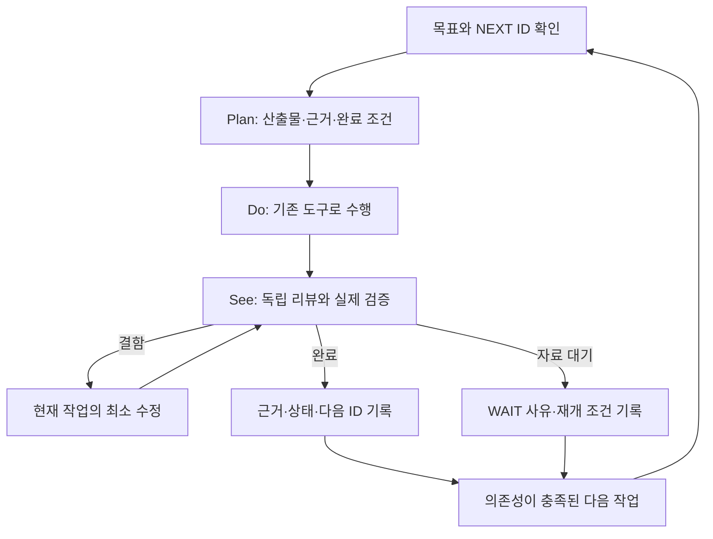

# 엔진 개선 실행 원장 — 목표·진행·리뷰·다음 작업

> **현재 작업 순서의 정본.** 새 세션은 이 문서부터 읽는다. 개별 계획·PR·운영 영수증은 근거이며, 과거 문서의 미완료 체크박스를 모두 새 작업으로 되살리지 않는다. 이 문서의 날짜 도래나 체크 완료가 주문·배포·새 구독의 승인을 대신하지 않는다.

**Goal:** 좋은 종목을 고르고 실제로 진입할 수 있는 시점을 판단해, 거래·데이터·LLM 비용 후 순수익을 개선한다. 현재 과제는 **KIS와 Toss를 함께 사용하는 자료 경로의 실효성을 확인하고 필요한 소비자에 연결하는 것**이다.

**Architecture:** 기존 도구·원장·예약을 재사용한다. 한 작업마다 Plan → Do → See를 마친 뒤 다음 작업 ID를 명시한다. 기술 개발, 운영 적용, 실측 효과, 경제성 검증을 별도 열로 관리한다.

**Tech Stack:** 기존 Python 엔진·pytest·JSONL 판독기·cron/systemd, 이 Markdown 실행 원장. 별도 작업관리 앱이나 유료 AI 자동 실행기는 만들지 않는다.

**Spec:** 사용자 2026-10-24 요청, [기존 수익성 일정](../superpowers/plans/2026-10-14-profitability-priority-schedule.md), [Toss/KIS 설계](../superpowers/specs/2026-10-23-kis-toss-read-offload-design.md), [현재 실측 계획](../superpowers/plans/2026-10-24-live-readout.md).

## 1. 현재 위치와 이번 작업의 끝

2026-10-24 **11:34 KST** M00 최초 대조 기준(이후 O01 사고/설치 상태는 [O01](#o01) 참조):

- 운영 `44483017`·PID3125313·active·NRestarts0. 저장소 main `eb4f9923`와 다르다. 차이는 후속 판독 도구/문서이며 본체 재배포가 필요한 상태로 해석하지 않는다.
- PR #250 KIS 조회 보완, #252 Toss 보고 helper는 배포됐다. #253 배포 영수증, #254 판독 도구도 병합됐다. #254의 전체9,052검사·PR CI와 병합 후 main CI가 통과했다.
- 현재 Toss는 **16:00 장후 보고에 `/api/v1/prices` REST 가격을 제공하는 경로**다. 별도의 v2 WebSocket 관측 코드가 있어도 장중 스캐너·진입 판단에 병행 연결됐다는 뜻은 아니다.
- 현재 보고의 KIS 조회는 연결되지 않아 Toss의 직접 대체 대상은 pykrx/Naver다. **보고 성공을 KIS 웹소켓 제한 해소나 종목 선정 향상으로 보고하지 않는다.**
- 10월26일 읽기 전용 cron7개 설치 완료, 실제 실행은 대기다. Toss 보고 승인 범위는10월26~30일16:00–16:05, 만료10월30일16:06 KST다. 후보0·휴장·구형 cohort는 성공 표본이 아니다.
- 이번 문서 정비에서는 운영 코드·설정·cron·timer를 변경하지 않는다. 예약을 확인한 것과 수정한 것을 구분한다.

**현재 주 과제:** T03/T04의 실측으로 기존 연결을 인수하고, T02/T05에서 실제 KIS 부담을 줄일 소비자 하나를 고른다. **다음 즉시 작업은 O01**(오래된 자동 모델 전환과 예약 충돌 정비)이다. 별도 보고·청소 개선이 이 주 과제를 대체하지 않는다.

완료는 “Toss 코드가 있다”가 아니라 **어느 소비자의 어떤 요청을 대신했는지, 원자료/시각/결측을 보존했는지, 실패 때 기존 기능이 유지되는지**가 확인된 상태다. 그 뒤 선정·진입·청산 개선으로 복귀한다.

## 2. 바꾸지 않는 평가 기준

1. 종목 선정과 진입 시점을 분리한다. 실시간 자료·여러 원천은 검증할 강점이며, 일봉 백테스트만으로 무효라고 단정하거나 실시간이라는 이유만으로 우위라고 판정하지 않는다.
2. 전체 KODEX200을 주 비교로 유지하고, 사전 정의한 반도체 제외·현금·업종·엔진 버전·국면을 보조 분석으로 병기한다. 최근 결과에 유리하게 지수나 기간을 소급 교체하지 않는다.
3. 자료 경로의 요청 절감·정확성, 가격 이동, 체결 가능성, 실제 순손익은 각각 다른 결과다. 결측은0 또는 정상으로 채우지 않는다.
4. 실제 현금 부족·매수 중지를 유지한다. 사용자가 철회한 가상1,000만원·모의투자를 다시 시작하지 않는다. 현금 부족을 이유로 선정 입력 점검까지 멈추지는 않는다.
5. 월 LLM USD100·기존 저비용 전환/월초 정책을 유지한다. 과거 비용 불명은 사용자 결정인 `log_and_continue`와 `actual=null`을 보존하며 추가 제출을 다시 선행 조건으로 만들지 않는다.
6. 매일 기술 결함은 고칠 수 있다. 전략 임계값·모델·청산 방식은 결과를 본 뒤 여러 개를 함께 최적화하지 않는다. 기존 유료 R1·새20일 관측·매수 재개는 이 원장으로 자동 활성화되지 않는다.

## 3. 이전 작업의 완료 범위

`구현 완료`는 경제성 검증 완료와 다르다. 아래는 주제별 현재 상태이며 세부 변경 이력은 링크에서 확인한다.

| 작업 묶음 | 구현·적용 | 실제 확인한 것 | 아직 남은 것 / 연결 ID |
|---|---|---|---|
| KIS 직접 오류 피드백·분석 일봉 캐시 | [#250·배포 완료](../superpowers/plans/2026-10-23-kis-toss-read-offload.md) | 회귀/전체검사, 정상 기동·계수 노출 | 실제 스캔 요청/적중/제한 오류·자료 나이/후보 결측: **T03** |
| Toss 보고 연결·별도 helper | [#252·배포/활성화 완료](../superpowers/plans/2026-10-24-toss-report-runtime.md) | 실제 계정의 무접속 설치 검사·설정 보존 | 첫 실제 API·보고 가격 소비·전달: **T04**; 장중/WS 분산: **T02/T05** |
| KIS 차분·Toss 당일 판독 | [#254·병합/별도 설치 완료](../superpowers/plans/2026-10-24-live-readout.md) | 전체9,052검사·독립 리뷰·localhost 스모크·후보0 판독 | 10월26일 예약 결과: **T03/T04** |
| 선정 입력·수급·지표 전달 | [수정/검증 및 후속 반영](../reviews/selection-input-followthrough-2026-10-21.md) | 10/19 반환41건 중 미관측 수급 감점 회피3건·계열 보너스 차이1건; 순위 변화 없음 | 전체 원천의 추가 성과/탈락 후보 모집단: **E02** |
| 판단/호가/장 상태·차단 전 후보 관측 | [10/22 판독 완료](pregate-capture-2026-10-22.md#10월22일-실측-판독--완전-원장과-보조-가격-쌍-4개) | 완전 원장42,487기록·반환19·상위5·보조 가격쌍4. 모두regime 차단 | strict 장 상태 unknown·order_ready/실제 체결 없음. 순수익null: **E01** |
| 주문/체결 귀속·동일 진입 청산 비교 | [귀속 반영](../reviews/order-attribution-2026-10-18.md)·[오프라인 첫 청산 도구](../reviews/first-exit-replay-2026-10-18.md) | 합성 수명주기/실제 ExitManager 첫 판단 재생 | 신규 실거래 표본·PRICE 경로·체결 비용에 의한 우위: **E03** |
| LLM 입력·역할·예산·timeout fallback | [역할 검토](../research/engine-model-allocation-2026-10-15.md)·[비용 불명 정책 배포](../research/gemini-timeout-fallback-2026-10-17.md) | 호출 계약/예산/폴백 검사와 제한된 자격 확인 | 동일 자료·응답 뒤 가격·비용 후 모델 우위, R1 disabled: **E04**. 옛 자동 전환은 **O01** |
| 전문가·미장·아침/장후·복기 보고 | [본문·모바일·결측 보완 배포](../superpowers/plans/2026-10-22-report-content.md) | 생성·일부 API 수락·캐시 결합·정상 종료 | 실제 모바일 수신, 후보 있는 날/주간 표본 내용: **R01** |
| 계좌 순수익·벤치마크 | [수집/대사 도구와 결측표](account-baseline-status-2026-10-13.md) | 과거 주문/체결·권리 수집, 추정 청산29건의 경제적 대사 | 시작NAV·완전 입출금·권리 실지급/세전후·운영비·현재 버전 귀속: **A01**. 계좌 순손익/TWR null |
| 서버/에이전트 산출물 정리 | 과거 정리 이력과 이번 예약 목록은 별개 | 이번에는 파일 삭제 없음 | 자동 보존 만료3건·새 Toss namespace·소비된 timer 정합화: **O02** |

## 4. 순서와 의존성

상태는 `READY`(착수 가능), `DOING`(수행 중), `REVIEW`(검토 중), `WAIT`(명시 조건 대기), `DONE`(해당 산출물 인수), `DEFERRED`(의도적 보류)만 쓴다. `WAIT`에는 기다릴 사건/시각과 재개 행동을 반드시 적는다. 초기 문서 작업 M00은 이 원장이 main에 병합되면 DONE으로 전이하고 NEXT=O01이다. 별도 상태 문서만을 위한 배포/PR 반복 없이 GitHub 병합 영수증으로 확인하며, 다음 작업의 첫 기록에서 표기도 갱신한다.

| 순서 / ID | 상태 | 산출물·착수 조건 | Plan → Do → See / 완료 조건 | 다음 |
|---|---|---|---|---|
| 0 **M00 통합 실행 원장** | DONE | 이번 문서·기존 작업/예약 대조·세션 진입 규칙 | 목적/완료 범위/누락/권한을 독립 검토 → 문서 검사 → 커밋/푸시/PR 통합. 최종 통합 여부는 해당 PR 기록 | O01 |
| 1 **O01 옛 자동 전환 정비** | REVIEW | **10/24 22:00 전에 우선 검토.** 기존 cron과 현재 모델 정책 충돌 | `llm_migration_monitor.py`의 자동 설정 쓰기/재시작을 보고 전용으로 제한하는 최소 변경안 → 운영 설정·예산·보고 보존 회귀 → 독립 중요 리뷰 → 검증된 운영 적용. 완료는 실행 경로에서 자동 쓰기/재시작이 없고 기존 예약과10/26 고정 조건이 보존된 것. 원래 상태 파일을 조작해 우회하지 않음 | T02; 시각 도래 시 T03/T04 |
| 2 **T02 KIS/Toss 역할 확정** | READY | 실측 대기 중 가능한 코드/계약 분석. 새 API 호출 없이 먼저 조사 | 현재 KIS 소비자/요청종류/빈도와 Toss REST·WS 지원 근거를 매핑. 시각·시장/수정주가 기준·자료 깊이·TTL·실패 동작·권한/기간을 표로 고정. **대체 후보1개 또는 대체 불가 사유**를 리뷰하면 완료. 이미 연결된 보고를 장중 분산으로 세지 않음 | T03/T04 결과 후 T05 |
| 3 **T03 실제 KIS 스캔 판독** | WAIT | 10/26 09:25/09:50 기록과16:12 자동 차분 | 동일 실행·계수 완전성 → TR/source/component별 시도/거절과 분석 적중/합치기/호출 비교 → 후보/자료 나이/결측 대조. 동일 구간 중복 조회 회피와 부하 보정 전후 절감률을 구분. 불충족이면 원인/최소 후속1개를 리뷰 | T04/T05 |
| 4 **T04 Toss 실제 사용 인수** | WAIT | 10/26 아침08:25 cohort·16:00 보고·16:12 판독 | 당일 원래 순위/종목/시각 → 정확한slot/attempt/terminal → 유효 quote의 실제 보고 사용·기존 조회 폴백·API 수락 → 수신 내용 대조. 단계별 확인 범위를 기록. `excluded` terminal은 quote 자체 실패와 구분. 원장 성공만으로 완료 금지 | T05 또는 결함수정1개 |
| 5 **T05 병행 소비자1개 적용(조건부)** | WAIT | T02 역할 표와 T03/T04 검토 결과. 새 목적/기간에 기존 권한이 적용되는지 확인 | 승인 범위 안에 실제 부담/자료 의미를 만족하는 후보가 있을 때만 소비자1개 설계/구현 → 실패·지연·TTL·재연결/중단·비용 회귀 → 독립 리뷰/전체검사 → 고정 적용·짧은 실측. 후보 부재/효과 불명은 DEFERRED, 새 권한 필요는 WAIT로 남긴다. **그 경우도 T06을 진행**하며 확대를 강제하지 않음 | T06(미적용 결론 포함) |
| 6 **T06 자료 경로 통합 리뷰** | WAIT | T03/T04 검토와 T05의 적용 또는 미적용 결정 | KIS 주 경로/Toss 보조·실제 호출 회피·결측·지연·폴백·비용과 선정 결과 보존을 리뷰. 확대/현행 보고 전용 유지/철회/자료 불충분을 명시. **T05가 미적용이어도 E01로 복귀**한다. 이는 Toss 장중 분산 성공이 아니며 미완료 범위·재개 조건은 T05에 남김 | E01로 주 과제 전환 |
| 7 **E01 진입 가격·차단 원인** | READY(주 과제 종료 후) | 기존10/19~22 판독과 실제 입력; 새 수집기 재구현 금지 | 전체 후보/실제 첫 차단·strict/보조 가격·당시 버전·수량/자본 결측을 연결해 비교 가능 범위를 확정. 단일 대안은 결과 밖 기간에서 평가. 필요한 필드가 없으면 경제성 WAIT와 구체적 입력 계약을 기록; 관측만 반복하지 않음 | E02; 실제 PRICE가 있으면 E03 |
| 8 **E02 어떤 종목이 좋은가** | WAIT(경제성) | 입력/원천 매핑은 지금도 가능; 경제성은 E01 비교 자료 필요 | 같은 모집단에서 원천 하나 제거 또는 계열 가중 하나만 비교. 시점·선택/거절·중복정보·결측·동일 진입/청산/비용을 보존. 반환 상위5개로 전체 원천 기여를 단정하지 않음 | E03 |
| 9 **E03 같은 진입의 청산 비교** | WAIT | 실제 진입 identity·PRICE 경로·설정/ATR·체결/비용 | 기존 도구로 첫 판단과 실행/체결/비용을 분리. 복합 trailing/ATR/사이징 floor 등을 동시에 변경하지 않음. 입력 결측이면 설정 변경 없이 남김 | E04; A01과 연결 |
| 10 **E04 모델·추론 비교** | WAIT | 동일 입력·응답 뒤 시세·입장 조건·비용 한도 | 역할 하나·대안 하나, 지연 후 실제 가능한 가격/회피손실/놓친 기회/불명 비용까지 비교. 공개 벤치마크 순위나 응답 일치율로 거래 모델 승격 금지. R1 재개 조건을 확인한 뒤에만 제한 호출 | E05 |
| 11 **E05 순수익 통합 판정** | WAIT | E01~04의 유효 결과 + A01 | 선정→진입→크기→체결→청산→총비용→계좌/동시간 지수 흐름 리뷰. 다음 적용 가설1개 또는 효과 미입증/중단을 결정. 매수 재개는 별도 사용자 결정 | 다음 가설1개 |

실측을 기다리는 동안 **T02 → O02의 비삭제 사전점검 → A01의 기존 자료 결측 대사**는 순서대로 진행할 수 있다. 이는 완료 근거를 앞당기는 준비이며 주 과제 교체가 아니다. 구현 중인 주 작업은1개로 제한하고, 독립 읽기/리뷰만 병렬화한다.

### 기한·병행 트랙

| ID | 상태 / 기한 | 해야 할 일과 완료 조건 |
|---|---|---|
| **R01 보고 인수** | WAIT, 다음 자연 발송 | 07:00 사진2장·본문,07:30 결합,08:25 후보,16:00 장후,16:30 전문가,20:30 복기/주간 보고 중 아직 미확인인 항목만 점검. API 수락과 실제 모바일 수신을 분리. 후보0/거래0이면 경제 표본 확인은 미완료. 새 디자인 변경은 실제 결함이 있을 때만 하며 T04와 중복 기록하지 않음 |
| **A01 계좌·기준선 대사** | READY(기존 로컬 자료 대사), WAIT(신규 실조회/누락 증빙) | READY 범위는 이미 수집한 KIS 주문/체결/권리와 기존 CLI로 빠진 기간/항목을 확정하는 것. 신규 계좌 API 실조회는 지원/보존 범위·전송 한도·실행창·기존 승인 범위를 확인한 별도 Do 이후에만 진행한다. API로 얻을 수 없는 시작NAV·외부 흐름·권리 지급/세전후·운영비만 추가 증빙 대상으로 남김. 자료가 없으면 계좌 순손익/TWR은null |
| **O02 만료·예약 정리** | READY(검토), 10/30·11/1 이전 우선 | 10/26 점검 후 표시된 cron7개만 정리.10/30 16:06 Toss 승인 만료/송신 종료 확인.11/1·5·6 옛 관측 retention의 정확한 대상/보존/현재 참조·진행 작업을 **삭제 전** 대조. 새 Toss 보고 namespace는11/29 16:06 기한의 별도 제한된 정리 절차 필요. starts/token/unknown/승인·계좌 원장은 삭제 대상으로 확대하지 않음. 검토/설치/실삭제 영수증은 분리 |

## 5. 예약 원장 — 설치와 실제 실행 구분

2026-10-24 확인한 범위는 ubuntu/root crontab, system/user timer, `/etc/crontab`·cron 디렉터리, 저장소 workflow와 봇 스케줄러다. root crontab 없음, user timer/시스템 cron에 추가 QWQ 작업 없음. GitHub는 PR/main 검증이며 배포 예약이 아니다. 봇 내부 항목은 코드/설정 계약이고, 각각의 미래 발송 성공은 아직 확인하지 않았다.

| 종류 | KST 시각 | 현재 상태 / 주의 | 담당 |
|---|---|---|---|
| ubuntu cron | 매일22:00 `llm_migration_monitor.py` | 등록됨. 실제 상태 `phase=shadow`; 소스에 조건부 모델 설정 쓰기·`systemctl restart` 있음. 오늘 실행/조건 충족을 뜻하지 않음. **현재 기준 충돌, 미조치** | O01 |
| ubuntu cron | 평일16:00 / 일요일09:00 `shadow_report.py` | 등록됨. 각각1일/7일·Telegram 보고. 과정 품질 알림이며 신규 유료 모델 비교/순수익 검증 아님 | R01 |
| ubuntu cron4개 | **10/26 09:25·09:50·15:59·16:10** | 고정 `f8ef32eb`로 로컬 계수 기록. 설치 완료, 실실행 대기 | T03 |
| ubuntu cron3개 | **10/26 16:12** | 스캔 차분·보고 차분·Toss 당일slot. 설치 완료, 실실행 대기 | T03/T04 |
| 봇 내부 | 08:25/16:00 후보 보고 | Toss helper는10/26~30의16:00–16:05·당일 cohort 조건. 별도 시스템 timer로 자동 WS를 켜는 작업이 아님 | T04 |
| 봇 내부 | 07:00 미장,07:30/13:00/16:30 전문가,20:30 복기/원장 등 | 기존 일정 유지. 휴장·데이터·이미 실행 여부 조건은 기존 스케줄러 적용. 불필요한 시험 발송/유료 재호출 금지 | R01/A01 |
| system timer | **11/1 09:46:10** | `qwq-entry-capture-retention-20261101.timer` waiting → 10/2 관측 retention service | O02 |
| system timer | **11/5·11/6 09:34:10** | 각각11/5·11/6 retention timer waiting → 10/6·10/7 관측 retention service | O02 |
| system timer | 과거10/2·6·7·8·14·15·16·22 capture,10/16 premarket3개 | enabled/elapsed, 다음 실행 시각 없음. 미래 수집 예약으로 세지 않으며 원본/소비 기록을 보존 | O02 |
| system service | 과거 Toss observer | disabled/inactive. 새 보고 helper와 별개, 재시작하지 않음 | O02 |

10/26 작업은 정확한 날짜/분·운영 HEAD `44483017`·소스 지문을 검사하며 결과를 덮어쓰지 않는다. 파일 부재는0건이나 실패 확정이 아니므로 가드/로그부터 확인한다. cron 항목은 자동 삭제되지 않는다. 판독 결과 경로는 `~/.local/state/qwq-live-readout/20261026/`, 설치/통합 영수증은 `~/.local/share/qwq-live-readout/20261026/`다. 이번 예약 감사의 비공개 근거는 `~/.local/state/qwq-task-audit/20261024/schedule-audit.json`이다. 금액·자격·원문 cron은 이 문서에 넣지 않는다.

**자동화 경계:** 예약된 것은 기록/JSON 판독까지다. 미래의 독립 AI 리뷰·코드 수정·다음 PR을 실행할 에이전트 예약은 없다. 활성 세션에서는 아래 규칙으로 이어가며, 세션이 종료되면 다음 세션이 같은 원장에서 재개한다.

## 6. 완료 → 리뷰 → 다음 작업 규칙



1. 시작할 때 이 문서, 관련 마지막 영수증, 실제 main/운영 버전, 예약 충돌을 확인한다. 변경할 작업 ID·원래 목표에 미치는 영향·완료 조건을 한 문단으로 선언한다.
2. 리뷰 지적은 우선 현재 작업의 하위 수정으로 처리한다. 별도 목적의 발견은 ID/우선순위/기한/의존성을 붙여 대기열에 넣는다. 실제 주문·비용·데이터 유실·무단 재시작 위험만 주 작업을 선점하며, 중단한 ID와 복귀 조건을 남긴다.
3. 구현자 검사 후 독립 리뷰를 받는다. 돈/권한/상태 일관성/운영 변경은 독립 중요 리뷰, 문서는 근거·정합성 리뷰면 된다. 실제 모델 metadata가 없으면 요청 모델과 분리해 미확인으로 기록한다. 같은 diff를 이유 없이 재리뷰하거나 검증된 도구를 다시 만들지 않는다.
4. 결함 수정 후 해당 실패와 영향 범위를 검증한다. 제품 코드 변경에는 관련/전체 검사·비밀 검사·CI를 적용한다. 문서만 바뀌면 링크·상태·diff·비밀 검사를 하고 저장소 필수 CI를 따른다. 문서만을 위해 운영을 재배포하지 않는다.
5. 완료 보고에는 **달라진 기능 / 검증 근거 / 남은 한계 / 운영·예약 변경 여부 / NEXT ID**를 남긴다. 리뷰 승인과 실제 운영 효과는 별도다. 입력 결측을 확인한 작업은 결측표 작성만 DONE이고 경제성 작업은 WAIT로 둔다.
6. 원장·체크포인트·관련 문서를 같은 PR에서 갱신하고 커밋/푸시한다. PR/CI/병합의 최종 상태는 GitHub 영수증을 따른다. 같은 완료 기록을 여러 파일 머리에 계속 복제하지 않는다.
7. 승인된 범위이고 의존성이 충족된 다음 READY 작업은 새 “ㄱㄱ”를 기다리지 않고 이어간다. 새로운 주문·권한 확대·파괴적 삭제 등 기존 범위를 넘는 작업은 구체안과 이유를 제시한다. 과거 고정 예약을 몰래 다시 맞추거나 재사용하지 않는다.
8. 후보0 또는 자료 불충족 때20일 수집부터 늘리지 않는다. 이번 보고 승인의 남은10/26~30 슬롯으로 충족 가능한지 먼저 검토한다. **10/30 만료 시에는 표본이 없어도 유지/추가 자료/중단 결정을 기록**하고 자동 연장하지 않는다. 계좌 증빙은 하루마다 같은 결측을 다시 조사하지 않는다.

### 작업별 기록 양식

기존 상세 계획을 링크하고 아래 한 블록만 이 원장에 추가한다. 긴 로그/코드는 기존 영수증에 둔다.

```text
ID / 날짜 / 담당 / 상태:
PLAN: 원래 목표에 필요한 이유, 산출물, 입력·의존성, 완료/중단 조건
DO: 변경 파일·PR/고정 SHA 또는 읽은 자료, 운영/예약 변경 유무
SEE: 테스트/실측, 독립 리뷰 결과·모델 확인 수준, 잔여 결측/한계
DECISION: 완료 / 최소 수정 / WAIT / 중단 (구현·배포·효과를 각각 표시)
NEXT: 작업 ID, 착수/재개 조건, 중단한 주 과제로 돌아갈 지점
```

## 7. 이번 정리 기록과 다음 세션

**M00 / 2026-10-24 / coordinator / DONE**

- **Plan:** 흩어진 미완료 목록을 재검증해 Toss 병행 사용에서 순수익 검증까지 한 실행 순서로 묶는다.
- **Do:** main `eb4f9923` 기준 주제별 완료 범위·cron10개·미래 retention3개·과거 elapsed timer·봇 내부 일정 대조. 현재22시 자동 전환 충돌을 새 O01로 등록. 운영/예약 변경0.
- **See:** 두 자료 감사와 별도 독립 문서 리뷰 요청 Sol/high, 실제 모델/effort metadata 미노출. 수익성 감사의 최초 cwd 착오를 정정했고 인용한 tracked 파일은 `44483017..eb4f9923` 차이0임을 확인했다. 문서 리뷰의 T05 필수 관문 P1·A01 실행범위/일시적 PR 개수 P2를 반영해 재승인(APPROVE, 새 차단 지적0)을 받았다. 추가 상대 링크/앵커20개·작업 ID15개·diff·비밀 검사 통과, 운영 PID/cron 불변. 제품 코드는 변경하지 않았으며 최종 CI/통합은 이 변경 PR의 근거를 따른다.
- **통합:** PR [#255](https://github.com/qwq-partners/qwq-ai-trader/pull/255), main `603d2ee0`, CI9,052검사 통과.
- **Next:** **O01**. 그다음 **T02**,10/26 기록 도래 시 **T03/T04**. 주 과제의 인수 **T06** 뒤 **E01**로 돌아간다.

다음 세션용 지시:

> 최신 main의 `docs/operations/execution-roadmap.md`를 읽고 마지막 NEXT ID부터 Plan→Do→See로 이어가라. 운영 checkout이 옛 문서일 수 있으므로 main 문서와 실제 운영 SHA를 구분하라. 이미 완료된 구현은 재개발하지 말고 미확인인 실제 효과만 확인하라. 현재 주 과제는 Toss/KIS 병행 자료 경로이며 다음은 O01→T02→T03/T04다. 예약·매수 중지·USD100·가상자금 미사용을 보존하고, 각 작업 리뷰 뒤 상태/근거/NEXT를 갱신하라. 조건 충족 다음 작업은 같은 세션에서 이어가되 새로운 외부 실행 권한을 이 문서에서 추론하지 마라.

## 8. 자동으로 되살리지 않을 항목

- 가상1,000만원/모의투자, 사용자가 미적용으로 정한 실시간 RAG: **취소/미적용 유지**.
- 새20일 관측·유료 R1·매수 재개: **조건 미충족/별도 결정**, 달력만으로 시작하지 않음.
- ETF Core·3분할·H4·복합 trailing A/B·Rule3-3 완화·사이징 floor0.50: **가설/보류**. E01~05에서 선택한 단일 가설에 해당할 때만 근거와 별도 설계로 재개한다. 기존 H1~H3 부정 결과를 현재 버전의 보편적 실패나 새 가설 성공으로 바꾸지 않는다.
- 에이전트 캐시/과거 worktree 대규모 삭제·보고서 취향상 재디자인: 현재 주 과제의 선행 조건이 아님. 자원 문제/구체적 결함과 보존 검증이 있을 때만 별도 ID로 다룬다.

## O01

2026-10-24 / coordinator / REVIEW

- **Plan:** 현재 경제성/예산 정책과 충돌하는 옛22시 자동 모델 전환을 보고 전용으로 정비한다. 설정/상태 쓰기·재시작 함수를 제거하고 기존 자료 요약·알림은 유지한다. 결과 일치율은 정확도/순수익 증거가 아니며 추가 수집·모델 변경을 권하지 않는다.
- **Do:** `scripts/llm_migration_monitor.py`와 격리 회귀를 수정한다. 고정5파일 artifact를 별도 설치한 뒤 기존22시 cron 한 줄만 교체할 계획이다. 운영 HEAD와10/26 판독 예약은 변경하지 않는다. 독립 리뷰와 전체9,075검사 통과, CI·설치는 아직 대기 중이다.
- **검증 사고:** 12:14:51 KST 기존 코드 RED 시험의 마지막 케이스에서 `subprocess.run` 대역이 누락되어 운영 봇이1회 재시작됐다(PID3125313→3167991). coordinator 실수이며 정상 계획 실행으로 취급하지 않는다. 공통 fixture의 명령 차단을 보완했다. 운영 HEAD `44483017`, 보호4파일 지문·cron10개 불변, 복구ready/미완료 원장0 확인. `NRestarts=0`은 수동 재시작 부재의 근거가 아니다.10/26 계수 비교는 그날 두 스냅샷의 동일 실행 여부로 판단하며 이번 전후 계수를 비교하지 않는다. 비공개 근거 `~/.local/state/qwq-task-audit/20261024/o01-test-incident.json`.
- **See:** 관련 회귀에서 자동 전환 재현 뒤 보고 전용 동작을 확인했다. 실제 JSONL 손상3건을 포함해23개 통과·격리 위반0, 고정5파일 합성 smoke 통과. 독립 중요 리뷰 요청Astra/xhigh, 실제 모델/effort 미노출; 파서 예외/설치 실패 보류 P2 2건 수정 후 미해결0 승인. 최종 전체9,075 passed/2 skipped/2 xfailed·격리 위반0·문법/비밀 검사 통과(825.19초). 첫 전체 실행은 리뷰 수정 반영을 위해2,168통과 시점에 중단했으며 최종 성공과 구분한다. CI·설치 영수증은 이어 기록한다.
- **Next:** O01 실제 예약 교체 검증 후 **T02** 역할표 인수,10/26 **T03/T04** 대기.
