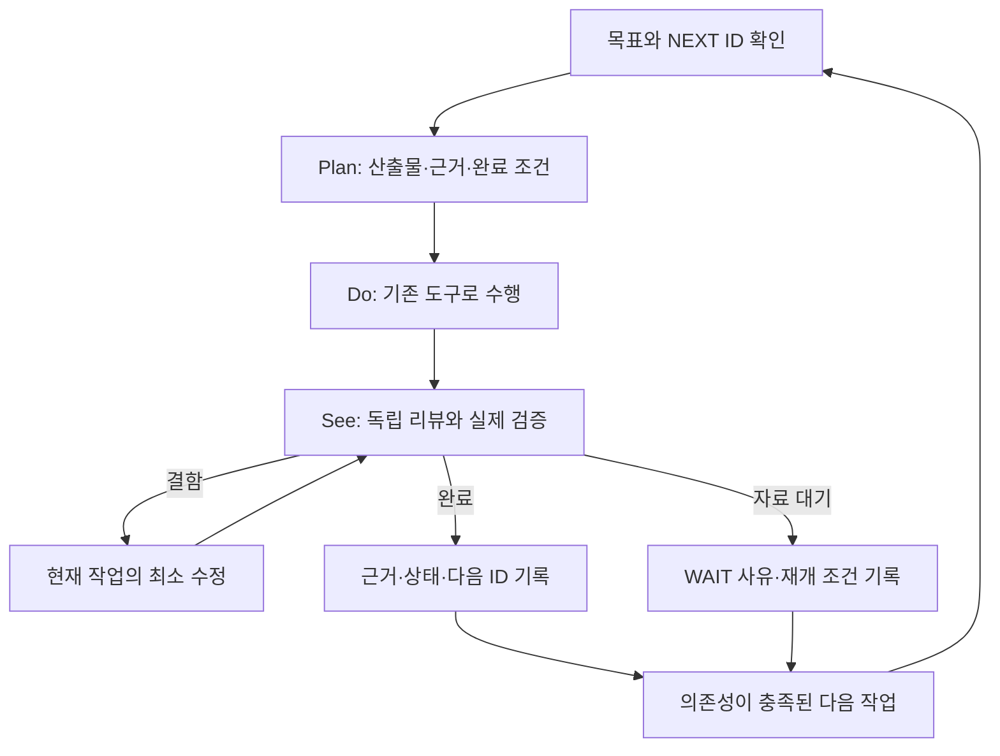

# 엔진 개선 실행 원장 — 목표·진행·리뷰·다음 작업

> **엔진 변경·개선·결함 수정·운영 및 예약·남은 작업을 관리하는 단일 원장.** 새 세션은 이 문서부터 읽고 모든 작업을 ID·우선순위·상태·근거·NEXT에 연결한다. 개별 계획·PR·운영 영수증은 이 원장에 연결하는 상세 근거이며, 별도 문서에 독립된 우선순위 목록을 만들지 않는다. 과거 문서의 미완료 체크박스를 모두 새 작업으로 되살리지 않는다. 이 문서의 날짜 도래나 체크 완료가 주문·배포·새 구독의 승인을 대신하지 않는다.


<a id="r02-live-followthrough-20261029"></a>
### 10/29 R02 정상 배포·도래 결과 판독·다음 개발

**Plan / Do:** 사용자 승인에 따라 PR #293의 고정 `9a193331b044044cccae892f17d619646e9fdb5f`를 기존 local_deploy로 적용했다. RR 자료 추출 절차/도구는 PR #292를 재사용하고, 최근 수신 KIS 참고란을 함께 배포했다. 이후10/28 보고·T04·전환 이후 LLM 기록을 필요한 필드만 읽기 전용으로 대조했다. 수집/시험 발송/유료 시험 호출은 추가하지 않았다.

**See — 배포 DONE:** [운영 완료 영수증](https://github.com/qwq-partners/qwq-ai-trader/pull/293#issuecomment-6473256376). 로컬/PR/main/운영 전체 각각9,647passed·2skipped·2xfailed, 격리0·문법/비밀 검사PASS. 독립 코드/문서/중요 배포 리뷰 승인. 운영 검증779.47초 후00:28:45 기동·PID3761592,00:31:35에169.6초/20인수항목 전부PASS. 브로커/복구ready·미체결0·NRestarts0·시작 오류0, 보호48파일/cron 지문 전부동일. 환경/자격/override·매수 중지·월USD100/log_and_continue·CLI/API 계약 유지. 문서 후속을 위해 재배포하지 않는다.

**See — R02 도래 판독 DONE / 모바일 WAIT:** 10/28 장전·장후 채널과21시 개인 요약은 각각 API accepted다.13:10은 기존 원천시각 조건으로 생략됐다. 장후는532자/24줄·날짜10/28, 개인은924자/23줄이며 세 본문에 `기준일 미확인` 문구는 없다.16:00:02 team_shadow_daily 저장과10/27 22시 llm_migration의10/28 개인 요약 포함을 확인했다.10/28 22:00:02 저장의 report_date는10/29이므로 오늘21시 포함은 별도 WAIT다. 두 migration의 같은 문두가 일치한다는 것만으로 미래 행 포함이나 시각 누출을 판정하지 않는다. 새 참고란은 배포 후 첫13:10 자연 보고에서 확인하며, API 수락과 모바일 수신/가독성은 구분한다.

**See — T04 10/28 DONE:** 아침 파일의 date는10/28, stocks0·cohort 없음이다. 실제16:00:20의 당일 추천0/생략 로그와 대조했다. exact16:00 오프라인 판독은 rc0·no_candidates·incompleteFalse·member/terminal/success0으로, ledger를 열기 전 단락이다. Toss 실호출/가격 소비·조회 절감으로 세지 않는다. 남은10/29·30 16:00–16:05만 유지하며10/30 16:06에 자동 연장 없이 종료한다.

**See — E04 부분 확인 / Claude 자연 인수 WAIT:** 10/28 17:37:36~10/29 00:32:06의 일반 응답 기록은 모델 표기gpt-5-mini·theme_detection45행(성공41/JSON실패4)이다. 예산의 같은 기간 조건 전체 집계도 settled45행이다. JSON 재시도 행이 섞일 수 있으므로45탐지 주기·같은 입력·실제 청구 비용으로 환산하지 않는다. 일반 응답에는 resolved_model/transport/billing 필드가 없다. 팀 원장의 해당 기간행0·역할 감사 파일 부재만으로 모든 호출0을 주장하지 않는다. GPT 경로의 실행/정산 기록과 Claude CLI→API 자연 대체 인수를 구분한다. 이번 판독이 유발한 브로커/LLM/Telegram 호출은0이다.

**예약:** 기존 retention3개는 loaded/active/waiting이며 다음11/1 09:46:10·11/5/6 09:34:10을 새로 확인했다. 실행 전 참조 대조10/31·11/4·11/5 각18시와 T04 종료 후 새 namespace 대상 확정은 WAIT다. 새 자동 AI 판독/배포/정리 예약은 없다. 비공개 근거는 `~/.local/state/qwq-task-audit/20261029/r02-indicative/`에 보존했다(SQLite query_only·원문 비공개·범위별 요약).

<a id="morning-followthrough-20261029"></a>
**10/29 장전 후속 — Plan / Do:** 최신 main `48ec1b51`의 완료 상태를 기준으로, 운영 `9c187307`의 밤사이 기록과07:40 자연 보고를 읽기 전용으로 확인했다. 보고 DB는 SQLite `mode=ro`·`query_only`·동일 읽기 transaction으로 조회했고, 기존 파일의 필요한 메타데이터와 본문 지문만 판독했다. 운영 객체 초기화·브로커/LLM 호출·시험 발송·재시작·예약 변경은0이다. 조회용 보조 스크립트와 원문은 `~/.local/state/qwq-task-audit/20261029/morning-followthrough/`에만 보존한다.

**See — 아침 API 수락 DONE / 모바일 WAIT·당시 원천 검증 한계:** 07:40:20에는 슬롯이 없었으나 정상07:40~07:50 창 안의07:40:35 보조dispatch 기록과07:41:31 조회에서 `market/morning/2026-10-29` accepted·본문1개로 자연 발송을 확인했다(보조 기록시각을 HTTP 송신시각으로 확정하지 않음). 367자/17줄, 표시시각10/29 07:40 KST·미국 기준일10/28이며 계좌/엔진 문맥과 `기준일 미확인` 문구는 없다. 미국 지수3개만 표시되고 국내 지수·한국 섹터는 미표시다. 보조 dispatch1개가 본문과 정확히 일치하며 `brief_match=none`은 이 새 보고 경로의 정상 계약이다. 본문은 국내 시가/섹터 강세 예측과 구분한다. DB에는 당시 원천 snapshot 원문이 없으므로 현재 캐시로 당시 가격/원천시각을 소급 검증하지 않는다. accepted는 HTTP200+ok=true 근거이며 모바일 수신/가독성,13:10 참고란 인수를 대신하지 않는다.

**See — 운영·E04 제한된 판독:** 07:40:20 점검에서 운영PID3771021·active/running·NRestarts0·브로커 연결·미체결0·복구ready, 보호48파일/cron 동일·매수 중지 유지를 확인했다. 01:33:25 이상~07:40:20 미만의 일반 응답40행은 모델 표기gpt-5-mini·테마39행(성공36/실패3)·quick_classify 성공1행이며 예산도동일 구간 settled40행이다. 실제 공급자 모델/transport/billing은 일반 기록에 없어 독립 호출 수·같은 입력·청구액·절감으로 바꾸지 않는다. 당일 팀/역할 감사 파일은 부재여서 Claude 자연 CLI/API 인수는 미관측이다. 저널514레코드의 문자열/바이트 메시지를 해석한 뒤 ERROR/traceback0을 확인했다.07:30:36의 EGW00201 언급2행은 오류/재시도 기록으로 HTTP2건 또는 제한 해소의 증거가 아니다.

**See / NEXT:** PR #295의 main CI(run40729697328) SUCCESS를 확인했다. retention3개의 다음11/1 09:46:10·11/5/6 09:34:10과 기존 참조 점검 기한은 유지된다. 다음은10/29 13:10 새 참고란→16:00 T04 조건부 결과→16:40 장후→21시 개인 요약이다. RR은 새 유효 신호, Claude는 해당 자연 호출, F1/W1은 구별 가능한 입력이 생길 때 각각 재개한다. 실제 절감·신규 거래 순수익은 미측정이며 추가 제품 수정/재배포를 요구하는 새 결함은 이번 판독에서 확정하지 않았다. 이 문서 판독 기록 때문에 재배포하지 않는다.

<a id="e04-news-dedup-20261029"></a>
**E04-NEWS-DEDUP — 구현·리뷰·CI·운영 인수 DONE:** [최소 구현 계획](../superpowers/plans/2026-10-29-news-dedup-freshness.md). 야간45행을 낭비로 단정하지 않고 소스 감사를 이어갔다. 빈 뉴스는 이미 LLM 전에 생략되고10분 상시 탐지는 설정된 동작이다. 대신 빈 유사도 cache가 첫 정상 기사를 등록하지 못하는 결함과, 반환 목록이 finally 정리 전에 만들어져 stale 테마를 포함하는 연결 결함을 재현했다. 실제 sklearn·mock 수집/LLM의 최초3RED/3PASS, 반환 경계 추가 후9RED/3PASS를 확인했다. 실제 운영 발생 원인/절감은 미확정이다.

- **Plan:** 독립 Astra/high 계약 리뷰에 따라 첫 seed와 반환 전 만료 정리를 함께 고친다. 뉴스 선정/후단 입력이 달라질 수 있으므로 행동 불변으로 부르지 않는다. 실패 LLM의 기사 소비·재시도/폴백·저장 순서, 주기/force/모델·기존 신선도/문턱은 보존한다.
- **Do:** 빈 cache도 TF-IDF 유효 처리를 거친 뒤 기존 append/cap 경로를 사용한다. 모든 detect_themes 목록 반환은 private 정리를 먼저 수행하며 finally/취소 전파를 유지한다. 공용 get_active_themes를 추가하지 않아 별도 장전 진단의 미검토 LLM/시세 경로를 활성화하지 않는다.
- **See / 진행:** 구현 Terra/high, coordinator 관련104검사/3.52초·격리0. 빈 vocabulary 검사를 추가했을 때 cold seed의 검증 우회1실패를 확인해 고쳤다. 실제 sklearn·A→중복A→새B·TTL/1시간 경계·취소·실패 LLM 저장 순서·실제 scheduler/fake 전달을 검증했다. 독립 중요 최종 리뷰는 구독 Claude CLI·요청 Opus5.5/high·실제 응답/terminal 모델 claude-opus-5-5로 확인했고 APPROVE/P0/P1/P2 0이다. 도구/MCP0·rc0·147.73초, 실효 effort 미노출이며 reviewer는 테스트를 실행하지 않았다. 표시 비용USD0.5806338은 구독 증분 청구액으로 해석하지 않는다. 별도 Astra/high 배포 매개변수 리뷰도 승인했다(실제 metadata 미노출). 로컬 전체 verify는 **9,675 passed / 2 skipped / 2 xfailed / 8 warnings / 782.07초 / rc0**·격리0·문법/비밀 검사PASS다. 독립 문서 리뷰의 날짜/현재 예약표P2 두 곳을 고치고 최종APPROVE/P0~P2 0을 확인했다. 최종CI/통합·운영 인수는 [PR #294 운영 완료 영수증](https://github.com/qwq-partners/qwq-ai-trader/pull/294#issuecomment-6474809303)로 확정했다. native 결과의 실제 model/effort 미노출은 요청값만 기록한다.
- **운영 DONE:** 운영 고정 `9c187307`·PID3771021, 10/29 01:36:10 KST 인수·164.6초/20항목 전부PASS. 운영 전체9,675passed·2skipped·2xfailed/783.28초, 보호48파일/cron 동일·복구ready·미체결0·NRestarts0·시작 오류0. 매수 중지·월USD100/log_and_continue·GPT/Claude 계약 유지. 병합본과 독립 리뷰 대상의 제품 트리 동일, PR/main CI도9,675검사 PASS다. [PR #294 운영 완료 영수증](https://github.com/qwq-partners/qwq-ai-trader/pull/294#issuecomment-6474809303). 실패 LLM 뒤 기사 재소비 정책과 별도 장전 진단 API 불일치는 기존 별도 계약 항목이며 이번에 활성화하지 않았다. 실제 절감/순수익은 미측정이다. 문서 마감 때문에 재배포하지 않는다.

**NEXT — 기존 조건/기한 순서:** 10/29 13:10 새 참고란·21시 개인 요약의 전일22시 자료 포함/모바일은 자연 발송 뒤 확인한다. 새 유효 신호/RR·구별 가능한 F1/W1/Claude 호출은 해당 기록이 생기면 판독하며 과거0행 조회를 반복하지 않는다. T04는10/29·30 16:00–16:05 결과와10/30 16:06 종료 확인, O02는10/31·11/4·11/5 각18시 참조 점검 뒤 기존 정리 결과를 확인한다. 새 수집기간·자동 AI/배포·삭제 예약은 추가하지 않았다. 아래 유일한 우선순위 표의 조건을 따른다.

<a id="r02-indicative-20261028"></a>
### R02-INDICATIVE — 장중 참고란 구현·자료 판독 준비 통합

**Plan:** 사용자 묶음 실행·운영배포 승인에 따라 [기존 장중 설계](../superpowers/specs/2026-10-27-telegram-audience-design.md#intraday-source-followthrough-20261028)를 [구현 계획](../superpowers/plans/2026-10-28-midday-provider-reference.md)으로 연결한다. 실제 자료 추출·첫 판독은 PR #292/main `138f41b5`에서 완료했으므로 같은 조회/도구를 다시 만들지 않는다. 이번 배포에는 RR 오프라인 도구와 장중 보고 보완을 함께 포함한다.

**Do:** 검증된 현재 지수가 없을 때만 기존 KIS 응답의 가격·제공기관 대비율·수신시각을 별도 참고란으로 표시한다. 원천시각이 명시 None이고 같은 KST 거래 시간대의 최근 300초 응답에 한정한다. 원천시각이 잘못되었거나 오래된 행을 참고란으로 되살리지 않는다. 동일 중복은 한 번, 충돌은 제외하며 원천시각 미제공·전일 기준 거래일 미확인을 본문에 표시한다. 기존 현재 지수/장전·장후 계약·하루 3회 채널/1회 개인 슬롯을 유지한다. 추가 조회·LLM·시험 발송·거래정책 변경은 없다.

**See / 진행:** 기준 보고30검사, 구현 뒤 관련78검사/4.93초·격리0 통과. 최초 참고란 부재1실패와 동일 중복 누락1실패를 각각 재현·수정했다. 구현 요청Terra/high, 독립 코드 리뷰 요청Sol/high APPROVE·P0/P1/P2 0, reviewer 관련53검사/독립31단언·장전/장후16조합 동일성을 확인했다. 중요 배포 계약 리뷰 요청Astra/high도 APPROVE·P0/P1/P2 0이다. 실제 모델/실효effort metadata는 모두 미노출이며 교차 공급자 리뷰로 부르지 않는다. 로컬 전체 verify는 **9,647 passed / 2 skipped / 2 xfailed / 8 warnings / 783.54초 / rc0**·격리0·문법/비밀 검사 PASS다. 독립 최종 문서 리뷰도 APPROVE/P0~P2 0, 신규 링크/앵커11개 정상이다. 최종 CI·통합/운영 결과는 이 변경 PR의 완료 영수증을 따른다. 작성 시 운영 `fcb3a71e`/PID3743214·active/NRestarts0이며 실제 새 버전 배포는 아직이다. 고정SHA·기존 local_deploy 전체 검증/재시작/자동 롤백과150초 이상 인수, 보호 파일/예약 대조를 마친 뒤 PR 완료 영수증으로 확정한다.

**실자료 절차:** [필요 항목만 읽는 RR 비교 안내](../reviews/cash-and-sepa-rr-2026-10-28.md#rr-context-cli)와 아래 22:18~22:51의0행 영수증을 재사용한다. 새 자연 신호가 기록되면 제한된 읽기 전용 추출→지문/기간/완전성 확인→actual 판독→결측·수량 출처별 비교 순서로 재개한다. 계좌 전체/불필요 metadata를 복사하지 않으며0행을 수익0으로 바꾸지 않는다.

**NEXT:** 정상 배포 인수 뒤 이미 도래한10/28 T04 16시·R02 16:40/21시·22시 저장 결과와 전환 이후 실제 GPT/Claude 호출을 필요한 항목만 읽어 대조한다. 이어서 아래 우선순위 표의 READY만 수행한다. 다음13:10 자연 보고/API 수락과 실제 모바일 가독성은 별도 인수이며 이번 합성 검사로 완료하지 않는다. T04 10/30 16:06 만료·O02 기존 정리 기한·매수 중지·월USD100을 유지한다.

<a id="e02-rr-compare-20261028"></a>
### E02-RR-COMPARE — 오프라인 비교·실자료 첫 판독

**현재:** PR #291/main `fcb3a71e`는10/28 22:18:08 운영 기동,22:21:13에183.7초/20항목 사후 인수를 마쳤다. [최종 완료 영수증](https://github.com/qwq-partners/qwq-ai-trader/pull/291#issuecomment-6470124663)이 정본이며 아래 롤백/준비 문장은 당시 이력이다. 보호48파일·매수 중지·월USD100·기존 예약은 보존했다. 새 비교 작업은 별도의 오프라인 변경으로 운영 재기동 대상이 아니다.

- **Plan:** [구현·실자료 준비 계획](../superpowers/plans/2026-10-28-rr-context-comparison.md). 기존 비교기를 저장된 선정 근거에 연결한다. 최초 범위는 계획 수량 출처별 선정/현재 가격 비교이며 실제 intent/체결 조인은 제외한다.
- **Do:** `compare_rr_rows`와 `scripts/compare_rr_context.py`는 명시 JSON 배열만 읽는다. 원래 float gate·선정 당시 비용률·현재 신호 가격·수량3출처를 분리한다. 같은 신호의 여러 행과 서로 다른 신호 수, 수량별 비교쌍 수를 따로 세며 불일치·0·결측을 보존한다. 입력지문과 actual/synthetic 선언은 자료 출처를 추적하기 위한 것이며 진위 인증이 아니다.
- **실자료:** coordinator가 기존 DB의 `signal_events`를 읽기 전용 transaction(서버 read-only 확인,5초 시한,10,000행 상한)으로1회 조회했다. 범위는 **10/28 22:18:08 이상~22:51:28.477296 미만 KST**, 결과0행·완전 추출. 계좌/다른 metadata는 제외하고 id/time/symbol/strategy/side/type/gate·signal_id/rr_context만 대상으로 했다. CLI actual 판독은0행/고유신호0/비교쌍0·`no_rows`다. 이는 해당 DB/시간창의 기록 결과이며 장중 전체 후보0이나 수익0의 증거가 아니다. 비공개0600 근거는 `~/.local/state/qwq-task-audit/20261028/rr-compare/`에 보존한다.
- **See:** baseline130검사, 신규17/관련147검사·격리0·문법/diff 확인. 구현 요청Terra/high·실제metadata 미노출. 독립 Sol/high 리뷰에서 현재 가격 검증/계산 불일치P2 1건을 발견해 수정했으며 재현14검사·독립16검사 통과/격리0으로 해결했다. 원래 float gate와 재구성 RR·수량 충돌을 표에서도 구분했다. 독립 최종 코드/통합 문서 리뷰 APPROVE·P0/P1/P2 0(요청Sol/high·실제metadata 미노출). 로컬 전체 **9,618 passed / 2 skipped / 2 xfailed / 8 warnings / 793.36초 / rc0**·격리0·문법/비밀 검사 PASS. PR #292의 최초CI(run40702174612/job122864601823)도9,618passed/2skipped/2xfailed/40warnings·476.87초·격리0로 통과했다. 최종 문서HEAD의 CI·병합은 [PR #292 완료 영수증](https://github.com/qwq-partners/qwq-ai-trader/pull/292)이 정본이다. 이 문서 때문에 검증/운영 배포를 새로 반복하지 않는다.
- **운영/예약:** 비교기는 DB·환경·네트워크를 읽거나 주문/기록을 바꾸지 않는다. 별도 자료 추출만 기존 연결을 읽기 전용으로 사용했다. 운영`fcb3a71e`·기존 cron3개·retention3개·T04 10/30 16:06 만료 유지. 새 유료 호출·자동 AI 후속·수집기간·삭제/배포/재시작0.
- **R02 설계:** [장중 자료/참고값 분리](../superpowers/specs/2026-10-27-telegram-audience-design.md#intraday-source-followthrough-20261028)를 검토했다. 기존 응답의 같은 가격/등락률을 수신시각과 함께 참고란으로 표시하는 안을 우선한다. 추가 호출/새 저장소0, strict 현재지수 계약은 유지하며 원천시각/전일 기준 미확인 한계가 남는다. 공식 KIS 시간별 경로는 같은 행 시간/가격/등락률은 있지만 날짜 결합 근거가 별도라는 점을 대조했다. 이번은 설계이며 발송 본문/정책은 미변경이다.
- **NEXT:** 실제 신호가 기록 경로에 도달하면 같은 도구로 첫 비어 있지 않은 결과를 판독한다. 선정/진입 결함1개를 근거로 개선하며 새 자료가 없다는 이유로 장기 수집·가상자금을 만들지 않는다. 다음 개발은 **R02-INDICATIVE: 기존 응답 참고란 구현**이며 아래 설계/검증 계약을 따른다. 원천시각 확보와 실제 자연 수신은 별개다.


<a id="e02-rr-deploy-recovery-20261028"></a>
### E02-RR-DEPLOY-RECOVERY — 배포 검증의 종료 상태 관측 경쟁 보완

**복구 준비 당시 상태:** PR #290/main`d78c10d6`의 소스·독립 리뷰·로컬/PR/main CI는 완료했지만, 운영 verify에서 기존 Claude 합성 종료 검사1건이 실패해 자동 롤백했다. 운영은`0b82af5d`/PID3734201·21:28:29 KST 재기동·active/NRestarts0·복구ready·미체결0이다. **RR 연결의 운영 적용 완료가 아니다.** [실패/복구 영수증](https://github.com/qwq-partners/qwq-ai-trader/pull/290#issuecomment-6469023692)을 보존한다. 다음 비교 구현보다 이 배포 인수를 먼저 마친다.

- **Plan:** systematic-debugging으로 실제 살아남은 자손과 커널 종료 상태 전환 지연을 구분한다. 제품 transport·시한·주문 정책은 그대로 두고, 근거가 확인된 테스트 동기화만 보완한다. 실패 영수증/원장은 지우지 않으며 새 고정SHA/별도 배포 시도로 진행한다.
- **Do / 원인:** 독립 Astra/high 요청(실제metadata 미노출)이 소유한 합성 프로세스만으로 실제 complete→timeout→cleanup120회를 계측했다. 기존 즉시 assertion 위치에서R3회가 재현됐고 같은PID/starttime/group이 추가 kill 없이 다음 관측1.36/2.44/1.82ms 안에Z로 전환됐다. 정상120회 모두종료, 부모만 종료시킨 음성대조3회는150ms 뒤에도 살아 있어 모두실패했다. 단독cleanup240회에서는 즉시R이 재현되지 않아 실제 경로로 좁혔다. 실제 Claude/API/운영 파일 접근0. 이는 모든 자손 프로그램의 종료 보증으로 확대하지 않는다.
- **Do / 최소 수정:** `tests/test_claude_transport.py`에서 자손만 monotonic 최대0.5초/5ms 간격으로 부재 또는Z를 확인한다. 기존 timeout 응답·직접 부모 회수 단언은 유지한다. 실제 살아 있는 소유 합성 프로세스가0.03초 상한 뒤 반드시 실패하는 음성대조를 추가하고 finally에서 그 그룹만 회수한다. 고정 sleep 뒤 통과·무조건 retry·검사 skip은 없다. [kill(2)](https://man7.org/linux/man-pages/man2/kill.2.html)와 [wait(2)](https://man7.org/linux/man-pages/man2/waitpid.2.html)의 신호 전달/직접 자식 회수 경계와 계측 결과를 근거로 한다.
- **See:** 관련 Claude133검사/4.58초/rc0·격리0 통과. 독립 Astra/high 요청(실제metadata 미노출) 소스 리뷰 APPROVE/P0/P1/P2 0, 실제 helper의 별도5계약 검사도 일치했다. 로컬 전체 verify **9,601 passed / 2 skipped / 2 xfailed / 8 warnings / 780.75초 / rc0**, 격리0·문법/비밀 검사 PASS. 최종 CI/병합·새 배포 인수는 [PR #291](https://github.com/qwq-partners/qwq-ai-trader/pull/291)의 완료 영수증으로 확정한다. 최초 focused 명령의 잘못된 파일명은 수집오류(rc4/검사0)였고 올바른4파일로 다시 실행했다.
- **롤백 사후 인수:** 276초·broker/복구/환경/자격/예산/cron/매수 중지 정상. 보호48개 중47개 지문 동일, KIS 캐시1개는 재시작 전 기존PID의21:21 정상 TokenManager 갱신 완료 로그와24시간 만료로 대사했다. 인증키/환경 변경이 아니다. 원래 hash 불일치 영수증을 보존하고 별도 `rollback-reconciled.json`에 자연 갱신을 명시했다. 캐시를 옛 토큰으로 되돌리거나 지문을 조용히 덮지 않는다.
- **NEXT:** 복구 패치 검증·고정SHA 배포 인수 → E02-RR-COMPARE의 기존 자료 판독. 신규 거래 순수익은 여전히 미검증이며 가상자금·매수 재개·새 장기 수집은 없다.

<a id="deploy-and-order-rr-20261028"></a>
**2026-10-28 완료 이력 — 통합 배포 → E02-ORDER-RR:** 사용자 “완료되면 배포하고 다음 작업” 승인으로 PR #288/main `0b82af5d`를 고정 적용했다. PR #288의 로컬/CI9,470검사·독립 Claude Opus5.5 리뷰·[병합 영수증](https://github.com/qwq-partners/qwq-ai-trader/pull/288#issuecomment-6464056761)은 DONE이다. 아래 이전 `0bfd6191` 배포 계획은 이번 통합 SHA로 대체하며 E04-D1/D2·E02-RR/COST/PNL-COST가 함께 포함된다.

- **Plan:** 기존 local_deploy 전체 verify/재시작/롤백, 검증된 CLI 절대경로1개만 환경에 추가. 원본 환경·보호 파일·매수 중지·예약·예산 보존, 미체결/복구·충돌 확인. 실패 시 복구 상태를 확인하며 Gemini 전환 성공으로 세지 않는다.
- **Do / See:** 사전검사에서 active·pending0·recovery ready·CLI2.1.310·보호46파일을 확인했다. 독립 Astra/high 누적 배포 범위 감사 P0~P2없음(실제metadata 미노출). 운영17:37:36 재기동·17:40:29 사후 인수20조건(172.3초)을 완료했다. 운영 전체9,470passed/2skipped/2xfailed·790.97초·격리0·문법/비밀PASS, 새PID3705216·NRestarts0·복구ready·미체결0·계좌 초기화/대시보드 소유 확인·기동오류0. 보호46파일/cron 지문과 기존KIS 자격·override·매수 중지·월USD100/log_and_continue는 보존, 환경의CLI 경로1개만 적용했다. [공개 배포 영수증](https://github.com/qwq-partners/qwq-ai-trader/pull/288#issuecomment-6464631035)과 비공개 `~/.local/state/qwq-deploy/e02-cost-20261028/acceptance-public.json`에 기록했다. 실제 자연 Claude 판단/정산은 별도 WAIT이며 기동 확인만으로 모델 품질·순수익을 입증하지 않는다. root 전용 drop-in은 내용 접근 권한이 없어 새 내용 지문을 만들지 않으며 재작성/권한 변경도 하지 않는다.
- **E02-ORDER-RR Plan / Do:** [기존 승인 설계](../reviews/cash-and-sepa-rr-2026-10-28.md#e02-order-rr-design)에 따라 오프라인 순수 함수와 합성 검사를 추가했다. 기준`0b82af5d`, 작성 Terra/high(실제metadata 미노출), coordinator가 통합한다. 기존1주 근사와 계획 수량/목표·손절별 비용을 구분하며 엔진/주문/스케줄러에는 연결하지 않는다.
- **See / 리뷰 처분:** 초기 독립 실제 Claude Opus5.5/high 요청 리뷰 P1 3건/P2 3건에 한 수정 묶음을 적용했다. scoped 재리뷰는 제품 P1/P2없음이나 검사 구분2건으로 `request_changes`였다. coordinator가 소스와 대조해 두 검사를 보강하고 거대 정수의 JSON 직렬화 결함도 함께 해결하도록 범위를 확정했다. 최종 델타는 독립 Sol/high 리뷰 APPROVE·P0/P1/P2 0(실제metadata 미노출)이며 reviewer 직접63검사/격리0, coordinator 관련140검사/격리0를 확인했다. 최종 로컬/PR CI9,533passed/2skipped/2xfailed·격리0·PR #289/main62998f67 병합과 main CI SUCCESS는 [완료 영수증](https://github.com/qwq-partners/qwq-ai-trader/pull/289#issuecomment-6467233257)을 따른다. 중간 전체9,527passed/2skipped/2xfailed·781.78초·격리0는 수정 전 기준이며 최종 코드 검증을 대체하지 않는다.
- **Ruling — 계산 정밀도:** 가격/문턱/비용률은28자리·exponent/adjusted 절댓값28 이하, 수량0~10^12와 고정Decimal28/half-even 문맥을 쓴다. 호출자 정밀도에 따른 값 변화를 막지만 큰 곱셈은28자리에서 반올림되거나 기존 비용 quantize가 실패해 unavailable이 될 수 있다. 거래 규모 검증이나 실제 runtime float 동일성은 주장하지 않는다.
- **Ruling — 실패 의미:** 비용/산술 실패는 일부 gross만 성공으로 남기지 않는 all-null 진단이며 넓은 예외 경계와 `fee_calculation_unavailable` 이유를 유지한다. 세부 원인 분류가 없으므로 후속 분석은 unavailable을0비용으로 바꾸지 않는다.
- **NEXT E02-RR-CONTEXT:** 비교 입력의 출처 연결. 아래 [다음 계약](#e02-rr-context-20261028)을 먼저 확정하고 기존 metadata/원장 재사용 여부를 검증한다. 현재 자료가 없는 gate나 수량을 만들어 넣지 않으며 새 수집 기간·가상계좌·매수 재개는 없다.


<a id="e02-rr-context-20261028"></a>
### E02-RR-CONTEXT — 선정 근거와 실행 신호 기록 연결

**현재:** 기존 입력 출처 연결의 구현·독립 재리뷰·로컬 전체 검증을 완료했다. 최종 CI/병합/운영 인수는 [PR #290](https://github.com/qwq-partners/qwq-ai-trader/pull/290)의 완료 영수증으로 확정한다. 기준 main`62998f67`의 PR #289는 로컬/PR CI9,533검사와 병합 후 main CI까지 SUCCESS이며 [완료 영수증](https://github.com/qwq-partners/qwq-ai-trader/pull/289#issuecomment-6467233257)을 확인했다. 운영0b82af5d와 새 소스 통합을 구분한다.

**Goal / Spec:** 이전 E02-ORDER-RR은 오프라인 계산을 갖췄다. 이번에는 실제 SEPA 배치의 원래 gate와 P/T/S가 대기 JSON·실행 신호·기존 signal_events 기록까지 도달하게 만든다. 매매 조건을 바꾸지 않고 가격 변경 전후 근거를 구분하는 것이 완료 조건이다. [기존 RR 계약](../reviews/cash-and-sepa-rr-2026-10-28.md#e02-order-rr-design)을 따른다.

**Architecture / 선택:** 별도 원장이나 소비자 없는 builder 대신 현재 Signal.metadata → PendingSignal.inputs_ref → entry_plan → signal_events.metadata를 사용한다. 기존 JSONB라 DB migration/새 상태파일이 없다. 현재 설정으로 과거 gate를 복원하는 대안은 출처가 없어 제외한다. 원래 gate를 주문 직전 gate로 통합하는 대안은 거래정책 변경이라 제외한다. coordinator의 구현 선택이며 새로운 매매정책 승인이 아니다.

**선행 감사:** 요청 Astra/high(실제metadata 미노출)와 coordinator가 실제 `generate_batch_signals` 호출을 확인했다. 실행 P는 현재가, S는 레짐/장중 상태에 따라 조정된다. `_log_sig`의 passed와 entry_risk 수량은 pending lock 재검사/제출보다 앞선 자료다. snapshot metadata를 기록해도 주문 제출/체결 증거로 승격하지 않는다. 현금 부족으로 수량이 없으면 결측이다.

**Global constraints:** 가격/문턱/비용 계산·boolean gate·선정 순서·사이징·주문·pending/쿨다운·ExitManager 인자를 변경하지 않는다. 새 API/LLM 호출·토큰/환경/예약/DB schema·과거 행 backfill 없음. live RR 계산기 연결 없음. 기록 실패는 진단 unavailable로 축소하며 기존 신호/주문 흐름을 유지한다. 기존 fail-closed 비용 처리는 그대로다. 증명 없는 문턱2.0/default 적용·수량 생성·실제 exit 설정 추정 금지.

**Files / 역할:** `src/utils/rr_context.py`(새 bounded 순수 snapshot helper), `src/strategies/base.py`(실제 비용 계산기에서 선택적 진단 복사), `src/strategies/kr/sepa_trend.py`(통과 근거 생성), `src/core/batch_analyzer.py`(기존 inputs_ref 전달), `src/core/engine.py`(기존 _log_sig 소비), `tests/test_rr_context.py`(새 연결/동작 보존 검사). coordinator가 원장/CHANGELOG/CLAUDE/docs 인덱스를 갱신한다. helper는 실제 producer/consumer에서 사용하며 독립 새 수집기를 만들지 않는다.

**Interfaces / 명시 계약:**
1. `capture_fee_snapshot(calculator) -> dict`: 이미 사용한 `_fc`의 실제 FeeCalculator/FeeConfig rates 3개만 문자열로 복사한다. 별도 get_fee_calculator 호출 없음. 정상0 유지, config 없음/유효하지 않은 값은 unavailable. 기존 비용 계산 try/except와 **분리한 안전 경계**에서 diagnostics['fee_snapshot']에 추가한다. capture 실패가 원래 True/False를 바꾸면 안 된다.
2. `capture_sepa_rr_selection(signal, diagnostics) -> dict`: 통과한 batch SEPA Signal에 metadata['rr_selection']을 붙인다. version1, status/reason, symbol/strategy, source_ref=`src/strategies/kr/sepa_trend.py:generate_batch_signals`, 원래 P/T/S 문자열, signal.timestamp(원래 시간대 의미 유지), gate basis=`entry_roundtrip_per_share`/threshold=`2.0`/passed=true, 실제 float diagnostics5필드와 fee_snapshot을 독립 복사한다. 현재판정 재계산·새 git subprocess·현재 설정 재조회 없음. diagnostics가 미확보면 unavailable이며 신호는 유지한다.
3. `copy_rr_selection(value, *, symbol, strategy) -> dict`: 알려진 v1 schema·source/identity·bounded scalar만 별개 복사한다. None은 not_captured, 잘못된 version/source/identity/비유한·순환·과대값은 unavailable 또는 conflict. raw arbitrary 객체/default=str/deepcopy로 직렬화하지 않는다. 문자열≤256자·숫자 문자열≤128자, quantity0..10^12; 고정 키만 처리하여 payload를 작게 유지한다.
4. `_to_pending_signal`은 inputs_ref['rr_selection']에 안전 복사를 넣는다. old JSON/VCP/다른 전략에서 근거가 없으면 unknown/not_captured이며 SEPA를 추정하지 않는다. 기존 execute_pending_signals의 entry_plan 경로를 이용해 top-level 중복 추가는 하지 않는다.
5. `build_rr_log_context(event, extra_metadata=None) -> dict`: `_log_sig`가 await/task 생성 전에 새 rr_context를 고정한다. direct metadata.rr_selection과 entry_plan.inputs_ref.rr_selection이 모두 있고 다르면 conflict; 임의 우선순위 없음. 원래 selection과 현재 event P/T/S·event.id/source/timestamp·plan_id/version·quote_as_of를 별개 구조로 보존한다. 기왕 존재하는 requested_quantity(extra metadata), entry_risk.planned_quantity/planned_price, size_trace.quantity는 **서로 다른 근거**로만 보존하고 제출 증거/통합수량으로 합치지 않는다. no evidence=null, 실제0=0. event/metadata의 후속 변경이 저장값을 바꾸지 않아야 한다. 추가 caller metadata가 rr_context를 덮어쓰지 못하게 helper 결과를 마지막에 넣는다. helper 자체가 예외를 내도 호출부가 unavailable marker로 축소한다.

**범위 한계:** 최초 SEPA gate만 캡처한다. 프리장 추가 gross 검사·장중 직접스크리너·VCP/다른 전략의 gate는 이번에 수집하지 않으며 전체 gate 이력을 설명한다고 하지 않는다. batch 기본 candidate_id는 실제 후보 원문 ID로 승격하지 않는다. signal target/stop과 전략 exit_params/계획 net SL/실제 등록 SL/현재 effective stop은 다르다. 이번에는 청산 설정 스냅샷이나 execution intent join을 구현하지 않는다.

**Review focus / See:**
- [x] RED: source SEPA → 실제 _to_pending_signal → JSON 저장/재로드 → execute_pending_signals → 실제 _log_sig fake sink에서 원래 gate/비용/가격이 도달하지 않는 재현.
- [x] 동작 보존: 기록 유무 대조(기존 동작 근사) 및 캡처 예외 대조로 후보/순서/score/strength/P/T/S, emit 수, risk/non-risk q>0·q0·early cash/G3 차단·pending race·기존 entry_risk/size_trace/LLM metadata 동일. 기존 lifecycle/T11/attribution 회귀 재사용.
- [x] 변이/오류: 원본 Signal/fee config/event를 기록 후 변경해도 snapshot 고정. 조정된 현재 P/S가 원래 snapshot을 덮지 않음. legacy missing, source/identity/version 오류, direct/plan conflict, NaN/Inf/bool/큰값/순환, feeconfig/helper 실패에도 기존 gate/주문 흐름 동일.
- [x] 실제 수량0와 결측·sizing quantity·제출 의도/실체결을 구분. unknown gate를2.0으로 복원하지 않음. 추가 gate 미수집 한계 명시.
- [x] 관련 검사·로컬 전체 verify·비밀정보 검사·독립 중요 리뷰. **9,600 passed / 2 skipped / 2 xfailed / 8 warnings / 780.02초 / rc0**, 운영 상태·외부 네트워크 접근0. 문법/비밀 검사 PASS. 고정 PR CI/병합과 운영 고정SHA 인수는 PR 완료 영수증으로 별도 확정하며 소스 완료와 혼동하지 않는다.

**실행:** 한 Astra/high 구현자와 독립 실제 Claude Opus5.5/high 리뷰, coordinator 문서/통합. 구현자는 위6파일만 별도 worktree에서 수정한다. 신규 로컬 기본 검사에 운영 자격/API 사용0. 기준 관련87검사 통과/격리0, full9533의 직전 main CI SUCCESS를 baseline으로 재사용한다.

**See 중간 근거:** 실제 batch→대기 JSON→실행 신호→기록 RED를 확인했고, 관련296검사·추가 attribution/관측/LLM270검사(각 격리0)를 coordinator가 재실행했다. 첫 독립 구독 Claude CLI Opus5.5/high 소스 리뷰는 P0/P1 없음, P2 검증 공백3건으로 보류했다. 기존 소비자/미계산 수량 감사와 실제 on_signal까지의 연결 검사를 보완하며, 이 중간 통과를 최종 인수로 세지 않는다. 요청 모델과 실제 응답 모델 일치·도구/MCP0·실효 effort 미노출. 실제 제출/체결·신규 거래 수익은 미검증이다.

**병행 자연 인수 — 21:01 KST:** 운영0b82af5d/PID3705216·active/running·NRestarts0·broker connected·미체결0·recovery ready를 읽기 확인했다. 당일 보고 슬롯은 장전367자/장후532자/개인21시924자 API accepted, 장중은 `skipped_missing_current_market_basis`다. 실제 모바일 수신/가독성은 별도 확인이며 재발송하지 않았다. 역할 감사 파일은 여전히 미발견으로 자연 Claude 역할 호출 인수는 WAIT다. 파일 부재를 모든 LLM 호출 부재로 해석하지 않는다. 예약·설정·운영 프로세스 변경0.

**독립 리뷰 최종 처분:** 재리뷰는 실제 응답모델 `claude-opus-5-5`/high 요청·실효 effort 미노출·도구/MCP0·rc0·112.25초로 **APPROVE, P0/P1/P2 0**이다. P2-1/2는 실제 소비자17경로/수량 호출3곳을 전수 대조해 확인된 결함이 아님을 확인했고, P2-3은 실제 on_signal 연쇄4조합과 배선 제거 RED4실패로 보완했다. 동일 결측 marker·공백 숫자·비용 계산기 출처를 보완했다. fee snapshot은 실제 FeeCalculator/FeeConfig의 비율만이며 반올림 구현 전체가 아니다. source-only reviewer는 테스트를 실행하지 않았다.

재리뷰 비차단 P3는 현재/가정 범위를 구분한다. 문턱 spy의 미래 기본값 변경 위험은 현재 호출부가 `min_rr=2.0`을 명시하므로 현 결함이 아니다. 비정규 숫자 문자열·인스턴스 monkeypatch는 정상 producer 근거가 없고, 추가 로그 개수 단언은 검사 강도 제안이다. 임의 입력 정규화나 새 정책을 이 변경에 더하지 않으며 실제 재현 시 후속 이슈로 다룬다. 요청/실제 모델·소스 지문·비공개 리뷰 영수증은 `~/.local/state/qwq-task-audit/20261028/rr-context-rereview/`에 보존한다. 구독 표시 비용은 API 실청구액으로 해석하지 않는다. 최종 전체/CI는 아래 완료 영수증으로 확정한다.

**사전 충돌 대조:**

| producer → consumer | 계약 대조 | 결정 |
|---|---|---|
| Base diagnostics → SEPA | fee snapshot 오류가 기존 비용 오류(False)로 번질 수 있음 | 실제 비용 try 밖에서 별도 capture 안전 경계; boolean 불변 검사 |
| SEPA → PendingSignal | float 가격 변환과 얕은 metadata 복사가 원래 근거를 바꿀 수 있음 | 원래 Decimal 문자열을 고정한 v1만 inputs_ref 별개 복사 |
| PendingSignal/direct → _log_sig | 두 출처 충돌·후속 가격 변경·task 시작 전 예외 | 불일치 conflict, 현재 P/T/S 분리, task 생성 전 bounded 복사/오류 marker |
| 기록 → 수량 해석 | passed/entry_risk가 실제 제출로 오인될 수 있음 | 각 source별 기존 수량만 저장; intent/체결 해석과 분리 |

**Ruling:** 기록 불능 때문에 매매 판정을 바꾸지 않는다. 실패한 새 문맥만 unavailable로 축소한다. 이 선택의 비용은 해당 판단의 분석 근거 결측이며, 결측을0비용/통과/실제 거래로 채우지 않는다.
**Ruling:** 최초 SEPA gate만 이번 범위로 고정하고 프리장 추가 gate·실제 청산 policy/intent join은 다음 단계로 둔다. 이 선택으로 전체 진입·청산 경로의 설명은 아직 완성되지 않지만 기존 출처를 추정으로 메우지 않는다.


<a id="e02-rr-compare-next"></a>
**NEXT — E02-RR-COMPARE (계약 검토 DONE / 구현 READY):** 기존 `compare_order_rr`를 저장된 `signal_events.metadata.rr_context`에 연결하는 오프라인 판독으로 이어간다. 목적은 선정 당시 매력이 실행 참조가격/손절 조정 뒤 어떻게 달라지는지 한 표로 확인하는 것이다. 소스 분석 Sol/high(실제metadata 미노출)에서 기존 최근 신호/SSE에는 metadata가 없고, 실행 intent에는 수량/attribution만 있으며 가격·비용률은 없음을 확인했다. 기존 exporter가 있다고 가정하지 않는다. 합성 fixture 검증과 필요한 필드만의 로컬 자료 추출/실제 판독을 분리하며, 실제 추출은 아직 수행하지 않았다.

- **Plan:** 명시한 오프라인 저장행만 읽는 adapter/작은 CLI를 설계한다. 원래 float gate/진단과 현재 signal P/T/S의 Decimal 재구성을 나란히 표시한다. 비용률은 선정 당시 자료로 고정한 분석이며 현재 비용 설정/실제 실행 RR로 표시하지 않는다. 새 API/LLM 호출·DB 연결·수집기·가상자금·실거래 gate 변경은 없다.
- **Do:** 첫 범위는 기존 계획 수량 근거별 비교와 결측표다. requested/entry_risk/size_trace를 각각 표시하고 서로 다르면 고르지 않는다. 결측을1주나 현금 기반 수량으로 채우지 않는다. 실제 intent 연결이 필요하면 별도 검증된 export의 정확한 signal_id와 종목/전략만 대조하고, plan_id 단독/복수 후보/유사 시각으로 붙이지 않는다. 해당 확장은 최초 판독 결과가 필요성을 보여줄 때 수행한다.
- **See:** 실제 저장 schema의 합성 fixture→기존 비교기 결과·가격 변경·0/결측·충돌·지원 범위 제외·입력 지문/분모 검증, 관련/전체 검사·독립 리뷰. 실제 자료가 없으면 비교 불가 건수와 이유를 낸다. 선정 float와 재구성 Decimal 차이를 순수 가격 효과로 단정하거나 passed를 제출/체결로 승격하지 않는다.
- **복귀점:** 첫 실제 판독에서 드러난 한 가지 선정/진입 결함을 근거로 개선한다. 비교 가능 자료 부족을 새 장기 수집이나 반복 기록 기능 개발로 자동 전환하지 않는다. 경제성은 실체결·실비용 확보 전까지 미검증이다.


**Goal:** 좋은 종목을 고르고 실제로 진입할 수 있는 시점을 판단해, 거래·데이터·LLM 비용 후 순수익을 개선한다. R02 최소 보완은 운영 적용했고10/28 장전 발송·새 KIS 실시간 수신까지 확인했다. E04-D1은 PR #282 병합 후 위 통합 배포에 포함됐다. **E04-D2는 PR #284로 소스 통합했고, 위 통합SHA `0b82af5d`로 운영 적용·기동 인수를 완료**했다. 자연 Claude 호출 인수는 별도 대기다. Google 결제 복구를 다음 조건으로 요구하지 않는다. 이후 E02의 선정·비용 기준 검증으로 연결한다. 기술 결함 해결과 순수익 개선을 구분하며 R02/T04 자연 슬롯과 O02 보존 기한을 병행한다.

**Architecture:** 기존 도구·원장·예약을 재사용한다. 한 작업마다 Plan → Do → See를 마친 뒤 다음 작업 ID를 명시한다. 기술 개발, 운영 적용, 실측 효과, 경제성 검증을 별도 열로 관리한다.

**Tech Stack:** 기존 Python 엔진·pytest·JSONL 판독기·cron/systemd, 이 Markdown 실행 원장. 별도 작업관리 앱이나 유료 AI 자동 실행기는 만들지 않는다.

**Spec:** 사용자 2026-10-24 요청, [기존 수익성 일정](../superpowers/plans/2026-10-14-profitability-priority-schedule.md), [Toss/KIS 설계](../superpowers/specs/2026-10-23-kis-toss-read-offload-design.md), [현재 실측 계획](../superpowers/plans/2026-10-24-live-readout.md).

## 1. 현재 위치와 이번 작업의 끝

**2026-10-28 E02-PNL-COST 구현 이력:** [비용 오류 전 회계 상태 보존](#e02-pnl-cost-20261028)의 재현·최소 수정·독립 중요 소스 리뷰와 전체9,470검사/격리0를 마쳤다. 최종 CI·병합은 이 변경의 PR 영수증을 따른다. PR #287은 main`7a685909`로 통합했고 [최종 영수증](https://github.com/qwq-partners/qwq-ai-trader/pull/287#issuecomment-6463287552)을 확인했다. 구현 당시 운영`c4bc4f0e`를 유지했고 이후 적용은 위 통합 배포 영수증을 따른다.

**2026-10-28 E02-COST 당시 Plan:** PR #286/main `10ed6ac0`의 진단 보완 다음으로 비용 계약을 검토한다. 정상 비용 모형·목표·손절·문턱은 유지하고, 이번 단일 정책 변경은 **비용 계산 예외 또는 유효하지 않은 비용을 0으로 가정해 통과시키지 않고 보류**하는 것이다. 공통 KR `BaseStrategy`의 호출자는 SEPA/RSI2/Gap&Go이며 별도 US 구현·체결 원장·실현손익 계산기는 바꾸지 않는다. 매도가/수량별 산술 차이는 기존 `calculate_net_pnl`로 재현하고, 실제 수량이 선정 뒤에 확정되는 구조 때문에 매도 금액·수량 모형으로의 입장 판정 교체는 별도 설계로 분리한다. 테스트는 예외·비유한/음수 비용·정상0·정상 게이트 유지·SEPA 비용 미확인 사유를 먼저 실패 재현한다. 관련/전체 검증·독립 중요 리뷰 뒤 통합하며 배포·주문·새 관측은 수행하지 않는다.

**2026-10-28 후속 Plan — 현금 제약과 E02-RR:** 사용자가 확인한 신규 매수용 현금 부족과 매수 중지 상태에서는 현재 버전의 신규 거래 순수익을 실증할 수 없다. 기존 보유자산의 계좌 손익, 선정/호출 경로 검증, 조건부 가격 분석을 구분한다. 가상자금·모의 체결을 만들지 않는다. E02-RR은 기존 산식/설정/수수료를 재현하고, 최소 보완으로 공통 `check_rr_ratio`에 선택적 진단 결과를 받아 SEPA 로그가 실제 사용한 비용/순RR/ATR/문턱을 표시하도록 한다. boolean 판정·목표/손절·원 단위 반올림·비용 조회 실패 시 기존 처리까지 유지한다. 목표가 상향/문턱 인하는 전략 변경이므로 이번 범위가 아니다. `tests/test_sepa_rr_diagnostics.py`로 누락된 진단을 먼저 재현한 뒤 기본/경계/비용 실패/미설정/배치 소비를 검증하고 전체 verify·독립 중요 리뷰 후 통합한다. 운영 배포·주문·새 수집/유료 호출은 포함하지 않는다. 상세 결과와 NEXT는 검증 뒤 아래에 기록한다.

**2026-10-28 14:26 KST 재대조:** 최신 기능 main `0bfd6191`·PR #284 병합/PR와 main CI 성공, 열린 PR0을 확인했다. 운영은 `c4bc4f0e`·PID3611280이다. 구독 CLI/API 연결은 구현·실측·리뷰 DONE이며 운영 적용만 남았다. 오늘 장전은 accepted,13:10은 `skipped_missing_current_market_basis`와 품질 기록1행을 확인했다. 이는 전송 실패가 아닌 입력 부족에 따른 생략이다. 다음 순서와 완료 조건은 [정합화한 대기열](#task-reconcile-20261028)을 따른다. 이번 점검은 제품 코드·배포·재시작·예약·유료 호출을 변경하지 않았다.

**2026-10-28 오전 이력:** [오늘 Plan→Do→See](#morning-acceptance-20261028)가 아래10/27 이력을 잇는다.07:40 채널1건 수락·09:00:32 실제 WS 시세 수신, 배치7→SEPA 점수 통과1→비용 후 RR 차단1을 확인했다.10:30 팀 심의24요청 중 Gemini12실패(HTTP402), OpenAI12성공이며 위키 이력은12프롬프트/성공6응답에 포함됐다. 공급자 오류의 계정/결제 원인은 미확정이다. E04-D1 보완을 개발/검토했고, 당시 운영은`c4bc4f0e`·PID3611280로 장중 재기동하지 않았다. 이후 운영은 상단 통합 배포 영수증을 따른다.

2026-10-27 시장/선정 판독은 **10:00:24 KST까지의 자료**, R02 장후 원문 확인은 **16:43:38 KST**, 후속 코드 운영 인수는 **22:47:48 KST**, 예약 대조는 **19:54:24 KST**, 복기 저장 행 확인은 **20:49:16 KST** 기준이다. 아래는 현재 결론이며 날짜별 상세 기록은 당시 이력이다. 다음 실행은 [현재 대기열](#next-tasks-20261027)을 따른다.

- **사용자 후속 요청 R02:** 채널은 한국시장 장전·장중 핵심 변화·장후3슬롯, 개인은 엔진 일일1회+주문/중요 장애 즉시 알림으로 분리한다. 실제 장전 원문/분할과 시각 유실 재현을 포함한 [감사·제안 설계](../superpowers/specs/2026-10-27-telegram-audience-design.md)를 정리했다. [구현 계획](../superpowers/plans/2026-10-27-telegram-audience.md)에 따라 제품 변경과 독립 리뷰를 마쳤다. 전체 검증·병합 결과는 PR #275의 필수 검사와 merge 기록으로 확인한다. PR #275는 `6d132809`로 병합했고 최종 CI9180검사 통과를 확인했다. 운영 전환은16:25:53 완료했고 [실제 영수증](#r02-live-20261027)을 따른다. 아래 오전 실측의 모집단/결론을 바꾸지 않는다.

- **E02 오전 경로 부분 인수:** 배치364유니버스→289지표→SEPA6최종 후보→진입 점수 통과0→pending0. RSI2 후보0은 확인했으나 과거 중복 충돌의 자연 회복은 미관측이다. 장중 양성 수급 가점은 상위10 로그36행/12종목에서 확인했고 공백 뒤 초기화는 미관측이다. W1 실제 판단 문맥은 확인할 기록이 없어 WAIT다. [판독·설명 수정·다음 조건](#e02-morning-20261027).
- **E01/E02 개선 운영 적용 DONE:** F1 수급 연속성·F2 비활성 전략 후보 점유·W1 연구 수집일·R01 전송/보고 의미·E01-ACK 수신 진행·후보0 표시 수정이 고정 `804e7b22`에 포함됐다.20:55:30 KST PID3451512로 기동,20:58:36에 active·broker 연결·복구ready·pending0·실패/정체 루프0 확인. 롤백0·자동 재시작0(수동1회). [적용·보존 근거](#e01-application).
- **T03 판독/T06 검토 DONE, T05 DEFERRED:** 10/26 오전/오후 분석 일봉199/130요청·적중0, 오후 시간외 논리181/HTTP184를 확인했다.10/27에도 KIS 제한 로그가 있으며 해결/절감은 미입증이다. 로그 행을 HTTP 요청 수로 합산하지 않는다. 새 PID의 누적 계수를 옛 PID 계수에서 빼지 않는다.
- **T04 실사용 WAIT / 10/27 결과 확인 DONE:** 10/26에 이어10/27도 아침0종목/cohort 없음이며16:00:06 당일 추천0으로 오후 보고를 생략했다. 당일 exact slot 오프라인 판독은 rc0·`no_candidates`이고 ledger 미접근이다. 실제 Toss 호출/가격 소비 성공으로 세지 않는다. 남은10/28~30의 승인된16:00–16:05 범위만 유지하고10/30 16:06 뒤 자동 연장하지 않는다.
- **O02 소비 cron 정리 DONE:** 20:59:06에 표시된 단발7줄만 제거했다. 다른 모든 바이트·기존 반복3개·예약 결과7개·원본/고정 도구를 보존했고 파일 삭제는0이다. 기존 retention 기한과 삭제 전 참조 점검은 WAIT다.
- `.env`·설정/사용자 override·매수 중지·기존 관측 자료·접수불명 파일 상태8경로, helper5파일, 기존 비용 terminal3,294행과 예산 설정을 보존했다. 토스 start/token0·무접속 검사rc0으로 재확인했으며 실제 API 성공 근거로 세지 않는다.

**현재 주 과제와 NEXT:** E02-RR/COST/PNL-COST·출처 연결은 PR #291 고정 `fcb3a71e`까지 운영 인수 DONE이다. E02-ORDER-RR/COMPARE 오프라인 도구도 PR #289/#292 검증·통합 DONE이며 첫 실제 추출은0행이었다. R02-INDICATIVE 운영 인수와10/28 보고/T04·E04 제한된 기록 판독을 완료했다. E04-NEWS-DEDUP 구현·독립 리뷰·CI·운영 인수도 DONE이다. 다음은 자연 보고/기한 확인이며 유효 신호가 생기면 RR 비교를 재개한다. 현금 부족/매수 중지 중 신규 거래 순수익은 미측정이다. 새20일 수집·가상자금·매수 재개·유료 R1은 시작하지 않는다.

문서 main과 실제 운영 고정 SHA를 구분한다. 현재 운영은 `9c187307`이며 [PR #294 운영 완료 영수증](https://github.com/qwq-partners/qwq-ai-trader/pull/294#issuecomment-6474809303)가 정본이다. 이 마감 문서 커밋은 운영 재배포 대상이 아니다. T04 남은 슬롯과 O02 retention은 병행한다. 기술 적용 완료를 조회 절감·경제성 입증으로 확대하지 않는다.

<a id="next-tasks-20261027"></a>
<a id="task-reconcile-20261028"></a>
### 1.1 다음 실행 계획 — 10월28일 완료·잔여 작업 재정합

기존 ID를 유지하는 유일한 우선순위 표다. **PR #285는 점검/계획이며, 후속 E02-RR 실행 범위는 아래 별도 영수증으로 구분한다.** 시각은 KST다. 기한이 도래한 P0는 우선 확인하고, 평상시 주 분석은 한 개다. 운영 적용 준비와 독립 읽기/리뷰는 병행할 수 있다. 미래 슬롯·자료·승인을 기다리는 작업이 다른 READY 분석을 막지 않는다.

| 순서 / ID | 현재 상태 | PLAN — 목표 | DO — 다음 행동 | SEE — 완료 조건·NEXT |
|---|---|---|---|---|
| **E04-NEWS-DEDUP 완료** | 구현·관련104/전체9,675·독립 중요 리뷰·CI·운영 인수 **DONE:9c187307** | 뉴스 중복 제거 시작과 반환 신선도 복구 | [완료 영수증·NEXT](#e04-news-dedup-20261029) | 실제 호출/비용 절감은 미측정. 다음 자연 보고·유효 입력·기한 조건으로 이동; 구현/배포 반복 없음 |
| **1 E02-RR 선정 통과 가능성** | 분석/진단 구현/독립 리뷰·운영 적용 DONE | 점수 통과 후보가 비용 후 RR에서 막히는 이유 규명 | 기본/실제 파일 override·36 산술 조합 대조. 약 ATR4.9~6% 상단 통과 구조 확인. 기존 게이트 값으로 비용 후 RR/비용/상태를 로그에 표시 | [영수증](#cash-and-rr-20261028)의 검사/독립 리뷰/CI. 목표/문턱/판정 변경0, 경제성은 미입증. **NEXT:E02-COST** |
| **E02-COST 비용 계약** | PR #287/main7a685909·CI/검증/리뷰·운영 적용 DONE | 비용 실패와 계획/실현 비용의 의미 차이를 정리 | 비용 예외/유효하지 않은 비용을0으로 가정하지 않고 보류. 정상1,280판정 일치·매도가/수량 경계 차이 확인 | [검증·한계·NEXT](#e02-cost-20261028). 정상 모형/문턱 유지. 실제 체결 비용·주문 직전 RR 통일은 미완료 |
| **E02-PNL-COST 체결 비용** | 관련161·전체/CI9,470검사·독립 중요 리뷰·PR288·운영 적용 DONE | 실제 SELL 비용 실패의 부분 회계 변경 방지 | [검증/한계](#e02-pnl-cost-20261028)와 위 통합 배포 영수증 | 정상 결과 동일·실패 시 원본 보존/대사 보류. 다음은 오프라인 계산 대조 |
| **E02-ORDER-RR** | PR #289·로컬/PR/main CI9,533·독립 리뷰 DONE | 최종 계획 수량·가격별 비용 차이를 기존1주 근사와 비교 | [설계/사례](../reviews/cash-and-sepa-rr-2026-10-28.md#e02-order-rr-design), Decimal 문맥 독립/입력 오류/계산 출처·8사례 검증 | 관련/전체 검사·독립 리뷰·PR 인수 영수증. 실제 주문 허용이나 청산 성과로 승격하지 않음. **NEXT:E02-RR-CONTEXT** |
| **E02-RR-CONTEXT** | 구현/독립 리뷰/CI·PR #291 운영 인수 DONE | 선정 당시 실제 gate/P/T/S/비용을 실행 신호 기록까지 보존 | 기존 inputs_ref/entry_plan/signal_events 재사용. 현재 가격·각 수량 근거와 원래 선정 자료 분리 | [Plan→Do→See](#e02-rr-context-20261028). 최종 CI/운영 인수는 PR 완료 영수증. **NEXT:E02-RR-COMPARE** |
| **E02-RR-COMPARE** | 구현/관련147·전체9,618검사·독립 리뷰 DONE; 최종 통합 PR #292 영수증; 실자료0행 | 선정 당시와 현재 실행 참조가격의 비용 후 차이 판독 | [범위/결측/수량 계약](#e02-rr-compare-next)의 오프라인 소비자부터 구현. 새 수집/DB 연결/매매 정책 없음 | 명시 저장행→기존 비교기·분모/결측/가격 변화 검사·독립 리뷰. 실제 자료와 합성 검증 분리 |
| **운영 1 E04-D2 적용 준비/배포** | 소스/실측/리뷰/PR284 **DONE**; 준비 **DONE**, 실제 배포 **DONE:0b82af5d/17:40 사후 인수** | Gemini 중단·GPT/Claude 계약을 실행 중인 봇에 적용 | 아래 고정 SHA 체크리스트로 CLI 절대경로·환경/예산·기존 예약·복구/미체결/helper를 대조. 운영 단계에서만 기존 배포 절차 실행 | 통합 고정`0b82af5d` 적용·복구 정상·보호/기존 원장/예약 유지. **NEXT:아래 자연 호출 인수**. 준비를 배포 완료로 세지 않음 |
| **운영 2 E04-D2 자연 호출 인수** | **WAIT: 적용 이후 다음 해당 호출** | 실제 서비스에서도 CLI 우선/API 대체와 독립 검토 보류 확인 | 전환 시점 이후의 요청만 GPT/Claude 실제 모델·transport·billing·완료/timeout·지연·API 예산으로 대조. 기존 Gemini 기록과 구분. API 대체가 자연 발생하지 않으면 오프라인 계약/소규모 실측 완료와 자연 대체 미관측을 분리 | 새 Gemini 전송0·허용된 경로·원장 일치·구독/API 비용 분리·미완료 시 단독 승인0. 표본 없는 자연 API 대체를 무기한 배포 장애로 취급하지 않음. **NEXT:E02/W1·조건부 E04 비교** |
| **2 E02-F1/W1 미관측 조건** | F2/양성 가점/역사 위키 문맥 DONE; **WAIT: 구별 가능한 자연 입력** | 선정 입력과 위키가 설계대로 쓰이는지 확인 | F1은 기록 단계의 전체 입력에서 공백→재등장, W1은 실제 판단에 들어간 최근 연구행/수집일을 대조. 상위 목록 미등장을 공백으로 추정하지 않음 | 해당 경계의 정상 처리 또는 재현된 결함1개. 증거가 없으면 이유·재개 사건만 남기고 다음 READY로 이동. 비활성 RSI2 충돌·과거 위키 사용은 다시 대기하지 않음 |
| **3 E01 진입 시점 연결** | 도구/104후보 분석/ACK 적용 DONE; **WAIT: 유효 선정·동일 판단/시세 입력** | 좋은 후보가 응답 지연·가격 이동 뒤에도 유효한지 확인 | 기존 판단 완료시각·이후 첫 ask/수량·같은 연결 세대의 장 상태·비교 bid/비용을 재사용. strict/보조 진단 분리. 기존104후보 분석 반복·새 기간 자동 수집 없음 | 실제 매매 가능한 조건을 충족한 비교쌍과 지연/비용 차이, 또는 정확한 결측표. 체결/실현 순손익으로 승격하지 않음. **NEXT:E03/E04 입력 인계** |
| **병행 R02 장중 시장 근거** | 장후 참고가·개인 시점 구현/배포 DONE; **R02-INDICATIVE 구현/CI/운영 인수 DONE:9a193331**, 검증된 원천시각 자료 WAIT | 요청한 장중 핵심 변화 보고를 유효한 원천으로 구성 | 13:10 생략 근거를 출발점으로 기존 지수 자료의 날짜·시각·동일 거래 기준·전일 비교 가능성과 호출 부담을 정리. 시점이 확인된 최소 입력1개 연결안을 검토 | 근거 없는 등락·수신시각 대체0, 결측/오래된 값/휴장/날짜 경계 검사·독립 리뷰 후 구현 판단. 이 보고 개선이 E02 분석을 밀어내지 않음 |
| **P0 도래 R02 자연 보고 인수** | 10/28 도래 판독·**10/29 07:40 수락/본문 대조 DONE**; **WAIT:10/29 13:10·16:40·21시/모바일** | 발송량·수신 대상·본문 날짜가 실제로 맞는지 확인 | [장전 판독](#morning-followthrough-20261029) 뒤10/29 13:10 새 참고란·16:00 저장→16:40 채널→21:00 개인의 출처/날짜·문맥 분리·전일22시 자료 포함 대조. 첫 일요일09시 저장/주간 요약도 확인 | API 수락·실제 모바일 수신·가독성 각각 판정. 중복 시험 발송0. 과거 R01 단독 보고 체크를 새 작업으로 재개하지 않음 |
| **P0 도래 T04 승인 종료** | **10/28 no_candidates 판독 DONE / WAIT:10/29~30 16:00–16:05**, 최종10/30 16:06 | Toss 보고 연결의 실제 사용 여부를 기간 안에서 결론 | 비어 있지 않은 당일 아침 cohort가 있으면 exact slot 원장/가격 소비/폴백 대조. 후보0이면 무표본으로 기록.10/30 이후 추가 송신 부재/종료 확인 | 실사용 성공·불가·무표본 중 결론. **자동 연장 없음**. KIS 장중/WS 부하 분산 성공으로 확대하지 않음. **NEXT:O02 새 대상 확정** |
| **P0 기한 O02 기존 자료 정리** | 사전대조 DONE; **WAIT:10/31·11/4·11/5 각18:00 재확인** | 예약 정리가 평가 자료를 훼손하지 않도록 확인 | 기한 전 활성 참조·대상·잠금/보존 계약 재대조.11/1 09:46:10,11/5·11/6 09:34:10 이후 기존 정리 영수증 확인 | 대상 밖 변경0·삭제/보존/실패를 실제 결과로 기록. 오늘 정적 점검을 미래 참조 부재로 간주하지 않음 |
| **조건부 O02 새 Toss 정리** | 절차 초안 DONE; **WAIT:10/30 종료 후 실제 대상/참조 확정** | 새 namespace 보존기한11/29 16:06 누락 방지 | 실제 `observations.jsonl` 생성 여부부터 확정. 필요할 때만 최소 정리기·임시 경로 검증·독립 중요 리뷰·설치 계획 | 대상 부재이면 없음을 기록. starts/tokens/승인/접수불명/계좌 자료 제외. **현재 정리기·자동 예약 없음** |
| **조건부 A01 계좌 기준선** | 기존 KIS 수집/29건 대사 DONE; **WAIT: 빠진 기간·항목의 새 증거** | 비용 후 계좌 성과를 계산할 기반 완성 | 시작NAV·외부 입출금·권리 실지급 의미·운영비·현재 버전 귀속 결측만 처리. 추가 API는 지원 기간/범위·한도/창을 먼저 확인 | 완전성 전 순손익/TWR null. 같은 자료 재조회·사용자에게 이미 제공한 자료 재요청을 반복하지 않음 |
| **조건부 E03 동일 진입 청산** | 도구 DONE; **WAIT: 진입/가격 경로·설정/ATR·체결/비용** | 손절 구조의 영향을 진입 선택과 분리 | 기존 첫 청산 판단 재생기로 같은 진입 비교; 실제 체결/비용과 구분 | 유효 비교와 비용 후 차이. trailing·ATR·사이징 동시 조정 금지. **NEXT:E05** |
| **조건부 E04 모델·추론 비교** | 연결 DONE; 품질/경제 비교 **WAIT**, 유료 R1 **OFF** | 놓친 기회·회피 손실·응답 후 가격·API 비용을 함께 비교 | 역할1개·대안1개·동일 자료·실측 토큰 상한으로 설계. 현재 Claude 계약용 manifest/runner 지원부터 확인; 옛 Gemini 합성 도구를 재활성화하지 않음 | 동일 입력과 응답 이후 가격·비용을 갖춘 비교 결과. 공개 벤치마크/짧은 연결 시험만으로 승격하지 않음. **NEXT:E05** |
| **최종 E05 순수익 통합 리뷰** | **WAIT: 실제 전략 거래 부재 + E01~04/A01 결측** | 개발을 종목 선정·진입·청산·총비용 후 결과로 연결 | 지금은 기술/조건부 가격/과거 계좌 근거만 통합. 향후 실제 자료가 있을 때 같은 기간/버전/국면에서 KODEX200와 사전 정의한 반도체 제외 보조 기준·현금/업종 기여 대조 | 현재 신규 거래 순수익 미측정. 현금 부족·매수 중지 기간의 관측을 실증으로 승격하지 않음. 자금 추가/매수 재개 요구·가상 성과 대체 없음 |

**E04-D2 이전 운영 인계(10/28 17:40 위 통합SHA로 적용 완료):** 기능 고정 SHA는 PR #284의 `0bfd6191`이다. 뒤 문서 커밋을 이유 없이 배포에 포함하지 않는다. 서비스 기본 PATH는 `/usr/bin/claude`2.1.222를 선택하므로, `CLAUDE_CLI_COMMAND=/home/ubuntu/.nvm/versions/node/v24.21.0/bin/claude`로 검증한2.1.310 경로를 명시해야 한다. 기존 서비스 PATH/HOME에서 그 절대경로의 version/help는 통과했다([읽기 점검 영수증](https://github.com/qwq-partners/qwq-ai-trader/pull/284#issuecomment-6461197401), 비공개 `~/.local/state/qwq-claude-engine-20261028/service-cli-path-check.json`). 경로/버전은 실제 배포 직전에 다시 확인한다. 적용 시 사용자 override·예산/비공개 키파일·보호 상태를 보존하고 실제 process/auth/모델/도구0 계약을 확인한다. 오늘16:00 Toss helper/16:40 보고와20:30 원장/21:00 요약/22:00 저장이 끝나거나 실행 중이 아닌 창을 선택하며 시각만으로 강행하지 않는다. 미체결·복구·단일 프로세스·예약 충돌을 확인하고 기존 `scripts/deploy/local_deploy.sh`/자동 롤백 절차를 쓴다. 이번 계획은 설치/예약/재시작 승인을 대신하지 않는다.

**E02-RR 분석 범위:** 기본 산식은 `stop=clamp(2×ATR,4,7)`, `target=max(2×stop,min(20,3×ATR))`다. 비용 전 목표가2R인 구간은 양의 왕복 비용을 보상에서 빼고 위험에 더하면 비용 후2R을 만족하지 못한다. 이 코드 관계와 오늘 차단1건은 분석 착수 근거이며 전략 전체 실패/개선 수익의 증거가 아니다. `src/strategies/kr/sepa_trend.py`, `src/strategies/base.py`, `src/utils/fee_calculator.py`, 기존 설정/후보 기록만으로 첫 분석을 끝낸다. 실제 반올림·비용 조회 실패·ATR 상한/override·누락 지표를 포함한 결과표와 결론1개를 낸 뒤 수정 여부를 판단한다. 새 유료 모델 호출·주문·가상계좌 없이 수행 가능하다.

**완료 후 넘기는 방법:** 각 작업은 입력/버전·검증 명령과 결과·독립 리뷰·운영/예약 변경 여부·NEXT를 같은 ID에 기록한다. 결함은 현재 작업 안에서 최소 수정하고, 별도 발견은 이 표에 넣는다. 하루마다 전략 기준을 바꾸지 않으며, 자연 자료가 없으면 WAIT 사유를 갱신하는 것으로 끝내고 다음 READY로 이동한다. 봇은 설치된 수집/저장만 실행한다. **자동 AI 후속 검토·수정·배포 예약은 없다.**

<a id="e02-pnl-cost-20261028"></a>
### E02-PNL-COST — KR SELL 비용 오류의 회계 부분 변경 방지

**Plan / 승인 범위:** 사용자 후속 진행 요청으로 PR #287/main`7a685909`의 NEXT를 실행한다. coordinator가 `src/core/engine.py`의 KR `UnifiedEngine.update_position`을 수정하고, 별도 Astra/high 읽기 감사가 원본 fill·대사/후처리 경계를 확인한다. 최종 중요 소스 리뷰는 도구 없는 구독 Claude Opus5.5/high가 맡는다. 작성/승인은 분리하며 전체 worker≤3을 유지한다. 계획은 이 원장을 정본으로 사용한다.

**설계 선택:** 비용0 대체와 비용 복구 후 자동 재적용은 배제한다. 기존 `portfolio_applied=False`·원본 event/handoff 보존·대사 보류 계약을 재사용하며 비용 계산/개별 Decimal·유한·비음수 검증만 메타데이터/수량/현금/손익 변경 앞으로 옮긴다. 정상0·부분/전량 SELL 계산은 그대로다. `_position_update_generation`은 실패 시에도 진행하는 기존 활동 계수다. 일반 영속화/후처리 장애 전체의 트랜잭션 롤백을 구현하는 작업은 아니다. 식별된 체결의 영속 증거와 비식별 legacy fill의 메모리 보호를 구분한다. 기존 신규 BUY/해당 종목 부분 SELL 보호와 전량 보호 SELL 예외를 바꾸지 않는다.

- [x] **Do 1 재현:** `tests/test_sell_cost_atomicity.py`에서 비용 계산기/양쪽 메서드 예외, 각 비용의 잘못된 형식·비유한·음수를 주입해 False·회계/메타데이터/통계/원장 미변경을 검사한다. 정상0·부분/전량 SELL의 금액은 독립 계산한 고정값으로 검사한다. 실제 큐/handler/scheduler 경로에서 원본 fill/event 보존·False·후처리/성공영수증 없음·복구 후 자동 재적용 없음까지 확인한다. 먼저 실패를 관측한다.
- [x] **Do 2 최소 수정:** `update_position(fill)->bool` 서명과 정상 산식을 유지하며 비용 실패 시 상태 변경 전에False를 반환한다. 공유 FeeCalculator·주문·사이징·전략 문턱·수수료율·기존 재처리 정책은 변경하지 않는다.
- [x] **See — 로컬/리뷰:** 새 검사와 기존 fill/reconciliation/journal/durable execution 회귀·전체 verify·비밀 검사·독립 중요 소스 리뷰를 통과했다. 문서/커밋/푸시 후 최종 CI/병합 여부는 이 변경의 PR 영수증으로 확정한다. 비용 불명 회계 결함 방지이며 실제 정산 비용/현재 전략 순수익 실증이 아니다. 운영`c4bc4f0e`·사용자 override·매수 중지·예약은 미변경. **NEXT:** 계획 수량 확정 뒤 목표/손절별 비용과 주문 직전 RR 계약 설계.

**현재 증거:** 수정 전 신규22검사에서18실패/4정상 통과, 수정 뒤 관련161검사/4.83초·격리0. 별도 Astra/high 읽기 감사(실제metadata 미노출)는 기존 False 영수증·원본 fill/대사 보존·성공 후처리 차단 경로와 전량 보호 SELL 예외를 확인했다. 최종 중요 소스 리뷰는 도구/MCP0·sanitized stdin의 구독 Claude CLI2.1.310·요청`claude-opus-5-5`/high·실제 응답모델 일치·rc0·82.629초로 승인받았다(P0/P1/P2=0). 실효effort는 미노출이며 reviewer는 테스트를 실행하지 않았다. 표시 비용USD0.390305는 구독의 증분 청구액으로 해석하지 않으며 엔진 API 호출은 없다. 비공개 영수증:`~/.local/state/qwq-task-audit/20261028/e02-pnl-cost-review/claude-review-receipt.json`. 전체verify rc0: **9,470 passed / 2 skipped / 2 xfailed / 8 warnings**,791.32초·격리0·문법/비밀 검사 통과. 별도 Sol/high 문서 리뷰(실제metadata 미노출)의 현재 상태 시제·매수 귀속 비용 표기 P2 두 곳은 수정했다. 수정·NEXT 설계 추가 후 같은 문서 리뷰의 재대조에서 APPROVE/P0~P2=0을 확인했다. 중요 소스 리뷰 이후 제품/테스트 지문은 일치하며 문서만 보완했다.

**독립 리뷰 P3 후속(이번 차단 사유 아님):** ① 비용 오류 원인 세분화: 실패 타입/검증 원인 코드로 구분할 수 있으나 예외 원문/비용값을 그대로 출력하는 제안은 미채택. ② SELL 사전 계산 블록의 지역변수/기존 초과 보정 정리: 현재 두 분기 조건은 동치이며 정상 계약 보존을 위해 유지. ③ 실제 import 구문 실패/sNaN 등 추가 사례: 현재 테스트는 계산기 호출에서 ImportError를 주입하며 같은 try 경계, sNaN도 유한성 검사가 비교 전에 처리하는 것을 정적 확인. 직접 추가 사례는 후속. ④ 기존 테스트 모듈 간 공통 헬퍼 정리: 저장소 관례를 유지하고 광범위한 fixture 재배치는 분리.

**NEXT — E02-ORDER-RR (경로 대조 DONE / 오프라인 구현 READY):** [경로표·입출력/산식·8검증 사례](../reviews/cash-and-sepa-rr-2026-10-28.md#e02-order-rr-design)를 선행 작성했다. 별도 Astra/high 읽기 분석(실제 model/effort 미노출)과 coordinator 대조에서2.0 net/1.5 gross/1.3 gross의 적용 경로가 다르고, MARKET 참조가는 체결가가 아니며 signal.stop과 실제 net SL 정책도 다름을 확인했다. 다음은 명시적 출처·P/T/S·수량·비용 설정·원래 문턱으로 기존1주 근사와 목표/손절별 비용을 대조하는 순수 함수다. 미확인 문턱 기본값/라이브 호출/모의 체결/계좌 성과는 만들지 않는다. 단일 주문 전 검사 적용은 RR 출처 보존과 실제 청산 정책의 관계를 확정한 뒤 별도 검토한다.


<a id="e02-cost-20261028"></a>
### E02-COST — 비용 실패 정책과 매도가·수량 계약

**Plan:** PR #286/main`10ed6ac0`에서 이어간다. 단일 정책 변경은 비용 계산 실패를 정상0으로 취급하지 않고 진입을 보류하는 것이다. 정상 모형·목표·손절·문턱/수량/주문은 바꾸지 않는다. [산술 비교·호출자·한계](../reviews/cash-and-sepa-rr-2026-10-28.md#e02-cost).

**Do:** 공통 KR 게이트의 매수/매도 비용을 각각 검증하고 계산 예외·비유한/음수/잘못된 형식이면 False와 `cost_status=unavailable`을 반환한다. 비용 전 RR만 보존하고 게이트/비용 후 RR·비용은None으로 남긴다. 정상 비용0은 유지한다. SEPA는 비용 미확인 집계/상세를 표시한다. SEPA/RSI2/Gap&Go 호출자는 영향 범위지만 US 별도 구현·공유 계산기·실현손익은 수정하지 않는다. 매도가/수량별 비교에서는 저가 경계에서 판정 차이를 확인했다. 실제 수량이 선정 뒤 확정되고 별도 RR 경로가 있어 이번에 새 산식을 주문 기준으로 적용하지 않는다.

**See:** 비용 오류 실패13/기존 통과11 → 관련112검사 통과·운영/외부 접근0. 정상1,280조합 boolean/진단값 불일치0. 로컬 전체 verify **9,448 passed / 2 skipped / 2 xfailed**, rc0·789.05초·운영/외부 접근0·문법/비밀검사 통과. 최종 원격 CI·병합 SHA는 이 변경 PR의 통합 영수증에서 확인한다. 독립 중요 리뷰는 로그인된 Claude CLI2.1.310·요청`claude-opus-5-5`/high·응답 metadata에서 같은 모델 확인, 실효effort 미노출·도구/MCP0·rc0·64.10초. 소스 전용 승인(P0/P1/P2=0), 자체 실행 검증은 없으므로 테스트 근거와 구분한다. P3 두 건(실패 원인 세분화·장애 시 반복 경고)은 후속 관측성 항목으로 남겼고 현재 판정 수정의 차단 사유가 아니다. 원문 예외를 그대로 로그에 추가하는 제안은 채택하지 않았다. 별도 Sol/high 문서 리뷰도 승인(P0/P1/P2=0, 실제model/effort 미노출)했고 추가 상대 링크11개/앵커·변경분 비밀 패턴·diff 검사도 통과했다. 구독 CLI 비용 표시 약USD0.3902는 증분 청구액이 아니며 엔진 API 비용0과 구분한다. 비공개 리뷰 영수증:`~/.local/state/qwq-task-audit/20261028/e02-cost-review/claude-review-receipt.json`.

**운영/예약:** 운영 checkout `c4bc4f0e`·사용자 override·매수 중지·기존 예약은 변경하지 않는다. 이 작업은 운영 프로세스/잔고/미체결을 새로 조회한 검사가 아니며 과거 PID를 현재 상태로 재보증하지 않는다. E04-D2 고정`0bfd6191`에는 E02-RR/COST가 없으므로 함께 적용하려면 새 통합 SHA와 운영 인수 범위를 확정해야 한다. 실제 신규 거래 순수익은 미측정이다.

**NEXT — E02-PNL-COST (READY):** 기존 보유 SELL에도 영향을 주는 `UnifiedEngine.update_position`의 비용 실패를 우선 처리한다. 현재 수량 차감 뒤 비용을 계산하며 일부 예외는0 가정, 다른 예외는 부분 변경 위험이 있다. 독립 Sol/high 읽기 분석(실제 model/effort 미노출)과 coordinator 소스 대조로 범위를 정했고 이번 패치에 섞지 않았다.

- **Plan:** 비용 계산/유효성 확인을 포지션·현금·daily PnL 변경보다 앞에 두는 최소 설계. 실제 발생한 체결을 버리거나 미발생으로 처리하지 않으며 원본 fill·대사 보류/충돌 주문 보호 계약을 보존한다.
- **Do:** 비용 예외/비유한/음수/형식 오류에서0 대입과 부분 변경을 막고, 미적용 fill의 후처리/완료 표시가 진행되지 않는 경로를 재현한다. `Fill.commission=0`에는 known 표식이 없으므로 자동 대체 근거로 쓰지 않는다. 보호 SELL 주문 자체·비용률·진입 문턱/목표/손절·사이징은 변경하지 않는다.
- **See:** 정상0·부분/전량 체결 결과 동일, 실패 시 상태/성과 원장 미변경·원본 fill/대사 필요 보존·잘못된 완료/후처리0을 통합 검사하고 독립 중요 리뷰/전체검증을 통과한다. 실제 비용 정산 인증이나 순수익 입증과 구분한다. **그 다음:** 계획 수량 확정 후 목표/손절별 비용과 주문 직전 RR 계약 설계. E01/F1/W1 자연 자료, E04-D2 운영 인수·R02/T04/O02 기한은 병행한다.

<a id="cash-and-rr-20261028"></a>
### 현금 제약 확인과 E02-RR — 10월28일 후속

**Plan:** 현금 부족은 사용자 확인 조건이며 새 잔고 조회는 하지 않았다. 신규 매수/체결 없이 현재 버전의 신규 거래 순수익을 실증할 수 없다. 계좌 보유 손익과 과거 체결은 귀속·기준선이 확보된 범위만 분석하며 새 엔진 성과로 바꾸지 않는다. [경로·산술 결과·최소 보완](../reviews/cash-and-sepa-rr-2026-10-28.md).

**Do:** 장중 스크리너는 후보 기록 뒤 cash gate에서 막히며, 배치는 다른 선행 조건을 통과하면 LLM 뒤 G5_cash에서 막힐 수 있다. 따라서 E01/E04의 호출/조건부 가격 자료가 곧 실제 주문 가능 표본은 아니다. E03의 실제 진입/청산 비교와 E05의 현재 버전 실증은 실제 귀속 거래가 없는 동안 WAIT다. 기존 API/운영비 기록은 계속된다. 미측정을 순수익0·승률0이나 전략 실패로 치환하지 않는다.

SEPA 기본 산식과 유효 파일 설정을 대조하고 36조합의 실제 게이트를 재현했다. 10만원/ATR2.6% 산술 사례는 비용 전2R→비용 후1.8745R이며 ATR4.9%부터 통과한다. 실제 후보의 정밀 가격/ATR는 미확보라 사례를 실측 수익으로 제시하지 않는다. 목표/손절·문턱·기존 비용 조회 실패 정책은 유지하고, 같은 계산의 비용 후 RR/비용/ATR/비용 상태를 탈락 로그에 표시한다.

**See:** 실패 재현12건→관련100검사 통과·격리0. 원본/현재 판정5,120조합 불일치0. 독립 중요 리뷰 요청Astra/high에서 P0/P1/P2 없음·승인, 독립12검사/368판정 대조/산술7행 통과를 확인했다. 실제 모델/실효 effort metadata는 미노출이며 교차 공급자 리뷰는 아니다. 현금 경로는 별도 Sol/high 읽기 감사(실제 metadata 미노출)로 대조했다. 로컬 전체 verify 9,436 passed / 2 skipped / 2 xfailed(rc0,786.12초), 격리0·문법/비밀검사 통과. 최종 원격 CI/병합은 이 변경의 PR 통합 영수증을 따른다. 운영 `c4bc4f0e`·설정/매수 중지/예약은 변경하지 않았다. 기존 E04 배포 고정본`0bfd6191`에는 이번 진단이 없으므로 합쳐 배포하려면 새 고정본의 전체 검증/인수 범위를 명시해야 한다.

**NEXT:** E02-COST의 비용 실패/매도가·수량 계약을 기존 자료로 검토한다. E01/F1/W1은 구별 가능한 기존/자연 자료만 확인하며 새 수집으로 거래 부재를 메우지 않는다. 운영 E04 적용과 R02 장중 근거 보완·T04/O02 기한은 별도 트랙을 유지한다.

**이번 점검 근거:**14:26:32의 비공개 `~/.local/state/qwq-task-audit/20261028/task-reconcile/public-receipt.json`. 보고 DB는 읽기 전용으로 슬롯/건수만 대조했다. ubuntu cron3개와 retention timer3개의 OnCalendar/활성화 링크는 재확인했으나 timer 런타임 상태는 재조회하지 않았다. 기존 timer가 미래에 실제 실행됐다는 의미가 아니다. 원문 보고·계좌 금액·자격값은 문서에 넣지 않는다. 독립 목록 감사 요청Sol/high(실제 모델·실효 effort metadata 미노출), 최종 문서 정합성 리뷰는 변경 PR 근거를 따른다.

**보류 유지:** T05 추가 소비자·ETF Core/H4·복합 trailing/ATR/사이징 가설은 기존 DEFERRED 조건을 따른다. L01의 CLI는 E04-D2에 통합됐으며 별도 중복 개발하지 않는다.

R02 설계 당시 근거: 기존 `get_index_price()`는 원천시각을 넘기지 않는다. [공식 현재지수 예제](https://raw.githubusercontent.com/koreainvestment/open-trading-api/main/examples_llm/domestic_stock/inquire_index_price/chk_inquire_index_price.py)의 매핑에는 현재 관측시각이 없고, [업종 분봉 예제](https://raw.githubusercontent.com/koreainvestment/open-trading-api/main/examples_llm/domestic_stock/inquire_time_indexchartprice/chk_inquire_time_indexchartprice.py)의 같은 행에는 날짜·시각·가격 필드가 있다. 이 공식 예제 조사 자체는 실제 응답 검증이나 연결 완료를 뜻하지 않는다. 이후 [실제 응답 대조](#r02-evening-20261027)와 [장후 참고 가격 연결·운영 적용](#r02-index-health-20261027)을 완료했다. 단순 수신시각/연중 고저일을 현재 지수 시각으로 바꾸지 않는다.

## 2. 바꾸지 않는 평가 기준

1. 종목 선정과 진입 시점을 분리한다. 실시간 자료·여러 원천은 검증할 강점이며, 일봉 백테스트만으로 무효라고 단정하거나 실시간이라는 이유만으로 우위라고 판정하지 않는다.
2. 전체 KODEX200을 주 비교로 유지하고, 사전 정의한 반도체 제외·현금·업종·엔진 버전·국면을 보조 분석으로 병기한다. 최근 결과에 유리하게 지수나 기간을 소급 교체하지 않는다.
3. 자료 경로의 요청 절감·정확성, 가격 이동, 체결 가능성, 실제 순손익은 각각 다른 결과다. 결측은0 또는 정상으로 채우지 않는다.
4. 실제 현금 부족·매수 중지를 유지한다. 사용자가 철회한 가상1,000만원·모의투자를 다시 시작하지 않는다. 현금 부족을 이유로 선정 입력 점검까지 멈추지는 않는다.
5. 월 LLM USD100·기존 저비용 전환/월초 정책을 유지한다. 과거 비용 불명은 사용자 결정인 `log_and_continue`와 `actual=null`을 보존하며 추가 제출을 다시 선행 조건으로 만들지 않는다.
6. 매일 기술 결함은 고칠 수 있다. 전략 임계값·모델·청산 방식은 결과를 본 뒤 여러 개를 함께 최적화하지 않는다. 기존 유료 R1·새20일 관측·매수 재개는 이 원장으로 자동 활성화되지 않는다.

## 3. 이전 작업의 완료 범위

`구현 완료`는 경제성 검증 완료와 다르다. 아래는 주제별 현재 상태이며 세부 변경 이력은 링크에서 확인한다.

| 작업 묶음 | 구현·적용 | 실제 확인한 것 | 아직 남은 것 / 연결 ID |
|---|---|---|---|
| KIS 직접 오류 피드백·분석 일봉 캐시 | [#250·배포 완료](../superpowers/plans/2026-10-23-kis-toss-read-offload.md) | 회귀/전체검사, 정상 기동·계수 노출 | 실제 스캔 요청/적중/제한 오류·자료 나이/후보 결측: **T03** |
| Toss 보고 연결·별도 helper | [#252·배포/활성화 완료](../superpowers/plans/2026-10-24-toss-report-runtime.md) | 실제 계정의 무접속 설치 검사·설정 보존 | 첫 실제 API·보고 가격 소비·전달: **T04**; 장중/WS 분산: **T02/T05** |
| KIS 차분·Toss 당일 판독 | [#254·병합/별도 설치 완료](../superpowers/plans/2026-10-24-live-readout.md) | 전체9,052검사·독립 리뷰·localhost 스모크·후보0 판독 | 10월26일 예약 결과 판독 DONE·실사용 WAIT: **T03/T04** |
| 선정 입력·수급·지표 전달 | [수정/검증 및 후속 반영](../reviews/selection-input-followthrough-2026-10-21.md) | 10/19 반환41건 중 미관측 수급 감점 회피3건·계열 보너스 차이1건; 순위 변화 없음 | 전체 원천의 추가 성과/탈락 후보 모집단: **E02** |
| 판단/호가/장 상태·차단 전 후보 관측 | [10/22 판독 완료](pregate-capture-2026-10-22.md#10월22일-실측-판독--완전-원장과-보조-가격-쌍-4개) | 완전 원장42,487기록·반환19·상위5·보조 가격쌍4. 모두regime 차단 | strict 장 상태 unknown·order_ready/실제 체결 없음. 순수익null: **E01** |
| 주문/체결 귀속·동일 진입 청산 비교 | [귀속 반영](../reviews/order-attribution-2026-10-18.md)·[오프라인 첫 청산 도구](../reviews/first-exit-replay-2026-10-18.md) | 합성 수명주기/실제 ExitManager 첫 판단 재생 | 신규 실거래 표본·PRICE 경로·체결 비용에 의한 우위: **E03** |
| LLM 입력·역할·예산·timeout fallback | [역할 검토](../research/engine-model-allocation-2026-10-15.md)·[비용 불명 정책 배포](../research/gemini-timeout-fallback-2026-10-17.md) | 호출 계약/예산/폴백 검사와 제한된 자격 확인 | 동일 자료·응답 뒤 가격·비용 후 모델 우위, R1 disabled: **E04**. 옛 자동 전환은 **O01** |
| 전문가·미장·아침/장후·복기 보고 | [본문·모바일·결측 보완 배포](../superpowers/plans/2026-10-22-report-content.md) | 생성·일부 API 수락·캐시 결합·정상 종료 | 실제 모바일 수신, 후보 있는 날/주간 표본 내용: **R01** |
| 계좌 순수익·벤치마크 | [수집/대사 도구와 결측표](account-baseline-status-2026-10-13.md) | 과거 주문/체결·권리 수집, 추정 청산29건의 경제적 대사 | 시작NAV·완전 입출금·권리 실지급/세전후·운영비·현재 버전 귀속: **A01**. 계좌 순손익/TWR null |
| 서버/에이전트 산출물 정리 | 과거 정리 이력과 이번 예약 목록은 별개 | 이번에는 파일 삭제 없음 | 자동 보존 만료3건·새 Toss namespace·소비된 timer 정합화: **O02** |

## 4. 순서와 의존성

상태는 `READY`(착수 가능), `DOING`(수행 중), `REVIEW`(검토 중), `WAIT`(명시 조건 대기), `DONE`(해당 산출물 인수), `DEFERRED`(의도적 보류)만 쓴다. `WAIT`에는 기다릴 사건/시각과 재개 행동을 반드시 적는다. 초기 문서 작업 M00은 이 원장이 main에 병합되면 DONE으로 전이하고 NEXT=O01이다. 별도 상태 문서만을 위한 배포/PR 반복 없이 GitHub 병합 영수증으로 확인하며, 다음 작업의 첫 기록에서 표기도 갱신한다.

| 순서 / ID | 상태 | 산출물·착수 조건 | Plan → Do → See / 완료 조건 | 다음 |
|---|---|---|---|---|
| 0 **M00 통합 실행 원장** | DONE | 이번 문서·기존 작업/예약 대조·세션 진입 규칙 | 목적/완료 범위/누락/권한을 독립 검토 → 문서 검사 → 커밋/푸시/PR 통합. 최종 통합 여부는 해당 PR 기록 | O01 |
| 1 **O01 옛 자동 전환 정비** | DONE(구현·설치) | [PR #256](https://github.com/qwq-partners/qwq-ai-trader/pull/256)·12:47 고정 보고 전용 예약 설치 완료. 자연 발송은 R01 | `llm_migration_monitor.py`의 자동 설정 쓰기/재시작을 보고 전용으로 제한하는 최소 변경안 → 운영 설정·예산·보고 보존 회귀 → 독립 중요 리뷰 → 검증된 운영 적용. 완료는 실행 경로에서 자동 쓰기/재시작이 없고 기존 예약과10/26 고정 조건이 보존된 것. 원래 상태 파일을 조작해 우회하지 않음 | T03/T04; 자연22시 R01 |
| 2 **T02 KIS/Toss 역할 확정** | DONE | [소비자 역할표](../superpowers/plans/2026-10-23-kis-toss-read-offload.md#t02) 검토 완료. 현재 의미 보존 가능한 추가 대체 후보 없음; 미래 영구 불가 결론은 아님 | 현재 KIS 소비자/요청종류/빈도와 Toss REST·WS 지원 근거를 매핑. 시각·시장/수정주가 기준·자료 깊이·TTL·실패 동작·권한/기간을 표로 고정. **대체 후보1개 또는 대체 불가 사유**를 리뷰하면 완료. 이미 연결된 보고를 장중 분산으로 세지 않음 | T03/T04 결과 후 T05 |
| 3 **T03 실제 KIS 스캔 판독** | DONE(실측 판독), 효과 미입증 | [오전](#t03-t04-morning)·[오후](#t06) 비교 완료. 고정7개 결과 보존 | 같은 실행·차원 완전성·페이지/계측 범위별 증가량 확인. 공유 캐시 절감/제한 해결·unknown 귀속·자료 나이·후보 동등성은 미입증. 후속 원인 구분은 source 태깅부터 검토하며 기간 자동 연장 없음 | T06 완료 → E01 |
| 4 **T04 Toss 실제 사용 인수** | WAIT(남은 승인 슬롯의 자연 비어 있지 않은 cohort),10/26·27 빈 입력/보고 생략 판독 DONE | 이틀 모두`no_candidates`: ledger 미접근·가격 사용 표본 없음.10/28~30 기존16시 슬롯에서 후보가 생길 때 재개 | 실제 exact slot/terminal·보고 소비/폴백·저장 후 통합 전달을 함께 확인. 후보 강제 금지.10/30 16:06 만료 시 표본 없어도 중단/자료 필요를 결정하고 자동 연장하지 않음 | E02를 막지 않음;10/30 만료 판단 |
| 5 **T05 병행 소비자1개 적용(조건부)** | DEFERRED | T02 역할표와 T03/T04 검토상 의미·현재 권한을 만족하는 추가 소비자 없음 | 재개 시 소비자1개의 시장·원주가/수정주가·당일 봉·깊이·TTL·실패/비용·목적/기간과 실제 부담을 먼저 확인. 현재 보고 연결을 장중 분산으로 세지 않음 | T06 완료 → E01 |
| 6 **T06 자료 경로 통합 리뷰** | DONE(자료 불충분·승인 기간 보고 전용 유지 결정) | [통합 흐름·결론](#t06). T03 판독 완료, T04 무표본·T05 미적용을 명시 | KIS 절감·Toss 실제 소비·비용·선정/진입 우위는 미입증. 기존 승인 범위만 유지하며 기간 자동 연장 없음. 추가 수집을 주 과제의 관문으로 만들지 않음 | E01 적용 완료 → E02 자연 스캔 인수 |
| 7 **E01 진입 가격·차단 원인** | DONE(기존 분석·ACK 개발/검증·운영 적용); 경제성 WAIT | [104후보 분석](#e01-offline)·[ACK 개선](#e01-ack)·[10/26 고정 배포](#e01-application) | regime81/cash23은 기록된 첫 차단. strict0·보조4쌍 유지. 관리형 관측 수신 루프 개선을 적용했으나 실제 지연·체결·비용 효과는 미확인. 새 수집기간을 자동 시작하지 않음 | E02 자연 스캔 인수; 유효 가격/체결 입력이 있을 때 E03 |
| 8 **E02 어떤 종목이 좋은가** | 구현/활성 경로 DONE·W1 역사 문맥 부분 확인; WAIT(F1 초기화·최근 연구 날짜·경제성) | [10/28 오전 판독](#morning-acceptance-20261028). 비활성 RSI2 자연 충돌은 해당 없음으로 정정 | 배치7→SEPA 점수 통과1→비용 후 RR 차단1. 최종 목록으로 중간 수급 모집단의 부재를 추정하지 않음. 비용 전/후 라벨 수정은 판정 기준 변경이 아님 | 자료별 미관측/경제성 분리; E02-RR 분석; E04-D2 운영은 별도 |
| 9 **E03 같은 진입의 청산 비교** | WAIT | 실제 진입 identity·PRICE 경로·설정/ATR·체결/비용 | 기존 도구로 첫 판단과 실행/체결/비용을 분리. 복합 trailing/ATR/사이징 floor 등을 동시에 변경하지 않음. 입력 결측이면 설정 변경 없이 남김 | E04; A01과 연결 |
| 10 **E04 모델·추론 비교** | 비교 WAIT / D1·D2 소스·운영 적용 DONE·자연 호출 WAIT | 사용자 Gemini 중단·GPT/Claude 전환 | [D2](#e04-gpt-claude-20261028)의 일반 GPT와 독립 Claude 연결을 구분. 비교는 동일 입력·응답 후 시세·비용 상한이 필요, 유료 R1은OFF | D2 연결·운영 후 비교 유효 입력 때 재개. 공급자 변경 자체는 수익성 근거가 아님 |
| 11 **E05 순수익 통합 판정** | WAIT | E01~04의 유효 결과 + A01 | 선정→진입→크기→체결→청산→총비용→계좌/동시간 지수 흐름 리뷰. 다음 적용 가설1개 또는 효과 미입증/중단을 결정. 매수 재개는 별도 사용자 결정 | 다음 가설1개 |

실측 대기 중 **T02 역할표 → O02 비삭제 사전점검 → A01 기존 자료 결측 대사**를 진행했다. T02와 A01의 로컬 대사는 완료했고, O02는 보존기한 도래와 삭제 전 참조 재확인이 남아 있다. 새 증거 없이 같은 검사를 반복하지 않는다. 이는 완료 근거를 앞당기는 준비이며 주 과제 교체가 아니다. 구현 중인 주 작업은1개로 제한하고, 독립 읽기/리뷰만 병렬화한다.

10/24 추가 승인으로 E01의 기존 자료 분석도 선행 완료했다. 표본/원장 제약을 유지한 분석이며 T03/T04의 미래 실측을 대체하지 않는다.

### 기한·병행 트랙

| ID | 상태 / 기한 | 해야 할 일과 완료 조건 |
|---|---|---|
| **R02 보고 개편** | 구현·검증·배포/보고 예약 전환·첫 장후 API 수락 DONE, 나머지 자연 보고/모바일 수신 WAIT | [감사·사용자 선택·단계별 완료 조건](#r02-telegram). R02-0→수신 대상→날짜→발송 통합→모바일 본문→통합 인수. 기존 계산/긴급 알림/매수 중지/예산·T04 연구 계약 보존. 이후 E02 자연 입력·경제성 순서로 복귀 |
| **D01 개발 CLI 협업** | DONE(로그인·제한 호출·역할 규칙·사용 검증), 계속 적용 | [가짜 도구 응답 재현·수락 계약 보완](#d01-사용-검증). 실제 모델·도구 제한·합산 worker≤3·작성/승인 분리. 실행 성공과 유효 리뷰/내용 수락을 구분한다. 자동 배포 권한이나 도구 사용 샌드박스 확보를 뜻하지 않음 |
| **L01 엔진 CLI 타당성** | 검토/소스·운영 적용 DONE / E04-D2 자연 호출 WAIT | 10/28 사용자 선택으로 두 Bear에 구독 CLI 우선·API 대체를 연결. 구독/증분비·지연·구조화 결과·예산/판단 원장을 분리해 검증하며 현재 상태는 E04-D2를 따름 |
| **R01 보고 인수** | WAIT(미확인 수신·표본); 10/24·25 22시와10/25 09시 실행/API 확인 DONE, #266/#267 및 후보0 표시 보완은10/26 운영 적용 DONE | [22시 자연 실행](#r01-22시)은 rc0·HTTP200 로그까지 확인, 모바일 수신·가독성은 대기. 이 시간표는 R02 적용 전 발송 이력이다. R02 적용 후 같은 분석 결과의 저장과 채널07:40/13:10/16:40·개인21:00 통합 전달로 인수 조건을 대체한다. 후보0/거래0이면 경제 표본 확인은 미완료. 새 디자인 변경은 실제 결함이 있을 때만 하며 T04와 중복 기록하지 않음 |
| **A01 계좌·기준선 대사** | WAIT(경제성 입력); 기존 로컬 대사 DONE | READY 범위는 이미 수집한 KIS 주문/체결/권리와 기존 CLI로 빠진 기간/항목을 확정하는 것. 신규 계좌 API 실조회는 지원/보존 범위·전송 한도·실행창·기존 승인 범위를 확인한 별도 Do 이후에만 진행한다. API로 얻을 수 없는 시작NAV·외부 흐름·권리 지급/세전후·운영비만 추가 증빙 대상으로 남김. 자료가 없으면 계좌 순손익/TWR은null |
| **O02 만료·예약 정리** | 소비 cron 정리·기존3대상 사전대조·새 대상 절차 초안 DONE / WAIT(기한·참조 재확인) | [오늘 대조](#morning-acceptance-20261028)·[새 namespace 절차](#o02-new-retention-20261028).10/30 16:06 승인 종료 확인,11/1·5·6 기존 정리 결과 확인. 새 자료11/29 16:06 보존기한은 정리기/예약 미설치. 파일 삭제0 |

## 5. 예약 원장 — 설치와 실제 실행 구분

2026-10-24 확인한 범위는 ubuntu/root crontab, system/user timer, `/etc/crontab`·cron 디렉터리, 저장소 workflow와 봇 스케줄러다. root crontab 없음, user timer/시스템 cron에 추가 QWQ 작업 없음. 아래 반복 보고3개와 봇 보고 슬롯은10/27 R02 운영 전환을 반영했다.10/28 14:26에는 ubuntu cron3개와 retention timer3개의 정의/활성화 링크만 재대조했으며 root/user/system 전체 감사나 timer 런타임 재조회는 반복하지 않았다. GitHub는 PR/main 검증이며 배포 예약이 아니다. 봇 내부 항목은 코드/설정 계약이고, 실행된 장후/개인/장전 수락과 10/28 13:10 생략은 위 현재 기록을 따르며 이후 미래 발송 성공은 미확인이다.

| 종류 | KST 시각 | 현재 상태 / 주의 | 담당 |
|---|---|---|---|
| ubuntu cron | 매일22:00 `qwq-llm-report-only/20261027-6d132809/run-nightly.sh` | 10/27 기록 전용 고정7파일로 교체 완료. Telegram 직접 발송 없이`llm_migration`을 저장해 다음날21시 개인 요약에 포함한다. 10/27 22:00:01 자연 실행의 기록1행(report_date10/28)을 확인했다. 10/28 21시 포함·10/28 22시 다음날 자료 저장 판독은 DONE,10/29 21시 포함은 WAIT다.10/24·25 rc0·HTTP200은 이전 발송 이력이다. 모델 승격·재시작 경로 없음 | R02 / R01 이력 |
| ubuntu cron | 평일16:00 / 일요일09:00 `shadow_report.py --record` | 10/27 기록 모드 전환 완료. 각각1일/7일 분석 범위는 유지하며 다음21시 개인 요약에 포함한다. 10/28 평일16시 자연 저장 판독은 DONE, 일요일09시 결과는 해당 실행 이후 확인한다. 과정 품질 자료이며 신규 유료 모델 비교/순수익 검증 아님 | R02 |
| 소비 cron4개(제거 완료) | **10/26 09:25·09:50·15:59·16:10** | 고정 `f8ef32eb`로 로컬 계수 기록.4개 snapshot 생성·판독 완료,20:59 표시4줄 제거·원본 보존 | T03 |
| 소비 cron3개(제거 완료) | **10/26 16:12** | 스캔 차분·보고 차분·Toss 당일slot. 3개 출력 대조 후20:59 표시3줄 제거·원본 보존. Toss는 빈 입력 단락으로 ledger 미접근 | T03/T04 |
| 봇 내부 | 08:25/16:00 후보 분석/저장 | Toss helper는10/26~30의16:00–16:05·당일 cohort 조건. 별도 시스템 timer로 자동 WS를 켜는 작업이 아니며 자동 개별 발송은 R02 통합 전달로 대체 | T04/R02 |
| 봇 내부 | 07:00 미장,07:30/13:00/16:30 전문가,20:30 복기/원장 등 | 분석/저장 일정 유지·정기 개별 발송은 R02 통합 전달로 대체. 휴장·데이터·이미 실행 여부 조건 유지. 불필요한 시험 발송/유료 재호출 금지 | R02/A01 |
| 봇 내부 | 채널07:40/13:10/16:40·개인21:00 | R02 조건부 시장3슬롯·엔진1회. 10/28 장전·장후·개인 요약 API 수락 판독 DONE.10/29 새13:10/21시·실제 모바일 수신은 WAIT. 주문·중요 장애 즉시 개인 알림은 유지 | R02 |
| system timer | **11/1 09:46:10** | `qwq-entry-capture-retention-20261101.timer` → 10/2 관측 retention service.10/29 런타임 loaded/active/waiting·다음11/1 09:46:10 확인. 실행 전 참조 대조는 별도 | O02 |
| system timer | **11/5·11/6 09:34:10** | 각각11/5·11/6 retention timer → 10/6·10/7 관측 retention service.10/29 두 timer loaded/active/waiting·다음11/5/6 09:34:10 확인. 실행 전 참조 대조는 별도 | O02 |
| 승인 문서의 만료 | **10/30 16:06** | Toss 허용 기간 종료. 결과 리뷰/결론을 낼 별도 AI 예약은 없음 | T04/O02 |
| 미설치 정리 작업 | **11/29 16:06 보존기한** | 새 Toss 보고 namespace의 별도 절차 준비가 필요하며 자동 삭제 예약은 없음 | O02 |
| system timer | 과거10/2·6·7·8·14·15·16·22 capture,10/16 premarket3개 | enabled/elapsed, 다음 실행 시각 없음. 미래 수집 예약으로 세지 않으며 원본/소비 기록을 보존 | O02 |
| system service | 과거 Toss observer | disabled/inactive. 새 보고 helper와 별개, 재시작하지 않음 | O02 |

10/26 작업은 정확한 날짜/분·운영 HEAD `44483017`·소스 지문을 검사하며 결과를 덮어쓰지 않는다. 파일 부재는0건이나 실패 확정이 아니므로 가드/로그부터 확인한다. cron은 자동 삭제되지 않아10/26 20:59에 표시7줄만 수동 정리했다. 판독 결과 경로는 `~/.local/state/qwq-live-readout/20261026/`, 설치/통합 영수증은 `~/.local/share/qwq-live-readout/20261026/`다. 이번 예약 감사의 비공개 근거는 `~/.local/state/qwq-task-audit/20261024/schedule-audit.json`이다. 금액·자격·원문 cron은 이 문서에 넣지 않는다.

**자동화 경계:** 예약된 것은 기록/JSON 판독까지다. 미래의 독립 AI 리뷰·코드 수정·다음 PR을 실행할 에이전트 예약은 없다. 활성 세션에서는 아래 규칙으로 이어가며, 세션이 종료되면 다음 세션이 같은 원장에서 재개한다.

## 6. 완료 → 리뷰 → 다음 작업 규칙



1. 시작할 때 이 문서, 관련 마지막 영수증, 실제 main/운영 버전, 예약 충돌을 확인한다. 변경할 작업 ID·원래 목표에 미치는 영향·완료 조건을 한 문단으로 선언한다.
2. 리뷰 지적은 우선 현재 작업의 하위 수정으로 처리한다. 별도 목적의 발견은 ID/우선순위/기한/의존성을 붙여 대기열에 넣는다. 실제 주문·비용·데이터 유실·무단 재시작 위험만 주 작업을 선점하며, 중단한 ID와 복귀 조건을 남긴다.
3. 구현자 검사 후 독립 리뷰를 받는다. 돈/권한/상태 일관성/운영 변경은 독립 중요 리뷰, 문서는 근거·정합성 리뷰면 된다. 실제 모델 metadata가 없으면 요청 모델과 분리해 미확인으로 기록한다. 같은 diff를 이유 없이 재리뷰하거나 검증된 도구를 다시 만들지 않는다.
4. 결함 수정 후 해당 실패와 영향 범위를 검증한다. 제품 코드 변경에는 관련/전체 검사·비밀 검사·CI를 적용한다. 문서만 바뀌면 링크·상태·diff·비밀 검사를 하고 저장소 필수 CI를 따른다. 문서만을 위해 운영을 재배포하지 않는다.
5. 완료 보고에는 **달라진 기능 / 검증 근거 / 남은 한계 / 운영·예약 변경 여부 / NEXT ID**를 남긴다. 리뷰 승인과 실제 운영 효과는 별도다. 입력 결측을 확인한 작업은 결측표 작성만 DONE이고 경제성 작업은 WAIT로 둔다.
6. 원장·체크포인트·관련 문서를 같은 PR에서 갱신하고 커밋/푸시한다. PR/CI/병합의 최종 상태는 GitHub 영수증을 따른다. 같은 완료 기록을 여러 파일 머리에 계속 복제하지 않는다.
7. 승인된 범위이고 의존성이 충족된 다음 READY 작업은 새 “ㄱㄱ”를 기다리지 않고 이어간다. 새로운 주문·권한 확대·파괴적 삭제 등 기존 범위를 넘는 작업은 구체안과 이유를 제시한다. 과거 고정 예약을 몰래 다시 맞추거나 재사용하지 않는다.
8. 후보0 또는 자료 불충족 때20일 수집부터 늘리지 않는다. 이번 보고 승인의 남은10/26~30 슬롯으로 충족 가능한지 먼저 검토한다. **10/30 만료 시에는 표본이 없어도 유지/추가 자료/중단 결정을 기록**하고 자동 연장하지 않는다. 계좌 증빙은 하루마다 같은 결측을 다시 조사하지 않는다.

### 작업별 기록 양식

기존 상세 계획을 링크하고 아래 한 블록만 이 원장에 추가한다. 긴 로그/코드는 기존 영수증에 둔다.

```text
ID / 날짜 / 담당 / 상태:
PLAN: 원래 목표에 필요한 이유, 산출물, 입력·의존성, 완료/중단 조건
DO: 변경 파일·PR/고정 SHA 또는 읽은 자료, 운영/예약 변경 유무
SEE: 테스트/실측, 독립 리뷰 결과·모델 확인 수준, 잔여 결측/한계
DECISION: 완료 / 최소 수정 / WAIT / 중단 (구현·배포·효과를 각각 표시)
NEXT: 작업 ID, 착수/재개 조건, 중단한 주 과제로 돌아갈 지점
```

## 7. 이번 정리 기록과 다음 세션

**M00 / 2026-10-24 / coordinator / DONE**

- **Plan:** 흩어진 미완료 목록을 재검증해 Toss 병행 사용에서 순수익 검증까지 한 실행 순서로 묶는다.
- **Do:** main `eb4f9923` 기준 주제별 완료 범위·cron10개·미래 retention3개·과거 elapsed timer·봇 내부 일정 대조. 현재22시 자동 전환 충돌을 새 O01로 등록. 운영/예약 변경0.
- **See:** 두 자료 감사와 별도 독립 문서 리뷰 요청 Sol/high, 실제 모델/effort metadata 미노출. 수익성 감사의 최초 cwd 착오를 정정했고 인용한 tracked 파일은 `44483017..eb4f9923` 차이0임을 확인했다. 문서 리뷰의 T05 필수 관문 P1·A01 실행범위/일시적 PR 개수 P2를 반영해 재승인(APPROVE, 새 차단 지적0)을 받았다. 추가 상대 링크/앵커20개·작업 ID15개·diff·비밀 검사 통과, 운영 PID/cron 불변. 제품 코드는 변경하지 않았으며 최종 CI/통합은 이 변경 PR의 근거를 따른다.
- **통합:** PR [#255](https://github.com/qwq-partners/qwq-ai-trader/pull/255), main `603d2ee0`, CI9,052검사 통과.
- **Next:** **O01**. 그다음 **T02**,10/26 기록 도래 시 **T03/T04**. 주 과제의 인수 **T06** 뒤 **E01**로 돌아간다.

다음 세션용 지시(10/27 저녁 갱신):

> [현재 실행 대기열](#next-tasks-20261027)부터 읽고 이미 지난 미확인 자연 보고 결과부터 대조하라. R02 수신 대상 분리·기존 예약 전환·첫 장후/21시 원문·22시 저장과 장후 지수/계좌 시점 최소 보완의 `c4bc4f0e` 운영 적용은 완료했다. 이를 다시 배포/설치하지 말고 E02의 미관측 선정 조건·비용 후 효과로 복귀하라. 다음 장후/개인 보고·모바일·실제 KIS WS는 WAIT이고 장중 지수/전일대비의 원천 근거는 별도다. T04/O02 기한은 병행하며 문서 후속은 재배포하지 않는다.

> E02의 F2 배치 전달/아침 보고와 F1 양성 가점은 첫 판독 완료다. F1 공백 초기화·F2 충돌 회복·W1 실제 판단 문맥은 미관측이며 같은 자료를 반복 분석하지 마라.6후보는 SEPA 진입 점수에서 이미0이 되었고 후단 하락장/현금/매수 중지를 원인으로 바꾸지 마라. 기존 개선과 표시/설명 수정은 현 운영6d132809에 포함됐다. 같은104후보 분석·ACK 개발·배포를 반복하지 마라.10/27 T04도 후보0으로 생략했고 ledger 미접근이므로 실사용 검증을 완료 처리하지 않는다. 매수 중지·USD100·운영 설정을 유지한다.

## 8. 자동으로 되살리지 않을 항목

- 가상1,000만원/모의투자, 사용자가 미적용으로 정한 실시간 RAG: **취소/미적용 유지**.
- 새20일 관측·유료 R1·매수 재개: **조건 미충족/별도 결정**, 달력만으로 시작하지 않음.
- ETF Core·3분할·H4·복합 trailing A/B·Rule3-3 완화·사이징 floor0.50: **가설/보류**. E01~05에서 선택한 단일 가설에 해당할 때만 근거와 별도 설계로 재개한다. 기존 H1~H3 부정 결과를 현재 버전의 보편적 실패나 새 가설 성공으로 바꾸지 않는다.
- 에이전트 캐시/과거 worktree 대규모 삭제·보고서 취향상 재디자인: 현재 주 과제의 선행 조건이 아님. 자원 문제/구체적 결함과 보존 검증이 있을 때만 별도 ID로 다룬다.

## O01

2026-10-24 / coordinator / DONE(구현·설치), 자연 실행/API R01 확인·모바일 수신 WAIT

- **Plan:** 현재 경제성/예산 정책과 충돌하는 옛22시 자동 모델 전환을 보고 전용으로 정비한다. 설정/상태 쓰기·재시작 함수를 제거하고 기존 자료 요약·알림은 유지한다. 결과 일치율은 정확도/순수익 증거가 아니며 추가 수집·모델 변경을 권하지 않는다.
- **Do:** `scripts/llm_migration_monitor.py`와 격리 회귀를 수정했다. PR [#256](https://github.com/qwq-partners/qwq-ai-trader/pull/256)의 CI 성공 뒤 `186bc542`를 12:47:26 KST 고정 5파일 artifact로 별도 설치하고 기존 22시 cron 한 줄만 교체했다. 운영 HEAD와10/26 판독 예약은 유지했다.
- **검증 사고:** 12:14:51 KST 기존 코드 RED 시험의 마지막 케이스에서 `subprocess.run` 대역이 누락되어 운영 봇이1회 재시작됐다(PID3125313→3167991). coordinator 실수이며 정상 계획 실행으로 취급하지 않는다. 공통 fixture의 명령 차단을 보완했다. 운영 HEAD `44483017`, 보호4파일 지문·cron10개 불변, 복구ready/미완료 원장0 확인. `NRestarts=0`은 수동 재시작 부재의 근거가 아니다.10/26 계수 비교는 그날 두 스냅샷의 동일 실행 여부로 판단하며 이번 전후 계수를 비교하지 않는다. 비공개 근거 `~/.local/state/qwq-task-audit/20261024/o01-test-incident.json`.
- **See:** 관련 회귀에서 자동 전환 재현 뒤 보고 전용 동작을 확인했다. 실제 JSONL 손상3건을 포함해23개 통과·격리 위반0, 고정5파일 합성 smoke 통과. 독립 중요 리뷰 요청Astra/xhigh, 실제 모델/effort 미노출; 파서 예외/설치 실패 보류 P2 2건 수정 후 미해결0 승인. 최종 전체9,075 passed/2 skipped/2 xfailed·격리 위반0·문법/비밀 검사 통과(825.19초). 첫 전체 실행은 리뷰 수정 반영을 위해2,168통과 시점에 중단했으며 최종 성공과 구분한다. PR CI도 9,075 passed/2 skipped/2 xfailed(487.65초)로 성공했다. 설치 후 별도 대조에서 PID/InvocationID·보호 5파일·상태·다른 cron 9줄·10/26 artifact 450파일·사용자 override를 보존했고 manifest/권한 검사가 통과했다. 이 설치 중 추가 재시작과 시험 알림 발송은 없었다.
- **Evidence:** 설치 영수증 `~/.local/state/qwq-llm-report-only/20261024/install-receipt.json`, 별도 대조 `~/.local/state/qwq-task-audit/20261024/o01/post-install-verification.json`, 로그 `~/.local/state/qwq-llm-report-only/20261024/nightly.log`. source manifest `2f61bcaa6bf51e477bdda0ccade8b3570fbbfb7a10f115da3ee0dcce45952c52`, wrapper `054c42c7c0fb74228d79315212ea42813110d1b4928acb57e754292344a19f45`. 운영 checkout의 옛 monitor는 다음 본체 배포 전까지 수동 실행하지 않는다.
- **Next:** T02 역할표 검토 완료,10/26 **T03/T04**. 자연22시 종료 코드·Telegram API 수락은 아래 **R01**에서 확인했다. 실제 수신은 별도로 남기며 설치 성공으로 대체하지 않는다.

<a id="r01-22시"></a>
### R01 — 10월24일22시 보고 전용 자연 실행

- **Plan:** 설치한 고정 보고의 첫 자연 실행을 읽기 전용으로 확인한다. 종료·API 수락·실제 수신을 분리하고 시험 발송이나 추가 모델 호출을 하지 않는다.
- **Do:** 22:22 KST에 기존 `nightly.log`와 설치 영수증·고정 소스를 대조했다.22:00:01 시작,22:00:03.209 발송 성공 로그1건, `llm_report_exit=0`1건이다. source5파일 manifest 검사rc0·wrapper 지문·crontab 전체 지문은 설치 시와 동일하다. 운영 HEAD `44483017`, 기존 PID3167991 존재/작업 경로와 override의 미커밋 수정 표기도 확인했다. override 내용 지문·systemctl/InvocationID·현재 active 상태는 이번에 재조회하지 않았다.
- **See:** 고정 Telegram 소스의 성공 로그는 HTTP200 분기와 연결된다. 응답 본문·message_id·실제 모바일 수신/가독성은 보존 근거가 없어 미확인이다. 본문은 `shadow 로그 없음`과 과거 상태/현재 모델의 구분, 정확도·순수익 증거가 아니라는 한계를 명시한다. 비교 자료 부재를 이유로 유료 비교나 모델 승격을 시작하지 않는다. 이번 확인에서 운영·설정·예약 변경, 재시작, 시험 발송·유료 LLM 호출0이다.
- **Evidence:** 비공개 `~/.local/state/qwq-task-audit/20261024/r01-nightly/natural-execution.json`. 기존 원본 로그와 설치 영수증을 변경하지 않았다. 제품 코드 변경은 없으며 문서 검사·독립 리뷰·CI/통합 결과는 이 후속 PR을 따른다.
- **Next:** R01 전체는 WAIT다. 아직 미확인인 자연 보고/모바일 수신만 후속 확인하며 주 과제를 막지 않는다.10/26 08:25 cohort → 09:25/09:50 KIS 스캔 계수 → 15:59 계수/16:00 보고/16:10 계수 → 16:12 차분·slot 판독, **T03/T04→조건부 T05→T06→E01** 순서를 유지한다.

**10월26일 오전 후속 확인:** 같은 고정 실행의10/25 22:00:02 시작·22:00:04.285 Telegram 성공 로그·`llm_report_exit=0`을 확인했다. source manifest 검사rc0·wrapper/cron 지문 일치, 시험 발송·추가 모델 호출 없음. HTTP200 성공 분기의 로그 근거이며 응답 본문/message_id·모바일 수신/가독성은 여전히 미확인이다. 비교 로그 부재를 경제성 또는 모델 우위로 승격하지 않는다. 비공개 근거는 `~/.local/state/qwq-task-audit/20261026/t03-morning/`다.

<a id="r01-delivery-status"></a>
### R01 — 주간 보고 전송 결과 전달

2026-10-25 / coordinator / 구현·독립 리뷰 DONE, 운영 미적용; 전체검사/CI·통합은 이 변경 PR 영수증

- **Plan:** 00:26 KST 점검에서 오늘09:00/22:00은 아직 실행 전이다. cron10개·22시 고정본·10/26 판독7개와 원래 source 지문을 대조했다. `shadow_report.py`는 `send_alert()`의 false를 버리고 완료 문구/rc0을 남기는 구조여서 이를 무접속 재현 후 수정한다. 실제 당일 전송 실패를 확인한 것은 아니다.
- **설계 선택:** 로그 문구를 외부 wrapper가 추정하는 방식 대신 기존 notifier의 bool을 CLI까지 전달한다. 성공만 완료/rc0, false·예외는 실패/rc1, `--telegram` 없는 출력은 rc0·발송/환경 로딩 없음이다. 예외는 클래스명만 남긴다. 추가 재시도·다른 알림 채널·보고 내용/평가 기준 변경은 없다.
- **Do 순서:** 실제 CLI의 성공·false·예외·출력 전용 회귀를 먼저 실패 확인 → `scripts/shadow_report.py` 최소 수정 → 관련/전체 검사·비밀 검사 → 독립 리뷰 → 문서/커밋/PR 통합. 상세 근거는 [보고 후속](../superpowers/plans/2026-10-22-report-content.md#r01-delivery-status)과 비공개 `~/.local/state/qwq-task-audit/20261025/`에 보존한다.
- **See:** 실제 CLI의 실패 반환·미확인·예외3건이 rc0으로 끝나는 실패를 재현했다(3 failed/2 passed). 최소 수정 후 신규5건과 기존 본문/22시 보고를 포함한 관련56 passed/rc0·격리 위반0. 독립 Sol/high 리뷰 APPROVE·P0/P1/P2 0, 실제 model/effort metadata 미노출. 관련 회귀5건도 독립 통과했다. 전체 verify·필수 CI가 모두 성공한 뒤 병합하며 최종 결과는 이 변경 PR 영수증을 따른다.
- **운영/Next:** 운영 HEAD/cron은 유지한다. 오늘09:00에는 기존 코드가 실행되므로 `[전송 완료]`나 rc0만으로 수락 판정하지 않는다. 자연 성공/실패 로그가 없으면 미확인으로 남긴다. 수정의 운영 적용은10/26 T03/T04 고정 실측 뒤 통합 적용 검토에 포함하고, 본래 T03/T04→조건부T05→T06→E01 순서를 유지한다.

<a id="r01-weekly-body"></a>
### R01 — 10월25일09시 주간 보고·본문 의미 정정

2026-10-25 / coordinator / 자연 실행·원자료 대사·본문 구현·독립 리뷰 DONE, 운영 미적용; 전체검사/CI·통합은 이 변경 PR 영수증

- **Plan:** 자연09시 보고의 실행/API 수락과 본문 집계를 확인한다. 최신 요약·전체 판단 원장·독립 평가 표본을 구분하고 HOLD 의견 수용을 매수 승인으로 읽히지 않게 한다. 보고 스크립트만 수정하며 전략·원장 스키마·승격 기준200건/80%·운영 예약은 유지한다.
- **Do:** 09:00:01 cron 실행1건과09:00:03.506 Telegram 성공 로그를 확인했다. 고정 notifier의 HTTP200 분기 근거이며 응답 본문/message_id·프로세스 종료 코드·모바일 수신은 미보존/미확인이다.10/19~25 최신 요약48건(HOLD46/BUY2), 의견 수용43건(HOLD41/BUY2), 원장 raw/dedup120/120, LLM480호출을 독립 대사했다. 기록 파일이 있는 날짜는10/19~23이며 나머지 날짜의 부재를 무신호로 해석하지 않는다. 입력15파일 지문은 대사 전후 동일하다.
- **설계 선택:** 최신 요약48과 원장120은 각각 표시한다. `deliberation_id` 중복 제거는 독립성/평가 적격성 증명이 아니므로120/200으로 치환하지 않고 **독립 심의 표본 미검증(기준200건)**으로 표시한다. 같은 prompt 해시의 반복 그룹9개에서 저장된 bool 판정이9/9 일치했다는 범위만 설명한다. 전체480호출의 답변 품질·모델별 재현성·수익성을 의미하지 않는다.
- **See:** 수정 전 합성 회귀4건 실패를 확인했고 수정 후 관련37건 통과·운영/외부 네트워크 접근0이다. HOLD/SELL 수용과BUY 구분, 최신 요약/205개 고유ID·206행 원장의 분리,200건 초과에도 독립 적격성 미검증, 반복 그룹별 일치/불일치를 검사했다. 독립 Sol/high 리뷰 APPROVE·P0/P1/P2 0, 실제 모델/effort metadata 미노출. 독립 관련45검사·diff/변경파일 비밀 검사·상대 링크2개를 통과했다. 전체 verify와 필수CI가 성공한 뒤 병합하며 최종 결과는 이 변경 PR 영수증을 따른다. 근거는 비공개 `~/.local/state/qwq-task-audit/20261025/r01-weekly/`에 보존하고 원문 로그는 커밋하지 않는다.
- **Next:** 오늘22시는 아직 실행 전이다. 운영 `44483017`·10/26 고정 실측을 유지하며 수정 적용은 T03/T04 이후 통합 검토에 포함한다. **T03/T04→조건부T05→T06→E01** 순서를 유지한다.

## T02

2026-10-24 / coordinator / DONE

- **Plan:** KIS 소비자와 Toss 지원·시각·시장·가격 기준·TTL·실패/권한 계약을 대조해 추가 대체1개 또는 부적격 근거를 확정한다.
- **Do:** [역할표](../superpowers/plans/2026-10-23-kis-toss-read-offload.md#t02)에 캐시/직접 일봉·실시간/실행·수급/시장자료와 Toss REST/WS를 구분했다. 공개 명세만 재조회했고 시세·토큰·계좌 API와 운영 설정 변경은0이다.
- **See:** 분석 일봉의 공급자 교체 초안은 KIS 원주가와 Toss 수정주가 기본값·시장·오늘 행의 의미가 달라 **미적격으로 정정**했다. 직접 소비자/부분반환과 공개 REST호가를 추가했다. 분석/독립 문서 리뷰 요청Sol/high, 실제 모델/effort 미노출; P1 2건·P2 1건 반영 후 재승인, WS 연결 추가의 한정 검토도 승인됐다.
- **Decision:** T02 산출물 DONE, KIS 요청 절감·Toss 장중 연결·순수익 효과는 미판정. T05는 T03/T04와 자료 동등성 검토를 기다리며, 후보가 없으면 DEFERRED→T06→E01로 복귀한다.
- **Next:** 10/26 **T03/T04**. O01의 실제 설치 상태는 위 기록을 따른다.

## O02

비삭제 사전점검 — 2026-10-24

- **Plan:** 이미 예약된 보존기한 작업이 정확한 과거 cohort만 대상으로 삼는지 확인한다. 이번에는 삭제·timer 변경·새 정리 작업 설치를 하지 않는다.
- **Do:** systemd timer/service와 날짜별 BindReadOnlyPaths·고정 deployment/retention 소스를 읽었다.11/1 09:46:10→10/2 cohort,11/5 09:34:10→10/6,11/6 09:34:10→10/7로 연결되고 각각 승인 retention_at보다10초 뒤 실행된다. 세 경로는 `/var/lib/qwq-toss-observer/cohorts/<각 plan hash>/observations.jsonl`이며 새 보고 namespace `/var/lib/qwq-toss-report`와 별개다.
- **See:** 고정 소스는 기한·서비스 비활성·sender lock·소유권/경로 검증 후 해당 observations 파일만 지우고 retention 영수증을 남긴다. 원문/계좌/auth/starts를 넓게 삭제하는 경로는 이번 검토 범위에서 없다. 일반 사용자로는 메타데이터 접근이 거부됐으나 기존 서비스 계정의 읽기 전용 stat으로3개 대상의 존재·소유UID997·0600과 크기3,603,165/4,298,388/9,010,436바이트를 확인했다. 원문을 읽거나 권한을 변경하지 않았다. 삭제 시점의 활성 참조는 다시 확인해야 한다. 실행 코드의 범위 검토를 실삭제 승인/완료로 표시하지 않는다.
- **Decision:** 비삭제 사전점검 DONE, **O02는 WAIT(기한·삭제 전 참조 재확인)**.11/1 전에 실제 실행 계정으로 대상 존재/보존·활성 참조/진행 작업을 확인하고, 필요한 과거 평가 입력을 근거 없이 지우지 않는다. 소비된10/26 cron7개 제거는 실제 판독 뒤, 새 Toss namespace11/29 정리 절차는10/30 만료 확인과 함께 준비한다.
- **Evidence:** `~/.local/state/qwq-task-audit/20261024/o02-preflight.json`, `o02-targets.json`. 설치/삭제 영수증은 아직 없다.

## A01

기존 자료 대사 — 2026-10-24

- **Plan:** 새 계좌 호출이나 사용자 재요청 전에 이미 확보한 자료의 무결성과 남은 입력을 구분한다.
- **Do:** 기존 권리 수집 manifest23파일의 바이트/sha256을 모두 재검증했고 기존 기준선 JSON도10/13 지문과 같다. 요청 기간2025-01-01~2026-10-01,22창(complete3·empty19),8행(03코드7·04코드1),금액 파싱 불가0을 기존 문서와 대조했다. 새 시장/계좌 API 호출0, 금액·계좌 식별자 공개0이다.
- **See:** 이번에 확인한 자료는 늘어나지 않았다. 원장 손상과 자료 결측은 다르다. 2024년 이하 보존범위, 권리코드 의미·배정금액의 지급/세전후, 시작 순자산·완전 외부 입출금·운영비·현재 버전 귀속은 기존 미해결 상태다. 실현손익과 추정 청산29건의 경제적 대사를 계좌 순수익/TWR로 바꾸지 않는다.
- **Decision:** **A01의 기존 자료 대사 DONE / 경제성 입력 WAIT**. 관련 증빙·확인 가능한 API 계약이 새로 확보될 때 재개하며 같은 결측을 매일 재조회하지 않는다. `account_net_profit`/`account_twr`은null 유지한다.
- **Evidence:** `~/.local/state/qwq-task-audit/20261024/a01-local-reconciliation.json` 및 [기존 기준선 문서](account-baseline-status-2026-10-13.md). 이 확인은 로컬 원본23파일과 기존 기준선에 한정하며 모든 가능한 과거 자료를 조사했다는 뜻이 아니다.

### 10월24일 후속 문서 통합 검증

O01 설치·T02 역할표·O02/A01 대사의 상태와 NEXT를 8개 문서 및 비식별 영수증에 대조했다. 독립 문서 리뷰 요청 Sol/high, 실제 모델/effort metadata 미노출. CHANGELOG의 대상 파일 존재 확인 문구를 정정한 뒤 APPROVE, 미해결 P0/P1/P2 0건이다. 새 상대 링크/앵커13개·변경 파일 비밀 패턴·diff 검사를 통과했다. 제품 코드 변경은 없으며, 커밋/푸시/최종 CI·통합 결과는 이 문서 변경 PR을 따른다. 비공개 검토서: `~/.local/state/qwq-task-audit/20261024/task-followthrough-final-review.md`.


## E02 입력 점검

위키 입력 후속은 [E02-W1](#e02-w1)에 기록한다. 이 하위 작업은 T03/T04 대기 중 기존 입력을 정비하며 주 순서를 변경하지 않는다.

2026-10-24 / coordinator / 입력 매핑·F1/F2 개발/중요 리뷰 DONE, 운영 미배포, 경제성 WAIT

- **Plan:** T03/T04 실측 대기 중 장중/배치 선정 원천을 읽기 전용 매핑한다. 이번 점검에서 발견한 **E02-F1 수급 연속성**만 최소 수정한다. 기존 `_record_supply_demand`는 양성 기록만 남겨 확인 공백·후보 누락 뒤에도 과거 가점을 유지한다. 현재 스캔의 참여 표시가 없는 종목의 연속 이력만 끊고, 3회 시작·회당2점·최대15점·일자 초기화·36개 상한을 유지한다. 공백을 순매도/0으로 간주하거나 별도 감점을 주지 않는다.
- **Do:** 실제 `screen_all`과 수급 기록/가점 메서드를 사용하는 합성 재현에서 5 failed / 3 passed를 확인했다. 원천/관련 없는 외부 보정은 대역이고 운영 상태·외부 네트워크 접근0이다. 코드 변경 전 실패 근거는 `~/.local/state/qwq-task-audit/20261024/e02/red.log`다.
- **See:** 신규8건을 포함한 관련173 passed, 전체 verify9,083 passed/2 skipped/2 xfailed·rc0(735.40초), 문법/비밀 검사·격리 위반0. 독립 Claude Opus/high 리뷰는 실제 `claude-opus-5` 응답/terminal 성공을 확인했고 실효 effort는 미노출이다. 첫88KB 검토는180초 제한으로 미완료; 좁힌 코드 검토133.717초 뒤 정책 ID/기존 관측 문맥59.087초 대조로 APPROVE/P0/P1 0을 받았다. 로그 보완은 비차단, 부재 판정 전용 ID 변경 요청은 과거 원장 호환 근거로 철회됐다. 호출 횟수/보고 폴백 한계를 문서에 반영했고 나머지 경미한 정리 의견은 같은 보고서에 보류했다. 최종 CI/통합은 이 변경 PR 영수증을 따른다.
- **운영/비용 경계:** 운영과10/26 고정 HEAD/예약은 유지하며 배포하지 않는다. 개발 검토의 두 완료 호출 표시 추정비는 합계 약$0.6244이며 첫 timeout 비용과 실제 추가 청구액은null이다. 이를 엔진 원장에0 또는 확정 청구액으로 합산하지 않는다. 현행 캐시의 같은 응답 재사용을 새 순매수 사건으로 검증한 것으로 주장하지 않는다.
- **입력 매핑:** [장중/배치 근거와 한계](../reviews/selection-source-map-2026-10-24.md)를 작성했다. 장중은 coordinator, 배치는 Sol/high가 독립 분석했으며 실제 served model/effective effort는 미노출이다. 원천 편입/내부 거절 전체 모집단과 공급자 원시각 공백을 확인했다. 기존10/19 한정 산술을 새 수익 실험으로 재집계하지 않았다.
- **F1 통합:** [PR #259](https://github.com/qwq-partners/qwq-ai-trader/pull/259), main `abd8040c`에 병합했다. CI도9,083 passed/2 skipped/2 xfailed로 통과했다. 이 통합은 운영 반영을 뜻하지 않는다.
- **Next:** 아래 F2 검증/통합 뒤 본래 T03/T04→조건부 T05→T06→E01 순서로 돌아간다. 수정의 실제 선정/순수익 영향은 개발 검증과 별개다.

<a id="e02-w1"></a>
### E02-W1 — 위키 실사용·리서치 수집일

2026-10-24 / coordinator / 개발·관련/전체 검사·중요 리뷰 DONE, 운영 미배포

- **Plan:** 사용자 요청으로 위키 실제 소비와 오래된 근거를 점검. 연구행만 기존30일 기준으로 제한하고 거래 교훈·원문을 보존한다. [설계·재현·검증 정본](../reviews/wiki-context-audit-2026-10-24.md).
- **Do:** KST 수집일0~30일 연구행, 연도 누락/미래/잘못날짜 제외, 최신 연구행 우선 전달·역사자료 표시. 팀300자/전체600자 상한·매매/위험 정책·주간 파일 직접읽기는 유지한다.
- **See:** 수정 전11건 실패, 수정 뒤 새15건 포함 관련66검사 통과·운영 상태/외부 네트워크 접근0. 최종 전체9,108검사·문법/비밀 검사와 독립 중요 리뷰 통과. 최종 CI/통합은 이 변경의 PR 영수증을 따른다. 위키 문맥 사용6/120건은 수익 기여가 아니다.
- **NEXT:** 운영 `44483017`·10/26 고정 예약 유지. T03/T04→조건부T05→T06→E01 복귀. E04 동일입력 비교에서 위키의 선택/진입·응답 지연·비용 기여를 평가하며 새 수집/유료 비교를 자동 시작하지 않는다.

### E02-F2 — 비활성 전략의 후보 점유 제거

2026-10-24 / coordinator / 개발·중요 리뷰 DONE, 최종 CI/통합은 해당 PR 영수증, 운영 미배포

- **Plan:** `abd8040c`에서 실제 RSI2/SEPA 필터를 동시 통과하는 같은 종목과 BatchAnalyzer 설정 배선을 재현한다. 활성 후보만 VCP 제외 집합·종목 중복 제거에 참여시킨다. 전략 임계값/점수·활성 전략 간 우선순위·VCP 후단 복구 정책은 유지한다.
- **Do:** 신규10건 중 수정 전8 failed/2 passed. 합성 설정 RSI2=false/SEPA=true인데 RSI2 행만 반환되고 소비자에서 삭제되어 SEPA 생성기가 빈 목록을 받는 것을 확인했다. 비활성 전략의 VCP 차단도 재현했다. SwingScreener에서 필터 호출 전에 enabled를 적용했다. 누락 기본값은 기존 배치 소비자와 동일하게 RSI2=false/SEPA=true, VCP 독립라인=true를 유지한다. config None/빈 dict/키 누락과 명시 false를 회귀로 구분했다.
- **See:** 관련250 passed/rc0, 운영 상태·외부 네트워크 접근 시도0. 전체 verify9,093 passed/2 skipped/2 xfailed·rc0(732.67초), 문법/비밀 검사·격리 위반0이다. 독립 Claude Opus/high 중요 리뷰는 APPROVE/P0/P1 0이다. 최초58KB 검토는180초 제한으로 미완료였고,29KB로 범위를 줄인 검토137.699초와 지연 import 문맥 확인31.053초는 정상 완료됐다. 테스트 patch 타깃 지적은 생성자 내부 import 근거로 해소했다. 실제 응답 모델은 `claude-opus-5`, 실효 effort는 미노출이다. 두 완료 호출의 표시 추정비 합계 약$0.5001, 최초 timeout 비용과 실제 추가 청구액은null이며 엔진 확정 비용으로 합산하지 않는다. Sol/high의 설정/문서 검토는 차단 발견0이며 두 표현 보완을 반영했다. 실제 모델·실효 effort metadata는 미노출이다. 근거는 `~/.local/state/qwq-task-audit/20261024/e02-f2/`에 남긴다.
- **경계:** RSI2와 SEPA가 모두 활성인 경우 score0 동점의 RSI2 우선·한 종목 한 후보를 유지한다. 활성 SEPA가 나중에 점수 미달이어도 VCP로 복구하지 않는 기존 정책도 그대로다. VCP=false는 독립 후보만 끄며 코드상 탐지/캐시/오버레이 경로는 보존한다(신규 회귀의 직접 검증은 독립 후보 off). 운영 프로세스의 실효 설정/dirty override는 이번에 조회하지 않았다. VCP만 활성일 때 배치 분석기가 시작되지 않는 기존 런처 조건은 범위 밖이다. 실제 발생 빈도·복구 후보 수·수익 영향은 미확인이다.
- **운영/NEXT:** 운영 `44483017`과10/26 예약을 유지한다. F1/F2는 배포하지 않았으며 T03/T04 고정 실측 뒤 통합 적용 시점을 정한다. 최종 CI/통합 결과는 이 변경 PR 영수증을 따르며, 통합 뒤 T03/T04→조건부 T05→T06→E01로 복귀한다.

<a id="e01-offline"></a>
## E01 — 기존 자료 분석 선행

2026-10-24 / coordinator / 분석 DONE, 제품 수정 미착수·경제성 WAIT

- **Plan:** 사용자 승인으로10/19~22 원장·기존 판독을 연결해 비교 가능 범위와 진입 준비 지연을 확정한다. 원래 시점/버전·표본 제한을 유지하고 새 수집·정책 변경 없이 수행한다.
- **Do:** [상세 분석](../research/entry-readiness-offline-2026-10-24.md). 5스캔104후보를 선정 근거·첫 차단·선언 소스로 연결, 원본/사본 지문·해시 체인·study/window/frame 검증·원시 독립 재집계를 수행했다. 기존19일 게이트·20일 strict·22일 strict/보조 후보 결과 일치,21일 불완전 판독 거부 유지다.
- **See:** 기록된 regime81/cash23·signal_created0, strict 상태 충족0·22일 보조4쌍. 구독15개 전송은2.106~2.129초, 같은 잠금의 ACK 처리가 묶음 뒤로 지연되는 구조를 실제 클래스/Event로 재현했다.22일5위 allocation→CNT received6.418303초의 남은 원인은 미확정이며 앞선 전송 시간을 빼서5초 통과로 바꾸지 않는다.1위 준비 전/후 ask차이+0.234192%는 가격 기준 변화 사례이며 실제 슬리피지/수익이 아니다.
- **Decision:** 다음 개선 후보1개는 요청 간격·상한·세대/불명 상태를 보존하며 ACK 대기의 수신 루프 차단을 줄이는 설계다. 제품 변경은 미착수이며 독립 중요 리뷰·검증 후 적용을 판단한다. 모델 고급화·점수/시장 방어 완화·새 관측 기간 연장은 이번 근거로 선택하지 않는다.
- **Evidence/검증:** 비공개 `~/.local/state/qwq-task-audit/20261024/e01-offline/`. 소스 분석·재현 제안은 요청Sol/high·실제 metadata 미노출; coordinator가 실제 venv·logger로 무접속 재현rc0을 별도 확인했다. 독립 최종 문서 리뷰 요청Sol/high·실제 metadata 미노출, APPROVE/P0/P1 0. 비차단 P2의 strict 장 상태 표현을 명료화했다. 문서 검사·CI/통합은 이 후속 PR 영수증을 따른다. 원본/기존 결과 보존·추가 API/유료 LLM/주문/재시작/배포0이다.
- **NEXT:** R01의 아직 미확인 자연 보고는 별도 확인. 본래10/26 **T03/T04→조건부T05→T06** 뒤 E01 단일 개선 설계로 연결한다. 기존104건 분석을 반복하지 않으며 E02~E05 경제성 입력 결측을 유지한다.

## D01/L01

2026-10-24 / coordinator / 개발 협업 적용·타당성 검토 완료, 엔진 도입 DEFERRED

- **Plan:** 사용자가 다시 로그인한 Claude를 Codex와 함께 활용하고, 엔진 API를 CLI로 대체할 가치가 있는지 현재 호출 계약으로 판단한다. 개발 생산성과 거래 판단의 안정성·순수익을 구분한다.
- **Do:** 현재 호스트의 Claude Max/Codex ChatGPT 로그인 상태와 CLI 버전을 확인했다. Codex Sol/high에 코드 계약 분석, Claude Opus/high에 도구 없는 별도 설계 검토를 병렬 배정했다. [역할 분담·공식 근거·비교 후보](local-development.md#cli-collaboration)를 기록했다. 운영 코드·설정·예약·배포 변경0이다.
- **See:** Claude 호출 exit0/terminal success, 응답·usage metadata에 실제 `claude-opus-5`, 도구/MCP0, 76.610초. 요청 high의 실효 effort는 미노출이다. 표시 비용 약$0.19739는 실제 추가 청구액이 아니며 actual=null. Codex 분석은 요청 Sol/high, 실제 metadata 미노출. CLI를 전면 대체하지 않는 권고는 채택하되, 비용 불명 전면 차단 권고는 기존 사용자 `log_and_continue`와 충돌해 채택하지 않았다. 이번 개발 검토는 엔진 품질/속도 A/B 시험이 아니다.
- **Decision:** D01의 개발·리뷰 협업은 즉시 적용한다. L01은 검토 완료, 제품 적용 DEFERRED. `POST_EXIT_RESEARCH`의 운영 밖 고정 입력 재생이 가장 작은 후속 후보이며, 현재 진입8~12초·포지션 판단·예산·decision_available_at 계약은 기존 API로 유지한다.
- **문서 검증:** 독립 Sol/high 문서 리뷰 APPROVE(P0/P1 0). 비차단 P2인 미검증 컨테이너 배치 암시를 “호스트에서 사용 가능한 CLI”로 정정했다. 새 상대 링크/앵커10개·비밀 패턴·diff 검사 통과, 제품 코드 변경 없음. 검토서는 위 비공개 경로의 `independent-docs-review.md`, 인증 재확인은 `cli-auth-check.json`이다. 최종 CI/커밋/통합은 이 문서 변경 PR을 따른다.
- **Next:** 본래 **T03/T04→조건부 T05→T06→E01**. L01 실험을 선택할 때만 E04의 역할 하나 비교로 연결하며 새20일 수집/유료 R1/배포를 자동 시작하지 않는다. 실제 로그인·한도는 이후 배정 때 재확인하며 이번 성공을 영구 가용성으로 보지 않는다.

<a id="d01-사용-검증"></a>
### D01 사용 검증 — 가짜 도구 응답과 리뷰 수락

- **Plan:** 사용자 별도 요청으로 최근 Claude 시간 초과와 부적합 응답을 조사한다. 최대3회·Opus/high·도구/MCP0·인증/권한 유지, coordinator가 실제 호출하고 Sol/high는 독립 읽기 분석을 담당한다. 제품 코드·운영·예약은 변경하지 않는다.
- **Do:** [상세 보고](../reviews/claude-cli-usage-audit-2026-10-24.md). CLI2.1.310·Max 로그인·실제 Opus 응답 확인. 과거와 같은 입력으로 가짜 Glob/결과 텍스트를 재현했다. 같은 입력에 정적 검토/출력 계약을 추가한 경우와 결함 있는 소스의 제어 실험을 비교했다.
- **See:** 3회 모두 실행 완료·실제 `claude-opus-5`, 실효 effort 미노출.43.692초 재현은 내용 거부;40.535초 후속과22.076초 결함 검토는 각각 APPROVE/REQUEST_CHANGES 내용이지만 단일 JSON 코드블록 때문에 원래 형식 검사 실패. 원본을 보존한 별도 정규화 검사에서는 적합했다. 오프라인 계약9+정규화10건, 알려진 반례2개 확인. 과도한 P0 분류는 채택하지 않았다. 표시 추정비 합계$0.428506·실제 증분 비용null, 엔진 원장 변경0.
- **Decision:** [호출·수락 계약](local-development.md#claude-result-contract)을 필수로 적용한다. 실행/형식/내용 판정 분리, 가짜 실행 결과 거부, 명확한 정적 검토 역할, 단일 코드블록의 제한된 처리와 원본 보존. 비공개 진단 실행기를 공용 자동화 구현 완료로 세지 않는다. 과거 부적합 응답으로 병합한 사실은 없고 독립 대체 리뷰 근거를 유지한다.
- **독립 검토/통합:** Sol/high 읽기 분석·최종 문서 리뷰 APPROVE(P0/P1/P2 0), 요청 모델/effort 외 실제 metadata 미노출. 새 링크/앵커13개·diff/비밀 패턴 검사 통과. 보고서는 비공개 근거 폴더의 `independent-audit.md`/`independent-doc-review.md`이며 최종 CI/통합은 이 변경 PR 영수증을 따른다. 제품 코드 변경 없음·운영 미배포.
- **NEXT:** 기존 **T03/T04→조건부 T05→T06→E01**. 이번 결과만으로 엔진 CLI 도입·추가 유료 실험·도구 권한 확대를 시작하지 않는다.

<a id="d01-opus55"></a>
### D01 모델 선택 — 구독 CLI Opus5.5

- **Plan:** 사용자 승인에 따라 개발 Claude 호출을 Opus5.5/high 우선으로 변경한다. 모델 가용성을 작은 정적 검토로 확인한 뒤 호스트 라우팅 정본·프로젝트 문서를 갱신하고 새 세션의 지침 전달을 확인한다. 최대2회·각120초·표시 비용 상한$1·도구/MCP0, 엔진·운영·예약 변경 없음.
- **Do/See:** 기존 Max 구독 CLI2.1.310의 실제 `claude-opus-5-5` 응답 확인, 첫 결함 검토12.442초·새 세션 정책 전달22.259초·둘 다 process0/terminal success. 단일 JSON 코드블록 정규화 후 각각 REQUEST_CHANGES/APPROVE 내용 적합을 확인했다. 원래 진단 rc1과 원본을 보존한다. 요청 high·실효 effort 미노출, 표시 추정비 합계$0.1607428·실제 추가 청구액null. 전달 시험은 safe mode의 명시 stdin 주입이며 자동 파일 탐색 검증이 아니다.
- **적용/검토:** 호스트 정본의 Claude 역할2곳과 날짜별 선택 근거를 갱신했다. 기존 entry2파일의 정본 참조·불변과 Codex TOML 파싱/불변 확인. 최초 독립 Sol/high 리뷰의 오래된 별칭 허용·권한 범위 문구·effort 표현3건을 반영하고 재승인받았다. 두 번째 Claude 호출이 지적한 “Claude 배정에만 적용” 범위 명확화도 독립 최종 APPROVE 뒤 반영했다. 새 링크/앵커7개·입력/응답/실행기 지문·diff/비밀 패턴을 검사한다. 비공개 근거는 `~/.local/state/qwq-task-audit/20261024/opus55-qualification/`이며 CI/통합은 이 변경 PR 영수증을 따른다. 실제 모델·실효 effort가 미노출인 native 리뷰는 요청 Sol/high로만 기록한다.
- **Decision:** 새 호출은 `claude-opus-5-5`를 명시한다. 과거 Opus5 실측과 Fable 거절 폴백 이력을 소급 변경하지 않는다. 모델 신원 확인과 리뷰 정확성·최종 수락을 구분하며 도구 사용 샌드박스 확보로 해석하지 않는다. [현재 선택·역할표](local-development.md#claude-opus55).
- **NEXT:** 검증/문서 통합 후 **T03/T04→조건부 T05→T06→E01** 복귀. 엔진 API 모델이나 대화형 사용자의 저장된 CLI 기본값은 이 작업 범위가 아니다.

<a id="e01-ack"></a>
### E01-ACK — 관리형 관측 ACK 대기의 수신 루프 차단 개선

2026-10-25 / coordinator / DONE(개발·검증·중요 리뷰·PR #268 병합), 운영 미배포

- **Plan:** [기존 분석의 설계·실행 계획](../research/entry-readiness-offline-2026-10-24.md#10월25일-선행-개선-설계실행-계획)에 따라 기존 송신 직렬화·간격·상한과 요청/ACK 기록 순서를 유지하며 수신 루프의 묶음 대기를 제거한다. 일반 시세 경로·초기 연결 시작·5초 기준·전략/주문은 범위 밖이다.
- **Do:** 기존 관련54검사 통과 뒤 새7검사에서4 failed/3 passed로 묶음 대기를 재현했다. 조기 ACK는 자체 요청 완료만 대기하고 후속 송신은 단일 작업으로 합쳤다. dirty 재실행·요청 identity·실제 disconnect/재연결·시작 전 취소 경계를 추가했다. 독립 설계 분석은 요청Astra/high·실제 metadata 미노출이며 최종 승인이 아니다.
- **See:** 신규17건 포함 관련94 passed(0.96s), 격리 위반0. 실제 feed 수신과 reader로 기록 순서를 확인했다. 첫 독립 정적 리뷰는 실제 `claude-opus-5-5`/요청high(실효 effort 미노출)·148.777초·APPROVE(P0/P1 없음, P2 세 건)였다. 현재 호출자의 종료 계약을 문서화하고 완료 worker 방어·조기 거절 교차 검사를 추가했다. 추가 취소 결함은1 failed/16 passed로 재현 후 수정했다. 최종 정적 재리뷰도 실제 `claude-opus-5-5`/요청high·48.737초·APPROVE(추가 지적0)이며 coordinator가 범위/제약을 대조했다. 최종 전체 `scripts/dev/verify.sh` rc0: **9,134 passed / 2 skipped / 2 xfailed / 8 warnings**,719.34초; 문법·비밀 검사 통과·격리 위반0. 리뷰 수정 전 첫 전체 실행은2,873 passed 지점에서 의도적으로 중단했고 완료 증거로 사용하지 않았다. 관련 코드/테스트 지문이 최종 리뷰·전체검사 후 동일함을 확인했다. 문서 링크/상태 독립 점검은 요청Luna/medium·실제 metadata 미노출, 지적0. 최종 CI/병합은 이 변경 PR 영수증을 따른다. 리뷰별240초/도구·MCP 없음/추정비용 상한USD2.50이며 CLI 두 호출의 추정비용 합계USD1.0190368이며 실제 구독 증분 청구는 미확인이다. 실제 코드 실행 없는 정적 리뷰이며 전체검사/CI를 대체하지 않는다. 근거는 비공개 `~/.local/state/qwq-task-audit/20261025/e01-ack/`.
- **통합:** [PR #268](https://github.com/qwq-partners/qwq-ai-trader/pull/268)은 verify SUCCESS 뒤10/25 21:40:34 KST에 main `de4bf64cff0e3101dfe56acac331dc9d43c7a95d`로 병합됐다. PR CI는9,134 passed/2 skipped/2 xfailed다. 운영 적용은 하지 않았다.
- **NEXT:** 개발을 선행하되 운영 `44483017`·10/26 고정 실측을 유지한다. T03/T04→조건부T05→T06에서 통합 적용을 검토하며 실제 지연/경제성 효과는 별도다.10/25 22시 실행 후속은 위 R01에 기록했다.

<a id="t03-t04-morning"></a>
## T03/T04 — 10월26일 오전 실제 판독

2026-10-26 / coordinator / 오전 판독 DONE, 전체 인수 WAIT(15:59~16:12 예정 결과)

- **Plan:** 생성된09:25/09:50 snapshot을 기존 고정 CLI로 비교하고 당일 아침 대상과 대조한다. 원본·운영·예약은 유지하며16:12 자동 출력과 별도 파생 파일을 쓴다.
- **Do:** [계수별 실측·한계](../superpowers/plans/2026-10-24-live-readout.md#morning-20261026). 동일 실행/차원 완전성 확인·오프라인 diff rc0. 분석 일봉199요청/적중0, broker unknown 일봉204시도/성공199/EGW00201 5, 동기화 positions 적중48. direct valuation37시도/성공36/EGW00201 1과 broker 동기화 EGW00215 2는 별도 기록했다.5회 스캔 완료는 확인하되 호출자 unknown·후보 동등성·자료 나이·broker/event-loop epoch 결측은 유지한다.
- **See:** 분석 캐시의 실제 조회 절감·제한 해결은 미입증이다. TTL60초/스캔5분/스캔 내부 캐시 때문에 적중0만으로 결함을 확정할 수 없다. 독립 소스 분석 요청Sol/high·실제 metadata 미노출, 캐시 결함 재현 없음. 적중률을 위한 TTL 변경이나 보고용 Toss 가격의 분석 일봉 치환은 하지 않는다. 아침 JSON은 존재하지만0종목/cohort 없음(`no_candidates`)이며 아직 유효 Toss 표본이 없다. 빈 목록에 대한 `invalid_report_protocol` 경고의 문구 혼동은 T04/R01 후속1건으로 남긴다.
- **검증/통합:** 기존 KIS 차분·Toss slot 회귀25 passed(0.91s)/rc0·운영 상태/외부 네트워크 접근0. 주요 계수 재대조·입력/고정 artifact 지문5개 보존·새 상대 링크/앵커16개·diff/비밀 패턴 검사 통과. 독립 최종 문서 리뷰 APPROVE·차단 지적 없음, 요청Sol/high·실제 모델/실효 effort metadata 미노출이다. 문서5개만 변경하며 최종 전체 CI/병합은 해당 PR 영수증을 따른다. 제품 코드·운영·예약 변경, 추가 시세/계좌/유료 호출·시험 발송0. 근거는 비공개 `~/.local/state/qwq-task-audit/20261026/t03-morning/`에 보존한다.
- **NEXT:** 15:59/16:10 계수와16:00 보고,16:12 세 판독 결과가 나온 뒤 T03/T04를 종합한다. 오전 파생 차분과 자동 차분도 대조한다. 후보0이면 이를 유효 표본으로 만들지 말고 확인 가능한 종료/폴백 범위와 자료 불충분을 명시해 조건부T05→T06으로 진행한다. 적합한 추가 소비자가 없으면 T05를 DEFERRED로 두고 E01로 복귀한다. cron7개 정리는 전체 결과 검토 뒤 O02에서 하며, 지금 고정 HEAD/예약은 변경하지 않는다.

<a id="t06"></a>
## T03~T06 — 오후 판독·추가 적용 결정·주 작업 복귀

2026-10-26 / coordinator / T03 판독·T06 검토 DONE, T04 실사용 WAIT, T05 DEFERRED

- **Plan:** 예약7개와 실제 보고 로그를 대조하고 자료 경로의 유지/확대 여부를 결정한다. 필요한 최소 표시 수정 후 기존 선정·진입 개선의 적용 검토로 복귀한다. 원본·기존 승인/예산·운영 동작을 보존한다.
- **Do:** [상세 계수·보고 흐름·통합 검토](../superpowers/plans/2026-10-24-live-readout.md#afternoon-20261026). 자동 오전 차분은 오전 파생본과 동일하고 오후도 같은 실행·계수 비교 가능이다. 오후 분석 일봉130요청/적중0, broker 일봉page1 HTTP132/page2 HTTP1, 시간외 논리181/HTTP184를 구분했다. 구간 내 완료 스캔2회와16:10:04의 구간 밖 완료를 분리했다. 오류·unknown 호출자·epoch/자료 나이/후보 동등성 결측은 유지한다.
- **T04/R01 최소 수정:** 실제 파일이 존재하는 후보0에서도 경고2개가 “잘못된 protocol/파일 없음”을 암시했다. 임시 파일·기존 격리 가드로 이를 재현하고 `daily_report.py`의 빈 cohort 조기 생략과 저녁 로그를 정정했다. 기존 빈 반환/가격조회·발송 생략, 파손 읽기/잘못된 비어 있지 않은 cohort 경고는 유지한다. 반환 목록/전략/주문/예산 동작 변경은 없다.
- **See:** 독립 판독 및 시간외 호출경로 분석은 각각 요청Sol/high·실제 모델/실효 effort 미노출이다. `no_candidates`를 ledger 성공으로 해석하면 안 된다는 지적을 반영했다.16:00 보고는 후보 없음으로 helper/가격조회/발송 전에 종료했으며 실제 가격 사용·폴백·모바일 수신은 미검증이다. 최소 수정의 전후 재현rc0·격리0, 기존 관련62검사/9.93초 통과. 최종 전체 verify rc0: **9,134 passed / 2 skipped / 2 xfailed / 8 warnings**,779.94초·격리 위반0·문법/비밀 검사 통과. 최종 독립 코드/문서 리뷰 APPROVE·지적0(요청Sol/high·실제 모델/실효 effort 미노출). 새 상대 링크/앵커17개·원본 지문7개 보존·diff/변경 파일 비밀 패턴 검사 통과. 최종 CI/병합 결과는 이 변경의 PR 영수증을 따른다.
- **Decision:** T03 판독/T06 검토는 완료하지만 KIS 제한 해소·Toss 장중 분산·선정/진입·순수익 우위는 입증하지 못했다. T05는 적격 추가 소비자 부재로 DEFERRED. Toss는 승인된10/30까지의 보고 전용 범위만 유지하고 만료 뒤 자동 연장하지 않는다. T04는10/27~30 자연 후보가 있을 때 실제 원장 terminal·소비·폴백·수신 대조로 재개하며 주 과제를 막지 않는다.
- **후속 발견:** 시간외181논리 호출은 보유·watch/pending 두 경로 중 어느 쪽인지 unknown이다. 뒤 경로도 engine 이벤트를 발행하므로 표시 전용이라고 단정해 끄거나 캐시를 늘리지 않는다. 호출자/폴백 source 태깅은 필요 시 T03의 작은 후속으로 검토하고 E01을 선점하지 않는다.
- **NEXT — E01:** F1/F2/W1·R01·E01-ACK와 이번 표시 수정의 통합 적용 후보를 준비했다. 최종 main SHA/검증 결과와 실제 적용 시점의 운영 상태·복구·보호 파일을 대조하는 단계로 이어간다. 기존104후보 분석/ACK 개발·새20일 수집을 반복하지 않는다. 운영은 아직 `44483017`이며 이 검토를 배포 완료로 세지 않는다. O02 소비된 cron7개는 정리 READY이고 나머지 예약/원본은 보존한다.

<a id="e01-application"></a>
## E01/O02 — 10월26일 운영 적용·소비 예약 정리

2026-10-26 / coordinator / DONE(고정 SHA 운영 적용·소비 cron7개 정리), 경제성 WAIT

- **Plan:** 사용자 후속 승인으로 기존 개선 묶음을 고정 main `804e7b22382b6367df0377d137f5a74c3f3af2e7`에 적용하고, 정상 기동 확인 뒤 소비된 단발 cron7개만 제거한다. 새 전략 임계값·주문·매수 재개·가상자금·모델 변경은 없다. 문서 후속 main과 운영 고정 SHA를 구분한다.
- **사전 확인:** 20:40:36 KST 운영 `44483017`/PID3167991·active·NRestarts0, broker 연결·복구ready·pending/미귀속/오늘 접수불명0, 실패 루프0.20:30:45 LLM 복기 완료와20:30:46 마지막 초과수익 원장 갱신을 함께 확인했다. 날짜 파일만으로 전체 완료를 판정하지 않았다. 보호8경로(부재인 접수불명 파일 포함)·helper5파일·기존 비용 terminal3,294행·예산 설정 지문을 보존 기준으로 저장했다.
- **독립 검토:** 고정 source 범위는 Astra/high 승인·새 차단 지적0, 실제 모델/실효 effort 미노출. 설정·의존성·배포 절차·Toss helper 인터페이스는 동일하고 추가 ledger 메서드는 읽기 전용이다. 실제 UID의 무접속 helper 검사rc0·start/token0·활성 capture/Toss 서비스와 helper0을 확인했다. 소비 cron7줄 제거안은 Sol/high 승인·지적0(실제 모델/effort 미노출), 나머지 모든 바이트·기존3개 반복 예약·결과7개 지문 보존을 대조했다.
- **Do/See — 배포:** 기존 `local_deploy.sh` rc0, 전체 **9,134 passed / 2 skipped / 2 xfailed / 8 warnings**,777.71초·격리 위반0·문법/비밀 검사 통과. 고정 main CI run40315389845도 SUCCESS다.20:55:30 KST 새 PID3451512/새 Invocation으로 기동했고,20:58:36의185.5초 안정화 점검에서 listener PID 일치·active·broker 연결·복구ready·pending/미귀속/접수불명0·실패/정체 루프0을 확인했다. 수동 재시작1회·자동 재시작0·롤백0이며 이전 프로세스의 정상 종료를 확인했다. 기동 뒤145로그에서 ERROR/CRITICAL/Traceback·KIS 제한 두 코드·미종료 client 경고0이다.
- **보존:** 보호8경로·helper5파일·기존 비용 terminal3,294행·예산 설정의 지문이 같다. 사후 비용 원장은 settled3,295/unknown2이며 기존 unknown을0이나 정산으로 바꾸지 않았다. 기동 전후 정상 봇 활동의 추가 기록과 검증 중 외부 접근0을 구분한다. `.env`/사용자 override·매수 중지·월USD100·토스 승인 기간을 유지했다. helper 무접속 검사rc0·start/token0이며 실제 Toss 요청은 미검증이다. 옛 PID의 계수를 새 PID의 절감 비교 기준으로 쓰지 않는다.
- **Do/See — O02:** 20:59:06 KST 표시된 소비 cron7줄만 제거하고 다시 읽어 제안 바이트와 일치함을 확인했다. 기존 반복3개·나머지 모든 바이트·결과7개 지문을 보존했고 파일 삭제0이다. 전체 cron 지문은 `87058bbe…`→`850b534a…`이며 복구용 원문은 비공개로 보존한다. 기존11월 retention이나 새 Toss namespace 기한은 변경하지 않았다.
- **문서 인수:** 변경5문서만으로 제품 코드는 추가 수정하지 않았다. 새 상대 링크/앵커20개·diff/비밀 패턴 검사 통과, 독립 Sol/high 최종 리뷰 APPROVE·차단 지적0(실제 모델/실효 effort 미노출). 최종 필수CI·커밋/푸시/병합 결과는 이 후속 PR 영수증을 따른다.
- **Evidence:** 비공개 `~/.local/state/qwq-task-audit/20261026/operational-application/`의 `before.json`/`after.json`, `preflight-review.json`, `evening-job-completion.json`, `deploy.log`/`deploy-exit.json`, `postcheck.json`/`startup-log-summary.json`, `cron-cleanup-plan.json`/`cron-cleanup-review.json`/`cron-cleanup-result.json`. 계좌/자격/원문 cron은 커밋하지 않는다. 문서 독립 리뷰·검증·CI/병합은 이 후속 PR 영수증을 따른다.
- **NEXT:** 적용 완료 뒤 [E02 경로별 기준](#e02-natural-acceptance)으로 F2 배치·F1 장중 스캔·W1 실제 판단의 반영 여부를 각각 확인한다. 가격/선정/순수익의 효과는 별도이며, 새20일 수집이나 가상 주문을 시작하지 않는다. T04는 기존 승인 슬롯/10월30일 만료, O02 retention은 기존 기한·삭제 전 참조 재확인을 유지한다.

<a id="e02-natural-acceptance"></a>
## E02 — 자연 실행의 경로별 인수 기준

2026-10-26 / Plan→Do→See / 준비 DONE, 자연 실행·결함 조건 재현·경제성은 각각 WAIT

- **Plan:** 배포한 F1/F2/W1을 실제 소비 경로와 기존 증거에 연결한다. 스캔 성공을 위키 사용이나 수익 개선으로 확대 해석하지 않는다. 추가 수집기·유료 호출·시험 발송은 만들지 않는다.
- **Do:** 운영 YAML의 기존 병합 규칙에서 SEPA=true·RSI2=false·VCP=true, 아침 스캔08:20 활성 상태를 확인했다. 이는 디스크 설정이며 실행 중 객체의 직접 조회는 아니다. 배포 후 로그에는 배치 초기화 성공이 있고,이번 로컬 health 확인에서 스크리너는 장외 idle·실패0·성공 스캔 미기록이다. 당시 PIT(08:20)·pending(13:30)은 배포 전 자료이므로 새 코드의 실측으로 사용하지 않는다.
- **See:** 독립 Sol/high 분석과 coordinator의 소스 대조에서 제품 코드의 새 결함은 발견하지 않았다. 기존 NEXT가 아침 보고와 W1을 묶은 검증 계획 오류를 아래처럼 수정했다. 실제 모델/실효 effort는 미노출이다.

| 항목 / 재개 조건 | 기존 증거와 판독 | 완료로 세지 않는 것 |
|---|---|---|
| **F2 후보 점유** — 다음 정상08:20 배치와 후속 보고 | `[스윙스크리너]` 필터/최종 후보 로그, 당일 `~/.cache/ai_trader/pit_universe/YYYY-MM-DD.json`의 생성 시각·전체 최종 후보 전략을 먼저 대조. 이후 `pending_signals.json`·`morning_recs_YYYY-MM-DD.json`으로 소비/보고를 확인 | PIT도 필터 통과 집단이며 최초 전체 유니버스가 아님. pending/보고는 더 작은 집단이다. 후보0·RSI2 0은 자연 동시 통과 종목의 SEPA/VCP 회복이나 수익 개선 증거가 아님 |
| **F1 수급 연속성** — 다음 장중 `screen_all`의 연속 입력; 보고 폴백이면 별도 표시 | 일반 스크리너 로그·`screening_YYYYMMDD.log` 상위10개 이유·`daily_YYYYMMDD.json` 상위20개를 대조. `수급누적N회(+X)`는 해당 반환 후보의 양성 연속 표시. 공백 뒤 초기화 판정에는 같은 실행의 같은 종목에 대해 양성→공백/비양성→재진입을 구분할 근거가 필요 | 이력은 메모리에만 있고 로그는 부분집단이다. 로그 미등장만으로 후보 이탈/수급 공백을 단정하지 않으며 근거 없으면 초기화 결과는 미관측. N회는 스캔 호출 횟수이지 N×5분이나 새로운 순매수 사건 수가 아님 |
| **W1 위키 날짜** — 자연스럽게 도달한 팀 심의 또는 진입 LLM 2차 검증 | `llm_ledger/llm_YYYYMMDD.jsonl`의 실제 팀 프롬프트 또는 `llm_decisions/decisions-YYYY-MM.jsonl`의 `inputs.common_context`에서 종목 위키 연구행을 확인. 당시 원본이 보존된 범위에서 KST 수집일0~30일, 미래/오일자/연도 누락 제외, 과거 교훈 구분을 대조 | 배치/아침 보고는 `query_symbol` 소비자가 아님. `wiki_context_used`는 비어 있지 않은 문맥 표시뿐이다. 300/600자 절단·원본/기록 결측으로 빠진 행의 원인을 단정하지 않는다. 현금·매수 중지·조건 미충족으로 판단 미도달이면 WAIT이며 확인하려고 가드를 풀거나 유료 호출하지 않음 |

경로 근거: [아침 보고](../../src/analytics/daily_report.py)의 pending 재사용/`screen_all` 폴백, [장중 수급](../../src/signals/screener/kr_screener.py)의 메모리 이력, [배치/PIT](../../src/core/batch_analyzer.py), [로그 범위](../../src/utils/logger.py), [팀 문맥](../../src/agents/team.py), [진입 2차 검증](../../src/core/cross_validator.py), [위키 날짜 필터](../../src/core/evolution/trade_wiki.py).

**NEXT:** F2부터 실행 시각·경로 완료·출력 집단을 확인하고, F1/W1은 해당 자연 입력이 생겼을 때만 인수한다. 자료 부재를 실패/정상/효과0으로 바꾸지 않는다. 미관측 항목이 있다는 이유만으로 같은 사전점검이나 상태 전용 PR을 반복하지 않는다. 경제성은 E03~E05/A01의 별도 입력 조건을 따른다.

<a id="e02-morning-20261027"></a>
## E02 — 10월27일 오전 실제 선정 경로와 설명 정정

2026-10-27 / Plan→Do→See / 자료 마감10:00:24 KST / F2 경로·F1 양성 가점 첫 판독 DONE, 특수 조건·W1·경제성 WAIT

- **Plan:** 운영 `804e7b22`의 첫 자연 배치·장중 스캔·보고를 기존 자료로 판독한다. 후보 탈락 지점을 먼저 찾고, 실제 결함과 전략 성과 미입증을 구분한다. 추가 수집·주문·유료 호출·시험 발송·운영 설정 변경 없이 수행한다.
- **Do — F2 배치:** 08:20:21 유니버스364→지표289→필터 RSI2=0/SEPA=6→최종6/PIT6→SEPA 진입 점수 통과0·R/R 차단0→후단 하락장 차단0→pending0이다. VCP 탐지6은 최종 VCP 후보6을 뜻하지 않으며 세부 제외 사유는 미관측이다. 08:25 보고는 pending이 비어 `screen_all` 폴백을 실행했고 당일 보고 파일은 종목0·`report_cohort` 없음이다. 당일16시 실행 결과는 아직 없다.
- **See — 탈락 원인:** 6개 전략 점수는54·53·36·36·25·25, 각각 실제 적용된 최소 점수를 통과하지 못했다. 디스크 병합 설정은 SEPA=true·RSI2=false·VCP=true·SEPA 최소60이며 실행 중 객체를 직접 조회한 값은 아니다. 코드에는 수급 관측 경과일에 따른55/50 완화가 있으나 당시 종목별 경과일/적용 기준은 보존되지 않아 일괄60으로 단정하지 않는다. 현금·매수 중지·후단 하락장·US/갭·손익비는 이6개 탈락의 선행 원인이 아니다.
- **See — 점수 척도:** 스크리너 순위 점수는 기본/기술/추가 가점으로 만들고 SEPA는 별도 척도로 다시 계산한다. 상위 순위 점수와 낮은 진입 점수의 차이만으로 계산 결함이나 진입 기준 완화 필요성을 주장하지 않는다. PIT는 최종 후보만 보존하며 전체364개 모집단·당시 모든 지표를 복원하지 못한다. F2의 비활성 후보0·활성 SEPA 전달은 확인했으나 과거 동시 통과 충돌의 회복이나 선정 효과는 미입증이다.
- **Do/See — F1:** `screen_all` 완료23회 중 장전/보고 폴백11회·장중12회다. 상위10개 로그에 양성 연속 가점36행/12종목, 연속3~8회·가점+6~15가 나타났다. 이는 양성 누적 경로의 실측이며 공백 뒤 초기화는 미관측이다. 부분 로그의 미등장을 수급 공백으로 보지 않고, 누적 횟수를 새로운 순매수 사건 수나5분 단위 경과시간으로 환산하지 않는다.
- **Do/See — W1:** 당일 `llm_ledger/llm_20261027.jsonl`·월별 `llm_decisions/decisions-2026-10.jsonl`은 확인 시 없었다. 파일 부재만으로 호출0/장애를 판정하지 않으며 실제 판단 문맥의 위키 날짜 인수는 WAIT다.
- **Do/See — R01:** 07:00 미장 차트2/2 생성·두 전송 API 수락·본문 전송 로그, 07:30 브리프 결합과 아카이브 `sent`/`exact_text`를 확인했다. 실제 모바일 수신/가독성은 미확인이다. 브리프의 미국 원자료 기준일은 미상으로 표시되어 있어 자료 정확성 검증 완료로 세지 않는다. 오늘 로그는 기동일 경로 `logs/20261026/`에 이어 기록되므로 날짜별 새 폴더 부재를 실패로 보지 않는다.
- **Do/See — T03 제한 잔존:** EGW00201은81로그행(제한 처리기48·API 로거33), EGW00215는26로그행(장부 제한 처리기13·API 로거13)이다. 여러 계층이 같은 오류를 기록할 수 있어 HTTP 요청/고유 오류 횟수로 합산하지 않는다. 두 코드는 각각 조회 속도/계좌 장부 제한이며 이번 근거로 토큰 발급 문제라고 단정하지 않는다. 같은 자료 구간 ERROR/CRITICAL/Traceback0, 로컬 health는 브로커 연결·복구ready·실패/정체 루프0이지만 제한 해소나 조회 절감의 증거는 아니다.
- **Do — 설명 수정:** `sepa_trend.py`의 실제 최소 손익비2.0과 달랐던 경고1.5 및 일반화된 원인 설명을 정정했다. 오늘6개에는 이 경고 경로가 실행되지 않았다. `swing_screener.py`의 오래된 고정 배점 문서를 현재 순위/보강/전략 재계산 구분으로 고쳤다. 계산·임계값·분기·주문 동작은 바꾸지 않는다. 이 두 설명 수정은 운영 미적용이며 다음 필요한 제품 배포에 포함한다.
- **See — 검증/통합:** 문서문자열·해당 로그 상수만 정규화한 AST 대조에서 나머지 코드가 동일했다. 관련 기존88검사 통과·격리 위반0. 독립 최종 리뷰·전체 필수CI·커밋/푸시/병합 결과는 이 후속 PR 영수증을 따른다. 로컬 운영 HEAD·예약·매수 중지·월USD100을 유지한다.
- **Evidence:** 비공개 `~/.local/state/qwq-task-audit/20261027/morning-acceptance/evidence.json`과 입력 지문·관련 시험 로그. 원시 입력 사본/로그는 같은 비공개 디렉터리에만 보존하고 계좌·종목별 가격·자격정보를 문서에 옮기지 않는다.
- **NEXT:** F1 공백 초기화/F2 실제 충돌/W1 문맥은 구별 가능한 자연 입력 때 재개하고 동일 확인을 반복하지 않는다. T04는 기존16시 조건/10월30일 만료를 따른다. 선정 효과 평가는 종목별 원천·적용 점수 기준이 보존된 비교 입력부터 확인하며 유효 가격/비용이 갖춰지면 E03~E05로 연결한다. 오늘6개 결과만으로 매수 기준을 낮추거나 새20일 수집·가상자금·모델 변경을 시작하지 않는다.

<a id="r02-telegram"></a>
## R02 — 채널/개인 보고 분리·발송량·기준일 개편

2026-10-27 / 사용자 배포 승인 / 감사·설계·구현·통합 검증·병합 DONE, 운영 적용 DONE, 자연 보고 생성/전송 WAIT

- **Plan:** 채널은 한국시장 전반, 개인은 엔진으로 분리한다. 사용자는 질문 답변에서 채널 장중 핵심 변화1회를 추가했다. 채널 장전/장중/장후3슬롯·개인 일일1회와 주문/중요 장애 즉시 알림이 목표다. 자세한 시각·길이·무변화 처리 제안은 [설계](../superpowers/specs/2026-10-27-telegram-audience-design.md)에 구분했다.
- **Do:** 실제07:30 발송문4680자/132줄·미확인22회·분할2개, 오전 채널 전송량 하한6개, 채널의 개인 운영 문맥과 DM의 일반 시장 보고를 대조했다. 날짜가 있는 합성 v8 flat/nested 응답에서 날짜가 사라지는 기존 파서를 재현했다. 새 시장/계좌 API·유료 호출·시험 메시지 없이 기존 기록과 순수 파서를 사용했다.
- **See:** 독립 Sol/high 소스 감사2건과 coordinator 대조. 실제 모델/실효 effort는 미노출이다. 수신자 혼합·미국 정보 재방송·일일/주간 보조 알림 과다·원천 날짜 유실/그룹 계보·한국 업종0채움 문제를 구분했다. 생성/수락/사용자 수신, 정적 최대 발송 가능성과 실제 로그 하한을 혼동하지 않는다. 최종 문서 리뷰·검증/통합 결과는 후속 PR 영수증을 따른다.
- **범위:** 이번 감사/설계는 제품·운영 HEAD `804e7b22`·cron·설정·매수 중지·월USD100을 변경하지 않았다. 실제 시장/계좌 상태는 채널 예시로 재발송하지 않는다. 날짜 보정의 공유 거래 소비자 영향과 Toss16시 연구 계약 변경은 구현 때 별도 검토한다.
- **NEXT:** R02-1 대상 계약/채널의 엔진 문맥 제거 → R02-2 원천 날짜/결측 → R02-3 발송 통합(고정 cron 포함) → R02-4 본문/모바일 → R02-5 독립 통합 리뷰·검증·운영 인수. 단계마다 실제 완료 범위를 갱신한 뒤 E02 자연 입력·경제성 순서로 복귀한다.

### R02 구현 인수 — 10/27

- **Plan:** 승인 설계의 구현은 [R02 실행 계획](../superpowers/plans/2026-10-27-telegram-audience.md)을 따른다. base00df8c4e, 개발 격리 worktree에서만 작업한다.
- **Do:** 두 대상 전용 본문·영속 발송 슬롯·21시 집계·보조 보고 기록을 연결했다. 후보0/무거래/변화 없는 hold/shadow는 단독 정기 알림을 만들지 않으며 주문·체결·청산 시그널·트레일링 조정·중요 장애는 즉시 개인 경로를 유지한다. 후보/Toss 생성 시각08:25/16:00과 전문가 계산 시각은 유지한다.
- **Do — 날짜:** 기존 거래 메타데이터와 분리한 `report_market_time`에 v8 선택 가격과 짝인 원천시각을 보존하고 지수/종목/ETF 그룹이 서로 날짜를 빌리지 않는다. KIS `report_values`는 빈 숫자를null로 보존하며 기존 거래 숫자는 바꾸지 않는다. 거래 소비자의 기존0/신선도 문제는 별도 변경 대상이다.
- **See — 리뷰:** [PR #275](https://github.com/qwq-partners/qwq-ai-trader/pull/275). 독립 Astra/high 상태·라우팅 후속 PASS 및 합성 동시 요청/취소 후 단일 시도 검사rc0(실제 native metadata 미노출). Claude 구독 CLI 실제 `claude-opus-5-5`/요청high 최종 수정 리뷰 APPROVE(P0/P1=0, effective effort 미노출). 마지막 표시 순서·구형 평가 라벨·heartbeat/시작 순서 후속은 독립 Sol/high PASS. 매매 입력 메타데이터와 보고 전용 날짜를 분리했다.
- **See — 검증 증거:** 관련64건·격리0 및 날짜/거래 호환92건·주간 기록14건 통과(중복 합산 금지). 첫 전체 완료 실행의 유일 실패는 기존 Toss 등록 검사의11개 고정 기대값이었고, 새 보고 작업 포함12개를 정확한 이름/중복 여부로 검사하도록 갱신했다. **최종 전체검증·CI 통과와 병합 여부는 PR #275의 최신 head 필수 `verify` 및 merge 기록이 판정 근거**다. 실패/중단 로그는 통과로 세지 않는다.
- **미완료:** 기존 KIS 지수 응답 어댑터에 원천 관측시각이 없다. 수신시각을 대신 쓰지 않아 현재 장중 슬롯은 `skipped_missing_current_market_basis`가 예상된다. 국내 전체 시장 폭·당일 누적 총수급도 기존 입력에 없어 표시하지 않는다. 이를 알림 실패/시장보합으로 표시하지 않는다.
- **NEXT:** PR #275의 최종 검증·병합 게이트를 확인한 뒤, 명시 개인/채널 설정과 고정 cron 교체·고정 SHA 운영 인수 → 자연 슬롯의 수신 대상/횟수/길이/API 상태 확인. 원천시각 있는 국내 지수 입력은 R02 자료 후속으로 별도 확보·검증한다. E02 자연 입력/경제성·T04 승인 기간은 유지한다.


<a id="r02-deploy-20261027"></a>
### R02 운영 배포 승인·16:10 예약 설치 — 10/27

- **Plan:** 사용자 현재 지시 `배포해 ㄱㄱ`. [deploy-local](../../.claude/skills/deploy-local/SKILL.md)의 장중09:00~15:30 재시작 금지와 기존16:00~16:05 Toss 슬롯을 고려해 오늘16:10 이후 한 번 실행한다. 대상은 PR #275 병합 `6d1328092cd9312d7a7f214e2bb0767f3ae805b6`; 뒤의 문서 커밋은 배포하지 않는다.
- **Do — 준비:** 새 고정7파일·전체 지문·명시 HOME wrapper를 별도 디렉터리에 준비했다. 합성 state/log와 임시 SQLite를 쓰는 실제 기록 모드 검사에서 `llm_migration`1행·rc0·외부 호출0·DB0600을 확인했다. 기존 수신 대상과 같은 개인/채널 ID 두 키만 담은 비공개 환경 사본과 원 cron/고정본을 보관했다. 현재 운영 환경은 아직 바꾸지 않았다.
- **Do — 실행 경계:** 고정 날짜16:10~16:19 시작 창, 운영HEAD·서비스·복구ready·미체결0·보호10파일·환경/cron 지문을 다시 확인한다. 시작영수증은 실패를 포함해 한 번만 소비한다. 기존 배포 절차로 전체 verify→재시작→기동150초 이후 상태를 확인한 뒤 shadow 일일/주간2줄을 `--record`,22시1줄을 새 고정 기록 wrapper로 함께 전환한다. 시각/분석 범위는 그대로다.
- **Toss 조건:** 현재 시작영수증은 미소비다. 오늘16시 실제 helper가 시작되면 같은 grant의 재시작은 불가하므로 배포 가드가 중단한다. 슬롯 종료만으로 재시작 가능하다고 하지 않는다. 새 grant/영수증 삭제·기존 승인 연장은 하지 않으며 T04 후속 권한 검토로 돌린다.
- **See — 사전 상태:** 운영`804e7b22`·PID3451512·active/running·NRestarts0·복구ready·미체결0을 확인했다. 사용자 수정 설정·매수 중지·예산은 보존한다. 저장소 전체 최종 검증은 [CI40450755473](https://github.com/qwq-partners/qwq-ai-trader/actions/runs/40450755473)의9180 passed/2 skipped/2 xfailed다. 이 결과는 장외 실제 배포 성공을 뜻하지 않는다.
- **실행 증거:** 호스트 스크립트 `~/.local/share/qwq-deploy/telegram-20261027/deploy_once.py`; 비공개 상태 `~/.local/state/qwq-deploy/telegram-20261027/`. `attempt.json`·`result.json`·`deploy.log`로 시작/차단/코드 복구/예약 전환을 구분한다. 실제 설치/리뷰 상태는 아래 후속 기록을 따른다. 시험 메시지·신규 유료 호출·주문은 실행하지 않는다.
- **복구:** 본체는 기존 자동 롤백 절차를 따른다. 이전SHA로 복귀했고 환경이 이번 변경분과 정확히 일치할 때만 두 키를 원본으로 복구한다. 반복 예약은 배포 사후 확인 뒤에만 바꾸므로 그 전 실패 시 원 예약을 유지한다. 새 코드가 이미 동작한 뒤의 불명확한 실패는 자동 반복하지 않고 수동 점검한다. 보고 발송DB·Toss 시작영수증·원장은 삭제하지 않는다.
- **NEXT:** 장외 결과가 `deployed_healthy`이고 반복 예약 전환까지 확인되면 다음 자연16:40/21:00·22시 기록→다음날21시 요약을 확인한다. 자료 조건에 따라 시장 보고는 생략될 수 있으며 API 수락과 모바일 수신은 별개다. 현재의 국내 지수 원천시각 결측 해결→E02 자연 입력·경제성 순서로 돌아간다.

- **See — 설치 완료14:05 KST:** ubuntu cron에 `10 16 27 10 *` 단발1개를 등록했고 원 반복3개 원문을 그대로 보존했다. `cron` active·등록 후 읽기 대조·읽기 전용 사전 검사 통과. 예약 영수증은 위 비공개 상태의 `schedule-receipt.json`이다. 고정 날짜/시작 창으로 다음 해 실행을 거부하며 실제 시도 후 자기 항목을 제거한다. 날짜/manifest 가드에서 실행 전 거부된 경우 로그와 남은 항목을 별도 확인한다.
- **See — 독립 검토·모의 실행:** 요청Astra/high 중요 소스 검토 READY, 미해소P1/P2=0(실제 모델/effective effort 미노출). manifest 전체 지문·환경의 기존 수신 대상·cron 변경의 attempted/verified를 보완했다. 요청Terra/high가 격리 단위 검사를 작성했고 coordinator 재실행8건OK. 시간 창·토스 시작 소비·미체결/복구 결측·수신 대상 불일치·manifest 변경·예약 비교·성공/코드 롤백을 검사했다. 운영 서비스를 대체한 합성 결과이며 실제 배포 결과가 아니다.
- **설치 직후 운영 불변:** HEAD`804e7b22`·PID3451512·active/running·NRestarts0, 환경·보호10파일·매수 중지 유지. 새 명시 환경과 반복 보고3개 전환은16:10 실행 시에만 적용한다. 오늘16:00 구 shadow 보고는 전환 전 예약대로 실행될 수 있다.


<a id="r02-live-20261027"></a>
### R02 실제 운영 적용·보고 예약 전환 — 10/27

- **Plan:** 승인된 고정`6d132809`와 기록 전용7파일 패키지/기존 수신 대상 이전만 적용한다. 주문·전략·매수 중지·월USD100·Toss 승인10/30 만료는 유지한다.
- **Do:** 16:10:01 단발 작업 시작 → 운영 verify9180 passed/2 skipped/2 xfailed(769.82초, 격리 위반0)·비밀 검사 통과 →16:23:12 PID3552211 기동 →16:25:53 `deployed_healthy`/deploy_rc0/exit_code0. 반복3개(shadow일일·주간/22시 비교 보고)를 한 번에 기록 모드로 전환했고 자기 단발 cron을 제거했다. 코드 자동 롤백0·자동 재시작0.
- **See — 실제 사후 확인:** 16:26:27 별도 읽기 점검19조건 모두 통과. 운영SHA·새PID·8080소유PID 일치, active/running·broker연결·복구ready·미체결0·NRestarts0·기동ERROR/Traceback0. 보호10파일·고정7파일/manifest·wrapper 보존, `.env` 변경은 기존과 같은 수신 대상을 명시하는2키뿐이다. 원 반복 시각/분석 범위를 유지했고 새 cron이 사본과 정확히 일치한다.
- **See — 독립 인수:** 요청Astra/high가 runner와 비식별 사후 근거를 검토해 운영 적용 수용으로 판정했다(실제 모델/effective effort 미노출). 리뷰어가 직접 운영 명령을 실행한 것으로 쓰지 않는다. 최종 status뿐 아니라 exit_code0·cron verified·자기 항목 부재·새PID 지속을 함께 확인했다.
- **T04:** helper 시작영수증은 여전히 미소비다. 이번 재시작에서 소비한 권한을 재사용하거나 승인 문서/원장을 재작성하지 않았다. 미소비를 오늘 API 성공이나 실제 가격 분산/비용 절감 증거로 바꾸지 않는다.
- **보고 후속:** 이 사후 확인 시점에는 새 보고 DB가 아직 없었다. 첫 자연 생산자 미실행과 저장 실패를 혼동하지 않고,16:30 자료 저장→16:40 조건부 채널 보고→21:00 개인 요약→22:00 비교 자료 저장(다음날21시 대상)을 각각 확인한다. API 수락·모바일 수신·내용 유용성은 별도다. 국내 지수 원천시각이 없을 때 장중 생략하는 조건은 유지한다.
- **근거:** 비공개`~/.local/state/qwq-deploy/telegram-20261027/`의`result.json`·`deploy.log`·`acceptance-public.json`. 예약 문서 PR #276은`6d5689e1`로 병합했다. 현재 후속 문서는 운영 재배포 대상이 아니다.
- **NEXT:** 새 보고의 자연 생성/전송 인수 → 국내 지수 원천시각 연결 검토 → E02의 미관측 조건/지연·비용 후 효과로 복귀. 과거 단독 보고 시각을 다시 활성화하거나 이미 완료된 배포/예약 등록을 반복하지 않는다.

- **첫 자연 저장 확인16:30:59:** 실제 보고DB가 생성됐고`expert_quality`1행이16:30:40.472100에 기록됐다. 해당 시점 보고 저장/생성 오류 로그0. 실제 운영의 저장 연결은 확인했으며 16:30 실제 경로는 품질 요약 저장·전문가 snapshot 갱신이며, 옛 전문가 전문의 별도 저장은 현재 계약이 아니다.16:40 채널 수락·21시 개인 전달은 이1행으로 대신 판정하지 않는다.
- **첫 장후 자연 보고 확인16:43:38:** `market/after/2026-10-27` 슬롯은`accepted`, 저장 본문1개·416자/19줄이다. 국내 섹터 ETF 기준일`2026-10-27`과 확인10개 중4개 움직임을 명시했고 `기준일 미확인` 반복0, 계좌/엔진 문맥 혼입 없음으로 원문을 확인했다. 국내 지수는 표시하지 않았으며 시장 전체 상승·하락 종목 수와 당일 누적 수급은 미확보라고 밝혔다. 개인 보고나 시장 전체 분석 완료로 확대하지 않는다. API 수락은 모바일 수신·가독성 확인이 아니다. 비식별 근거는 같은 비공개 디렉터리의`first-market-after-public.json`이며16:42:30 운영19조건도 다시 모두 통과했다. 추가 시험 발송/수동 재실행0.

<a id="schedule-audit-20261027"></a>
### 10월27일 저녁 예약 재대조·실행 대기열 정리

- **PLAN:** 사용자 요청에 따라 기존 예약의 확인 범위와 남은 task를 이 원장에 모은다. 설치·실행·결과 판독·경제성을 구분하며 새 개발/예약/삭제를 실행하지 않는다.
- **DO:**19:54:24까지 호스트 cron·system/user timer·과거 결과 파일·관련 문서를 읽기 대조했다. 반복 cron3개(직접 Telegram 옵션0), 과거 단발7개와 오늘 배포 cron 부재, 미래 retention3개를 확인했다.10/27 T04는16:00:06 후보0 생략 로그와 당일 입력/정확한 slot 판독 rc0·`no_candidates`를 대조했다. 이번 판독은 ledger 미접근이다.
- **SEE:**10/6 예약 배포 실패는 별도19:00:53 복구로 해결됐고,10/15 Claude09:35 실행/헬퍼 전송·10/16 점검·10/26 결과7개는 기존 확인 근거와 일치했다.10/22 오전 판독 창 누락은14:51:19 후속 판독으로 보완한 이력을 보존했다. 과거 activation/premarket 서비스11개의 rc0는 자료 품질/수익성 성공으로 바꾸지 않는다. 독립 문서 대조는 요청Sol/high, 실제 모델/effective effort 미노출이며 운영 직접 점검은 coordinator가 수행했다.
- **DECISION:** 예약 대조와10/27 빈 후보 결과 확인은 DONE. 오늘21시·22시와 다음 자연 슬롯, 모바일 수신, T04 실사용,10/30 만료,11/1·5·6 정리,11/29 별도 정리는 각각 WAIT/READY로 남긴다. 별도 자동 AI 검토 예약과11/29 자동 정리 예약은 없다.
- **근거:** 비공개`~/.local/state/qwq-task-audit/20261027/schedule-followup/evidence.json`. R02 원천 자료 예비 검토는`~/.local/state/qwq-deploy/telegram-20261027/index-source-followup.json`. 표시/설명 수정3714f3db가 운영6d132809의 조상이고 관련 두 소스 차이가 없음을 확인해 오래된 미배포 표기를 바로잡았다. 제품·운영·예약 변경0.
- **NEXT:** [현재 실행 대기열](#next-tasks-20261027). 다음 세션은 이미 도래한 미확인 결과부터 판독하고, 개발은 R02 자료 보완→E02 비용 후 효과 방향으로 이어간다. 이 정리는 후속 작업의 구현·배포·경제성 완료를 뜻하지 않는다.
- **20시대 문서 정리 중 추가 확인:** 실제 보고DB에 당일`daily_review`·`expert_quality_daily`가 각1행 저장됐다(`evening-records.json`). 저장 존재만 확인했으며 본문 내용/생산자 전체 완료·초과수익 원장 확정·21시 전달을 대신 판정하지 않는다. 이미 도래한 자료 대조는 READY로, 미래 슬롯은 WAIT로 나눴다.
- **대기열 독립 검토:** 요청Sol/high(실제 모델/effective effort 미노출)가 사전 정리 점검을 삭제 시각까지 WAIT로 두는 모순1건을 지적했다. coordinator가 사전대조 READY/전날18시 마감과 삭제 뒤 결과 WAIT를 분리해 원장·체크포인트에 반영했다. 문서 링크·앵커·상태·비밀 검사를 수행하며 제품 테스트와 운영 변경은 추가하지 않는다. 최종 문서 CI/병합 여부는 이 변경 PR 기록을 따른다.


<a id="kis-rotation-20261027"></a>
### O03 KIS 인증 갱신·운영 복구 — DONE(10/27 21:27)

- **PLAN:** 사용자 제공 새 인증정보를 실제 운영에 적용하고 읽기 전용 시험으로 검증한다. 현재 운영SHA·계좌·전략·매수 중지·예산·기존 예약은 보존한다.21:17 사전 점검은 서비스 active지만 broker 연결 false, 복구ready·local pending0이었다.20:40 이후 발급 실패/토큰 오류 로그가 있었으며 이를 기존 운영 정상으로 기록하지 않는다.
- **DO — 비공개 준비/시험:** 서비스 EnvironmentFile과 캐시 경로를 확인하고 새 키를 화면 echo 없는 stdin으로0700 디렉터리/0600 후보 설정에 전달했다. `.env`의 변경은 canonical 자격2키뿐이며 다른 설정은 동일하다. 토큰 매니저는 앱키 식별 없이 만료만 보고 캐시를 읽으므로 REST·WS 두 캐시를 함께 준비했다. OAuth1·현재지수 GET1·Approval1이 HTTP200, 지수 rt_cd0. 추가 지수 GET1로 동결한 입력/토큰 쌍을 재확인했다(검증 총4요청, OAuth/Approval 재발급0). 원문 응답/키/토큰은 출력·커밋하지 않았다.
- **DO — 적용:** 독립 중요 소스 검토 후 공용 배포 잠금 아래 운영PID/미체결/복구/보호파일/cron/Toss 미소비를 재검사했다. 기존 프로세스 완전 종료 후 설정·캐시를 원자적으로 교체하고 같은 `6d132809`를21:25:09 재기동했다. 새 PID3587169이며 설정과 두 캐시는0600이다. 프로세스가 새 자격을 읽었는지는 값 대신 일치 여부로 검증했다. 수동 재기동1회·코드 재배포0·검증 도구가 보낸 주문0이다. 기존 보유 보호 동작까지 비활성화했다는 뜻은 아니다.
- **SEE:**21:27:48 기동158.9초 뒤17조건 모두 통과(rc0). active/running·broker 연결·기동 현금/보유 검증·복구ready·미체결0·자동 재시작0·기동ERROR/Traceback/인증발급실패0. 보호10파일·기존 cron·Toss 미소비 영수증·운영SHA 보존, 새 REST/WS 캐시와 후보 일치. 기본 원자 저장/교체/심볼릭 링크 거부의 격리 검사3건·문법 검사도 통과했다. 제품 코드 변경이 없어 전체 제품 테스트를 이 작업에서 재실행한 것으로 기록하지 않는다.
- **독립 리뷰:** 요청Astra/high가 runner 단계·비식별 사후 근거를 검토해 적용/운영 인수를 승인했다. 실제 모델/effective effort는 미노출이며 리뷰어는 운영 명령·자격정보에 접근하지 않았다. 스트림 부분 읽기·시도 중복·설정 앞 공백·공용 잠금·검증 바이트 결합·WS 캐시/안정화 확인 지적을 적용 전에 반영했다.
- **한계:** Approval 발급은 실제 WS 연결/구독/체결·호가 수신 성공이 아니다. 다음 자연 장중 연결에서 확인하며 별도 소켓/후보를 강제로 만들지 않는다. 재기동 전후 계수는 같은 epoch가 아니므로 이전 누적 계수와 차감하지 않는다. 사전/사후 receipt는 `~/.local/state/qwq-kis-rotation/20261027/`에 비공개로 보존한다. 과거 배포의 `.env` 전체지문 검사는 이 승인된 갱신 이후의 검증 기준으로 재사용하지 않는다.
- **NEXT:** 다음 절의 R02 실제 보고/원천 입력 후속을 이어간다. 이 문서 후속만을 위한 재기동/재배포는 없다.

<a id="r02-evening-20261027"></a>
### R02 21시 요약 인수·국내 지수 실제 응답 — 10/27

- **PLAN:** 이미 도래한 보고 결과를 대조한 뒤, 원천시각 없는 지수 보고를 보완할 실제 자료 계약을 확인한다. 보고 API 수락과 모바일 전달·계좌 순수익 확정을 구분한다.
- **DO/SEE — 개인 요약 부분 인수 DONE:** 보고DB를 읽기 전용으로 열어 `engine/daily/2026-10-27` accepted1개·저장 원문1개488자/16줄을 확인했다. `expert_quality`·`expert_quality_daily`·`daily_review` 3유형과 저장된 당시 문맥으로 원문을 정확히 재생했다. 신규 매수 중지·가용현금 제약·거래0으로 성과 보류가 포함됐다. 원문 재생은21시 당시 메모리의 신선도를 독립 재확인한 것이 아니며, 계좌 초과수익 원장 확정/생산자 전체 성공 또는 모바일 수신을 증명하지 않는다. 채널/개인 슬롯은 분리됐고 수동 재발송0이다.
- **남은 보고 결함:** 개인 문맥은 연결 상태·잔고 자료 나이를 보여주지 않는다.21시 당시 브로커 상태를 사후 추정하지 않되,21:17 연결false 실측과 무관하게 같은 안내가 나올 수 있는 소스 구조를 확인했다. 다음 R02 보완에 읽기 전용 상태/신선도를 넣고, `평균 신뢰도` 같은 품질 항목을 예측 정확도로 오인하지 않게 정리한다.22시 새 `llm_migration` 저장과 다음날21시 포함, 다음 시장 슬롯/주간·모바일은 WAIT다.
- **DO — 지수 실조회:** 인증 검증의 현재지수 GET2회와 별개로 KIS `FHKUP03500200`의 종합0001/코스닥1001을 추가 각1회 GET했다. coordinator 직접 시험은 인증4요청+후속2조회=총6요청이며 봇 정상 기동/동기화 호출은 이 수에 포함하지 않는다. 기본0·60초·당일N, 페이지 추가/재시도/토큰 발급0이다. 두 응답 모두 HTTP200/rt_cd0·102행·영업일20261027. public index 필드만 비공개 fixture에 보존하고 계좌/자격정보는 포함하지 않았다.
- **SEE — 연결 전 처리할 근거:** 첫2행 시각은`999999`/`888888`이며 실제 시각으로 파싱할 수 없다. 최신 유효 시각은15:32이고15:31/15:30 행도 있다. KOSPI 요약/특수행 값과 유효 분봉 값은0.01 차이가 있어 요약의 등락률을 분봉 날짜에 붙이면 서로 다른 관측을 섞는다. KOSDAQ 일치1건으로 일반 계약을 인정하지 않는다. 기존 현재지수 adapter는 원천시각이 없으므로 이를 그대로 최신 시각으로 보충하지 않는다.
- **다음 최소 구현 — READY:** 보고 전용 parser에서 실제 날짜/시각 파싱·예상 영업일·유한 양수 가격을 검사하고 sentinel을 제외한다. 같은 행의 가격/시각만 `분 단위 참고 관측`으로 보존하며 최신 유효 행을 고른다. 첫 소비 범위는 장후 참고가이며 거래용 cache/점수에는 연결하지 않는다. 공식 확정 종가·완성 봉 플래그·전일대비·시장 방향을 만들지 않는다. 분이 지났다는 이유만으로 `bar_complete=true`를 부여하지 않는다.
- **전일대비/장전·장중 승격 조건:** 날짜가 붙은 전 거래일 종가와 거래일 인접성을 확인한 뒤 분봉 가격에서 직접 계산하거나, 공급자의 명시된 날짜/기준 계약을 확보한다. output1의 무날짜`prdy_nmix`는 같은 HTTP에 있어도 과거Y 행의 전일 기준이라는 증거가 아니다. 장전 과거 포함·장중 봉 시작/종료/후속 정정 의미는 이번 야간2조회로 검증되지 않았다. 현재 장중 생략 계약은 유지한다.
- **검증 계획:** sentinel·미래/다른 거래일·비유한/0가격·무순서 행·늦은 정정·요약/행 가격 불일치·본문의 종가/방향 오표현·한 지수 실패/중복 슬롯/호출 상한을 합성 fixture로 확인한다. 보고 연결 전 관련·전체 검사와 독립 리뷰를 한다. 가격만 노출하는 개발이 시장 해석의 충분한 근거가 됐다고 주장하지 않는다.
- **근거/검토:** 같은 비공개 디렉터리의`evening-readout-public.json`·`index-probe-public.json`; [KIS 공식 함수](https://github.com/koreainvestment/open-trading-api/blob/main/examples_llm/domestic_stock/inquire_time_indexchartprice/inquire_time_indexchartprice.py)·[필드 매핑](https://github.com/koreainvestment/open-trading-api/blob/main/examples_llm/domestic_stock/inquire_time_indexchartprice/chk_inquire_time_indexchartprice.py). 요청Sol/high 독립 분석을 실제 fixture로 재검토했고, 처음 제안의 분 경과→완성 봉 가정과 무날짜 전일 기준 결합을 채택하지 않았다(실제 모델/effective effort 미노출). 이번에는 제품 코드/보고 consumer/예약을 변경하지 않았다.


<a id="r02-index-health-20261027"></a>
### R02 지수 참고 관측·개인 계좌 시점 — 10/27 후속

- **PLAN:** [실행 계획](../superpowers/plans/2026-10-27-report-index-health.md). 같은 행의 지수 날짜/시각/가격을 장후 참고 자료로 연결하고 개인 현금 안내를 실제 계좌 동기화 성공 시각에 묶는다. 거래 정책·가격 캐시·매수 중지·예산·기존 예약은 유지한다.
- **DO:** 분봉 output2만 엄격 파싱, 보고 전용 최대2GET·SQLite 시도 보존·날짜별 파일 잠금, 중단/경합/재시작 재조회 방지. 개인 현재 대응3줄은 로컬 세션/계좌 시점/현금 분류를 분리한다.15분을 넘거나 실패/보류/미확인이면 현금 getter를 쓰지 않는다. 전문가 평균 평가값은 예측 정확도와 구분하고 잘못된 고정 의견 분모를 제거한다.
- **SEE — 구현/운영 인수 DONE:** 기존 관련21검사에서 출발했다. 독립 리뷰가 기본 heartbeat 인자 형식과 fetcher 없는 경합자의 조기 발송을 재현해 수정했고, 라이브러리 내부 GET 재시도도 별도 보고 연결에서 차단한다. 최종 관련96·CI/운영 전체9,227검사와 독립 리뷰를 통과했고 PR #280/main`c4bc4f0e`를 배포했다. 아래 확정 근거를 따른다. 아직 다음 자연 보고의 실제 수신을 완료로 보지 않는다.
- **22시 기존 예약 확인:**22:00:39 KST 보고DB 읽기 전용 대조에서 `llm_migration`1행이22:00:01에 저장돼 report_date=`2026-10-28`로 배정됐다. 기존 cron3개 유지·수동 재실행/재발송0. 이 기록은10/28 21시 요약 포함의 사전 근거이며 실제 포함/모바일 수신은 WAIT다.
- **NEXT:** E02의 미관측 조건·비용 후 효과 검증으로 복귀한다. R02 다음 장후/개인 보고의 원문·전송·모바일, KIS 실제 WS 연결은 자연 실행에서 확인한다. T04 남은 승인 슬롯/10월30일 만료와 O02 정리 기한은 병행한다. 지수 전일대비·장중 보고는 이번 최소 구현의 완료 범위가 아니다.

- **운영 영수증(2026-10-27 22:47 KST):** 고정`c4bc4f0e`·PID3611280·가동161.1초·active·브로커/기동 계좌 검증·복구ready·미체결0·자동 재시작0·기동 오류0. 보호23파일/새 KIS 자격/cron3개/Toss 미소비 보존. [전체 검증·운영 근거](../superpowers/plans/2026-10-27-report-index-health.md). 문서 후속은 재배포하지 않으며 다음 자연 보고 수신/경제성은 WAIT다.


<a id="morning-acceptance-20261028"></a>
## 10월28일 오전 — R02/O03 자연 인수와 E02 비용 기준 진단

**Plan:** main `6b6358a7`를 기준으로 07:40 채널·09시 KIS WS의 실제 실행을 기존 자료로 확인하고, E02 후보 탈락 위치와 도달할 수 없는 완료 조건을 바로잡는다. 수익 효과는 별도로 남긴다.

**설계·구현 범위:** 실제 손익비 필터는 수수료·세금을 반영하지만 SEPA 차단 로그는 비용 전 비율만 표시한다. 목표가를 임의로 높이거나 순손익비 기준을 완화하는 대신, 기존 계산/분기를 유지하고 비용 전·후 진단 라벨과 설명만 수정한다. F2의 비활성 RSI2 자연 충돌은 현 설정에서 해당 없음으로 분리한다. 전략 임계값·주문·매수 중지·유료 호출·예약·운영 재기동은 이 수정으로 바꾸지 않는다.

- [x] **Do — R02/O03:**07:40 `market/morning`1건 accepted·367자/17줄, 미국 자료 기준일10/27·`기준일 미확인`0·계좌/엔진 문맥0.09:00:29 WS 연결→09:00:32 첫 실시간 시세 수신,10:04 메시지 통계5,000을 확인했다. API 수락은 모바일 수신/가독성과 다르며 WS 누계는 관리형 호가·장 상태 완전성 증명이 아니다.
- [x] **Do — E02 선정 경로:**08:20 배치364→지표290→RSI2 0/SEPA7→최종/PIT7. VCP11탐지 중 중복3·점수미달8로 독립0. SEPA 진입 점수 통과1(67점)→RR 차단1→신호0→이후 regime 차단0·pending0,08:25 아침 추천0/cohort없음.10/28 16시 결과는 아직 도래하지 않았으므로 미리 판정하지 않는다.
- [x] **Do — F1/F2 완료 조건 정정:** F2는 명시 false인 RSI2 필터를 실행하지 않으므로 그 전략의 자연 충돌 회복을 기다릴 수 없다. 합성 회귀·활성 배치 전달은 DONE, 반사실 선정/경제성은 미측정이다. PIT는 종목/전략/점수만 있어 전체 지표·중복 제거 전 모집단을 복원할 수 없다. F1 양성 가점은 관측했지만 초기화는 WAIT다. 최종 top10/top20에서 안 보이는 종목도 더 이른 `_record_supply_demand(all_stocks)`에 있었을 수 있으므로 목록 크기와 무관하게 부재 증거로 쓰지 않는다.
- [x] **Do — W1 실제 사용:**10:30:32~10:31:08 팀 심의24기록/6종목 중 위키 문맥12기록/3종목(성공 응답6)에 과거 이력·거래 교훈이 포함됐다. 최근 `[리서치]`행은0이므로 연구 수집일 필터의 자연 경계 검증은 WAIT다. 실패 요청에 들어간 문맥과 성공 응답, 실제 판단 효과를 구분한다. 당시 `llm_decisions` 파일 부재를 LLM 호출0으로 해석하지 않는다.
- [x] **Do — RR 진단:** 로그의 stop5.2%/target10.4%/RR2.00은 비용 전 값이고 공통 게이트는 비용 후2.0이다. 비용 전 RR이2면 양의 비용을 뺀 RR은2미만이므로 차단은 부동소수점 오류로 설명되지 않는다. 기본 산식 `stop=clamp(2×ATR,4,7)`, `target=max(2×stop,min(20,3×ATR))`와 비용 후 문턱의 조합을 별도 설계 문제로 기록한다. 로그 반올림 값으로 실제 후보의 정확한 순RR을 복원하지 않는다. 목표를 높여 통과시키거나 문턱을 낮추지 않고 두 제품 파일의 라벨/주석만 고쳤다.
- [x] **See — 로컬:** 문자열 상수를 제외한 두 파일 AST 동일·실제 diff 확인. 관련88검사 및 전체`verify.sh` **9,227 passed / 2 skipped / 2 xfailed**, rc0·격리0·비밀정보 검사 통과. 독립 리뷰·CI/병합 결과는 이 변경 PR의 영수증으로 확정한다. 이 결과는 뒤 E04-D1 변경의 검증을 대신하지 않는다.
- **조회 결측:**10:38 스냅샷에는 수급 HTTP500 오류1행·KIS EGW00201 99행/EGW00215 94행이 있다. 중복 로그 계층을 포함하므로 고유 HTTP 요청/실패 횟수로 세지 않는다. 키 교체/WS 수신 성공을 제한 해소·입력 완전성으로 확대하지 않는다.
- **근거:** 비공개 `~/.local/state/qwq-task-audit/20261028/morning-acceptance/`의 시각/해시·집계, 원문 별도 보존. 문서에는 계좌 금액·인증값·프롬프트를 싣지 않는다. 독립 분석 요청Sol/high, 실제 모델/effective effort는 미노출이다.

**O02 사전대조:**10/2·10/6·10/7 고정 대상의 plan 원문/정규화 해시 일치, 원장 regular/0600/소유자일치/nlink1과 열린 FD0(`lsof` rc1·진단없음)을 확인했다. 대상 크기는3,603,165 / 4,298,388 / 9,010,436바이트, 삭제 영수증은 아직 없다. 보존 시각은 각각11/1 09:46·11/5 09:34·11/6 09:34 KST이고 기존 timer는10초 뒤 실행 예정이다. 고정 정리기는 해당 cohort의 `observations.jsonl`만 대상으로 하며 재검증·sender lock·inode 검사·영수증 뒤 삭제한다. 이번에는 정리기 실행·삭제·예약 변경0이다. 이 정적 대조는 sandbox 안의 실제 실행 검증이나 마감 시점 활성 참조 부재를 보증하지 않으며 정해진 전날18시 재확인을 유지한다.

**당시 NEXT(이후 E04-D2로 통합):** 오전에는 E04-D1 통합 뒤 운영 점검을 계획했다. 현재 D1은 PR #284 고정SHA에 포함됐으며 별도 D1 배포를 만들지 않는다. O02 새 namespace 절차 초안은 아래에 완료했고10/30 종료/대상 확정을 기다린다. 오전 당시에는 당일13:10/16:00/16:40/21:00 판독을 기다렸고,13:10 생략 판독은 위14:26 기록에서 완료했다. E02 경제성은 아직 미입증이다. 현재운영`c4bc4f0e`·PID3611280, 매수 중지·기존 예약은 유지하며 진단 문구만을 위한 장중 재배포는 하지 않는다.

<a id="e04-provider-failure-20261028"></a>
### E04-D1 — 공급자 실패 시 판단/반복 호출 보완

**Plan:** 오늘 Gemini Bear12건은 HTTP402로 실패했고 OpenAI Bull12건은 성공했다. 실패 응답은 중립 표가 아닌 `None`으로 남으며 T11 shadow는 HOLD지만, legacy Trader는 `failed=False`인 단독 응답을 점수 보정만으로 처리해 높은 분석가 점수에서 신규 BUY 제안을 허용할 수 있다. HTTP 상태만으로 결제/크레딧/정책 원인을 확정하지 않는다. 사용자에게 원인 확인을 요청했고 보완 개발은 기다리지 않는다.

**승인 범위 내 설계:** 신규 BUY에 양측 유효 bool 판정을 요구하고, 기존 점수·보유 HOLD/SELL은 유지한다. ResearchTeam 인스턴스에서 실패 응답의 명시 `http_status=402`만300초 monotonic 대기를 건다. 미송신은 성공·중립·실제 비용으로 바꾸지 않고 기록하며 다른 공급자 호출은 유지한다. 이미 진행 중인 요청은 회수할 수 없고 늦은 성공이 더 새 실패를 지우지 않게 한다. 자연 성공으로 복구하고 강제 유료 probe·모델 대체·새 Telegram 발송/예약은 추가하지 않는다. 경고는 대기 구간당1회, 상태/생략 수는 기존 통계로 노출한다. 프로세스 재시작에 걸친 영속 차단은 이번 범위가 아니다.

**Do — 개발 완료:** 별도 feature worktree의 작성자 변경을 coordinator가 검토/통합했다. 신규 BUY의 bool/결측 구분과 공급자별300초 대기·세대 보호, 원장의 `request_sent`/`billing_status`/`http_status`를 구현했다. 이전 라운드의 실제 bool 최종 판정을 이어받는 기존 계약과 보유 판단은 유지했다. 미송신은 `request_sent=false`·`billing_status=not_sent`이며 예산 예약을 만들지 않는다.

**See — 독립 리뷰/검증:** 요청Astra/high 구현, 별도 Astra/xhigh 최종 리뷰(실제 모델/effective effort 미노출, 다른 공급자 리뷰라고 부르지 않음). 첫 리뷰 P2 1건은 미송신3행을 실제5호출에 더해8호출로 보고하던 소비자 집계였다. 원장 총기록·전송 확인·미전송·전송 미확인을 분리하고, 명시 false를 모델 사용량/일치율 표본에서 제외했다. 과거 missing/null은 미확인으로 보존한다. 수정 재리뷰는 미해결 P0/P1/P2 0·승인이다.

초기 구현 전체`verify.sh` **9,254 passed / 2 skipped / 2 xfailed**, rc0·격리0·비밀정보 검사 통과. 이는 소비자 집계 수정 전 수집된 검사로 최종 검증을 대신하지 않는다. 최종 통합 관련 **212 passed / rc0 / 격리0**, 실제 manager+합성 HTTP+임시 예산DB에서5예약/3미송신의 예약0을 확인했다. 최종 통합 SHA 전체 CI와 병합 결과는 이 변경 PR의 검사/merge 영수증을 정본으로 한다. 리뷰 보고는 비공개 `/tmp/qwq-morning-provider-review-result-20261028.md`, 검증 로그는 `/tmp/qwq-morning-provider-integrated-targeted-20261028.log`에 있다.

**운영/NEXT:** 현재`c4bc4f0e`·PID3611280에 이 보완은 아직 미적용이다. D1은 E04-D2 고정`0bfd6191`에 포함하므로 별도 배포/복구 작업을 만들지 않는다. 사용자 Gemini 중단 선택에 따라 Google 결제/자연 복구는 진행 조건에서 제외했다. 실제 적용 전 미체결·helper/기존 슬롯·보호 설정은 통합 운영 인계에서 확인한다. 월USD100·불명 비용 `log_and_continue`·매수 중지·유료 비교OFF를 보존한다.

<a id="o02-new-retention-20261028"></a>
### O02 — 새 Toss namespace 정리 절차 초안

**Plan/Do:** 기존 설치의 `/etc/qwq-toss-report/deployment.json`·plan 해시와 launcher의 경로 계약을 읽기 대조했다.11:00:38 KST 기준 계획 원문/정규화 해시는 일치하고, cohort 디렉터리만 있으며 관측 원장·sender lock은 없다. starts/token 파일은 각각0이다. 원장 부재를 조회 성공이나 미래에도 삭제할 것이 없다는 결론으로 쓰지 않는다. 현재 확인에는 원문·토큰 읽기/발급·삭제가 없다.

**실행안(아직 구현/설치하지 않음):**

1.10/30 16:06 승인 종료 뒤 마지막16시 슬롯/접수불명 여부와 helper 종료를 확인하고, 실제 생성 파일·평가 참조를 확정한다. 기존 허용 기간을 연장하지 않는다.
2. 유일한 삭제 후보는 `/var/lib/qwq-toss-report/cohorts/e3975c49e1ebc2b90257c173f951c81ce40717479a486575f9209a5ca53f6860/observations.jsonl`이다. 고정 deployment/plan과 결합해11/29 16:06 KST 보존기한을 검사한다. `starts/`, `tokens/`, 접수불명/승인 자료·status·sender lock·계좌/기존 observer 원장·artifact는 대상이 아니다.
3. 필요하면 report 전용 경로 계약의 최소 정리기를 별도로 검토한다. 기존 observer 실행파일의 namespace를 문자열 치환해 재사용하지 않는다. 서비스/helper 비활성·활성 평가 참조 없음·sender lock 독점·소유UID/0600/regular/nlink1·심볼릭 링크 거부·파일 교체 방지를 확인하고, 삭제 전 intent/후 completion 영수증을 남긴다. 잠금/검증 실패는 삭제0으로 끝낸다. 이미 없는 대상은 `already_absent`로 기록하고 삭제 성공으로 꾸미지 않는다.
4. 임시 경로에서 기한 전/정상/대상 부재/활성 참조/경합/교체/영수증 실패/재실행을 검증하고 독립 중요 리뷰 후 설치 여부를 결정한다. root 보호 실행물·고정 SHA/plan·단일 날짜·복구 범위를 갖춘 설치안이 있어야 예약할 수 있다. 이 문서 자체는 설치/삭제 승인이거나 자동 실행기가 아니다.

**See/NEXT:** 절차 초안과 현재 대상 상태 확인은 DONE,10/30 종료 뒤 대상/참조 확정은 WAIT다. 자동 삭제 timer·새 정리기·파일 삭제는0이다. 기존11/1·5·6 timer와 섞지 않으며10/30 종료 점검에서 이 절을 다시 연다.

<a id="e04-gpt-claude-20261028"></a>
### E04-D2 — Gemini 중단·GPT/Claude 역할 전환

**2026-10-28 / coordinator / GPT·Gemini 차단 PR #283 및 Claude CLI→API PR #284/main0bfd6191 병합·CI9,424검사 DONE / 운영 미반영**

- **Plan:** 사용자 지시대로 신규 Gemini 호출을 중단하고 일반 분석은 기존 GPT, 독립 Bear 검토는 Claude로 분리한다. [구현 계획](../superpowers/plans/2026-10-28-openai-claude-routing.md). 목적은 실패한 공급자 반복 호출을 없애고 선정·진입 판단의 실제 검토 가용성을 회복하는 것이다. 모델 교체만으로 순수익 향상을 주장하지 않는다.
- **Do:** base `cfdf4910`, feature branch에서 고정 보고 역할·일반 task·직접 client·비교 도구 활성화 경계를 수정한다. 최초에는 API/구독 CLI를 질문했고, 이후 사용자가 CLI 1순위·제공한 API 2순위를 명시했다. 자격값은 저장소 밖 소유자 전용0600 파일에 보관하고 두 경로를 별도로 연결한다. GPT를 Claude 독립 검토로 표시하지 않는다.
- **See:** 통합 관련 **131검사 통과·격리0**. 독립 중요 리뷰 요청Astra/xhigh(실제 모델/effort metadata 미노출)에서 일일 검증 한도 뒤 정책 차단이 풀리는P1을 재현했다. 공급자 정책을 한도·자료 읽기·모델 호출 전에 확인하도록 수정했고, cap0/이미 소진/6회 반복3사례 RED→GREEN·독립 재검증12통과로 재승인(미해결P0/P1/P2 0). 공통 경로 작성자는Astra/high, 역할 작성자는Terra/high이며 실제 metadata 미노출로 각각미확인. 첫 완료된 로컬 전체는4실패/9,288통과·격리0이었다. Gemini 활성 전송/이전 예산 전제 회귀4개를 제품 코드 변경 없이 정비하고, 통합 브랜치 관련201검사·격리0을 확인했다. age·예산 단독 장애·402 억제·기존 미확인 비용 보존 검증은 유지했다. 최종 전체CI/소스 통합 상태는 [PR #283](https://github.com/qwq-partners/qwq-ai-trader/pull/283)의 실제 실행 영수증을 따른다. 실패 실행이나 중간 중단3,918통과를 전체 성공으로 세지 않는다.
- **운영·예약:** 운영`c4bc4f0e`·PID3611280와 기존 예약 변경0. 따라서 현재 실행 중인 봇의 Gemini 중단을 아직 완료로 표시하지 않는다. 매수 중지·월USD100·불명 비용 로그/계속 정책은 유지한다.
- **NEXT:** Claude CLI/API 구현·검증·병합은 완료. 승인된 운영 단계에서 고정SHA 적용/인수; 그 전에도 E02-RR 분석은 가능하다. 그 뒤 E02의 남은 선정 근거와 비용 후 효과로 복귀한다. Google 결제 복구는 더 이상 진행 조건이 아니다. 연결 방식 선택은 완료됐다. 운영 배포/재시작은 이번 구현 작업에서 수행하지 않는다.


### E04-D2 후속 — 구독 CLI 우선·API 대체

- **Plan:** [상세 계약](../superpowers/plans/2026-10-28-claude-cli-api.md). 일반 분석/보고는 GPT, 두 독립 Bear는 정확한 `claude-opus-5-5`/low. CLI에 전체 시한의 절반(최대8초)을 부여하고 회수 후 남은 시간에 API1회만 허용한다. 기존 바깥12초/20초·매수 중지·월USD100·기존 예약을 유지한다.
- **Do:** 별도 빈 cwd·stdin·safe mode·tools/MCP0·기존 구독 로그인만 쓰며 API키 환경을 제외한다. 모델 불일치·안전 거절·도구/인증 정책 위반은 대체 호출하지 않는다. CLI 실패와 API 실패의300초 대기를 분리하며 API 결제 오류가 정상 구독 CLI를 차단하지 않는다. API는 공식 Messages URL·리디렉션/재시도0·소유자0600 키 파일을 사용한다. 독립 의견이 없으면 보류하고 이전 라운드 의견을 재사용하지 않는다.
- **비용/증거:** CLI의 list-price 추정과 API 예산을 구분한다. 구독 추가 청구액은null, API만 월 원장 예약/정산. 실패·취소 때도 완료한 상대 모델과 실제 시도/전송/모델/비용 채널을 보존한다. API 입력 견적은 캐시 쓰기 최대 요율을 포함한 보수적 상한이며 청구서 확정액이 아니다.
- **See:** 모델 목록GET200·정확한Opus5.5 확인. 도구 없는 CLI 제어2회는4.524초/3.440초·실제모델일치·구독 인증·종료 성공이었다. API 생성2회는HTTP400으로 실패했고 원인은 Opus5.5에서 `thinking.disabled`를 받지 않는 계약 차이다. adaptive/low로 보완한 생성 호출은HTTP200·실제Opus5.5·end_turn·입력47/출력8·1.053초로 완료됐고 예산 원장에USD0.000536 보수적 견적을 정산했다. API 청구서 확정액/대표 거래지연/수익성은 미판정이다. 오프라인 관련181검사·격리0, 독립 리뷰P1 두 건(과다출력 회수·거절 뒤 다음 라운드 재시도)을 수정하고 재승인받았다. 실제manager CLI도3.997초/1시도/API0·모델일치로 확인했다. source`f7deacd7` 독립승인. 초기 로컬 전체는30실패/9,381통과/2skip/2xfail·격리0이었다. 29건은 현재 Claude 계약을 과거 Gemini 비교 fixture에 유입한 회귀라 당시 조건을 명시하고 실제 현재 입력의 거부 검사를 추가했다. 오프라인 dryrun도 동일한 역사 계약으로 고정하고 합성 전용임을 출력한다. 나머지 heartbeat1건은 단독/관련24검사에서 재현되지 않았으며 최종 전체CI에서 재확인한다. 이 실패 실행은 전체 성공으로 세지 않는다. 수정 뒤 비교/heartbeat/Claude 통합266검사는27.53초에통과·격리0이며 최종 전체CI는 PR 실제 실행을 따른다.
- **Phase A 확정:** PR #283/main `293a3a59`, CI run40626670546/job122613119649,9,293passed/2skipped/2xfailed·격리0·문법/비밀검사PASS. 시험HEAD와 병합tree 일치 확인.
- **운영/예약/NEXT:** 운영`c4bc4f0e`·PID3611280, 재시작/배포/예약변경0. 실제CLI/API 소규모 연결·독립 중요 소스 리뷰를 확인했고, 소스`0e6b36d0`까지 독립 추가46검사/14.82초·격리0·P0/P1/P2미해결0으로 승인받았다. 문법723파일·추적1,195파일/제공키커밋이력 비밀검사를 확인했다. 최종 전체CI9,424검사·소스 통합은 [PR #284 완료 영수증](https://github.com/qwq-partners/qwq-ai-trader/pull/284#issuecomment-6461277045)과 아래 병합 기록으로 확정했다. **NEXT:** E02-RR 기존 자료 분석과 별도 E04-D2 고정SHA 운영 적용/인수. 운영 미반영·경제성 미검증 상태는 유지한다.

### E04-D2 최종 소스 통합 영수증 — 10월28일

PR #284는 main `0bfd6191`로 병합됐다. 시험HEAD`c557b178`·PR CI run40635826293/job122642520130은9,424passed/2skipped/2xfailed·격리0·문법/비밀검사PASS이며 병합tree가 동일하다. 병합 뒤 main CI40636886809도SUCCESS를 확인했다. [완료 영수증](https://github.com/qwq-partners/qwq-ai-trader/pull/284#issuecomment-6461277045)과 [CLI 경로 인계](https://github.com/qwq-partners/qwq-ai-trader/pull/284#issuecomment-6461197401)를 정본에 편입한다. 위 중간검사/병합 대기 문장은 당시 이력이며 소스 통합을 다시 실행하지 않는다. 현재 운영은c4bc4f0e/PID3611280이고, NEXT는 [1.1 실행 계획](#task-reconcile-20261028)의 E02-RR 분석·별도 E04-D2 운영 인수다.
