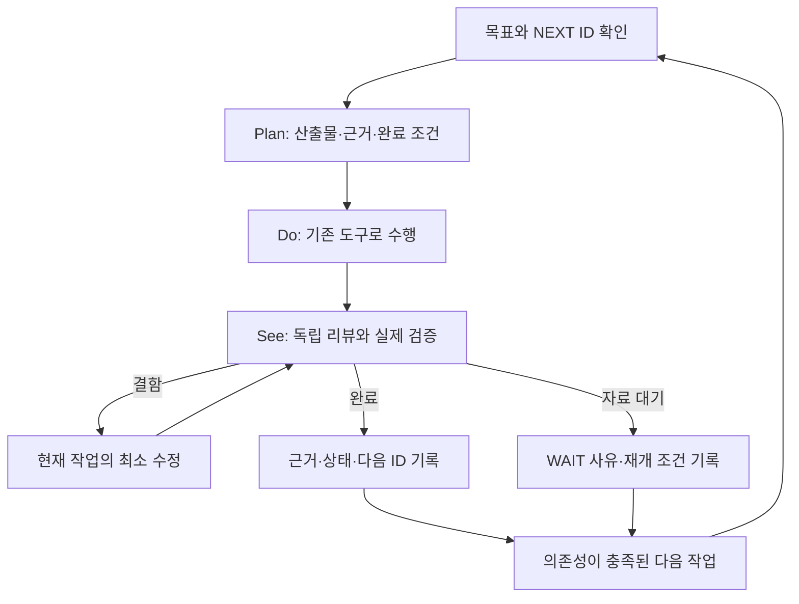

# 엔진 개선 실행 원장 — 목표·진행·리뷰·다음 작업

<a id="engine-evaluation-20261113"></a>
### ENGINE-EVAL-20261113 — 엔진 종합 평가와 우선순위 과제 V01~V12 (평가 DONE / V01 판독 DONE·두 계열 미입증 / V05 DONE·주 판정 불가(두 모델 모두 매수 승인 0~1건) / V02 기록 소스 DONE·판독 스크립트 후속·운영 배포 대기)

**Plan:** 사용자 지시(11/13 "엔진을 평가하고 목적을 위한 부족한 점·개선점·우선순위 task 정리, Fable 5.2로 보강")에 따라 목적(종목 선정·진입 시점의 비용 차감 KODEX200 초과수익 검증) 기준으로 엔진을 평가한다. 읽기 전용, 새 LLM·시세 호출 0, 운영 불변.

**Do:** 조사 세 갈래(작업 원장 미완료 재고 / 운영 기록 수치 판독 / 선정·진입·청산 코드와 기존 검증)를 병렬로 돌리고 조정자가 종합했다. 조사 worker는 사용자 지정에 따라 세션 모델(Fable 5.2) fork로 실행했다 — 전역 정책의 "Fable 자동 배정 제외"는 그대로이며 이번은 사용자 직접 지정이다. 핵심 수치는 조정자가 원자료로 재계산했다(초과수익 원장 253건 −1.62%·t −3.89, 보유 0~1일 131건 −1.57%, 손절 단독 92건 −4.25%, 현금 0.5%·보유 1종목, 반사실 추적 절대수익).

**See:** [평가 정본](../reviews/engine-evaluation-2026-11-13.md). ① 엣지 미입증·실거래 음수(양수인 전략·진입 월 없음). ② 근거 생산이 실거래에만 묶였는데 현금 0.5%·매수 중지·G1 하락 국면 차단으로 10/7 이후 신규 표본 0 — 재개 기준을 정의한 작업이 없어 순환 대기. ③ 9/30 이후 개발은 보고서·LLM 라우팅·비교 계층에 쓰였고 수익 근거는 0. ④ 서버에 이미 있는 후보 기록(배치 1,940건·장중 약 320 종목-일·팀 심의 967건)에 일봉 사후 초과수익을 붙이면 현금 없이 선정 신호 유무를 답할 수 있다. ⑤ LLM 하루 8~9달러 중 약 80%가 보고서·테마 탐지이고 승인 BUY의 선별력은 미입증.

| 순위 | ID | 과제 | 필요 승인 | 상태 |
|---|---|---|---|---|
| 1 | V01 | 기존 후보의 사후 초과수익 판독(사전 등록 4기준) | 공개 일봉 조회·오프라인 스크립트 | **판독 DONE(11/13) — 두 계열 모두 미입증**. WSL 정본 verify는 임시 키 미등록으로 미실행(인계) — GitHub `verify`가 병합 조건 |
| 1 | V02 | 후보 전수 기록(현금·레짐 게이트 이전, 기록만) — 구성요소·신호 시점 가격·같은 날 후보 간 비교·베타 조정 포함 | 운영 배포 1회 | **기록 소스 DONE(11/13)·운영 미배포** — `candidate_ledger`(스캔 후보 전수·점수 구성·레짐/현금 게이트 결과), 판독 기준 사전 등록. **사후 수익을 붙이는 판독 스크립트(V02-R)는 미작성** — 운영 잡으로 넣지 않고 오프라인으로, 최소 표본 도달 전에 작성(평가 정본 6절 조정). 배포는 사용자 승인 뒤 |
| 1 | V03 | 재개 기준 사전 등록(근거↔canary 규모) | 사용자 결정(기준·자본 출처) | WAIT(사용자) |
| 2 | V04 | 진입 직후 손실 해부 → 가설 1개 사전 등록 | 없음(V01 자료) | V02 뒤(V01 사전 등록 분기: 둘 다 미입증 → V02). **사용자 결정(11/13): 최근 거래가 없어 실거래 기반 해부는 앞당기지 않는다** |
| 2 | V05 | LLM 판단 가치 시험(저장된 심의 입력을 Fable 5.2·Opus 5.5로 재판정) | 실호출 승인(약 10~15달러 추정) | **DONE(11/13) — 두 모델 모두 판정 불가(표본 부족)**: 218건 중 `buy` Fable 5.2 0건·Opus 5.5 1건. 점수 분할(보조)도 양의 선별 없음. 정가 약 6.3달러(원장 밖) |
| 3 | V06 | LLM 지출 재배치(테마 탐지 주기 등) | 사용자 결정 | WAIT |
| 3 | V07 | Fable 5.2 전환(고정 보고 역할 3개, 입력 8/출력 40) | 신원 실호출 1회 | **소스·신원 실호출 DONE(11/13)** — 역할표 v8·출력 상한 6144/6144/16384, `resolved_model=claude-fable-5-2` verified. heavy task 슬롯은 5.1 유지(출력 상한 100~150토큰 소비자 점검이 선행 — 후속 과제). **운영 인수 DONE(11/13 13:30:52 KST, `0781bc53`·PID 1483849)** — 사용자 "지금 배포해도 돼"(장중 명시 승인, 매수 중지·pending 0), 13:00 심의·13:10 보고 슬롯 뒤 시작. 서버 10,804 passed·롤백 0, 기동 169초 사후 점검: NRestarts 0·pending 0·recovery ready·ERROR 0, 보호 48파일 중 `config/default.yml` 주석만(YAML 동일)·cron/KILL/월 200 보존. 기동 직후 13:30~13:33 KIS 한도 거절 로그(EGW00201 8줄·EGW00215 2줄, 재시작 때 배치 스캔 재실행의 반복 현상) → completed_with_findings. 첫 자연 호출은 11/13 16:40 장후 보고 WAIT |
| 3 | V08 | 밸류코어 13주 섀도우 판정 | 없음 | 대기 |
| 3 | V09 | 문서·원장 정리(§1.1 표·체크포인트·CLAUDE.md) | 없음 | 일부 DONE(현금 사실 수정) |
| 4 | V10 | 백테스터 정합(`atr_dynamic` 기본값 누수 등) | 없음 | 대기 |
| 4 | V11 | 레짐 단일화·G1 검증 | V02 4주 축적 | 대기 |
| 4 | V12 | 계좌 기준선(A01) | 사용자 자료 | WAIT |

완료 기준·판정 수치·분기는 평가 정본 6절이 정본이다. 기존 E01~E05는 실거래 입력이 생길 때까지 WAIT를 유지하고, V01~V05가 그 앞 단계가 된다. 아래 §1.1 우선순위 표는 10/30 상태이며 V09에서 갱신한다.

**See/V01(11/13, 사용자 "ㄱㄱㄱ"):** [사전 등록·결과 정본](../research/v01-candidate-forward-excess-2026-11-13.md). 판정 기준을 가격 조회 전에 커밋(`a3968ff5`)하고 스크립트(`scripts/research/candidate_forward_excess.py`, 합성 검사 41건)·벤치마크 분배금 보정을 결과 계산 전에 고정했다. 관측 4,450건(배치 후보 1,940·장중 신호 종목-일 2,078·팀 심의 432), 종목 327개 공개 일봉(KIS 무접촉), 벤치마크는 KIS 수정 종가 비율로 보정. **판정: A-sepa 미입증·B-all 미입증**(음의 신호 아님). ① 순초과수익 점추정치는 음수이나(A-sepa 5일 −0.56%·20일 −0.66%, B-all −0.42%·−4.00%) t가 −0.94~−0.21로 0과 구분되지 않는다. ② 전반 음수·후반 양수로 기간 안정성 기준(C3)을 둘 다 통과하지 못했다 — 지수가 월 +35%~−22%로 움직인 기간이라 후보군의 초과수익이 지수 방향에 좌우된다(급등 달 −18%로 열위, 급락 달 +4~7%로 우위). 후보 수익의 벤치마크 수익에 대한 기울기는 0.25~0.47(탐색 집계)이다. **이런 장세에서는 포지션당 KODEX200 초과수익만으로 선정 능력을 가리기 어렵다.** ③ 탐색(사후, 판정 제외): 배치 SEPA 점수 상−하 차이 10일 +2.65pp(t 2.57)·20일 +5.92pp(t 3.47)이나 하위는 이미 진입 기준 아래이고 상위는 48종목·5종목이 39%. ④ 후보의 50~58%가 5일 안에 −5%에, 64~69%가 −3.5%에 닿는다. 20일 뒤 오른 후보도 28~34%가 먼저 −5%를 찍는다(내린 후보 56~72%, 탐색 집계). 실거래 손절 단독 36%·보유 0~1일 52%와 방향이 맞으며, "고정 손절이 변동성 때문에 너무 일찍 발동한다"는 가설로만 남긴다. 운영·설정 변경 0.

**See/V05(11/13, 사용자 "ㄱㄱㄱ"·"니 뜻대로"):** [사전 등록·결과 정본](../research/v05-team-rejudge-2026-11-13.md). 판정 기준·프롬프트·표본·비용 상한을 호출 전에 커밋(`f6b58e25`)했다. 종목-일 첫 심의 가운데 20일 결과가 있는 218건(18거래일)의 분석가 보고를 Fable 5.2(medium)·Opus 5.5(low)로 재판정(`scripts/research/team_rejudge.py`, 합성 검사 11건). 436회 전부 성공·신원 verified·재시도/거절 0, 정가 약 6.27달러(보수 추정 11.21, 상한 15, 월 원장 밖). **주 판정: 두 모델 모두 판정 불가(표본 부족)** — `buy`가 Fable 0건·Opus 1건이라 승인−비승인 비교가 성립하지 않는다(운영이 승인한 26건 중 두 모델이 고른 것 0). ① 점수 분포는 Fable 22~46·Opus 25~57로 거의 전부 50("판단 불가") 아래다. ② 같은 날 점수 상−하(보조)는 20일에서 Fable −3.47pp(구간 −11.08~+1.28), Opus −8.62pp(−14.38~−4.25)로 양의 선별이 없다. 기준선(분석가 점수 합 −1.61pp, 운영 승인 BUY −3.36pp)도 같은 방향이다. ③ **심의 입력 결손:** 재무 분석가 보고 966행 전부 `insufficient`, 기술 보고 22% `error` — 모델보다 입력이 먼저다. 범위: 운영 심의(요약 입력·시장/위키 문맥·Bull/Bear 토론)를 재생한 것이 아니라 **저장된 분석가 보고를 받은 단일 심의자 실험**이다(문맥 원문은 해시만 남아 재생 불가). 결정: 이 시험에서 shadow 후보 모델은 나오지 않았고 장중 심의는 늘리지 않는다(축소 여부는 V06과 함께 사용자 결정). Bull/Bear의 Fable 5.2 전환은 이 시험이 다루지 않아 기존 보류가 그대로 남는다. 운영·설정 변경 0.

**See/V02(11/13, 사용자 "니 뜻대로"):** [설계·판독 사전 등록](../research/v02-candidate-ledger-2026-11-13.md). 장중 스캔이 반환한 후보 전체를 현금·레짐·점수 게이트보다 앞에서 일별 JSONL(`~/.cache/ai_trader/candidate_ledger/`)에 남긴다 — 후보별 점수·가격·등락·수급 표시·사유와 점수 구성(원천별 가중 점수·병합 뒤 보정·출현 보너스), 스캔 단위 레짐·현금 게이트 결과(지수 등락률은 관측된 값만·조회 실패는 null, 현금은 통과 여부만). 주문·사이징·게이트 판정 불변, 기록 실패는 경고뿐, `CANDIDATE_LEDGER=0`으로 끈다. 달라지는 것은 원장이 켜져 있을 때 스크리너에 `capture_selection=True`를 넘기는 것 하나(점수·순위 불변, 10월 관측에서 운영 사용). 검사 12건: 단위(행 구조·결측 null·짧은 쓰기·멈춘 디스크 비차단) + 실제 `run_screening` 통합 4건(원장을 켜도 신호·게이트 추적 동일, 약세장 차단·현금 0·지수 조회 실패에서도 후보 기록). 매매 경로는 대기열에 넣기만 하고 전용 스레드가 쓴다(디스크가 멈춰도 스캔은 기다리지 않음). 판독 기준(같은 날 점수 상위−하위 3분위 차이, 5일 +1.0pp·20일 +2.0pp와 95% 하한 > 0, 최소 15거래일·300종목-일, 중간 엿보기 금지)은 자료가 쌓이기 전에 고정했다. **운영 미배포.**

**NEXT:** ① V02 운영 배포(사용자 승인) → 첫 거래일에 행 구조·결측률 확인 → V02-R 판독 스크립트 작성(같은 날 3분위 비교·블록 부트스트랩 — V05의 `within_day`·V01의 `forward` 재사용, 최소 표본 도달 전) → 최소 표본 뒤 5일 판독(배포 뒤 약 4주) ② 심의 입력 보강 결정(사용자): 재무 분석가는 9/15 MCP 정리 뒤 수급·공매도 소스가 꺼져 구조적으로 `insufficient`만 낸다(코드 판독 확인) — 실제 재무·수급 자료를 연결할지, 분석가를 뺄지. 기술 보고 오류 22%는 전부 `지표 없음`이고 대부분 한 종목의 슬롯별 반복이다(보유 종목 재평가 경로로 추정) ③ V07 첫 자연 슬롯 판독(11/13 16:40 장후 시장·웹 보고: `resolved_model=claude-fable-5-2`·`end_turn`·시한), heavy 소비자의 작은 출력 상한(100~150토큰) 점검. V04는 V02에서 선정 신호가 확인된 뒤(사용자 결정 11/13: 실거래 기반 해부는 앞당기지 않음). V06 주기는 V02 원천별 판독 뒤, V03 canary 자본은 사용자 결정 대기.

<a id="test-panel-deadline-loop-clock-20261109"></a>
<a id="l02-gpt5mini-successor-20261111"></a>
### L02-GPT5MINI-SUCCESSOR — `gpt-5-mini` 2026-12-11 API 제거 대비 후속 모델 교체 (소스 PR #362 병합 `22f8be07`·리뷰 3회·terra 실호출 신원 verified DONE / **운영 `3caaeaa9` 11/11 22:38 인수 DONE** / **자연 Bull 인수 11/12 36/36 exact DONE** / 비용 실측 11/16 WAIT)

**Plan(11/11, 사용자 "이내용도 참고해줘" → "니가 결정해서 진행해"):** OpenAI 공식 폐기 공지 [2026-06-11 GPT-5 and o3 model deprecations](https://developers.openai.com/api/docs/deprecations#2026-06-11-gpt-5-and-o3-model-deprecations) — API 제거 **2026-12-11**: `gpt-5`→`gpt-5.6-sol`, `gpt-5-mini`/`gpt-5-mini-2025-08-07`→**`gpt-5.6-terra`**, `gpt-5-nano`→`gpt-5.6-luna`, `gpt-5-pro`/`o3`/`o3-pro`→`gpt-5.6-sol`. 내부 CHANGELOG의 "12-10"은 11일로 정정. 영향 없음: gpt-5.6-sol·gpt-6-astra·gpt-6.1-sol·전역 라우팅 정책 모델. `f29a250a` 운영에 남은 `gpt-5-mini` 경로: Bull(`model_comparison_contract.DOCUMENTED_SNAPSHOTS`/BULL minimal 400, D8 "Bull gpt-5-mini 유지"), `MORNING_BRIEF`(결정론 조립의 역할표 항목), heavy→GPT light 폴백·`REPORT_SUMMARY` 절약 light·`STOCK_MAPPING`·`openai_model_light` 기본값(`llm.py`·`default.yml`), `_OPENAI_EFFORTS`(terra 항목 없음), `llm_pricing._RATES`(terra 단가 없음), `report_premarket_check.RECOGNIZED_OPENAI_MODELS`, 프로브 스크립트 3종, 테스트 34파일. **결정:** L01과 독립이고 기한까지 30일 여유가 있어 L01 Task 6(11/16) 뒤 별도 과제로 착수한다 — 단가·effort 표·snapshot 실호출 재검증·테스트를 건드리므로 11/11 배포에 섞지 않았다. 첫 하위 단계는 **D8 재결정**: 기본안 공급자 분리 유지 → Bull `gpt-5.6-terra`(공식 권장 대체); Opus 전환은 Bull/Bear 동일 공급자가 되어 교차 독립 검토 계약을 깨므로 사용자 명시 승인 없이는 택하지 않는다.

**완료 조건(초안):** terra 공식 단가 입력(`llm_pricing`), `_OPENAI_EFFORTS`/`RECOGNIZED_OPENAI_MODELS`/`DOCUMENTED_SNAPSHOTS` 갱신, 실호출 1회 resolved snapshot 신원 verified(사용자 승인), `MORNING_BRIEF`·light 기본값·heavy→light 폴백·`REPORT_SUMMARY`·`STOCK_MAPPING` 교체, 운영 배포 2026-12-11 이전. 모델 교체는 정확도·순수익 향상의 증거가 아니다.

**Do(11/11 20:1x~ KST, 사용자 "ㄱㄱ" → L01 Task 6 전 착수, 브랜치 `feature/l02-gpt5mini-successor-terra-20261111`, 기준 main `b65e3dc7`):** D8 재결정은 기본안 유지(Bull OpenAI `gpt-5.6-terra` / Bear Claude Opus 5.5, Opus 전환 없음). 공식 모델 페이지(2026-11-11) 확인: 입력 2/캐시 0.2/출력 12, 캐시 쓰기 1.25x, >272K 2x/1.5x, effort none|low|medium|high|xhigh|max(**minimal 없음**), dated snapshot 미공개(default `gpt-5.6-terra`). 소스 교체 9파일: `llm.py`(light 기본·`_OPENAI_EFFORTS`·경량 기본 effort `minimal→none→low`), `llm_pricing.py`(terra 단가+sol 규칙), `llm_roles.py` v7(`MORNING_BRIEF` terra/none), `llm.light_default_effort`·`adversarial_validator.bull_reasoning_effort(llm)`(설정 light 모델별 mini minimal/terra none — Bull·토론·비교 입력 공용), `model_comparison_contract`(Bull 역사/현행 두 프로필·snapshot 표 불변), `report_premarket_check`(terra 인식), `default.yml`. 역사 프로브/드라이런·R1 manifest·과거 단가는 보존. 영향 검사 41파일 1,444 passed(AWS 보조)·신규 검사 5건(단가·contract 3·premarket). **독립 리뷰 1차(Codex gpt-6-astra/xhigh, 헤더 확인):** P0 0·P1 1(effort `none` 고정 — 설정에 mini 잔존 시 Bull 전송 전 ValueError)·P2 3 → P1·P2①(장전 점검이 요청·응답 모델을 따로 인증) 반영(+검사 6, 1,456 passed), P2②(`or` 기본값)는 설정 계약(빈 문자열=기본값)이라 미반영, P2③(float 단가)은 기존 부채. AWS 보조 전체 verify(`2743c7f8`) 10,746 passed. **2차(xhigh):** P0/P1 0·신규 P2 2(장전 점검 비문자 필드 TypeError→read_failed 회귀, reporting.md 역사/현행 역할 혼합) 반영·EOF 공백 정리. PR #362(초안). 상세 CHANGELOG 11/11 L02.

**비용·신원 메모:** 출력 단가 6배 — Bull 월 약 USD 9 추정(11/16 실측 대조). terra 응답 `model` 이 dated id 면 현행 신원 정책에서 mismatch→hold 라 **운영 배포 전 실호출 1회로 `resolved_model` 확인이 배포 게이트**(사용자 승인, 추정 USD 0.001).

**See/병합·실호출(11/11 21:2x KST):** 3차 리뷰(`cd52f7b3`, xhigh) 신규 P0/P1/P2 0(기존 P2 3: `or` 기본값·float 단가·장전 점검 v2 고정 — 부채 기록) → PR #362 CI verify pass 6m28s → 사용자 "병합해" → head 고정 병합 main `22f8be07`. 사용자 "보내" → 운영 전송 코드(`OpenAIClient`)로 `gpt-5.6-terra` 1회(effort none·JSON·64토큰): **`resolved_model=gpt-5.6-terra` exact·verified**, HTTP 200·`stop`·거절 0·입력 31/출력 11/추론 0·2.79초·추정 USD 0.0002(월 원장 밖 단발). dated snapshot 없음 → `DOCUMENTED_SNAPSHOTS` 불변, 현행 exact 신원 정책으로 Bull 인증 가능. 운영 `f29a250a` 불변. 영수증 `~/.local/state/qwq-task-audit/20261111/l02-terra/`(비공개).

**See/운영 배포(11/11 22:38 KST, 사용자 "지금 배포"):** 장 밖 22:22 운영 호스트 `local_deploy.sh 3caaeaa9`(main = 소스 `22f8be07` + #363) — 사전 pending []·pytest 0·보호 48파일 스냅샷(이전 `f29a250a`). 서버 verify **10,756 passed / 2 skipped / 2 xfailed (870초)**·롤백 0·22:38:06 재기동(PID 1331574·NRestarts 0), 기동 로그 `light=gpt-5.6-terra`·상한 불일치 0(원장 변경 없음). postcheck rc 0(22:40:40): HTTP 500 0·EGW00201 0·EGW00215 0·ERROR 0·pending []·실행 원장 ready·정체 0(이번엔 기동 KIS 버스트 거절 0). 보호 48파일 중 변동은 `default.yml` 1건(커밋 대상과 동일, `openai_model_light` mini→terra)·cron/KILL/`evolved_overrides`/월 200/R1 OFF/worker 비활성 보존. **completed.** 영수증 `~/.local/state/qwq-task-audit/20261111/l02-terra-deploy/`(비공개). 사용자가 11/16 실측 분리 권고 대신 즉시 배포를 택했으므로 Task 6 실측에는 Bull 단가 변화가 섞인다.

**See/자연 호출 인수(11/12 13:50 KST 판독, 사용자 "ㄱㄱ", 읽기 전용 — 새 호출·재실행·시험 발송 0):** 운영 `3caaeaa9`/PID 1331574·NRestarts 0. 장중 3슬롯(10:30·11:30·13:00) Bull **36/36** `requested_model=gpt-5.6-terra`·`resolved_model` exact·effort `none`·HTTP 200·성공·거절 0, 지연 p50 2.05초·최대 3.33초, 월 원장 정산 36건 USD 0.075(호출당 약 0.0021 → 48건/일 약 0.10, 월 약 USD 2 — 사전 추정 ~9보다 낮다). 판정 승인 1/36(직전 5거래일 gpt-5-mini 2~7/48과 같은 범위, 1일 표본이라 분포 변화 판단 불가). 같은 슬롯 Bear 36/36 Opus 5.5 API 1차. 감사 행의 `role_policy_version=engine-roles-v7-terra` 확인; `MORNING_BRIEF`는 결정론 조립이라 LLM 호출 행이 없다(행 부재가 정상). 14:00 슬롯은 일 예산 소진으로 Bull 12/12 `Daily budget exceeded`(미전송)였고, Bear는 API 단계가 같은 사유로 차단돼 구독 CLI 대체 12회 → 성공 2·`cli_timeout` 7·`cli_incomplete` 3(CLI 대체 경로의 첫 운영 관측, 구독 한도 사용 발생; 팀 심의는 Bear 단독 응답·매수 판정 0). 일 예산 소진은 [L01 See](#l01-llm-credit-routing-20261108) 참조. 영수증 `~/.local/state/qwq-task-audit/20261112/l01-l02-natural/readout.json`(비공개).

**NEXT:** ① 자연 Bull 인수 DONE(신원·effort·지연). 판정 분포는 11/16 Task 6에서 5거래일 누적으로 읽는다. ② 11/16 L01 Task 6 실측에서 11/11 22:38 전후를 나눠 읽는다. ③ 기존 부채 3건(`or` 기본값·float 단가·장전 점검 v2 정책 고정)은 별도 과제.

### TEST-PANEL-DEADLINE-LOOP-CLOCK — 공통 패널 시한 검사의 벽시계 플레이크 제거 (테스트 전용·제품 코드 0 / 수정·AWS 보조 반복·독립 리뷰·PR #354 병합 `1f87b896` DONE — WSL 전체는 검사 전용이라 생략, 서버 배포 verify 10,659 passed에 포함)

**Plan:** 11/9 docs 전용 PR #352의 필수 CI `verify`(hosted runner 직렬 전체)가 `tests/test_model_comparison_current_flow.py::test_common_panel_deadline_is_fixed_before_roles_start`에서 1회 실패하고 재실행에서 통과했다. 실패 단정은 `bull_role_deadline_exceeded_after_response` 포함인데 실제 사유는 `bear_role_deadline_exceeded_after_response`였다. 검사(Codex 6회차 `56459e82` 추가)는 패널 0.5초·Bear 내부 0.4초·CLI 0.1초에 `guard._admit`(Bear 입장) `time.sleep(0.3)`·`guard._store_result`(Bull 저장) `time.sleep(0.25)`를 몽키패치해 벽시계로 늦은 Bull 의견을 만들었고, Bear 완료(0.3초+지터)와 내부 시한 0.4초 사이 여유가 0.1초라 느린 러너에서 Bear 시한이 먼저 걸렸다(11/9 PR #351·main·WSL·서버 verify 4회는 통과 — 간헐). 목표는 증명 성질(패널 시한은 task 생성 전에 고정되고, Bull이 자기 역할 기준 제때 끝나도 패널 기준 늦으면 hold)을 유지한 최소 변경, 제품 코드(`src/analytics/model_comparison_runner.py`) 변경 0.

**Do(브랜치 `test/panel-deadline-loop-clock-20261109`, 기준 origin/main `5abfd02e`):** runner `_bear_role`/`_arm`/`run`과 `ClaudeSingleAttemptAdapter`가 시한을 전부 `loop.time()`으로 읽고 `asyncio.timeout_at`도 같은 시계를 쓰므로, `asyncio.Runner(loop_factory=…)`로 만든 테스트 루프의 `time`을 `실제 단조 시계 + 전진분`으로 바꾸고 sleep을 전진분 가산(Bear 입장 +10초·Bull 저장 +11초)으로 교체했다. 시한은 패널 20초·Bear 내부 19초·CLI 8초(계약 상한 `min(8, 내부/2)`)·API 19초. Bull은 자기 역할 시한(시작 T0+10 → T0+30) 안에 끝나지만 패널 기준 T0+21 > 20이라 hold·`bull_role_deadline_exceeded_after_response`; Bear는 T0+10+지터 < 19라 지터 9초까지 Bear 사유가 나지 않는다(부재 단정 추가). 완전 고정 시계는 채택하지 않았다 — 준비 콜백 없이 타이머만 남는 순간 `_run_once`가 영원히 대기한다. 실제 대기 0이라 검사 시간은 종전과 같다. CHANGELOG 1항목. 같은 파일의 `time.sleep` 패턴 2종(`test_admission_latency_cannot_extend_the_bear_internal_deadline` 0.15초·여유 5.75/11.5초, `test_result_arriving_inside_deadline_but_settled_after_it_is_not_counted[bear|bull_current]` 0.35초·여유 0.3초 미만)은 범위 밖으로 목록만 남긴다.

**See/검사(AWS 보조, Python 3.12.3·venv):** 대상 1건 passed → 돌연변이(Bull 전진분을 패널 안으로) `assert 'reject' == 'hold'` 실패로 단정의 판별력 확인 → 파일 전체 53검사 × 10회 연속 passed(10.3~11.8초) → CPU 부하(다른 pytest 2파일 + 소모 루프 동시, `nice -n 10`)에서 대상 passed. 같은 부하에서 범위 밖 `test_result_arriving_inside_deadline_but_settled_after_it_is_not_counted` 2파라미터가 `policy_verdict == 'hold'`로 실패(단독 재현 1/3) — 후속 후보로만 기록. **독립 리뷰(Codex `scripts/dev/codex_review.sh --branch`, `QWQ_REVIEW_BASE=origin/main`, 래퍼 gpt-6-astra/high — 제어 호출·본 리뷰 헤더 `model: gpt-6-astra`·`reasoning effort: high` 확인, 로그 `~/.local/state/qwq-task-audit/20261109/test-panel-deadline/codex-review-1.log`):** 1차(`f50d054c`) P0 0·P1 0·P2 2 — ① 시계가 실제 시간도 반영해 Bear 여유 1초(당시 패널 5·내부 4·전진 3)가 남아 "러너 속도와 무관" 표현이 부정확 → 여유 9초로 재배치·문구 정정, ② docs 원장 미기록 → 이 항목. 2차(`bc08d626`, 로그 `codex-review-2.log`, 헤더 gpt-6-astra/high) **P0 0·P1 0·P2 0**, `git diff --check` 통과, "코드 리뷰 관점 조건부 병합 가능(사용자 WSL 직렬 전체·필수 CI 조건)". 리뷰어는 임시 SQLite 생성을 피해 pytest를 직접 돌리지 않았다(기록된 반복 결과는 리뷰어 재검증이 아님).

**NEXT:** PR 생성 → 사용자 WSL `bash scripts/dev/verify.sh` 직렬 전체(AWS는 보조) → 필수 CI → 병합(사용자 승인). 운영 배포 대상이 아니다(테스트 전용). 범위 밖 `time.sleep` 검사 2종의 같은 패턴 전환은 별도 과제.

<a id="r02-web-rejection-recurrence-20261109"></a>
### R02-WEB-REJECTION-RECURRENCE — 라벨 허용(PR #346) 뒤에도 웹 리포트 3/3 거절이 재발한 원인 조사 (판독·코드 대조·합성 재현·최소 수정 ①②·독립 리뷰·실제 WSL·PR #353 병합 `188ab3f0`·운영 `1f87b896` 11/10 00:22 인수 DONE / 자연 수락 11/10 morning 거절(`recommendation_vocabulary`)·midday ready 1/2, after WAIT)

**Plan:** 11/9 도래 영수증에서 시장 보고 3슬롯은 `ready`·Telegram API accepted인데 웹 `report_analyses(audience=web)`는 morning `unsupported_latin @ summary[0]`, midday·after `unsupported_numeric @ market_view.text`로 **3/3 `failed`**(대체 본문 29자)였다(저널 07:40:55·13:10:50·16:41:56 WARNING 일치). 11/2~11/9 웹은 **18/18 failed**이며 11/7 00:15 배포(`b127577c`, 라벨 허용)와 11/9 01:24 배포(`a1331059`) 뒤에도 같다. 사용자 지시(11/9)로 원인 조사·최소 수정안·검사 계획까지만 수행하고, 추가 LLM 생성·슬롯 재실행·시험 발송·검증 완화·모델 교체 결론은 하지 않는다. 운영 `a1331059`(11/9 슬롯 당시 버전, 검증 계약 = PR #346 포함 현행 `web-report-v1`) 불변.

**Do/판독(읽기 전용, 응답 본문 없음):** ① 슬롯 당시 운영은 `a1331059`(01:24 기동)이고 적용 계약은 `_check_text(words=)` 포함 현행이다. ② 동결 facts(`result_json.facts`)·공개 근거(`report_analysis_sources.evidence_json`, 46건: news 24·disclosure 8·calendar 6·macro 8)를 읽었다. morning facts는 미국 3지수만(M1 S&P500 +0.31%·M2 나스닥 +1.09%·M3 SOX +4.21%, 국내 지수·섹터 0). midday는 KOSPI 5,121.15 (+1.21%)·KOSDAQ 656.35 (+1.87%) `관측 11/09 13:08 KST`(제공기관 대비율)+섹터 10. after는 KOSPI 5,019.73·KOSDAQ 638.97 `관측 11/09 15:32 KST` **등락률 없음**(분 단위 참고·전일 대비 미확보)+섹터 10. 같은 날 뉴스 제목에는 `코스피 5100선 회복`(midday E5), `5000선 겨우 사수`(after E4)·`5018.85 마감`(E19)·`장중 5170선`(E1)이 있다. ③ 실패 행은 `result_json.analysis=None`·metadata는 코드·경로·토큰 수만이라 **실제 거절 토큰은 미확정**(설계: R02-WEB-REJECTION-DIAGNOSTICS, 응답 본문 비저장). ④ 모델은 3슬롯 모두 `gpt-6-astra` 완료(`finish_reason=stop`, 출력 1,780~1,878토큰, 월 원장 정산 `reported_usage`).

**Do/합성 재현(실제 11/9 facts·E 묶음 + 현행 `validate_web_analysis`, 영수증 `~/.local/state/qwq-task-audit/20261109/l01-task2/web_probe_20261109.py`, 운영 미변경):** market_view(M1·M2 인용)에서 **통과**: M값 그대로(`5,019.73`·`638.97`·`5,121.15`·`+1.21%`·부호 없는 `1.21%`), 관측 시각 그대로(`15:32`·`13:08`·`11/09`), 섹터 값은 그 M을 추가 인용했을 때(`M12 -5.33%`), 뉴스 숫자는 그 E를 추가 인용했을 때(`5000선`+E4, `5018.85`+E19, `5100선`+E5). **거절(`unsupported_numeric`)**: 인용하지 않은 뉴스 숫자(`5000선`·`5100선`·`5018.85`), 인용하지 않은 섹터 값(`-5.33%`), 천 단위 절삭(`5,019`·`5,121`), 반올림(`1.2%`), 부호 제거(`5.33% 하락`), 시각·날짜의 한글화(`15시 32분`·`13시 8분`·`9일`), 계산값(`0.66%p`·`1.7포인트`). summary(전체 출처)에서 **통과**: 입력 표기 `S&P500`·`SOX`·`AI`(E2)·`CEO`(E23)·한자 `美`; **거절(`unsupported_latin`)**: 입력에 없는 `Fed`·`FOMC`·`HBM`·`Nasdaq`(입력은 `나스닥`)·`NVIDIA`(입력은 `엔비디아`). 검증기가 근거에 있는 표기를 잘못 거절한 사례는 **0건**이다.

**See/판정:** 확정된 것은 "11/9 3건 모두 계약상 올바른 거절 종류"라는 점과, 재발을 설명하는 **프롬프트-계약 불일치 3가지**다. (a) 범위: 프롬프트 스키마 예시가 `market_view.evidence_ids: ["M1"]`처럼 M만 보여 주고 "숫자는 인용한 M/E의 값만"이라고만 말해, 시장 서술에 자연히 쓰는 뉴스 수준(`5000선`)·다른 M의 값을 그 블록에 인용하지 않으면 거절된다. (b) 표기: 관측 시각 `11/09 15:32 KST`·절삭·반올림·계산값은 '그대로' 규칙이지만 프롬프트가 금지 형태(한글화·절삭·반올림·차이 계산)를 열거하지 않는다. (c) after 슬롯 구조: KOSPI/KOSDAQ 참고값에 등락률이 없어 방향을 쓸 허가된 숫자가 없고, 뉴스 수치로 채우면 (a)에 걸린다. morning의 영문 거절은 입력에 없는 약어를 쓴 경우로, "입력 표기만" 규칙의 정상 차단이거나 공통 금융 약어 허용 목록(`_LATIN_ALLOWED`=etf/kospi/kosdaq) 부재 중 어느 쪽인지 토큰이 없어 **미확정**이다. 11/3~11/6 라벨 거절(PR #346로 해소)과는 다른 원인이며, 모델 교체가 해결책이라는 결론은 내리지 않는다.

**최소 수정안(①② 아래 Do/구현으로 구현, ③ 미실시):** ① 진단 보강(검증 완화 0, 응답 본문 비저장 유지): `unsupported_numeric/latin` 거절 시 첫 위반 토큰이 **전체 출처 어딘가에는 있는지**(`validation_scope=uncited_source|absent`)를 metadata 허용 목록에 추가 — 토큰 자체는 저장하지 않고 '인용 범위 밖'과 '입력에 없음'만 가른다(`_check_text`가 위반 토큰을 예외 속성으로 올리고 `validate_web_analysis`가 전체 풀과 대조, `_DIAGNOSTIC_*` 허용 목록 확장, 약 15줄). ② 프롬프트 정합(계약 불변): `build_web_prompt`에 "블록에 쓰는 모든 숫자·날짜·영문은 **그 블록의 evidence_ids**에 있는 줄의 것이어야 하며 E도 인용 가능", "관측 시각·날짜는 `11/09 15:32` 그대로(한글화·절삭·반올림·계산 금지)", "등락률이 없는 지수는 방향을 숫자로 쓰지 말고 '전일 대비 미확보'로 서술" 3문장 추가 + 스키마 예시 `evidence_ids`에 E 포함. ③ 선택(사용자 결정): 공통 금융 약어 소수(`fed`·`fomc` 등)를 `_LATIN_ALLOWED`에 넣을지는 ①로 `absent` 비율을 본 뒤 결정. **검사 계획:** `tests/test_web_report_label_numeric.py` 모양으로 11/9 after/midday facts 고정 fixture를 두고 위 통과 12·거절 14 사례를 회귀 검사로 고정, ① scope 분류 검사(인용 범위 밖/입력 없음/허용 목록 외 코드 fallback), ② 프롬프트 문장 존재·`max_input_bytes` 경계 검사. 수용 기준은 "거절 사유 분포가 바뀌는지"이며 자연 수락을 보장하지 않는다.

**Do/구현(11/9, 브랜치 `feature/r02-web-rejection-scope-20261109`, 기준 main `5abfd02e`, 소스 1파일 `src/analytics/web_report.py`):** ① `_check_text`가 `unsupported_numeric/latin`의 첫 위반 토큰을 예외 속성 `.token`으로만 올리고(`_reject`, 메시지는 종전 `code: field`), `validate_web_analysis`가 검사 묶음을 감싸 토큰이 전체 값 풀 `all_numbers`에 있으면 `uncited_source`, 없으면 `absent`로 `.scope` 분류(영문 풀은 전체 출처라 latin 은 항상 `absent`; `headline/summary/checklist`의 숫자 거절도 `absent`). `_web_validation_diagnostic`은 두 코드에 한해 `_DIAGNOSTIC_SCOPES` 안의 값만 `validation_scope`로 더하고 로그에 `(scope)`만 덧붙인다 — 토큰·응답 본문은 metadata/result/로그 어디에도 없다. 상한: 표기 안의 숫자(`2차전지`의 2·`15:32`)가 첫 위반이면 값 풀 밖이라 `absent`(주석 명시, 표기 풀 미대조). ② system 지시 세 문장(블록 `evidence_ids` 범위·E 인용 가능 / `11/09 15:32` 그대로·한글화·절삭·반올림·계산값 금지 / 등락률 없는 지수는 "전일 대비 미확보")·`_SCHEMA` `market_view=["M1","M2","E4"]`·`sector_view=["M3","E2"]`. 검증 규칙·거절 집합·모델·호출 횟수·`max_input_bytes` 불변. ③ 약어 허용 목록 미실시(사용자 결정). **See/검사(AWS 보조):** 신규 `tests/test_web_report_rejection_scope.py` — 11/9 after(KOSPI 5,019.73·KOSDAQ 638.97 `관측 11/09 15:32 KST` 무등락률+섹터 10, M12 -5.33%)/midday(5,121.15 (+1.21%)·656.35 (+1.87%) `13:08` 제공기관 대비율)/morning(미국 3지수 +0.31/+1.09/+4.21) facts 와 E1~E23 제목(`5170선`·`AI`·`5000선`·`5100선`·`5018.85`·`CEO`)을 판독 그대로 합성(운영 DB 미접촉) → 위 통과 사례 16·거절 사례 19 회귀(코드·필드·scope·무토큰 메시지·진단 dict), 블록/전체 풀 scope 차이, 허용 목록 외 fallback 4경로, 저장 행 `validation_scope` 영속·재오픈·토큰 비저장, 프롬프트 세 문장·스키마 E 예시, `max_input_bytes` 정확 경계. 기존 `test_web_report_rejection_diagnostics.py` 진단 동등성은 scope 포함으로 갱신. 관련 7파일 **111 passed**(격리 0). **See/독립 리뷰(Codex, 래퍼 `~/.local/state/qwq-task-audit/20261109/r02-web-scope/codex-astra-high`, 제어 호출·본 리뷰 헤더 모두 `gpt-6-astra`/`high`, 영수증 `codex-review-1.log`, 72,147 토큰):** 커밋 `1477ec8c` 6파일 정적 리뷰 **P0/P1/P2 0**, 조건부 병합 가능(실제 WSL 직렬 전체·CI verify 조건). 지적 없는 한계 메모 1건 — `absent`는 값 풀 기준이라 입력에 있는 `2차전지` 표기 미인용도 `absent`일 수 있으며 '입력에 없는 내용 생성'의 확정 근거가 아니다(코드 주석·검사·문서에 명시된 상한과 동일). 리뷰는 pytest 미실행(읽기 전용), 111 passed는 리뷰 재검증값이 아님. PR·실제 WSL·배포는 아래 NEXT.

**NEXT:** 독립 리뷰 P0/P1 0 → PR → 사용자 WSL 직렬 전체 `verify.sh` → 사용자 승인 배포(장외). 배포 뒤 다음 거래일 07:40/13:10/16:40 웹 슬롯은 `validation_code/field/scope`로 판독한다 — `uncited_source`가 남으면 ②의 인용 범위 지시가 덜 먹힌 것, `absent`만 남으면 ③(약어 허용 목록) 결정 자료. 응답 저장·재발송·검증 완화·모델 교체는 하지 않는다. 시장 보고(Telegram) 경로는 영향 없음.


**See/병합·운영 인수(11/9~11/10, 사용자 "등록했고 같이 병합 ㄱㄱ 후속작업 있으면 바로 진행해줘"):** PR #353 HEAD `4c2c3bbb`를 사용자 WSL 격리 워크트리에서 직렬 전체 verify — **10,659 passed / 2 skipped / 2 xfailed**, 412.63초, rc 0, 격리 0, 트리 전후 동일(`ed9be033`), 로그 sha256 `baefd7ee…` → `--match-head-commit`으로 merge `188ab3f0`, main Verify run42635312381 success. 이어 TEST-PANEL-DEADLINE-LOOP-CLOCK PR #354(검사 파일만)를 main과 합쳐(CHANGELOG 충돌은 두 항목 보존, 검사 파일 불변) 필수 verify success 뒤 merge `1f87b896`, main Verify run42637082236 success. 운영 배포는 크론·스케줄러 작업이 없는 11/10 00:05~01:30 창: 사전 스냅샷 00:06:17(운영 `31edd820`·PID986445·pending 0·보호 48파일 변동 0) → WSL `--check` 정상 → 드라이버 `--deploy 1f87b896` 00:06:40~00:22:43 rc 0, 서버 직렬 **10,659 passed / 2 skipped / 2 xfailed**(909.17초)·비밀 검사 PASS·롤백 0 → **00:22:27 KST 재시작 PID1048208**·NRestarts 0 → `--postcheck` rc 0(KIS 오류/ERROR/정체 0·pending 0·실행원장 ready) → 사후 스냅샷 00:25:16: ops_head `1f87b896`·보호 48파일 변동 0·cron 보존·KILL/예산 100·log_and_continue/R1·worker OFF/Toss 0·evolved_overrides 미커밋 보존, 기동 저널 154줄 오류 0·브로커 연결·엔진 시작. 임시 키(`r02-web-scope-verify-20261109`)는 키 재질 기준 제거(남은 줄 0·해시 `01ba4719`)·재접속 `Permission denied`·AWS 키 shred, 핀/터널/사용자 키 불변. 영수증 `~/.local/state/qwq-task-audit/20261110/r02-web-scope-deploy/completion.json`. **NEXT(11/10 00:22 시점, 이력):** 다음 거래일 07:40/13:10/16:40 웹 슬롯의 `report_analyses(web)` `status`와 거절 시 `validation_code/field/scope`로 자연 인수한다(프롬프트 정합이 수락을 보장하지 않으며, `scope=absent` 비율을 본 뒤 공통 약어 허용 ③ 여부를 사용자가 결정). 응답 저장·재발송·검증 완화·모델 교체·슬롯 재실행은 하지 않는다. 이 문서 영수증은 재배포하지 않는다. **See/자연 수락(11/10 15:50 KST 판독, 읽기 전용):** 배포 뒤 첫 두 슬롯 — 07:40 morning `failed`·`validation_code=recommendation_vocabulary`·`validation_field=issues[1].event`(매수/매도 추천·목표주가류 금지 어휘; 숫자·영문 범위 거절이 아니라 `validation_scope` 비해당·미영속, 계약상 올바른 거절, 토큰 비저장이라 어휘 미확정)·13:10 midday **`ready`**(`reason=validated`, gpt-6-astra, 출력 1,681토큰, analysis 9블록) — 11/3 이후 15연속 거절 뒤 첫 자연 수락. 16:40 after는 판독 시점 미도래. 1/2는 비율 추정이 아니며 ③ 약어 허용 목록 판단 근거(`scope=absent` 분포)는 아직 0건. 영수증 `completion.json`의 `readout_20261110_1550_kst`. **NEXT:** 16:40 after와 다음 거래일 3슬롯의 `status`/`validation_code/field/scope` 누적으로 거절 종류 분포를 본다(재생성·슬롯 재실행 없음). `recommendation_vocabulary` 재발이 이어지면 프롬프트에 금지 어휘를 명시하는 최소 수정(검증 불변)을 검토한다.

<a id="l01-llm-credit-routing-20261108"></a>
### L01-LLM-CREDIT-ROUTING — Ultra 월 API 크레딧 USD200 기준 엔진 LLM 라우팅 재설계 (계획서 PR #348 병합 `4f0cbb64`·사전 결정 D1~D8 DONE / Task 1 PR #349 병합 `a1331059`·운영 11/9 01:24 인수 DONE / Task 2 PR #351 병합 `31edd820`·운영 11/9 21:21:59 인수 DONE·자연 Bear 호출 인수 11/10 48/48 API 1차 DONE / Task 3 PR #357 병합 `7a28163b`·Fable 5.1 실호출 신원 verified DONE / Task 4 리뷰 4회·WSL 10,726·PR #359 병합 `9d14c87d` DONE / Task 5 리뷰 4회·WSL 10,691·PR #360 병합 `f29a250a` DONE / **운영 `f29a250a` 11/11 18:28 인수·원장 100→200 이관 DONE** / **Task 4 자연 호출 11/12 신원 4/4 verified·`daily_budget` 5.0 13:19 소진 FINDING(사용자 결정 대기)** / 7일 실측(11/16) WAIT · 후속 [L02](#l02-gpt5mini-successor-20261111))

**Plan:** 11/8 사용자 질문(OpenAI 1주 청구 약 USD11·"1순위 Claude, 2순위 OpenAI, 깊은 추론 Fable")에 대해 월 예산 원장(읽기 전용)으로 비용을 분해하고 Ultra 플랜 크레딧 조건을 공식 문서로 확인했다. OpenAI 11/1~11/8 USD8.24 = gpt-5-mini 테마 탐지(140회/일, 24시간·주말 포함) 4.15 + 웹 리포트 Astra(거래일 3회, 회당 0.20) 3.06 + Sol 보고/복기 1.04. Claude USD3.15는 전부 Bear **API 대체**(CLI 성공 39 vs API 198)이며 크레딧에서 차감됐다(콘솔 잔액 197.52, 만료 12/4). 크레딧은 Claude API만 덮고 Claude Code CLI는 덮지 않으므로 현재 Bear "CLI 우선·API 대체"는 거꾸로다. Codex 리뷰는 ChatGPT 구독이라 무관. 계획서 [2026-11-08-llm-credit-routing.md](../superpowers/plans/2026-11-08-llm-credit-routing.md): Task1 테마 탐지 거래일·장 시간 게이트 → Task2 Bear API 우선 → Task3 Claude 모델 신원/가격 확장(실호출 1회/모델) → Task4 역할 재배정(초안: 웹/시장/복기 Opus 5.5, 경량은 Haiku 검증 뒤 — 확정은 아래 D3~D5: 웹·heavy·시장 조사 Fable 5.1, 경량 Opus 5.5 즉시) → Task5 월 예산 100→200 명시 이관 → Task6 7일 사후 측정. 코드·설정·운영·매수 중지 변경 0. **결정(11/8):** D1 Bear API 우선·CLI 대체, D2 Task 4 뒤 예산 100→200, D3 웹 리포트 처음부터 Fable 5.1, D4 경량 역할 Opus 5.5 즉시 이전, D5 heavy·시장 조사 보고 Fable 5.1, D6 OpenAI 자동 충전 유지, D7 Anthropic 자동 충전 OFF 유지. 확정안 보수 추정 월 약 USD138(Fable thinking 포함 시 1.5~2배 가능, 초과는 기존 100% 중단·과금 0). **D8(11/8 확정):** Bull은 gpt-5-mini 유지 — Bull(OpenAI)/Bear(Claude) 교차 공급자 독립 검토 계약 보존. Fable 전제로 조직 30일 데이터 보존 설정 확인이 Task 3 선행 조건. **Do/Task 1(11/8, 브랜치 `feature/l01-theme-detection-gate-20261108`, 기준 main `52955d8e`):** `kr_scheduler.run_theme_detection`에 거래일 06:30~16:45 KST 허용 창(`_theme_window_wait_seconds`, 창 밖 대기 상한 1시간·1회 로그)을 추가했다. 주기 10분·gpt-5-mini·프롬프트·소비자 불변, 창 밖은 마지막 성공 결과 유지. 실측 타임스탬프(11/7 03:01·03:11·…)로 10분 주기 24시간 가동을 확인했고 창 적용 시 거래일 약 62회·주말 0 예상. **See/검사(AWS 보조):** 신규 `tests/test_theme_detection_gate.py` 11 passed; kr_scheduler 참조 38파일 묶음 863 passed + 기존 `test_real_scheduler_emits_only_fresh_events[True]` 1건이 벽시계(일요일 밤) 때문에 창 밖에 걸려 실패 → 그 검사의 게이트 시계만 거래일 장중으로 고정(제품 불변) 후 두 파일 39 passed. **See/독립 리뷰(Codex, 래퍼 `QWQ_REVIEW_CODEX_BIN`, 헤더 `gpt-6-astra`/`high` 3회 모두 확인):** 1차(`197fd806`) P0 0·**P1 1**·P2 2 — P1은 탐지기가 `abs_impact` 비교 **뒤** 1시간 만료를 지워 창 밖 대기 뒤 첫 탐지에서 전날 +8(만료)이 새 -7을 가리고 삭제되던 경계(코드로 확정) → 병합 전 `_prune_stale()`·실제 탐지기 회귀 검사 2건(`2fd93d5b`); P2는 CHANGELOG의 소비자 1시간 만료·매매 영향 구분·계획서 PR 연결. 2차(`2fd93d5b`) P0/P1 0·P2 2 — 게이트 시계 `_now_kst`가 naive `datetime.now()`라 호스트 시간대 의존(운영 호스트는 KST) → 게이트 전용 `_theme_gate_now()=datetime.now(KST)`·aware 입력 KST 환산·UTC/KST 동일 판정 검사; 대시보드 `/api/themes`가 `_themes` 직접 읽기라 주말 내내 만료 테마 노출 → `_fresh_theme_list()`·회귀 검사(`3544d597`). 3차(`3544d597`) P0/P1 0·P2 1(문서 표현) → 정정(`00398ee5`), 결론 "코드 관점 조건부 병합 가능". **See/실제 WSL 직렬 전체(`00398ee5`):** 번들 sha256 `152d0f9a…` 일치, 격리 워크트리 `/home/user/projects/qwq-l01-task1-20261108-00398ee5`(WSL main `b127577c` clean 보존, 기준 `52955d8e` fetch) — **10,569 passed / 2 skipped / 2 xfailed**, 465.53초, rc 0, 격리 위반 0, 트리 전후 동일(tree `e3641304`), 로그 sha256 `e8dfbf8b…`. 임시 키는 작업 전용 파일에서 키 재질 기준 제거(남은 줄 0·파일 해시 `01ba4719`)·재접속 `Permission denied (publickey)`·AWS 키 shred, 핀/터널/사용자 키 불변. 영수증 `~/.local/state/qwq-task-audit/20261108/l01-task1/completion.json`. **See/PR:** [#349](https://github.com/qwq-partners/qwq-ai-trader/pull/349)(소스 3파일·검사 16건·CHANGELOG·아키텍처 문서) — 사용자 "둘 다 병합해"로 #348 병합 뒤 main을 합쳐 이 영수증을 포함, 필수 verify 통과 후 병합. **See/병합·운영 인수(11/9, 사용자 "둘 다 병합해"·"배포해"):** #349 HEAD `fb92d8ac`(main 병합+문서, 소스 `00398ee5` 불변) 필수 verify 통과 → merge `a1331059` → main Verify run42497715635 success. WSL main `a1331059` ff·`--check`(운영 `b127577c`·pending 0·active·health OK)·창 01~03시(crontab·스케줄러 작업 없음) → 사전 스냅샷 01:09:53(PID754080·보호 48파일·KILL/예산/R1/Toss 보존) → 드라이버 `--deploy a1331059` 01:09:57~01:25:08 rc0, 서버 직렬 **10,569 passed / 2 skipped / 2 xfailed** 869.79초·비밀 검사 PASS·롤백 0 → **01:24:53 KST 재시작 PID888110**·NRestarts 0 → `--postcheck` rc0·사후 스냅샷 01:27:38(ops_head `a1331059`·보호 변경 0·cron 보존·새 PID·uptime 165초) → 기동 저널 154줄 ERROR/Traceback/HTTP500/EGW 0·브로커 연결·엔진 시작. 게이트 첫 자연 동작 01:25:02 `허용 창 밖 — 305분 뒤 재개`·테마 LLM 호출 0. 임시 키(검증 `l01-task1-20261108`, 배포 `l01-task1-deploy-20261109`) 각각 제거·`Permission denied`·shred, 핀/터널/사용자 키 불변. 영수증 `~/.local/state/qwq-task-audit/20261108/l01-task1/completion.json`. **NEXT(Task 1 시점, 이력):** Task 2는 위 Do/See로 완료. 다음 거래일 06:30 첫 탐지 재개는 11/9 06:30 자연 재개로 확인 대상이며 07:40 web morning 슬롯은 11/9 거절 재발([조사](#r02-web-rejection-recurrence-20261109)), 배포 7일 뒤(11/16) 월 예산 원장으로 테마 탐지 호출 수·OpenAI 일 비용·Bear API/CLI 시도 수 실측. Fable 역할 이전(Task 3·4) 전 콘솔 데이터 보존 30일 설정 확인은 사용자 몫. 이 문서 영수증은 재배포하지 않는다. E02-RR/E01 입력 전제 결정·E05·R02-WEB 자연 수락(11/9 07:40)은 WAIT 그대로.

**Do/Task 2(11/9, 사용자 "Task2도 ㄱㄱ", 브랜치 `feature/l01-bear-api-first-20261109`, 기준 main `9ca16289`, 운영 `a1331059`/PID888110 불변):** 운영 Bear 경로는 `LLMManager._complete_claude` 한 함수다(소비자 `adversarial_validator`·`researchers`는 `complete_with(provider=ANTHROPIC)`만 부른다). 이를 **API 1차 → 가용성 실패에서만 구독 CLI 1회**로 뒤집었다: API는 총 시한(기본 12초·상한 20초) 전부를 받고 월 원장 예약·`api_max_tokens`(≤800)·401/402/403/429 cooldown 300초·일/월 예산 게이트는 종전 API 단계 그대로; API가 `api_timeout`·`api_unavailable`·`api_auth_unavailable`·`api_http_error`(상태 코드 불문 — 크레딧 소진은 400 `invalid_request_error`)·API cooldown·전송 전 예산 차단으로 끝나고 남은 시한 ≥ 4.0초(`_CLAUDE_CLI_FALLBACK_MIN_SECONDS`, CLI 1turn 실측 3.4~4.5초)일 때만 CLI(`subscription`, 예약 없음, 남은 시한)로 1회. 거절·신원 불일치·빈/잘린 200(`api_incomplete`)·`invalid_request`·취소·CLI 비활성은 우회하지 않는다(종전 CLI→API 허용 규칙의 거울). 모델·effort·출력/시한 상한·trail 형식 불변. **비교 계층:** 생산자 `operating_role_controls`만 운영 순서 `[anthropic_messages, claude_cli]`를 적고(worker 부착 시에만 호출, 운영은 미설치·R1 OFF), runner/worker는 CLI→API(`entry-independent-review-v1`)만 구현하므로 wiring이 실제 생산자 제어를 `unsupported_bear_transport_order`로 거부한다(fail-closed, 주석만). 오프라인 계약 `model_comparison_contract`는 `policy.bear_transport_order` 두 순서를 해석(첫 전송·두 번째 인가 집합 `FALLBACK`/`API_FALLBACK`+`blocked`, CLI 5.75초 상한은 CLI 1차만). **계획 대비 축소 2건(ponytail):** `claude_transport_order` 설정 키 미도입(합법값 1개, 되돌림은 코드 롤백=배포), runner API 1차 이식 미실시(비교 재가동 시 선행 과제). **See/검사(AWS 보조):** `test_claude_manager_routing.py` 전면 교체 25건(API 성공→CLI 0·예약 1 / 예산 0→API 미전송·CLI 성공·예약 0·비용 null / 가용성 실패 6종→CLI 1 / 비가용성 5종·거절·잘린 200→CLI 0 / 시한 20초 API=CLI 절대 시한 동일 / 4.03초-0.05초→CLI 0 / CLI 비활성 / 취소 trail api 1행 / 402→cooldown→CLI / CLI 429 cooldown 재기동 0 / cap 400·800 경계), contract API 1차 6·비인가 8·순서 거부 5, 생산자 순서·worker 거부·레거시 고정 fixture·소비자 trail. 관련 17파일 **635 passed**(라우팅/계약/입력/소비자/전송 414 + 비교 계층 221, 격리 위반 0). **독립 리뷰 1차(Codex gpt-6-astra/xhigh, 제어 호출 헤더 `reasoning effort: xhigh` 확인, 커밋 `d66d6b15` vs origin/main):** P0 0·P1 1·P2 2, 병합 보류 권고 → 전부 반영. P1: `AnthropicAPIClient`가 상태 분기 전에 JSON을 파싱해 HTML 본문의 502/503이 `api_incomplete`로 떨어져 새 대체 조건이 CLI를 막음 → 비JSON/비dict 본문은 상태≠200이면 `api_http_error`, 200이면 `api_incomplete`(전송 검사 5종 + 실제 `AnthropicAPIClient`→manager→CLI 연결 회귀 3종). P2-1: 계약의 '전송 전 차단' 인가가 `request_sent`를 보지 않음 → `is False` 필수(True/None 거부 검사). P2-2: 계약에 CLI 대체 4초 바닥 부재 → `started_ms ≤ 7500` 검사·시각 결손은 unverified. **독립 리뷰 2차(xhigh, `8f2d477c`):** P0 0·P1 1·P2 0 — 응답 상태를 받기 전 연결 종료(`ServerDisconnectedError`)와 비정상 상태의 본문 수신 실패(`ClientPayloadError`)가 `request_sent=True`라 `api_incomplete`로 떨어져 CLI 대체가 막힘 → `http_status is None`이면 `api_unavailable`, ≠200이면 `api_http_error`, 200만 `api_incomplete`(전송 검사 3종 + 실제 클라이언트 연결 회귀 1종). **독립 리뷰 3차(xhigh, `7c2cb86c`, 3커밋·20파일):** P0 0·P1 0·P2 0, 리뷰어 자체 실행 계약 162+모의 API 전송 18 = 180 passed·`git diff --check` 통과, **조건부 병합 가능**(실제 WSL 직렬 전체 verify·필수 CI 조건). 관련 17파일 AWS 보조 722 passed. **See/실제 WSL 직렬 전체(`cfc201d9`, 11/9 19:22:25~19:29:37 KST):** 번들 sha256 `4ae63a35…`(전제 `9ca16289`) 양측 일치, 격리 워크트리 `/home/user/projects/qwq-l01-task2-20261109-cfc201d9`(WSL main `a1331059`→`9ca16289` ff, clean 보존) → **10,615 passed / 2 skipped / 2 xfailed**, 428.41초, rc 0, 격리 위반 0, 비밀 검사 통과, 트리 전후 동일(`54cafa18`), 로그 sha256 `8b2c4b17…`. **See/PR·병합:** [PR #351](https://github.com/qwq-partners/qwq-ai-trader/pull/351) HEAD `cfc201d9`(WSL 검증 SHA 그대로) 필수 verify run42601390769 success → merge `31edd820`(11/9 19:38 KST) → main Verify run42602331283 success(10,615 passed·524.78초). **See/운영 인수(사용자 11/9 "완료되면 배포 해줘"·20:13 인수 브리프):** 창 21:05~21:50 KST(20:30 진화·초과수익 원장 20:30:49 완료, 21:00 개인 요약 뒤, 22:00 cron 전) → 사전 스냅샷 21:06:21(운영 `a1331059`·PID888110·pending 0·broker 연결·recovery ready·보호 48파일 중 변동은 KIS 토큰 캐시 갱신 1건) → WSL main `31edd820` ff·`--check` 정상 → 드라이버 `--deploy 31edd820` 21:06:55~21:22:16 rc 0, 서버 직렬 **10,615 passed / 2 skipped / 2 xfailed**(873.74초)·비밀 검사 PASS·롤백 0 → **21:21:59 KST 재시작 PID986445**·NRestarts 0 → `--postcheck` rc 0(21:24:41, KIS 오류/ERROR/정체 0·pending 0·실행원장 ready) → 사후 스냅샷 21:25:56: ops_head `31edd820`·cron 보존·KILL/예산 100·log_and_continue/R1·worker OFF/Toss 0 보존·evolved_overrides 미커밋 보존. 보호 파일 변동 1건 `config/default.yml`은 PR #351에 포함된 주석 변경이 새 SHA 체크아웃으로 반영된 것(운영 파일 = 커밋 내용, YAML 파싱 결과 이전 SHA와 동일)이며 설정 변경이 아니다. 기동 저널 158줄 ERROR/Traceback/HTTP500/EGW 0·브로커 연결·엔진 시작. 임시 키(`l01-task2-verify-20261109`, 검증·배포 공용)는 작업 전용 파일에서 키 재질 기준 제거(남은 줄 0·해시 `01ba4719`)·재접속 `Permission denied`·AWS 키 shred, 핀/터널/사용자 키 불변. 영수증 `~/.local/state/qwq-task-audit/20261109/l01-task2/completion.json`. **See/자연 Bear 호출 인수(WAIT):** 재시작 이후 Claude 예약 0건·Bear 로그 0줄. 매수 중지·현금 비중 0.5%라 진입 독립 검토 입력이 구조적으로 0이고 팀 심의 슬롯은 장중(10:30/11:30/13:00/14:00)이라 다음 거래일 전에는 생기지 않는다. 오늘 10:30~14:01의 Claude API 예약 45건은 구버전(CLI 우선)에서 `policy_attempts.role=fallback`으로 남은 대체분이다. 새 순서의 인수 기준: 첫 전송 `anthropic_messages`·`role=primary`, API 성공 시 CLI 0, 대체가 났다면 허용 실패 종류(`api_timeout/unavailable/auth_unavailable/http_error/transport_cooldown`·전송 전 예산 차단)와 남은 시한 ≥4초, 신원 `claude-opus-5-5`, API 예약/정산과 `subscription` 채널 구분. API 성공만 관측되면 CLI 대체 경로 실증은 아니다. 비교 runner/worker는 API 1차 미지원(`unsupported_bear_transport_order` fail-closed)이며 이번에 이식·활성화하지 않는다. **NEXT(11/9 시점, 이력):** 다음 거래일 장중 첫 자연 Bear 호출의 trail(`anthropic_messages`→(대체 시)`claude_cli`)·`role=primary` 인수(새 대기자·관측 연장 없음). 7일 뒤(11/16) 원장으로 테마 탐지 호출 수·OpenAI 일 비용·Bear API/CLI 시도 수 실측(Task 6). Task 3(모델 신원·가격 확장, 사용자 선행 확인: Anthropic 조직 데이터 보존 30일)·Task 4(역할 재배정 Fable/Opus)·Task 5(예산 100→200 이관)는 사용자 지시 뒤 착수. 이 문서 영수증은 재배포하지 않는다. **See/자연 Bear 호출 인수(11/10 15:50 KST 판독, 읽기 전용·소스 변경 0) DONE:** 운영 `1f87b896`/PID1048208의 장중 팀 심의 4슬롯(10:30/11:30/13:00/14:00) Claude 호출 48건(슬롯당 12) 전부 `transport=anthropic_messages`·`billing_channel=api`·HTTP 200·`success`·trail 길이 1·`transport_error_kind` null, 예약 48건 모두 `policy_attempts.role=primary`(11/9 구순서 45건은 모두 `fallback`)·settled, `resolved_model=claude-opus-5-5`·`model_identity_status=verified`, 지연 3.5~10.5초(중앙값 5.9초, 시한 19.5초), 판정 REJECT 25/ACCEPT 23. CLI 대체 시도 0 — 가용성 실패가 없어 대체 경로는 운영 미실증이고 구독 한도 사용 0은 관측값이다. 원천 `~/.cache/ai_trader/llm_ledger/llm_20261110.jsonl`·`llm-budget.sqlite3`(reservations⋈policy_attempts), 영수증 `~/.local/state/qwq-task-audit/20261110/r02-web-scope-deploy/completion.json`. 이 문서 영수증은 재배포하지 않는다. **NEXT:** 7일 뒤(11/16) 원장 실측(테마 탐지 호출 수·OpenAI 일 비용·Bear API/CLI 시도 수). Task 3은 사용자의 Anthropic 조직 데이터 보존 30일 확인 뒤 지시로 착수.

**Do/Task 3(11/10 20:21 KST, 사용자 "ㄱㄱ", 브랜치 `feature/l01-task3-claude-model-identity-20261110`, 기준 main `66e01d87`, 운영 `1f87b896`/PID1048208 불변):** 소스 범위만 RED→GREEN으로 넣었다(실호출 0). ① `LLMConfig.claude_model` 허용 집합 `CLAUDE_MODELS={claude-opus-5-5, claude-fable-5-1}`(다른 Fable/Mythos 세대·Sonnet·별칭은 종전대로 거부, 기본값 Opus 불변). ② `claude_transport`: 구독 CLI는 Opus만(`_MODEL`), API는 `_API_MODELS` 두 모델·`_API_EFFORTS={low, medium}`; Fable 요청 본문은 `output_config.effort`만 보내고 `thinking`을 넣지 않는다(공식 모델 페이지 "Adaptive (always on)"), Opus는 운영 실측 형태(`thinking: adaptive`) 유지. `stop_reason=refusal`(공식: HTTP 200·`stop_details.category`·content 비어 있음)은 기존대로 `refusal` 실패·`refusal_detected`로 남기고 다른 모델 우회 없음; `resolved_model≠requested`는 `identity_mismatch`. `stop_details.category`는 저장하지 않는다(필요 시 별도). ③ `_validate_controls` Anthropic 분기: `thinking_level` 거부·effort는 `_CLAUDE_EFFORTS` {low, medium}만(공식 허용값은 low~max지만 D3/D4 범위만 연다). ④ `llm_pricing`: `claude-fable-5-1` (10.0, 50.0) + Opus와 같은 1h 캐시 쓰기 상한(입력 2배=공식 1h write 20) — 공식 가격 페이지 11/10 확인(5m 12.50·캐시 읽기 0.25는 가정하지 않음). 역할표(`llm_roles`)·`default.yml`·`_complete_claude`(Bear low·800 상한)·`_get_client(ANTHROPIC)=CLI`는 Task 4 범위라 불변. 신규 검사 12건(가격 1·설정/controls 3·전송 8), 관련 묶음 1,895 passed(AWS 보조 실행). 독립 리뷰 1차(Codex gpt-6-astra/xhigh, 제어 호출로 헤더 확인, 정적) P0/P1 0·P2 2: ① 집합 조회로 바꾼 `model`/`effort`에 해시 불가 입력이 오면 `invalid_request`/`ValueError` 대신 `TypeError` — `isinstance(str)` 선검사로 반영(검사 2건 추가). ② `llm_pricing` float 계산은 이 변경 전부터 전 모델 공통(소비자가 `Decimal(str())` 변환)이라 기존 부채로 분류, 이번 범위 밖(후속 과제로만 기록). **See/남은 조건:** 독립 리뷰·실제 WSL 직렬 전체·PR은 영수증 참조. **실호출 신원 검증 1회/모델(크레딧 수 센트)과 Anthropic 조직 데이터 보존 ≥30일 확인은 사용자 승인·확인 대기**이며 거절/불일치/400이면 그 모델은 라우팅 제외·D3/D5는 Opus로 되돌려 기록한다. 소스 GREEN은 Fable 가용성·품질·비용의 증거가 아니다.

**See/Task 3 완료(11/10 22:15 KST):** 실제 WSL 직렬 전체 1회차 `1 failed`(비교 작업자 재전달 검사 — WSL 벽시계 역행 `clock_reversal` 플레이크, dmesg "Time jumped backwards"·WSL +1.7초 skew, 변경과 접점 0, 단독 3회·파일 전체·같은 SHA CI 통과) → 수정 없이 2회차 **10,676 passed·rc 0**. 사용자 "병합해" → PR #357 main `7a28163b`·main CI success, 운영 `1f87b896` 미배포. 사용자가 Anthropic 조직 데이터 보존 ≥30일을 확인한 뒤 "보내"로 **Fable 5.1 실호출 1회**: 운영 전송 코드 그대로(effort medium·800토큰·thinking 미지정) `resolved_model=claude-fable-5-1` **verified**·HTTP 200·`end_turn`·거절 0·입력 44/출력 4토큰·1.18초·추정 USD 0.001(월 원장 밖 단발, 콘솔 대조 시 차이), rate-limit 헤더 requests 4000/분·tokens 600k(input 500k·output 100k). Opus 5.5는 11/10 운영 48/48 verified로 대체. 영수증 `~/.local/state/qwq-task-audit/20261110/l01-task3/`. **NEXT:** Task 4(역할 재배정, 사용자 지시 대기 — 시한은 첫 자연 슬롯 실측으로 결정, 자동 상향 없음)·Task 5(예산 이관)·11/16 7일 실측. 후속 부채: `llm_pricing` float 계산 Decimal 정합, 비교 작업자 `clock` 주입(WSL 시계 역행 플레이크). 임시 WSL 키는 키 재질 기준 제거·재접속 거부·AWS shred.

**Do/Task 4(11/10 22:3x KST, 사용자 "Task4~6은 시작해도 될 것 같은데?", 브랜치 `feature/l01-task4-role-reassignment-20261110`, 기준 main `2c54efba`, 운영 `1f87b896` 불변):** ① 역할표 `engine-roles-v6-claude-roles`: `WEB_REPORT`(12288·180초·JSON)·`MARKET_BRIEF`(4096·90초·JSON)·`POST_EXIT_RESEARCH`(4096·90초·research) → `claude-fable-5-1`/medium, `REPORT_ONE_LINE`(512·20초) → `claude-opus-5-5`/low, `MORNING_BRIEF`는 결정론 조립이라 gpt-5-mini 프로필 그대로. 시한·출력 상한은 첫 자연 슬롯 실측 전까지 유지(자동 상향 없음). ② task 슬롯: 코드 `TASK_CONFIG` 기본(OpenAI)은 그대로 두고 `LLMConfig.task_route_heavy/light`(`default.yml llm.task_routes` heavy/light: anthropic)가 `_task_route`에서 primary만 바꾼다 — heavy(`market_analysis`/`trade_review`/`strategy_analysis`) → `claude_model_heavy`(Fable, medium), light(`theme_detection`/`quick_classify`/`quick_analysis`/`wiki_ingest`/`news_summary`) → `claude_model_light`(Opus, low). heavy 폴백(OpenAI light 1회)·light 폴백 없음·`REPORT_SUMMARY`/`STOCK_MAPPING`/Bull(gpt-5-mini, D8)은 불변. 롤백은 설정 두 줄(openai)+재시작. ③ manager: `_get_client(ANTHROPIC)`는 예산 원장이 있는 API 클라이언트(구독 CLI는 Bear 대체 전용으로 `_complete_claude`만 사용), Anthropic은 `response_format`을 빼고 system 끝에 JSON 전용 지시를 붙이며(예약 전 반영) 기본 `max_tokens`는 `max_output_tokens`(전송 기본 400은 Bear 경계), 역할 완료 사유는 `end_turn`, JSON 역할 응답이 `{`/`[`로 시작하지 않으면 `Invalid JSON mode response`(수리·재시도 없음). `_validate_controls` Anthropic 분기(Task 3) 재사용. ④ 전송 API 상한 출력 16384·입력 256KiB(CLI 400/800·64KiB 불변, Bear 800은 manager가 유지). ⑤ 소비자(`market_report_runner`·`web_report`)의 완료 사유 검사는 `stop|end_turn`. 검사: 신규 `tests/test_llm_claude_roles.py` 26건(역할표·역할별 요청 본문/원장 귀속·거절/max_tokens/펜스/신원/500 실패 1회 과금·월 상한 미전송·기본 라우팅 OpenAI 유지·슬롯 라우팅 8 task·heavy 폴백/거절 비폴백·light 비폴백·설정 파싱/거부·default.yml 실값), 기존 역할 역학 검사는 OpenAI 프로필이 남은 `morning_brief`로 이전(계약 불변), 시장 E2E/runner는 Anthropic 가짜 세션. **비용·운영 주의(실측 전 추정):** light 슬롯 Opus 5.5는 gpt-5-mini 대비 입력 단가 32배(캐시 쓰기 상한 기준)라 테마 탐지 62회/일 기준 일 USD 1~2 추정, Fable 웹 3회 약 USD 1.5, 일 합계가 `daily_budget` USD 5.0에 근접할 수 있다 — 초과 시 `_check_budget`가 그날의 **유료 API 호출**(OpenAI·Anthropic API, Bear API 1차 포함)을 막고 Bear 는 CLI 활성·남은 시한 ≥4초 조건에서만 구독 CLI 대체 1회가 남으므로 배포 전 `daily_budget` 상향 여부를 사용자 결정으로 올린다(Task 5 월 200 이관과 함께). 월 예약은 호출당 출력 상한×단가(Opus light 16000×20/M=USD 0.32, Fable 웹 12288×50/M=USD 0.61)로 잠시 잡혔다 풀린다. **See/리뷰:** 독립 리뷰 1차(Codex gpt-6-astra/xhigh, 정적) P0 0·P1 2·P2 2 전부 반영: ① heavy 폴백은 Anthropic **가용성 실패**(시한·연결·408/409/425/429/5xx/529)에서만 OpenAI light 로 — 크레딧 소진 400/402·401/403·신원 불일치·정책 위반·잘린 200·거절·cooldown·로컬 자격 부재는 유료 승격 없음(`_claude_openai_fallback_authorized`); ② 일반 task 의 Anthropic 시한은 설정 `timeout_seconds`(120초)로, 전송 기본 12초는 Bear 경계(역할은 프로필 시한 그대로); ③ 설정 파싱의 `or` 기본값 제거 — 키 누락만 기본값, 명시 falsy·비매핑 `task_routes` 는 거부; ④ 일반 task 도 전송·예약 전 `_validate_controls`/`response_format` 검증(ValueError, 전송 0). 검사 +18건(가용성 매트릭스 9·비가용성 3·시한 2·제어값 4). 2차(xhigh) P0 0·P1 1·P2 3 전부 반영: ① 400/402/403 상태를 받은 뒤 본문 시한 초과/연결 종료도 상태 코드가 우선해 폴백 금지; ② Bear(`complete_with` ANTHROPIC)는 출력 정수 1..400(명시 None 거부)·입력 64KiB를 `_complete_claude`가 독립 검증(일반 task 기본 16000·API 입력 256KiB 확장과 분리); ③ 문서 정합(`REPORT_SUMMARY`는 OpenAI heavy→light, 복기/위키 모델 표기, 테마 JSON 계약에 Anthropic 경로 주석); ④ JSON 검사의 `or` 패턴 제거. 검사 +8건(상태별 본문 시한 5·Bear 경계 3). **See:** 3차 리뷰·실제 WSL·PR #359·사용자 승인 배포는 영수증 참조. 배포 뒤 첫 자연 슬롯(07:40 web morning·08:xx 테마 탐지·10:30 heavy)에서 `report_analyses.status`·원장 `provider=anthropic` 행·`llm_ledger`로 인수한다(수락 보장 아님).

**See/Task 4 병합(11/11 07:33 KST, 사용자 "ㄱㄱ"):** 3차(xhigh) P0/P1 0·P2 반영, 4차 0건. 실제 WSL 직렬 전체 1회차 `1 failed`(Toss 토큰 계약 검사 — `issued_at <= now()` 실시계 판정이 WSL 벽시계 역행에 걸린 플레이크, dmesg "Time jumped backwards" 394건, 변경과 접점 0, 단독 3회·파일 전체·AWS 3회·같은 SHA CI 통과) → 수정 없이 2회차 **10,726 passed·rc 0**. `--match-head-commit b6fc4614`로 PR #359 merge `9d14c87d`. 운영 `1f87b896` 미배포·`daily_budget` 5.0 상향은 사용자 결정 대기. 임시 WSL 키 제거·재접속 거부 확인·AWS 개인키 shred, 영수증 `~/.local/state/qwq-task-audit/20261110/l01-task4/`.

**Do/Task 5(11/10 23:4x KST, 사용자 "Task4~6은 시작해도 될 것 같은데?", 브랜치 `feature/l01-task5-budget-limit-migration-20261110`, 기준 main `2c54efba`, 운영 `1f87b896`·운영 원장 상한 100 불변):** `src/utils/llm_budget.py` `migrate_monthly_limit(path, current_limit_usd, new_limit_usd, note)` — 설정만 바꾸면 종전대로 `budget_configuration_mismatch`(D2), 이관은 BEGIN IMMEDIATE 한 트랜잭션에서 현재 상한 일치·활성 예약 0 확인 → `settings.limit_units` 갱신 + `limit_migrations` 영수증 행(시각·구/신 상한·메모·행 수·확정 사용액), 전후 스냅샷(상태별 예약 수/합·정책/증서 행 수)이 다르면 롤백, 원장 파일 부재 시 생성 금지. `scripts/ops/llm_budget_migrate.py`(`--check` 읽기 전용 / `--from --to --note`는 `hold_or_exit`로 봇 정지 중만). `config/default.yml monthly_budget 200.0`(이관 전 운영은 100 → 배포 순서·짧은 LLM-only 차단 창은 runbook). 80/95/100% 문턱은 상한에서 매번 계산돼 160/190/200(테스트 확인). 검사: 신규 `tests/test_llm_budget_migration.py` 10건, 출하 설정 검사 200, 예산 묶음 149 passed(AWS 보조). PR #360. 독립 리뷰 1차(Codex gpt-6-astra/xhigh) P0 0·P1 1·P2 3 전부 반영: ① `policy_months.level` 월 고수위 잠김 → 이관이 이달 단계를 새 상한 기준(확정+예약+불명 상한 보수 합산)으로 재계산해 저장(`limit_migrations.previous_level/new_level`), 다음 관측이 종전 경로로 전환 알림; ② 활성 예약은 잠금 보유로 판별(고아 예약은 보존·비차단); ③ runbook '거래 영향 없음' → 'LLM 독립 검토가 필요한 신규 진입 보류 가능'·인수 조건 추가; ④ `clock or` 제거·callable 검증. 검사 +4건(잠긴 essential 재계산·문턱 내 유지·고아 예약·잘못된 clock). 2차(xhigh) P0 0·P1 1·P2 1 전부 반영: ① 정책 단계 재계산의 비용 집계를 원장 `_snapshot`(불명 비용 정책·timeout 증서·고아 판정 동일)으로 교체 — 현재 상한으로 원장을 여는 것이 상한 일치 검사이며 CLI `--missing-cost-policy`(기본 log_and_continue=운영)로 정책을 맞춘다; ② CLI `--check`의 sqlite 오류도 JSON·exit 2. 검사 +2건(확정 80+불명 110 → 200에서 normal·비필수 허용, 손상 DB --check). 3차(xhigh) P0/P1 0·P2 2 반영: ① 이관 시각을 검증 직후 KST 로 통일(월초 00~09시 전월 조회 방지), ② CLI `--check` 상대경로·settings 행 부재도 JSON·exit 2. 검사 +2건(월 경계·CLI 경로/설정). 4차(xhigh) P0/P1 0·P2 1 반영: 이관 뒤 코드 롤백 시 역이관(200→100) 복구 절차를 runbook에 명시. **See:** 독립 리뷰·실제 WSL·운영 적용(배포 창에서 봇 정지→이관→기동, 사용자 승인)은 영수증 참조. `daily_budget` 5.0 상향 여부는 별도 사용자 결정.

**See/Task 5 병합·Task 3·4·5 운영 인수(11/11):** 사용자 "ㄱㄱ" → PR #360 병합(main `f29a250a`, 병합 커밋 `c00dcd27` 경유)·main CI success. 사용자 **"1. 진행 2. 유지"** → 장 마감 뒤 18:05~19:20 창에서 운영 호스트의 `scripts/deploy/local_deploy.sh f29a250a`(WSL 드라이버가 부르는 같은 서버 스크립트; 임시 WSL 키는 Task 4 뒤 제거되어 서버측 실행) — 사전: pending []·pytest 0·보호 48파일 스냅샷(이전 `1f87b896`·PID 1048208). 서버 verify **10,741 passed / 2 skipped / 2 xfailed (881초)**·비밀정보 검사 통과·롤백 0, 18:28:00 재기동(PID 1272958). 예상된 상한 불일치 창: 18:28:07 `[LLM] monthly budget storage unavailable; paid calls blocked` 1건(유료 LLM만, 주문 무관). 즉시 runbook 절차 — 18:28:52 정지 → 18:28:55 `llm_budget_migrate.py --from 100 --to 200`(`migration_id` 1, 사용액 USD 27.296·예약 7,075행·불명 337건 보존, 정책 단계 0→0, note에 사용자 승인 인용) → 18:28:55 기동(PID 1274063·NRestarts 0·health OK). `--check`: `limit_usd` 200·`migrations` 1·{released 2, settled 6736, unknown 337}·`activated_at` 2026-10-12 불변. 기동 로그 `[LLM] 월 예산 $200 (KST), OpenAI heavy=gpt-5.6-sol, light=gpt-5-mini`·80/95/100 모니터 시작, 재기동 뒤 mismatch 0·ERROR/Traceback 0. postcheck rc 0(18:31:34)·pending []·실행 원장 ready·cron/KILL_SWITCH_KR/`evolved_overrides` 미커밋 수정 보존·R1 OFF·worker 비활성. 보호 48파일 중 변동은 `config/default.yml` 1건으로 커밋 대상과 동일(YAML 차이: `claude_model_heavy` fable-5-1·`claude_model_light` opus-5-5·`task_routes.heavy/light` anthropic·`monthly_budget` 100→200). 기동 직후 KIS EGW00201 9줄·HTTP 500 3줄(FHKST03010100, 리미터 전역 정지 뒤 재시도)은 11/5·11/10과 같은 기동 버스트 → **completed_with_findings**(해결로 표시하지 않음). `daily_budget` 5.0 유지. 영수증 `~/.local/state/qwq-task-audit/20261111/l01-task4-5-deploy/completion.json`(비공개). 문서 영수증은 재배포하지 않는다.

**See/Task 4 자연 호출 인수·일 예산 소진(11/12 13:50 KST 판독, 읽기 전용):** ① 신원·완료: Fable 5.1 고정 역할 4/4 `resolved_model=claude-fable-5-1` verified·HTTP 200·`end_turn`·거절 0 — `MARKET_BRIEF` 07:40 33.2초(입력 13,965/출력 2,774)·13:10 35.4초(14,361/2,868)로 90초·4096 안, `WEB_REPORT` 07:42 82.5초(출력 7,423)·13:12 **111.5초(출력 10,032)**로 180초·12288 안(midday는 출력 상한의 82%). light 슬롯 Opus 5.5: 테마 탐지 40/40, `quick_classify` 18/19, `quick_analysis` 2/2. ② 내용 수락: 시장 보고 **0/2** — morning `unsupported_numeric @ issues[0].counterpoint`, midday `unsupported_date @ issues[1].event`(슬롯은 대체 본문 258·454자로 Telegram `accepted`; 11/11 gpt-6.1-sol은 3/3 ready). 웹 1/2 — morning `unsupported_numeric @ market_view.text`(scope `absent`), midday ready. 2건·1일 표본이라 모델 원인으로 단정하지 않으며 검증은 완화하지 않는다. ③ **비용·일 예산:** 월 원장 13:10까지 Opus 97건 USD 3.20(테마 탐지 40건 약 2.25·Bear 36건 약 0.59·분류 등 21건 약 0.36), Fable 4건 2.28, terra 36건 0.07 = **5.56**(11/9~11/11은 일 1.72~1.79). 프로세스 지역 일 예산(`llm.daily_budget` 5.0, 보수 추정 합)이 13:10 시장 보고·13:12 웹 리포트 뒤 초과 → **13:19:07부터 모든 LLM 호출이 `Daily budget exceeded`로 전송 전 차단**(테마 탐지 4회 차단 확인). 14:00 심의 슬롯 실측: Bull 12/12 미전송, Bear는 API 차단 → 구독 CLI 대체 12회 중 성공 2·`cli_timeout` 7·`cli_incomplete` 3 — Task 2의 CLI 대체 경로가 처음 운영에서 돌았고 성공률 17%·구독 한도 사용이 생겼다. 남은 당일 영향(예상): 테마 탐지(~16:45), 16:40 시장 보고·웹 리포트(대체 본문), 저녁 복기·진화 LLM. 매수 중지 상태라 주문 영향은 없다. ④ 추정: 보수 추정 기준 하루 전체는 Fable 보고 6건 약 3.4 + 테마 탐지 62건 약 3.5 + Bear 48건 0.8 + 분류 등 0.5 + terra 0.1 ≈ **USD 8~9**(저녁 heavy 미실측). 단가는 보수 추정(Fable 입력 20/MTok 상한)이라 청구액은 더 낮다. 월 누적 정산 22.24 + 남은 거래일 13일 × 9 ≈ 140으로 11월은 200 안이지만 한 달 전체(22거래일)는 약 200이라 월 80% 절약 구간 진입이 예상된다. 11/11 사용자 결정 "2. 유지"(5.0)는 관측 조건부였고 이번에 초과가 실측됐으므로 **`daily_budget` 조정은 사용자 재결정 대기** — 설정·재시작·호출 변경 0. 영수증 `~/.local/state/qwq-task-audit/20261112/l01-l02-natural/readout.json`(비공개).

**Plan→Do/일 상한 12(11/13, 사용자 "상한 ㄱㄱ … 운영배포까지"):** `config/default.yml` `llm.daily_budget` 5.0→**12.0** 한 줄과 출하 설정 검사 1건(`tests/test_llm_budget_application.py`)만 바꾼다. 근거는 위 11/12 실측(13:10까지 5.56·하루 보수 추정 8~9)이고 12는 그 위 여유 약 3~4를 둔 폭주 방지선이다. 일 상한은 프로세스 로컬 사후 집계(`LLMManager._check_budget`)라 원장 이관이 필요 없고, 실제 지출 통제는 월 원장 200·80/95/100% 정책이 그대로 맡는다. 모델·역할표·월 상한·`log_and_continue`·매수 중지·R1 OFF 불변. **휴장일 실행 판독(읽기 전용, 월 원장·응답 기록·코드):** 거래일 게이트가 있는 것 — 테마 탐지(11/9 배포부터 거래일 06:30~16:45 창, `_theme_window_wait_seconds`가 `is_kr_market_holiday` 사용), 시장·웹 보고 3슬롯(`report_scheduler`가 `not is_kr_market_holiday`), 팀 심의 Bull/Bear, 저녁 복기·진화(공휴일 1시간 대기). 주말 11/7(토)·11/8(일) 원장에는 고정 역할·Bear·보고 호출이 0건이고, 그날의 `gpt-5-mini` 140건/일(USD 0.5)은 Task 1 이전의 24시간 테마 탐지라 11/9 뒤로는 사라졌다(수정 뒤 첫 주말은 11/14~15 — 원장으로 확인). 휴장일에도 설계상 도는 것 — 일요일 21:00 전문가 패널(11/8 `strategy_analysis` 4건 USD 0.20, heavy 슬롯이라 이제 Fable 5.1 단가), 토요일 09:30 주간 매도 후속 복기(표본 ≥5건일 때만), 일요일 밤 뉴스 분류 1건 수준. 운영 인수 영수증은 배포 뒤 별도 기록한다.

**See/일 상한 12 운영 인수 DONE(11/13 06:39:44 KST, `b00cdbdc`·PID 1400705):** PR #366 CI verify pass(9분 54초) → 병합 main `b00cdbdc` → 서버 `local_deploy.sh b00cdbdc` 직렬 **10,756 passed**·2 skipped·2 xfailed(960초)·롤백 0. 기동 208초 시점 사후 점검: NRestarts 0·pending []·브로커 연결·복구 ready·새 PID 오류/Traceback 0·KIS 오류 0·루프 정체 없음. 보호 48파일 중 `config/default.yml`만 커밋대로 변동(YAML 차이 `llm.daily_budget` 5.0→12.0 한 키)·cron 보존·KILL_SWITCH_KR·월 200·`log_and_continue`·R1 OFF·worker 비활성 유지. 기동 직후 테마 탐지 1회 정상(06:40, 거래일 창 안). WSL 정본 검증은 임시 키 미등록으로 실행하지 못했고 CI 직렬 전체와 서버 verify로 대체했다. 운영 checkout은 `b00cdbdc` detached(트리는 main과 동일). 비공개 영수증 `~/.local/state/qwq-task-audit/20261113/l01-daily-budget-deploy/`.

**NEXT(11/13):** ① ~~일 상한 12 운영 배포·인수~~ DONE(위). ② 11/13 자연 슬롯에서 오후 보고·14:00 심의 Bull·저녁 복기가 차단 없이 도는지와 하루 실제 합계 판독(11/16 Task 6에 포함). ③ 시장 보고 검증 거절 재발 여부는 코드·필드만 재판독. ④ 11/14~15 주말 원장으로 테마 탐지 0건 확인. ⑤ Fable 5.2 전환 검토는 별도 항목(허용 모델·단가·신원 실호출 승인 필요, 이 변경에 포함하지 않음).

**NEXT(11/12 시점, 이력):** ① `daily_budget` 재결정(사용자) — 올리면 `config/default.yml` 한 줄 PR·장외 배포, 유지하면 오후 보고·저녁 복기가 매 거래일 차단된다. ② 시장 보고 검증 거절은 11/13 슬롯에서 코드·필드만 다시 읽고 재발 시 R02와 같은 최소 진단(검증 완화·모델 교체 결론 없음). ③ Task 6 11/16 7일 실측(원장 집계·OpenAI 청구·크레딧 잔액 대조, 11/11 22:38 전후 분리). 토요일 `POST_EXIT_RESEARCH` 자연 호출 WAIT.

**NEXT(11/11 시점, 이력):** ① 다음 거래일 자연 호출 인수 — 07:40 web(`WEB_REPORT` Fable 5.1)·13:10/16:40 `MARKET_BRIEF`·장중 light 슬롯(테마 탐지 Opus low)·토요일 `POST_EXIT_RESEARCH`의 `resolved_model`·완료 사유·거절·시한 실측(새 대기자·시험 발송 없음); `daily_budget` 5.0 근접 여부 관측. ② Task 6 11/16 7일 실측(원장 집계·OpenAI 청구 0·크레딧 잔액 대조). ③ 후속 [L02-GPT5MINI-SUCCESSOR](#l02-gpt5mini-successor-20261111)는 L01 뒤 착수.

<a id="r02-web-label-numeric-20261106"></a>
### R02-WEB-LABEL-NUMERIC — 웹 리포트 검증이 출처 줄의 숫자 포함 표기(S&P500·2차전지·표본 수·관측 시각)를 거절하던 경계 (수정·합성 재현·독립 리뷰 4회·실제 WSL·PR #346 병합·운영 `b127577c` 인수 DONE / 자연 수락은 11/9 3슬롯 거절 재발 → [원인 조사](#r02-web-rejection-recurrence-20261109))

**Plan:** 11/6 22:21 KST 도래 영수증 판독에서 웹 리포트 `report_analyses(audience=web)`가 11/3~11/6 **12슬롯 전부 `failed`**(대체 본문 29자)이고 같은 기간 시장 보고는 9/9 `ready`임을 확인해 사용자가 "착수해"로 원인 판독·최소 보완을 승인했다. 기준 main `f68ed7c1`, 운영 `fa72a099`/PID645724(변경 없음). 목적은 검증 기준 완화가 아니라 프롬프트가 사실로 제시하는 표기와 검증 허용 범위의 불일치 제거다. 실호출·재생성·시험 발송·슬롯 재실행은 하지 않는다.

**Do/판독(읽기 전용·5초·LIMIT≤12):** 저장된 사유는 `unsupported_numeric` 11(`market_view.text` 9, `summary[0]` 1, `sector_view.text` 1)·`unsupported_latin` 1(11/5 after). 저널 11/6 07:41:47·13:11:49·16:41:50 WARNING과 일치. 응답 본문은 설계상 저장되지 않아(`result_json`은 facts·reason만) 슬롯별 실제 거절 토큰은 **미확정**이다. 코드 대조: 웹 `_check_text`의 숫자 허용 풀은 `fact_numbers`의 **값 표기(가격·등락률)만**이고, 시장 보고 `_research_validate`는 사실 줄 본문 전체를 쓴다. 그런데 웹 프롬프트는 `fact_lines` 줄을 그대로 제시하므로 라벨 `S&P500`(토큰 500), 섹터명 `2차전지`(토큰 2), 보일러플레이트 `확인 10개 표본`·`최근 1세션`, 관측 시각 `15:32`가 모두 숫자 토큰으로 거절된다. morning 슬롯은 facts가 미국 지수 3개뿐이고 `market_view`는 M 인용이 필수라 `S&P500` 표기를 쓰는 순간 구조적으로 거절된다(구조 확정). midday/after는 `2차전지`(11/5·11/6 facts에 존재)·표본 수·관측 시각이 유력하나 본문 미저장으로 확정하지 않는다. 기존 검사 `tests/test_web_report.py`는 `'코스피 3% 급락 우려, 외국인 1조 순매도'`를 "boilerplate digits are not a licence"로 거절해야 한다고 고정하므로 시장 보고처럼 줄 전체 숫자를 푸는 것은 계약 위반이다.

**Do/최소 수정(`src/analytics/web_report.py` 1파일):** 새 `_digit_words`가 인용 출처 줄에서 **숫자가 다른 문자와 붙은 표기**만 모은다 — 숫자 표현(`10%`·`+1.20%`·`(-5.65%)`·`YYYY-MM-DD`·순수 숫자, `_NUMERIC_EXPRESSION`)은 표기가 아니라 값이라 제외한다. `_check_text(words=)`가 숫자 토큰 추출 전에 그 표기를 제거하되, 앞은 숫자·부호·소수점이 아니고 뒤는 공백·문장부호 또는 고정 조사 목록(`_PARTICLES`: 이/가/은/는/을/를/의/도/에/에서/로/으로/와/과/만/까지/부터/이다/이며 등)만 허용한다. 따라서 앞에 붙은 부호(`-11개`), 이어 붙은 숫자(`S&P5000`), 뒤에 다른 글자가 이어지는 단위 확장·합성어(`11개월`·`2차전지주`·`S&P500선물`)는 표기 그대로가 아니다(합성어 거절은 알려진 상한, 자연 거절 자료가 요구할 때만 목록 확장). 블록(`market_view/sector_view/macro_view/issues/outlook`)은 그 블록이 인용한 출처만, `headline/summary/checklist`는 전체 출처를 쓴다. 벗겨진 숫자(`3%`·`1조`·`10%`·`500 포인트`)는 종전과 같이 값 풀로만 판정하고, 이어 붙은 변형(`S&P5000`·`12차전지`·`15,730.74`)·미인용 사실의 표기·부호 뒤집기·잘못된 표본 수는 계속 거절한다. 프롬프트·스키마·`PROMPT_VERSION`·저장 행·거절 진단 코드/경로·호출 횟수·시장 보고 검증은 불변.

**수정 전후 판단(합성, `tests/test_web_report_label_numeric.py` 6건):** 11/6 07:40과 같은 모양의 facts(미국 지수 3개)에서 `S&P500이 -4.36%, 나스닥이 -5.52% 내려…`(M1·M2 인용)는 전 `unsupported_numeric @ market_view.text` → 후 통과. after facts+합성 `2차전지`에서 `KOSPI 5,730.74는 15:32 관측값…`·`확인 11개 표본의 최근 1세션에서 2차전지가 -1.70%…`도 전 거절 → 후 통과. 거절 유지 14사례(위 목록 + `확인 10개 표본`(실제 11개) + `-11개` + `11개월`·`2차전지주`·`S&P500선물`), 조사·문장부호 뒤 허용(`2차전지가/는/에서는/의`, `(2차전지)`, `2차전지,`) 1건. 값 풀에 `500`이 없음을 검사해 허용 근거가 표기 그대로 규칙뿐임을 고정했다. 독립 리뷰 P2(아래)의 회귀 검사: E 발췌의 부호 없는 `10%`는 응답 `10%`만 허용하고 `-10%`·`+10%`·`10.0%`는 `unsupported_numeric @ issues[0].event`로 거절한다.

**See/검증(AWS 보조, 같은 명령 `venv/bin/python -m pytest tests/test_web_report_label_numeric.py tests/test_web_report.py tests/test_web_report_rejection_diagnostics.py -q`):** `3a20d733` 신규 4 + 기존 25 = 29 passed · `f841cefa` 신규 5 + 25 = 30 passed · `ab79e3d5`(최종 소스) 신규 6 + 기존 25(`test_web_report.py` 5·`test_web_report_rejection_diagnostics.py` 20) = **31 passed**. 관련 보고 묶음 11파일은 `ab79e3d5`에서 158 passed, 격리 위반 0. 정식 전체 검증은 아래 실제 WSL 영수증.

**See/독립 리뷰 1차(Codex, 커밋 `3a20d733`):** 요청 gpt-6-astra/high였으나 헤더는 `model: gpt-6-astra`·`reasoning effort: medium` — 원인은 호출자(이 세션)가 `codex_review.sh`의 변수 `QWQ_REVIEW_CODEX_BIN` 대신 `CODEX_BIN`을 넘겨 래퍼가 적용되지 않고 config 기본값으로 돈 것이다(Codex 결함 아님, 제어 호출로 래퍼 단독은 high 확인). **실효 gpt-6-astra/medium으로 기록**. 정적 검토, P0/P1 0, **P2 1건 유효**: 근거 E의 부호 없는 `10%`가 표기로 등록돼 응답 `-10%`에서 `10%`만 제거되고 `-`가 남아 부호 뒤집기 거절이 퇴행 → 숫자 표현 제외·제거 경계 앞 부호 차단·회귀 검사 1건(커밋 `f841cefa`).

**See/독립 리뷰 2차(Codex, 커밋 `f841cefa`, 같은 호출 오류로 실효 gpt-6-astra/medium):** P0/P1 0, **P2 문서 1건 유효**: 신규 검사 수를 6건으로 적었으나 실제 5건(기존 25, 합 30) → 본 절·CHANGELOG 정정. 코드상 차단 결함 없음, 조건부 병합(WSL 직렬 전체·CI 뒤).

**See/독립 리뷰 3차(Codex, 커밋 `af125882`, 헤더 `gpt-6-astra`/`high` — `QWQ_REVIEW_CODEX_BIN` 래퍼):** P0/P1 0, **P2 1건 유효**: 오른쪽 경계 `(?!\d)`가 숫자만 막아 `11개`가 허용되면 응답 `향후 11개월…`에서 `11개`가 지워지고 근거 없는 기간이 통과 → 뒤 경계를 공백·문장부호·고정 조사 목록으로 제한하고 `11개월`/`2차전지주`/`S&P500선물` 거절·조사 허용 회귀 검사를 추가했다(후속 커밋).

**See/독립 리뷰 4차(Codex, 커밋 `ab79e3d5`, 헤더 `gpt-6-astra`/`high`):** P0/P1 0, **P2 문서 1건**: 검증 줄이 `HEAD f841cefa`에 신규 6·31 passed로 적혀 SHA와 수치가 어긋남 + `git diff --check` 후행 공백 1곳 → 본 문서 커밋에서 SHA별 수치로 분리·공백 제거. 코드 지적 없음, 조건부 병합(WSL·CI 뒤).

**See/실제 WSL 직렬 전체(`ab79e3d5`):** 사용자 WSL(6.6.87.2-microsoft-standard-WSL2) 격리 워크트리에서 `QWQ_VERIFY_PYTHON=/home/user/projects/qwq-ai-trader/venv/bin/python bash scripts/dev/verify.sh` → **10,553 passed / 2 skipped / 2 xfailed**, 427.94초(총 440초), rc 0, 격리 위반 0, 트리 전후 동일·원본 main `fa72a099` clean 보존. 번들 sha256 `e7171197…`(전제 `fa72a099`), 로그 sha256 `87951184…`. 임시 키는 작업 전용 sshd 파일에만 등록했고 배포 결정 뒤 제거·재접속 거부 확인·AWS 키 파기를 영수증에 남긴다.

**See/PR·병합:** [PR #346](https://github.com/qwq-partners/qwq-ai-trader/pull/346) HEAD `93b41c8a`(소스 `ab79e3d5`+문서 커밋, 코드 차이 0) 필수 `verify` run42230913332 success(8분52초) → `--match-head-commit`으로 merge `b127577c`(11/6 23:35:43 KST) → main Verify run42235327098 success. 앱 PR 바인딩은 워크트리 origin 미인식으로 실패해 gh 한정 대기로 확인했다.

**See/운영 인수(사용자 "배포해" 승인):** 사전 스냅샷 23:59:33(운영 `fa72a099`·PID645724·pending0·broker 연결·recovery ready·보호 48파일 변동 0) → WSL main `b127577c` ff·`--check` 정상 → crontab 23시/0시대 항목과 스케줄러 자정 작업이 없음을 확인하고 11/7 00:00:12 KST 드라이버 `--deploy b127577c` 기동(자정 이후 시작·재시작임을 명시) → 서버 직렬 전체 **10,553 passed / 2 skipped / 2 xfailed**(869.11초)·비밀 패턴 검사 PASS·롤백 0 → **00:15:09 KST 재시작 PID754080**, NRestarts0. 00:17:50 `--postcheck` rc0(pending0·실행원장 ready·루프 정체 없음), 사후 스냅샷 00:17:53: 운영 HEAD `b127577c`·보호 48파일 변경 0·crontab 보존·KILL_SWITCH_KR·월USD100/log_and_continue·R1 OFF·worker OFF·Toss 0 보존·evolved 미커밋 변경 보존. 기동 저널 147줄 ERROR0/Traceback0/HTTP500 0/EGW00201 0/EGW00215 0, 브로커 연결·엔진 시작 로그 확인. WSL 임시 키는 작업 전용 파일에서 제거(사용자가 주석 오타판으로 등록해 키 재질 기준 제거, 남은 줄 0)·재접속 거부 rc255·AWS 키 shred, 핀/터널/사용자 키 불변. 영수증 `~/.local/state/qwq-task-audit/20261106/r02-web-label-numeric/completion.json`. 비공개 영수증 `~/.local/state/qwq-task-audit/20261106/r02-web-label-numeric/`.

**도래 영수증(11/6 22:21 판독, 같은 세션):** 시장 보고 3슬롯 `ready`·Telegram API accepted(수신·내용 수락 미확정). O02 `qwq-entry-capture-retention-20261106.timer` 09:34:10 발화 → `qwq-toss-observer-retention-20261007.service` 09:34:11 rc0·`{"deleted": true, "eligible": true}`(10/7 cohort, `/var/lib/qwq-toss-observer`는 권한상 미열람, 권한 확대 없음). `signal_events` id>19232 새 222행 전부 `intraday_screening/blocked/G1_regime`(11/6 10:02~14:59), passed 0, 판독 경계 **id 19454**. E02-RR/E01·E05 WAIT 불변.

**NEXT:** 다음 거래일 07:40 web morning 슬롯의 `report_analyses(web).status=ready` 여부로 자연 인수한다(라벨 허용이 수락을 보장하지 않음). 거절이 재발하면 저장된 `validation_code/field`로 판독하며 응답 본문 저장·검증 완화·재발송은 하지 않는다. 이 문서 영수증은 재배포하지 않는다. E02-RR/E01 입력 전제 결정·E05는 WAIT 그대로. 배포 뒤 첫 자연 슬롯(다음 거래일 07:40 web morning)에서 `report_analyses(web).status=ready` 여부로 인수하며, 라벨 허용이 자연 수락을 보장하지는 않는다. 다른 사유(`unsupported_latin`, 미인용 숫자)가 재발하면 응답 저장 없이 같은 진단 경로로 판독한다.

<a id="t03-theme-supply-missing-20261105"></a>
### T03-THEME-SUPPLY-MISSING — 테마 수급 미관측/실제0 생산자 경계 (수정·합성 재현·독립 리뷰·실제 WSL·PR #343 병합·운영 fa72a099 인수 DONE)

**Plan:** 사용자 지시 “선정·진입 판단에 잘못된 근거가 들어가지 않도록, 재현되는 전달 결함만 최소 수정”. 기준 main `45070551`, 운영 `f5c9e6c8`·PID609787·NRestarts0·evolved 미커밋·KILL_SWITCH_KR 유지. 범위는 [직전 T03 분석](#t03-kis-ledger-ownership-20261105)의 합성 경계 ②(theme 캐시에 다른 종목만 있어도 미관측 종목의 metadata 수급이 0)이며, 경계 ①(KR 실패 빈 목록 300초 캐시)·새 캐시 계측·수집 확대·TTL/한도/재시도·전략 설정은 다루지 않는다.

**Do/경로·재현:** 원천 `kis_market_data.fetch_foreign_institution`(FHPTJ04400000 순위 목록, 검증 실패 수량은 `net_buy_qty=0`·`_supply_proof=None`) → `ThemeChasingStrategy._refresh_supply_demand`가 시장별 목록을 합쳐 외국인/기관 캐시를 재구성 → `_check_entry_signal`이 `Signal.metadata["indicators"]["foreign_net_buy"/"inst_net_buy"]`를 채움 → `cross_validator`(None만 수급 결손으로 읽음·규칙2는 양쪽 숫자일 때만)·`entry_llm_context`(0을 `balanced`로 표기)·trade_memory/journal. 실제 `generate_signal`을 가짜 순위 목록(외국인 KOSPI 빈 목록/KOSDAQ 2행, 기관 KOSPI 2행/KOSDAQ 빈 목록)으로 구동한 재현에서 ① 순위 목록에 없는 000002의 외국인=0, ② 수량 검증 실패 행 000003의 양쪽=0이 전달됐고 entry LLM 사실 입력은 둘 다 `provided/balanced`였다. 순위 목록 부재는 상위 순위에 들지 않았다는 뜻이지 순매수0 관측이 아니다.

**Do/최소 수정(`src/strategies/kr/theme_chasing.py` 1파일):** 캐시 행의 `net_buy`는 공급자 `_supply_proof`의 정수 값만 쓰고 없으면 None, metadata는 캐시에 종목이 없거나 값이 None이면 None(캐시 전체가 비어 있을 때의 기존 None과 같다). 관측된 0·음수는 그대로 전달하고 외국인·기관은 서로 독립이다. 보너스/감점 helper는 미관측을 기존처럼 0으로 비교해 판정 산식·임계값·전략 설정은 변하지 않는다. 소비자 소스 변경 0.

**수정 전후 판단(합성 사례):** 미관측 양측(000003): 전 `(0,0)`→검토기 수급 결손 없음·LLM balanced / 후 `(None,None)`→기존 결손 감점 1단계(-2)·LLM missing/unknown. 한쪽 관측(000002: 기관 -5·외국인 미관측): 전 `(0,-5)`→규칙2 미발동·LLM balanced / 후 `(None,-5)`→관측 측만 전달, 결손 감점 없음·규칙2 미발동·LLM unknown. 실제0(000001 기관 0)·양수(외국인 100)는 전후 동일 `(100,0)`·보너스 +5. 음수는 그대로 전달된다. 규칙2(양쪽 음수 차단)는 이미 양쪽 숫자일 때만 평가하므로 새로 차단되는 경우는 없다.

**See/검증:** 새 `tests/test_theme_supply_missing.py` 2건은 수정 전 두 결함을 그대로 실패로 재현했고, 수정 뒤 관련 검사 `test_theme_supply_missing`·`test_supply_missing_consumers`·`test_startup_cash_verification`·`test_entry_llm_context` 56 passed, `test_cross_validation_boost_label`·`test_core_signal_indicators`·`test_selection_supply_policy`·`test_swing_supply_evidence` 143 passed(격리0). 독립 Codex 교차 리뷰(요청 gpt-6-astra/high, 헤더 model gpt-6-astra·effort high, 실효 effort 미노출, 읽기 전용·테스트 미실행)는 소스 커밋 `3de15b9b`에 **P0/P1 0·P2 1(문서 갱신 누락)**로 문서 보완 후 병합 권고다. 지적 그대로 이 절·CHANGELOG·전략 문서를 추가했고 소스는 바꾸지 않았다. 비공개 영수증 `~/.local/state/qwq-task-audit/20261105/t03-theme-supply-missing/`. 실제 사용자 WSL 직렬 전체 `bash scripts/dev/verify.sh`(HEAD `283c5404`, tree `f4597f0e`, bundle ssh 스트림·SHA256 대조)는 **10,547 passed / 2 skipped / 2 xfailed**·401.86초·rc0·격리0·비밀검사 PASS, 작업본/원본(`f5c9e6c8` clean) 보존이다. WSL 접속은 작업용 sshd(`AuthorizedKeysFile=/home/user/.cache/qwq-wsl-e04-20261101/authorized_keys`)에 사용자가 등록한 임시 키 1줄로만 했고, 처음 `~/.ssh/authorized_keys`로 잘못 안내해 거부 2회가 있었다(사용자 원래 키·호스트 핀·터널·SSH 설정 변경 0). 푸시(SSH 성공)→PR #343 HEAD `283c5404` 필수 verify run42035166945 success(6m46s)→mergeable CLEAN에서 `--match-head-commit` merge `fa72a099`(PR tree와 diff 0)→main CI run42038205041 success(10,547 passed·516.24초).

**한계·불변:** `theme_chasing`은 `enabled:false`·배분 0%(2026-05-04 폐지)라 현재 운영에서 이 생산자는 신호를 만들지 않으며, 이번 수정은 선정 결과·주문·순수익을 바꾸지 않는다. 설정·매수 중지·월USD100/log_and_continue·R1/worker OFF·Gemini 차단 유지. 별도 생산자인 `kr_scheduler`의 `supply_demand_*.json` 일별 파일 합산(`net_buy_qty` 직접 사용)은 이번 범위 밖이며 소비자(Swing) 쪽 정책이 legacy 캐시를 0으로 승격하지 않는 기존 검사에 의존한다. 11/5 자연 오류의 실제 영향 종목·점수·수익은 여전히 미확정이다.

**See/운영 인수:** 기존 승인 범위(정상 운영배포)에 따라 실제 WSL의 정본 `--check`(운영 `f5c9e6c8`·pending0·active·health OK) → `--deploy fa72a09971a1b0d49aa17d3490395c0e3ab2ef72`(22:53:54 시작, 22시 cron은 180초 시한으로 종료·내일 09:34 정리 timer와 무충돌·장외) → 서버 직렬 전체 **10,547 passed / 2 skipped / 2 xfailed**·869.54초·격리0·비밀검사 PASS·배포 rc0·롤백0 → 23:08:45 KST 새 PID645724 → 기동169.66초 시점 `--postcheck` rc0. 전후 스냅샷: 보호48파일 변경0·crontab 동일·evolved 미커밋 M 보존·KILL_SWITCH_KR·월USD100/log_and_continue·R1 enabled=false·worker 플래그/manifest 없음·Toss starts/tokens0/helper없음, active/running·NRestarts0·broker connected·recovery ready·pending0. 23:08:45~23:11:36 journal 151줄에서 ERROR/Traceback/HTTP500/EGW00201/EGW00215 **0**, KIS 연결·엔진 시작 표식 확인. 이는 해당 기동 구간 인수이며 자연 입력 완전성·순수익 개선·과거 거절 원인을 입증하지 않는다. 배포 뒤 WSL 작업용 authorized_keys의 임시 줄 1개만 제거(잔여 1줄 개행, sha 동일)·재접속 거부 rc255 확인·AWS 임시 키 삭제, WSL main `fa72a099` clean. 비공개 영수증 `~/.local/state/qwq-task-audit/20261105/t03-theme-supply-missing/`. 완료 문서 커밋은 재배포하지 않는다.

**NEXT:** **E02-RR/E01 입력 전제 결정(WAIT)**·E05 순수익(WAIT)은 현금/매수 중지 상태 그대로이며 0행 구간 반복 조회·모의 거래를 만들지 않는다. 경계 ①(KR 실패 빈 목록 300초 캐시)과 `kr_scheduler` 일별 수급 파일 합산은 별도 ID로만, 새 자연 영수증이 있을 때 다룬다. 내일 09:34 O02 정리 timer·07:40 자연 보고는 도래 시 기존 영수증만 제한 조회한다.

**11/6 00:03 KST 인계 판독(읽기 전용·소스 변경 0):** PR #344 병합 main `85e28df5`의 CI run42045058151 success 확인으로 문서 PR 영수증을 닫았다. 운영 `fa72a099`·PID645724·NRestarts0·KILL_SWITCH_KR·evolved 미커밋 유지, 현금 83,045원(비중 0.52%)·보유 1종목·pending 0이라 E02-RR/E01 입력은 구조적으로 0이다. **엔진 판독 경계 갱신:** 11/3 14:59:39 KST(id 18706) 이후 `signal_events`를 READ ONLY·statement_timeout 5초·10,001행 상한으로 집계(id > 18706, 이전 구간 재조회 0) — **새 526행**(11/3 3·11/4 210·11/5 313), 전부 `intraday_screening` `blocked` **`G1_regime`(bear)**, passed 0·RR 문맥 0·현금/LLM 단계 도달 0. 전체 최신은 id 19232·11/5 14:58:25 KST다. 다음 판독은 id > 19232부터 한다. 선정 후보는 계속 생기지만 bear 체제 차단·현금 0·매수 중지로 진입 단계에 이르지 않으므로 선정 근거/판단 시각/진입 가격/RR 연결은 자료가 없어 하지 않았다(추정값 없음). 도래 영수증: 11/5 22:00 보고 전용 cron은 기존 로그에 `[저장 결과] 성공`·`llm_report_exit=0`; 11/5 18시 O02 사전점검 영수증은 허용 경로에서 여전히 미확인(미실행 단정 아님); 11/6 07:40 자연 보고와 09:34:10 정리 timer(NextElapse 확인)는 미도래 WAIT. 남은 경계(KR 실패 빈 목록 300초 캐시·`kr_scheduler` 일별 수급 파일 합산)는 활성 소비자 선정에 연결된 새 자연 영수증이 없어 코드 변경 없이 WAIT다. 시험 발송·재생성·새 예약·권한 확대·모의 거래 0. 비공개 영수증 `~/.local/state/qwq-task-audit/20261106/t03-handover-readout/`. **사용자 결정 대기:** 현금 충전/매수 중지 해제/배분 변경 없이는 E02-RR/E01·E05가 자연 입력을 얻지 못한다. **NEXT ID:** E02-RR/E01 입력 전제 결정(WAIT), 재개 조건 = 사용자 결정 또는 bear 해제 뒤 `passed`/G2 이후 단계 행 발생. **지적(이 문서 PR #345 1차 CI):** 소스 동일 tree(`85e28df5`와 Markdown만 차이)인데 run42051203364에서 `tests/test_model_comparison_current_flow.py::test_common_panel_deadline_is_fixed_before_roles_start` 1건 실패(10,546 passed)·reasons에 `bear_role_deadline_exceeded_after_response`만 있고 bull 사유 없음. 이 검사는 실제 `time.sleep` 0.3/0.25초와 패널 0.5초·Bear 시한 0.4초의 0.05초 여유로 벽시계 순서를 가정해 러너 부하에서 Bear 시한이 먼저 넘는 경로로 빠질 수 있다(이전 [부하 플레이크 교훈](../../CLAUDE.md)의 같은 부류). 같은 tree가 WSL·PR #343·main·서버·PR #344에서 5회 10,547 passed였으므로 제품 결함 근거는 없고, 이번 문서 수정과 무관하다. 정책상 동일 요청 재시도 1회만 하며(이 커밋 푸시로 새 run), 실패가 반복되면 별도 ID **T05-COMPARISON-FLOW-CLOCK**(검사의 시계 주입/여유 재설계, 운영 시한 불변)로 다룬다. 테스트 삭제·시한 연장·맹목 재실행 반복은 하지 않는다.

<a id="t03-kis-ledger-ownership-20261105"></a>
### T03-KIS-LEDGER-OWNERSHIP — 조회 대기 소유권 (수정·WSL·병합·운영 인수 DONE)

**Plan:** 사용자 후속 진행 지시에 따라 11/5 배포 후 남은 KIS 조회 실패를 기존 안전 영수증·코드·합성 자료로 한정 조사했다. 기준 main `98513f6e`, 운영 `4117371c`·PID579455·NRestarts0·evolved 미커밋·KILL_SWITCH_KR 유지다. 직전 최신 절의 KIS 판독을 E05로 적은 것은 ID 혼동이며 **T03 후속**으로 바로잡는다. E05 순수익 통합 리뷰는 실제 전략 거래/E01~04/A01 결측으로 WAIT다. [수정 계획](../superpowers/plans/2026-11-05-t03-kis-ledger-ownership.md).

**기존 자연 자료 경계:** 초기 08:03 인수의 거절 2건은 당시 스냅샷이다. 이후 이미 판독한 08:04:20~08:27:44 구간/08:28:58 집계에서 EGW00201은 process 총 7건(추가 5), 별도 EGW00215 1건이다. foreign_institution ERROR 1행은 같은 실패의 로그이므로 별도 요청으로 더하지 않는다. 직접 수급/일별 수급/밸류 조회 일부 실패는 확인됐지만 집계 성공 수만으로 개별 복구·자료 완전성·선정 영향을 확정하지 않는다. 이 구간 재조회·추가 API·새 관측 기간은 없다. 관련 broker/리미터 소스는 직전 운영 a399 대비 배포 diff가 없어 신규 회귀 인과는 미확정이다.

**Do/재현:** 실제 리미터·브로커와 가짜 시계/전송으로 ① stale 10초 초과 분기가 MIN_GAP 0.1초를 건너뛰어 직전 시세와 0초 간격으로 입장, ② 늦은 이전 응답이 새 요청의 busy를 해제해 세 번째 요청 조기 입장, ③ 소유자 취소 뒤 busy가 stale까지 남는 경계를 확인했다. 일반 응답 본문 오류가 외부 except로 전달돼 이중 해제된다는 가설은 내부 예외 처리 때문에 기각했다. 오늘 실제 공급자 거절이 이 결함 때문이라는 증거는 없다.

**Do/최소 수정:** 리미터는 원장 입장 asyncio task를 소유자로 기록하고 동일 소유자만 해제한다. stale 해제 뒤 전체 가드를 재검사하며 GET 시도 finally가 취소/예상 밖 종료에도 자신의 대기만 정리한다. 이벤트 루프 밖 해제는 무변경으로 반환한다. 헤더 수신 시 조기 해제·네트워크 오류 재시도 전 해제·MAX_RPS10/MIN_GAP0.1·원장1.05/8434R2.1·stale 10초·HTTP 시한·최대3시도/거절 backoff는 유지한다. 기존 stale 정책의 최초 중첩 가능성은 남는다. **송신 후 취소/예상 밖 종료에서도 서버 처리는 아직 진행 중일 수 있어, 로컬 해제 뒤 다음 요청과 중첩될 수 있다.** 입장 간격을 wire/공급자 도착 간격 보장으로 해석하지 않는다.

**See:** 새 실제 broker/리미터 검사 RED 5 failed/7 passed → 수정 뒤 관련 12파일 199 passed(18.98초, 격리 0, 기존 pykrx warning 1). 독립 Claude CLI의 실제 응답 모델 `claude-opus-5-5`, 요청 high/실효 effort 미노출, tools0/rc0/172.63초 리뷰는 조건부 APPROVE·P0/P1 0·P2 5다. P2의 루프 밖 예외를 새 RED로 확인해 최소 보완했고, 부정 단언 뒤 정상 소유자 응답→후속 요청 진행을 양성 대조했다. 해당 2파일 38 passed/7.17초·격리 0이며 문서 한계/띄어쓰기와 새 파일 포함도 정정한다. 문법/diff/비밀패턴 PASS. 실제 Opus5.5/high 보완 재리뷰(tools 0, rc0, 71.03초)는 기존 P2 5건을 모두 해소로 판정하고 소스 조건부 APPROVE·P0/P1 0을 냈다. 남긴 P2 1건은 새 문단의 숫자 띄어쓰기이며 해당 문구만 정정했다(추가 리뷰/검사 반복 없음). 실제 사용자 WSL2/Python3.12.3의 별도 작업본에서 스냅샷 `cdebeec1`/tree `f2426a8b`를 직렬 전체 검증해 **10,545 passed / 2 skipped / 2 xfailed**(440.30초, 전체461초, rc0, 격리0, 문법/비밀검사 PASS)를 확인했다. bundle/로그 SHA256·전후 tree·원본 main `4117371c` clean 보존을 대조했다. AWS 전체 중복 실행은 없으며 이후 변경은 완료 기록 Markdown뿐이다. PR #341 고정 HEAD `21e8ab83`를 merge `f5c9e6c8`로 병합했다(PR/main tree `38c43983` 동일). PR verify run42017690683은 10,545 passed·341.57초, main run42018874522는 10,545 passed·466.50초이며 모두 2 skipped/2 xfailed·격리0·비밀검사 PASS다. 비공개 근거: `~/.local/state/qwq-task-audit/20261105/t03-kis-boundary/`. 아래 운영 인수까지 완료했다.

**See/운영 인수:** 사용자 승인 “완료되면 다음 task 진행해줘. 그리고 커밋 푸쉬 문서업데이트 운영배포까지”에 따라 실제 WSL의 정본 `--check → --deploy f5c9e6c8e8c53c9bd9db7fafe87ccb4a2f23896d → 기동150초 이후 --postcheck`를 실행했다. 21시 개인 요약의 기존 accepted 영수증을 확인한 뒤 21:05:33 배포를 시작했고, 서버 직렬 전체 **10,545 passed / 2 skipped / 2 xfailed**·865.53초·격리0·비밀검사 PASS, 배포 rc0·롤백0이다. 21:20:25 KST 새 PID609787, 21:23:24 인수 시 기동179.10초·**명시 점검30/30 PASS**: active/running·NRestarts0·broker connected·recovery ready·pending0, 보호48파일/crontab/evolved/KILL·월USD100/log_and_continue·R1/worker OFF·Toss starts/tokens0/helper없음 보존. Gemini 차단 설정도 보호 지문에 포함돼 동일하다. 초기21:20:25~21:23:24 기존 기동 로그에서 ERROR/Traceback/HTTP500/EGW00201/EGW00215는0이며 KIS 연결·엔진 시작 표식을 확인했다. 이는 해당 기동 구간 인수이며 오전 거절의 실제 원인·영구 복구·자료 완전성·순수익 개선을 입증하지 않는다. 독립 Astra/high 절차 검토(실제 모델/실효 effort 미노출)는 차단 결함0이며 집계 rc0만으로 인수하지 말라는 P2를 반영해 실제 수치와 보호 상태를 대조했다. 문서 마감으로 재배포하지 않는다.

**선정 입력 후속:** core의 빈 수급은 None, Swing은 근거 날짜를 검증한 폴백을 유지한다. 별도 합성 경계는 ① KR 실패 빈 목록이 300초 캐시에 들어가 다음 cached_empty의 오류0이 복구 증거가 되지 않는 점, ② theme 캐시에 다른 종목만 있어도 미관측 종목의 metadata 수급이0이 돼 검토기가 관측값처럼 읽는 점이다. 실제 11/5 영향 종목·점수·수익은 미확정이며 이번 수정은 이 소비자를 바꾸지 않는다. **NEXT T03-THEME-SUPPLY-MISSING:** 미관측과 실제0의 생산자 경계를 합성으로 고정한 최소 수정. 캐시 계측·새 수집과 분리한다. → [11/5 최소 수정·합성 재현·독립 리뷰 DONE](#t03-theme-supply-missing-20261105).

**도래 O02:** 기존 10/6 cohort 정리는 11/5 09:34:10 시작→09:34:11 종료·rc0/success, 같은 service의 기존 journal은 deleted=true/eligible=true다. 원본 retention.jsonl은 권한상 직접 읽지 못해 intent/completed·대상 부재·보호파일 해시를 독립 확인한 것은 아니다. 권한 확대·새 삭제·재실행은 없다. 11/4 18시 사전점검 영수증은 미확인이며 미실행으로 단정하지 않는다. 20:09 판독에서 오늘 18시 사전점검 영수증도 확인되지 않았으며 미실행으로 단정하지 않는다. 내일 09:34:10 기존 timer는 WAIT다.

**도래 보고:** 오늘 midday/after만 읽기 전용·5초·테이블별 LIMIT10으로 판독했다. 시장 보고 13:10/16:40은 ready/validated 및 Telegram API accepted이며 실제 모바일 수신·내용 수락은 미확정이다. 웹은 둘 다 failed/invalid_output으로 각각 unsupported_numeric/unsupported_latin @ market_view.text다. 21시 개인 요약도 21:02 읽기 전용 판독에서 본문 저장944자·Telegram API accepted이며 실제 수신/내용 수락은 미확정이다. 원문 재생성·시험 발송·소비 슬롯 재실행은 없다.

**운영·예약:** 설정·매수 중지·월USD100/log_and_continue·R1/worker OFF·Gemini 차단·기존 cron을 보존한다. 승인된 배포 재시작1회 외 새 주문·진단 실호출·시험 발송·예약은 없다. 실제 WSL 검증을 푸시 전에 완료했고 완료된 과거 검증은 반복하지 않았다. NEXT였던 T03-THEME-SUPPLY-MISSING은 [위 절](#t03-theme-supply-missing-20261105)에서 수정했으며 E02/E01·E05의 현금/매수 중지 WAIT를 해제하지 않는다.

<a id="e04-completion-deploy-20261105"></a>
### E04-BEAR-COMPLETION-DECISION / 누적 소스 배포 (제어 유지 결정·검증·병합·배포 DONE / 초기 KIS 거절 지적 유지)

**Plan:** 사용자 승인 원문: “완료되면 다음 task 진행해줘. 그리고 커밋 푸쉬 문서업데이트 운영배포까지”. PR #338을 고정 HEAD `9841eb14`·필수 verify run41867517421 success(10,526 passed)·mergeable 대조 후 merge `4d0f2ad2`로 병합했다(PR/tree 동일). 운영 기준은 `a399c297`이며 운영 checkout을 미리 이동하지 않는다. [완료 조건 결정](../reviews/e04-bear-completion-decision-2026-11-05.md)과 [배포 정본](lightsail-deployment.md)을 따른다.

**Do/결정:** 기존400 절단/800 timeout 자료와 코드를 정적으로 대조했다. 현재 모델/low/프롬프트/운영 상한/시한 유지, 완료 기준 완화·실호출·원장 대사·추가 계측0. 네 필드 전달 수정은 진단 증거 보존이지 완료율/순수익 개선이 아니다. 독립 Sol6.1/high 분석(정본 Sol5.6 런타임 미제공 대체)과 Astra/xhigh 누적 배포 검토 P0/P1/P2 0을 마쳤다(실제 모델/실효 effort 미노출).

**Do/배포 준비:** `a399c297..4d0f2ad2` 누적 실행 소스8파일(+1249/-45): journal close 실패 진단, E04 승인 실행기/API cap 진단, 비교 정책 등록/소유권·복구 검사, 취소 보조 기록. config/requirements/scheduler/run_trader/LLMManager/전송/배포 스크립트 차이0. 새 소스 작성·완료된 WSL/PR 검사 재실행0. 배포 정본의 서버 전체 verify와150초 후 인수는 이번 배포의 필수 확인이다. worker 서비스 환경·dotenv 활성 플래그/manifest 부재, R1 manifest enabled=false, 월USD100/log_and_continue, Toss 승인 만료·starts/tokens0·helper없음, pending0·broker연결·recovery ready·active/PID346880/NRestarts0, 보호48파일·cron 기준선을 대조했다. 오늘09:34/내일09:34 기존 정리 예약과 현재 장외 배포 창은 충돌하지 않는다. 기존 예약 변경0.

**See/main CI 실패·후속:** 병합 main `4d0f2ad2`의 run41870477873/job126715855067은 `test_cross_policy_attempt_id_collision_and_concurrent_global_cap` 1건 실패(10,525 passed/2 skipped/2 xfailed·456.15초·격리0)다. 동시 두 요청 중 한 건은 전송됐고 다른 건이 기대한 daily cap 대신 `comparison_storage_unavailable`로 차단됐다. journal close 실패가 아니다. **E04-COMPARISON-CONTENTION**에서 동일 순서 무주입 합성의20번째 반복과 통제 writer 보유로 `_admit/BEGIN IMMEDIATE`의 실제 `OperationalError/SQLITE_BUSY(5)`를 확인했다. 원 CI의 하위 예외가 없어 당시 같은 원인이었다고 단정하지 않는다. 정상 타임라인2회에서는 종료 후 잠금 잔존 근거가 없고 실패 회차 보유 시간은 미계측이다.

**Do/최소 수정:** 기존0.1초 bounded lock 차단을 제품 결함으로 입증하지 못했으므로 런타임은 바꾸지 않았다. 테스트2파일은 ① 첫 입장·예약 commit 후 전송 미완료 상태의 다른 정책 요청이 정확히 daily cap으로 차단되는지, ② 실제 writer 경합에서 storage 차단·새 요청/예약/전송0인지 구분한다(old/new 승자 모두). 기존 ID충돌을 유지하며 예외 유형/SQLite code/단계를 합성 단언에만 남긴다. 모든 저장소 실패를 통과시키거나 잠금 대기·상한·시한을 늘리지 않는다. 작성자 Astra/high의 관련6파일206 passed·24.00초·격리0·문법/diff/비밀패턴 PASS, 소스0·테스트2파일이다. 독립 Astra/xhigh 최종 리뷰는 작성자 `1d77803f` 두 테스트 파일 P0/P1/P2 0(정적/기존 관련 로그 확인, 재실행0, 실제 모델/실효 effort 미노출)이다. 통합 `66d3e468`의 테스트 내용은 같다. 실제 사용자 WSL 직렬 전체는 `cfdd49f3`/tree `e38764ff`에서 **10,529 passed / 2 skipped / 2 xfailed**·406.74초(전체425초)·rc0·격리0·문법/비밀검사 PASS다. bundle/로그 SHA256·전후tree·원본 main a399c297 clean을 대조했고 최종 실행1회, AWS 전체 대체0이다. WSL 뒤 문서만 추가했다. PR #339 HEAD `82c5ba4a` 필수 verify run41920632454/job126891859617 success(10,529 passed·450.47초), merge `4117371c`/tree `5e17d93c`(PR 동일), main run41922067431/job126896815806 success(10,529 passed·507.10초), 모두 격리0·비밀검사 PASS다. 실제 WSL 정본 --check를 통과했고 main CI가07:15 시작 기준을 넘어 완료되어07:40 자연 보고 뒤07:45 이후 배포한다. 새 예약은 만들지 않는다. [계획](../superpowers/plans/2026-11-05-e04-comparison-contention.md).

**See/운영:** 사용자 승인으로 실제 WSL의 정본 `--check → --deploy 4117371c47282cf6207230a56e168e830384c25a → 실제 기동150초 이후 --postcheck`를 실행했다. 서버 직렬 전체 **10,529 passed / 2 skipped / 2 xfailed**·870.76초·격리0·문법/비밀검사 PASS, 배포 rc0·롤백0이다. 08:00:26 KST 새 PID579455, 08:03:23 인수 시 기동177.57초·active/running·NRestarts0·broker connected·recovery ready·pending0이다. 보호48파일/crontab/evolved/KILL·월USD100/log_and_continue·R1/worker OFF·Toss starts/tokens0/helper없음이 전후 동일하고 Gemini 차단 설정도 보존했다. 주문·매수 재개·새 비교 진단 실호출·환경/예산/전략 변경0이다.

**인수 지적(지우지 않음):** postcheck rc0이지만 초기08:01:37/39의 일봉 시세 FHKST03010100에서 HTTP500/EGW00201 **2건**(중복 로거 때문에 코드 출력4줄)이 발생해 정본의 **초기 KIS 거절0 조건은 미충족**이다. ERROR/Traceback은0이다. 08:04:20 기존 process_lifetime 집계는 source=unknown 일봉 논리15·provider15·HTTP시도17·재시도2·HTTP/rt_cd 성공15이고, 08:01:40 이후 관측 구간의 추가 거절/ERROR/Traceback0·정체/실패 누적0이다. 이 집계로 일봉 자료 완전성·개별 실패의 복구·호출주체를 확정하지 않는다. 실제 KIS 재시도 정책은 최대3 HTTP시도이며 관측된 재시도2회를 정책 변경으로 해석하지 않는다. 관련 broker/리미터/스케줄러/entry/config 소스는 이전운영 대비 차이0으로, 신규 회귀나 지속 장애·즉시 롤백 필요 근거는 확인되지 않았다. 공급자 한도·동시 사용·기동 요청 집중의 정확 원인은 미확정이다. **배포는 유지하되 completed_with_findings이며 전 항목 PASS/거절0으로 기록하지 않는다.** 추가 API시험·재시작·시한/한도/재시도 조정은 하지 않았다. 독립 Astra/xhigh 판독의 원인/집계 한계를 반영한다(실제 모델/실효 effort 미노출). 비공개 영수증: `~/.local/state/qwq-task-audit/20261105/e04-completion-deploy/`. 결과 문서만으로 재배포하지 않는다.

**도래 보고·예약(기존 영수증):** 11/5 07:43 읽기 전용·5초·각 LIMIT≤3으로 오늘 morning만 판독했다. market은 ready/validated·finish stop, 저장 본문1,612자·Telegram API accepted다. 실제 모바일 수신/내용 수락은 미확정이다. web은 failed/invalid_output·`unsupported_numeric` @ `summary[0]`이며 자연 거절의 안전한 코드/경로가 저장돼 R02-WEB-REJECTION-DIAGNOSTICS의 영속화 경로를 실제로 확인했다. 이는 인용 근거의 표시 수치 검사 결과이며 원문이 없어 어떤 문장이 왜 달랐는지 또는 의미상 허위였는지는 단정하지 않는다. 실패 유발·재생성·시험/재발송0. 보고 종료 후07:45:23에 WSL 정본 고정SHA 배포를 시작했다.

O02 기존 영수증의 독립 판독(Sol6.1/high, 실제 모델/실효 effort 미노출)은 **11/4 18시 사전점검 영수증 미확인**이다(허용된 task-audit/deploy 경로 내 미발견이며 미실행 단정 아님). 기존 영수증에 기록된 timer 일정은11/5·6 09:34:10, 대상은 각각10/6·7 cohort observations1개다. 11/1 완료를 다른 cohort에 옮기지 않는다. 신규 참조 재스캔·삭제·예약 변경0, 해당 정리 결과/11/5 18시 점검은 WAIT다.

**NEXT:** **E02-RR/E01 입력 전제 결정(WAIT)**. KIS 초기 거절 지적은 기존 자연 영수증에 재발/새 구별 근거가 있을 때 T03 후속에서 판독하며, 이번에 새 관측 기간이나 API 부하 실험을 만들지 않는다. 현금/매수 중지 유지 상태에서 같은0행 반복 조회나 모의 거래를 만들지 않는다. E04의800 충분성·완료율·unknown 총비용은 미확정이며 증빙/별도 변경 승인 없이는 새 실호출·시한/모델 변경0이다. O02·자연 보고는 기존 일정의 영수증을 해당 작업 범위에서 확인한다.

<a id="e04-bear-timeout-evidence-20261105"></a>
### E04-BEAR-TIMEOUT-EVIDENCE — 취소 예외의 안전한 보조 상태 전달 (구현·독립 리뷰·실제 WSL·PR CI·병합 DONE)

**Plan:** 사용자 “합성 자료로 취소 예외 상태 전달 확인·최소 수정, 완료 판정/시한/정산·설정/매수 중지 유지, 추가 실호출/완료 검증 반복 없음, 새 변경 WSL 후 커밋/푸시”. 기준 main `7bbad4f3` 위 이전 판독 문서 `04e10341`을 함께 통합한다. source 범위는 진단 모듈1개와 새 합성 검사1개이며 transport/guard/adapter를 바꾸지 않는다. [계획](../superpowers/plans/2026-11-05-e04-bear-timeout-evidence.md).

**Do:** 실제 run→guard→adapter→가짜 HTTP·임시 원장의 직접 취소/외부 timeout에서 안전한 상태가 영수증으로 전달되지 않는 경계를 재현했다. 선택적 `timeout_observation`에 request_sent/http_status/transport_error_kind/refusal_detected만 남기고 기존 outcome/error/verdict/settlement·중단/시도/close는 보존한다. 원문·usage/비용·모델 신원은 승격하지 않는다. 과거 실제800에 첨부 상태가 있었다고 추정하거나 과거 영수증을 보충하지 않는다.

**See(관련 합성):** 소스 `2d6d7483`(작성자 `60a8364c`)는 직접/외부 취소의 보조 상태 소실3건 RED 후 최소 투영으로 GREEN을 확인했다. 악성 속성 dict가 취소를 가리는 추가1건도 재현해 plain dict만 읽도록 보완했다. AWS 보조 관련4파일 **218 passed**(신규42)·18.19초·rc0·격리0, 문법/diff/비밀패턴 검사 통과다. 독립 최종 리뷰(Astra/xhigh 요청, 실제 모델/실효 effort 미노출, 같은 제공자 별도 리뷰어)는 `5729b489` 전체 범위 P0/P1/P2 0·Spec/Quality PASS다. **실제 사용자 WSL 직렬 전체**는 고정 `5729b489`/tree `648ee21a`에서 **10,526 passed / 2 skipped / 2 xfailed**·394.61초(전체410초)·rc0·격리0·문법/비밀검사 PASS다. bundle/로그 해시·전후tree·원본 main a399c297/작업본 clean을 대조했다. 로그SHA256 `7f787dbe…3c729e4e`, 영수증은 `~/.local/state/qwq-task-audit/20261105/e04-bear-timeout-evidence/`에 보존한다. 최종 소스 전체 실행은 이1회이며 WSL 뒤 결과 문서만 추가한다. PR #338 고정 `9841eb14` 필수 verify run41867517421은 **10,526 passed / 2 skipped / 2 xfailed**·482.70초·격리0·비밀검사 PASS로 마감했고, merge `4d0f2ad2`로 병합했다. main CI와 운영 배포 상태는 위 E04-BEAR-COMPLETION-DECISION 절에서 이어 기록한다. 이전 검증 반복/AWS 전체 대체·실제 원장 조회/쓰기·모델 실호출0. 기존 WSL 호스트 핀과 원본 main `a399c297` clean을 대조했으며 사용자 등록 임시 인증만 사용한다.

**운영/예약·NEXT:** 운영 checkout `a399c297`·evolved 미커밋·KILL/default/evolved 지문 보존, 월USD100/log_and_continue·R1/worker OFF·Gemini 차단 유지. 배포/재시작/주문/보고 발송/새 예약0. **NEXT E04-BEAR-COMPLETION-DECISION:** 기존400 절단/800 timeout의 미확정 한계를 바탕으로 제어 변경 필요 여부를 결정한다. 본 수정은 완료율 개선이나800 충분성의 증거가 아니며 새 실호출·시한/상한 조정·운영 활성화는 별도 승인 범위다. 실제 unknown 비용 대사는 공급자 증빙이 있을 때 기존 절차로만 진행한다.

<a id="e04-bear-completion-review-20261105"></a>
### E04-BEAR-COMPLETION-REVIEW — 기존 영수증의 시한 내 의견 완성 조건 (정적 판독·독립 문서 리뷰·병합 main CI DONE)

**Plan:** 사용자 “PR #337 병합, 기존 영수증·코드로 완료 조건 확인, 완료 검증 반복/추가 실호출 없음”. 11/5 00:38 KST PR HEAD `3b8c4508`·필수 verify run41854057057 success·mergeable을 대조해 merge `7bbad4f3`으로 병합했다(tree `6f00b841` 동일). 자동 main CI run41859848787은 **10,484 passed / 2 skipped / 2 xfailed**,527.28초·격리0·비밀검사 PASS다. 운영 checkout `a399c297`·evolved M·KILL/default/evolved 지문 불변. 이 main에서 feature/e04-bear-completion-review-20261105로 판독 문서만 커밋/푸시한다. 상태 기록을 위한 추가 PR·수동 전체 검증은 만들지 않고 후속 소스 작업 때 함께 통합한다.

**Do:** 11/4 인수 영수증·11/5 API400/800 영수증과 공개 소스/기존 검사 정의만 읽었다. 이전8개 probe·WSL/PR/full test 재실행0, 모델 호출/DB조회·쓰기/SSH/배포/재시작0. [완료 조건·근거·후속 계약](../reviews/e04-bear-completion-review-2026-11-05.md).

**See:** API400 두 응답은 max_tokens, API800은 외부 TimeoutError로 응답/사용량 unknown. 완료는 end_turn·정확 신원·본문·파싱 가능한 의견·시한을 모두 요구하며, 단독 진단 valid는 알려진 사용량/정산도 요구한다. API 단독5.75초와 CLI 뒤 실제 내부 잔여 시간은 다르다. output_tokens400이 최종 답변400임을 뜻하지 않으며800 충분성·지연 단계·실효 effort·순수익은 미확정이다. 800의5.799초는 예외 정리/조회 포함으로 deadline 결함 증거가 아니다. 독립 Astra/high 정적 검토(실제 모델/실효 effort 미노출)와 coordinator 영수증 대조로 확인했다. 최종 문서 리뷰 P0/P1 0·P2 표현 보정2건을 반영했다. 운영 판정·모델/effort/프롬프트/상한/시한·월예산·기존 unknown은 변경하지 않는다.

**운영/예약·NEXT:** 신규 주문/발송/예약·매수 재개·worker/R1 활성화0. **NEXT E04-BEAR-TIMEOUT-EVIDENCE:** raw 전송의 취소 예외 `_llm_response`가 진단에서 사라질 수 있는 경계만 합성으로 검토하는 최소 단위. 실제800에 그 상태가 있었음을 가정하지 않으며, 허용된 상태를 보존하더라도 실패/hold·unknown 정산·재시도0을 바꾸지 않는다. 본 리뷰는 구현·새 검사·추가 실호출 승인이 아니다. 비용 대사는 공급자 증빙이 있을 때만 기존 절차로 진행한다.

<a id="e04-comparison-policy-lifecycle-20261104"></a>
### E04-COMPARISON-POLICY-LIFECYCLE — 공유 월 원장 안의 명시 실험 정책 등록 (구현·WSL·PR CI DONE / 승인 진단 2시도 후 중단)

**Plan:** 사용자 “PR #336 병합하고 후속 진행, 기존 기록·월 예산·설정·매수 중지 보존, WSL 검증 후 커밋/푸시, 실호출 승인”. #336은 고정 HEAD `5fa5d623`·필수 verify run41835266729 success를 대조해 merge `aa29b636`으로 병합했다(PR/tree 동일). 병합 후 main CI run41840618012도 **10,442 passed / 2 skipped / 2 xfailed**,485.72초·격리0·비밀검사 통과로 마감했다. 새 개발은 이 main 기준 별도 feature 브랜치와 구현 worktree에서 진행한다. 과거 검증 반복0, 운영 `a399c297`·evolved M·KILL의 읽기 전용 지문 보존.

**설계:** legacy `comparison_policy(id=1)`을 전역 상한의 불변 기준으로 남기고 명시 승인자·plan 참조에 결합한 실험별 정책 등록부를 추가한다. 기존 요청·결과·쌍·월 예약·대사 바이트는 재작성하지 않는다. 일 상한은 기존 전역 cap과 새 실험 cap을 모두 만족해야 하며 월 예산·80/95/100%·기존 unknown은 유지한다. 같은 ID 정책 변경·불명 버전/부분 스키마는 거절한다. [구현 계획](../superpowers/plans/2026-11-04-e04-comparison-policy-lifecycle.md).

**실호출 범위:** 이번 사용자의 승인은 기존 API400→800·같은 모델/low/입력/system/5.75초·최대2시도·재시도0·추정USD0.50 진단 한 번에만 적용한다. 코드/WSL/CI 완료 뒤 새 고정 SHA·ID·입력/plan 지문·KST 창으로 구체화하며, 이전 만료/소비 승인과 다른 실험이다. 11/4 기존4시도로 전역 일 한도가 소진됐으므로 그날은 호출할 수 없다. 한도 변경·새 ID 우회·자동 cron/기간 연장은 하지 않는다.

**Do:** 소스 `159b552a`(작성자 원본 `a165a719`)는 lifecycle v1 metadata/anchor SHA와 explicit registry를 추가했다. 기존 policy payload v2·역사 JSON/토큰·월 원장 소스는 그대로다. 같은 transaction에서 전체/실험 한도를 검사하고 runner의 schema/claim도 정책을 대조한다. RO는 등록 필요/동일 정책/충돌/손상을 구분하며, run은 두 소비표식 뒤 승인자/plan 지문으로 등록한다. 누락 슬롯·미등록 소유권·unknown schema는 fail-closed다.

**See(구현자 AWS 보조):** 관련 `test_model_comparison*.py`+진단 **882 passed**,71.90초·rc0·격리0, 변경7파일 문법/diff/비밀패턴 통과. 신규 lifecycle25사례와 기존 진단의 legacy 보존 검사를 포함한다. 최초 PRAGMA가 월 예약의 readonly authorizer에 거절되는 실패를 재현한 뒤 권한 완화 없이 SELECT/DDL 검사로 바꿨다. 슬롯 소실·스키마 제약·RO 분류도 RED→GREEN으로 보완했다. 별도 Astra/xhigh 독립 리뷰(02811500)는 P0 0·P1 2·P2 1로 보완을 요구했다: 요청/예약/과금 role 연결, 쌍 입장 날짜 소실, standalone 일별 조회의 빈 결과 전 무결성 검사. 수정 `fadcf3aa`(작성자 `bf40f645`)는 13개 손상 재현과 marker 날짜 재현 후 세 지적을 보완했다. 요청 owner↔slot/token↔예약↔과금 task/role, pair schema/입장 날짜/차단 marker, standalone 보고의 빈 결과 전 이력을 검사한다. 날짜열 없는 pair table은 비어 있을 때만 기존 upgrade를 허용하고 자료가 있으면 무쓰기 차단한다. 최종 관련 **899 passed**,75.31초·rc0·격리0·문법/diff/비밀검사 통과. 독립 재리뷰 `e9a75b6f`는 세 지적 모두 ADDRESSED·새/미해결P0/P1/P2 0, Spec/Quality PASS다(같은 제공자 별도 검토, 요청 Astra/xhigh·실제 모델/실효 effort metadata 미노출). 실제 원장의 최종 RO도 registration_required로 판독했고 쓰기는 없다. 실제 사용자 WSL의 고정 `e9a75b6f`/tree `060cbe96` 직렬 전체는 **10,484 passed / 2 skipped / 2 xfailed**,386.02초(전체403초)·rc0·격리0·문법/비밀검사 통과다. 기존 호스트 핀 일치·사용자 임시 인증·bundle 해시·전후tree·원본 main a399c297/작업본 clean·로그SHA256 `440df591…7ddfd19`을 대조했다. 최초02811500번들은 검증 실행 없이 대체했고 최종소스 전체는1회다. source/tests/scripts 불변의 결과 문서만 추가해 푸시/PR로 진행한다. PR #337 고정 `5565e56d`의 필수 verify run41848613697은 **10,484 passed / 2 skipped / 2 xfailed**,511.22초·격리0·비밀검사 PASS다. 실행 래퍼는 별도 Astra/high 정적 리뷰 PASS와 실제 로더의 공유 원장/월USD100 일치를 확인했다(실제 모델 metadata 미노출). 승인 기록과 과거 행/설정 보존 지문은 비공개 `~/.local/state/qwq-task-audit/20261104/e04-comparison-policy-lifecycle/`에 둔다.

**See(승인 실호출, 11/5):** 사용자 실호출 승인을 새 고정 `5565e56d`·실험 `e04-api-cap-lifecycle-20261105-r1`·00:00~00:45 KST 창에 결합했다(구체 SHA/지문/창은 coordinator가 승인 범위 안에서 동결). 11/4 전역4시도는 재사용하지 않고 다음 KST 날짜 00:00:20에 한 번 실행했다. 모델/low/과거 승인 공개 입력/system/5.75초는 같고 상한만400→800, 최대2시도·재시도0·추정USD0.50. 400은 5,671ms·HTTP200·신원 verified·입력1,143/출력400·max_tokens·의견 없음, 월 예약 settled/가드 known·추정USD0.017144다. 허용된 known 절단 뒤 800은 5,799ms(취소 정리/조회 포함)에 TimeoutError로 끝나 사용량/응답 신원/실제 과금은 미확정이며 월 예약 unknown이다. `stopped`·rc1·client_closed=true, 두 소비 표식과 2시도는 보존했고 재호출0이다. **800 증설 효과·모델 우위·순수익은 판단 불가**이며 시한/상한/운영 설정은 변경하지 않았다.

**See(보존·상태 해석):** lifecycle/등록부 각1행과 새 요청/슬롯/월 예약/과금 연결 각2행이 추가됐고 기존 policy/request/attempt/pair/settings/policy_meta 및 기존 비교 예약/과금 연결 지문은 모두 동일하다. 운영 HEAD·default/evolved/KILL 지문도 동일하다. 새 unknown1건은 그대로 남기며 기존10월336건도 변동 없다. 기존 월USD100·log_and_continue는 유지되고, 이 unknown 자체가 전체 유료 호출을 차단하는 정책은 아니다. 확인된 추정비 **소계**는USD0.017144이고 총비용은 미확정(800 예약 추정상한USD0.06296은 실제 청구액이 아님). 조회의 `ledger_state=blocked`는 `comparison_attempt_interrupted` 재전송 금지 상태이며 월 예약 unknown·dispatch_entered=true와 구분한다. 별도 정적 대조가 기존 검사와 일치함을 확인했고 새 결함을 재현하지 않았다. WSL 작업용 등록1줄·개인키 제거 및 재접속 거절을 확인했으며 호스트키/사용자키/터널/작업본은 보존했다. 결과 문서만 후속 커밋하며 완료된 WSL/소스 검사는 반복하지 않는다.

**운영/예약·NEXT:** 운영 배포/재시작·주문·매수 재개·worker/R1 활성화·정기 보고/기존 예약 변경0. PR #337은 커밋/푸시 범위에서 OPEN으로 유지한다. **NEXT E04-BEAR-COMPLETION-REVIEW:** 기존 영수증/코드로 출력량과 5.75초 내 완료 조건을 검토하고, 800 unknown은 공급자 사용량/청구 증빙이 있을 때만 기존 감사 대사 절차로 처리한다. 현재 결과만으로 800 운영 승격·시한 연장·새 유료 진단을 실행하지 않는다. 다음 실호출은 별도 승인 대상이다. E02/E01 대기 입력을 반복 조회하지 않는다.

<a id="e04-bear-api-cap-prep-20261104"></a>
### E04-BEAR-API-CAP-PREP — Bear API 400/800 비교 준비 (구현·관련/실제 WSL 검사·독립 리뷰 DONE / 실호출 미승인·원장 정책 충돌)

**Plan:** 사용자 “기존 가드·어댑터 재사용, API400/800 비교 진단 준비. 모델·effort·프롬프트·시한·설정·매수 중지 유지, 실호출은 별도 승인”. 기준 main `af35f601`·직전 조사 `51a23912`·운영 `a399c297`(evolved M). 별도 API 진단에서 상한만400→800, 모델 `claude-opus-5-5`/low·기존 Bear 입력/system·고정 API5.75초·최대2시도/재시도0·추정비USD0.50. 기존 Bull 비교기/PairSpec과 CLI→API 운영 흐름은 변경하지 않는다. [계약·계획](../superpowers/plans/2026-11-04-e04-bear-api-cap.md), [준비/한계](bear-api-cap-diagnostic.md).

**발견한 선행 제약:** 공유 월 원장의 `comparison_policy(id=1)`은 단일 정책에 결합돼 있고, 읽기 전용 조회에서 기존 `e04-acc-20261104-003490-r1`(11/4 하루·출력400·시도4)이 남아 있다. 새 진단은 `comparison_policy_mismatch` 대상이다. 기존 정책/원장 삭제·리셋, 별도 예산 DB, 과거 승인 재사용 없이 읽기 전용 사전점검과 차단을 준비한다. 실제 실행은 승인만 추가한다고 가능해지는 상태가 아니다.

**Do:** 새 `bear_api_cap_diagnostic` 모듈·진입점·검사만 추가(기존 가드/어댑터/운영 소스·설정 변경0). prepare는 과거 공개 입력/제어·기존 Bear 프롬프트를 새 지문에 동결하며 설정/자격/원장/전송을 열지 않는다. 별도 승인자·지문·창·clean SHA·입력·운영 제어를 대조한 뒤에만 실행을 허용하고, 현재 원장 정책 충돌은 RO 사전검사에서 차단한다. 승인된 run에서만 디렉터리 소비 표식과 원장 경로/실험ID별 영속 소비 표식을 만들며 두 표식 모두 보존한다. 가드 입장 전 고정5.75초·늦은 결과 미수락, known/verified 400절단 예외만800으로 진행, 실패/중단/정산/종료 안전 영수증과 동시 실행 방어를 구현했다.

**See:** 소스 통합 `4fab99c0`(구현자 원본 `bdbd2c59`+`2603e987`). AWS 보조 관련4파일 **176 passed**(신규40·기존136,14.78초·rc0·격리0), 문법/diff/비밀 패턴 검사 통과. 신규 검사 RED→GREEN 이력 포함. Codex 요청 Astra/high 구현·별도 Astra/xhigh 최종 리뷰: 1차P0/P1 0·P2 2(다른 폴더 동일ID 경쟁, 안전 실패 사유 소실) → 모두 반영 → 재리뷰P0/P1/P2 0. 실제 응답 모델/실효 effort metadata는 미노출이며 같은 제공자 독립 리뷰다. 비공개 영수증 `~/.local/state/qwq-task-audit/20261104/e04-bear-api-cap-prep/`. **실제 WSL 전체 DONE:** 기존 핀 일치·사용자 임시 등록 뒤 별도 worktree에서 고정 `55b6c7b3`/tree `8258f4a1`의 미푸시 bundle 해시를 대조하고 정본 `QWQ_VERIFY_PYTHON=/home/user/projects/qwq-ai-trader/venv/bin/python bash scripts/dev/verify.sh` 직렬 전체를 실행했다. **10,437 passed / 2 skipped / 2 xfailed**, 검사410.48초·전체443초·rc0·격리0·문법/비밀검사 통과. 로그SHA256 `1633ba6d…5d93a53`, 검증 전후 tree 동일, WSL 원본 main `a399c297`·작업본 clean 보존(`wsl-result.json`). 기존 완료 WSL/CI 반복·AWS 전체 대체0. 본 기록은 검증본 위 문서만 갱신하며 source/tests/scripts 동일성을 확인해 푸시/PR로 이어간다. 임시 인증 정리는 PR CI 후 영수증으로 남기고 기존 호스트키/SSH 설정을 보존한다.

**PR #336 CI 1차 실패·원인 수정:** HEAD `68e7be0b`, run41831695258은 기존 `test_core_signal_indicators.py::test_rebalance_buy_signal_closes_missing_indicator_gap` 1건 실패(10,436 passed/2 skipped/2 xfailed,462.76초·격리0). CI 현지12:45의 기존 점심 가점+5로 지표 없는 점수가82인데 검사는77 이하를 기대했다. journal close 오류가 아니다. 시각 고정 재현은 12:30/12:45/13:00에서3 failed·중립 시각3 passed. 테스트 파일만 수정(`8b066fef`): 실제 생산자→소비자 경로와 시간 가점을 유지하고 -8/-2 결손을 정확히 단언하며, 전후 경계6시각과 파일 내 시계를 고정했다. 관련31검사 PASS·격리0, 운영 소스/설정 변경0. Sol6.1/high 독립 검사 리뷰는 P0/P1/P2 0(정본 Sol5.6 런타임 부재로 대체, actual/effective 미노출). 새 검사 변경의 WSL 전체 후 푸시하며 동일 SHA 맹목 재실행은 하지 않는다. 최초 CI 실패와 최초 WSL 통과는 각각 보존한다. **수정본 실제 WSL:** 고정 `c74071d7`/tree `5abdc2ae`, 별도 작업본 직렬 전체 **10,442 passed / 2 skipped / 2 xfailed**, 검사388.57초·전체405초·rc0·격리0·문법/비밀검사 통과. 로그SHA256 `5071995f…e75605cb`, 전후tree 동일·원본 main/작업본 clean 보존(`wsl-ci-clock-result.json`). 최종 PR #336 HEAD의 필수 CI 결과는 같은 비공개 디렉터리의 `pr-ci.json`과 PR 검사에서 확인한다. 수정 후 source/tests/scripts는 이 검증 SHA와 동일하며 결과 문서만 추가한다.

**무호출 준비 확인:** 고정 `55b6c7b3`에서 기존 공개 입력(준비 시각11/3 20:06:41)을 새 `e04-bear-api-cap-20261105-proposal1`로 동결해 `prepared_not_authorized` rc0, 읽기 전용 원장 점검은 `existing_policy_conflict` rc1을 확인했다. 새 plan 지문 `61e545e9…c89ef655`; 11/5 17:00~17:45는 미승인 제안일 뿐 예약/실행 권한이 아니다. 소비 표식2종·공급자 영수증·실호출0. 정책 수명 작업 후 새 소스/지문/창을 다시 고정해야 한다.

**운영/예약·NEXT:** 실호출/배포/재시작/발송/새 예약0, 운영 설정·매수 중지·R1 OFF 보존. 이번 준비 완료 뒤 `E04-COMPARISON-POLICY-LIFECYCLE`에서 같은 공유 월 원장 안의 비교 정책 수명/분리 계약을 검토해야 한다. 실제400/800 호출은 해당 제약 해소와 새 고정 SHA·지문·창·승인자 승인 후 별도이며, 현재 승인을 실행 권한으로 해석하지 않는다. 이전 E04-BEAR-COMPLETION의 NEXT는 본 항목으로 이어진다.

<a id="e04-bear-completion-20261104"></a>
### E04-BEAR-COMPLETION — Bear 요청·완료 계약 조사 (조사 DONE / 런타임 결함 미재현 / 새 실호출 없음)

**Plan:** 사용자 “이번에는 Claude가 아니라 Codex에서 직접 이어서 진행”. 기존 11/4 1쌍의 Bear timeout·API400 절단을 요청 계약과 대조하고 재현된 결함만 최소 수정한다. 완료된 검증은 반복하지 않고 운영 설정·매수 중지를 유지한다. 기준 main `af35f601`·운영 checkout `a399c297`/evolved M. PR #335 main Verify run41820676472는 기존 실행 success를 확인했다(재실행0).

**Do/See:** 외부 전송 없는 새 진단8건 PASS·격리 위반0(AWS 개발 worktree, 가짜 CLI/HTTP·임시 월 원장). CLI/API400 전달·절단 시 hold·기존 명시 API800 override의 예약/시도 기록은 계약대로다. 설치 CLI2.1.316 정적 조사에서 `CLAUDE_CODE_DISABLE_THINKING=1`은 명시 thinking 설정을 생략하며 Opus5.5의 추론을 끄지 않음을 확인했다. 공식 문서상400은 추론+답변 합계 상한이다. 실제400 토큰 배분과 CLI 지연의 내부 원인은 기존 영수증으로 미확정이다. 현재 E04는 Bull 후보만 바꾸고 Bear를 공유하므로 API만800으로 바꾸는 Bear 비교를 표현할 수 없으며, 이는 현행 프로필 제약이다. 고칠 런타임 결함이 재현되지 않아 소스·테스트·설정 변경과 기존 WSL/CI 재검증은0이다. [요청 계약·8진단·공식 근거·다음 단위](../reviews/e04-bear-completion-2026-11-04.md). 비공개 영수증은 `~/.local/state/qwq-task-audit/20261104/e04-bear-completion/`. 독립 분석 Sol6.1/high 2명과 별도 최종 문서 검토(차단0·P2 1 정정 반영; 5.75초는 실제 최대 잔여가 아닌 고정 진단 예산) 완료. 실제 모델/실효 effort metadata는 미노출이다.

**NEXT:** `E04-BEAR-API-CAP-PREP` — 같은 입력/모델/low effort/API 시한에서 API 상한400과800만 비교할 최소 진단 계약·실행 준비. 기존 단일 시도 가드·어댑터 재사용을 먼저 검토하고 현재 Bull 비교기의 Bear를 조용히 바꾸지 않는다. 800의 충분성·개선률은 미입증이며 실제 호출은 새 승인 대상이다. 기존 승인/manifest/영수증 재사용·실패 후 새 쌍 자동 재시도는 없다. CLI5.75/내부11.5/패널12초·운영 설정·KILL_SWITCH_KR·R1 OFF 유지, 배포/재시작/실호출/발송/새 예약0. 아래 E04의 이전 NEXT는 이 조사 결과로 대체하며 상태 기록만의 별도 PR은 만들지 않는다.

<a id="e04-acceptance-runner-20261103"></a>
### E04-ACCEPTANCE-RUNNER — 제한 실호출 인수 실행기 (구현·검증·리뷰·PR #334 병합 DONE / 11/4 1쌍 실호출 DONE · 양 arm hold · 비교쌍 평가 불가)

**Plan(후속 순서 단계④):** 사용자 “E04 실제 연결 인수 준비 → 별도 사용자 승인 → 제한된 인수 실행.” 기존에는 가짜 공급자 드라이런(`scripts/dev/comparison_worker_dryrun.py`)만 있고 승인 기반 실호출 경로가 없었다. 준비안의 범위(1쌍/일·시도 4·출력 400·USD 0.50·현행 시한 12.0/11.5/5.75)를 코드로 고정하고, 운영 worker/R1/`_raw_clients` 를 건드리지 않는 전용 경로를 만든다. 실호출 승인은 배포 승인과 별개이며 이 단위는 승인을 요청할 수 있는 상태를 만드는 것까지다.

**Do:** `model_comparison_acceptance.prepare_acceptance(controls, experiment_id, day, candidate{변수 1개}, input_spec, out_dir, now)` → `manifest.json`(enabled=True, `execution_policy` 고정 범위, `allowed_models`=운영 Bull/Bear 요청 모델(+후보 모델)), `approval.json`(experiment_id·manifest_sha256·창·전송 집합·`approved_by=null`), `input.json`(사양·`operating_controls`·공통 입력 SHA256/바이트). `run_acceptance(out_dir, approved_by, ledger, transports(owned), now, deadline≤600s)` → 영수증이 있는 디렉터리는 거부, 조립 거절(창·지문·입력 지문·전송·프로필)은 전송 생성 전, 통과 뒤 승인 서명 기록, 봉투 1개 offer, 종료 상태까지 폴링(시한 초과는 `deadline_exceeded` 로 보존) → `worker.stop(5)` → **stop 뒤** pair(`inspect_pair`, 원문 키 제거)·원장·소유 전송 종료를 최종 조회해 두 arm 판정·차단 사유·unresolved·drained·종료 여부로 `finished`/`completed_with_findings` 를 정한 뒤 실행별 `receipt-<decision_id>.json` 저장. CLI `main` 은 `LLMManager(LLMConfig.from_env())` 로 제어·공유 월 원장만 쓰고(호출 0) raw `OpenAIClient/ClaudeCLIClient/AnthropicAPIClient` 를 owned 로 만든다. 입력은 저장된 공개 지표 사양(예: 11/2 011200 코어 신호의 지표)으로 `build_entry_context` 를 만들며 계좌 자료는 없다.

**See/합성 검사(AWS 보조):** `tests/test_model_comparison_acceptance.py` — 고정 범위·호출 0, 전송 접촉 전 거절, 승인 창 밖 fail-closed, CLI 시한→API 1쌍 완료(예약 3·구독 1·영수증 정화·전송 종료), CLI 성공 시 API 0, 미래 fixed_at 거절, 재실행 거부(영수증 보존), 서명자 불일치 거절, **저장 완료≠인수 통과**(신원 미검증 → `completed_with_findings`), 전송 미종료 finding. 비교 계층 관련 묶음 827 passed. 독립 리뷰 1회차(Codex gpt-6-astra/high, HEAD `1d83b9ec`) **P0 0·P1 1·P2 3** — 저장 완료를 성공으로 처리, 재실행 시 영수증 덮어쓰기, `or` 기본값, 문서 표기 → 전부 반영(인수 통과 판정 `_acceptance_findings`: 결과 행 저장·검토 판정 approve/reject·신원/시한 사유 없음·원장 unresolved 0·worker drained·소유 전송 종료; 실행별 `receipt-<decision_id>.json`·재실행 거부; 명시 None 검사). 2회차(HEAD `42874475`) **P1 1·P2 1** — 후보 arm 판정 미검사, OpenAI 세션 종료 미확인 → `current`/`candidate` 두 arm 판정·차단 사유 검사(후보만 실패 회귀), `_closed` 에 OpenAI 세션 포함(미종료 회귀). 3회차(HEAD `a26e3666`) **P0/P1 0·P2 3** — Anthropic 세션 종료 미확인, 입력 지문이 승인서에 미결합, 실험 ID 파일명 안전성 → `_closed` 가 CLI/API `_closed`+세션 종료를 함께 보고, 승인서에 `common_context_sha256`·`operating_controls_sha256` 결합·실행 시 대조(`approval_input_mismatch`), 실험 ID `[A-Za-z0-9._-]{1,64}`. 4회차(HEAD `0ccac4a8`) **P0/P1 0·P2 2** — 재준비가 기존 승인 증거를 덮어씀, 최종 영수증이 stop 전 상태를 기록 → prepare 는 준비/영수증이 있는 디렉터리를 거부(`prepare_dir_not_empty`), pair·원장은 stop 뒤 재조회해 최종 상태로 기록하고 시한 초과는 `deadline_exceeded` 플래그+finding 으로 별도 보존(종료 대기 중 완료 회귀). 5회차(HEAD `234ae177`) **P0/P1 0·P2 1**(문서 불일치: 영수증 파일명·stop 뒤 최종 조회 순서·검사 건수) → 이 문서·CHANGELOG 정정. **See/실제 WSL 전체:** 핀 호스트키 라이브 대조 일치, 사용자 등록 임시 키 재사용, 미푸시 bundle(전제 `a399c297`) ssh 스트림·해시 일치, 별도 작업본 `/home/user/projects/qwq-e04-acceptance-runner-20261103`(detached `9890db7a`·tree `ce6bdd6e`)에서 정본 `verify.sh` 직렬 전체 — **10,391 passed / 2 skipped / 2 xfailed**, 검사 402.53초·전체 411.3초·rc 0·FAILED 0·격리 0·문법/비밀 검사 실행, 원격 로그 SHA256 일치, 실행 전후 tree 동일(`wsl-result.json`). 검증 뒤 커밋은 Markdown 전용이며 필수 verify 는 PR 영수증. 병합은 사용자 결정.

**실호출 승인 요청안(실행 안 함):** 고정 소스 SHA = 이 단위의 병합 커밋(아래 기록), 실행기 `scripts/ops/model_comparison_acceptance.py`. 인수 당일 KST 하루 창(valid_from=valid_until=당일), 시작/종료 시각은 승인 시 명시(장외 권장). baseline=운영 Bull `gpt-5-mini/minimal/400` · candidate=Bull `reasoning_effort=low`(변수 1개) · Bear=`claude-opus-5-5/low/400` 구독 CLI 우선→허용 실패 시 API 1회(현행 시한 12.0/11.5/5.75). 상한: 1쌍·시도 4(Bull 2 + Bear CLI 1 + API 1 포함)·출력 400·`experiment_usd_ceiling` USD 0.50(가드 예약/추정 계약, 청구액 보장 아님; 구독 CLI 는 예약 없이 표시 추정비만). 중단 조건: 채널/정산 불일치·unknown 예약·신원 불일치·CLI 미정리·운영 점검 오류·승인 창 밖. 정리: 자기 소유 전송 종료·영수증 보존, 실패/불명을 새 쌍으로 재시도하지 않음. 1쌍은 경로 인수이며 모델 우위·선정 품질·순수익 증거가 아니다.
**11/3 20:06 KST 준비 DONE(호출 0)·실행 전 선행 결함 1건:** 사용자 “승인 가능하도록 실행안·입력·승인 자료 준비, 실호출·배포 없음.” `prepare` 를 worktree HEAD `465762d5`(=origin/main)·운영 venv·API 키 환경 제거 상태로 실행해 실험 ID `e04-acc-20261104-003490-r1`, 창 2026-11-04 하루, 후보 `reasoning_effort=low` 1개를 동결했다(manifest sha256 `4018c0dc…692ec`, common_context `7a1034d6…c73c83` 2,034B, controls `825cbf97…bd029`, 전송 openai_chat/claude_cli/anthropic_messages, Bear CLI 5.75s·내부 11.5s·역할 12.0s·API 대체 min(11.5, 잔여)). 입력은 **저장 공개 지표**만: signal_events 18706(003490 intraday_screening score 100·bear·14:59:39 KST·G1 차단, 저장 sector '')과 같은 시각 스크리닝 로그 679행의 RSI 57.2/ATR 4.4%/PER 13.9/외국인 당일 +114,000주(단위 미검증) — 경로 인수용 과거 입력이며 실시간 선정 성과가 아니고 합성값·계좌 자료·새 조회는 없다(11/2 011200 코어 행은 `indicators={}` 라 대안으로만 기록). 운영 제어 복사본은 기본안(gpt-5-mini/minimal/400/12.0 · claude-opus-5-5/low/400/12.0 · CLI→API · 체인 10.0)과 일치했다. 원장 상태 normal·11월 unknown/reserved 0·정산 사용 약 USD 4.51, 구독 CLI loggedIn, ops_check 오류 0(KIS 리미터 경고는 기존 패턴). **결함(미수정):** `main()` run 모드가 `LLMConfig.from_env()` 로 설정을 만들어 월 예산이 None → `shared_monthly_ledger_unavailable` rc 2 로 전송 생성 전에 종료한다(fail-closed, 호출 0, 실행 확인). 지금 SHA 로는 승인해도 실호출이 일어나지 않으며 `.env` 도 스크립트가 읽지 않는다. 최소 수정은 `main()` 한 곳(운영과 같은 `load_effective_config()`+`LLMConfig.from_config`+`load_dotenv`; prepare 도 같은 설정)이고 별도 PR·검사·독립 리뷰·WSL verify 뒤 병합 커밋이 실행 고정 SHA 가 된다(운영 배포 불필요). 승인 요청서·명령·사전 점검·중단 조건·승인 문구는 비공개 `~/.local/state/qwq-task-audit/20261103/e04-acceptance-runner/approval-request-e04-acc-20261104-003490-r1.md`. **결함 2(미수정):** `MonthlyBudgetLedger.status().unresolved_count` 는 월 필터 없이 `unknown` 전체를 세므로 2026-10 unknown 336건이 그대로 들어가 `_acceptance_findings` 가 항상 `ledger_unresolved:336` 을 붙인다 → 현재 기준으로는 최선이 `completed_with_findings` 이고 `finished` 불가(경로·영수증은 끝까지 남음). 선택지는 인수 기준을 이 실행의 예약만으로 좁히는 소규모 수정(결함 1 과 같은 PR) 또는 알려진 사유로 판독하는 것이며 10월 unknown 은 임의 해제하지 않는다. **11/3 수정(같은 브랜치, 사용자 “수정 PR 진행”):** 결함 1·2 를 `model_comparison_acceptance.py` 한 파일에서 고쳤다 — `load_operating_llm_config()`(`.env`+유효 YAML→`from_config`, 월 예산/원장 경로 없으면 거절)로 `main` 의 prepare/run 이 운영과 같은 설정·공유 원장을 쓰고(새 로더 controls 지문 = 오늘 prepare `825cbf97…`, 준비 디렉터리 재사용 가능), 인수 기준은 이 쌍의 예약 토큰이 있는 시도 전부 `known`/`known_reconciled`(finding `ledger_unresolved_attempt:<id>:<state>`)로 바꿨고 공유 원장 전체 건수 전후(`ledger_status_before`·`ledger_unresolved_delta`)는 참고값이다 — Codex 1회차(gpt-6-astra/high, HEAD `319a8130`) **P0/P1 0·P2 1**(전후 차이는 동시 운영 호출·과거 unknown 대사에 흔들림) 반영. 검사 3건 추가(사전 unknown 1건 통과·다른 호출 증감 불변/이 쌍 unknown·pending finding·로더 값/거절). Codex 2회차(HEAD `55a05702`) **P0/P1/P2 0**(정적 리뷰 기준 병합 가능, WSL·필수 CI 별도). 관련 검사 AWS 보조: acceptance 27·wiring 32 passed. **실제 WSL 전체(11/3 22:14~22:21 KST):** 핀 호스트키 라이브 대조 일치, 사용자가 전용 sshd(127.0.0.1:22223, publickey 전용)의 `authorized_keys`에 등록한 임시 키로 접속, 미푸시 bundle(전제 `a399c297`, 61,268B) ssh 스트림·SHA256 `e4517464…8cd2` 일치, 별도 작업본 `/home/user/projects/qwq-e04-fix-20261103`(detached `55a05702`·tree `8d36643b`)에서 `QWQ_VERIFY_PYTHON=/home/user/projects/qwq-ai-trader/venv/bin/python bash scripts/dev/verify.sh` 직렬 전체 — **10,397 passed / 2 skipped / 2 xfailed**, 439.19초·rc 0·FAILED 0·격리 0·문법/비밀 검사 실행, 원격 로그 SHA256 `1a9c08e9…d85df` 일치, 실행 전후 tree 동일, WSL main `a399c297` clean 불변, 종료 뒤 임시 등록 줄 제거(재접속 거부 확인)·AWS 임시 개인키 삭제(`wsl-result-fix.json`). 검증 뒤 이 커밋은 Markdown 전용이며 필수 verify 는 PR 영수증. **NEXT:** ① 이 수정 PR 의 필수 CI·병합(새 고정 SHA, 사용자 결정) → ② 사용자 승인 문구(승인자·창 2026-11-04 17:00~17:45 제안) → ③ 1쌍 실행·영수증 판독. 승인 전 run 없음, 실패·불명은 새 쌍 재시도 없음. 11/2 20:39:12.308 KST 판독 경계 이후 signal_events 251행은 전부 `G1_regime`(bear) 차단이라 E02-RR/E01 입력은 여전히 0이다.

**11/4 17:02 KST 실호출 1쌍 DONE(경로 인수 · 판정 hold/hold · 비교쌍 평가 불가):** 사용자 승인(승인자 김민우, 창 11/4 17:00~17:45 KST, 고정 `b71d6828`=PR #334 병합 커밋, 준비 디렉터리 `prepare-e04-acc-20261104-003490-r1` 재사용, 4시도·400토큰·추정비 USD 0.50, 실패·불명 시 새 쌍 재시도 없음). 실행 작업본 `.claude/worktrees/qwq-e04-run-20261104`(detached `b71d6828`·clean)·운영 venv·운영 `.env`·`~/.config/qwq-ai-trader/anthropic-api-key`, cron 단발 래퍼(창·HEAD·clean·영수증 없음·실행 중 프로세스 없음 가드, 완료 후 자기 제거). **결함(실행 전 공개, 저장소 코드 아님):** 17:00:02 cron 1차는 래퍼가 `python -m src.analytics.model_comparison_acceptance` 로 `__main__` 가드가 없는 모듈을 직접 불러 import 만 하고 rc 0·1초에 끝났다(호출 0·예약 0·영수증 0·stdout/stderr 빈 파일 확인). 진입점을 `scripts/ops/model_comparison_acceptance.py` 로 고쳐 같은 창 17:02:48 에 같은 쌍을 실행했다(새 쌍 아님). **영수증** `receipt-acceptance-e04-acc-20261104-003490-r1-083e579e639b.json`: status `completed_with_findings`·offer accepted·error null·deadline_exceeded false, 17:02:49.215→17:03:00.383 KST, manifest `4018c0dc…`·common_context `7a1034d6…` 승인 지문 일치, pair `170922a4…5de0`. findings 4 = `current/candidate_verdict_hold_or_missing`·`…:reason:independent_review_unavailable`. 시도 4/4(전부 known): bull_current gpt-5-mini/minimal → `gpt-5-mini-2025-08-07` 2,484ms·636/90tok·USD 0.000339·토큰 `81651a02…`; bull_candidate gpt-5-mini/low → 같은 snapshot 5,429ms·636/191tok·USD 0.000541·토큰 `f712e0b1…`; bear:0 claude_cli 구독 `claude-opus-5-5` 신원 verified·요청 일치, 5,639ms, `cli_timeout`(5.75s), 토큰/비용 없음; bear:1 anthropic_messages api `claude-opus-5-5` verified·일치, HTTP 200, 5,235ms, 1143/400tok `finish_reason=max_tokens` → `api_incomplete`(의견 불인정), USD 0.017144·토큰 `fe20cd57…`. OpenAI 신원은 `provider_reported_unverified`(요청 ID≠snapshot). 양 arm verdict **hold**(bull false·bear null·`independent_review_status=unavailable`; 사유 independent_review_unavailable·bear_api_fallback_dispatched·independent_review_hold_no_entry·subscription_attempt_cost_not_api_billed), provider_latency current 13,358ms/candidate 16,302ms, total_comparison_cost USD 0.018024(공개 요금 추정·청구 보장 아님; arm 별 비용은 공유 Bear 포함 시나리오값이라 합산 금지), economic_evaluable false·net_delta null(downstream_admission_not_replayed·continuous_session_not_certified), live_provenance in_process_attested. 원장 전후: spent 6.370849→6.388873·available 93.629151→93.611127·settled 901→904·reserved 0·unresolved 336→336(10월, 참고값)·delta 0·normal·blocked false; 이 쌍 API 토큰 3개 전부 known. stop: accepted/started/finished 1·incomplete 0·drained·journal dropped/failed 0; worker finished 1; transports openai/claude_cli/anthropic_api 모두 closed; 잔존 자식 프로세스 0·cron 줄 제거. 운영 불변: HEAD `a399c297`·PID 346880 active·KILL_SWITCH_KR·evolved_overrides M·배포/재시작 0(17:00:08 의 ops `theme_detection gpt-5-mini` 기록은 자연 호출이며 E04 아님). **해석:** 경로(승인→조립→Bull 2→Bear CLI→API 대체→정산→종료)는 끝까지 돌았으나 독립 Bear 의견이 없어 비교쌍 평가는 불가하며, 1쌍·양 hold 는 모델 우위·순수익 증거가 아니다. 드러난 한계 2 = 구독 CLI 가 5.75s 안에 끝나지 않음(11/2 팀 심의 Bear CLI 9/48 와 같은 방향), API 대체가 400토큰 상한에서 절단. 승인대로 새 쌍 재시도 없음. 판독·실행 로그는 비공개 `~/.local/state/qwq-task-audit/20261103/e04-acceptance-runner/`(readout·run log·stdout/stderr). **NEXT(사용자 결정):** ① Bear 출력 400토큰·CLI 5.75s 의 현행 제어값 재검토 여부(변경은 별도 PR·승인, 운영 불변) → ② 같은 제어값이면 추가 쌍도 같은 결과가 예상되므로 새 승인 없이 실행하지 않음. 저장소 소스 변경 0, E02-RR/E01 자연 입력 0 상태 그대로.

<a id="journal-close-diagnostics-20261103"></a>
### JOURNAL-CLOSE-DIAGNOSTICS — 관측 저널 종료 실패 계측 (구현·합성 검증·독립 리뷰·실제 WSL 전체 DONE · PR CI 영수증 참조 / 운영 미배포)

**Plan(후속 순서 단계③):** 사용자 “journal_close_timeout의 기존 실패 근거 판독과 필요한 원인 조사.” 기존 근거 판독: 11/2 WSL 1차 `runtime.result`는 `error=journal_close_timeout·fsync_confirmed=False·persisted_records=4,300`뿐이고 pytest 단정 repr이 나머지를 `...`로 잘라 생산/접수/봉인 건수·큐·writer 상태는 **로그에도 미보존**(WSL run1 `verify.log` 292행 확인). 사후 부하 0.53/0.87/0.54·동시 pytest 없음·단독 13.97초 통과·같은 SHA 2차 10,367 passed 는 원인 증명이 아니다. 구조적으로 `EntryObservationJournal._finish`가 실패 시 `sealed/fsync_confirmed/persisted_records/error/path`만 돌려주므로 다음 실패도 같은 공백이 생긴다 → 가설 없는 재현 반복 대신 계측 보완을 택했다(시한 연장·skip·수집 한도 변경 없음).

**Do:** 실패 시에만 `close_diagnostics`(접수/영속 건수·큐 잔량·writer 생존·바이트·시한/경과·sealed_at) 추가, 성공 result 키 집합 불변, 로그 sink 미대기(리뷰 P1: 디스크 정체 시 종료 경로의 동기 로그가 시한을 무력화할 수 있음 → 반환값으로만 전달). 검사: 시한 초과 진단 필드 집합·값, 성공 형태 유지; `test_first_scan_volume.py` 포함 40 passed(AWS 보조). 규약 문서·CHANGELOG 갱신.

**See/독립 리뷰(Codex gpt-6-astra/high, 읽기 전용):** 1회차 HEAD `bd142b71` **P0 0·P1 1·P2 1**(동기 로그, 문서) → 반영. 2회차 HEAD `9589d3eb` **P0/P1 0·P2 2** — ① 대량 검사의 `assert …, runtime.result` 가 여전히 repr 생략으로 진단을 잃을 수 있음 → `close_failure_message()` 명시 JSON 문자열 + 8필드 보존 검사, ② 취소 경로 설명 오류 → 결과를 돌려주는 실패(`journal_close_timeout`)로 한정하고 취소는 예외 전파로 명시. 3회차 HEAD `a2546ff2` **P0/P1 0·P2 1** — 진단 반환 조건을 timeout 으로 한정한 문서 불일치 → “오류가 기록된 close 반환 결과 전부(대표 timeout)”로 정정하고 writer 실패 경로 진단 검사 추가. **See/실제 WSL 전체:** 핀 호스트키 라이브 대조 일치, 사용자 등록 임시 키 재사용, 미푸시 bundle(전제 `a399c297`) ssh 스트림·해시 일치, 별도 작업본 `/home/user/projects/qwq-journal-close-diagnostics-20261103`(detached `ec53e3b6`·tree `634b162c`)에서 `QWQ_VERIFY_PYTHON=/home/user/projects/qwq-ai-trader/venv/bin/python bash scripts/dev/verify.sh` 직렬 전체 — **10,370 passed / 2 skipped / 2 xfailed**, 검사 419.64초·rc 0·FAILED 0·격리 0·문법/비밀 검사 실행, 원격 로그 SHA256 일치, 실행 전후 tree 동일(`wsl-result.json`). 검증 뒤 이 커밋은 Markdown 전용이며 필수 verify 는 PR 영수증을 따른다. 병합은 사용자 결정.

**미해결:** 최초 실패의 원인(I/O 여부·당시 부하·diff 인과)은 unresolved 로 유지한다. 다음 자연 실패 때 `close_diagnostics`의 접수 대비 영속 건수·큐 잔량·writer 생존으로 writer 정체(디스크)인지 생산 과다/큐 적체인지 가른다. 운영 `a399c297`(11/3 01:29 배포)에는 포함되지 않았고 다음 고정 SHA 대상이다.
<a id="deploy-prep-20261103"></a>
### 운영 배포 — 고정 `a399c297` (누적분 cfc9bc20→a399c297) · 11/3 01:29:44 KST 인수 DONE

**Plan:** 사용자 “PR #330 병합 상태를 이어받아 누적 변경의 고정 SHA 운영 배포를 준비.” 허용 범위는 읽기 대조·누적 변경/위험 검토·정본 `--check`·실행/롤백/인수 계획 작성이며 `--deploy`·재시작·예약 등록은 승인 전 실행하지 않는다. 과거 PR 병합 승인을 배포 승인으로 읽지 않는다. 시작 상태(11/3 00:58 KST, 읽기 전용): origin/main `a399c297`(이후 변경 0), 운영 `cfc9bc20bbc02e5478825936a4225049dc64fd0e`+`config/evolved_overrides.yml` 미커밋, `KILL_SWITCH_KR`, active PID 4157369/NRestarts 0, pending `[]`, 실행 원장 ready, `.env` 에 `COMPARISON_WORKER`/`COMPARISON_EXPERIMENT_MANIFEST` 없음.

**후보 고정:** `a399c29792e36839a1b23e79904aa54cebc420a2`(PR #330 merge, tree `cc928e187287c758d0a28f4d4577bcdeb28b89e7`). 이후 origin/main 이 움직여도 이 후보를 자동 교체하지 않는다(새 후보는 추가 변경·검증 근거를 따로 제시).

**누적 변경(cfc9bc20→a399c297, 병합 9건: PR #321·#323~#330, 40파일 +5,261/−114):** 런타임 소스 11개 — `src/analytics/model_comparison_{contract,execution,recovery,runner,worker,daily_report,claude,wiring}.py`(E04: 공식 snapshot 신원·과금 채널 가드·Claude 단일 시도 어댑터·현행 독립 검토/CLI→API 상위 흐름·worker 조립·생산자 현행 manifest), `src/core/batch_analyzer.py`·`src/core/entry_llm_context.py`·`src/signals/screener/core_screener.py`(E02-CORE-INDICATORS: 코어 리밸런싱 BUY 지표 전달·수급 관측 일수/유효 합·LLM 입력 창/관측일), `src/analytics/web_report.py`(R02-WEB-REJECTION-DIAGNOSTICS: 거절 코드/경로 영속화). 개발 스크립트 `scripts/check_model_comparison_contract.py` 1개. 나머지는 tests·docs·CHANGELOG·CLAUDE.md·MEMORY.md. **포함되지 않은 것:** `config/`(evolved_overrides 포함)·`src/schedulers/`·`src/data/storage/`·`scripts/deploy/`·systemd 유닛·`requirements.txt`·`.env` 템플릿 → DB 스키마/마이그레이션 0, 의존성 설치 불요, 정기 생성/발송 횟수·슬롯 소비 의미 변경 0. “웹 진단만 배포”가 아니라 이 누적분 전체가 대상이다.

**운영 경계 대조(후보 tree 정적 확인):** `scripts/run_trader.py:895` 가 `install_from_env(cross_validator)` 를 호출하지만 `COMPARISON_WORKER=1`+manifest 경로+`manifest.enabled=true` 가 모두 있어야 켜지며 운영 `.env` 에 둘 다 없음 → `None`(worker 비설치). `_raw_clients()` 는 `provider_disabled` 로 거절, R1 manifest 2개 모두 `"enabled": false`, 새 `os.getenv` 추가 0 → import/기동만으로 실험 전송·실제 Claude 클라이언트 생성·R1 활성화는 일어나지 않는다. 후보는 `config/evolved_overrides.yml` 을 바꾸지 않아 `local_deploy.sh` 의 보존 검사 통과 가능(전략 배분 core 0%·예산 정책·매수 중지 그대로). 코어 지표 전달은 **포함되며** 배포 뒤 코어 신호가 생겨도 현금 0.52%·KILL_SWITCH_KR 로 주문에 닿지 않고, 운영 효과(크로스검증 점수 변화)는 미확정이다. 웹 진단은 다음 자연 거절에서만 기록이 생긴다. **미확인(실행으로만 확인 가능):** 서버 전체 `verify.sh` 통과, 재기동 뒤 health/루프/브로커 연결, 보호 파일·crontab·KILL 지문 동일, 첫 자연 슬롯의 생성·발송 횟수.

**정본 사전점검:** 서버 측 동등 점검(01:00 KST, `ops_check.sh`·API 읽기): 서비스 active(기동 11/1 04:18:41)·운영 HEAD cfc9bc20·KIS 오류 0·pending `[]`·실행 원장 ready·루프 정체 없음·작업 트리 변경 evolved 1건뿐. 정본 WSL `bash scripts/deploy/deploy_lightsail.sh --check` 는 WSL 로컬 main 이 origin/main 과 같아야 하는데 현재 WSL 저장소 HEAD 는 `1eb023a9`(앞선 작업에서 확인) → 실행 전 `git -C /home/user/projects/qwq-ai-trader checkout main && git pull --ff-only origin main` 이 필요하다(ff-only, 사용자 트리 청결 확인 뒤). 이번 준비에서 `--check` 자체는 WSL 접속 키가 없어(앞선 임시 키는 정리 규칙대로 삭제) **미실행**이며, 승인 시 새 임시 키 1회 등록 뒤 `--check`→`--deploy` 를 같은 창에서 수행한다. Toss observer 서비스/retention 유닛 disabled(재소비 불가), 남은 timer 는 O02 11/5·6 09:34:10 정리뿐, crontab 은 22:00 보고 전용·평일 16:00/일 09:00 shadow_report 3줄.

**실행창 제안(KST, 장중 09:00~15:30 금지·서버 검증 14~19분+재시작+150초 인수):** 1안 **11/3(화) 01:30~05:30**(정기 작업 없음; 06:00 전문가 품질·07:40 모닝 전 완료), 2안 **11/3(화) 17:00~18:30**(16:40 마감점검·16:00 cron 뒤, 21:00 개인 요약·22:00 cron 전). 새 단발 예약·정기 슬롯 재실행은 만들지 않는다.

**승인 뒤 정본 명령(WSL, main==origin/main 상태에서):** `bash scripts/deploy/deploy_lightsail.sh --check` → 승인 문구 확인 → `bash scripts/deploy/deploy_lightsail.sh --deploy a399c29792e36839a1b23e79904aa54cebc420a2` → 재시작 150초 뒤 `bash scripts/deploy/deploy_lightsail.sh --postcheck "<재시작 HH:MM>"`. 서버 `local_deploy.sh` 가 권한→fetch→detached checkout→전체 `verify.sh`→restart→health 12×5초를 수행하고 실패 시 이전 SHA(cfc9bc20) 로 자동 롤백(exit 1 `[복구]`, exit 2 `[긴급]`=즉시 점검). 수동 롤백은 같은 실행기로 `--deploy cfc9bc20bbc02e5478825936a4225049dc64fd0e`.

**보존 기준선·인수 기준:** 배포 전 지문은 비공개 `~/.local/state/qwq-task-audit/20261103/deploy-prep/pre-deploy-baseline.json`(이전 배포 영수증의 보호 파일 48경로 sha256·crontab·qwq timer 목록·KILL·evolved 지문). 인수 PASS 조건: 운영 HEAD=`a399c297`·PID 교체·NRestarts 0·`KIS API 연결 완료`/`엔진 시작` 로그·health OK·KIS 오류 0·pending `[]`·실행 원장 ready·보호/crontab/evolved 지문 동일·KILL_SWITCH_KR 존재·Toss disabled 유지·E04 worker 미설치 로그(비교 worker 설치 실패/미설정 경고 없음 또는 `None`). 실패 시 정본의 중단/롤백을 따르고 실패 영수증(검사명·runtime.result·저장 건수)을 보존하며, 같은 SHA 를 자동 재실행하거나 시한 연장·skip·선택 실행으로 통과시키지 않는다 — 특히 `journal_close_timeout` 재발 시 그대로 중단·보고한다.

**배포 뒤 자연 인수(웹 진단):** 기존 미소비 정기 슬롯(다음 07:40/13:10/16:40)에서만 — 실패 행의 `validation_code/field` 가 허용 목록 안이고 재조회 동일, 원응답·프롬프트·예외 전문 미노출, 성공/실패 판정·대체 본문·claim·호출/발송 횟수 유지, Telegram/웹 본문에 진단 미노출. 자연 거절이 없으면 WAIT(실패 유발·시험 생성/발송·슬롯 재실행 없음). 진단 영속화는 분석 복구가 아니며 11/2 웹 실패 원인은 미확정이다. 저장 성공·API 수락·실제 수신·내용 수락은 계속 구분한다.

**승인·실행(DONE):** 사용자 “1안 승인·키 등록함”(11/3 ~01:12 KST). WSL main 을 `1eb023a9→a399c297` ff-only 로 맞춘 뒤 정본 `--check` rc 0(01:14, 운영 HEAD cfc9bc20·pending []·active·health OK), 배포 직전 스냅샷 기준선과 동일. **`--deploy a399c29792e36839a1b23e79904aa54cebc420a2`** 01:15:03~01:29:59 — 서버 전체 `verify.sh` **10,367 passed / 2 skipped / 2 xfailed**(848.89초) → 재시작 → health, `[완료] 배포 a399c29792e3 (이전 cfc9bc20bbc0)` rc 0, 롤백 없음. 서비스 01:29:44 기동 **PID 346880**(이전 4157369)·NRestarts 0, `KIS API 연결 완료` 01:29:45·`통합 트레이딩 엔진 시작` 01:29:53, 자동매도 금지 087010 복원. 150초 뒤 정본 `--postcheck "01:29"` rc 0: KIS 오류 0·앱 ERROR 0·pending []·실행 원장 ready·루프 정체/실패 없음·현금 0.52%/보유 1종목 그대로. **보존:** 운영 tree = 후보 tree `cc928e18`, 보호 48파일 변경 0, crontab·evolved 지문 동일(미커밋 수정 보존), `KILL_SWITCH_KR` 존재, Toss 유닛 disabled, timer 는 O02 11/5·6 뿐. 비교 worker 설치/활성 로그 없음(`.env` 게이트 부재 → None). 배포 중 이 호스트에서 다른 pytest·합성 실험 0. 영수증: 비공개 `~/.local/state/qwq-task-audit/20261103/deploy-prep/`(`wsl-check.txt`·`pre-deploy-snapshot.json`·`deploy.log`·`postcheck.log`·`post-deploy-fingerprint.json`·`deploy-receipt.json`). 사용자 등록 임시 WSL 키는 이번 후속 단계(②~④)의 WSL 검증 가능성 때문에 유지하며 요청 종료 시 제가 추가한 등록만 제거한다.

**미인수(자연 결과 대기):** 배포 뒤 첫 정기 슬롯(07:40/13:10/16:40)의 생성·발송 횟수, 웹 거절 진단의 자연 거절 기록(없으면 WAIT), 코어 지표 전달의 실제 크로스검증 효과(현금 0.52%·매수 중지라 주문 없음). 완료 문서만의 재배포는 하지 않는다. E02-RR/E01(경계 11/2 20:39:12)·E04 실호출 인수·현금/매수 중지·core 배분은 이번 배포와 별개로 유지하며 O02 11/4·5 18:00 사전점검·11/5·6 정리는 그대로다.

<a id="r02-web-rejection-diagnostics-20261102"></a>
### R02-WEB-REJECTION-DIAGNOSTICS — 웹 분석 검증 거절의 안전한 사유 코드·필드 경로 영속화 (구현·합성 검증·독립 리뷰·실제 WSL 전체 DONE · PR CI 영수증 참조 / 운영 미배포)

**Plan:** 사용자 “웹 리포트 검증 거절 사유 기록을 최소 보완” 승인. 목적은 반복되는 웹 분석 거절(11/2 3/3 `invalid_output`, 로그에 ValueError 유형만)을 실제 근거로 판독할 수 있게 하는 것이며 검증 기준 완화·유료 재생성·과거 실패 원인 추정은 하지 않는다. 시작 상태(읽기 전용): origin/main `d37a95f9`(PR #329 병합, main CI run 41457041643 success 10,347 passed — 기존 실행 결과만 확인, 새 실행 0), 운영 `cfc9bc20`+evolved 미커밋·`KILL_SWITCH_KR`·active PID 4157369.

**Do/계약 추적:** 시장 보고는 `AnalysisValidationError(code, field)` + runner `_validation_diagnostic` 허용 목록으로 `metadata.validation_code/field`를 남기지만, 웹 `validate_web_analysis`는 `ValueError('uncited number')` 류 문장만 올리고 `prepare_web_report`는 `type(error).__name__`만 로그했다. 저장 경로는 `ReportStore.complete_analysis(metadata_json ≤16KiB)`·`analysis_receipt`(재시작 후 조회), 페이지는 `status!=ready`면 "분석 미확보". 스키마 변경 없이 기존 metadata 로 영속화한다.

**Do/구현:** `web_report.py` — 모든 거절을 `AnalysisValidationError(code, field)`로(ValueError 하위, 기존 호출자 호환), `_check_text(field=)`·`check_block(path)`·`check_list` 색인 경로, `_web_validation_diagnostic()`(고정 코드 11종·스키마 경로 고정 집합·그 밖은 `composition_failure/response`, 사건 미인용 `no_event_cited/issues`), `prepare_web_report` 실패 분기에서 `_safe_metadata(...)`에 진단 2키 추가·로그는 유형/코드/경로만. 통과 행·`reason`·status·대체 본문·claim/동결·호출 횟수·Telegram/페이지 출력 불변, 마이그레이션 0. 리뷰 지적의 기존 `text_limit or LIMITS[key]`는 `is not None` 비교로 정리(동작 동일).

**See/수락 검사(AWS 보조):** `tests/test_web_report_rejection_diagnostics.py` 8건(파라미터 13종 포함) — 정상 통과 불변, 거절별 고정 코드/경로·`str(error)`에 응답 본문 없음, 색인 경로·JSON/스키마 오류, 허용 목록 위조·미지 값 폴백, 실패 행 영속·재오픈 동일 조회·sentinel(저장 행·로그) 비유출·호출 1회·동결 재요청 무호출, 미분류 예외 고정 폴백, no_event/validated 형태 유지, 과거 행 추정 없음. 웹/시장 보고·저장·연구 E2E 관련 11파일 **164 passed**·격리 0(`related-tests-1.log`).

**See/독립 리뷰(Codex, 요청 gpt-6-astra/high, actual/effective 미노출, 읽기 전용·테스트 미실행):** 1회차 HEAD `06eeb7ef`(tree `0e7eb9bb`) **P0/P1 0·P2 1**(문서 누락) — 이 문서·CHANGELOG·reporting.md 로 반영. 2회차 HEAD `fabd9695`(tree `1609adc8`) **P0/P1/P2 0**(WSL·CI 조건부 병합 가능). 관련 11파일 재실행 **164 passed**·격리 0(`related-tests-2.log`). 리뷰 체인은 비공개 `review-chain.json`.

**See/실제 WSL 전체:** 핀된 호스트키 라이브 대조 일치, 임시 작업 키 1회 등록, 미푸시 bundle(전제 `1eb023a9`)을 ssh 스트림 전달·해시 일치, 별도 작업본에서 `QWQ_VERIFY_PYTHON=/home/user/projects/qwq-ai-trader/venv/bin/python bash scripts/dev/verify.sh` 직렬 전체(선택/병렬/skip 없음). **1차**(`…-20261102`): rc 1 — `tests/test_oct21_capture_integration.py::test_oct21_declared_window_and_volume_reaches_observed_flow` 1건 `journal_close_timeout`(`runtime.result`: error=journal_close_timeout·fsync_confirmed=False·persisted_records=4,300, close_timeout_seconds=10; 10/31 원장의 같은 검사 실패와 같은 오류 코드), 나머지 10,366 passed. **확인된 사실:** 실패 직후 WSL 부하 평균 0.53/0.87/0.54·동시 pytest 없음(사용자 장기 `python worker.py` 1개)·/tmp 720G 여유, 해당 검사 단독 실행 13.97초 통과(`wsl-failure-diagnosis.txt`). **미확정:** 최초 실패의 원인(I/O 여부), 실행 당시(사후가 아닌) 부하, 이번 diff 와의 인과, 생산/접수/봉인 건수(로컬 영수증에는 persisted 4,300 외 미보존·WSL run1 `verify.log` 에만 남음). 단독 통과와 사후 저부하는 원인 증명이 아니며 문제가 해결된 것도 아니다. **2차**(같은 HEAD/tree, 별도 작업본 `…-run2`, 정책상 1회 재실행): **10,367 passed / 2 skipped / 2 xfailed**, 검사 438.63초·전체 461.2초·rc 0·격리 0·문법/비밀 검사 실행, 원격 로그 SHA256 일치, 작업본·원본 청결(`wsl-result.json`). 시한 연장·선택 실행은 하지 않았고 플레이크 원인 해결은 여전히 별도 후속이다.

**통합:** 검증된 `fabd9695` 위의 문서 전용 커밋으로 PR 을 연다(필수 verify 는 PR 영수증). 병합은 사용자 결정이다.

**과거 실패:** 11/2 web morning/midday/after 3건은 원응답·사유가 없어 원인 미확정으로 유지한다. market morning `unsupported_date`와 같은 원인이라고 단정하지 않는다. 새 자연 거절이 생기면 그때 저장된 코드·경로로 판독한다(실패를 일부러 만들거나 유료 재생성하지 않음).

**운영/예약:** 운영 `cfc9bc20`·미커밋 evolved·매수 중지·R1 OFF·worker 비활성·Gemini 차단 보존, 배포/재시작/실호출/시험 발송/슬롯 재실행/새 예약 0. 영수증: 비공개 `~/.local/state/qwq-task-audit/20261102/r02-web-rejection-diagnostics/`.

**NEXT:** 실제 WSL 직렬 전체 → 커밋/푸시·PR·필수 CI → 사용자 병합 결정. 그다음은 고정 SHA 배포 승인 — 배포 대상은 운영 `cfc9bc20` 이후 main 누적분(E04 비활성 wiring·현행 흐름·어댑터, 코어 지표 전달, 이 웹 진단 등)이며 웹 진단만 배포되는 것이 아니다. 배포 뒤 기존 미소비 정기 슬롯의 자연 결과에서 거절 기록 인수를 확인하고, 자연 거절이 없으면 WAIT 로 둔다.

**See/자연 인수 11/3(운영 `a399c297`, 읽기 전용 판독 19:58~20:10 KST):** 시장 보고 3슬롯(07:40/13:10/16:40) 모두 `report_analyses(market)` status `ready`·`reason=validated`(gpt-6.1-sol 1회 호출, 입력 8,323/9,677/9,234·출력 1,050/1,504/1,226 토큰)·`slots` accepted·Telegram `publish_report status=accepted`(07:40:57/13:11:07/16:41:15). 웹 분석 3/3 `failed`·`reason=invalid_output`에 **`validation_code=unsupported_numeric` / `validation_field=market_view.text`** 가 영속됐다(두 번 재조회 동일, 허용 목록 안 코드·경로, metadata 키 17개에 원응답·프롬프트·예외 전문 없음, `result_json={facts,analysis:null,reason,version}`·`final_body` 대체 문구 29자, 로그는 WARNING 1줄 `AnalysisValidationError unsupported_numeric @ market_view.text`, 호출 1회·attempt_trail 1·슬롯 소비 의미 불변). → **거절 진단 자연 인수 PASS**(코드/경로 영속·비유출·판정 불변). 실제 사용자 수신·내용 수락은 미확인이며 API accepted 를 수신으로 적지 않는다. 11/2 3건은 진단 없는 과거 행으로 같은 원인이라 소급하지 않는다. **새 관찰(미수정):** 3/3 이 같은 코드·같은 경로다. `validate_web_analysis.check_block` 은 `market_view.text` 의 숫자를 **인용한 `evidence_ids` 의 수치 사실에서만** 허용하므로, 비인용 M/E 의 숫자나 파생·반올림 수치 하나로 전체 웹 분석이 떨어진다. 원응답을 저장하지 않아 오프라인 재현은 불가하다. 최소 후보 범위: 응답 원문 없이 `불일치 숫자 토큰 수`와 `그 토큰이 비인용 사실에는 있는지` 2개 계수만 진단에 추가해 '인용 범위 문제'와 '근거 없는 수치'를 가른다(검증 기준 완화·유료 재생성·프롬프트 변경은 별도 결정). 이번 단위에서 구현·배포하지 않았다.

<a id="e02-core-indicators-20261102"></a>
### E02-CORE-INDICATORS — 코어 리밸런싱 BUY 신호의 선정 당시 지표 전달 (구현·합성 검증·독립 리뷰·실제 WSL 전체 DONE · PR #329 CI 영수증 참조 / 운영 미배포)

**Plan:** 사용자 “코어 신호의 지표 전달 공백을 최소 수정” 승인(11/2 판독의 결함 (a)). 범위: `CoreCandidate.indicators` → `Signal.metadata` → 크로스검증·entry LLM 입력 전달 경로의 공백 재현·수정, 소비자 영향 확인, 독립 리뷰, 실제 WSL 직렬 전체, 커밋/푸시·PR·필수 CI. 설정·배분(core 0%)·현금 운용·매수 중지·월 USD100·GPT/Claude·Gemini 차단 유지, 배포/재시작/실호출/R1/주문/새 예약 0. 시작 상태(읽기 전용): origin/main `9e8d60f7`(PR #328), 운영 `cfc9bc20`+evolved 미커밋·`KILL_SWITCH_KR`·active PID 4157369.

**Do/계약 추적:** 생산자 `CoreScreener._calc_indicators`/`_enrich_supply_demand` 는 `CoreCandidate.indicators` 에 MA·close·변동성·거래대금·PER/PBR/EPS/BPS(유니버스 미제공 0.0)·`foreign_net_buy_5d/inst_net_buy_5d`(KIS FHKST01010900 5거래일 합, 미관측 일자는 원천이 0 으로 채움)를 둔다. `execute_core_rebalance` 의 즉시 매수·pending 저장·재시도 세 경로는 `metadata={is_core, candidate_name, batch_signal, rebalance}` 만 실어 지표가 끊겼다. 소비자 `CrossStrategyValidator.validate` 는 `metadata.indicators` 의 `atr_pct/atr_14`·`per`·`pbr`·`foreign_net_buy/inst_net_buy` 의 None 을 결손으로 세고(2점×개수, 상한 8), 규칙 8(적자+고PBR -10·PER>50 -5)·규칙 7(MA200, sepa/theme 한정)·규칙 2(동시 순매도, 코어 비대상)를 적용한다. entry LLM 입력 `build_entry_context` 는 `rsi_14/atr_14/atr_pct/ma200_distance_pct/per/foreign_net_buy` 만 고른다. signal_events(jsonb)·core_state(JSON)가 직렬화한다.

**Do/최소 재현:** 같은 합성 후보(73점·PER 16.2·PBR 0.9·수급 관측)로 실제 `execute_core_rebalance`→`validate` 를 돌리면 origin/main `9e8d60f7` 은 metadata 키 4개·지표 None·조정 65(-8), 수정본은 지표 전달·조정 71(-2)이다(11/2 실측 73-8+10=75 와 일치). 영수증 `repro-baseline.json`/`repro-fixed.json`.

**Do/수정:** `batch_analyzer.core_signal_indicators()` — 소비자 키만 새 dict 로 복사(후보 비공유, None 보존, `or` 없음), PER/PBR 센티널 0→None(음수 보존), 수급은 레거시 합 `*_5d`·유효 evidence 합 `*_5d_observed`·측별 `*_observed_days` 보존 + 관측 일수 ≥1 인 측의 `*_5d_observed` 만 `foreign_net_buy/inst_net_buy`(아니면 None) + `supply_window_days=5`·`indicators_source`, Decimal→float·직렬화 불가 None, 빈 입력 {}. 세 경로 적용, 구 pending 항목은 지표를 만들지 않음. `core_screener._enrich_supply_demand` 는 레거시 합계 불변, 배치 응답 뒤 잡은 기준시각으로 `valid_evidence` 를 통과한 값만의 합·관측 일수 추가(점수 입력 불변). `entry_llm_context` 수급 metric 에 `window_days/source`(없으면 None)와 지시문 1줄. ATR 은 코어가 계산하지 않아 결손 유지(-2), 감점 규칙·문턱·배분·현금/매수 중지·주문 경로 불변.

**See/수락 검사(AWS 보조):** `tests/test_core_signal_indicators.py` 9건 — 헬퍼 계약(별칭·센티널·None 보존·비공유·직렬화), E2E 전달(수정 전 대비 +6 = 결손 8→2, 기존 metadata/가격/손절 보존, 발행 뒤 후보 변경 무영향), 불리 지표(적자+고PBR -10 유지, 순효과 -4), 부분/빈 지표(-6/-8 유지), pending 저장·재시도 복원·구 항목 불변, 스크리너 관측 일수(합계 불변, 값 0 관측일 포함), 미관측 수급(-4), LLM 입력 창/출처·미관측 direction unknown. 관련 묶음(`test_entry_llm_context`·`test_exit_exempt_sell_guard`·`test_cross_validation_boost_label`·`test_rr_context*`) 결과는 아래에 적는다.

**See/독립 리뷰(Codex, 요청 gpt-6-astra/high, actual/effective 미노출, 읽기 전용·테스트 미실행):** 1회차 HEAD `e527696e`(tree `8f3c5b78`) **P0 0·P1 1·P2 3** — ① 원천 0 채움·evidence 무시 합계를 관측 수급으로 전달, ② 5일 창 정보가 실제 LLM 입력에서 소실, ③ 문서 미갱신, ④ 테스트 `or {}`. 전부 반영. 2회차 HEAD `4518b2ff`(tree `69ad2dac`) **P0 0·P1 2** — ① 검증 기준시각을 조회 전에 고정해 새로 받은 evidence(`captured_at` 이 더 늦음)를 전부 거절, ② 전달 합이 레거시 합(충돌·미관측 0 포함)이라 유효 evidence 합이 아님. 반영: 기준시각은 배치 응답 뒤, 신호용 `*_5d_observed` 는 유효 evidence 값만 합산(충돌 행 섞인 회귀 검사·`_fetch` 내부 evidence 생성). 기존 계약 검사 `test_supply_missing_consumers` 의 수급 metric 완전 일치 단정에 `window_days/source=None` 을 추가했다(목적 "None→balanced 금지" 불변). 3회차 HEAD `5a62f060`(tree `2a3a9666`) **P0/P1 0·P2 1** — 부분 관측(예: 3일) 합이 LLM 입력에 `window_days=5` 로만 보여 완전한 5일 합처럼 읽힘. 반영: 헬퍼가 측별 관측 일수를 `foreign_net_buy_observed_days/inst_net_buy_observed_days` 로 적고 LLM 수급 metric 에 `observed_days`·`partial` 추가, 1·3·5일 관측 회귀 검사. 4회차 HEAD `69c577a7`(tree `05bf5827`) **P0/P1/P2 0** — 조건부 병합 가능(실제 WSL 전체·필수 CI 확인 조건). 리뷰 체인은 비공개 `review-chain.json`·`codex-review-1~4.log`.

**See/관련 검사(AWS 보조, HEAD `69c577a7`):** 코어 지표/크로스검증/entry LLM/수급/팀 심의 입력 10파일 **373 passed**·격리 0(`related-tests-4.log`).

**See/실제 WSL 전체:** 핀된 호스트키 라이브 대조 일치, 임시 작업 키 1회 등록, 미푸시 bundle(전제 `1eb023a9`, WSL 원본에 `9e8d60f7` 부재)을 ssh 스트림으로 전달(scp 는 `restrict` 옵션에 막힘), 별도 작업본 `/home/user/projects/qwq-e02-core-indicators-20261102`(detached `69c577a7`·tree 동일)에서 `QWQ_VERIFY_PYTHON=/home/user/projects/qwq-ai-trader/venv/bin/python bash scripts/dev/verify.sh` 를 선택/병렬/skip 없이 직렬 실행 — **10,347 passed / 2 skipped / 2 xfailed**, 검사 406.79초·전체 425.2초·rc 0·격리 0·문법/비밀 검사 실행, 원격 로그 SHA256 일치, 원본 저장소 상태 보존·작업본 청결(`wsl-result.json`). 임시 키는 PR CI 확인 뒤 제거한다.

**통합:** 검증된 `69c577a7` 을 푸시해 [PR #329](https://github.com/qwq-partners/qwq-ai-trader/pull/329)를 열었다. 이 문서 커밋은 검증 뒤 Markdown 전용이며 필수 verify 는 PR 영수증을 따른다. 병합은 사용자 결정이다.

**운영/예약:** 운영 `cfc9bc20`·미커밋 evolved·매수 중지·R1 OFF·worker 비활성·Gemini 차단 보존, 배포/재시작/실호출/시험 발송/새 예약 0. 영수증: 비공개 `~/.local/state/qwq-task-audit/20261102/e02-core-indicators/`.

**NEXT:** 실제 WSL 직렬 전체 → 커밋/푸시·PR·필수 CI → 사용자 병합 결정. 그다음 단위는 웹 리포트 검증 거절 사유 기록 보완(reason_code/field_path, 검증 기준 완화 없음). core 배분 재개·현금/매수 중지는 사용자 결정 사항이며 이 수정은 그 전제를 바꾸지 않는다.

<a id="e02-e01-readout-20261102"></a>
### E02-RR/E01 자연 입력 판독 — 11/2 (판독 DONE / 비교쌍 0 · 실행 제약 상태 / 소스 변경 0)

**Plan:** 사용자 “E04-WORKER-WIRING 완료를 이어받아 E02-RR/E01 새 자연 입력으로 선정·진입·비용의 실제 병목을 판독하고, 재현 결함이 있을 때만 최소 수정하며, 도래한 보고·예약은 기존 영수증으로만 확인.” 시작 상태(읽기 전용): origin/main `a3aabff1`(PR #327 병합), 작업 worktree 깨끗, 운영 checkout `cfc9bc20`+`config/evolved_overrides.yml` 미커밋 보존, `KILL_SWITCH_KR` 존재, 서비스 active PID 4157369/NRestarts 0. PR #327 재병합·전체 검사·독립 리뷰는 반복하지 않았다. 새 수집·반복 폴링·유료 호출·시험 발송·배포·재시작·새 예약 0.

**Do/① E02 새 구간:** 마지막 경계 11/1 17:42:10.256971 KST 이상~11/2 20:39:12.308 KST 미만의 `signal_events`를 READ ONLY 트랜잭션·`statement_timeout` 5초·10,001행 상한으로 집계했다(이전 구간 재조회 0, 상한 미초과, 실패 조회 0). **새 2행**, 모두 11/2 09:07:44 `core_holding` 011200(HMM) 한 신호의 기록이다: `penalized/G2_cross`(73→75: 지표결손(ATR,PER,PBR,수급) -8 + 전문가패널 추천 +10) → `blocked/G5_cash`(가용 현금 부족). `rr_context`는 `captured`이나 source `core_rebalance`·entry 23,600·stop 20,060(설정 `stop_loss_pct` 15)·**target 없음**·selection `not_captured`·요청/계획/size_trace 수량 전부 null, `llm_decision`·`wiki_context_used` null. 코어 전략에는 RR gate가 없어 비용 전/후 손익비·수량별 비용 민감도·선정 당시 대비 현재 가격 비교쌍은 0이다. 운영 `/api/portfolio` 읽기: 현금 83,045원·`cash_ratio` 0.52%·보유 1종목(최소 포지션 20만원 미달, 매수 중지 유지) — 실제 주문 의도·접수·체결 0.

**Do/① 분모와 차단 원인(운영 로그 중복 제거 요약):** 배치 08:20/13:30 — SEPA 점수분포 전체 9/10·통과 0(평균 37.9/34.2·최고 45.7/54.0)·R/R차단 0, 하락장 감지(KOSPI 20일 -16.2%/-15.8%) → SEPA/VCP 0개 차단·RSI2 0 → **시장 국면·전략 조건 제외**. 장중 09:00~15:30 — 스크리닝 후보 1→36개, “75+후보” 1~9개가 매 주기 **`자동진입 체크: 가용현금=0 … 제외`**로 엔진 `on_signal` 전에 끝나 `signal_events`·rr_context·LLM 2차·수량 기록이 생기지 않았다 → **선정 조건 통과 후 실행 제약으로 미평가**. `passed` 신호·계획 수량·체결은 0이며 매수 중지/현금 부족을 선정 실패나 수익률 0으로 바꾸지 않는다.

**Do/② E01:** 판단 완료 기록 0(`llm_decision` null; `~/.cache/ai_trader/llm_decisions/`는 이 호스트에 존재한 적 없음 — 10/27 W1 기록과 동일, 부재만으로 호출 0을 뜻하지 않음). 오늘 `llm_ledger/llm_20261102.jsonl` 96행은 팀 심의 `debate-v2-2026-09-15`(10:31/11:31/13:01/14:01 4슬롯·심의 6건·round 1/2·11종목) shadow이며 entry 2차 검증이 아니다. 판단 완료 뒤 첫 유효 ask·수량·같은 연결 세대 장 상태·비교 bid 입력 없음 → WAIT.

**Do/③ E04 자연 호출(운영 `cfc9bc20`의 팀 심의 Bear, 새 wiring 아님):** Bull gpt-5-mini 48/48 완료·최종 지연 중앙값 1.67초·추정 USD 0.0159(48회). Bear claude-opus-5-5 48/48 완료: CLI 시도 48 → 성공 9(18.8%)·`cli_timeout` 33·`cli_incomplete` 6(end_turn·불완전) → API 대체 39/39 성공. 최종 응답 지연 중앙값 5.24초, **시도 지연 합 중앙값 12.81초·최대 15.52초**(CLI 시한 ≈7.85초 + API 중앙값 5.26초). CLI 성공 지연 중앙값 5.19초·최대 7.18초, 시한 초과 33건은 7.85초 전후(2.40초 1건 포함). API 추정 USD 0.6124(39회, `log_and_continue`), 구독 표시 추정 USD 0.4950(23회, 청구액 아님), CLI 24회 usage unknown·1회 not_sent. 신원 `model_identity_status`: API verified 39, CLI verified 39/unverified 9. 10/30 표본(CLI 7/24)과 합쳐도 2거래일 자료라 시한·모델·정책 변경 근거로 쓰지 않으며, 새 wiring의 운영 인수나 대안 모델 A/B로 해석하지 않는다.

**Do/④ F1/W1·E03/A01/E05:** 코어 신호 `wiki_context_used` null, 장중 후보는 엔진 미도달 → 구별 가능한 연구/위키 소비 입력 0. 새 진입·청산·체결·비용·계좌 기준선 자료 0 → 전부 WAIT, 순손익/TWR null 유지, 가상자금 없음.

**Do/⑤ 11/2 도래 보고(기존 영수증만):** `report_delivery/reports.sqlite3` 읽기 — 슬롯 market morning/midday/after 3건 `accepted`(**저장 성공·Telegram API 수락**, 07:41:44 로그 accepted), HTML `2026-11-02.html`/`index.html` 16:41 생성. 자연 LLM 분석: market midday/after `ready/validated`(gpt-6.1-sol, 자연 본문 발송), **market morning `failed/invalid_output` `unsupported_date` @ `issues[0].event`** → 결정론 대체 본문 발송. **web morning/midday/after 3/3 `failed/invalid_output`**(gpt-6-astra, request_sent·finish stop·출력 1.7~2.1k 토큰, 입력 9.0~9.6k) → 페이지 “분석 미확보” 3건. 웹 경로는 검증 예외를 `type(error).__name__`(ValueError)만 로그하고 메시지·원응답을 저장하지 않아 **거절 사유(uncited number/date/latin·schema 등)를 오프라인에서 재현할 수 없다**(market 경로는 `validation_code/field`를 남긴다). **실제 모바일 수신·내용/가독성 수락·웹 링크 열림은 사용자 확인 없음 → 미확정.** 11/1 예시 수락을 옮기지 않는다. 시험 발송·슬롯 재실행·새 LLM 생성 0. O02 11/4·5 18:00 사전점검·11/5·6 09:34:10 정리는 아직 도래하지 않았고 T04는 종료 완료다.

**See/결함 분류:** (a) 재현 가능·오늘 효과 0 — `CoreCandidate.indicators`에는 스크리너 지표가 있으나 리밸런싱 BUY `Signal` 생성 시 `metadata`에 `is_core/candidate_name/batch_signal/rebalance`만 넣고 `indicators`를 전달하지 않아 크로스검증 지표결손 -8이 코어 신호마다 붙는다(매도 체결 대기 뒤 재시도하는 `pending_core_buys` 저장 경로의 지표 보존 여부는 별도 확인 필요; 독립 Codex 리뷰 P2 정정 반영). core 배분 0%·현금 차단이라 결과 불변이며 배분 재개 결정 때 하위 수정으로 다룬다. (b) 재현 가능·관측성 — 웹 리포트 검증 거절 사유 미기록으로 3/3 실패 원인을 판정할 수 없다. R02 범위이고 보고 후속이 엔진 주 작업을 대신하지 않도록 이번 턴에는 수정하지 않았다(최소 수정안: `validate_web_analysis` 예외 메시지를 metadata `validation_code`로 보존·로그, 판정 동작 변경 0, 별도 승인·WSL·PR). (c) market morning `unsupported_date`는 인용 근거 밖 날짜를 거절하는 설계대로의 fail-closed이며 원응답 미보존으로 모델 오류/근거 누락을 구분할 수 없다. **소스 변경 0** → WSL 전체 검증·독립 코드 리뷰 불요, 문서 검사(참조·비밀 패턴·diff)만 수행.

**판정:** 선정 근거 자체의 문제, 판단 지연으로 가격 조건이 달라진 문제, 비용 포함 시 기대 조건 불성립 중 어느 것도 아직 판정할 수 없다. 현재는 **실행 제약(현금 0.52%·매수 중지) 때문에 거래 성과를 평가할 수 없는 상태**이며, 스케줄러가 가용현금 0에서 75+ 후보를 엔진 게이트 전에 제외하므로 **기다려도 rr_context·LLM 판단·E01 입력은 생기지 않는다.** 단일 사례로 임계값·모델·시한을 바꾸지 않는다.

**NEXT(우선 1개):** 사용자 결정 — 신규 매수용 현금/매수 중지 상태가 그대로면 E02-RR/E01 자연 인수는 구조적으로 WAIT다. 코드 없이 가능한 추가 판독은 없다(장중 75+ 후보의 선정 당시 가격·ATR 손절·비용 후 RR을 기존 오프라인 계산기로 보려면 엔진 전에 끊기는 rr_context를 대신할 새 기록 경로가 필요하며, 비교 코드 추가 목적화를 피하기 위해 승인 전 구현하지 않는다). E04 실호출 인수안(KST 하루 창·pairs_per_day 1·daily_attempt_cap 4·max_output_tokens 400·USD 0.50·현행 시한·worker 전용 raw 클라이언트·불일치 시 중단)은 승인 대기 그대로이며 이번 판독은 승인이 아니다. 운영 `cfc9bc20`·미커밋 evolved·매수 중지·R1 OFF·worker 비활성·Gemini 차단·월 USD100/`log_and_continue` 보존, 배포/재시작/새 예약 0. 영수증: 비공개 `~/.local/state/qwq-task-audit/20261102/e02-readout/`(구간 집계·새 2행·요약 JSON; 원문/계좌/자격 미커밋).

<a id="e04-worker-wiring-20261102"></a>
### E04-WORKER-WIRING — worker 클라이언트 조립 경로·생산자 현행 프로필 발행 (구현·합성 검증·독립 리뷰·AWS 보조·실제 WSL 전체 DONE · PR 영수증 참조 · 운영 worker/R1 OFF)

**Plan:** 사용자 “worker의 GPT/Claude 클라이언트 생성·조립 경로 구현. 생산자의 현행 비교 프로필 발행 연결. 실제 호출 없이 합성 입력으로 생산자→worker→상위 비교 흐름→시도별 guard→복구까지 연결 검증. 독립 리뷰·실제 WSL 검증·커밋/푸시·PR 작성.” [실행 계획](../superpowers/plans/2026-11-02-worker-wiring.md). 11/2 00:56 KST 확인: origin/main `c8b38798`(PR #326 병합, main CI 10,303 PASS), 운영 checkout `cfc9bc20`(detached)·미커밋 `config/evolved_overrides.yml`만·실제 `KILL_SWITCH_KR` 존재·서비스 active. 개발은 별도 worktree의 `feature/e04-worker-wiring-20261102`(기준 `c8b38798`). PR #326의 검증·리뷰·병합은 반복하지 않고 영수증(`~/.local/state/qwq-task-audit/20261101/e04-current-flow/`)을 사용한다.

**의존성·완료 조건:** E04-CURRENT-FLOW의 현행 판정·CLI→API 흐름 위에서 (1) 주입 가능한 전송 묶음으로 runner/worker를 조립하는 명시 경로, (2) 생산자 제어에서 현행 프로필 manifest를 동결하는 발행 함수, (3) 실제 `CrossValidator` 발행→worker→guard→복구의 합성 E2E를 추가한다. `install_from_env`/`_raw_clients`의 무조건 거부는 그대로이며 환경변수·기존 승인·과거 슬롯은 새 실행 권한이 아니다. 완료 조건은 합성 검사·관련 회귀·Codex 독립 리뷰·실제 WSL 직렬 전체·PR 필수 verify이고 운영 활성화는 포함하지 않는다.

**Do:** [계획](../superpowers/plans/2026-11-02-worker-wiring.md) 설계대로 새 `src/analytics/model_comparison_wiring.py`에 `ComparisonTransports`(raw OpenAI/Claude CLI/Anthropic API + `owned`), `ComparisonActivationApproval`(실험 ID·동결 manifest sha256·KST 날짜 창·전송 집합·승인자; 파일/환경변수 자동 생성 없음), `manifest_sha256`(worker `config_sha256`과 동일), `current_profile_manifest`(생산자 `operating_role_controls`에서 현행 프로필 동결: 요청 모델만, Bear 채널 subscription, API 대체 채널 api·시한 내부 예산, CLI `min(8, 내부/2)`, 폴백 체인 없음, 기본 `enabled=False`, 원천 None·지원하지 않는 전송 순서는 치환 없이 거부, `validate_profile` 검사), `required_transports`, `build_comparison_runner`(Gemini 인스턴스 없이 `SingleAttemptAdapter(gemini=None)`+채널별 Claude 어댑터), `assemble_comparison_worker`(비활성 manifest·승인 실험/지문/날짜/전송 집합 불일치·Gemini 포함·레거시 프로필·전송 누락/초과는 어댑터·worker 생성 전 `ValueError`; 통과 시 guard→runner→worker 조립·`_owned_transports` 설정·start·attach, start/attach 실패 시 자기 worker만 stop)를 넣었다. runner `SingleAttemptAdapter`는 `gemini=None`을 허용하고 Gemini 요청을 전송 전 `provider_disabled`로 거절하며, worker는 `_owned_transports=False`면 stop 때 전송을 닫지 않는다. `install_from_env`/`_raw_clients`·cross_validator 발행 조건(attach)·설정·R1은 변경하지 않았다.

**See/합성 검사(AWS 보조):** 새 `tests/test_model_comparison_wiring.py` 16검사 — 생산자 제어→manifest 동결·worker 지문/봉투 대조 일치, 원천 결측/전송 순서/후보 변경 규칙의 치환 없는 거부, 조립 fail-closed 7종(전송 호출·종료·예약 0), import/기본 생성/환경변수 설치의 생성 0과 `_raw_clients` 거부 회귀, runner 조립의 역할·채널 라우팅과 Gemini 전송 전 거절, **실제 `CrossValidator._offer_comparison` 발행 → 조립 worker 수락 → Bull 2·CLI 1(허용 실패)·API 1 → 가드 예약 3(구독 0)·unresolved 0 → `inspect_pair` 완료 4시도·현행 행 → 같은 봉투 재실행 재전송 0 → owned 전송 종료**, 공유(`owned=False`) 전송은 stop 때 닫히지 않음. 관련 6파일 210 passed·격리 0, 1회차 소스 기준 관련 21파일 **788 passed**.

**See/독립 리뷰(Codex, 요청 gpt-6-astra/high, actual/effective 미노출):** 1회차(HEAD `5a75e641`·tree `0cb4445b`, 1분44초)는 **P1 2·P2 1**, 병합 보류 — ① 승인 날짜는 조립 때 한 번만 보고 가드에는 policy 창만 전달돼 승인 만료 뒤에도 새 유료 호출이 가능, ② worker는 자기 스레드 루프인데 aiohttp 세션을 캐시하는 공유 전송을 그대로 받아 루프 교차 사용 위험, ③ 생성 manifest에 일별 보고 스크립트가 읽는 최상위 `max_input_age_seconds`·`pairs_per_day`가 없고 입장 신선도가 `worker_kwargs`로 지문 밖에서 바뀜. 전부 반영: 승인 창⊇execution_policy 창을 조립 전에 강제(가드의 시도별 policy 창 검사로 창 경과 뒤 전송·예약 0 — 원장 시계를 다음 날로 돌린 회귀 검사), `owned=False` 공유 전송은 조립 거부(worker 전용 전송만, 쓰지도 닫지도 않음 검사), manifest가 `max_input_age_seconds`(0~60)·`pairs_per_day`(policy와 동일 강제)를 최상위에 지니고 worker가 그 값을 쓰며 인자 override는 거부, 생성 manifest의 한도를 `build_daily_report`가 받는 검사. 반영 뒤 관련 5파일 139 passed·관련 21파일 **793 passed**. 2회차(HEAD `37df2c3a`·tree `4398ce94`, 2분35초)는 **P0/P1 0·P2 1** — 가드 생성자가 원장에 정책을 저장한 뒤 worker 생성에서 프로필이 거절되면 잘못된 manifest의 정책이 공유 원장에 남아 수정본을 `comparison_policy_mismatch`로 막는다는 지적. 반영: `prevalidate_manifest`(worker 키·역할 프로필의 부작용 없는 사전 검증)를 가드 생성 전에 두고, 두 변수 변경 manifest의 실패 뒤 원장에 `comparison_policy` 표가 없고 같은 원장에서 수정 manifest가 조립되는 회귀 검사를 추가했다. 반영 뒤 관련 21파일 **794 passed**. 3회차(HEAD `43b9b37b`·tree `908072dc`, 2분55초)는 **P0/P1 0·P2 1** — 사전 검증이 공통 스칼라 값(`fixed_at`·`horizon_seconds`·`empty_retries`·`strict_on_disagreement`·`fallback_chain_timeout_seconds`)을 보지 않아 `horizon_seconds=0` 등이 정책 저장·worker 시작을 통과한다는 지적(전송 전 차단이라 과금 위험은 없음). 반영: `prevalidate_manifest`가 `PairSpec.validate`와 같은 규칙으로 공통 값을 검사하고 `current_profile_manifest`도 발행 시점에 같은 검사를 거친다(잘못된 값 6종의 발행/조립 거부·정책 표 부재·전송 무접촉 회귀 검사). 반영 뒤 관련 21파일 **800 passed**. 4회차(HEAD `0a6eea97`·tree `a15dfb94`, 2분05초)는 **P0/P1 0·P2 1** — `validate_profile`의 `bear_empty_retries != 0` 비교가 `False`/`0.0`을 통과시킨다는 지적. 반영: 공용 `validate_profile`에 정수형(0~1) 검사를 넣어 발행·worker init·조립 사전 검증 모두 거절(발행/조립 회귀 검사 추가). 반영 뒤 관련 21파일 **804 passed**·격리 0. 5회차(HEAD `57c710bb`·tree `0c6d80c4`, 1분56초)는 **P0/P1/P2 0** — 승인 지문·기간·전송 집합 확인, 기존 가드 한도 유지, 환경변수 활성화 차단 유지, 주문/전략/설정 불변을 확인했고 최종 HEAD의 WSL·필수 CI 확인 뒤 병합을 권고했다. 매 회차 실제 모델/실효 effort는 미노출이며 리뷰어는 테스트를 실행하지 않았다. 리뷰 체인은 비공개 `~/.local/state/qwq-task-audit/20261102/e04-worker-wiring/`(codex-review-1~5.log·review-chain.json). AWS 보조 전체·실제 WSL·PR은 아래에 적는다.

**See/AWS 보조 전체 검증 — HEAD `fe5639b715347b945d8a7091c447d30a7e4104cb`·tree `ee6567aa4cfec9936ee30fcc7c29d6d3a6e14691`(리뷰 완료 소스 `0c6d80c4`에 문서 커밋만 더한 tree):** 별도 detached worktree에서 정본 `QWQ_VERIFY_PYTHON=…/venv/bin/python bash scripts/dev/verify.sh` 직렬 전체 — **10,335 passed / 2 skipped / 2 xfailed**, 검사883.37초·rc0·격리0·문법/비밀정보 PASS(01:26:07~01:41:08 KST, 사용자 WSL 아님).

**See/실제 WSL PASS — 11/2 01:34:21 KST, 같은 HEAD `fe5639b7`·tree `ee6567aa`:** 사용자가 이번 작업용 새 임시 공개키를 WSL 작업용 `authorized_keys`에 등록했고(“등록했어”), 터널 호스트키는 정본과 일치했다. GitHub 푸시 없이 bundle(sha256 접두 `8a3109d7`, 양쪽 일치)을 터널로 전달해 WSL main(깨끗, `1eb023a9`)의 객체 저장소에 fetch하고 병합 main `c8b38798` 기준 별도 detached 작업본 `/home/user/projects/qwq-e04-worker-wiring-20261102`(write-tree 일치)에서 정본 `QWQ_VERIFY_PYTHON=/home/user/projects/qwq-ai-trader/venv/bin/python bash scripts/dev/verify.sh`를 선택/병렬/skip 없이 직렬 전체 실행했다(WSL2 6.6.87·Python3.12.3) — **10,335 passed / 2 skipped / 2 xfailed**, 검사404.78초·전체423.37초·rc0·격리0·문법/비밀정보 PASS(01:27:36~01:34:21 KST). 실행 전후 tree 동일·unstaged 0·원본 저장소 상태 보존·원격 로그 sha256 대조 일치. 검증 뒤 변경은 이 완료 근거 Markdown뿐이다. 비공개 `wsl-result.json`·`aws-full-verify.json`.

**소스 인계:** 검증된 소스는 `feature/e04-worker-wiring-20261102`로 푸시하고 PR을 만든다. 필수 verify·병합은 해당 PR 영수증을 따르며 이번 범위는 병합/배포가 아니다. WSL 임시 클라이언트 키는 PR CI 확인 뒤 제거한다.

**연결된 경로 / 계속 차단된 경로:** 이번에 연결된 것은 (a) 생산자 제어→현행 manifest 동결(`current_profile_manifest`), (b) 명시 승인+worker 전용 전송→guard/runner/worker 조립·attach(`assemble_comparison_worker`), (c) 실제 `CrossValidator._offer_comparison`→worker→CLI→API→가드 영수증→복구의 합성 경로다. 계속 차단된 것은 `install_from_env`(환경변수+manifest 파일)·`_raw_clients`·운영 코드의 `assemble_comparison_worker` 호출(없음)·실제 전송 생성(호출자 책임, 이번 턴 0회)이다. 합성으로 확인한 것은 조립·라우팅·과금 소유권·시한·복구 경계이고, 실제 공급자 인수에서 확인해야 할 것은 CLI/API의 실제 응답 신원·지연·표시 추정비/청구액·CLI 프로세스 정리·운영 루프와의 자원 경합이다.

**다음 실호출 인수안(준비만, 실행 안 함):** 별도 사용자 승인으로 `ComparisonActivationApproval(experiment_id, manifest_sha256, valid_from=valid_until=인수 당일 KST, transports=(openai_chat, claude_cli, anthropic_messages), approved_by)`를 만들고 execution_policy를 같은 하루로 좁힌다 — `pairs_per_day=1`, `daily_attempt_cap=4`(Bull 2+CLI 1+API 1), `max_output_tokens=400`, `experiment_usd_ceiling="0.50"`(GPT mini 2회+Claude API 1회 보수 추정의 약 10배 여유), 월 USD100·80/95/100% 정책·`log_and_continue` 유지. 시한은 현행 그대로(패널 12.0·Bear 내부 11.5·CLI 5.75·API 나머지). 전송은 그 인수만을 위해 새로 만든 worker 전용 raw 클라이언트(`owned=True`)이며 운영 LLMManager의 세션을 공유하지 않는다. 중단 조건: 첫 쌍에서 `comparison_billing_channel_mismatch`·`comparison_settlement_mismatch`·`unknown` 예약 1건·신원 불일치·CLI 자식 프로세스 미정리·운영 ops_check 오류 중 하나라도 나오면 worker stop, 승인 창 종료로 자동 만료. 결과는 원장 `day_attempts`·일별 보고·`inspect_pair`로 판독하며 1쌍은 통계가 아니라 경로 인수다. 이 안은 코드 준비이지 승인·실행·수익성 입증이 아니다.

**NEXT:** ① PR 필수 verify 통과 확인·사용자 병합 결정. ② E02-RR/E01 새 유효 자연 입력 판독 우선(평일 장중 자료 뒤). ③ 위 실호출 인수안은 사용자의 별도 승인(승인 기록 작성·하루 창·USD 0.50 상한)이 있을 때만 실행 단계로 넘어가며 R1 OFF를 유지한다.

**운영/예약:** 운영 `cfc9bc20`·미커밋 evolved·매수 중지 보존, 배포/재시작/주문/시험 발송/실제 모델 호출/새 예약/관측 연장 0, worker/R1 OFF·Gemini 차단 유지. E02-RR/E01 새 입력은 평일 자료 생성 뒤 판독(마지막 경계 11/1 17:42:10 KST). 11/2 07:40 자연 보고 수락·O02 11/4·5 사전점검·11/5·6 정리는 별도다.

<a id="e04-current-flow-20261101"></a>
### E04-CURRENT-FLOW — 현행 독립 검토 판정·CLI→API 상위 비교 흐름 (구현·합성 검증·독립 리뷰·AWS 보조·실제 WSL 전체 DONE · PR 영수증 참조 · worker 비활성)

**Plan:** 사용자 “현행 GPT/Claude 독립 검토 정책에 맞는 상위 비교 흐름 구현. Claude CLI→API 대체를 명시적인 단일 시도들의 조합으로 처리. 필요한 worker 입력 검증·선택 주입 준비. 합성 검증·독립 리뷰·실제 WSL 검증·커밋/푸시·PR 작성.” [실행 계획](../superpowers/plans/2026-11-01-current-review-flow.md). 11/1 23:01 KST 확인: origin/main `6e38a371`(PR #325 병합, main CI 10,250 PASS), 운영 checkout `cfc9bc20`(detached)·미커밋 `config/evolved_overrides.yml`만·실제 `KILL_SWITCH_KR` 존재·서비스 active. 개발은 별도 worktree의 `feature/e04-current-flow-20261101`(기준 `6e38a371`). PR #325의 검증·리뷰는 반복하지 않고 영수증(`~/.local/state/qwq-task-audit/20261101/e04-claude-adapter/`)을 사용한다.

**의존성·완료 조건:** E04-GUARD-BILLING(채널 소유권)·E04-CLAUDE-ADAPTER(단일 시도 어댑터) 위에서, runner의 레거시 단독 의견 승인 규칙을 현행 정책(`requires_independent_review`: 한쪽 의견 없음 → hold, 단일 모델 fallback 없음, strict False 합의)으로 표현하고 Bear의 CLI→API 대체를 러너 수준의 명시 단일 시도 조합으로 조정한다. 완료 조건은 합성 검사·관련 회귀·Codex 독립 리뷰·실제 WSL 직렬 전체·PR 필수 verify이며, worker의 실제 Claude 연결·R1 활성화는 포함하지 않는다(`_raw_clients` 차단 유지).

**경계 대조(소스·오프라인 계약):** 운영 `AdversarialValidator.validate`는 `requires_independent_review`면 Bull/Bear 한쪽 의견이 없을 때 `_review_unavailable`(hold)이고 둘 다 있으면 `STRICT_ON_DISAGREEMENT=False`로 하나라도 긍정이면 approve다. `LLMManager.complete_with`의 Bear는 `call_timeout_seconds=11.5` 안에서 CLI `min(8, 11.5/2)=5.75`, 허용 실패 `{cli_unavailable, cli_timeout, cli_rate_limited, cli_auth_unavailable, cli_incomplete}`에서만 남은 시한으로 API 1회이며 거절·성공은 대체하지 않는다. 오프라인 계약 `POLICY/BEAR/FALLBACK`·생산자 `operating_role_controls`(패널 12.0·Bear 내부 11.5·`bear_transport_order`·`bear_empty_retries 0`)와 같다. 현재 runner는 한쪽 의견으로 approve하고 양쪽 실패 시 레거시 폴백 체인을 쓰며 Bear는 어댑터 1개로 1회 전송만 한다 — 이 차이가 이번 범위다.

**Do:** [계획](../superpowers/plans/2026-11-01-current-review-flow.md) 설계대로 runner에 `review_policy`·`bear_internal_timeout_seconds`·`bear_cli_timeout_seconds`·`bear_api_fallback`(기본값은 스냅샷 생략)·`validate_profile`·`_bear_role`(CLI 단일 시도 → 허용 실패에서만 남은 내부 예산으로 API 단일 시도 1회)·`_current_arm`(양쪽 인증 의견 없으면 hold, `policy_verdict`/`verdict` 분리, 폴백 없음)·채널별 Claude 어댑터·`report_pairs` hold 계수를 넣었다. worker는 새 프로필 키가 있는 manifest를 init에서 `validate_profile`로 검증하고 `_spec`에 전달하며, 현행 프로필이면 봉투를 생산자 계약(`operating_role_controls`)으로 대조한다(Bull/Bear 제어는 채널 제외, Bear 재시도·내부 시한·전송 순서 포함, 레거시 단일 모델 폴백 체인은 제외). `_raw_clients`/`install_from_env` 차단·R1 OFF는 그대로다. 역사적 manifest는 종전처럼 쌍별 `PairSpec.validate`(claim 전)에서 검사한다 — init 검증을 모든 manifest에 걸었을 때 e2e의 역사적 manifest가 `role_provider_mismatch`로 깨져 되돌렸다.

**See/합성 검사(AWS 보조):** 새 `tests/test_model_comparison_current_flow.py`(현행 정책 합의/불일치/hold 5종·Bull 신원 4종·CLI 성공 시 API 0·허용 실패 5종 API 1회·금지 실패 3종 API 0·가드 차단 비대체·역할 시한·내부 예산 소진·남은 시한 전달·공유 Bear 1회·저장 실패→복구 재계산·프로필 규칙 12종·스냅샷 보존·채널별 어댑터·worker 프로필 검증/실제 생산자 제어 봉투 수락/합성 주입 체인/활성화 거부). 1회차 소스 기준 관련 20파일 **759 passed**·격리 0.

**See/독립 리뷰(Codex, 요청 gpt-6-astra/high, actual/effective 미노출):** 1회차(HEAD `74cf6a06`·tree `a2dc1f7d`, 2분38초)는 **P1 2·P2 1**, 병합 보류 — ① `SingleAttemptAdapter`의 `success`는 `resolved_model`을 보지 않아 현행 arm이 신원 미확인/불일치 Bull 의견으로 판정, ② 현행 worker 대조가 생산자 `operating_role_controls()`의 폴백 체인 2개·채널 없는 Bear와 어긋나 실제 봉투를 거절, ③ API 대체가 없는 현행 프로필은 CLI/내부 시한을 적용하지 않음. 전부 반영: 현행 정책은 `_identity_certified`(요청 모델 정확 일치 또는 계약 v2 `DOCUMENTED_SNAPSHOTS`)인 성공 응답만 의견으로 세고 아니면 hold+`<role>_identity_unverified_or_mismatch`(의견만의 `policy_verdict`는 보존), worker 현행 대조는 생산자 계약 정규화(위 Do), 현행 정책은 `bear_cli_timeout_seconds` 필수이며 `_bear_role`은 CLI 시한이 있으면 API 대체 유무와 무관하게 적용(`bear_api_fallback_not_configured` 사유). 회귀 검사: Bull resolved 정확/공식 snapshot/불일치/None, 실제 `operating_role_controls` 봉투 수락, API 대체 없는 프로필의 CLI 시한. 반영 뒤 관련 20파일 **765 passed**. 2회차(HEAD `25b3389f`·tree `50a8c7f2`, 2분58초)는 **P1 1·P2 2** — ① 어댑터가 dispatch 시점의 `loop.time()+timeout`으로 시한을 잡아 가드 입장·월 예약 지연만큼 Bear 내부 예산이 연장됨, ② 현행 진단 사유 `resolved_model_unverified_or_mismatch`가 인증 함수와 달리 정확 일치만 봐 공식 snapshot 성공에 모순 사유가 붙음, ③ `_identity_certified`의 `or` 기본값(빈 전송값을 기본 전송으로 치환)·테스트 헬퍼 `or`. 전부 반영: 러너가 Bear 체인 시작의 절대 시한을 어댑터의 task-local 상한 `model_comparison_claude.DEADLINE_AT`으로 고정하고 어댑터는 전송 직전 `min(상대 시한, 상한)`을 적용(입장 지연 0.15초 주입 경계 검사 추가), 현행 arm 진단도 `_identity_certified` 사용, `is None` 검사로 교체(빈 전송값 비인증 검사 추가). 반영 뒤 관련 20파일 **767 passed**. 3회차(HEAD `2775adc3`·tree `18f0811b`, 1분41초)는 **P1 1** — 절대 상한이 내부 11.5초뿐이라 CLI 단계에서는 입장 지연만큼 5.75초가 늘어난다는 지적(운영 `started+min(8,total/2)`와 다름). 반영: CLI 단계 상한은 `min(내부 시한, 체인 시작+CLI 시한)`, API 단계에서 내부 시한으로 전환하고 `bear:0`/`bear:1` 입장 지연을 모두 주입한 경계 검사로 바꿨다. 반영 뒤 관련 20파일 **767 passed**. 4회차(HEAD `1f11e46d`·tree `6844d11e`, 2분51초)는 **P1 1·P2 1** — ① 가드가 응답 뒤 동기 저장·정산하는 동안 역할/내부 시한을 넘겨도 의견이 채택됨(asyncio.timeout 비개입), ② worker 종료 시 주입된 Claude 전송 미정리. 반영: `_bear_role`이 `(attempts, late)`를 돌려주고 `_arm`이 Bull 역할 경과도 재검사해 늦은 결과는 영수증·정산을 보존한 채 의견으로 세지 않고 hold+`<role>_role_deadline_exceeded_after_response`(저장 지연 0.35초 주입 경계 검사, Bull/Bear 각각), worker `_close_clients`가 `_claude_adapters`의 raw 전송을 중복 없이 `close()`(종료 검사 추가). 반영 뒤 관련 20파일 **769 passed**. 5회차(HEAD `c3e61784`·tree `d3f9637b`, 2분35초)는 **P0/P1 0·P2 1** — API 대체의 `max_output_tokens`가 기본 Bear와 같은지 검증하지 않음. 반영: `validate_profile`이 동일 출력 상한을 강제(러너 규칙·worker init 검사 추가). 반영 뒤 관련 20파일 **770 passed**. 6회차(HEAD `651e90e7`·tree `91ad33b3`, 2분56초)는 **P1 1** — Bull 시한을 arm 코루틴 시작부터 재서 Bear의 동기 입장으로 Bull 시작이 밀리면 공통 패널 12초가 늘어난다는 지적(운영은 Bull/Bear 공통 `LLM_TIMEOUT`). 반영: 현행 정책은 Bull/Bear 역할 시한 동일을 요구하고 `run()`이 task 생성 전에 공통 패널 절대 시한을 고정해 Bull `_role`은 `timeout_at(min(역할, 패널))`, Bear는 역할·내부·CLI 시한을 패널 기준으로 잘라 적용하며 동기 저장 뒤 재검사도 패널 기준이다(Bear 입장 0.3초+Bull 저장 0.25초 주입 회귀 검사). 반영 뒤 관련 20파일 **772 passed**·격리 0. 7회차(HEAD `56459e82`·tree `d6dabd1e`, 2분01초)는 **P0/P1/P2 0** — 양쪽 신원 확인 의견 필요·누락/시한 초과 hold·허용 실패에서만 남은 내부 시한으로 API 1회·주문/전략/설정 불변·활성화 차단 유지를 확인했고 최종 HEAD의 WSL·필수 CI 확인 뒤 병합을 권고했다. 매 회차 실제 모델/실효 effort는 미노출이며 리뷰어는 테스트를 실행하지 않았다. 리뷰 체인은 비공개 `~/.local/state/qwq-task-audit/20261101/e04-current-flow/`(codex-review-1~7.log·review-chain.json). AWS 보조 전체·실제 WSL·PR은 아래에 적는다.

**See/AWS 보조 전체 검증 — HEAD `15b53483a3532b9c6e3b79e834a38d013ee6106a`·tree `e456cd127500cf790fc60b5aa5d935a315d09438`(리뷰 완료 소스 `d6dabd1e`에 문서 커밋만 더한 tree):** 별도 detached worktree에서 정본 `QWQ_VERIFY_PYTHON=…/venv/bin/python bash scripts/dev/verify.sh`를 선택/병렬/skip 없이 직렬 전체 실행 — **10,303 passed / 2 skipped / 2 xfailed**, 검사861.07초·rc0·격리0·문법/비밀정보 PASS(11/1 23:48:55~11/2 00:03:33 KST, 사용자 WSL 아님). 비공개 `aws-full-verify.log/json`.

**See/실제 WSL PASS — 11/2 00:24:25 KST, HEAD `a83be570c0cde6521c39ea71c3134166451103ba`·tree `447be5821327f9cf09e7009924637e6155ad4d1d`:** 사용자가 이번 작업용 새 임시 공개키를 WSL 작업용 `authorized_keys`에 등록했고(“등록했어”), 터널의 호스트키는 정본 `host-pin.json`과 일치했다. GitHub 푸시 없이 bundle(sha256 접두 `86a1b038`, 양쪽 일치)을 터널로 전달해 WSL main(깨끗, `1eb023a9`)의 객체 저장소에 fetch하고 병합 main `6e38a371` 기준 별도 detached 작업본 `/home/user/projects/qwq-e04-current-flow-20261101`(write-tree 일치)에서 정본 `QWQ_VERIFY_PYTHON=/home/user/projects/qwq-ai-trader/venv/bin/python bash scripts/dev/verify.sh`를 선택/병렬/skip 없이 직렬 전체 실행했다(WSL2 6.6.87·Python3.12.3) — **10,303 passed / 2 skipped / 2 xfailed**, 검사451.14초·전체475.648초·rc0·격리0·문법/비밀정보 PASS(00:16:48~00:24:25 KST). 실행 전후 tree 동일·unstaged 0·원본 저장소 상태 보존·원격 로그 sha256 대조 일치. 검증 뒤 변경은 이 완료 근거 Markdown뿐이다. 비공개 `wsl-result.json`·`wsl-verify.log`.

**소스 인계:** 검증된 소스는 `feature/e04-current-flow-20261101`로 푸시하고 PR을 만든다. 필수 verify·병합은 해당 PR 영수증을 따르며 이번 범위는 병합/배포가 아니다. WSL 임시 클라이언트 키는 PR CI 확인 뒤 제거한다.

**NEXT:** ① PR 필수 verify 통과 확인·사용자 병합 결정. ② E02-RR/E01 새 유효 자연 입력 판독 우선(평일 장중 자료 뒤). ③ E04 다음 단위는 worker의 실제 Claude 클라이언트 생성 경로(`_raw_clients` 대체)와 생산자 제어의 현행 프로필 발행이며 별도 승인·R1 OFF 유지. 코드 준비 완료와 실제 어댑터 운영 인수·유료 비교는 구분한다.

**운영/예약:** 운영 `cfc9bc20`·미커밋 evolved·매수 중지 보존, 배포/재시작/주문/시험 발송/실제 모델 호출/새 예약/관측 연장 0, worker/R1 OFF·Gemini 차단 유지. E02-RR/E01 새 입력은 평일 자료 생성 뒤 판독(마지막 경계 11/1 17:42:10 KST, 일요일 밤 조회 없음). 11/2 07:40 자연 보고 수락·O02 11/4·5 사전점검·11/5·6 정리는 별도다.

<a id="e04-claude-adapter-20261101"></a>
### E04-CLAUDE-ADAPTER — Claude 단일 시도 어댑터 (구현·합성 검증·독립 리뷰·AWS 보조·실제 WSL 전체 DONE · PR 영수증 참조)

**Plan:** 사용자 “PR #324의 HEAD·필수 CI·리뷰 영수증을 확인하고 문제가 없으면 병합. 다음 단위 E04-CLAUDE-ADAPTER의 최소 소스 구현. 독립 리뷰·실제 WSL 검증·커밋/푸시·PR 작성까지 완료.” [실행 계획](../superpowers/plans/2026-11-01-claude-single-attempt-adapter.md). 11/1 20:25 KST 확인: 운영 checkout `cfc9bc20`(detached)·미커밋 `config/evolved_overrides.yml`만·실제 `~/.cache/ai_trader/KILL_SWITCH_KR` 존재·서비스 active. 같은 요청의 선행 작업으로 운영 Anthropic API 키 파일(`~/.config/qwq-ai-trader/anthropic-api-key`, 600)을 사용자 제공 값으로 교체했다(이전 파일은 같은 디렉터리에 600 백업, 지연 읽기라 재시작 불필요, 값은 기록하지 않음). 개발은 별도 worktree의 `feature/e04-claude-adapter-20261101`(기준 main `6261c323`)에서 한다.

**PR #324 대조:** 인계 보고의 OPEN 상태와 달리 이미 11/1 19:47:19 KST merge commit으로 병합돼 있었다(main `6261c32344159a0909e42f46537017e35dc7f7d8`, 최종 HEAD `4eb3266c`, 비공개 영수증 `~/.local/state/qwq-task-audit/20261101/e04-guard-billing/pr324-merge.json`의 PR tree=main tree `4acec758`). main CI run41299009048 **10,200 passed / 2 skipped / 2 xfailed**를 `gh run list`로 재확인했고 병합·전체 검사를 반복하지 않았다. 오프라인 도구 병합이므로 운영 재배포는 없다.

**경계 확인:** `ComparisonCallGuard.call`은 어댑터 선언 채널을 전송 전에 대조하고 구독은 월 `reserve` 없이 일 슬롯·지문만 소비한다(E04-GUARD-BILLING). `SingleAttemptAdapter`는 raw OpenAI/Gemini만, `PairSpec`은 Bear=Gemini·temperature 숫자 고정, `_provider`는 gpt-/gemini-만 안다. `ClaudeCLIClient`/`AnthropicAPIClient`는 각각 단일 전송(CLI `CLAUDE_CODE_MAX_RETRIES=0`·`--max-turns 1`·`start_new_session`+자기 그룹만 `killpg`, API 단일 POST·`trust_env=False`·aiohttp 재시도 없음)이며 신원 불일치·거절·불완전 출력·인증 실패를 `transport_error_kind`로 분류하고 키 파일은 호출 시 fd 검사로 읽는다. `LLMManager.complete_with`가 CLI 시한 `min(8, total/2)`·API 대체 1회·쿨다운·월 예약을 소유하므로 감싸면 이중 예약·숨은 대체가 된다. worker `_raw_clients()`는 `provider_disabled`로 활성화를 거부한다.

**Do:** [계획](../superpowers/plans/2026-11-01-claude-single-attempt-adapter.md) 설계대로 `src/analytics/model_comparison_claude.py`(`ClaudeSingleAttemptAdapter`)를 추가하고 `model_comparison_runner.py`(`_provider` claude-, `RoleControls.billing_channel`/`temperature=None`, `PairSpec.bear_empty_retries`, Bear만 Claude, `claude_adapter` 주입·`_dispatch_for`, `_sum_cost` 구독 제외·`subscription_attempts`·arm 사유, `SingleAttemptAdapter`의 Claude/temperature None 거절)와 `model_comparison_execution.py`(`ComparisonRequest.temperature` None 허용)를 최소로 바꿨다. 정책 `adapter_contract` v2·기존 요청 지문·역사적 GPT/Gemini manifest 의미(기본 api·폴백 체인 공급자)·worker·R1/Gemini·주문·예약은 변경하지 않았다. 구현 중 두 번 과잉 변경을 되돌렸다: 폴백 체인을 OpenAI 전용으로 막은 규칙은 역사적 Gemini 폴백 manifest를 깨뜨려 Claude만 제외로 완화했고, 러너 `_stamp`에 `billing_channel`을 덧붙인 것은 복구 `_verify_attempt`의 저장 원본 대조를 깨뜨려 제거했다(채널은 어댑터 value와 가드 `lookup`에 이미 있다).

**See/합성 검사(AWS 보조):** 새 `tests/test_model_comparison_claude.py` 44검사 — 어댑터·가드 양쪽의 채널 불일치 전송 전 차단(`claude_adapter_billing_channel_mismatch`/`comparison_adapter_channel_mismatch`, 호출 0·예약 released/없음), dispatch 1회·같은 ID 복구 재전송 0, CLI 경로 `reservations` 0행·spent 0·`day_attempts` 구독 known/비용 None/표시 추정비, API 경로 가드 예약 1회·어댑터 단독 예약 0·가격표 일치, 전송 인자(모델·low·출력 상한·호출자 시한 이내·temperature/seed 미전달), 정상/신원 불일치/거절/불완전/timeout/미전송/생성 전 거절/취소의 상태·비용 결측 보존(유료 전송 뒤 불명은 기존 계약대로 unknown 예약), 실제 전송 클래스의 무자격 미전송(CLI disabled·키 파일 부재 → 호출 0), Claude Bear 쌍의 Bear 1회 dispatch·GPT 2예약·`subscription_attempts`·`api_cost_unknown` 아님, 빈 응답 재시도 0·timeout Bear의 known/미차단, PairSpec Claude 규칙 10종·역사적 Gemini 쌍 보존·어댑터 없는 러너의 claim 전 거절, worker 활성화 거부. 관련 19파일(execution/boundaries/admission/recovery/daily_report/runner/worker/lifecycle/contract/input/incomplete/diagnostics/e2e/claude_transport/claude_engine_contract/claude_manager_routing/claude_review_consumers 포함) **713 passed**·격리 0(AWS 개발 worktree, venv pytest). 전체 직렬·실제 WSL은 아래에 기록한다.

**See/독립 리뷰(Codex, 요청 gpt-6-astra/high, actual/effective 미노출):** 1회차는 백그라운드 실행에서 stdin이 닫히지 않아 `Reading additional input from stdin...` 뒤 출력 0줄로 1500초 시한에 걸렸고(프로브 단독도 180초 rc124), 샌드박스/모델/인증을 바꾸지 않은 채 `</dev/null` 통제 호출(8초, `OK`)로 원인을 stdin 대기로 확정했다(비공개 `codex-review-diagnosis.json`). 같은 HEAD `6f75ac88`·tree `388fcd03` 재실행(2분49초)은 **P1 2·P2 2**, 병합 보류 — ① 어댑터가 성공 응답에도 `error=None`을 넣어 복구 `_verify_attempt`가 러너 실패 기록으로 오판(저장 실패→복구 불가), ② `_failure`가 토큰 없음만으로 미전송을 추정해 전송 뒤 중단된 구독 시도를 `request_sent=False`·`'0'`으로 기록하고 채널을 잃음, ③ 새 기본 필드로 역사적 쌍의 manifest·행 형식이 달라져 완전 일치 복구가 깨짐, ④ 테스트 헬퍼의 `or` 기본값. coordinator가 전부 반영했다: 어댑터 value에서 `error` 키 제거(전송 실패는 `transport_error_kind`), 러너 `_failure`와 복구 `_verify_attempt`를 같은 규칙(슬롯 blocked·토큰 없음·`dispatch_entered=False`일 때만 0원, 구독 실패는 `billing_channel` 보존)으로 통일, `PairSpec.snapshot()`이 기본값 새 필드를 생략하고 `subscription_attempts`는 구독 시도가 있을 때만 적어 역사적 manifest·행 바이트 동일, 헬퍼 None 검사. 회귀 검사 추가: 실제 비동기 시한(0.2초 vs 1초 지연)으로 끊긴 Claude Bear가 `request_sent None`·`api_cost None`·`billing_channel subscription`·`ledger_state blocked`·`dispatch_entered True`로 남고 월 원장 unresolved 0, CLI/API×정상/실패 4조합의 저장 실패 행이 `finalize_row`·`_verify_attempt` 재계산과 완전 일치, 역사적 스냅샷·행에 새 키 없음. 반영 뒤 새 파일 49검사 포함 관련 19파일 **718 passed**·격리 0(AWS 개발 worktree). Codex 재리뷰(HEAD `2b2c8897`·tree `31233dac`, 3분37초)는 **P0/P1 0·P2 1** — 슬롯 없이 요청만 저장되는 일일 시도 한도 차단은 `dispatch_entered=None`이라 새 규칙(`False`만 미전송)이 확실한 전송 전 차단을 불명으로 바꾸고 기존 `'0'/False` 행의 복구가 깨진다는 지적. 반영: 러너 `_failure`·복구 `_verify_attempt` 모두 `dispatch_entered is not True`(슬롯 blocked의 False와 슬롯 없는 None은 미전송, 전송 진입 True는 제외)로 통일하고 한도 1 정책에서 차단된 유료/구독 시도가 `'0'/False`로 남고 복구 재계산이 일치하는 검사를 추가했다. 반영 뒤 관련 19파일 **719 passed**·격리 0. Codex 4회차(HEAD `df60e781`·tree `7e354668`, 2분04초)는 **P0/P1/P2 0** — 단일 전송·채널 차단·구독 월 예약 제외·API 가드 예약, 복구 네 항목, 거래 안전성·문서를 확인했고 “기존 runner의 단독 의견 승인 규칙은 남아 있어 현행 독립 검토 정책의 완전한 재현으로 해석하면 안 된다”는 범위 주의를 남겼다(이 작업의 주장과 같다). 매 회차 실제 모델/실효 effort는 미노출이며 테스트는 리뷰어가 실행하지 않았다. 리뷰 체인은 비공개 `~/.local/state/qwq-task-audit/20261101/e04-claude-adapter/`(codex-review-1~4.log·진단·체인 JSON)에 둔다. AWS 보조 전체·실제 WSL·PR은 아래에 적는다.

**See/AWS 보조 전체 검증 — HEAD `cd34912cec6c50d87f303940ea2af69a72b5601e`·tree `a6f9b4bbaf2f2a24cf04f429be9cd1de7a410d3e`(리뷰 완료 소스 `7e354668`에 문서 커밋만 더한 tree):** 별도 detached worktree에서 정본 `QWQ_VERIFY_PYTHON=…/venv/bin/python bash scripts/dev/verify.sh`를 선택/병렬/skip 없이 직렬 전체 실행 — **10,250 passed / 2 skipped / 2 xfailed**, 검사850.99초·rc0·격리0·문법/비밀정보 PASS(21:31:19~21:45:46 KST, 사용자 WSL 아님). 비공개 `aws-full-verify.log`.

**See/실제 WSL PASS — 11/1 21:57:44 KST, HEAD `6af76f1d7356e6598b05b9de1ffd6e3d82826ecc`·tree `83a00d9560294ca20700e10d971538200b858295`:** AWS→WSL 역방향 터널(127.0.0.1:22222)의 WSL 작업용 sshd 호스트키가 정본 `host-pin.json`과 일치함을 무자격 프로브로 확인한 뒤(인증 거부 정상), 사용자가 이번 작업용 새 임시 클라이언트 공개키 한 줄을 작업용 `authorized_keys`에 등록했다(“등록했어”). GitHub 푸시 없이 bundle(sha256 접두 `1eb2e422`, 양쪽 일치)을 터널로 전달해 WSL main(깨끗, `1eb023a9`)의 객체 저장소에 fetch하고 병합 main `6261c323` 기준 별도 detached 작업본 `/home/user/projects/qwq-e04-claude-adapter-20261101`(write-tree 일치)에서 정본 `QWQ_VERIFY_PYTHON=/home/user/projects/qwq-ai-trader/venv/bin/python bash scripts/dev/verify.sh`를 선택/병렬/skip 없이 직렬 전체 실행했다(WSL2 6.6.87·Python3.12.3) — **10,250 passed / 2 skipped / 2 xfailed**, 검사389.94초·전체410.329초·rc0·격리0·문법/비밀정보 PASS(21:51:11~21:57:44 KST). 실행 전후 tree 동일·unstaged 0·원본 저장소 상태 보존·원격 로그 sha256 대조 일치. 검증 뒤 변경은 이 완료 근거 Markdown뿐이다. 비공개 `wsl-result.json`·`wsl-verify.log`.

**운영/예약:** 운영 `cfc9bc20`·미커밋 evolved·매수 중지 보존, 배포/재시작/주문/시험 발송/실제 CLI·API 호출/새 예약/관측 연장 0, worker/R1 OFF·Gemini 차단 유지. E02-RR/E01은 새 유효 입력이 생길 때 판독하며 이번 턴에는 조회하지 않았다(마지막 경계 17:42:10 KST 유지). T04 만료 종료·O02 11/4·5 사전점검·11/5·6 정리·11/2 07:40 자연 보고 수락은 별도다.

**소스 인계:** 검증된 소스는 `feature/e04-claude-adapter-20261101`로 푸시하고 PR을 만든다. 필수 verify·병합은 해당 PR 영수증을 따르며 이번 범위는 병합/배포가 아니다. WSL 임시 클라이언트 키는 PR CI 확인 뒤 제거한다.

**NEXT:** ① PR 필수 verify 통과 확인·사용자 병합 결정. ② E02-RR/E01 새 유효 자연 입력 판독 우선(평일 장중 자료 뒤, 마지막 경계 11/1 17:42:10 KST). ③ E04 다음 단위는 CLI→API 대체를 조정하는 상위 비교 흐름과 worker의 Claude Bear 연결(`_raw_clients` 대체)이며 별도 승인·R1 OFF 유지. 코드 준비 완료와 실제 어댑터 운영 인수·유료 비교는 구분한다.

<a id="e04-guard-billing-20261101"></a>
### E04-GUARD-BILLING — 비교 호출 경계의 전송 채널 소유권 (PR #323 병합·구현·독립 리뷰·AWS/실제 WSL 전체 검증 DONE · PR 대기)

**Plan:** 사용자 “PR #323의 현재 CI·리뷰·HEAD를 확인하고 문제가 없으면 병합한다. 최신 실행 원장에 따라 지금 가능한 엔진 개선을 이어간다. … 기존 설정과 매수 중지는 유지한다. 이번 요청에 운영 배포·재시작·실주문·유료 비교 활성화는 포함하지 않는다.” [실행 계획](../superpowers/plans/2026-11-01-comparison-guard-billing-channel.md). 11/1 17:36 KST 확인: 운영 checkout `cfc9bc20`·미커밋 `config/evolved_overrides.yml`만·실제 `~/.cache/ai_trader/KILL_SWITCH_KR` 존재. 개발은 운영 checkout이 아닌 별도 worktree의 `feature/e04-guard-billing-channel-20261101`(기준 main `c022ef36`)에서 한다.

**PR #323 병합 DONE:** HEAD `1167a6f5`·필수 verify run41288445181 SUCCESS·MERGEABLE/CLEAN·추가 커밋/리뷰 변경 0을 인계 기록과 대조한 뒤 11/1 17:37:22 KST(09:37:22Z)에 merge commit으로 병합했다. main `c022ef365b931afb76a1f3b9e3515052af52e499`, PR 소스 tree `30d7f161`과 main tree 동일. main CI run41289640462 **10,183 passed / 2 skipped / 2 xfailed**(497.36초)·격리0·문법/비밀정보 PASS. 오프라인 도구 병합이므로 운영 재배포는 없다.

**① E02-RR/E01 새 입력:** 마지막 경계 17:03:16.662937 이상~17:42:10.256971 미만 KST만 기존 PostgreSQL `signal_events`를 READ ONLY 트랜잭션·statement_timeout 5초·10,001행 상한으로 집계했다. **0행·RR 문맥 0행**이며 전체 최신 행은 10/30 14:58:33이다. 이전 구간은 재조회하지 않았다. 유효 입력이 없으므로 E02-RR/F1/W1·E01은 WAIT, 임계값·전략 변경 0이다.

**② 조사:** Claude CLI→API 대체의 시도 단위 입장·월 예약·정산 소유권을 소스로 대조했다. 운영 `LLMManager._run_complete_attempt`는 구독 CLI 시도(`_client is self.claude_cli`)에 월 예약을 만들지 않고 API 대체 1회만 예약·정산한다. 비교 실행기의 `SingleAttemptAdapter`는 raw OpenAI/Gemini만 받아 LLMManager 감싸기(API 시도 이중 예약)를 형식 검사로 막지만, `ComparisonCallGuard`는 모든 입장 시도를 월 원장에 예약·정산하므로 **비과금 구독 시도를 표현할 수 없다**. 구독 시도를 비용 None으로 넘기면 공유 원장의 `unknown` 예약이 운영 유료 호출까지 막고, 사용량을 API 요율로 계산하면 가짜 USD가 정산된다. 이는 Claude 어댑터가 없는 현재의 운영 결함이 아니라 연결 전 선행 조건이다.

**Do:** `ComparisonRequest.billing_channel`(api|subscription, 기본 api)을 추가했다. 어댑터가 채널을 선언하면 전송 전에 대조하고 `SingleAttemptAdapter`는 구독 요청을 거절한다. 구독 요청은 `_admit`으로 일 슬롯·요청 지문을 유료와 같이 소비하되 월 `reserve`를 호출하지 않고 정책 단계 normal·실험 유효기간만 읽는다. 응답 정산 `subscription`은 `actual_cost_usd=None`만 허용하고 구독 표시 추정비는 value의 `subscription_estimated_cost_usd`로만 남긴다. 요청 채널과 응답 정산이 다르면 `comparison_billing_channel_mismatch`로 거절하며 API 예약은 `unknown`(과금 불명)으로, 구독 시도는 차단 ID만 남는다. `lookup`/`day_attempts`는 구독 결과를 토큰 없는 `known`·`cost_usd None`·`billing_channel`로 노출하고 토큰이 붙은 구독 결과는 `comparison_settlement_mismatch`다. 정책 `adapter_contract`는 `single-provider-attempt-v2`로 올려 구버전 정책 원장은 `comparison_policy_mismatch`로 fail-closed 된다(운영 원장에 비교 표 없음: worker 미활성). runner/adapter/worker/PairSpec·가격표·R1/Gemini·주문·예약은 변경하지 않았다. 일별 API 지출 보고는 구독 시도(완료·전송 전 차단)를 `subscription_attempts`로 따로 적고 전송 뒤 과금 여부가 불확실한 차단만 불명에 남긴다(리뷰 반영, 아래 See).

**See/관련 검사(AWS 보조):** 새 검사 7개 포함 `tests/test_model_comparison_execution.py`와 execution_boundaries/admission_budget/recovery/daily_report/runner/worker/worker_lifecycle/contract 9파일 **398 passed**·격리 0(개발 worktree, venv pytest). 전체 직렬 검증과 실제 WSL은 아래에 기록한다.

**See/독립 리뷰:** 명시 `claude-opus-5-5`/high 소스 리뷰(Agent 요청 opus/high, 응답 자기표기 claude-opus-5-5, 도구 읽기 전용)는 **APPROVE·P0/P1 0·P2 4**였다 — v1 고정 자료 변경, 복구의 “토큰 없음=미전송” 추정, 저장 요청 채널 교차 검사, 검사 공백 2건. Codex 교차 리뷰(요청 gpt-6-astra/high, actual/effective 미노출)는 **P1 1·P2 2**로 병합 보류를 권고했다 — 구독 요청이 기존 API 어댑터로 가면 예약 없는 과금이 되며 가드의 불일치 검사가 전송 뒤라는 지적, 일별 보고의 구독 시도 불명 집계, 문서 미커밋. coordinator가 전부 반영했다: 어댑터가 `billing_channel`을 선언하면 가드가 **전송 전에** 대조하고 `SingleAttemptAdapter`는 `api`를 선언하며 구독 요청을 공급자 호출 전에 거절한다. `_lookup_row`는 저장 요청 채널·정산·토큰이 모두 맞을 때만 구독 `known`이며 `billing_channel`을 노출한다. 복구는 유료 채널에만 미전송을 추정한다. 일별 보고는 구독 시도를 `subscription_attempts`로 따로 적고 USD 합계·불명에 넣지 않는다. 검사 7개를 더해 관련 12파일 **462 passed**·격리 0(AWS 개발 worktree). 리뷰 중 coordinator의 문서 편집이 교차 리뷰 스크립트의 작업 트리 대조에 잡혀 rc3(읽기 전용 위반 경고)로 끝났으나 Codex의 파일 변경은 없었고 결과 본문은 보존했다. 수정 뒤 재리뷰·전체 검증은 아래에 적는다.

**See/AWS 보조 전체 검증:** 리뷰 반영 1차 tree `ce9b376c`(HEAD 03ee9b69)에서 정본 `QWQ_VERIFY_PYTHON=…/venv/bin/python bash scripts/dev/verify.sh`를 선택/병렬/skip 없이 직렬 전체 실행했다 — **10,198 passed / 2 skipped / 2 xfailed**, 검사844.31초·rc0·격리0·문법/비밀정보 PASS(AWS 개발 worktree, 사용자 WSL 아님). Codex 재리뷰(요청 gpt-6-astra/high)는 **P1 1·P2 1**: 채널을 선언하지 않은 콜백에 구독 요청을 연결하면 예약 없는 유료 호출이 가능하다는 지적과, 전송 전 차단된 구독 시도가 보고에서 API 비용 불명으로 집계된다는 지적. 반영: 구독 요청은 어댑터의 **명시 `billing_channel="subscription"` 선언**이 없으면 전송 전에 거절하고(유료 요청의 미선언 콜백은 기존 계약 유지), 일별 보고는 완료·전송 전 차단 구독 시도를 상태·사유와 함께 `subscription_attempts`로 적고 전송 뒤 과금 여부가 불확실한 차단(`comparison_billing_channel_mismatch` 등)만 불명에 남긴다. 관련 12파일 **463 passed**·격리0. 최종 tree의 Codex 재리뷰·AWS 전체·실제 WSL 결과는 아래에 적는다.

**See/Codex 3차:** tree `92176560`(HEAD bd45f038) 재리뷰(요청 gpt-6-astra/high)는 **P0/P1 0·P2 1** — 전송 전 거절과 전송 뒤 정산 불일치가 같은 사유라 보고서가 전송 전 거절도 과금 불확실로 센다는 지적. 반영: 전송 전 거절은 `comparison_adapter_channel_mismatch`로 사유를 분리해 보고의 구독 목록에 남기고, 전송 뒤 `comparison_billing_channel_mismatch`만 불명에 둔다. Codex 4차(tree `20a14729`)는 **P0/P1 0·P2 1** — 전송 뒤 저장 실패(`comparison_storage_unavailable`)가 전송 전 차단으로 분류된다는 지적. 반영: 확인된 전송 전 사유만 허용 목록(`_SUBSCRIPTION_PRE_DISPATCH_BLOCKS`)으로 구독 목록에 남기고 그 밖의 차단은 전부 불명으로 둔다. Codex 5차(HEAD 676b10d9)는 **P0/P1 0·P2 1** — 구독 채널의 그 밖 상태가 같은 ID pair 행의 API 추정액(0 포함)으로 대체되어 불명이 사라질 수 있다는 지적. 반영: 구독 채널은 정상 완료·확인된 전송 전 차단 외 상태를 명시적으로 불명 처리하고 추정액 대체 경로를 타지 않는다(같은 ID pair/원장 양쪽 회귀 검사 추가). Codex 6차(HEAD bc691d99)는 **P0/P1 0·P2 1** — 콜백이 전송 뒤 허용 목록 사유를 올리면 보고서가 전송 전 차단으로 오인한다는 지적. 반영: 가드가 슬롯 상태(blocked/unknown)로 영속하던 전송 진입 여부를 `dispatch_entered`로 조회·일별 행에 노출하고, 보고서는 `dispatch_entered=False`이면서 허용 사유일 때만 전송 전 차단으로 본다. Codex 7차(HEAD 8efdf15e)는 **P0/P1 0·P2 1** — 전송 전 차단된 유료 시도(예: 구독 선언 어댑터에 연결)가 보고에서 불명으로 집계된다는 지적. 반영: 유료 채널도 `dispatch_entered=False`인 blocked 는 확정 0원 `not_sent_attempts`로 적고 불명에 넣지 않는다(원장 행→일별 보고 통합 검사 추가).

**See/최종 검증 — HEAD `9bb227bce058aef33310c7da83f181587a60eadf`·tree `7a991071332b11aa4f0b288d2dd6383a9b778431`:** Codex 8차(요청 gpt-6-astra/high, actual/effective 미노출)는 **P0/P1/P2 0** — 코드 승인, 검증 완료까지 병합 보류. AWS 보조 직렬 전체는 **10,200 passed / 2 skipped / 2 xfailed**(검사846.42초·rc0·격리0·문법/비밀정보 PASS). **실제 WSL(WSL2 6.6.87·Python3.12.3)** 은 사용자가 새 임시 클라이언트 키를 등록한 뒤 저장 호스트키와 일치를 확인하고, 푸시된 같은 커밋을 별도 `/home/user/projects/qwq-e04-guard-billing-20261101`(detached, write-tree 일치 확인)에서 정본 `QWQ_VERIFY_PYTHON=/home/user/projects/qwq-ai-trader/venv/bin/python bash scripts/dev/verify.sh`를 선택/병렬/skip 없이 직렬 전체 실행했다 — **10,200 passed / 2 skipped / 2 xfailed**, 검사380.73초·전체388.966초·rc0·격리0·문법/비밀정보 PASS(18:54:02~19:00:15 KST), 실행 전후 tree 동일·unstaged 0·원본 작업본 상태 보존. 중간에 리뷰 반영으로 중단한 AWS 전체 실행 4회는 PASS로 세지 않는다. 검증 뒤 변경은 이 완료 근거 Markdown뿐이다. 비공개 `~/.local/state/qwq-task-audit/20261101/e04-guard-billing/`에 판독 predicate·PR #323 영수증·리뷰 체인·AWS/WSL 영수증을 둔다.

**소스 인계:** `feature/e04-guard-billing-channel-20261101`을 푸시했고 PR의 필수 verify는 해당 PR 영수증을 따른다. 이번 범위는 병합/배포가 아니다.

**운영/예약:** 운영 `cfc9bc20`·미커밋 evolved·매수 중지 보존, 배포/재시작/주문/시험 발송/새 예약/관측 연장 0, worker/R1 OFF·Gemini 차단 유지. T04 만료 종료·O02 11/4·5 사전점검·11/5·6 정리·11/2 자연 보고 수락은 별도다.

**NEXT(당시):** E02-RR/E01 새 유효 자연 입력 판독 우선. E04 실제 Claude 어댑터는 [E04-CLAUDE-ADAPTER](#e04-claude-adapter-20261101)에서 구현했다(운영 비활성). R1 OFF 유지.

<a id="e04-snapshot-identity-20261101"></a>
### E04-SNAPSHOT-IDENTITY — 공식 GPT snapshot 신원 판독 (구현·독립 리뷰·실제 WSL DONE)

**Plan:** 사용자 “PR #322 CI 확인하고 통과했으면 병합해줘. 그다음 남은 엔진 개선 task 중 지금 가능한 것부터 이어가자.” [PR #322](https://github.com/qwq-partners/qwq-ai-trader/pull/322)는 필수 verify run41286412715의 **10,153 passed / 2 skipped / 2 xfailed**·격리0·문법/비밀정보 PASS 뒤11/1 16:58:14 KST에 고정 head f699c2f8로 squash 병합했다. main `e71ebc3255f710f331ccb777c420f8edb29397c9`과 PR 소스 tree는 동일하다. main CI run41286872638도 **10,153 passed / 2 skipped / 2 xfailed**(488.73초)·격리0·문법/비밀정보 PASS로 종료했다.

**우선순위 대조:** 이미 판독한 구간은 재조회하지 않고11/1 10:31:00.157165 이상~17:03:16.662937 미만 KST만 read-only/5초 시한/10,000행 상한으로 집계했다. 새 signal_events0행·RR문맥0행이며 E02-RR/F1/W1·E01의 새 유효 입력은 WAIT다. E03/A01/E05 결측도 그대로다. 기존 안전 집계에서 GPT24건의 요청 alias와 응답 날짜형 이름이 다름을 확인했고 공식 모델 문서로 그 관계를 검증했으므로 이번 보완을 실행한다. 이는 새 실험이나 새48행 재조회가 아니다.

**Do:** [계획](../superpowers/plans/2026-11-01-comparison-snapshot-identity.md)에 따라 v1의 완전 일치/출력 의미를 보존하고 명시 input/report v2에서 공식 `(openai_chat, gpt-5-mini, gpt-5-mini-2025-08-07)`만 인정한다. 요청/응답 신원과 분류를 함께 남기며 다른 이름·임의 날짜·역방향·실패 상태를 승인으로 바꾸지 않는다. Terra6.1/high 한정 구현은 별도 같은 base worktree, coordinator는 통합/문서를 담당한다(정책5.6 대체, native actual/effective 미노출). 합성 RED1failed/1passed(기존 v1 대조 통과) 뒤 worker와 통합 worktree의 정본 관련130검사·격리0·문법/비밀정보 PASS다(AWS 보조 검증). 독립 Sol6.1/high 문서 검토는 APPROVE이며 실제/실효 metadata는 미노출이다. 실제 Opus5.5/high 정적 소스 리뷰는132.186초에 APPROVE(P0/P1 0, 비차단P2 3)였으며 같은 모델의 후보 중복·v2 경계 대조·문서 관계의 비보증 표시를 현재 작업의 하위 보완으로 반영했다. RED3건 뒤 관련143검사·격리0·문법/비밀정보 PASS이며 실제 Opus5.5/high 재리뷰84.122초에서 APPROVE·미해결P0/P1/P2 0이다. 두 리뷰 모두 실제 응답 모델을 검증했고 실효 effort는 미노출이다. v1 전체 결과 지문은 coordinator도 수정 전 base 소스에서 독립 재계산해 일치를 확인했다. 사용자가 임시 키를 재등록했고 저장된 호스트키와 실제 WSL2를 확인했다. 기존 WSL 저장소 두 곳은 깨끗하며 별도 task worktree에서 최종 전체를 진행한다.

**운영/예약:**17:03 읽기 대조에서 운영cfc9bc20·evolved 미커밋만의 상태·보호config2개 바이트 동일·실제 `~/.cache/ai_trader/KILL_SWITCH_KR` 존재를 확인했다. 최초 repo-root의 잘못된 경로 점검은 비공개 영수증에 정정 이력으로 남겼으며 실제 매수 중지는 변경되지 않았다. 설정/주문/배포/발송/새예약/관측연장0, R1 OFF·Gemini 차단 유지. T04 만료 종료·O02 기존11/4·5 사전점검 및11/5·6 정리·11/2 자연 보고 수락은 별도다.

**See/실제 WSL PASS — 11/1 17:18:45 KST:** 별도 `/home/user/projects/qwq-e04-snapshot-identity-20261101`의 고정 tree `08d1ffc27fddfeafa6a0aa5cea2f402cc1e2904e`에서 정본 `QWQ_VERIFY_PYTHON=/home/user/projects/qwq-ai-trader/venv/bin/python bash scripts/dev/verify.sh`를 선택/병렬/skip 없이 직렬 전체 실행했다. **10,183 passed / 2 skipped / 2 xfailed**, 검사383.45초·전체392.184초·rc0·격리0·문법/비밀정보 PASS다(경고14건). 실행 전후 tree동일·unstaged변경0·기존 WSL 작업본 상태 동일이며 원본 로그 SHA256을 대조했다. 검증 뒤 변경은 완료 근거 Markdown뿐이다.17:19:10 운영 재대조도 동일 버전·설정2파일·미커밋 evolved·매수 중지 보존이다. 비공개 `~/.local/state/qwq-task-audit/20261101/e04-snapshot-identity/`에 소스 지문·리뷰·WSL 원본/영수증·보존 점검을 둔다.

**소스 인계/NEXT:** 검증된 소스는 `feature/e04-snapshot-identity-20261101`의 커밋/푸시·PR로 인계하고 필수 verify 결과는 해당 PR 영수증을 따른다. 운영 적용·실제 모델 비교·경제성 입증은 이번 완료에 포함하지 않는다. **NEXT=E02-RR/E01 새 유효 자연 입력 판독 우선**, E04 실제 adapter·입장/정산·대안 비교는 별도 조건 대기·R1 OFF다. 기존 O02 일정과11/2 자연 보고 수락은 유지한다.


<a id="e04-current-contract-20261101"></a>
### E04-CURRENT-CONTRACT — GPT/Claude 오프라인 비교 계약 (구현·독립 리뷰·실제 WSL 검증 DONE)

**Plan:** 사용자 “E04 GPT/Claude 비교 계약 보완부터 ㄱㄱ. 기존 설정과 매수 중지는 유지하고, WSL에서 검증 후 커밋/푸시까지 진행해줘.” [실행 계획](../superpowers/plans/2026-11-01-current-comparison-contract.md). 기준 main1eb023a9와 감사36a44126에서 시작한다. 기존 GPT/Gemini 비교기의 의미와 정산을 바꾸지 않고 현행 entry 독립 검토를 별도 버전의 순수 오프라인 계약으로 표현한다. Astra/high 설계·Terra6.1/high 한정 구현(정책5.6 대체, native actual/effective 미노출), coordinator는 문서·통합·WSL 검증을 담당한다.

**Do:** `model_comparison_contract.evaluate_contract`와 명시 파일 CLI를 추가했다. GPT Bull의 요청 제어·빈 응답 재시도1, Claude Bear 재시도0·CLI→API 허용 실패 종류·12/11.5초 전체 제한과 CLI 내부 시한을 구분한다. 누락 검토·모델 신원/시각 결측은 보수적으로 hold하고 두 표만의 `policy_verdict`를 별도로 보존한다. 이는 기존 엔진의 판단을 재현했다고 인증하는 도구가 아니다. 공유 Bear는 한 번만 계수하며 API 추정치·구독 표시 추정치·미상 추가 과금을 나눈다. 입력의 진위·실제 입장/정산·응답 후 가격·순수익은 인증하지 않는다. [사용법과 합성 예시](../reviews/engine-comparison-contract-2026-11-01.md#offline-contract-v1).

**See/소스:** 최초 합성43검사와 역사적 비교/현행 Claude 소비자 포함573검사를 AWS 개발 worktree에서 통과했다(격리0). 독립 리뷰 지적으로 비종단 신원 불일치·미전송과 응답/비용의 모순, 누락 trace의 비용 완전성, 관측 신원 비유출, 정상 timeout과 시한 위반 구분을 보완했다. RED19/17/3/8건과 대조 입력을 거쳐 최종 관련113검사·문법/비밀정보 GREEN이다. 각 실패는 합성 회귀 검사이며 운영 실패가 아니다. 명시 `claude-opus-5-5`/high의 도구·MCP 없는 누적 소스 리뷰와 마지막55.079초 재리뷰가 **APPROVE·미해결 지적0**이다. 매 응답의 실제 모델은Opus5.5로 확인했고 실효 effort는미노출이다. 정제된 소스·합성 검사만 제공했다. 별도 Sol6.1/high 문서 검토도APPROVE이며 native actual/effective는미노출이다.

**See/실제 WSL 진행:** 사용자 제공 새 공개 호스트키와 실제 WSL2/Python3.12.3을 대조하고 `/home/user/projects/qwq-e04-contract-20261101`을 별도로 만들었다. 99검사 버전과103검사 버전에서 시작한 전체 실행은 재리뷰 수정 반영을 위해 coordinator가 각각197.026초/218.433초에 중단했다(rc143, 관측된 테스트 실패0). 두 원본 로그·중단 사유·소스 tree를 보존하며 PASS로 세지 않는다. 최종113검사 버전의 고정 tree `373bef1b43dce4af0d5c7c5ee1d1da0d5531c9ce`에서16:40:51 KST에 정본 직렬 전체를 시작했다. AWS 부분 검사는 이 결과의 대체가 아니다. 선택/병렬/skip 없이 실제 WSL 원본의 민감 경로를 격리하고 운영 자격은 복사하지 않았다.

**See/실제 WSL 최종 PASS — 11/1 16:47:06 KST:** 승인된 고정 tree `373bef1b43dce4af0d5c7c5ee1d1da0d5531c9ce`에서 `QWQ_VERIFY_PYTHON=/home/user/projects/qwq-ai-trader/venv/bin/python bash scripts/dev/verify.sh`를 직렬 전체 실행했다. **10,153 passed / 2 skipped / 2 xfailed**, 검사372.36초·전체390.779초·rc0·격리0·문법/비밀정보 PASS다(경고14건 포함). 실행 전후 tree동일·unstaged변경0이고 원본 로그 SHA256을 재확인했다. 검증 뒤 변경은 이 완료 근거를 적는 Markdown뿐이다. 비공개 `~/.local/state/qwq-task-audit/20261101/engine-resume/`에 WSL 영수증/중단 이력/소스 지문·누적 리뷰를 보존한다. 원문 계좌/자격/운영 DB는 커밋·외부 리뷰에 넣지 않는다.

**운영/예약:**16:46:47 읽기 대조에서 운영cfc9bc20·미커밋 evolved만의 동일 상태·보호 config2개 바이트 동일·매수 중지를 확인했다. runtime worker/R1 OFF·Gemini 차단·기존 예약은 그대로다. 앱 LLM 실험·배포·관측 연장·발송0. 개발 리뷰용 구독 CLI와 엔진 호출은 구분한다.

**소스 인계:** `feature/e04-current-contract-20261101`에서 검증된 소스를 커밋/푸시한다. PR의 필수 verify 상태는 해당 PR 영수증을 따르며 이번 범위는 병합/배포가 아니다.

**NEXT:** **E02-RR/E01 새 유효 자연 입력 판독을 우선**, E04 실제 전송·입장/정산 연결과 경제성 비교는 별도 조건 대기·R1 OFF다. 기존 O02 일정과11/2 자연 보고 수락은 별도다. WSL 공개 호스트키 확인/재접속 위치는 비공개 `~/.local/state/qwq-wsl/host-pin.json`에 보존하며 사용자 원본 SSH 키/설정은 변경하지 않았다.

<a id="engine-resume-20261101"></a>
### 엔진 과제 재개 — 11/1 10:31 KST (착수 근거; 현재 E04 상태는 위 절)

**Plan:** 사용자 “기존에 엔진 개선 남아 있는 task 확인 해서 순서대로 다시 가보자.” 최신main1eb023a9/PR321 main CI10,040PASS와 운영cfc9bc20/PID4157369를 대조했다. 보고서 개발·배포를 반복하지 않고 선정→진입→청산→총비용 후 결과라는 기존 순서를 재개한다. 원장/완료 근거 감사와 코드/비교 도구 감사를 독립 Sol6.1/high 두 작업자로 나눴다(정책의5.6 가용 대체, actual/effective 미노출). 운영은active/NRestarts0·브로커 연결·복구ready·미체결0·매수중지, Toss starts/tokens0이다. 운영 evolved 미커밋은 보존한다.

| 순서/ID | 남은 일 | 현재 실행 조건 |
|---|---|---|
| 1 E02-RR·F1/W1 | 선정 당시 근거와 현재 가격·수량별 비용, 입력 공백/재등장 및 최근 연구 소비 | 구현 DONE. 구별 가능한 새 선정 snapshot/양수 수량·전체 입력 순서·실제 소비 연구행 필요 |
| 2 E01 | 판단 완료 뒤 첫 유효 ask·수량·같은 연결 세대의 장 상태·비교 bid/비용 | 도구·104후보 분석·ACK 적용 DONE. 실제 유효 선정/동일 판단·시세 입력 WAIT |
| 3 E03 | 같은 진입에서 청산 판단·실행·비용 분리 | 기존 도구 DONE. 진입 identity·PRICE 경로·설정/ATR·체결/비용 WAIT |
| 병행 E04 | 현행 GPT/Claude 비교 계약과 자연 완료율·지연·비용 | **현행 manifest/runner 호환성 점검·새 자연 기록 판독 DONE. NEXT:오프라인 계약 보완 범위 구체화.** 실제 대안 비교·유료R1 OFF |
| 병행 A01 | 시작NAV·입출금·권리 실지급/세전후·운영비·버전 귀속 | 기존29건 대사 DONE. 새 결측 증거 WAIT, 순손익/TWR null |
| 최종 E05 | E01~04/A01·실제 전략 거래를 동시간 KODEX200와 비교 | 입력 WAIT. 현금/반도체 집중/시장 국면/버전 효과 구분, 모의투자 없음 |

**Do/새 E02 입력:** 마지막 판독 경계10/30 12:54:06.768280 이상~11/1 10:31:00.157165 미만의 `signal_events`를 기존 DB의 read-only transaction/5초 시한/10,000행 상한으로 집계했다. 새97행 모두intraday_screening/G1_regime 차단·rr_context0이다. 이전0행/230행 창은 재조회하지 않았다. 선정 snapshot/가격·수량 비교쌍이 생기지 않았으므로 RR gate나 전략 임계값을 바꿀 근거는 아니다. F1/W1·E01의 결측도 새 자료 없이 정상/실패/효과0으로 바꾸지 않는다.

**Do/See E04:** [현행 비교 계약 점검](../reviews/engine-comparison-contract-2026-11-01.md). 기존 비교기는 GPT/Gemini와 옛 단독 승인/fallback을 전제로 해 현재 GPT/Claude 독립 검토와 다르다. 원본 AST의 순수 함수/생성자로 Claude 공급자·temperature=None 거절2건을 재현했고 GPT 대조 입력은 통과했다. adapter의 단일 공급자 시도와 실제CLI→API 대체의 정산도 다르다. 실제 worker의 활성화 거부는 유지되며 실행 중인 엔진의 같은 결함으로 확대하지 않는다. 새 자연 판단48행은10/30 14:02:08까지의 당시 운영 기록이며11/1배포 후 성능은 아니다. Bull24/Bear24 모두 유효 bool/본문 완료, Claude CLI7완료·17timeout 후 API17완료다. 최종 응답 지연 중앙값2.209/6.209초와 Bear 시도 지연 합13.323초는 전체 판단시간과 구분한다. API 추정비는GPT USD0.007964/Claude USD0.270292이며 구독 표시비·불명 사용량은 별도다. 모델 우위/순수익 개선을 입증하지 않았다.

**도래 O02 DONE:** 기존10/2 cohort 정리는11/1 09:46:10~11에자동실행·rc0으로 끝났다. 원본 intent/completed2행의 plan/config·사전 inode/device·보존기한을 대조하고 대상observations 부재를 확인했다. 보호 배치/계획/등록부/launcher/retention5파일은 사전 지문과 동일하다. 이번 작업의 삭제/예약/권한 변경0이며11/4·5 18시 사전점검,11/5·6 09:34:10 정리는 기존대로 대기한다. T04는10/30 16:06 만료·무표본 종료 DONE이며 새 helper/기간 연장은 없다.

**R02 후속 수락:** 사용자가11/1 10:24에04:35 텍스트 예시에 “수신했고 내용·가독성 괜찮음”으로 명시 답변했다. 그1건의 모바일 수신/내용/가독성은 DONE([PR321 후속 영수증](https://github.com/qwq-partners/qwq-ai-trader/pull/321)). 아래04:58 이전 WAIT는 당시 이력이다.11/2 07:40 자연 보고·웹 분석/링크/비용 수락은 별도이며 엔진 작업의 선행 조건이 아니다.

**검증/근거/NEXT:** 비공개 `~/.local/state/qwq-task-audit/20261101/engine-resume/`에 새 구간 집계·순수 재현·운영/정리 영수증을 보존하며 원문/계좌/자격은 커밋·리뷰에 넣지 않는다. 이번에는 앱/전송/거래 소스 변경0·새 브로커/LLM 호출0·발송0·배포0이다. **NEXT=E04-CURRENT-CONTRACT:** 현재 entry 독립 검토를 버전별 오프라인 입력·판정·전송별 비용 계약으로 표현하는 범위를 확정한다. 실제 adapter/입장·정산 연결과 유료 비교는 별도이며 R1 OFF/Gemini 차단 유지. 유효 E02/E01 자연 입력이 먼저 생기면 그 판독을 우선한다. WSL 임시 접속은 앞 작업 종료 때 정리됐고 새 코드의 최종 직렬 전체 검증은 실제 WSL에서 수행해야 한다. 독립 Sol6.1/high 문서·안전 집계 리뷰 APPROVE(실제/실효 metadata 미노출), diff·비밀 패턴·참조 검사를 통과했다. 소스 변경은 없고 새 WSL 전체 검증으로 주장하지 않는다. 이 기록은 feature/engine-resume-20261101에 보존하며 다음 실제 WSL 작업에서 통합한다.


<a id="r02-validation-rejection-20261101"></a>
### R02-VALIDATE — 정상 분석의 검증 거절 수정 (실제 WSL·PR/main CI·운영 인수·단발 API 수락 DONE / 모바일·자연 출력 WAIT)

**승인/Plan:** 사용자: “거절 원인 찾아서 제대로 고치고, 검증 후 커밋/푸시/배포까지 마무리해줘. 기존 설정과 매수 중지는 유지하고 정상 분석 보고서를 텔레그램으로 다시 한 번 보내줘.” [실행 계획](../superpowers/plans/2026-11-01-market-report-validation.md). 이번 지시는 새 단발 발송1회이며 이미 소비한 시험/정기 슬롯을 재실행하지 않는다. 시작 main54b2ba65·운영5af43e48/PID4116785, 운영 evolved 미커밋과 매수 중지는 보존한다.

**진단:** 11/1 00:26 시험은 실제 모델 응답 뒤 `invalid_output`으로 사실 요약을 보냈고 API accepted였으나 정상 분석의 수락은 아니다. 당시 원응답은 보존되지 않아 정확한 최초 원인은 미확정이다. 01:57 별도 진단1회는 기존 MARKET_BRIEF GPT-6.1 Sol/medium 고정 프로필·공통 USD100/log_and_continue로 입력2084/출력808token·finish stop·success 뒤 같은 거절을 재현했다. 저장된 공개 원응답을 순수 함수로 대조한 독립 Astra/high 진단은 `thesis.text`, `issues[0].counterpoint`, `issues[1].counterpoint`의 일반어 ETF만 어휘 검사에 걸림을 확인했다. 나머지8필드는 통과했다. 프롬프트는 ETF 표본의 한계를 설명하도록 지시하지만 검증은 섹션 제목을 버리고 개별 근거 문자열만 검사하는 불일치다. native 실제 모델/실효 effort metadata는 미노출이다.

**Do 범위:** 정규 ETF 섹션에 실제 관측이 있을 때 고정 일반어 ETF만 허용한다. 임의 영문/티커를 전역 허용하거나 숫자·날짜의 인용 범위를 넓히지 않는다. 프롬프트 계약을 명시하고 실패 metadata에는 허용된 사유 코드·정적 필드 경로만 기록한다. 모델 원문을 고쳐 통과시키거나 자동 재호출하지 않는다. Terra6.1/high 구현은 같은 base의 별도 worktree, coordinator는 문서/통합/배포/발송을 담당한다.

**See/소스·실제 출력:** 구현772ab801과 리뷰 보완294fdf1c를 통합했다. 합성 RED10+빈 구간 RED1 뒤 관련152검사 PASS/격리0, 리뷰 보완 RED2 뒤 관련81검사 PASS/격리0이다. 실제 `claude-opus-5-5`/요청high(실효 effort 미노출)의 소스 리뷰와 보완 재리뷰는 APPROVE이며 도구/MCP 없이 저장소 소스·합성 검사만 제공했다. 두 LOW(파서 예외 문맥 표시 억제, 사건 미인용의 별도 진단)를 반영했다. 원응답은 변경 없이1481자/37줄로 통과했다. 별도 검토된 단발 생성기는 새 MARKET_BRIEF 호출1회에서 `ready/validated`·실제gpt-6.1-sol·입력2194/출력1056token·finish stop을 확인했다. 10/30 선택 기사3행(중복 포함)·공시0의 제한된 저장 입력이며 자연 정기 출력이 아니다. 발송 대기 본문은 기준일 설명 포함1548자/40줄, 모델 문장 교체0·정기 스토어 변경0·보호 설정/매수 중지 동일이다. 원응답/본문은 비공개 `report-validation-preview/`에 보존한다.

**최종 게이트:** 첫 전체 실행은 리뷰의 작은 오류 경로 보완을 적용하려고 coordinator가 의도적으로 중단했다(실패 관측 없음·rc143/230.24초). 중단된 실행은 PASS가 아니다. 아래의 완료 실행은 AWS 개발 worktree 검사이며 사용자 WSL 검증을 대신하지 않는다. WSL에서 사전 검증과 배포 실행을 이어가며 사전/150초 뒤 인수, 설정/cron/영수증 보존, 고정 SHA와 전체 직렬 검증을 유지한다.

**See/AWS 서버 보조 검증 DONE — 02:23 KST:** 정식 `QWQ_VERIFY_PYTHON=/home/ubuntu/projects/qwq-ai-trader/venv/bin/python bash scripts/dev/verify.sh`는 **10,031 passed / 2 skipped / 2 xfailed**, 테스트814.77초·전체831.19초·rc0, 격리 위반0·문법/비밀정보 PASS다. 실행 위치는 사용자 WSL이 아닌 AWS 호스트의 격리 개발 worktree다. 검사 선택/병렬/skip 환경변수를 제거한 직렬 전체다. 새 사전/사후 읽기 점검기는 독립 Sol6.1/high 리뷰와 합성10검사 PASS, 정상 분석만 허용하는 새 단발 전송기와 보낼 실제 본문의 공개 근거 대조도 각각 APPROVE/READY다(native actual/effective 미노출). 이 단계에서 운영 배포·새 Telegram 전송은0이었다.

**See/병합·사용자 교정:** [PR #319](https://github.com/qwq-partners/qwq-ai-trader/pull/319)는 main `d896a37a`로 병합됐다. PR CI run41224369933(415.15초)과 main CI run41225080698(411.10초)은 각각10,031passed/2skipped/2xfailed·격리0·문법/비밀정보 PASS다. 검증 HEAD와 병합 tree71cdfb0c는 동일하다. 사용자는 이후 “CI는 내 로컬 WSL에서 하기로 했었는데? 최근에 클로드로 그렇게 작업했고.. 확인하고 담부터는 그렇게해”라고 교정했다. [PR #316](https://github.com/qwq-partners/qwq-ai-trader/pull/316)의7f29b0f3/8eaafa4b는 사용자 WSL 사전 검증과 WSL 배포 실행을 정했으며 GitHub 필수verify는 유지했다. AWS 검사를 로컬 WSL 검증처럼 보고한 점과 서버 직접 실행 예외 제안을 바로잡는다. 앞선 예외 질문은 철회하며 이 교정은 AWS 직접 배포 승인이 아니다. 독립 Sol6.1/high 문서·변경 이력 대조도 같은 결론이다(actual/effective 미노출).

**WSL 게이트 후속 R02-VALIDATE-WSL — 11/1 03:30 KST DO:** 사용자가 역방향 SSH와 연결 뒤 WSL 검증·배포·단발 발송을 명시 승인했다. 실제 `6.6.87.2-microsoft-standard-WSL2` 저장소를 읽기 점검하고 깨끗한 main을 d896a37a로 fast-forward했다. 기존 Claude worktree·사용자 SSH 설정·운영 자격/캐시는 보존하며 별도 feature worktree에서 WSL Python3.12.3으로 정식 직렬 전체를 실행했다. **1 failed / 10,030 passed / 2 skipped / 2 xfailed**, 테스트402.49초·전체410.69초·격리0·rc1이므로 배포/새 발송은 아직0이다. 실패는 `test_snapshot_rejects_oversize_and_detects_mid_read_mutation`: 같은 길이 파일을 즉시 덮어쓰면 mtime/ctime이 같을 수 있어 기존 메타데이터 비교만으로 변경을 놓친다. 격리된 합성20회 계측에서18회가 동일 시각·크기로 이전 내용을 수락했다. 독립 Astra/high 진단도 같은 결론이다(actual/effective 미노출). Plan은 동일 fd의 제한된 내용 재검증으로 관측된 변경을 거절하고 결정적 RED/GREEN·별도 독립 리뷰·WSL 전체/CI를 새 소스에 묶는 것이다. 원자적 파일 스냅샷이나 악의적 ABA 변경 방지로 확대 주장하지 않는다. 기존 대량 기록 종료 실패와는 다른 결함이며 운영 관측 연장·검사 skip·맹목 재시도는 없다. **NEXT:** R02-VALIDATE-WSL 수정/검증 → 새 고정 SHA → 실제 진입 직전 상태·일정 재확인 → WSL 정본 배포/인수 → 보존된 정상 분석1회 발송.

**WSL 후속 구현/독립 리뷰:** Astra/high의 `1421b138`은 `_snapshot`을 동일 fd에서 되감아 기존 chunk와 제한된 크기로 대조하고 마지막 EOF/메타데이터까지 검사한다. 재시도·sleep·파일 경로 재열기·두 번째 전체 버퍼는 없으며 원자적 스냅샷/ABA 보장은 하지 않는다. 결정적 관련 검사 RED6failed/14passed → GREEN20passed/1.02초·격리0·문법/비밀정보 PASS다. 실제 응답 모델 `claude-opus-5-5`/요청high의 도구 없는 독립 정적 리뷰는142.721초·rc0·APPROVE·수정 지적0건이다(실효 effort 미노출). 코드는2파일뿐이며 보고 역할·운영 설정·매수 중지·예약 변경0이다. 수정본 WSL 전체 결과는 다음 영수증을 따른다.

**See/실제 WSL 전체 PASS — 11/1 03:41:52 KST:** `/home/user/projects/qwq-wsl-validation-20261101`의1421b138에서 `QWQ_VERIFY_PYTHON=/home/user/projects/qwq-ai-trader/venv/bin/python bash scripts/dev/verify.sh`를 직렬 전체로 실행했다. 실제 WSL2/ext4·Python3.12.3, **10,040 passed / 2 skipped / 2 xfailed**, 테스트366.27초·전체 monotonic374.39초·rc0·격리0·문법/비밀정보 PASS다. 운영 자격은 복사하지 않았고 실제 WSL 원본 저장소의 민감 경로도 격리 가드에 지정했다. 초기 실패는 그대로 보존하며 수정 없이 재시도한 성공으로 설명하지 않는다. 이후 변경은 검증 영수증/WSL 정책을 적는 Markdown뿐이다. 독립 Sol6.1/high 문서 리뷰의 범위 명확화(PR319 완료와1421 후속 대기 분리)를 반영했다(actual/effective 미노출). 당시 단계는 WSL push/PR/main CI·병합 대기였으며 운영5af43e48/새 발송0이었다.

**See/WSL push·CI·병합 DONE / 배포 진입 — 11/1 04:04:29 KST:** 실제 WSL에서 문서85d27cf를 commit/push하고 [PR #320](https://github.com/qwq-partners/qwq-ai-trader/pull/320)을 생성했다. PR CI run41230796522는10,040passed/2skipped/2xfailed·495.38초·격리0·문법/비밀정보 PASS이며 main `cfc9bc20`으로 병합했다. main CI run41231635395도10,040passed/2skipped/2xfailed·484.47초·격리0·문법/비밀정보 PASS다. PR head/병합 tree28d6321b가 동일하며 실제 WSL 검증1421b138 이후 차이는 Markdown5개뿐이다. WSL main을 깨끗한 고정 대상까지 fast-forward했다. 기존 소스/WSL 근거와 현재 승인으로 정본 `deploy_lightsail.sh --check`를 통과했고, 실행 직전 새 baseline은26항목 전부PASS·보호48파일·운영5af43e48/PID4116785·매수중지/cron/T04만료/starts·tokens0을 확인했다. 독립 Astra/high가 검토한 단발 WSL 실행기(파일/디렉터리 fsync·중복 시작 거부, mock10PASS)로 `--deploy cfc9bc20bbc02e5478825936a4225049dc64fd0e`를 시작했다. 읽기 인수 점검기 mock11PASS, 실제 정본 서버 전체 검증/자동 롤백은 유지한다. source/CI 완료와 운영 인수를 구분하며 이 시점은 서버 전체 검증 중·기동 인수/새 발송 WAIT다. 기존 예약은 변경하지 않았고 이번 준비의 진입05시 전/인수06시 전 계획은 T04나 관측 기간 연장이 아니다. 기한 때문에 이미 시작한 정본 검증/롤백을 강제 종료하지 않는다.

**See/운영 인수 DONE — 11/1 04:35:11 KST:** WSL에서 시작한 정본 배포는 고정 `cfc9bc20bbc02e5478825936a4225049dc64fd0e`에서 서버 전체 **10,040 passed / 2 skipped / 2 xfailed**,809.85초·격리0·문법/비밀정보 PASS 뒤 rc0으로 종료했고 롤백하지 않았다. 04:18:41에 PID4157369로 기동,04:22:35 정본 사후 점검9/9PASS다. 최초04:22:36 인수30/31에서 보호 파일 집합에 포함된 버전 관리 소스 `scripts/deploy/local_deploy.sh`의 설명 주석 한 줄 변경만 동일성 검사에 걸렸다. 실행 코드는 같고 승인된 이전/대상 커밋의 정확한 파일 해시와 일치한다. 최초 baseline·실패 영수증은 수정하지 않고 원본 바이트 SHA로 연결했다. 독립 Astra/high 정정 절차·최종 소스 리뷰 APPROVE, 인수22/송신13 합성 검사 PASS 뒤 새 배타적 최종 영수증에서 **32/32PASS·기동988.61초**를 확인했다. **나머지47개 보호 파일은 동일, 해당 소스1개는 고정 대상과 일치**하며 “48개 모두 바이트 동일”을 뜻하지 않는다. active/NRestarts0·브로커 연결·복구ready·미체결0, evolved 미커밋·KILL_SWITCH_KR·기존cron·정기 보고 스토어·evolution·월USD100/log_and_continue·GPT/Claude 역할·Gemini 차단을 보존했다. T04는 만료·starts/tokens0·helper없음, O02 일정 변경0이다. private helper 리뷰는 요청Astra/high·실제/실효 metadata 미노출이다.

**See/승인 단발 발송 DONE — 11/1 04:35:20 KST:** WSL을 통해 운영 고정 소스·완료 인수·현재 설정·본문 해시를 다시 확인한 뒤 기존 시장 채널의 텍스트 요청1회를 실행했고 Telegram API **accepted**를 받았다. 이미 생성한 `ready/validated` 원응답을 사용해 이번 발송 단계의 추가 모델 호출0·이미지0·정기 슬롯 변경0이며 설정/매수중지 동일이다. 전체 예시 생성은 기존 고정 Sol/medium 호출1회다. 본문1548자/40줄은 **10/30 저장자료 기반 예시**로 명시했고 실제 공시 입력0을 공시 분석으로 부풀리지 않았다. 06시 이전 fresh 시각 확인과 파일/디렉터리 fsync된 배타적 attempt로 중복 시작을 막았다. API 수락은 확인됐으나 이번 새 보고의 실제 모바일 수신·내용 수락은 사용자 답변 **WAIT**다. 이전 보고의 수신/개선 필요 답변을 옮기지 않는다.

**근거/현재:** 공개 입력·원응답·독립 판독·WSL/배포/발송 영수증은 비공개 `~/.local/state/qwq-task-audit/20261101/` 및 사용자 WSL 작업 디렉터리에 보존한다. 자격·계좌·환경·원문 로그·캐시는 저장소/외부 리뷰에 넣지 않았다. [PR #319](https://github.com/qwq-partners/qwq-ai-trader/pull/319)의 보고 검증 수정과 [PR #320](https://github.com/qwq-partners/qwq-ai-trader/pull/320)의 스냅샷 후속은 실제 WSL/CI를 거쳐 운영cfc9bc20에 반영됐다. 이번 완료 문서는 독립 Sol6.1/high 리뷰 APPROVE(실제/실효 metadata 미노출)와 실제 WSL diff·문법·비밀정보 검사를 통과했다. 검증된 소스 이후 변경은 Markdown뿐이며 별도 PR로 통합하고 재배포하지 않는다. WSL에서 발견한 내용 변경 누락의 해결을 과거 대량 기록 `journal_close_timeout` 원인 해결로 설명하지 않는다. **NEXT:** 새 모바일 답변과11/2 07:40 자연 R02 출력·실제 웹 분석/링크/비용을 구분해 확인한다. O02는 기존11/1 09:46:10 실행 영수증,11/4·5 18시 사전 참조 점검 및11/5·6 기존 정리 시각을 따른다. E02-RR/E01/E04·F1/W1은 구별 가능한 새 유효 자연 입력에서 재개하며 기존0행 반복조회·관측 연장·모의투자를 만들지 않는다. 매수 중지/현금 제약 아래 신규 거래 순수익·계좌 순손익/TWR 실증은 주장하지 않는다.

<a id="r02-web-report-20261031"></a>
### R02-WEB — 웹 전용 데일리 리포트(qwq.ai.kr/reports)와 텔레그램 링크 (v2 DO / 운영 미적용)

**사용자 결정(10/31):** ① 기존 사이트에 장전/장중/장후 리포트 HTML을 올리고 텔레그램 본문에 링크를 붙인다 ② 사이트 전체 공개 유지·`invalidate` 열은 별도 PR·기본 noindex ③ **P1 거울형 페이지는 "너무 구리다"로 거부**: 10/30 실제 본문이 사실형 폴백(지수 2·ETF 4·관전 2줄)이라 "미확보" 배지만 남았고, 원인은 웹에 LLM 0·거울만 허용한 설계 제약이었다 ④ **"텔레그램과 웹을 통일하지 말고 웹은 웹 전용으로 설계·구현"** ⑤ **"LLM도 좋은 모델"** → 웹 역할은 GPT-6 Astra. [설계 v2](../superpowers/specs/2026-10-31-web-report-design.md).

**Plan(v2):** 텔레그램은 R02-TEXT 조사 본문 + 링크 한 줄(한도 초과 시 생략)로 불변. 웹은 자체 생성: 발송 시점 스냅샷의 적격 관측 사실 M#(지수 basis 구분·미국·섹터 ETF 전체, 기존 선별 규칙·잘라내기 없음) + 텔레그램 분석이 동결한 공개 근거 E#를 입력으로 새 고정 역할 `WEB_REPORT`(GPT-6 Astra/medium·출력12288·180초·입력96KiB·json_object·standard 예산) 1회. 스키마 `web-report-v1`(스탠스 열거형·제목·요약 2~4·시장 판단·이슈 1~4·업종/거시 해석·전망 기본/상방/하방·체크리스트 2~5). 검증은 조사 보고 규칙 상속(한글 필수·`<>`/URL 금지·숫자/날짜는 인용 근거만·영문은 입력 표기만·사건 E 인용 필수). 저장은 `report_analyses(audience=web)`에 `result_json={facts, analysis|null, reason}`로 동결하며 실패에도 사실을 남긴다. 순서는 텔레그램 분석 → 웹 준비 → 텔레그램 발송 → 페이지 갱신, 웹 예외는 발송 비차단. 보수 비용 추정 약 USD0.4/회·하루 3회(월 USD100·80/95/100% 정책 안). 계좌·보유·엔진 상태 노출 없음, 새 시세/뉴스 조회 없음.

**Do(v2):** `src/analytics/web_report.py`(사실 M·프롬프트·검증·runner), `llm_roles.WEB_REPORT`·`ROLE_POLICY_VERSION=engine-roles-v5-web-report`, `report_delivery`(audience `web` 허용·웹 결과 64KiB·실패 시 result 보존), `market_report_runner._complete_once(role=)`, `report_scheduler._prepare_web`, `market_report_html.py` 전면 재작성(리드 → 2단 서사/자료 → 근거·관측 자료, 아카이브 제목·스탠스 카드, 과거 날짜는 `facts_from_body`), 시스템 폰트만(외부 요청 0, 리뷰 P2로 CDN 폰트 제거)·외부 스크립트 0·noindex·`:target` 탭·다크/프린트.

**검증(v2):** 새 `tests/test_web_report.py` 5묶음(사실 전체 보존/지수 basis, 프롬프트 한도·검증 거부 7종·사건 미인용, runner 결과별 동결/고아 abandoned/재지불 0, 스케줄러 순서·텔레그램 불변·웹 실패 비차단, 스토어 web audience) + `tests/test_market_report_html.py` 재작성 10묶음(과거 본문→자료, 분석 슬롯 섹션·인용 칩·이스케이프·`javascript:` 거부, 실패 사유, 링크 한도, 파일명 허용목록, 스토어→파일 멱등/원자/휴장 제외/아카이브 제목, 스케줄러 보류·갱신 실패, HTTP 허용목록). e2e 3파일의 모델 호출 수 1→2 갱신. 관련 13파일 268 passed·격리 0. **독립 리뷰**(Agent 요청 opus/high, 응답 자기표기 claude-opus-5-5, 실제 effort 미노출)는 REQUEST CHANGES·P0 0·P1 1·P2 10이었고 전부 반영했다: P1 인용 칩 클릭 시 `:target`이 `<li>`로 옮겨가 기본 슬롯이 대신 보이던 결함(`.slot:has(:target)` 규칙·자료 칸 id 제거로 id 유일), P2 숫자 검사 풀을 표시 값·부호 일치로 축소(상용 문구·시각 숫자 제외), 매수/매도 추천·목표가 어휘 거부, 전 슬롯 보류 날 빈 페이지, 저장 분석 재사용 재시도 경로에서 새 웹 행 생성 금지, 텔레그램 지연(최대 180초) 의도 기록, 비용 최악치 약 USD1.1/회·월 약 70 기록, 웹 행 없음 사유 분리, `inf` 차단, 배달 API web audience 거부, 외부 CDN 폰트 제거(시스템 폰트), aria-current, 과거 관측 시각 표시. 반영 후 관련 9파일 155 passed, **최종 코드 로컬 전체 검사 10007 passed / 2 skipped / 2 xfailed · 1107.28초 · 격리 0**. 운영 스토어 복사본(읽기 전용)에 **합성 분석 행을 넣은 복사본**으로 10/30 장후 분석형·장전 과거형·아카이브를 390/1280px 렌더 확인(가짜 문구이며 모델 출력 아님). 전체 검사·독립 리뷰·PR CI는 아래 영수증으로 갱신한다.

**See/CI·병합:** [PR #314](https://github.com/qwq-partners/qwq-ai-trader/pull/314) 첫 CI는 21:33 통과했으나 그 사이 PR #315(애널리스트 문장)가 main에 병합돼 재합병(충돌 5파일: 문서 4·테스트 1, 폴백 문구 `시장 지표 요약` 채택)·재CI(run 41201823133 SUCCESS) 뒤 21:45 main `5af43e48`로 병합했다. 사용자 승인 문구: "병합·배포 진행".

**See/운영 배포 1차 — 검증 실패·자동 롤백(21:46~22:01):** 서버 전체 검증에서 `tests/test_oct21_capture_integration.py::test_oct21_declared_window_and_volume_reaches_observed_flow` 1건 실패(`journal_close_timeout`, sealed/fsync_confirmed=false, 로그의 persisted_records=30,100, 나머지 10,012 passed). `local_deploy.sh`가 `83d1b21f`로 롤백·재기동(PID 4104752, 22:01:12, 오류 0, health 200, pending `[]`), 22:00 야간 cron은 정상 완료. 원인 후보: 해당 세션은 같은 시간 서버의 배포 스크립트·로컬 검증 테스트가 겹쳤다고 보고했다. 최초 host 자원/지연의 직접 계측은 없어 동시 부하를 확정 원인으로 판정하지 않는다. 후속 관찰: 해당 테스트 단독 재실행 38.55초 통과, 테스트 파일은 `83d1b21f`·`5af43e48` 동일. 1차 로그는 세션 스크래치 `deploy-attempt1-rollback.log`에 보존(저장소 미포함). 테스트 skip·시한 연장 없이 같은 고정 SHA를 호스트 유휴 상태에서 재시도했다.

**See/운영 인수 DONE — 22:18:21 KST:** 2차 `bash scripts/deploy/local_deploy.sh 5af43e48eb3f7b84d54ac5f4dfb7eaa8dc0bf71d` rc0. 서버 정식검증 **10,013 passed / 2 skipped / 2 xfailed · 830.42초 · 격리 0**. 재기동 PID **4116785**, 기동 로그 `KIS API 연결 완료`·`KIS TR 세트: legacy`·`기준자본 확정`·`통합 트레이딩 엔진 시작`, 새 PID ERROR/Traceback 0. 150초 뒤(189초 시점) 인수: active/running·NRestarts 0·broker connected·복구 ready·journal_pending 0·귀속 미확정 0·pending `[]`, ops_check HTTP500/EGW00201/EGW00215/토큰 오류 0·정체/실패 누적 없음. 보호 48파일 지문 동일·crontab 동일·`KILL_SWITCH_KR` 유지·보고 스토어 행 수 불변(slots 18/payloads 14/analyses 0/web 0). `/reports`·`/reports/`·`/reports/2026-10-30`·`/reports/secret.txt`는 모두 404(페이지 파일은 첫 자연 발송 때 생성되므로 정상, 500 없음). 이 배포에는 PR #315의 애널리스트 문장 개선도 함께 적용됐다(그 PR의 별도 실행기는 미사용·미기동 템플릿 상태). 1차 롤백 재기동 1회와 2차 재기동 1회로 이번 통합 배포 흐름의 재시작은 총 2회다. 실제 Astra 웹 리포트 생성·링크 수신·페이지 열림은 **11/2 07:40 첫 자연 발송에서 확인**한다.

**NEXT:** 다음 자연 발송(11/2 07:40)에서 Astra 실제 출력 품질·검증 통과율·비용·링크 페이지 열림 확인. 모델 응답이 숫자/영문 규칙에 자주 걸리면 프롬프트 보강 또는 허용 어휘 확대를 별도 변경으로 검토한다. P1 이력: 거울형 렌더(`_judgment/_issues/_watch`)·독립 리뷰 P2 7건 반영·전체 10001 passed는 당시 기록이며 v2로 대체됐다. 봇 프로세스가 내려가면 링크도 죽는 구조(정적 호스팅은 P4), 링크 미리보기 OFF 유지.
<a id="r02-analyst-prose-20261031"></a>
### R02-INSIGHT — 독자용 분석 문장과 간결한 출처 (DONE / 자연 내용 수락 WAIT)

**사용자 피드백:** 새 승인으로20:24:17에 텍스트 예시1회를 발송했고 API accepted·실제 수신은 확인했다. 사용자는 근거 번호/출처가 복잡하고 미검증/미확보 표현이 거슬리며, 전문가 보고서처럼 느껴지지 않고 인사이트가 없다고 지적했다. 형식 전환/발송 성공을 내용 수락으로 세지 않는다. 이번 시험도 소비됐으며 새 발송 승인이 아니다.

**Plan:** [내용·구현 계획](../superpowers/plans/2026-10-31-market-report-analyst-prose.md). 기존 연구 schema/근거 검증/동결 원장을 유지하면서 프롬프트와 순수 본문 합성만 바꾼다. 핵심 쟁점의 우선순위·실적/수요/비용 전달 경로·판단을 바꿀 촉매를 연결하고, E/F번호/LLM라벨/반복 수집상태는 독자 본문에서 제거한다. 원문 링크와 실제 기준시점·공시 색인/참고가격의 한계는 간결하게 유지한다. 불확실성을 숨기거나 근거 없는 확신을 만드는 수정은 아니다.

**시작/독립 설계 검토:** 최신 main cadac660과 깨끗한 기존 개발 worktree를 대조하고 feature/r02-analyst-prose-20261031로 분기했다. 운영83d1b21f·evolved 미커밋·매수 중지를 유지한다. Sol6.1/high의 독립 읽기 검토는 기존 예시의 모호한 '실적 기대 재점검', 반복된 기사 설명, 동일 현대차 보도의 중복과 근거 없는 '전일 저점 재이탈' 조건을 지적했다. 새로운 증권 API/모델/분석 schema 없이 본문과 프롬프트를 고치는 범위를 권고했으며 구현 승인은 아니다(actual/effective미노출).

**Do/소스와 예시:** Terra6.1/high의 변경은 제품1파일과 관련 검사/과거 이미지 합성 fixture에 한정된다. RED4·후속 RED4/1을 확인하고 최종 관련138검사/14.45초·격리0을 통과했다. coordinator가 ad911467/33eb4811/928c300a로 통합했고 10/30 공개 자료로 검토 예시를 재구성했다. 새 예시는1568raw자/1379표시자/38줄·E/F표시0, 출처 설명357자로 이전605자보다 감소했다. 이는 대화 작성 예시이며 모델/Telegram 호출0이다.

**See/독립 리뷰:** Sol6.1/high의 전체diff·실제 예시 리뷰는 APPROVE·P0/P1/P2없음이다. 연간 목표 하향이 보도된 자동차와 아직 실제 투자 축소가 제시되지 않은 반도체의 근거 강도 차이, 조건부 실적 경로·후속 촉매를 확인했다. 출처 링크·시각/공시 범위·사용자 지정 한계·기존 이미지 parser 검사를 보존했고 근거 없는 전일 저점 조건은 예시에서 제거했다. native actual/effective는 미노출이다. 이 시점 이후의 정식 전체/CI와 운영 인수는 아래 최종 근거를 따른다.

**경계:** 이 작업은 기존 후속 개발·검증·커밋/푸시·정상 배포 승인 안에서 수행했다. 추가 시험 Telegram/유료 모델 실험·설정/예산/매수중지 변경0이며 최종 운영 상태와 NEXT는 아래에 기록한다.


**전체 검사 후속 — 21시 배포 미실행:** PR #315 첫 CI(run41198323486)는9,990passed/2skipped/2xfailed·388.95초·격리0·문법/비밀PASS다. 로컬 정식 전체는1failed/9,989passed/2skipped/2xfailed·1178.95초·격리0으로 실패했다. `test_unknown_cost_log_continue_does_not_reopen_analysis`는 요청 후 unknown을 기대했으나 실제 저장값은failed/request_sent=false/not_sent였다. 독립 Astra/high는50ms 검사 deadline에80ms 합성 admission 지연을 넣어 전송 전 종료·예약해제·payload0을 재현했다. 제품의 미전송 판정은 정당하며, 검사 의도인 전송 후 비용미상은 가짜 응답의 TimeoutError로 결정적으로 재현한다. 운영 timeout/정책을 늘리거나 재시도로 성공 처리하지 않는다. 테스트만의 후속 수정과 새 전체 검증 전에는 병합/배포하지 않는다.

**검사 수정:** Terra6.1/high의 테스트1파일 변경을0e8e524f로 통합했다. 실제90초 역할 설정·실제 예산/저장 경로를 유지하고,80ms 합성 admission 지연 뒤 가짜 응답본문에서 TimeoutError를 발생시킨다. 요청 후unknown/미해결예약1/추가요청0/원장불변을 유지·강화했다. 원래 단언의 RED와관련317검사/33.08초·격리0 GREEN을 확인했다. 실제 최초 실행의 host 지연 원인은 별도 계측되지 않았으며 재현은 충분한 경계 원인이다. 제품 제한시간/전송/예산 정책 변경0, 새 전체/CI·독립 리뷰는 후속 근거를 따른다.

**21시 자연 영수증/배포 검토:**21:00:46.500 파일 로그accepted1건,engine/daily 저장본문1개·주간/일일 제목·전일22시llm_migration 발췌 포함을 확인했다. 시장3슬롯은휴일skip·당일분석행0이다. 최초 journal-only 판독은INFO영수증을 찾지 못했으며 실제 파일로그로 출처를 바로잡았다(시험/재발송0). 실행기 최초실제Opus5.5/high 리뷰는NOT READY였고, 별도Sol 소스추적과위사실을반영한후속122.316초 검토는조건부READY·미해결P0/P1/P2없음이다. 그러나로컬실패로21:10~21:25실행기는plan/attempt없이미실행보존한다.22시기존저장작업완료후새수동창/실행기독립검토가필요하며자동연장은없다.운영83d1b21f/PID3981071·기존설정/매수중지유지다.

**최종 소스 검증/통합:** 테스트 후속의 독립 Sol6.1/high 리뷰도APPROVE·미해결P0/P1/P2없음이다. 새 로컬 정식검증은9,990passed/2skipped/2xfailed·994.51초·격리0·문법/비밀PASS, 새 PR CI(run41200062751)는같은9,990검사·488.32초·격리0·문법/비밀PASS다. [PR #315](https://github.com/qwq-partners/qwq-ai-trader/pull/315)를고정`d678247f0775bb527ea28a125e9f8905aa3f4657`로병합했고검증HEAD609d5525와전체tree동일을확인했다. main CI(run41201369313)도9,990검사·463.59초·격리0·문법/비밀PASS로완료됐다.

**22시 이후 준비와 중복 배포 중단:** 새 수동 실행기(22:05~22:30 진입·23:15 전 인수)는 합성16검사/문법PASS, 실제 Opus5.5/high 소스 리뷰216.872초·rc0·조건부READY를 받았다. 무입력 분류는 별도96.196초 검토를 거쳤다. 그러나22:05 실제 상태가 다른 세션의 PR #314 통합 배포로 바뀐 것을 발견해 이 실행기는 사용하지 않았다. 21시/22시 실행기 모두 plan/attempt/apply 없이 미실행으로 닫았고 새 예약·추가 재시작은 없다. 이 검토를 별도 웹 구현 전체의 승인으로 옮기지 않는다.

**22시 자연 저장:** 22:00:01.594065에11/1용 `llm_migration` 기록1행, 기존 wrapper 정상 저장 완료/rc0을 확인했다. 적격 shadow 입력 파일이 없어 `completed_no_observations`이며 기존 phase는 그대로다. 다른 다음날 저장행0과 전체 영수증 digest를 같은 읽기 트랜잭션에서 대조했다. 이는 다음날 개인 요약용 저장이며 추가 Telegram 발송·새 관측기간·모델 품질이나 수익 입증이 아니다.

**동시 배포의 실패 근거:** 다른 세션의 첫 운영 검증은 `tests/test_oct21_capture_integration.py::test_oct21_declared_window_and_volume_reaches_observed_flow`에서1failed/10,012passed/2skipped/2xfailed·852.96초로 실패해83d1b21f로 롤백됐다. 실제 결과는 `journal_close_timeout`, sealed/fsync_confirmed=false, 로그의 persisted_records=30,100이다. 확인 시 임시 JSONL은 없어 현재 파일을 재계수한 값은 아니다. 1,257 합성 주기·producer_checkpoint=None·실제 종료10초라는 검사 조건은 확인했지만 최초 host 지연/자원 원인은 미확정이다. 이후 PASS를 원인 해결로 간주하지 않으며 이번 작업에서 운영 수집 시간·제한은 변경하지 않았다.

**See/운영 반영 인수 DONE — 22:24:14 KST:** 다른 세션의 후속 정상 배포가 `5af43e48eb3f7b84d54ac5f4dfb7eaa8dc0bf71d`로 완료됐다. 운영 전체10,013passed/2skipped/2xfailed·830.42초·격리0·문법/비밀PASS, 해당 main CI(run41202540919)도10,013검사·504.38초·격리0·문법/비밀PASS다. PR #315의 병합 SHA가 조상이며 분석 파일은 검증본과 byte동일임을 확인했다. 새로 배포하지 않고 독립 Sol6.1/high 소스 리뷰를 통과한 읽기 전용 인수로 이번 본문의 포함·운영 상태를 대조했다. 22:18:21 시작 PID4116785, 기동352.8초에42항목 전부PASS·active/running·NRestarts0·브로커연결/복구ready·미체결0,22:24:42 ops_check rc0·주요 API/토큰 오류0·정체/실패누적없음이다. 이 인수는 상속된 R02-INSIGHT 범위이며 별도 웹 구현 전체의 코드 승인으로 확대하지 않는다.

보호48파일과cron은 다른 세션의22:03 사전 기준선과 모두 동일하다. 이전17시 인수 기준과는47개 동일하며 토큰 캐시1개는 배포 전21:15에 이미 갱신된 상태였다. 기존 자격/환경·evolved 미커밋·매수중지·월USD100/log_and_continue·GPT/Claude 및 Gemini 비활성을 보존했다. 21시 API accepted와22시 저장을 포함한 영수증은 재기동 전후 동일, T04는 만료·starts/tokens0·helper없음이다. 사후 근거는 비공개 `~/.local/state/qwq-task-audit/20261031/analyst-report-deploy-prerequisites/`의 adoption-acceptance/adoption-ops-check-public/concurrent-deploy-first-failure에 보존하며 원문 운영 자료는 커밋/외부 리뷰에 넣지 않는다.

**완료 기록 독립 검토:** Sol6.1/high가 최신main0d3d2797 위의6개 문서 diff와 정제된 근거를 읽고 APPROVE·미해결P0/P1/P2없음으로 판정했다. 별도 웹 인수 기록을 보존하고 재시작2회는 해당 통합 배포 흐름으로 범위를 고쳤다. actual/effective metadata는 미노출이며 문서 리뷰를 운영 재검증으로 세지 않는다. 새 CI/배포 정본에 따른 푸시 전 로컬 정식 전체는10,016passed/2skipped/2xfailed·810.74초·rc0·격리0·문법/비밀PASS다. 문서 후속의 PR CI는 해당 PR의 실제 결과를 따른다.

**NEXT:** R02-INSIGHT의 구현·통합·운영 반영은 완료다. 다음 적격 거래일 자연 본문의 논리·내용·모바일 수락은 WAIT이며 오프라인 작성 예시/기존 수신 확인으로 대체하지 않는다. 완료 문서는 최신main0d3d2797(PR #316 개발 도구/명세와 #317 웹 인수 기록 포함) 위에 반영하고 문서만으로 재배포하지 않는다. 재발한 합성 대량 기록 종료 실패의 원인 판독은 별도 미해결 후속으로 유지한다. O02는 기존11/1 09:46:10·11/5·6 09:34:10 실행 영수증 대기, E02-RR/E01/E04는 구별 가능한 새 유효 자연 입력이 생길 때만 재개한다. 매수중지/현금 제약 아래 신규 거래 순수익·계좌 순손익/TWR은 입증하지 않았다.

<a id="r02-text-body-20261031"></a>
### R02-TEXT — 본문 이미지 폐기·읽을 수 있는 글 보고로 전환 (DONE / 자연 내용 수락 WAIT)

**사용자 교정:** 10/31 16:13 시장 채널의 명시 승인 시험1회는 API accepted·사용자 실제 수신 확인이다. 사용자는 긴 본문을 이미지로 만든 방식의 가독성을 거부했고, 이어서 **레포트 형태의 글, 이미지는 도식화 등에 한정**이라고 명시했다. 앞선 이미지 출력과 오프라인 예시는 내용/모바일 수락으로 간주하지 않는다. 시험1회는 소비됐으며 추가 시험 발송 승인이 아니다.

**Plan:** [실행 계획](../superpowers/plans/2026-10-31-market-report-text-body.md). 정기 시장 보고의 본문→PNG 경로를 제거하고 검증된 전체 분석문을 기존 sendMessage1회로 보낸다. 출처 링크는 유지하고 링크 미리보기는 끈다. 뉴스·공시 입력/LLM/근거 동결/슬롯 및 과거 이미지 영수증은 유지한다. 별도 차트·도식 전송 기능을 이번 수정에 새로 붙이지 않는다. 기존 설정·매수 중지·월USD100/log_and_continue·GPT/Claude·예약을 보존한다.

**시작 근거:** 16:35 KST 운영356470c4/evolved 미커밋 보존, 기본 Git fetch로 최신main0f66a516 확인. 깨끗한 기존 개발 worktree에서 feature/r02-text-body-20261031로 분기한다. 구현은 같은base의 분리 worker worktree, coordinator는 문서·통합·운영을 소유한다. 상위의 기존 정상배포 승인을 이어가되 새 고정SHA/현재 일정·보호 상태를 확인한다.

**Do/소스 검증:** Terra6.1/high의 같은base 분리 구현을 a9fe6145로 통합했다. 연구 E2E는 기존 PNG 저장 때문에 RED3을 확인했고 관련196+delivery7검사 GREEN·격리0이다. coordinator 직접 실제 전송/아카이브/과거 이미지 소비 검사는5PASS/3.96초·격리0이다. Sol6.1/high 독립 전체diff 리뷰는APPROVE·P0/P1/P2없음이며 본문동일성·중복방지·과거미디어 보존·긴급/수동전송 무변경을 확인했다. native actual/effective metadata는미노출이다. 정식 전체검증은9984passed/2skipped/2xfailed/8warnings·851.39초·격리0·문법/비밀정보PASS로 완료했다.

**배포 검토:** 새 수동 실행기는 합성13검사/문법PASS다. 실제Opus5.5/high 전체소스 검토는모델진행중300초시한으로중단돼승인아님이다. 같은호출통제는4.01초CONTROL_OK·actual모델확인, 이미검토된기준과변경분으로범위를줄인검토는220.314초·rc0·actualOpus5.5확인·조건부READY다. 18시전창만사용하며실측배포시간과수락/여유시간으로시작상한을확인한다. 18시후창은O02종료증거없이는사용하지않는다. 기존인수SHA/PID·실제주말스키마/영수증조건·진화의휴장/고정시간가드·보호manifest교집합0을대조했고CI/고정SHA바인딩은병합후확인한다. 이준비는배포완료가아니다.

**See/CI·실제 진입:** [PR #312](https://github.com/qwq-partners/qwq-ai-trader/pull/312)는 PR CI run41182530867의9984passed/2skipped/2xfailed·407.79초·격리0·문법/비밀PASS 뒤 main83d1b21f로 병합했고 전체tree동일을 확인했다. main CI run41183388211도9984passed/2skipped/2xfailed·498.09초·격리0·문법/비밀PASS다. 실제Opus5.5 검토 조건은 현재SHA/PID·고정소스/manifest·주말상태·실측857.366초+인수240초+여유300초와17:29시작상한으로해소했다. 검토된 실행기의 변경은 대상SHA/tree 두 상수뿐이고 나머지byte동일·바인딩후합성13검사PASS다. 17:18:45 실제사전28항목전부PASS·보호48파일/cron/영수증 기준을확인한뒤17:18:52 분리세션 수동apply를시작했다. 기존 local_deploy의 전체검증·기동·롤백을 유지하며 운영완료는 아래 최종 인수로만 확정한다.

**See/운영 인수 DONE — 17:36:21 KST:** 고정 `83d1b21fc81de3c3ca73782fa6e3c29e42b7d3fb`를 정상 적용했다. 운영 정식검증은 **9,984 passed / 2 skipped / 2 xfailed**, 843.85초·rc0·격리0·문법/비밀정보PASS다. 17:33:35 재기동 PID3981071, 기동165.2초 뒤 **43항목 전부 PASS**, active/running·NRestarts0·브로커연결/복구ready·미체결/대사미완료0이다. 사후 ops_check도 rc0·HTTP500/EGW00201/EGW00215/토큰오류0·정체/실패누적없음이다.

보호48파일·환경/로드된기존자격·evolved미커밋·cron·매수중지·월USD100/log_and_continue·GPT/Claude 및 Gemini 비활성을 보존했다. 기존 발송/분석/이벤트 영수증과 입력 잠금 동일, 토요일 시장3슬롯은 skipped_holiday이며 새 분석 시도/행0이다. T04는 만료·starts/tokens0·helper/원장없음이다. 실행기 deployed_accepted/rc0·롤백0이며 이번 시도는 소비돼 재사용하지 않는다. 추가 시험 발송·실주문·매수 재개·예약 추가/연장은 없다.

비공개 근거는 `~/.local/state/qwq-deploy/text-report-20261031/{plan,preflight,review-receipt,result,acceptance-public,ops-check-public}.json`이다. 완료 문서만을 위한 재배포는 없다. 앞선 시험 이미지의 실제 수신을 새 텍스트 내용 수락으로 옮기지 않으며, 자연 LLM 품질이나 신규 거래 순수익을 기동 인수로 확정하지 않는다.

완료 문서6개의 독립 Sol6.1/high 리뷰도 승인된 집계 근거·전체diff와 대조해 APPROVE·P0/P1/P2없음이다(actual/effective 미노출). 문서만의 문법/비밀정보 검사는 통과했고, 위 전체9,984검사 근거를 문서 전용 재실행으로 바꾸지 않는다.

**NEXT:** R02 다음 자연 텍스트 보고의 API 수락 → 실제 수신 → 내용/가독성 수락은 WAIT다. O02 오늘 사전점검은 [완료](#o02-precheck-20261031)이며 11/1 기존 정리 실행 영수증, 11/4·5 사전점검 기한을 따른다. E02-RR/E01/E04는 새 유효 선정·진입·자연 호출 입력이 생길 때 재개하며 이미 판독한0행을 반복 조회하거나 관측을 연장하지 않는다. 사용자 첨부 캡처·계좌/환경/원본 캐시는 저장소에 넣지 않는다.

<a id="o02-precheck-20261031"></a>
### O02 — 10/2 자료의 기존 정리 전 사전점검 (사전점검 DONE / 실행 WAIT)

**Plan/시각:** 10/31 18:00은 자동 실행 예약이 아니라 수동 사전점검 기한이다. 17:12 KST 현재 기존 timer는 11/1 09:46:10→10/2, 11/5·6 09:34:10→10/6·7 대상으로 active/waiting이다. 예약·대상·범위·권한 정책 변경과 삭제 실행은 없다.

**Do/읽기 근거:** 기존 서비스 계정의 승인된 읽기 전용 stat으로 10/2 대상 observations 1개가 regular·UID997·0600·nlink1·3,603,165바이트로 유지됨을 확인했다. 고정 배치/계획/등록부/launcher/retention 5파일은 root 소유·비쓰기 보호·10/28 지문 동일이며 계획 원문/정규화 해시도 일치한다. 보존기한은 11/1 09:46:00 KST이고 기존 timer는 10초 뒤다. observer/해당 retention 서비스는 inactive/dead·PID0·시작/종료시각 없음, 열린 대상 FD0·lsof 진단0·sender lock 보유0·정리 영수증 부재다. 서비스의 기본 Result=success만으로 실행 완료를 세지 않는다.

**See/참조 검토:** 독립 Sol6.1/high는 현재 미완료 작업이나 src/scripts/tests에 이 raw cohort를 필수 입력으로 고정한 소비자를 찾지 못했다. 과거 품질·비교쌍0 판독은 완료 이력이 있고 현재 E01/E02는 새 유효 선정/진입 입력을 기다린다. 과거 재현 명령의 원본 참조는 남아 있으며, 독립 복사본의 현재 보존 완전성이나 미래 사용 가능성 부재를 증명한 것은 아니다. 열린 FD0만으로 자료가 불필요하다고 판정하지 않는다. native actual/effective metadata는 미노출이다.

**근거/NEXT:** 비공개 집계 `~/.local/state/qwq-task-audit/20261031/o02-precheck/metadata-public.json`. 기존 승인 정리는 변경하지 않는다. 11/1 09:46:10 이후 해당 retention의 intent/completed와 대상 부재를 대조한다. 11/4·5 사전점검은 각각 기한 대기이며 새 자동 AI 예약·복사·관측 연장은 없다.

> **엔진 변경·개선·결함 수정·운영 및 예약·남은 작업을 관리하는 단일 원장.** 새 세션은 이 문서부터 읽고 모든 작업을 ID·우선순위·상태·근거·NEXT에 연결한다. 개별 계획·PR·운영 영수증은 이 원장에 연결하는 상세 근거이며, 별도 문서에 독립된 우선순위 목록을 만들지 않는다. 과거 문서의 미완료 체크박스를 모두 새 작업으로 되살리지 않는다. 이 문서의 날짜 도래나 체크 완료가 주문·배포·새 구독의 승인을 대신하지 않는다.

<a id="r02-research-deploy-20261031"></a>
### R02-RESEARCH-DEPLOY — 기존 Git 인증 경로 확인과 운영 적용 (DONE / 자연 내용 수락 WAIT)

**승인·목표:** 사용자가10/31 Git 인증 오류 해결과 운영배포를 명시적으로 요청했고 기존 설정과 매수 중지 유지를 조건으로 정했다. 소스PR #310을 다시 구현하지 않고 검증된 고정SHA를 기존 배포·롤백·150초기동 인수 절차로 적용한다. 새로운 키/권한·매수 재개·실주문·시험Telegram·예약/관측기간 변경은 범위가 아니다.

**현재 근거:** 02:33~02:39 KST 최신main`356470c4e4fe79a3414484a300d53c139a145e4a`/tree`2014868e05c45f0169d3a679da03cdcadc713142`와 PR310 병합을 확인했다. 로컬·PR/main CI는각9986PASS이며 PR CI run41096494207·main CI run41098534671 및 실제Opus5.5 중요리뷰APPROVE가 선행 근거다. 운영은`72c88c07`/PID3911040·active/running·NRestarts0·미커밋evolved뿐, 브로커연결/복구ready·미체결/대사미완료0이다. 개발은최신main의`feature/r02-research-deploy-receipt-20261031`에서진행한다.

**인증 판독:** 기존설정/키를사용한비대화형GitSSH진단, override없는기본`git ls-remote origin refs/heads/main`, 정상`git fetch origin`이모두성공했다. 키/SSHconfigmtime은4/19이고이번변경0이다. agent목록조회는실패했으나명시된기존identity파일인증은서버수락을확인했다. 앞선publickey실패의원인은미확정이며새키발급/토큰기록/remote·credentialhelper·권한변경으로고쳤다고주장하지않는다. 현재정상fetch경로확인으로WAIT_AUTH_REPAIR는해소됐다.

**Plan/경계:** 운영HEAD를미리변경하지않고직전72c88c07을롤백기준으로보존한다. 실제변경30파일중제품12파일이며config/의존성manifest/배포script변경0이다. 기존48보호경로의현재지문과cron을새수동실행기에서고정하고기존소비된실행기는재사용하지않는다. 진입은10/31 02:35이상03:30미만,정상인수는04:00전이며이는기존verify/rollback을강제종료하는시한이아니다. 운영전체검증→재기동→150초이상기동인수·기존발송영수증불변·보호설정/매수중지/월USD100·log_and_continue/GPTClaude유지를확인한다. 새시장분석은토요일즉시발송대상이아니며자연내용수락은별도다.

**일정·독립 검토:** 읽기전용Sol6.1/high는설정·의존성·주문/사이징경로변경없음과T04만료/무표본종료·O02오늘18시사전점검및11/1 09:46:10,11/5·6 09:34:10정리를확인했다. 현재장외진입과충돌없으며토요일09:30매도후속복기를유지한다. 요청model/effort외native실효metadata는미노출이다. Astra/high는새비공개수동실행기만작성·합성검사하고coordinator가실제운영호출을소유한다. 실제Opus5.5 중요검토후준비·적용한다.

**Do/진입 인수:** 새비공개`~/.local/state/qwq-deploy/research-report-20261031/`의Astra/high 실행기 합성9검사PASS(직접0.014초), source문법PASS다. 실제Claude Opus5.5/high 중요리뷰는232.836초·rc0·assistant/terminal신원확인·도구/MCP0·조건부READY(P0/P1없음)였다. 요청된스키마조건은대상6테이블의report_date·ALTER부재·실제구버전→대상DDL전환/반복시동일영수증digest로검증했다. 기동시과거행backfill없음과보호48경로/승인diff교집합0도확인했다. 호출중단위험은새세션의분리된실행기로조치하며서비스를직접nohup기동하는방식이아니다. 표시USD0.6581238은구독증분청구액이아니다.

02:47:21 실제사전28항목전부PASS·보호48현재지문/cron/최근발송영수증기준확인뒤고정SHA수동apply를시작했다. 실행기는parent반환후별도session으로계속동작하며기존전체verify/재시작/rollback흐름에강제종료시한을걸지않는다. 실제검증·기동인수결과는완료후기록하며이단계는운영완료가아니다.

**See/운영 인수 DONE — 03:04:20 KST:** 고정`356470c4e4fe79a3414484a300d53c139a145e4a`를정상적용했다. 운영정식검증은9986passed/2skipped/2xfailed/8warnings·807.58초·rc0·격리0·문법/비밀정보검사PASS다. 종료뒤pytest의임시`/tmp`디렉터리정리경고는별도보존했으며검사성공이나운영기동오류와혼동하지않는다(임의삭제0). 03:01:39 재기동PID3945959,기동160.2초뒤**42항목전부PASS**·active/running·NRestarts0·브로커연결/복구ready·미체결/대사미완료0이다.

보호48파일지문변경0·`.env`/로드된기존자격·evolved미커밋·cron·매수중지·월USD100/log_and_continue·GPT/Claude및Gemini비활성을보존했다. 직전발송슬롯/본문/미디어메타·입력영수증digest동일,당일새발송슬롯/분석시도0,T04만료/starts·tokens0/helper·원장없음이다. 사후`ops_check.sh`도rc0·HTTP500/EGW00201/EGW00215/토큰오류0·정체/실패누적없음을확인했다. 배포실행기상태는deployed_accepted/rc0이며롤백은필요하지않았다. 새주문·매수재개·시험발송·예약추가/연장0이다. Git인증은기존경로정상확인으로해소됐고키/인증설정변경0이며과거실패원인은미확정으로남긴다.

비공개영수증은`~/.local/state/qwq-deploy/research-report-20261031/{plan,preflight,deploy-result,result,acceptance-public,review}.json`,인증/독립리뷰/사후요약은`~/.local/state/qwq-task-audit/20261031/git-auth-deploy/`에보존한다. 이번수동시도는소비됐으므로재사용하지않는다. [소스PR #310](https://github.com/qwq-partners/qwq-ai-trader/pull/310)의운영영수증과연결하며완료문서만을위한추가배포는없다. 실제새분석의자연호출품질·모바일내용수락·거래순수익은이기동인수로확정하지않는다. 완료문서4개는독립Sol6.1/high가허용된집계영수증과전체diff를대조해APPROVE·P0/P1/P2없음으로판정했다(native actual/effective미노출).

**NEXT:** R02-RESEARCH 자연보고의분석/API수락/모바일내용수락 구분 → O02 오늘10/31 18시 기존사전점검과11/1·5·6기존정리영수증 → 새유효E02/E01/E04입력판독. 자동관측연장/가상거래/문서마감용추가재배포는없다.

<a id="r02-research-evidence-20261031"></a>
### R02-RESEARCH — 뉴스·공시와 시장 자료를 연결한 조사 보고 (구현·검증·운영 DONE / 자연 내용 수락 WAIT)

**최종 인수 연결:** [PR #310](https://github.com/qwq-partners/qwq-ai-trader/pull/310)의 최종 전체·PR/main CI와 통합 영수증을 이 작업의 완료 근거로 따른다. 10/31 02:00 문서 작성 시 구현·독립 리뷰 DONE, 정식 전체/CI 진행 중이며 통과 전 병합하지 않는다. 아래 중간 결과는 각 시점 이력이다. 운영72c88c07/WAIT_AUTH_REPAIR와 자연 내용 수락 WAIT는 소스 인수와 별개다.

**사용자 교정:** 가격표만 LLM으로 해석한 이전 R02-LLM 설계는 내용 수락을 받지 못했다. 최근 수집 뉴스·공시·실적·거시 자료로 핵심 사건과 시장·업종·기업 영향을 분석해야 한다. PR #309의 상태·중복 방지 구현은 재사용하되 가격 전용 입력과 고유명사/숫자 일괄 금지 계약을 대체한다. 연구의 목적은 종목 선정·진입 판단에 도움이 되는 근거 제공이며 보고 변경만으로 엔진 수익 개선을 주장하지 않는다.

**시작 대조:** 10/31 01:15 KST 확인 main `75d092be`/tree `c9520f47`, 개발 `84b90c0e`와 전체 tree 동일. SSH 인증 실패 경로를 재시도/변경하지 않고 이미 연결된 GitHub 도구를 사용한다. 기존 개발 worktree의 새 `feature/r02-research-evidence-20261031`에서 작업한다. 운영은 별도72c88c07이며 evolved 미커밋 보존, PR309 미배포·정상배포 WAIT_AUTH_REPAIR. 완료된 T04·이전 발송을 재실행하지 않는다. O02 10/31 18시·11/1 기존 정리 시각은 유지한다.

**설계 근거:** [하나증권 실적 리뷰](https://www.hanaw.com/download/research/FileServer/WEB/industry/enterprise/2026/02/18/LIGN_260219_4Q25Re.pdf)는 실제/예상 실적 차이·사업 구성·비용·수주와 투자 판단을 연결한다. [미래에셋 시장 브리핑](https://securities.miraeasset.com/bbs/download/2143406.pdf?attachmentId=2143406)은 사건·지수/업종·특징주·금리/환율/원자재를 함께 다룬다. 해당 과거 자료는 구성 연구용이며 현재 시장 사실이나 복제 본문으로 사용하지 않는다. 기존 뉴스 저장소의 공개 제목/발췌/URL과 NewsCurator·EarningsExpert·거시의 출처 있는 수치가 실제 재사용 대상이다. 기존 전문가 snapshot은 완료 배치가 아니며 각각의 수집/발행/관측 시각을 보존한다.

**접근 선택:** 매 보고마다 새 뉴스/공시/API 조회를 붙이는 방식은 수집 중복과 지연을 늘린다. 가격 전용 해석은 사용자 목적에 부족하다. 따라서 **기존 수집 자료를 보고 시점에 제한적으로 읽어 동결하고 단일 LLM이 사건·전달 경로·상충 근거·촉매를 분석**한다. 현재 연결된 뉴스 DB의 제한 SELECT만 사용하고 새 연결/재시도/refresh는 없다. NewsCurator가 버리던 발췌, EarningsExpert가 버리던 공시 접수일/번호는 기존 응답에서 보존한다. 과거 뉴스의 발행시각은 미검증으로 남기며 수집시각을 발행시각으로 승격하지 않는다. 공시 색인/유형 설명은 원문 금액·효력·실적 방향 근거가 아니다. 보유 종목 경보·계좌/현금/주문 문맥은 입력에서 제외한다.

**공개 자료 인터페이스:** `market_research_sources.capture_public_research(bot, *, now)`는 async이며 공개 DTO만 반환한다. DTO는 `version=public-research-v1`, `captured_at`, `coverage[{source,status,detail}]`, `records[{id,kind,title,excerpt,source,url,published_at,publication_status,collected_at,observed_at,event_date,content_kind,limitations}]`다. 종류는 news/disclosure/macro/calendar, ID는 E1부터다. 기간은 뉴스 수집24시간·공시 접수3달력일·거시 실제 기준일을 보존한 최근7달력일, 최대 뉴스24·공시8·거시8·일정6개, 본문 발췌600자·전체UTF8 48KiB다. 기사 제목/URL 중복을 제거하고 제공처 한 곳만으로 도배되지 않게 선택한다. 오래됨/실패/빈 결과/미준비를 구별한다. `normalize_public_research(bundle)`는 공개 필드만 복사·검증하고 byte상한을 지킨다. `empty_public_research(now, status)`는 결측 봉투다. 개별 원천 자료와 조회 범위를 명시하며 전체 시장/전체 DART 수집을 주장하지 않는다.

**분석·표시 계약:** `build_analysis_prompt(..., public_evidence=None)`와 `compose_analysis(..., public_evidence=None)`로 순수 내용 모듈을 확장한다. 공개 봉투가 있으면 연구형 schema를 사용하고 과거 호출 호환은 유지한다. 연구형 응답은 `thesis{text,evidence_ids}`, `issues[{title,event,impact,counterpoint,watch,evidence_ids}]` 최대2개다. 사건은 어떤 새 사실인지, 영향은 수요/가격/비용/실적/할인율 경로, 반대 근거는 기대 선반영/상충 자료/자료 한계, 관찰은 시점·후속 촉매 또는 판단을 바꿀 구체 조건이다. 뉴스 목록만 나열하거나 모든 결과에 맞는 고정 관전 문구를 쓰지 않는다. 최소1개 사건 근거(news/disclosure/calendar)를 연결한 항목이 있어야 연구 완료로 인정한다. 사건 근거가 없으면 사실 보고+조사자료 미확보로 내려가며 가격만으로 새 사건을 만들지 않는다. ID·필드·길이·통제문자·허용 URL을 검증하고 고유명사/기존 수치를 허용하되 입력 밖 목표가·수익확률·실적 수치를 만들지 않도록 지시한다. 형식 검사는 의미 진위를 보증하지 않는다.

보고는 시장 판단→핵심 이슈와 영향→시장 자료→근거/출처로 구성한다. 본문3000자/60줄 초과는 분석을 채택하지 않고 사실 보고로 대체한다. 채택 본문의 PNG가 높이4500px/기존4MiB상한을 넘으면 글자 크기를 줄이지 않고 전체 텍스트로 대체한다. 캡션 길이가 허용하는 최대2개의 대표 원문 링크를 같은 사진 캡션에 표시하며 추가 Telegram 호출은 없다. HTML 본문에도 source URL을 보존한다. 과거 본문/이미지 계약은 호환한다.

**호출·상태 계약:** 보고 역할만 기존 연구용으로 검증된 OpenAI `gpt-6.1-sol`/medium·4096출력token·90초·64KiB입력·standard·JSON으로 변경한다. 월USD100/log_and_continue와 기존 budget 정산을 유지하고 정기슬롯당 manager1회·수정/다른모델/shadow0이다. 이는 사용자 요청에 따른 실제 정기 분석 설정이며 유료 비교 실험을 실행하지 않는다. 공식 모델 문서와 기존 역할/전송 지원을 대조했다. 분석 claim과 같은 트랜잭션에 정확한 봉투 JSON/해시를 원본문과 함께 고정한다. 저장 ready/orphan/발송소비 뒤 새자료 읽기·모델 호출0, 취소/정산/장후2GET 경계를 보존한다. 신규선택적자료 실패는 유효 사실 보고를 막지 않는다. DB 읽기는 claim전 중단 후 반복될 수 있어 유료 호출 상한과 구분한다.

**Do 분담/검증:** coordinator가 설계·통합·문서·실제 PNG 확인을 맡는다. 같은 base의 분리 worktree에서 Terra6.1/high 두 명이 공개자료 추출/기존 응답보존과 순수 분석/표시를 각각 소유하고, Astra/high가 상태/스케줄/역할/발송 상한을 맡는다. 각 파일 단일 작성, fanout0, native actual/effective 미노출. 새 뉴스/공시 입력·비공개 canary 제외·중복/미래/결측 날짜·공시 원문 미확인·주입/알수없는ID·상충근거·기사 없는 경우·동결/재시작/취소·이미지/원문 링크를 합성 RED→GREEN으로 검증한다. 독립 Sol 내용/출처 리뷰와 실제 Opus5.5 중요 경계 리뷰 후 정식 전체 verify·비밀 검사·PR/main CI를 인수한다. 소스/CI 성공, 실제 자연 분석, API수락, 모바일 내용 수락은 별도다.

**Do/통합:** 같은base8a73d6c5에서 source Terra6.1/high의5ed95067/e85122b5/9ca212af, content Terra6.1/high의8f7ead14/1c34600d, critical Astra/high의dd02c3ba를 분리 작업 후 통합했다. 최초 source검토에서 미래 시각/발행·수집 구분, 거시 단위, 더 나은 중복 기사 근거, 종류별 byte 여유를 보완했다. 독립Sol6.1/high는 실제형태의 2이슈/4출처가1751자지만61줄로 탈락하는P2, Unicode 서식 문자로 전체prompt가 실패하는P2, 필터 후0건인데확보로표시하는P2를 재현했다. 수집상태 최대2줄/고유공개출처4개·출처압축, 공개문자정규화, 필터 후partial/반영0건으로 고쳤다. 실제 PNG 합성회귀는1604자/53줄·720×3458이며 저장본문의전체URL과캡션의두대표URL을보존한다. 그림에있는합성수치/기사를현재시장이나실제모델결과로사용하지않는다.

**See/관련검사:** root의 새 실제 코드 경로·응답 대역 E2E는 미구현factory에서RED2를 확인했다. 실제 source→normalize→compose 통합의1failed/68passed는 시험 공시에 접수일이 없어 정상 제외됐으나 응답 대역이 그ID를 인용한 결과다. 원래 검사·가드를 완화하지 않고 fixture에실제형식접수일을넣어 관련46passed/11.59초로 확인했다. 원인 진단의 시스템python은pytest가없어중단됐고정식venv에서E1/E2만남아E3기각을확인했다. 수집 timeout 후속 수정 전 관련19파일342passed/28.09초·격리0이며, 단일role요청/JSON→기사반대근거→PNG/같은caption/정확아카이브/원천불변/재시작추가0을확인했다. 독립Sol6.1/high 재리뷰는APPROVE·P0/P1/P2없음, 직접37검사/6.22초·격리0이다. 요청model/effort 외 native actual/effective는미노출이며, 실제Opus 중요경계·정식전체/CI는진행중이다.

**See/중요 경계:** 실제 Claude Opus5.5/high 첫 리뷰(264.371초·rc0·assistant/terminal 신원 확인·도구/MCP0)는 수집 전체 마감 누락을 P1로 지적했다. Astra/high의 `0e4ecd18`을 `8eda70de`로 통합해 30초 취소와 정리 완료까지 guard 유지, 내부 취소의 일반 실패 처리, 수집 실패/사건0건 구분과 단계·예외종류 경고를 보완했다. 협조적 cleanup까지 포함한 벽시계30초를 보장하지 않는다. worker RED9/2PASS→관련16파일284PASS/28.48초·격리0이다. 두 번째 실제 Opus5.5/high 리뷰(173.764초·rc0·신원확인)는 이 세 항목 해소를 확인했고, 동일한 내부 취소 분류가 모델 호출 경로에도 남은P2와 최종 전체 검사 필요를 지적했다. Astra/high 후속216461a5를97865366으로 통합해 내부 모델 취소만 일반 공급자 실패/사실 보고로 바꾸고 외부 취소·반복 취소·알려진 정산 정보를 보존했다. 내부 취소 RED2 후 관련7파일171PASS/19.48초·격리0이며 최종 소스에서 전체 정식 verify를 시작했다. 이전342와 후속284/171은 각 단계의 부분 검사이고 전체 성공으로 합산하지 않는다. 결과16KiB 지적은 현 제한 스키마와 실제 `ensure_ascii=False` 직렬화의 최대5845byte로 도달하지 않음을 대조했다. 각 CLI 표시USD0.7306438/0.4765238은 구독 증분 청구액이 아니며 실제 증분비용은미확정이다.

**See/최종 리뷰:** 실제 Claude Opus5.5/high 재리뷰는106.643초·rc0·assistant/terminal 신원확인·도구/MCP0·APPROVE다. 현재runner/후속diff/합성취소검사/실제저장직렬화를검토했고 최종전체verify통과를별도병합gate로남겼다. 표시USD0.3350158은구독증분청구액이아니다. 독립Sol6.1/high 문서리뷰의 본문상한과이미지상한대체경로 혼동P2도 수정한뒤APPROVE·남은P0/P1/P2없음이다. 본문상한초과는분석미채택/사실보고,채택본문의이미지상한초과는전체text이며캡션은길이허용시최대2링크다. 최종제품소스97865366에서정식전체검증진행중이며이후문서만보완한다. 최종통합·CI/전체영수증은연결PR에서인수하고실패시병합하지않는다. 운영은72c88c07/WAIT_AUTH_REPAIR,새배포·재시작·시험발송·예약추가0이다.

**See/첫 전체 실패와 수정:** 로컬 정식검증은1failed/9985passed/2skipped/2xfailed·814.91초·격리0, PR CI(run41094959504)는같은1failed/9985passed·323.24초·격리0이었다. `test_report_review_regressions::test_invalid_body_is_terminal_and_delivery_issues_reach_digest`가 시장의과거상한1800을전제로1801자본문을무효로기대했다. 새승인계약은시장3000/개인1800이므로입력이정상범위에들어가전송대역의unknown이반환됐다. 해당시장fixture만실제상한초과3001자로바꾸고 terminal·재발송금지·개인요약오류표시·HTTP호출0단언을보존한다. 제품소스/시간/검증가드는변경하지않는다. 개인1801기각과시장본문/줄수/UTF16경계검사는기존회귀에서유지한다. 관련3파일60PASS/9.65초·격리0, 독립Sol6.1/high는APPROVE·P0/P1/P2없음(actual/effective미노출)이다. 최초실패를전체성공으로세지않으며수정후정식전체·CI를다시인수한다.

**NEXT:** 소스PR310과 [운영 인수](#r02-research-deploy-20261031)는DONE다. 다음 자연 보고 내용 수락·기존 O02 기한·새 유효 E02/E01/E04 입력 판독을 유지한다.

<a id="r02-llm-analysis-20261030"></a>
### R02-LLM — 그날의 근거로 판단·관전 조건을 쓰는 시장 보고 (구현 DONE / 운영 WAIT)

**최종 인수 연결:** [PR #309](https://github.com/qwq-partners/qwq-ai-trader/pull/309)의 검증·병합 영수증을 이 작업의 최종 근거로 따른다. 10/31 00:46 문서 작성 시 구현·관련 검사·독립 리뷰는 완료, 정식 전체 검사와 PR CI는 진행 중이며 통과 전 병합하지 않는다. 아래 중간 실패/진행 기록은 각 시점 이력이다. 운영은72c88c07 유지이며 기존 Git SSH `publickey` 인증 실패로 정상 배포 fetch가 막혀 있다. 인증·권한·원격 설정 변경이나 소비된 실행기 재사용은 없다. 실제 LLM 자연 보고·모바일 내용 수락은 WAIT다.

**Plan/요청:** 사용자가 시각 보고의 관전 포인트를 부적절하다고 지적하고 LLM 기반 분석을 요구했다. 기존 그림/전송은 유지하며 고정 문구를 보고 전용 분석으로 교체한다. 원천 숫자·날짜·출처는 코드가 보존하고 LLM은 핵심 판단·왜 중요한지·확인/반증 조건을 작성한다. 기존 전문가 문장 단순 재사용은 당일 슬롯 완결/원천시각을 보장하지 않으며 expert_quality는 본문이 아닌 품질 집계다. 모든 raw_evidence를 새 입력으로 확대하는 방안도 원천날짜 누락 때문에 이번 범위에서 제외한다. **선택: 기존 적격 시장 사실만을 입력으로 정기 슬롯당 분석 최대1회.** 기존 no-new-LLM은 이전 구현의 계약이며 이번 명시 요청에 따라 정기 보고 분석을 추가한다. 새 시장API/시험Telegram/유료 모델 비교·전략/매수재개는없고월USD100/log_and_continue를유지한다.

**설계/인터페이스:** 새순수모듈`market_report_analysis.py`는기존`render_market_report`본문에서정적관전문장을제외한근거봉투/ID를만든다. headline에만있는sector-only상하위값도사실표에보존한다. 출력schema는`judgment(text,evidence_ids)`, `importance(text,evidence_ids)`, `watchpoints[focus,why,confirm,invalidate,evidence_ids]`(최대2개)이며빈항목/알수없는근거/새수치/제어문자·HTML/대표고정양자택일문구를거부한다. 근거연결/형식검증이자유문장진실을보증한다고주장하지않는다. 모든수치·한계·출처를보존한HTML에분석을끼워기존이미지렌더러/동일caption전송으로연결한다. 길이초과/생성실패/예산보류는수정재호출없이사실표+분석미확보다. 1,800자/35줄·PNG상한은유지하며해석을잘라성공으로채택하지않는다.

**고정 호출/상태 계약:** 기존`complete_role`의단일시도·예산정산·deadline·metadata감사를재사용하는`MARKET_BRIEF`역할을추가한다(기존보고역할과같은OpenAI/gpt-5-mini/minimal,출력1600token·45초·입력64KiB·standard). 이역할만nativeJSONobject를요청하고기존role의제어값은유지한다. complete_json재시도·fallback·shadow는없다. 실제HTTP전송상한은전송계층근거와구분하고논리manager호출1회로검증한다. `report_analyses`의slot별durable claim이먼저원본문/지문/버전/owner를저장한뒤모델을호출한다. 모든시장슬롯guard가수집→생성→저장→렌더→발송을소유하며장후기존잠금inode/2GET계약을보존한다. 경합자는선발송하지않고,재시작의attempted는중단/불명으로종결해재호출0이다. ready는당시저장원본문+완성본문을함께재사용해새시세와혼합하지않는다. 전송slot소비후생성/재발송0,취소시기존정산/상태쓰기drain을유지한다.

**Do 계획/분담:** coordinator는설계/통합/문서를소유한다. 같은base089fdfac(main1c8f6b20와tree동일)의분리worktree에서Terra6.1/high가순수입력·프롬프트·schema검증·본문합성/합성검사를맡고,Astra/high가역할/단일호출adapter·분석원장·스케줄배선/경합·취소검사를맡는다. 파일중복쓰기/fanout0,운영원문/자격/API실호출0이다. 관련RED→GREEN·전체정식verify·비밀검사·실제Opus5.5 critical리뷰와Sol내용리뷰를거쳐PR/CI인수한다. 선언적상하위/혼조/미확정지수/근거부족/왜곡·주입/기각/시간초과/재시작/두프로세스/기존이미지·장후회귀를포함한다. 실제LLM본문의자연수신·내용수락은코드검사와구분한다.

**Do/내용 인수:** Terra6.1/high의 순수 내용 모듈을 `2f262ba6/55884b0c/3bfda382/6da77ddf`로 통합했다. 최초 예시의 공허한 확인 문구, 프롬프트와 검사 제약의 불일치, 장중 확인 시점과 관전 라벨을 보완했다. 독립 Sol6.1/high가 발견한 두 P2(장후 비교기준 결측 고지 유실, F 근거별 날짜·범위 소속 미연결)는 구체 회귀로 수정했다. 대표 합성 예시의 잘못된 근거 ID도 바로잡았다. Sol 재리뷰는 APPROVE·P0/P1/P2 없음, 직접 내용 검사 19 passed/2.31초·격리0이다. worker 관련 검사 66 passed, coordinator의 응답 대역 기반 실제 코드 경로(요청 구성→본문→PNG→아카이브) 합성 통합 검사는 배선 전 RED 2건을 확인했다. 소스·발송 경계의 최종 인수와 전체 검증은 진행 중이며, 요청 모델/effort와 달리 native actual/effective metadata는 미노출이다. 합성 예시를 실제 모델 품질 성공으로 세지 않는다.

**See/중요 경계 재검토:** Astra/high의 상태·역할·스케줄 배선을 `272d1907`로 통합했다. worker 관련252검사/15.68초와 coordinator 응답 대역 기반 role 요청 구성→JSON검증→본문→PNG→아카이브→재시작 합성 통합126검사/12.62초·격리0을 확인했다. 실제 Claude Opus5.5/high(assistant/terminal 신원확인,도구/MCP0,268.385초,rc0)의 첫 중요 리뷰는 REQUEST_CHANGES(P1: 대체 본문 검증 실패가 attempted를 남기는 경계; P2: 공급자 ValueError 오분류, U+2028/U+2029 줄바꿈 누락)다. 형식이 잘못된 입력의 경계이며 실제 운영에서 발생했다고 주장하지 않는다. 중요 수정과 재리뷰를 진행하며, 최초 전체 검사는 수정 필요가 확인되어 소유 개발 검증 프로세스만 중단했다(4,078passed/2skipped·339.73초·격리0·KeyboardInterrupt/rc2, 전체성공 아님). Unicode 두 사례 RED2→관련23PASS/4.08초와 실제전송 E2E는 `bf752ae0`로 보완했다. 표시USD0.7126418은 구독 증분 청구액이 아니며 실제 증분비용은미확정이다.

**See/최종 소스 인수:** 후속 `7164dabb/04e4d74b`는 사실 본문 검증 실패와 선택적 분석 준비 실패를 분리했다. 무효 사실 본문은 분석 claim/호출 없이 발송 슬롯의 failed_validation·품질 기록1건을 원자 저장한다. prompt/profile 실패는 분석 failed/prompt_unavailable과 유효 사실 보고1회로 끝내며, orphan은 prompt를 다시 만들지 않는다. 공급자·출력 예외와 사용량 불명을 구분하고 정산 metadata를 보존한다. 재리뷰의 저장 snapshot 유실 지적은 실제 선행 대입과 장후 회귀가 수정 전부터 통과해 철회됐다. 두 번째 전체 실행도 수정 반영을 위해 중단했다(4,078passed/2skipped·284.07초·격리0·KeyboardInterrupt/rc2, 전체 성공 아님). 중간 RED의 이미지 대역 누락은 격리에서 차단됐고 대역 보완 후 RED/GREEN 모두 격리0을 확인했다.

최종 worker 관련285검사/19.06초, coordinator 통합161검사/15.76초·격리0이다. 실제 Claude Opus5.5/high 최종 재리뷰는187.268초·rc0·assistant/terminal 신원 확인·APPROVE(P0/P1없음, 비차단P2두개)다. 호환 영문/숫자의 우회는 NFKC 검사로 RED4→관련80PASS/9.20초로 보완했고(`dfd18bca`), 취소 unknown은 분석 완료 불명이며 알려진 비용은 metadata에 별도로 보존한다는 기존 의미를 주석으로 명확히 했다. 작은 후속의 독립Sol6.1/high 리뷰는APPROVE·직접25검사/2.14초·격리0이다(actual/effective metadata미노출). CLI 최종 표시USD0.5498758 및 앞선 재리뷰USD0.4397358은 구독 증분청구액이 아니다. 정식 전체/PR/main CI의 최종 실행 결과·통합 SHA는 위 PR 영수증에서 확인한다. 로컬 dfd18bca의 소스 tree와 GitHub연결로 게시한4baf3138의 tree는 `0af3aecf7c6c593e9d5270ab964423baf5ae6c46`으로 동일하다. SSH 경로를 재시도하거나 인증 설정을 바꾸지 않았다.

**NEXT:** R02-LLM 최종 전체/CI 인수·PR 통합 → 기존 Git 인증 복구 후 일정·보호 상태를 재대조한 정상 고정SHA 배포 → 다음 자연 보고의 LLM 결과/수신/내용 수락. O02 기존 기한과 E02/E01/E04의 새 유효 입력 판독은 유지하며 자동 연장·새 장기 관측·가상 거래를 시작하지 않는다.

**10/31 도래 일정 읽기 인수:** 00:17 KST 운영은 같은72c88c07/PID3911040·active/running·NRestarts0이며 미커밋은 evolved 파일뿐이다. 00:00:26 주간 리밸런싱은 skipped·2026-W44 상태 저장, FN 분석은 원천 조회 실패 표식1건 뒤 Wiki Lint 완료(00:00:27)로 이어졌다. FN 분석 성공으로 세지 않는다. 00:05:26 원칙 보고는 `principles_weekly`1행 저장과 주차 시도 영수증을 확인했으며 로그/캐시 정리도 완료했다. 당시10/31 발송 슬롯은없으므로 저장/구형 전송완료로그를 추가Telegram수락으로바꾸지않는다. 해당 내용의 개인21시 포함은 자연발송대기다. O02의10/31 18시사전점검과기존11/1·5·6정리일정은유지한다. 새실행/예약/범위확대는없다. 비공개집계근거는 `~/.local/state/qwq-task-audit/20261031/llm-report/weekly-readonly.json`이다.

**착수 시 운영/통합 경계(이력):**23:46 KST 운영72c88c07/PID3911040·active/NRestarts0·evolved미커밋보존. 원격main1c8f6b20는API로확인했고개발089fdfac와tree동일하다. 직전SSH fetch인증실패경로는재시도/인증설정변경하지않는다. 별도GitHub연결은정상이며검토가능한소스/PR준비를먼저진행한다. 자정주간작업·O02기존예약/T04만료는유지하고기존소비된배포실행기는재사용하지않는다. **NEXT:R02-LLM 구현/내용·비용중복검증→통합/운영조건→다음자연보고수락→E02/E01/E04 새유효입력.**

<a id="r02-visual-report-20261030"></a>
### R02-VISUAL — 한 장 시각 보고서 (구현·운영 DONE / 자연 수신·내용 수락 WAIT)

**Plan/설계:** 사용자가 내용을 더 도식화한 레포트 형태로 요청했다. 이미지1장+짧은 설명과 텍스트 구획형 중 선호 질문은 아직 미응답이다. coordinator는 권장안인 이미지형을 작업 가정으로 삼아 시안을 만들고 진행하며, 사용자 선택이 오면 반영한다. 기존 미국 PNG 렌더링과 로컬 Matplotlib/한글 폰트를 활용한다. 별도 유료 디자인 모델/새 시장·LLM 호출 없이 기존 적격 본문만 시각화한다. 텍스트 구획형은 변경이 작지만 지표·확인 순서의 공간 배치가 제한된다. 한 장 이미지형은 모바일 위계가 분명하나 전송 영수증/아카이브도 함께 보완해야 한다.

**구성/사실 계약:** 제목·시각 → 시장 판단 → 주요 지표 비교 행 → ETF 관찰집단 흐름 → 번호를 붙인 국내 확인 순서 → 출처. 기존 `render_market_report`의 검증된 HTML 본문을 유일한 사실 입력으로 사용하고 모든 날짜/출처/결측/원천시각·전일비교 미확인/장후 미확정/ETF 상대순위 문구를 보존한다. 원시 snapshot을 재해석하거나 투자 판단·확률·추가 시세/뉴스를 만들지 않는다. 한글 가독성/배치/폰트/크기 검사에 실패하면 이미지 발송 전에 기존 텍스트로 전환한다. 지나치게 긴 입력은 글자를 축소/내용 삭제하지 않고 텍스트로 남긴다.

**Do — 분리 작업:** 같은base`583c5b1f`의 별도 worktree에서 Terra6.1/high는 신규 `market_report_image.py`와 관련 합성 렌더링 검사만 맡는다. API는 `render_market_report_image(text: str) -> MarketReportImage | None`, frozen 결과는`png:bytes, caption:str, width:int, height:int, plain_text:str`이다. caption은같은sendPhoto의plain text이며UTF16 900이내다. coordinator가 실제 PNG를확인한다. 별도Astra/high는`report_delivery.py`·`telegram.py`·`report_scheduler.py`·`daily_report.py`와 관련검사의 발송/저장 연결을 맡는다. `publish_report(...,store=...,photo=None,caption=None)`는 기존 호출과 호환한다. 렌더 실패는 송신전text1회, photo는같은슬롯claim아래1회+caption이며송신뒤rejected/unknown에도추가text/재시도0이다. 같은claim트랜잭션에정확한이미지/해시/caption/형식과기존semantic본문을비공개보존한다. 아카이브의sent_text는실제caption으로, 이미지에표시한본문/이미지해시는별도필드로남겨옛본문발송/예측평가와혼동하지않는다. 개인21시요약은text유지다.

**See/인수:** 두worker는정확한모델/effort·실효metadata노출여부·RED/GREEN·커밋을보고하고fanout하지않는다. 실제PNG의한글/내용전부/모바일축소가독성,렌더실패text대체,photo200+ok=true/거절/불명,취소·재시작·경합중복없음,장후입력조회한도와잠금,개인/시장문맥및아카이브를검사한다. 통합관련/정식전체verify/비밀검사·독립실제Opus5.5리뷰뒤PR/CI로인수한다. 새브로커/모델호출·시험Telegram·예약·실주문0이다. 운영적용은16:40자연발송및16:59까지기존전문가창/보호상태대조후기존고정SHA절차를따르며,기존소비실행기를재사용하지않는다.

**선행 소스 인수 DONE:** [PR #306](https://github.com/qwq-partners/qwq-ai-trader/pull/306)/main`583c5b1f`는 로컬9,781검사/785.71초, PR CI(run41013038738)9,781검사/477.33초, main CI(run41014010378)9,781검사/486.18초·격리0·문법/비밀PASS·독립리뷰승인이다.15:35 운영은`1f70ff8a`/PID3859797·복구ready/미체결0·매수중지/cron유지다. 이번이미지작업은그다음이며미배포상태를보존한다.

**T04 종료·O02 새 대상 대조 DONE:**16:24 읽기점검에서승인10/30 16:06만료·starts/tokens0·helper없음·대상observations.jsonl없음을확인했다.16:00:30의당일추천없음/오후결과보고생략로그와당일아침stocks0/cohort없음,exact16:00오프라인판독rc0/no_candidates·incompleteFalse·member/terminal/success0을대조했다. ledger를열기전단락으로실사용/조회절감성공이아닌무표본종료다. 종료후새송신을위한권한/기간연장0이며원장삭제대상도부재하므로새정리기/삭제예약을만들지않는다. 기존O02사전점검10/31·11/4·11/5각18시,기존삭제11/1·5·6시각은유지한다. 비공개근거는`~/.local/state/qwq-task-audit/20261030/t04-expiry/`다.

**Do/관련 검증:** Terra6.1/high의 렌더러/시각 배치2커밋을`ab7ed912/e95f5e9e`로 통합했다. 최초 단락 중심 시안은 지표 열 정렬·판단 강조·번호별 확인 영역으로 보완했고 장전/장중 PNG를 직접 확인했다. root는 글자$를수식으로해석하는 RED1실패를확인해 literal텍스트로고정하고폰트부재/전체본문표시검사를추가했다(`61fb9eb5`,관련47검사/2.91초). Astra/high는전송/원자미디어저장/취소드레인/실제아카이브를`983705c8`으로통합했다. 최초18실패·비정상렌더반환1실패·redirect6실패의RED를거쳤고worker관련193검사/9.22초·격리0이다. 중간 새검사의생성자캐시접근2시도는격리가차단했으며순수메서드검사로수정해실제접근0/최종격리0이다. coordinator통합관련240검사/10.80초·격리0, 실제렌더PNG→원자저장→multipart→실제caption아카이브→재시작후추가전송0을추가한후속35검사/6.86초·격리0(`b2837919`)이다. 두집합은겹치므로합산하지않는다. workeractual/effective metadata는미노출이다. 독립Sol6.1/high 렌더러/내용보존 검토는 APPROVE·P0/P1/P2 없음이다(actual/effective미노출). 최초실제Opus5.5/high 합동프롬프트90,511자는응답진행904이벤트후300.802초절대시한으로종료(rc143/terminal없음)해승인으로세지않는다. 같은모델/effort/auth/도구0/300초상한에서입력을38,896자로줄여중복발송·원자저장·아카이브경계만판독한대조는160.231초·rc0·실제assistant/terminal모델확인·APPROVE(P0/P1없음)였다. 표시USD0.4616378은구독증분청구액이아니며최초timeout비용은미확정이다. 비차단P2는순수로컬렌더러가반환하지않을경우별도강제시한이없다는한계로수용했다. 제한입력/로컬폰트·예외/크기fallback을검증했지만실행시간상한을주장하지않는다. 상태를쓰는worker의취소드레인보장과동일시해무조건thread를방치하는변경은하지않는다. 추가검토범위인실제notifier의기본str채널·동일class반환·archive비예측분기는소스와실제PNG통합검사로대조했다. 최종정식전체verify는9,816passed/2skipped/2xfailed/8warnings·794.55초·rc0이며격리0·문법/비밀검사PASS다. 독립Sol6.1/high의4개문서/상태구분리뷰도APPROVE·P0/P1/P2없음이다(actual/effective미노출).

**CI 후속 — 렌더 환경:** [PR #307 첫 CI](https://github.com/qwq-partners/qwq-ai-trader/actions/runs/41024366624)는8failed/9,808passed/2skipped/2xfailed/40warnings·478.79초·격리0이다.7개 실제렌더는None,사진통합1개는text/html대체로실패했다. CI에는렌더러가찾는한글폰트설치계약이없었다. 로컬의기존글꼴WenQuanYi는그대로두고CI와같은Matplotlib3.11.2 wheel만비공개경로에풀어관련35검사를실행해9.81초/rc0·격리0을확인했다(운영venv변경0). 글꼴부재/글리프조건을우선가설로두고CI에fonts-wqy-zenhei 설치·정확한파일존재·설치전후선택경로를명시한다. 실제CI설치전출력과새전체검증전에는원인을확정하지않는다. 제품fallback/검사단언을완화하거나skip/가짜렌더를추가하지않는다. 독립Sol6.1/high의최소환경보완방향은APPROVE이며actual/effective미노출이다.17시진입창은실행없이종료했다.22:29재확인운영은같은1f70ff8a/PID3859797·active/NRestarts0·미커밋evolved만유지다.21시개인요약은accepted,22:00:02기록은다음날10/31용llm_migration1행이며추가발송증거가아니다. 야간배포는CI인수후실제예약·보호상태를다시대조한다.

**CI 원인·소스 통합 DONE:** [PR #307](https://github.com/qwq-partners/qwq-ai-trader/pull/307)의 후속 CI(run41064049635)는 설치전한글폰트None→설치후실제WenQuanYi경로를기록했다. 제품/단언변경없이9,816passed/2skipped/2xfailed/40warnings·450.12초·격리0·문법/비밀PASS로통과해미준비글꼴환경을확인했다. 원래실패는이력으로보존한다. 최종sourceHEAD187fa31b를main72c88c07에병합했고전체tree동일을대조했다. mainCI(run41065544792)도9,816passed/2skipped/2xfailed/40warnings·506.76초·격리0·문법/비밀PASS다. 운영인수는아래최종영수증을따른다.

**야간 인수 준비:**17시실행기는plan/attempt없이보존했다. 새수동실행기만`~/.local/state/qwq-deploy/visual-report-night-20261030/`에준비했다.진입창10/30 22:45이상23:15미만은완료시한보장이아니다. 당일진화attempt/success·완료일과진화뒤초과수익최종원장기록,20:40일봉시작뒤완료,21시개인accepted,22시다음날기록1행및야간3script프로세스부재를추가대조한다. 토요일00시주간재배분/FN/Wiki와00:05보고·정리창이있으므로모든사후조회뒤시각과부모반환뒤시각으로자정후정상인수를거부한다. 기존verify/rollback을강제종료하는타이머는아니다. 독립Astra/high는시각경쟁P2수정후READY·남은P0/P1/P2없음,5합성검사와별도일정/보고19·자정경계5사례PASS다(actual/effective미노출). 기존48보호대상중인증캐시2개는당일갱신시각/지문차이를확인했으며새실행직전현재파일을기준으로보존한다. 다른46개와cron은이전인수와동일했다. 22:53 고정72c88c07의실제사전26항목PASS·보호48파일/cron기준확인뒤수동apply를시작했다. 기존local_deploy의전체검증/재기동절차는아래최종영수증으로인수했다. 롤백은필요하지않았으며새cron/예약은없다.

**16:40 자연 보고:**16:42:42 읽기점검에서기존운영본문market/after/10/30 accepted·입력completed·499자/24줄·개인계좌문맥0을확인했다. KIS15:32분관측은확정종가/봉완료미확정이며ETF10개관찰집단/최근1세션의상대값이다. 실제모바일수신/내용수락은WAIT다. 동일본문을새렌더러로720×1454 PNG시안으로확인했지만Telegram전송0이며기존소비슬롯을재실행하지않았다. 비공개근거는`~/.local/state/qwq-task-audit/20261030/visual-report/`다.

**운영 준비:** 새 수동 고정SHA실행기만 비공개로 준비했다(새cron/예약0). 기존48보호파일/cron·당일장후/전문가완료·미체결/복구·T04만료/starts·tokens·helper·원장부재를실제대조한뒤기존전체verify/자동롤백/150초기동인수를쓴다. 독립Astra/high 실행기리뷰READY·남은P0/P1/P2없음,합성가드검사PASS다(actual/effective미노출). 18시종목마스터창과의중첩지적에따라진입창은10/30 17:00이상17:30미만으로좁혔다. 이는완료시한보장이아니며창을놓치면자동실행/연장하지않고실제일정을재평가한다. PR/main CI·고정SHA·실제사전조건확인전에는실행하지않는다.

**운영 인수 DONE — 10/30 23:10:** 고정`72c88c076cd51a6d4a5bb8aa6a70a0657da5985f`를수동적용했다. 운영정식검증9,816passed/2skipped/2xfailed/8warnings·790.10초·rc0·격리0·문법/비밀PASS,23:07:19 재기동PID3911040이다.23:10:02 기동161.2초·**37항목전부PASS**,active/running·NRestarts0·브로커연결/복구ready·미체결0·보호48파일변경0/기존cron·매수중지·월USD100/log_and_continue·GPT/Claude계약을보존했다. T04만료/starts·tokens0/helper·원장없음,완료된보고슬롯과야간작업반환/프로세스부재·자정전인수도대조했다. 비공개영수증은`~/.local/state/qwq-deploy/visual-report-night-20261030/{plan,preflight,result,acceptance-public}.json`이다. PR #304의KR테마JSONmode,PR #305텍스트수정,PR #306검사보완과이번이미지형식을함께적용했고문서마감용추가배포는없다. 새이미지Telegram시험/재발송0이며다음정기시장슬롯의API수락·모바일수신·내용수락은WAIT다.10/30장전텍스트는사용자가수신했으나내용·가독성개선을요청했으므로새형식수락으로옮기지않는다. 새자연GPT/Claude호출완료율·지연·비용은기동인수만으로확정하지않는다. 완료문서4개는독립Sol6.1/high의근거/diff검토APPROVE·P0/P1/P2없음이며actual/effective미노출이다.

**NEXT:**R02-VISUAL 다음자연시장슬롯의이미지영수증·실제모바일수신/내용수락 → 기존O02사전점검10/31 18시/11/1 09:46:10 정리결과 → 새유효입력의E02/E01/E04/F1/W1판독. E02/E01/E04/F1/W1은구별가능한새유효입력이있을때만판독하며신규거래순수익/계좌TWR은미확정이다.

<a id="r02-volume-close-20261030"></a>
### R02 인수 하위 수정 — 대량 기록 종료·프로세스 소멸 검사

**Plan — 기존 main CI 실패 인수:** R02 [PR #305](https://github.com/qwq-partners/qwq-ai-trader/pull/305)는 로컬9,774검사/790.72초·PR CI9,774검사/442.52초·독립 실제Opus5.5 승인 후 main`dc37991b`으로 병합했다. 그러나 [main CI run41005921010](https://github.com/qwq-partners/qwq-ai-trader/actions/runs/41005921010)는1failed/9,773passed/2skipped/2xfailed·440.97초·격리0이다. 이전에도 간헐 실패한 `test_first_scan_volume.py::test_high_volume_raw_candidate_stream_seals_reads_and_preserves_regular_flow`의 실제 결과는 `journal_close_timeout`, 저장77,071건, sealed/fsync_confirmed=false였다. 원본 CI 로그와 오류/저장 건수를 보존했으며, 이전10/29 실패 원인을 이번 결과로 소급 확정하지 않는다.

**Do — 제한 계측과 수정:** Astra/high가 같은96,345개 원시 기록을 계측2회로 조사했다. 1,260초 합성 생산을 압축하면 실제10초 close에 수만 건의 대기열이 남는 기전을 확인했다. 인접 `test_oct22_capture_integration`은 이미 같은 문제를 설명하고 생산 checkpoint를 쓴다. Terra6.1/high는 그 기존 테스트 전용 조절을 두 양성 대량검사에 공유했다. 큐1,000이상→100이하, 개별5초/누적30초 감시를 유지하고 기본 수집기·음성대조에는 적용하지 않았다. tests3파일만 변경했으며 수집 한도·10초 close·실제 writer/flush/fsync·원시 기록·동일초 후보572건 burst·운영 가격 전달은 그대로다. 코드 통합은`5529cbaf`, 분기별 검사 후속은`d98de8ea`다. 두 worker의 요청 모델/effort 외 actual/effective metadata는 미노출이다.

| 계측 조건 | close 전 저장 / 큐 | close 시간 | 종료 결과 |
|---|---:|---:|---|
| 수정 전 기본 | 30,756 / 65,568 | 9.119초 | 96,345건 봉인·fsync 확인; 1passed/109.25초 |
| 수정 전 실제 sync 앞20ms 지연 | 23,488 / 72,829 | 10.005초 | 같은 timeout·저장50,516·미봉인; 재현1failed/77.01초 |
| 수정 후 동일20ms 지연 | 95,767 / 502 | 0.249309초 | 96,345건 봉인·fsync 확인; 1passed/115.31초 |

세 실행 모두 격리0이며 실제 flush/fsync를 생략하지 않았다. 실패 writer는 현재 batch 뒤 abort로 종료했고 수정 후에도 writer 종료를 확인했다. 시작행 이후 sync 앞에만 지연을 넣었다. 계측 오버헤드가 있고 각 시각 측정은 겹치므로 표의 시간을 일반 처리량이나 실제 디스크 지연으로 해석하지 않는다. CI 서버의 CPU/GIL/저장소/이전 검사 영향 중 무엇이 느렸는지는 미확정이다. 동일 지연의 RED→GREEN은 합성 생산 가정 보완의 근거이며, 종료 시한 연장이나 실패 재시도가 아니다.

**See — 관련 검사·독립 리뷰:** helper 부재 RED2실패 뒤 관련85검사/261.19초·격리0이다. 최종 봉인/fsync/오류 없음/저장=수락 건수를 함께 검사하고, 실제 close timeout은 미봉인/fsync 거짓으로 남긴다. 중지·실패·정체·누적 감시를 구별하는 후속은 coordinator 집중4검사/0.29초·격리0이다. 공유 helper와 대량 경로는 지연 조건 GREEN본과 동일하며 추가 변경은 단언과 설명뿐이다. 독립 실제Opus5.5/high 첫121.671초 리뷰의 비차단P2는 검사 판별력 보강과 한계 기록으로 처리했다. 최종52.582초 후속은 APPROVE·남은P0/P1/P2 없음이며, 두 실행 모두 assistant/terminal 모델 확인·도구/MCP0·effective미노출이다. 표시 추정비 합USD0.799778은 구독 증분 청구액이 아니다. 최종 정식 verify는9,778passed/2skipped/2xfailed/8warnings·788.39초·rc0, 문법/비밀정보PASS·격리0이다. 검토한 테스트 파일과 동일하며 최종 PR/CI·통합은 이 변경의 GitHub 영수증을 따른다. 독립 Sol6.1/high의4개 문서/근거 검토도 APPROVE·P0/P1/P2 없음이며 actual/effective미노출이다.

**리뷰 잔여 한계:** 다른 저용량/고갈 음성검사는 기존 unpaced 상태이며 이번에 실패를 관측한 대상이 아니다. 자동 확대하지 않고 새 실패가 생기면 실제 오류/저장량으로 구분한다. 공유5초/30초 감시도 호스트 속도에 의존하며 정체 시 실패하는 것이 계약이다. 일반 수정 검사에서 조절 대기8.691초/69checkpoint, 지연 검사에서23.776초/71checkpoint·큐 최대1,075였다. 이 여유를 보편적 CI 성능이나 간헐 실패 제거 보장으로 확대하지 않는다. 큐0이나 저장 건수만으로 fsync를 인정하지 않으며, 실운영 처리량·설치 적격·순수익을 입증하지 않는다.

**CI 후속 — 프로세스 종료 검사 재현/수정·로컬 인수 DONE:** [PR #306 run41010022326](https://github.com/qwq-partners/qwq-ai-trader/actions/runs/41010022326)는1failed/9,777passed/2skipped/2xfailed·510.84초·격리0이다. 대량 기록 검사는 통과했으나 기존 `test_cli_timeout_kills_owned_descendant`에서 직접 자식 회수 확인 뒤 `/proc/<pid>/stat`의 실제 read가 `ProcessLookupError(ESRCH)`로 실패했다. 별도 Terra6.1/high는 직접 소유한 합성 Python 자식의 stat FD를 연 뒤 종료/회수하고 읽어 실제ESRCH를 재현했다(RED1failed/3passed). `tests/test_claude_transport.py`의 헬퍼만 기존FileNotFoundError와ProcessLookupError를 소멸로 처리하며 실제 생존 거부·권한/EIO 전파·기존 시한·운영 cleanup은 유지한다. 통합`90b75b68`, 전체 해당파일86검사/3.68초·집중5검사/0.72초·격리0이다. worker 요청 모델/effort 외 actual/effective는 미노출이다. 독립 실제Opus5.5/high73.109초 리뷰는 APPROVE·P0/P1 없음이다. assistant/terminal 모델 확인·도구/MCP0·effective미노출이며 표시USD0.241973은 구독 증분 청구액이 아니다. 비차단P2인 빈환경/PATH 일관성·child watcher 가정·따옴표 스타일은 동작 변경 없이 수용했다. 절대 Python 경로를 사용하고 실제 SIGKILL 종료 코드를 단언하며, 프로젝트의 별도 child watcher 설정은 없다. 오류를 재실행 성공으로 덮지 않으며 별도 Sol6.1/high의4개 문서 diff 검토도 APPROVE·P0/P1/P2 없음이며 actual/effective미노출이다. 수정 후 최종 정식verify는9,781passed/2skipped/2xfailed/8warnings·785.71초·rc0, 문법/비밀정보PASS·격리0이다. 이 수치를 이번 최종본 근거로 사용하며 위9,778검사는 proc/stat 수정 전 이력이다. 새HEAD CI 인수 전 운영 승격을 보류한다.

**운영/NEXT:** 운영1f70ff8a/PID3859797·미커밋evolved_overrides와 기존 예약을 보존하고 배포하지 않았다. NEXT는 이 실패 인수→T04 마지막16:00~16:05 실제 결과/16:06 승인 종료→16:40 자연 보고·보호 상태 대조 후 E04/R02 고정SHA 운영 적용 검토다. O02 기존 기한·21시 개인 보고를 유지하며 새 관측 기간·배포/삭제 예약은 만들지 않는다.

<a id="e04-theme-json-mode-20261030"></a>
### 10/30 오전 자연 인수·E04-JSON 출력 형식 보완

**Plan:** 운영 `1f70ff8a`/PID3859797과 시작 main `5575e860`을 대조했다. 새 테마 구간10/29 23:20:58~10/30 12:51:04의86행은 성공75/실패11이며, 그중10/30분82행은 성공71/실패11이다. 실패11행 모두5,120자 기록 상한 미만·첫 오류가 숫자 선행 `+`이며 그 부호만 메모리에서 제거하면 JSON 해석이 가능했다. 어제의 유효 예시 수정만으로 재발을 막지 못했다. 당시 `ThemeDetector → LLMManager.complete_json → OpenAIClient.complete`는 공급자 JSON 출력 형식을 보내지 않았다. 이번 하위 수정은 **KR 테마 호출만** `response_format={"type":"json_object"}`를 요청해 문법 계약을 공급자 요청에 연결한다. 엄격 파서와 기존 성공 응답의 의미는 유지하며 잘못된 숫자를 자동 보정하지 않는다. 모델·추론/토큰 상한·예산·일정·추가 호출·Gemini 정책은 유지한다. 공식 [Chat Completions 출력 형식](https://developers.openai.com/api/reference/resources/chat/subresources/completions/methods/create)과 [JSON mode 경계](https://developers.openai.com/api/docs/guides/structured-outputs#json-mode)를 확인했다. JSON mode는 필드 스키마나 판단 품질을 보증하지 않으며 거절/중단/불완전 출력은 성공으로 채택하지 않는다.

**Do 계획:** 동일 base의 별도 feature worktree에서 Terra/high가 `src/utils/llm.py`·`src/signals/sentiment/kr_theme_detector.py`·관련 합성 검사만 수정한다. 작업 유형 전체가 아니라 KR 테마 호출자가 명시적으로 선택해 다른 스크리너/US 소비자까지 범위를 넓히지 않는다. 실제 HTTP 요청 경계의 형식 누락 RED→GREEN, 일반 텍스트/다른 JSON 작업 불변, 기존 JSON 재시도 상한·비용 기록 보존을 검증한다. 명시 JSON 모드의 거절/비정상 종료/빈 출력은 채택하지 않고 무제약 재호출도 하지 않는다. 일반 호출의 기존 종료 판정은 이번 범위 밖이다. coordinator는 diff/관련·전체 검사·비밀 검사와 독립 실제 Opus5.5 리뷰를 확인하고 문서를 통합한다. 운영 원문/자격·계좌 자료는 worker/외부 리뷰에 제공하지 않는다. 장중 재시작 없이 소스 검증을 진행하며 운영 적용은 T04 마지막 슬롯/승인 종료와 장후 보고 충돌을 별도 대조한 뒤 결정한다.

**Do/독립 소스 리뷰:** 별도 Terra6.1/high(정책5.6 가용 대체·actual/effective 미노출)가 전송 형식/종료 상태 RED14실패·4통과를 확인하고4파일을 구현했다. coordinator 통합은`1ad73b9a`, 관련198검사/10.00초·격리0이다. 실제 구독 Claude Opus5.5/high 첫101.165초 리뷰의 경로/예약/계수/검사/문서 지적은 빠졌던 `_complete_impl`·정적라우팅·OpenAI shadow·기존예약 해제 검사·문서 계약을 추가 대조해 소스 변경 없이 해소했다.77.617초 후속은 APPROVE·P0/P1/P2 0이며, 두 호출 모두 실제assistant/terminal모델 확인·도구/MCP0·effective미노출이다. 표시비용 합USD0.8253308은 구독 증분 청구액/엔진API 비용이 아니다. 검토자가 요구한 추가 근거는 기존 예약 해제/형식/대체 검사8통과·2.90초·격리0 및 heavy/light 기본값이 서로 다름을 확인했다. 독립 Sol6.1/high의 자료 판독 리뷰는 날짜가 걸친86행 분모P2를 지적해 시작/종료·당일82행을 명시했다. 전체검증·CI·통합/운영은 아래 실제 결과와 GitHub 영수증으로 구분한다.

**See — 로컬 검증 DONE:** 정식 verify는9,760passed/2skipped/2xfailed/8warnings·802.65초·rc0, 문법/비밀정보 검사PASS·격리0이다. 제품 소스는 독립 리뷰본과 동일하다. 독립 Sol6.1/high의 자료/문서 후속 리뷰도 날짜 구간P2 수정 후 APPROVE·P0/P1/P2 0이다(actual/effective미노출). [PR #304](https://github.com/qwq-partners/qwq-ai-trader/pull/304)는 main`911d3183`에 병합했다. PR CI(run41002116473)는9,760검사/308.73초, main CI(run41002727266)는9,760검사/450.98초·2skipped/2xfailed·격리0·문법/비밀검사PASS다. 운영 적용은 아직WAIT다.

**자연 자료 판독:** 07:40:17 새 시장 본문은 API accepted·347자/18줄·미국10/29 기준·Yahoo Finance 출처·개인 계좌 문맥0·아카이브 동일1건이다. SOX-1.42%/나스닥-1.38% 차이0.04%p와 국내 개장 후 확인 조건을 구분했다. 사용자는 이번 새본문을 **받았지만 내용·가독성 개선이 필요**하다고 답했다. 모바일 수신DONE/내용미수락이며 이전 본문 수락의 이월이 아니다. 오전 팀 Bull24/Bear24행은 모두 성공·비어 있지 않은 응답·bool판정이며 Bear는 CLI3/API21이다. API21은 한도800/end_turn·출력340~564토큰으로 완료했지만 CLI21시도는 시간초과(전송20/미전송1)였다. 기존 일반 응답/팀 시도를 합산해 독립 판단 수를 만들지 않는다. 새 RR 추출은10/29 13:59:15.092357~10/30 12:54:06.768280의230행·전부intraday_screening/G1_regime 차단·rr_context0·비교쌍0이다. 과거0행 자료의 재조회가 아니다.

**E04 지연·비용/위키 경계:** 위 팀 기록의 Bull/Bear 최종 응답 지연 중앙값은 각각2,266.5/5,949.9ms이며, Bear의 CLI/API **기록된 시도 지연 합** 중앙값은13,301.0ms다. 최종 응답 지연은 선행CLI 시간초과를 포함한 전체 판단시간이 아니고, 시도 합도 호출 사이 처리/정리 대기를 포함한 벽시계 총시간은 아니다. 해당 팀 표본의 사용량 기반 API 추정비는 GPT24시도USD0.008107·Claude21시도USD0.334168이다. 일반 뉴스/테마 비용을 포함한 엔진 총비용이나 확정 청구액이 아니다. CLI 표시 추정비USD0.0738482와 미확인 사용량19시도는 별도이며 구독 증분 청구액은 미확정이다. 새 팀48프롬프트의 종목 노트/리서치 표식은0이므로 W1 최근 연구 소비 인수를 완료하지 않는다. F1 공백 초기화도 구별 가능한 전체 입력 순서가 없어 WAIT다.

**E04 CLI 지연 후속 판독 — 현행 계약 유지:** 독립 Sol6.1/high의 읽기 전용 소스 대조에서 팀의 총19.5초 안에 CLI최대8초와 정리 후 남은시간 API대체1회가 배정됨을 확인했다. CLI시한에는 lock대기/기동/수신/정리가 포함되고0.1초 정리 여유는 벽시계 총시간 보장이 아니다. 같은 비공개 스냅샷의 실패21시도는 모두finish_reason=null이었다. 사용량 확인 실패1건도 result스트림의 출력434토큰/요청400을 남겼지만 최종응답/프로세스 종료 검증 전에timeout이어서 상한 종료나 적용 한도 무시의 증거로 확정할 수 없다. 미전송1건도lock대기를 원인으로 확정하지 않는다. 이 판독으로 재현 가능한 시한/상한 결함은 성립하지 않았으며 시간 연장·상한 변경·추가 실험/관측/반복조회 없이 해당 질문을 마감한다. 실제 전체 선정/진입 지연과 구독 증분 청구액은 미확정이다. Sol요청모델/effort 외 실제 metadata는 미노출이다.

**R02 13:10 자연 인수:** 13:11:31 판독에서 market/midday/10/30 accepted·본문1개·477자/24줄·개인 계좌 문맥0을 확인했다. KIS 참고2개는 수신13:08과 원천시각 미제공/전일 기준 거래일 미확인을 명시하고 시장 방향으로 확정하지 않는다. ETF10개는10/30 최근1세션 관찰집단이며 모두 음수인 표시 상하위를 강세/전체 업종 순위라고 하지 않는다. 본문 출처 표시는KIS다. DB에는 당시 원천 스냅샷 원문이 없어 가격 진위/생성 시점 신선도 경계의 완전한 검증으로 세지 않는다. 실제 모바일 수신·내용 수락은WAIT며 시험 발송/슬롯 재실행은0이다.

**운영/기한/NEXT:** 12:51 읽기 점검은 동일PID·로컬health 연결true/복구ready·broker/risk미체결0·귀속미확정0·정체루프0, 기존cron 동일·매수 중지·Toss starts/tokens0/helper미발견이다. 추가 브로커 조회나 systemctl 재조회는 하지 않았다.13:08 현재 병합설정의 월USD100/log_and_continue·CLI켜짐/추가모델비교꺼짐도 확인했다. 오늘 아침 후보0/cohort없음은16시 결과의 선판정이 아니다. 이 수정 통합 후 NEXT는 [R02 새본문의 내용·가독성 미수락 후속](#r02-mobile-revision-20261030),16:00~16:05 T04/16:06승인종료·16:40/21시 자연보고·O02기존기한이다. 운영 적용은 마지막T04/장후보고와 실제보호상태를 대조하는 별도실행이며 이번장중재시작/새배포예약0이다. 새 유효 선정·진입/위키 입력도 조건부 판독한다. 신규 거래 순수익·계좌 TWR은 미확정, 새 유료 실험·모의투자·기간 연장은 없다.

<a id="r02-mobile-revision-20261030"></a>
### R02-MOBILE-CONTENT 후속 — 문장과 수치 해석 연결

**Plan:** 사용자가10/30 새 모닝브리프를 받았지만 내용·가독성 개선이 필요하다고 답했다. 세부 선호 질문의 답은 아직 없으므로 이미 표시된 숫자를 읽기 쉽게 설명하는 한정 보완으로 진행한다. 엔진 JSON 보완 [PR #304](https://github.com/qwq-partners/qwq-ai-trader/pull/304)는PR CI9,760검사/308.73초·격리0 통과 후main `911d3183`으로 병합했고, 이번 작업은 그 다음 단계다. 보고를 순수익 검증의 대체물로 삼지 않는다.

**설계:** 시장 판단은 지수 이름·표시 방향을 직접 말하고, 나스닥/반도체와S&P500의 비교도 표시 수치가 뒷받침하는 경우에만 한 문장으로 연결한다. SOX−나스닥 차이는 기존 표시 반올림값 기준의 정확한%p를 지표란에 중립적으로 남기며, 작은 차이에 의미를 부여하는 임의 문턱/강세·위험선호 해석은 추가하지 않는다. 국내 관전 항목은 개장 후 두 반도체 종목의 동행/미국과의 차이 및 다른 업종·코스닥 확산을 확인 조건으로 쓴다. 네부분 구성·실제 날짜/출처·원천미확인 KIS 참고·장후 미확정 가격·ETF 관찰집단 상대순위를 보존한다. 없는 뉴스원인/수급/가격/종목추천을 만들거나 새 LLM/API 호출·발송을 추가하지 않는다.

**Do/See 계획:** base911d3183의 별도 worktree에서 Terra6.1/high가 `src/analytics/audience_reports.py`·내용/기존 호환 검사를 맡고 coordinator는 문서·통합을 맡는다. 미국 상승/하락/혼조/보합/일부결측·국내/참고값·ETF만의 합성 예시를 한 번 대조한다. 차이 반올림/과장 없음·조건부 국내 표현·HTML/개인문맥/1,800자35줄을 관련검사로 확인하고 전체verify·독립실제Opus5.5리뷰·CI로 마감한다. 완료는 표현 보완의 검증/통합이며 실제 모바일 내용수락은 다음 자연 발송 뒤 별도다. 운영은1f70ff8a/PID3859797을 유지하고 배포는T04마지막슬롯/승인종료·장후보고/보호상태 대조 전에는 실행하지 않는다. NEXT는 T04/O02 기존기한과 새 유효 E02/E01/E04 입력이다.

**Do — 소스/관련 검사:** 별도 Terra6.1/high(정책5.6 가용 대체·actual/effective 미노출)의 구현과 한 번의 문장 압축 후속을 coordinator가`b0b227f4`/`c0ed5d0f`로 통합했다. 첫 RED8실패/1통과·문장 후속 RED5실패/3통과 뒤 관련74검사가 통과했다. 독립 실제Opus5.5/high의118.188초 정적 리뷰는 미국/미 반도체 중복·SOX/국내 반도체 지칭·대표 문장/국내 기준일 순서 검사를 지적했다. 같은 하위 수정`83c68d10`으로 표현과 검사를 보완했고, coordinator 최종 관련76검사/4.26초·격리0이다. 미국 한 방향 요약은 이름/방향만 먼저 말하며, 혼조는 표시 수치로 설명한다. SOX 표기는 본문 요약의 반도체(SOX)·비교의 SOX·지표의 미 반도체 SOX로 문맥을 명확히 했다. 관련 검사는 대표 합성 문장·최대 결합 입력의1,800자35줄/HTML/개인문맥 경계를 포함한다. 이전 소스로 돌던 전체verify는 리뷰 보완 때문에 중단했으며 통과 근거로 쓰지 않는다. 수정 소스로 새 정식verify를 완료했다. 독립 실제Opus5.5/high 후속56.593초는APPROVE·P0/P1/P2 0이며, 두 리뷰 모두assistant/terminal모델 확인·도구/MCP0·실효effort미노출이다. 표시 추정비 합USD0.863342는 구독 증분 청구액/엔진API 비용이 아니다. 독립 Sol6.1/high의5개 문서/근거 검토도APPROVE·P0/P1/P2 0이며 actual/effective미노출이다.

**See — 로컬/독립 검증 DONE, 운영/모바일 WAIT:** 정식`QWQ_VERIFY_PYTHON=/home/ubuntu/projects/qwq-ai-trader/venv/bin/python bash scripts/dev/verify.sh`는9,774passed/2skipped/2xfailed/8warnings·790.72초·rc0, 문법/비밀정보PASS·격리0이다. 최종 제품 소스는 독립 재리뷰본과 동일하다. 최종 PR/CI·병합 근거는 이 변경의 GitHub PR 영수증을 따른다. 장중 운영은1f70ff8a/PID3859797을 유지했고 새 발송/재시작/예약은0이다. NEXT는 T04 마지막16:00~16:05 실제결과/16:06승인종료 →16:40자연보고·보호상태 대조 후 E04/R02 고정SHA 운영 적용 검토,21시개인보고와O02 기존기한이다. 배포 후 새본문 수신/내용수락과 JSON모드 자연효과는별도WAIT이며 현재 버전의 신규거래 순수익·계좌TWR은미확정이다.

<a id="e04-theme-json-example-20261029"></a>
### 10/29 인계 대조·E04-JSON 테마 입력 예시 후속

**Plan:** 최신 main `c18104c2`와 운영 `e5f781d3`을 읽기 전용으로 대조한다. 새 자연 실패가 확인된 E04-JSON의 하위 수정만 진행한다. 목표는 테마/종목 입력의 문법 오류와 불필요한 재시도를 줄이는 것이며 순수익 개선을 미리 주장하지 않는다. 테마 프롬프트의 설명문 숫자 예시를 유효한 JSON으로 바꾸고 양수 선행 `+` 금지를 명시한다. 엄격 파서를 느슨하게 하거나 잘못된 응답을 자동 보정하는 대안은 채택하지 않는다. 기존 스케일·목록/개수·방향/재료 규칙·모델/호출/재시도/비용 정책은 유지한다.

- [x] Terra/high는 별도 동일 base worktree의 `src/signals/sentiment/kr_theme_detector.py`와 합성 프롬프트 검사만 맡는다. 실제 LLM 경계에 전달된 예시의 JSON 해석/숫자형 검사를 RED→GREEN으로 확인한다. 운영 원문은 전달하지 않는다.
- [x] coordinator가 diff·관련 검사·정식 전체 verify·비밀정보 검사와 독립 실제 Claude Opus5.5/high 리뷰를 대조해 PR #302를 고정 `1f70ff8a`로 통합했다. 문서/원장만 coordinator가 썼다.
- [x] 현재 보호/일정/Toss 미소비·복구 상태를 대조하고 고정SHA 배포·기동 인수를 완료했다. 롤백은 없었으며 완료된 R02나 소비된 실행기를 재사용하지 않았다.

**Do / 독립 리뷰:** Terra6.1/high(정책5.6 가용 대체·actual/effective 미노출)가 실제 프롬프트 경계에서 기존 예시의 JSONDecodeError RED를 확인하고 숫자/부호/개수/필드 계약을 보완했다. 최초 실제 Opus5.5/high 리뷰의 P2 3개(구체 업종/가짜 종목코드 예시·예시 제약·양수 +10 표기)를 반영해 문자열은 자리표시자·모르는 symbol은 빈 문자열로 남겼다. 후속 독립 리뷰의 catalyst 규칙 누락 우려는 diff 밖 기존 규칙7 전체를 대조해 소스 추가 변경 없이 해소했다. 최종 APPROVE/P0/P1/P2 0, 세 호출 모두 assistant/terminal 실제claude-opus-5-5·도구/MCP0·요청high/effective미노출,62.597/69.103/28.044초다. 표시비용 합USD0.5323838은 구독 증분 청구액이나 엔진API 비용이 아니다. 최종 관련147검사/7.91초·격리0, 정식 로컬 전체9,738passed/2skipped/2xfailed/8warnings/789.26초·rc0·문법/비밀검사PASS·격리0이다. 리뷰 수정 전 전체검증은3,037passed/2skipped/203.37초에 조정자가 중단(rc2)했으며 완료로 세지 않는다.

**배포 준비 리뷰:** 별도 신규 수동 실행기의22:30–23:15 진입창·고정SHA·48보호파일/cron·야간 저장/이전 인수·Toss 미소비와 기존 자동 롤백/150초 인수 연결을 독립 Astra/high가 검토했다. source정적/합성24사례 PASS·coordinator 재실행24PASS·READY·차단P0/P1/P2 0이며 actual/effective미노출이다. 진입창은 완료시한 보장이 아니다. 선행 인수 사전이 비었을 때의 일반적 보완 의견은 이번 실제24항목전부True·동일PID 대조로 조건을 확인했다. 23:03 직전 사전조건을 재확인하고 고정SHA 수동 적용을 시작했다. 예약 변경은 없다.

**통합 DONE:** [PR #302](https://github.com/qwq-partners/qwq-ai-trader/pull/302)를 고정 `1f70ff8a00b647b388cc50f73ccf6c17da045e2e`로 병합했다. PR HEAD `cfcf876c`와 병합본 전체 트리 동일. PR CI [40884932901](https://github.com/qwq-partners/qwq-ai-trader/actions/runs/40884932901)는9,738passed/2skipped/2xfailed/337.16초, main CI [40886009317](https://github.com/qwq-partners/qwq-ai-trader/actions/runs/40886009317)는같은9,738검사/493.19초 SUCCESS·문법/비밀/격리0이다. 운영 전체검증/재기동 인수도 아래 실제 결과로 DONE이다.

**운영 DONE — 23:20:00 인수:** 고정 `1f70ff8a00b647b388cc50f73ccf6c17da045e2e`로23:17:06 재기동·PID3859797, 기동173.3초·24항목전부PASS·배포rc0/롤백없음. 운영 전체9,738passed/2skipped/2xfailed/8warnings/788.82초·문법/비밀/격리0이다. 보호48파일/기존cron·환경/프로세스 자격 계약·매수 중지·월USD100/log_and_continue·GPT/Claude를 보존했다. active/running·NRestarts0·브로커 연결/복구ready·미체결0·기동오류0·Toss starts/tokens0/helper부재를 확인했다. 최초 인수 명령은 시스템Python의dotenv 부재로rc1이었고, 프로젝트venv로 실행해rc0을 확인했다. 제품/서비스 장애나 재배포로 세지 않는다. 비공개 근거는`~/.local/state/qwq-deploy/theme-json-example-20261029/{deploy-result.json,acceptance-public.json,deploy.log}`이다. 23:17:06~23:20:58의 새 일반 응답에는 gpt-5-mini 표기 테마 성공1행이 있었다. 첫 성공 기록이며 반복 성공률/수정 인과/transport·지연·청구비·순수익 입증은 아니다. 완료 문서3파일은 독립 Sol6.1/high(실제/effective미노출)가 근거/범위/NEXT를 대조해 APPROVE·P0/P1/P2 0으로 검토했다. 이번 완료 문서만으로 추가 배포하지 않는다.

**See — 인계 확인:** 22:19 읽기 점검에서 운영 동일 PID3846093와 로컬 health의 연결 상태true·복구ready·broker/risk 미체결0·귀속미확정0·정체루프0을 확인했다(추가 브로커 조회 없이 메모리/기존 원장 상태 판독). 보호48파일/cron3개 동일·매수 중지·Toss starts/tokens0/helper없음이다. 서비스 관리자의 active/NRestarts는 이번에 재조회하지 않았다. main CI [40878425486](https://github.com/qwq-partners/qwq-ai-trader/actions/runs/40878425486)는22:10 KST SUCCESS·9,737passed/2skipped/2xfailed/397.16초·격리0이다. 오늘 시장3슬롯/21시 개인 요약 accepted와 개인 본문997자/23줄·기존 지문 일치,22:00:02의10/30용 llm_migration 저장1행을 대조했다. 저장을 추가 발송/모바일 수락으로 세지 않는다. retention3개 정의·활성화 링크는 기존11/1·5·6 시각 그대로며 런타임 재조회/예약 변경0이다. 등록부의 T04 종료10/30 16:06과 새 namespace 보존기한11/29 16:06도 일치한다.

**See — 새 결함 근거:**21:47:38~22:20:31 KST 일반 응답5행은 gpt-5-mini 표기 테마 성공3/실패2다.22:18:54·22:19:06 원문의 첫 문법 오류는 각각 숫자 `+6`/`+3`; 두 원문은 각각 선행 `+` 숫자13개를 메모리에서만 제거한 진단에서 JSON 해석이 가능했다. 원문·운영 파서는 그대로다. 현행 예시는 숫자 자리에 설명문·`+10` 표기를 사용한다. 응답 거부의 직접 원인은 확인했지만 프롬프트가 모델 출력을 유발한 인과관계/수정 후 자연 성공률은 미확정이다. 일반 기록은 transport/resolved_model/지연/비용이 없어5개 독립 판단·실제 모델/청구액으로 세지 않는다. 팀 원장의 마지막 기록은14:02:14여서17시 상한 보완 이후 Claude 자연 인수는 WAIT다. 과거 RR0행 조회·104후보 분석은 반복하지 않았다.

**독립 목록 검토/NEXT:** Sol6.1/high(정책5.6 가용 대체·actual/effective 미노출)는 기존 개발이 DONE/입력WAIT임을 확인했고, 문서 리뷰의 로컬health 근거 범위P2를 명시해 해소했다. 새 실패의 한정 수정·검증·운영 인수는 DONE이다. NEXT는 R02-NATURAL10/30 07:40/13:10/16:40·개인21시(오늘22시자료 포함), T0416:00–16:05/16:06종료·O02기존기한, 유효 E02/E01 신호·Claude/F1/W1 자연 입력의 조건부 판독으로 복귀한다. 신규 거래 순수익·계좌 TWR은 미확정이며 모의투자/승인 연장/새 예약은 없다.


<a id="r02-securities-brief-20261029"></a>
### R02-MOBILE-CONTENT — 증권 리포트형 본문 개선

**Plan:** 사용자 “증권레포트형태로.. 한국주식전문가가 보내준것처럼”에 따라 [구현 계획](../superpowers/plans/2026-10-29-securities-market-brief.md)을 실행한다. 채널 장전·장중·장후를 **시장 판단 → 주요 지표 → 업종 흐름 → 국내 관전 포인트**로 구성하며 실제 표시 자료의 수치/날짜만 해석한다. 전문가 자격·뉴스 원인·한국 시가 전망을 만들어 넣지 않는다.

**Do:** 미국 지수 동반 상승/하락·혼조와 SOX/나스닥의 등락률 차이를 먼저 설명한다. SOX가 있을 때만 개장 후 삼성전자·SK하이닉스 방향 대조와 다른 업종·코스닥 확산 여부를 확인 조건으로 제시한다. 국내 지수는 장전 실제 기준일과 장중 방향을 구분하고, 섹터 ETF는 최근1세션 관측집단 상대 상·하위로 표시한다. 모두 하락한 상대 상위를 강세라고 하지 않으며 미래 기준일 ETF도 제외한다. 원천 미확인 장중 응답·장후 미확정 가격의 제한은 유지한다. 실제 표시 출처만 붙이고 개인/거래/일정/호출 정책은 그대로다.

**See — 구현/통합 DONE:** Terra/high 요청(가용6.1 대체, 실제/effective metadata 미노출)의 세 커밋을 coordinator가 diff 대조 후 통합했다. 신규 의미 검사 RED를 확인했고 관련91검사 PASS·격리 접근 시도0이다. 미국만/국내 혼조/장후 참고가의 로컬 예시는 각각347/285/305자·18/15/15줄이며 실제 전송/휴대폰 수락이 아니다. 독립 구독 Claude Opus5.5/high 최초 리뷰에서 표시값과 %p 산술 불일치P1, HTML/basis 문구P2를 확인했다. 표시 반올림값의 Decimal 차이·미국 라벨 escape·장전 기준일 문구로 수정했고 재리뷰 APPROVE/P0~P2 0이다. 실제 응답/terminal claude-opus-5-5 확인·도구/MCP0·각156.73/44.07초·effective effort 미노출. 재리뷰의 실행되지 않은 도구 형식 텍스트는 제안으로만 읽었고 실행하지 않았다. 비유한 미국 값은 기존 observe_us_quote가 거부함을 대조했다. 표시비용 합계USD0.9047108은 구독 증분 청구액/엔진API 비용이 아니다. 최종 로컬 전체9,737passed/2skipped/2xfailed·796.41초·rc0와 PR CI9,737passed/2skipped/2xfailed·332.60초·문법/비밀/격리0을 확인해 PR #300을main `e5f781d3ba6084e30ebd7788ad763249b82e66ff`로 병합했다. PR HEAD와 병합본 전체 트리는 같다. 최초 완료 실행은 기존 대량 기록 검사1실패/9,736passed·2skipped·2xfailed/768.28초(rc1)다. 변경되지 않은 원장/수집 경로의 합성 파일은 무결한 미봉인 접두부였고 용량/개별 크기 한도 미초과다. 계측 단독 재현은96,345기록·봉인6.70294초/전체101.75초로 통과해 최초 오류 원인은 미확정이다. 독립 Astra/high 진단과 함께 제한값/운영 코드는 유지하고 검사 실패에 runtime.result만 포함했다. 이 진단 변경을 결함 해결로 부르지 않으며 최종 전체검증과 PR CI에서 같은 실패는 재현되지 않았으며 최초 오류 원인은 미확정으로 보존한다. worker의 잘못된 범위 전체 pytest는 script fixture 오류2개(rc2), 이후 올바른 범위 검사는394통과 시 조정자 요청으로 중단(rc2)했으므로 전체 통과로 세지 않는다. coordinator의 최초 전체검사도 리뷰 수정 반영을 위해2,263passed/2skipped·80.35초에 중단(rc2)했으며 최종 코드로 재실행해 위 통과 결과를 얻었다.

**운영 DONE:** 고정 `e5f781d3ba6084e30ebd7788ad763249b82e66ff`·21:47:38 재기동 PID3846093.21:50:25 인수·기동166.3초·24항목 전부PASS, 배포rc0·롤백 없음. 운영 전체9,737passed/2skipped/2xfailed/8warnings·793.37초·문법/비밀/격리0, main CI도9,737passed/2skipped/2xfailed·515.51초 SUCCESS다. 보호48파일/기존cron 보존·Toss starts/tokens0/helper없음·브로커 연결/복구ready/미체결0/NRestarts0/기동오류0·매수 중지/월USD100/log_and_continue·CLI/자격 계약을 확인했다. 적용 renderer는 리뷰·병합 대상과 동일하다. [최종 운영 영수증](https://github.com/qwq-partners/qwq-ai-trader/pull/300#issuecomment-6497157250). 다음 자연 보고의 실제 내용·가독성 수락은 별도 WAIT다.

**21시 기존 보고 확인:**10/29 21:04 읽기 전용 판독에서 engine/daily accepted·997자/23줄. 전일10/28 22:00:02의 llm_migration 저장행과 그 최신 발췌의 실제 본문 포함을 대조했다.8개 입력 유형/추가 유형 안내를 확인했으며 휴대폰 수신·내용 수락은 별도다. 비공개 근거 `~/.local/state/qwq-task-audit/20261029/securities-brief-review/daily-receipt.json`.

**배포 실행 근거:** 소비된17시 실행기와 별도로 수동 고정SHA 실행안을 준비했다.21:10~21:45 진입창·야간 작업 반환/개인 보고 수락·Toss 미소비·미체결/복구·fresh48보호파일/cron을 검사한다. 독립 Astra/high(실제/effective metadata 미노출) 정적/격리 검토 READY·P0/P1/P2 0, helper합성3검사·문법PASS. 재기동은 기존 local_deploy 전체검증/롤백에 맡기며150초 이후24항목으로 인수한다. 위 실제 인수 영수증으로 실행 완료를 확인했다.17시 기준과 다른 KIS 캐시1개는 기존PID의21:16:12 정상 갱신과 대조했고 fresh48지문을 사용했다. 문서 마감으로 추가 재배포하지 않는다.

**NEXT:** R02-NATURAL 새 본문 자연 발송/모바일 내용 수락 → 새 유효 신호/RR·Claude 자연 완료 기록의 조건부 판독.10/30 16:06 T04 종료·O02 기존 기한을 유지한다. 현금 부족 중 신규 실거래 순수익은 미측정이며 모의 체결을 만들지 않는다.

<a id="r02-mobile-feedback-20261029"></a>
### 10/29 장전 모바일 피드백 — 수신 DONE / 개선 착수 근거

**사용자 확인:**07:40경 채널의 ‘한국시장 · 장전 체크’에 대해 **“받았지만 내용·가독성 개선 필요”**라고 답했다. 이번 장전 보고의 휴대폰 수신만 DONE으로 전환한다. 내용·가독성 인수는 미완료이며 다른 보고/날짜의 수신이나 화면 품질로 확대하지 않는다. 글자 크기·줄 잘림 같은 구체 시각 원인은 화면 근거 없이 단정하지 않는다.

**Plan → Do → See:** 저장된 실제 발송문(HTML367자/17줄·SHA256`037bd6ed2e78c789d3452c0af60b857ea387458a3c1898ec1d6b578279a39b2b`)을 읽고 기준main4b35732의 renderer/보고 계약과 대조했다. 독립 Sol/high 내용 감사에서 P2 개선4개를 확인했다. 요청6.1Sol/high는 정책5.6 별칭의 사용 가능 대체이며 actual/effective metadata 미노출이다. 감사자는 제품 변경/시험/운영/네트워크에 접근하지 않았다. 구현 검증이나 모바일 품질 통과로 세지 않는다.

- 핵심 문장이 미국 지수 변화가 있다는 안내에 머문다. 실제 세 지수의 상승과 SOX 상승폭 차이를 먼저 요약할 수 있다.
- 개장 전 미국 자료만 있을 때에도 일반적인 국내 흐름 확인 문구가 붙는다. 국내 확인은 **개장 후 볼 조건**으로 시간과 관측 대상을 구체화한다.
- 미국 지수만 표시한 본문에 KIS/한국 ETF/Yahoo를 모두 나열한다. “중 표시 자료”라는 한정은 있으나 실제 표시 자료에 맞춘 출처가 더 명확하다.
- 길이 상한 통과는 모바일 가독성 수락이 아니다. 반복 안내/긴 꼬리말을 줄이고 핵심→수치→확인 항목 순서를 점검한다.

**당시 등록 ID: R02-MOBILE-CONTENT-20261029 (P1 작업 우선순위). 현재 구현/검증 상태는 [상단 실행 절](#r02-securities-brief-20261029)을 따른다.** 발견의 결함 심각도 P2와 실행 우선순위를 구분한다. 우선 미국 자료만 있는 장전 분기의 본문을 개선하고, 실제 표시군에 맞는 출처/자료 범위 표기를 정리한다. 채널 한국시장 관점·07:40/13:10/16:40, 개인21시·중요 즉시 알림, 기존 날짜/결측/HTML/개인정보/발송 중복 방지 계약은 유지한다. 새 유료 LLM·API·이미지·시험 발송을 추가하는 작업이 아니다.

완료 조건은 (1) 실제 날짜와 수치를 보존한 첫 핵심 요약, (2) 사실과 국내 개장 후 확인 조건 분리, (3) 표시 자료별 출처와 짧은 결측 안내, (4) 미국만/혼합/국내만/결측/날짜 불일치의 내용 회귀 및 기존 안전 계약 검사, (5) 독립 리뷰·전체 검증·운영 반영과 다음 자연 보고의 사용자 가독성 인수를 각각 기록하는 것이다. 예를 들어 이번 수치만으로 “관측한 미국3지수 모두 상승, SOX 상승폭이 가장 큼”은 가능하지만 국내 상승/수급/뉴스 원인/종목 수익 전망은 만들어 넣지 않는다. 이번 회차에서는 내용 개선의 범위와 완료 조건을 정리했고 제품 코드·보고 본문을 수정하지 않았다.

**운영/NEXT:** 아래17시 배포는 인수 DONE이며 재실행하지 않는다. 다음 개발은 위 R02 본문 개선이다.21시 개인 요약·새 Claude 자연 완료/상한 기록 판독은 기존 자연 자료가 생기는 순서로 병행하고,10/30 16:06 T04 만료·O02 기한을 유지한다. 피드백/운영 재확인 근거는`~/.local/state/qwq-task-audit/20261029/mobile-feedback/feedback-and-deployment-receipt.json`에 비공개 보존했다. 가상 거래나 새 관측 기간으로 순수익 검증을 대체하지 않는다.

<a id="e04-deploy-20261029"></a>
### 10/29 17시 고정 버전 단발 배포 — 운영 인수 DONE

**목표:** 완료된 Claude 팀 출력 한도·JSON 보완을 운영에 반영하고 실제 완료율을 확인한다. 새 모델 실험이나 관측 기간 연장을 앞세우지 않는다. 사용자 후속 진행·배포 승인에 따라 coordinator가 실행을 맡는다.

**Plan:** PR #297의 고정 `40714a199185c3da2c180d755cac6395727ece1e`를 기존 `local_deploy.sh`로 적용한다. main CI [run40827551611](https://github.com/qwq-partners/qwq-ai-trader/actions/runs/40827551611)/job123293966111는 **9,715passed/2skipped/2xfailed/368.77초·문법/비밀 검사PASS**다. 원래16:45 이후 후보창을17:00으로 구체화했다.16:30 전문가 슬롯은 완료 이력이 메모리에만 있고16:59까지 새 실행을 허용하므로, 빠른 검증 뒤16시대 재시작이 같은 분석을 반복하지 않게 한다.

**Do — 15:49:18 설치:** ubuntu cron에10/29 **17:00 KST 단발1개**를 추가했다. 실행기는 저장소 밖 `~/.local/state/qwq-deploy/llm-completion-20261029/deploy_once.py`이며 기존 cron3개는 그대로다. 파일0600/상태0700·cron active·호스트Asia/Seoul·검토된 실행 파일 지문 일치를 확인했다. 이 변경은 배포 예약 설치이며 본체 checkout/재시작/주문/시험 Telegram/유료 LLM 호출은0이다.

- 날짜10/29·시작17:00 이상17:10 미만, 운영HEAD9c187307/PID3771021·active/NRestarts0·미체결0/복구ready·매수 중지·보호48파일/기존cron 불변을 확인한다.
- 16시 후보 처리 반환일,16:30 이후 전문가 장후 저장,16:40 market/after **accepted**와 지수 입력 **completed**, 미완료attempted0을 각각 요구한다. 존재만으로 완료로 치지 않으며 보고 입력 잠금을 획득·유지한다. 생략/실패/불명 보고도 자동 배포는 중단한다.
- Toss 시작 영수증0·토큰0·helper 부재를 별도로 검사한다. 이미 시작권을 소비했으면10/30 16:06 승인 종료까지 남은 슬롯을 보호하며 영수증 삭제/새 승인/기간 연장으로 우회하지 않는다.
- 한 번 시도 영수증을 독점 생성하고 자기 cron을 제거한 뒤 기존 외부 배포 잠금을 유지한다. 검증/재시작/자동 롤백을 기존 도구에 맡기며 중간 강제 종료·자동 재시도는 없다. 성공 뒤150초 이상 기동 인수, 실패/롤백/인수 실패를 별도 결과로 기록한다. cron 교체는 임의 외부 작성자와 원자적이지 않으므로 이 짧은 조작 동안 다른 cron 변경은 하지 않는다; 확인 시점의 변경은 거부한다.

**See — 준비 검증:** 합성 가드7검사/문법PASS, 독립 Astra/high는 추가 합성2개 방법(여러 음성/성공/실패 경우)을 실행하고 READY·미해결P0/P1/P2 0 판정. actual/effective metadata 미노출이며 운영 접근은 coordinator만 수행했다. 설치 전 읽기 전용 검사에서 운영/보호/Toss 조건은 통과했고, 아직 도래하지 않은 보고 조건은false·시각 가드는outside_fixed_window였다. 실제 시도 영수증은 없고 조기 실행하지 않았다. 새 보호 기준48파일은 설치 직전 값이다. 이전01시 기준과는 정상09시 KIS approval cache 갱신1개만 달라, 과거48개 전부 불변이라고 기록하지 않는다.

**See — 실제 배포 DONE:** 단발 실행17:00:02 시작, 운영 전체 **9,715passed/2skipped/2xfailed/8warnings/785.73초·문법/비밀 검사PASS**, 배포rc0·롤백없음. 고정40714a19로17:13:29 재기동한 PID3817842가17:16:15에기동165.5초·**22인수 항목 전부PASS**를 받았다. 브로커 연결/복구ready·미체결0·NRestarts0·기동 오류0·보호48파일/기존cron 보존·Toss starts 미소비·매수 중지/월USD100/log_and_continue·CLI/API 계약을 확인했다. 단발cron은 제거됐고 원래3개가 복원됐다.20:16~20:19 읽기 전용 재확인에서도 같은HEAD/PID·정상health·보호48파일과 기존cron 일치다.16:40 채널 보고는accepted였으나 이번 사용자 답변을 장후 수신 확인으로 확대하지 않는다.

**근거와 한계:** 비공개 `~/.local/state/qwq-deploy/llm-completion-20261029/`의 `result.json`, `acceptance-public.json`, `deploy.log`를 직접 대조했다. 소스/설치 문서 PR #298은main4b35732로 병합됐고 main CI40833148035도SUCCESS다. 문서 merge는 배포 대상에 추가하지 않았다. 기동 인수로 새 Claude 자연 입력 전체 완료율·JSON 실제 오류 전부 해소·순수익을 입증한 것은 아니다.

**NEXT:** 단발 배포는 완료됐으므로 다시 실행하지 않는다. [장전 내용·가독성 개선](#r02-mobile-feedback-20261029)을 다음 개발로 수행하고 기존 자연 Claude 완료/실효상한·21시 개인 요약을 병행 판독한다. T04 10/30 16:06 만료와 O02 기한은 유지하며 이 문서 후속만을 위한 재배포는 없다.

<a id="e04-team-cap-20261029"></a>
### 10/29 장중 판독·E04-D2 팀 Claude 미완료 보완

**현재 우선순위:** R02 13:10 판독과 새 RR 자료 추출은 DONE. 새 자연 팀 기록에서 Claude API 미완료가 반복되어 [팀 전용 출력 한도·JSON 계획](../superpowers/plans/2026-10-29-claude-team-output-cap.md)의 구현·관련/전체검증·독립 리뷰를 완료했다. 최종 CI·병합은[PR #297](https://github.com/qwq-partners/qwq-ai-trader/pull/297) 영수증을 따르며, NEXT는16시 T04/16:40 보고 종료 대조 후 조건부 고정SHA 배포다. 아래 아침 기록의 ‘Claude 미관측’은 당시 상태다. 운영은`9c187307`·PID3771021이며 이번 구현/검증과 운영 반영을 구분한다.

**Plan → Do — 실제 자료:** 기존 저장소를 읽기 전용으로 조회하고 최소 필드만 비공개0700/0600 경로에 보존했다. 추가 브로커 조회·시험 Telegram 발송·가상 주문은 없다.

- **R02 13:10:**13:58:34 조회에서 market/midday/2026-10-29 accepted·1,485자/23줄·본문1개, 계좌 문맥0. KIS 참고2개는13:09 수신·원천시각 미제공/전일 기준 거래일 미확인을 명시했고, 한국 ETF10개는10/29 기준이다. 수신시각을 원천시각으로 승격하지 않았다.300초 신선도는 생성 당시13:10의 계약이며13:58 조회시각 기준 검사가 아니다. DB에 당시 원천 원문/초 단위가 없으므로 실제 경계·가격 진위를 완전 검증한 것은 아니다. HTTP 수락과 모바일 수신은 별도다.
- **E02-RR:**01:33:25~13:59:15.092357 KST의 새 구간을 readonly/repeatable-read·5초·10,000행 한도로 추출해 기존 actual 비교기를 실행했다. 완전226행·모두intraday_screening/G1_regime 차단, rr_context/eligible/comparison_pairs0. 앞단 차단은 SEPA RR 기록 소비자 미도달이며226개 독립 기회나 전체 후보0을 뜻하지 않는다. 가격/비용 비교와 순수익은 WAIT다. 입력SHA256`42fc3aabd53e52be031da8fe77eb5137033b4466470c16f740283340766e2a81`.
- **E02-W1/F1:** 같은 자연 팀86행 중 종목 노트4행·리서치 라벨0·8,000자 상한 도달0. 최근 리서치 수집일의 자연 인수는 WAIT며 과거 교훈 인수를 되돌리지 않는다. F1 공백 초기화도 전체 입력 경계 근거가 없어 WAIT다.
- **E04-D2 자연 기록:**07:40:20~14:01:30.800850 KST Bull43성공, Bear43중 CLI7성공/API9성공/API27미완료. API27개는 모두HTTP200·정확한모델·usage확인·출력400이고 성공9개는324~397이다. 정확한stop_reason은 미보존이며 출력 상한 가설이 강하다. CLI36시간초과는 전송34/미전송2·usage불명35/확인1로 별도다. 실패 Bear의 비어 있지 않은 반환/True판정은0이나 최종 매매27건 실패로 환산하지 않는다. 자연 호출 경로는 확인됐지만 완료율 문제는 미해결이다.
- **별도 운영 관측:**07:40:20~14:00:44.948778 저널3,939레코드에서 ERROR5(테마JSON3·수급HTTP500 2)와 KIS 한도코드 언급428행을 확인했다. 언급 수는 HTTP/독립 실패 수가 아니다. 이 문제를 Claude 상한 조정으로 해결했다고 보지 않는다. 일반 응답73행(테마34성공/12실패·분류24성공/1실패·분석2성공)은 공급자 실제transport가 없어 팀 원장과 합산하지 않는다.

**Do — 구현:** 팀 Bear만 API대체800을 명시하고 GPT/CLI400·독립 진입검증400을 보존한다. API예약과 전송 상한을 일치시키고 기존 시도원장에 제한된 종료사유/실효 요청 상한을 보존한다. 전체19.5초/라운드20초·CLI8초·API1회·미완료 신규BUY 보류·월USD100/log_and_continue는 유지한다. 구현·관련/전체검증·독립 리뷰·제한된 대조는 아래 근거로 완료했다. 소스 통합 결과는PR #297 영수증을 따르며 운영 반영은 별도 WAIT다.

**See — 코드·독립 리뷰:** 구현 Terra/high(정책5.6별칭 대신 사용 가능6.1 요청, actual/effective 미노출), 관련250검사·격리0. 독립 구독 Claude CLI는 실제`claude-opus-5-5`/요청high·도구/MCP0로103.651초 검토 뒤 P2 1건(비opt-in401~800 요청의CLI비활성/cooldown 우회)을 지적했다. RED2건을 재현하고 API예약 전 미전송 거부를 추가했다.66.107초 재리뷰는 APPROVE/P0/P1/P2 0, 실효effort 미노출이다. 두 리뷰 표시비용 합USD0.8104188은 구독 증분 청구액이 아니며 엔진 API비와 합산하지 않는다. 전체검증 첫 실행은 이 수정 때문에3,050통과 지점에서 취소했으며 전체 성공으로 세지 않는다. cap 단독 두 번째 전체검증도 순차 JSON 결함을 같은 배포로 묶기 위해6,211통과/2skip/2xfail 지점에서 취소했다. 취소된 두 실행은 전체 통과로 세지 않으며 묶음 첫 전체검증은7failed/9,708passed/2skip/2xfail·790.68초·격리0이었다. 새 api_max_tokens를 받지 못하던 T11 시험모형3곳에서 TypeError를 재현했고, 명시 옵션/Claude800·기타None 단언을 추가해 원래 판단 검사를 보존했다. 관련236검사/6.79초·coordinator T11 84검사/2.26초·격리0 통과, 제품코드 변경0이다. 시험모형 후속 독립 Sol/high 리뷰도APPROVE/P0/P1/P2 0이며 actual/effective metadata 미노출이다. 최종 로컬 전체verify는 **9,715 passed / 2 skipped / 2 xfailed / 8 warnings / 798.48초 / rc0**·격리0·문법/비밀검사PASS다. 제품/시험이 같은 문서 마감 전HEAD`ae998fe4`의 PR CI(run40825218022/job123286671410)도9,715passed/2skip/2xfail·494.85초·격리0·문법/비밀검사PASS다. 문서 마감 커밋의 최종 CI·병합은 [PR #297](https://github.com/qwq-partners/qwq-ai-trader/pull/297)의 최종 검증·병합 영수증을 따른다.

**See — 제한된 실제 API 대조:** 같은 합성 입력·BEAR_SYSTEM·정확한Opus5.5/low/adaptive·API만·각11.5초·research 우선순위로400/800을 각각1회 호출했다. 보수적 예약 합USD0.071456(상한0.10)·실제 POST2회, 입력각554토큰.400은출력400/max_tokens/미완료·6.283초,800은출력408/end_turn/완료·5.645초였다. 두 건 모두HTTP200·모델확인·usage확인·월 원장정산, 토큰 기준 추정비 합USD0.025024이며 청구서 확정액은 아니다. 첫 실행기는 첫400 정산 후 존재하지 않는 trail 예산우선순위 필드를 검사해rc1로 멈췄다. 이 로컬 검사 오류를 확인하고 응답의research 정책 검사로 고친 뒤 남은800만1회 실행해rc0을 확인했다.400 재호출/추가시도0이다. 이 표본의 완료 회복은 확인됐지만 전체 자연 입력의 정확도/완료율·CLI지연·수익성을 보증하지 않는다.

<a id="e04-json-20261029"></a>
**E04-JSON — 다음 결함 선행 수정:** 테마 Invalid JSON 경로의 소스 점검에서 정상 JSON 문자열 내부 코드블록 기호를 wrapper로 잘못 추출하는 공통 parser 결함을 재현했다. `{"x":"```ok```"}`는 JSON 오류, `{"x":"```null```"}`는 dict 대신None이었다. 전체JSON을 먼저 파싱하고 JSONDecodeError에만 기존 fence/prose 추출을 적용한다. 배열/null/scalar·복수 첫블록·잘림/빈값·기존 재시도 계약은 유지한다. Terra/high 별도 worktree에서 RED5/기존경계13PASS→관련248PASS/16.82초·격리0, 제품 diff는 `_extract_json`4줄뿐이다. 오늘 실제JSON 오류3건의 원인으로 확정하지 않는다. 독립 구독 Claude CLI 실제`claude-opus-5-5`/요청high·도구/MCP0·72.635초 리뷰는APPROVE/P0/P1/P2 0이며 실효effort 미노출이다. 표시비USD0.234337은 구독 증분 청구액이 아니다. 묶음 전체9,715검사까지 완료했으며 소스 통합은PR #297 영수증을 따른다. JSON 검증의 추가 유료 호출은0이다.

**배포 창:** 독립 Astra/high 소스 검토 결과 기존 절차는16:45 이후·16:40 보고 실제 종료·Toss starts 미소비/helper 없음 조건이다.15:35 시작은 검증 후 일봉 갱신/16시 슬롯·롤백 충돌 가능성이 있다. starts가 소비됐으면10/30 남은 슬롯 보호를 위해 승인 종료까지 재시작을 보류한다. 당시 새 예약 설치는 없었다. 이후 승인된 배포를 구체화한 [17시 단발 설치](#e04-deploy-20261029)가 현재 정본이며 시각만으로 배포 가능을 확정하지 않는다.

**See / NEXT:** 원자료는`~/.local/state/qwq-task-audit/20261029/midday-followthrough/`에 비공개 보존한다. source-only 독립 분석은 Sol/high 2건·Astra/high 1건이며 actual/effective metadata 미노출이다. **NEXT는 도래16시 T04·16:40 보고 종료 확인 → 조건에 맞는 고정SHA 운영 인수 → 다음 자연 완료율**이다. E04-D2/JSON 구현·전체검증·독립 리뷰를 반복하지 않는다. 기존16시 T04·16:40 채널·21시 개인 보고와10/30 16:06 만료를 유지한다. CLI 지연과 일반 테마JSON/KIS 제한은 분리해 우선도를 정하며, E02 유효 신호/순수익 작업을 새 장기 관측으로 대체하지 않는다.

<a id="r02-live-followthrough-20261029"></a>
### 10/29 R02 정상 배포·도래 결과 판독·다음 개발

**Plan / Do:** 사용자 승인에 따라 PR #293의 고정 `9a193331b044044cccae892f17d619646e9fdb5f`를 기존 local_deploy로 적용했다. RR 자료 추출 절차/도구는 PR #292를 재사용하고, 최근 수신 KIS 참고란을 함께 배포했다. 이후10/28 보고·T04·전환 이후 LLM 기록을 필요한 필드만 읽기 전용으로 대조했다. 수집/시험 발송/유료 시험 호출은 추가하지 않았다.

**See — 배포 DONE:** [운영 완료 영수증](https://github.com/qwq-partners/qwq-ai-trader/pull/293#issuecomment-6473256376). 로컬/PR/main/운영 전체 각각9,647passed·2skipped·2xfailed, 격리0·문법/비밀 검사PASS. 독립 코드/문서/중요 배포 리뷰 승인. 운영 검증779.47초 후00:28:45 기동·PID3761592,00:31:35에169.6초/20인수항목 전부PASS. 브로커/복구ready·미체결0·NRestarts0·시작 오류0, 보호48파일/cron 지문 전부동일. 환경/자격/override·매수 중지·월USD100/log_and_continue·CLI/API 계약 유지. 문서 후속을 위해 재배포하지 않는다.

**See — R02 도래 판독 DONE / 모바일 WAIT:** 10/28 장전·장후 채널과21시 개인 요약은 각각 API accepted다.13:10은 기존 원천시각 조건으로 생략됐다. 장후는532자/24줄·날짜10/28, 개인은924자/23줄이며 세 본문에 `기준일 미확인` 문구는 없다.16:00:02 team_shadow_daily 저장과10/27 22시 llm_migration의10/28 개인 요약 포함을 확인했다.10/28 22:00:02 저장의 report_date는10/29이므로 오늘21시 포함은 별도 WAIT다. 두 migration의 같은 문두가 일치한다는 것만으로 미래 행 포함이나 시각 누출을 판정하지 않는다. 새 참고란은 배포 후 첫13:10 자연 보고에서 확인하며, API 수락과 모바일 수신/가독성은 구분한다.

**See — T04 10/28 DONE:** 아침 파일의 date는10/28, stocks0·cohort 없음이다. 실제16:00:20의 당일 추천0/생략 로그와 대조했다. exact16:00 오프라인 판독은 rc0·no_candidates·incompleteFalse·member/terminal/success0으로, ledger를 열기 전 단락이다. Toss 실호출/가격 소비·조회 절감으로 세지 않는다. 남은10/29·30 16:00–16:05만 유지하며10/30 16:06에 자동 연장 없이 종료한다.

**See — E04 부분 확인 / Claude 자연 인수 WAIT:** 10/28 17:37:36~10/29 00:32:06의 일반 응답 기록은 모델 표기gpt-5-mini·theme_detection45행(성공41/JSON실패4)이다. 예산의 같은 기간 조건 전체 집계도 settled45행이다. JSON 재시도 행이 섞일 수 있으므로45탐지 주기·같은 입력·실제 청구 비용으로 환산하지 않는다. 일반 응답에는 resolved_model/transport/billing 필드가 없다. 팀 원장의 해당 기간행0·역할 감사 파일 부재만으로 모든 호출0을 주장하지 않는다. GPT 경로의 실행/정산 기록과 Claude CLI→API 자연 대체 인수를 구분한다. 이번 판독이 유발한 브로커/LLM/Telegram 호출은0이다.

**예약:** 기존 retention3개는 loaded/active/waiting이며 다음11/1 09:46:10·11/5/6 09:34:10을 새로 확인했다. 실행 전 참조 대조10/31·11/4·11/5 각18시와 T04 종료 후 새 namespace 대상 확정은 WAIT다. 새 자동 AI 판독/배포/정리 예약은 없다. 비공개 근거는 `~/.local/state/qwq-task-audit/20261029/r02-indicative/`에 보존했다(SQLite query_only·원문 비공개·범위별 요약).

<a id="morning-followthrough-20261029"></a>
**10/29 장전 후속 — Plan / Do:** 최신 main `48ec1b51`의 완료 상태를 기준으로, 운영 `9c187307`의 밤사이 기록과07:40 자연 보고를 읽기 전용으로 확인했다. 보고 DB는 SQLite `mode=ro`·`query_only`·동일 읽기 transaction으로 조회했고, 기존 파일의 필요한 메타데이터와 본문 지문만 판독했다. 운영 객체 초기화·브로커/LLM 호출·시험 발송·재시작·예약 변경은0이다. 조회용 보조 스크립트와 원문은 `~/.local/state/qwq-task-audit/20261029/morning-followthrough/`에만 보존한다.

**See — 아침 API 수락 DONE / 모바일 WAIT·당시 원천 검증 한계:** 07:40:20에는 슬롯이 없었으나 정상07:40~07:50 창 안의07:40:35 보조dispatch 기록과07:41:31 조회에서 `market/morning/2026-10-29` accepted·본문1개로 자연 발송을 확인했다(보조 기록시각을 HTTP 송신시각으로 확정하지 않음). 367자/17줄, 표시시각10/29 07:40 KST·미국 기준일10/28이며 계좌/엔진 문맥과 `기준일 미확인` 문구는 없다. 미국 지수3개만 표시되고 국내 지수·한국 섹터는 미표시다. 보조 dispatch1개가 본문과 정확히 일치하며 `brief_match=none`은 이 새 보고 경로의 정상 계약이다. 본문은 국내 시가/섹터 강세 예측과 구분한다. DB에는 당시 원천 snapshot 원문이 없으므로 현재 캐시로 당시 가격/원천시각을 소급 검증하지 않는다. accepted는 HTTP200+ok=true 근거이며 모바일 수신/가독성,13:10 참고란 인수를 대신하지 않는다.

**See — 운영·E04 제한된 판독:** 07:40:20 점검에서 운영PID3771021·active/running·NRestarts0·브로커 연결·미체결0·복구ready, 보호48파일/cron 동일·매수 중지 유지를 확인했다. 01:33:25 이상~07:40:20 미만의 일반 응답40행은 모델 표기gpt-5-mini·테마39행(성공36/실패3)·quick_classify 성공1행이며 예산도동일 구간 settled40행이다. 실제 공급자 모델/transport/billing은 일반 기록에 없어 독립 호출 수·같은 입력·청구액·절감으로 바꾸지 않는다. 당일 팀/역할 감사 파일은 부재여서 Claude 자연 CLI/API 인수는 미관측이다. 저널514레코드의 문자열/바이트 메시지를 해석한 뒤 ERROR/traceback0을 확인했다.07:30:36의 EGW00201 언급2행은 오류/재시도 기록으로 HTTP2건 또는 제한 해소의 증거가 아니다.

**See / NEXT:** PR #295의 main CI(run40729697328) SUCCESS를 확인했다. retention3개의 다음11/1 09:46:10·11/5/6 09:34:10과 기존 참조 점검 기한은 유지된다. 다음은10/29 13:10 새 참고란→16:00 T04 조건부 결과→16:40 장후→21시 개인 요약이다. RR은 새 유효 신호, Claude는 해당 자연 호출, F1/W1은 구별 가능한 입력이 생길 때 각각 재개한다. 실제 절감·신규 거래 순수익은 미측정이며 추가 제품 수정/재배포를 요구하는 새 결함은 이번 판독에서 확정하지 않았다. 이 문서 판독 기록 때문에 재배포하지 않는다.

<a id="e04-news-dedup-20261029"></a>
**E04-NEWS-DEDUP — 구현·리뷰·CI·운영 인수 DONE:** [최소 구현 계획](../superpowers/plans/2026-10-29-news-dedup-freshness.md). 야간45행을 낭비로 단정하지 않고 소스 감사를 이어갔다. 빈 뉴스는 이미 LLM 전에 생략되고10분 상시 탐지는 설정된 동작이다. 대신 빈 유사도 cache가 첫 정상 기사를 등록하지 못하는 결함과, 반환 목록이 finally 정리 전에 만들어져 stale 테마를 포함하는 연결 결함을 재현했다. 실제 sklearn·mock 수집/LLM의 최초3RED/3PASS, 반환 경계 추가 후9RED/3PASS를 확인했다. 실제 운영 발생 원인/절감은 미확정이다.

- **Plan:** 독립 Astra/high 계약 리뷰에 따라 첫 seed와 반환 전 만료 정리를 함께 고친다. 뉴스 선정/후단 입력이 달라질 수 있으므로 행동 불변으로 부르지 않는다. 실패 LLM의 기사 소비·재시도/폴백·저장 순서, 주기/force/모델·기존 신선도/문턱은 보존한다.
- **Do:** 빈 cache도 TF-IDF 유효 처리를 거친 뒤 기존 append/cap 경로를 사용한다. 모든 detect_themes 목록 반환은 private 정리를 먼저 수행하며 finally/취소 전파를 유지한다. 공용 get_active_themes를 추가하지 않아 별도 장전 진단의 미검토 LLM/시세 경로를 활성화하지 않는다.
- **See / 진행:** 구현 Terra/high, coordinator 관련104검사/3.52초·격리0. 빈 vocabulary 검사를 추가했을 때 cold seed의 검증 우회1실패를 확인해 고쳤다. 실제 sklearn·A→중복A→새B·TTL/1시간 경계·취소·실패 LLM 저장 순서·실제 scheduler/fake 전달을 검증했다. 독립 중요 최종 리뷰는 구독 Claude CLI·요청 Opus5.5/high·실제 응답/terminal 모델 claude-opus-5-5로 확인했고 APPROVE/P0/P1/P2 0이다. 도구/MCP0·rc0·147.73초, 실효 effort 미노출이며 reviewer는 테스트를 실행하지 않았다. 표시 비용USD0.5806338은 구독 증분 청구액으로 해석하지 않는다. 별도 Astra/high 배포 매개변수 리뷰도 승인했다(실제 metadata 미노출). 로컬 전체 verify는 **9,675 passed / 2 skipped / 2 xfailed / 8 warnings / 782.07초 / rc0**·격리0·문법/비밀 검사PASS다. 독립 문서 리뷰의 날짜/현재 예약표P2 두 곳을 고치고 최종APPROVE/P0~P2 0을 확인했다. 최종CI/통합·운영 인수는 [PR #294 운영 완료 영수증](https://github.com/qwq-partners/qwq-ai-trader/pull/294#issuecomment-6474809303)로 확정했다. native 결과의 실제 model/effort 미노출은 요청값만 기록한다.
- **운영 DONE:** 운영 고정 `9c187307`·PID3771021, 10/29 01:36:10 KST 인수·164.6초/20항목 전부PASS. 운영 전체9,675passed·2skipped·2xfailed/783.28초, 보호48파일/cron 동일·복구ready·미체결0·NRestarts0·시작 오류0. 매수 중지·월USD100/log_and_continue·GPT/Claude 계약 유지. 병합본과 독립 리뷰 대상의 제품 트리 동일, PR/main CI도9,675검사 PASS다. [PR #294 운영 완료 영수증](https://github.com/qwq-partners/qwq-ai-trader/pull/294#issuecomment-6474809303). 실패 LLM 뒤 기사 재소비 정책과 별도 장전 진단 API 불일치는 기존 별도 계약 항목이며 이번에 활성화하지 않았다. 실제 절감/순수익은 미측정이다. 문서 마감 때문에 재배포하지 않는다.

**NEXT — 기존 조건/기한 순서:** 10/29 13:10 새 참고란·21시 개인 요약의 전일22시 자료 포함/모바일은 자연 발송 뒤 확인한다. 새 유효 신호/RR·구별 가능한 F1/W1/Claude 호출은 해당 기록이 생기면 판독하며 과거0행 조회를 반복하지 않는다. T04는10/29·30 16:00–16:05 결과와10/30 16:06 종료 확인, O02는10/31·11/4·11/5 각18시 참조 점검 뒤 기존 정리 결과를 확인한다. 새 수집기간·자동 AI/배포·삭제 예약은 추가하지 않았다. 아래 유일한 우선순위 표의 조건을 따른다.

<a id="r02-indicative-20261028"></a>
### R02-INDICATIVE — 장중 참고란 구현·자료 판독 준비 통합

**Plan:** 사용자 묶음 실행·운영배포 승인에 따라 [기존 장중 설계](../superpowers/specs/2026-10-27-telegram-audience-design.md#intraday-source-followthrough-20261028)를 [구현 계획](../superpowers/plans/2026-10-28-midday-provider-reference.md)으로 연결한다. 실제 자료 추출·첫 판독은 PR #292/main `138f41b5`에서 완료했으므로 같은 조회/도구를 다시 만들지 않는다. 이번 배포에는 RR 오프라인 도구와 장중 보고 보완을 함께 포함한다.

**Do:** 검증된 현재 지수가 없을 때만 기존 KIS 응답의 가격·제공기관 대비율·수신시각을 별도 참고란으로 표시한다. 원천시각이 명시 None이고 같은 KST 거래 시간대의 최근 300초 응답에 한정한다. 원천시각이 잘못되었거나 오래된 행을 참고란으로 되살리지 않는다. 동일 중복은 한 번, 충돌은 제외하며 원천시각 미제공·전일 기준 거래일 미확인을 본문에 표시한다. 기존 현재 지수/장전·장후 계약·하루 3회 채널/1회 개인 슬롯을 유지한다. 추가 조회·LLM·시험 발송·거래정책 변경은 없다.

**See / 진행:** 기준 보고30검사, 구현 뒤 관련78검사/4.93초·격리0 통과. 최초 참고란 부재1실패와 동일 중복 누락1실패를 각각 재현·수정했다. 구현 요청Terra/high, 독립 코드 리뷰 요청Sol/high APPROVE·P0/P1/P2 0, reviewer 관련53검사/독립31단언·장전/장후16조합 동일성을 확인했다. 중요 배포 계약 리뷰 요청Astra/high도 APPROVE·P0/P1/P2 0이다. 실제 모델/실효effort metadata는 모두 미노출이며 교차 공급자 리뷰로 부르지 않는다. 로컬 전체 verify는 **9,647 passed / 2 skipped / 2 xfailed / 8 warnings / 783.54초 / rc0**·격리0·문법/비밀 검사 PASS다. 독립 최종 문서 리뷰도 APPROVE/P0~P2 0, 신규 링크/앵커11개 정상이다. 최종 CI·통합/운영 결과는 이 변경 PR의 완료 영수증을 따른다. 작성 시 운영 `fcb3a71e`/PID3743214·active/NRestarts0이며 실제 새 버전 배포는 아직이다. 고정SHA·기존 local_deploy 전체 검증/재시작/자동 롤백과150초 이상 인수, 보호 파일/예약 대조를 마친 뒤 PR 완료 영수증으로 확정한다.

**실자료 절차:** [필요 항목만 읽는 RR 비교 안내](../reviews/cash-and-sepa-rr-2026-10-28.md#rr-context-cli)와 아래 22:18~22:51의0행 영수증을 재사용한다. 새 자연 신호가 기록되면 제한된 읽기 전용 추출→지문/기간/완전성 확인→actual 판독→결측·수량 출처별 비교 순서로 재개한다. 계좌 전체/불필요 metadata를 복사하지 않으며0행을 수익0으로 바꾸지 않는다.

**NEXT:** 정상 배포 인수 뒤 이미 도래한10/28 T04 16시·R02 16:40/21시·22시 저장 결과와 전환 이후 실제 GPT/Claude 호출을 필요한 항목만 읽어 대조한다. 이어서 아래 우선순위 표의 READY만 수행한다. 다음13:10 자연 보고/API 수락과 실제 모바일 가독성은 별도 인수이며 이번 합성 검사로 완료하지 않는다. T04 10/30 16:06 만료·O02 기존 정리 기한·매수 중지·월USD100을 유지한다.

<a id="e02-rr-compare-20261028"></a>
### E02-RR-COMPARE — 오프라인 비교·실자료 첫 판독

**현재:** PR #291/main `fcb3a71e`는10/28 22:18:08 운영 기동,22:21:13에183.7초/20항목 사후 인수를 마쳤다. [최종 완료 영수증](https://github.com/qwq-partners/qwq-ai-trader/pull/291#issuecomment-6470124663)이 정본이며 아래 롤백/준비 문장은 당시 이력이다. 보호48파일·매수 중지·월USD100·기존 예약은 보존했다. 새 비교 작업은 별도의 오프라인 변경으로 운영 재기동 대상이 아니다.

- **Plan:** [구현·실자료 준비 계획](../superpowers/plans/2026-10-28-rr-context-comparison.md). 기존 비교기를 저장된 선정 근거에 연결한다. 최초 범위는 계획 수량 출처별 선정/현재 가격 비교이며 실제 intent/체결 조인은 제외한다.
- **Do:** `compare_rr_rows`와 `scripts/compare_rr_context.py`는 명시 JSON 배열만 읽는다. 원래 float gate·선정 당시 비용률·현재 신호 가격·수량3출처를 분리한다. 같은 신호의 여러 행과 서로 다른 신호 수, 수량별 비교쌍 수를 따로 세며 불일치·0·결측을 보존한다. 입력지문과 actual/synthetic 선언은 자료 출처를 추적하기 위한 것이며 진위 인증이 아니다.
- **실자료:** coordinator가 기존 DB의 `signal_events`를 읽기 전용 transaction(서버 read-only 확인,5초 시한,10,000행 상한)으로1회 조회했다. 범위는 **10/28 22:18:08 이상~22:51:28.477296 미만 KST**, 결과0행·완전 추출. 계좌/다른 metadata는 제외하고 id/time/symbol/strategy/side/type/gate·signal_id/rr_context만 대상으로 했다. CLI actual 판독은0행/고유신호0/비교쌍0·`no_rows`다. 이는 해당 DB/시간창의 기록 결과이며 장중 전체 후보0이나 수익0의 증거가 아니다. 비공개0600 근거는 `~/.local/state/qwq-task-audit/20261028/rr-compare/`에 보존한다.
- **See:** baseline130검사, 신규17/관련147검사·격리0·문법/diff 확인. 구현 요청Terra/high·실제metadata 미노출. 독립 Sol/high 리뷰에서 현재 가격 검증/계산 불일치P2 1건을 발견해 수정했으며 재현14검사·독립16검사 통과/격리0으로 해결했다. 원래 float gate와 재구성 RR·수량 충돌을 표에서도 구분했다. 독립 최종 코드/통합 문서 리뷰 APPROVE·P0/P1/P2 0(요청Sol/high·실제metadata 미노출). 로컬 전체 **9,618 passed / 2 skipped / 2 xfailed / 8 warnings / 793.36초 / rc0**·격리0·문법/비밀 검사 PASS. PR #292의 최초CI(run40702174612/job122864601823)도9,618passed/2skipped/2xfailed/40warnings·476.87초·격리0로 통과했다. 최종 문서HEAD의 CI·병합은 [PR #292 완료 영수증](https://github.com/qwq-partners/qwq-ai-trader/pull/292)이 정본이다. 이 문서 때문에 검증/운영 배포를 새로 반복하지 않는다.
- **운영/예약:** 비교기는 DB·환경·네트워크를 읽거나 주문/기록을 바꾸지 않는다. 별도 자료 추출만 기존 연결을 읽기 전용으로 사용했다. 운영`fcb3a71e`·기존 cron3개·retention3개·T04 10/30 16:06 만료 유지. 새 유료 호출·자동 AI 후속·수집기간·삭제/배포/재시작0.
- **R02 설계:** [장중 자료/참고값 분리](../superpowers/specs/2026-10-27-telegram-audience-design.md#intraday-source-followthrough-20261028)를 검토했다. 기존 응답의 같은 가격/등락률을 수신시각과 함께 참고란으로 표시하는 안을 우선한다. 추가 호출/새 저장소0, strict 현재지수 계약은 유지하며 원천시각/전일 기준 미확인 한계가 남는다. 공식 KIS 시간별 경로는 같은 행 시간/가격/등락률은 있지만 날짜 결합 근거가 별도라는 점을 대조했다. 이번은 설계이며 발송 본문/정책은 미변경이다.
- **NEXT:** 실제 신호가 기록 경로에 도달하면 같은 도구로 첫 비어 있지 않은 결과를 판독한다. 선정/진입 결함1개를 근거로 개선하며 새 자료가 없다는 이유로 장기 수집·가상자금을 만들지 않는다. 다음 개발은 **R02-INDICATIVE: 기존 응답 참고란 구현**이며 아래 설계/검증 계약을 따른다. 원천시각 확보와 실제 자연 수신은 별개다.


<a id="e02-rr-deploy-recovery-20261028"></a>
### E02-RR-DEPLOY-RECOVERY — 배포 검증의 종료 상태 관측 경쟁 보완

**복구 준비 당시 상태:** PR #290/main`d78c10d6`의 소스·독립 리뷰·로컬/PR/main CI는 완료했지만, 운영 verify에서 기존 Claude 합성 종료 검사1건이 실패해 자동 롤백했다. 운영은`0b82af5d`/PID3734201·21:28:29 KST 재기동·active/NRestarts0·복구ready·미체결0이다. **RR 연결의 운영 적용 완료가 아니다.** [실패/복구 영수증](https://github.com/qwq-partners/qwq-ai-trader/pull/290#issuecomment-6469023692)을 보존한다. 다음 비교 구현보다 이 배포 인수를 먼저 마친다.

- **Plan:** systematic-debugging으로 실제 살아남은 자손과 커널 종료 상태 전환 지연을 구분한다. 제품 transport·시한·주문 정책은 그대로 두고, 근거가 확인된 테스트 동기화만 보완한다. 실패 영수증/원장은 지우지 않으며 새 고정SHA/별도 배포 시도로 진행한다.
- **Do / 원인:** 독립 Astra/high 요청(실제metadata 미노출)이 소유한 합성 프로세스만으로 실제 complete→timeout→cleanup120회를 계측했다. 기존 즉시 assertion 위치에서R3회가 재현됐고 같은PID/starttime/group이 추가 kill 없이 다음 관측1.36/2.44/1.82ms 안에Z로 전환됐다. 정상120회 모두종료, 부모만 종료시킨 음성대조3회는150ms 뒤에도 살아 있어 모두실패했다. 단독cleanup240회에서는 즉시R이 재현되지 않아 실제 경로로 좁혔다. 실제 Claude/API/운영 파일 접근0. 이는 모든 자손 프로그램의 종료 보증으로 확대하지 않는다.
- **Do / 최소 수정:** `tests/test_claude_transport.py`에서 자손만 monotonic 최대0.5초/5ms 간격으로 부재 또는Z를 확인한다. 기존 timeout 응답·직접 부모 회수 단언은 유지한다. 실제 살아 있는 소유 합성 프로세스가0.03초 상한 뒤 반드시 실패하는 음성대조를 추가하고 finally에서 그 그룹만 회수한다. 고정 sleep 뒤 통과·무조건 retry·검사 skip은 없다. [kill(2)](https://man7.org/linux/man-pages/man2/kill.2.html)와 [wait(2)](https://man7.org/linux/man-pages/man2/waitpid.2.html)의 신호 전달/직접 자식 회수 경계와 계측 결과를 근거로 한다.
- **See:** 관련 Claude133검사/4.58초/rc0·격리0 통과. 독립 Astra/high 요청(실제metadata 미노출) 소스 리뷰 APPROVE/P0/P1/P2 0, 실제 helper의 별도5계약 검사도 일치했다. 로컬 전체 verify **9,601 passed / 2 skipped / 2 xfailed / 8 warnings / 780.75초 / rc0**, 격리0·문법/비밀 검사 PASS. 최종 CI/병합·새 배포 인수는 [PR #291](https://github.com/qwq-partners/qwq-ai-trader/pull/291)의 완료 영수증으로 확정한다. 최초 focused 명령의 잘못된 파일명은 수집오류(rc4/검사0)였고 올바른4파일로 다시 실행했다.
- **롤백 사후 인수:** 276초·broker/복구/환경/자격/예산/cron/매수 중지 정상. 보호48개 중47개 지문 동일, KIS 캐시1개는 재시작 전 기존PID의21:21 정상 TokenManager 갱신 완료 로그와24시간 만료로 대사했다. 인증키/환경 변경이 아니다. 원래 hash 불일치 영수증을 보존하고 별도 `rollback-reconciled.json`에 자연 갱신을 명시했다. 캐시를 옛 토큰으로 되돌리거나 지문을 조용히 덮지 않는다.
- **NEXT:** 복구 패치 검증·고정SHA 배포 인수 → E02-RR-COMPARE의 기존 자료 판독. 신규 거래 순수익은 여전히 미검증이며 가상자금·매수 재개·새 장기 수집은 없다.

<a id="deploy-and-order-rr-20261028"></a>
**2026-10-28 완료 이력 — 통합 배포 → E02-ORDER-RR:** 사용자 “완료되면 배포하고 다음 작업” 승인으로 PR #288/main `0b82af5d`를 고정 적용했다. PR #288의 로컬/CI9,470검사·독립 Claude Opus5.5 리뷰·[병합 영수증](https://github.com/qwq-partners/qwq-ai-trader/pull/288#issuecomment-6464056761)은 DONE이다. 아래 이전 `0bfd6191` 배포 계획은 이번 통합 SHA로 대체하며 E04-D1/D2·E02-RR/COST/PNL-COST가 함께 포함된다.

- **Plan:** 기존 local_deploy 전체 verify/재시작/롤백, 검증된 CLI 절대경로1개만 환경에 추가. 원본 환경·보호 파일·매수 중지·예약·예산 보존, 미체결/복구·충돌 확인. 실패 시 복구 상태를 확인하며 Gemini 전환 성공으로 세지 않는다.
- **Do / See:** 사전검사에서 active·pending0·recovery ready·CLI2.1.310·보호46파일을 확인했다. 독립 Astra/high 누적 배포 범위 감사 P0~P2없음(실제metadata 미노출). 운영17:37:36 재기동·17:40:29 사후 인수20조건(172.3초)을 완료했다. 운영 전체9,470passed/2skipped/2xfailed·790.97초·격리0·문법/비밀PASS, 새PID3705216·NRestarts0·복구ready·미체결0·계좌 초기화/대시보드 소유 확인·기동오류0. 보호46파일/cron 지문과 기존KIS 자격·override·매수 중지·월USD100/log_and_continue는 보존, 환경의CLI 경로1개만 적용했다. [공개 배포 영수증](https://github.com/qwq-partners/qwq-ai-trader/pull/288#issuecomment-6464631035)과 비공개 `~/.local/state/qwq-deploy/e02-cost-20261028/acceptance-public.json`에 기록했다. 실제 자연 Claude 판단/정산은 별도 WAIT이며 기동 확인만으로 모델 품질·순수익을 입증하지 않는다. root 전용 drop-in은 내용 접근 권한이 없어 새 내용 지문을 만들지 않으며 재작성/권한 변경도 하지 않는다.
- **E02-ORDER-RR Plan / Do:** [기존 승인 설계](../reviews/cash-and-sepa-rr-2026-10-28.md#e02-order-rr-design)에 따라 오프라인 순수 함수와 합성 검사를 추가했다. 기준`0b82af5d`, 작성 Terra/high(실제metadata 미노출), coordinator가 통합한다. 기존1주 근사와 계획 수량/목표·손절별 비용을 구분하며 엔진/주문/스케줄러에는 연결하지 않는다.
- **See / 리뷰 처분:** 초기 독립 실제 Claude Opus5.5/high 요청 리뷰 P1 3건/P2 3건에 한 수정 묶음을 적용했다. scoped 재리뷰는 제품 P1/P2없음이나 검사 구분2건으로 `request_changes`였다. coordinator가 소스와 대조해 두 검사를 보강하고 거대 정수의 JSON 직렬화 결함도 함께 해결하도록 범위를 확정했다. 최종 델타는 독립 Sol/high 리뷰 APPROVE·P0/P1/P2 0(실제metadata 미노출)이며 reviewer 직접63검사/격리0, coordinator 관련140검사/격리0를 확인했다. 최종 로컬/PR CI9,533passed/2skipped/2xfailed·격리0·PR #289/main62998f67 병합과 main CI SUCCESS는 [완료 영수증](https://github.com/qwq-partners/qwq-ai-trader/pull/289#issuecomment-6467233257)을 따른다. 중간 전체9,527passed/2skipped/2xfailed·781.78초·격리0는 수정 전 기준이며 최종 코드 검증을 대체하지 않는다.
- **Ruling — 계산 정밀도:** 가격/문턱/비용률은28자리·exponent/adjusted 절댓값28 이하, 수량0~10^12와 고정Decimal28/half-even 문맥을 쓴다. 호출자 정밀도에 따른 값 변화를 막지만 큰 곱셈은28자리에서 반올림되거나 기존 비용 quantize가 실패해 unavailable이 될 수 있다. 거래 규모 검증이나 실제 runtime float 동일성은 주장하지 않는다.
- **Ruling — 실패 의미:** 비용/산술 실패는 일부 gross만 성공으로 남기지 않는 all-null 진단이며 넓은 예외 경계와 `fee_calculation_unavailable` 이유를 유지한다. 세부 원인 분류가 없으므로 후속 분석은 unavailable을0비용으로 바꾸지 않는다.
- **NEXT E02-RR-CONTEXT:** 비교 입력의 출처 연결. 아래 [다음 계약](#e02-rr-context-20261028)을 먼저 확정하고 기존 metadata/원장 재사용 여부를 검증한다. 현재 자료가 없는 gate나 수량을 만들어 넣지 않으며 새 수집 기간·가상계좌·매수 재개는 없다.


<a id="e02-rr-context-20261028"></a>
### E02-RR-CONTEXT — 선정 근거와 실행 신호 기록 연결

**현재:** 기존 입력 출처 연결의 구현·독립 재리뷰·로컬 전체 검증을 완료했다. 최종 CI/병합/운영 인수는 [PR #290](https://github.com/qwq-partners/qwq-ai-trader/pull/290)의 완료 영수증으로 확정한다. 기준 main`62998f67`의 PR #289는 로컬/PR CI9,533검사와 병합 후 main CI까지 SUCCESS이며 [완료 영수증](https://github.com/qwq-partners/qwq-ai-trader/pull/289#issuecomment-6467233257)을 확인했다. 운영0b82af5d와 새 소스 통합을 구분한다.

**Goal / Spec:** 이전 E02-ORDER-RR은 오프라인 계산을 갖췄다. 이번에는 실제 SEPA 배치의 원래 gate와 P/T/S가 대기 JSON·실행 신호·기존 signal_events 기록까지 도달하게 만든다. 매매 조건을 바꾸지 않고 가격 변경 전후 근거를 구분하는 것이 완료 조건이다. [기존 RR 계약](../reviews/cash-and-sepa-rr-2026-10-28.md#e02-order-rr-design)을 따른다.

**Architecture / 선택:** 별도 원장이나 소비자 없는 builder 대신 현재 Signal.metadata → PendingSignal.inputs_ref → entry_plan → signal_events.metadata를 사용한다. 기존 JSONB라 DB migration/새 상태파일이 없다. 현재 설정으로 과거 gate를 복원하는 대안은 출처가 없어 제외한다. 원래 gate를 주문 직전 gate로 통합하는 대안은 거래정책 변경이라 제외한다. coordinator의 구현 선택이며 새로운 매매정책 승인이 아니다.

**선행 감사:** 요청 Astra/high(실제metadata 미노출)와 coordinator가 실제 `generate_batch_signals` 호출을 확인했다. 실행 P는 현재가, S는 레짐/장중 상태에 따라 조정된다. `_log_sig`의 passed와 entry_risk 수량은 pending lock 재검사/제출보다 앞선 자료다. snapshot metadata를 기록해도 주문 제출/체결 증거로 승격하지 않는다. 현금 부족으로 수량이 없으면 결측이다.

**Global constraints:** 가격/문턱/비용 계산·boolean gate·선정 순서·사이징·주문·pending/쿨다운·ExitManager 인자를 변경하지 않는다. 새 API/LLM 호출·토큰/환경/예약/DB schema·과거 행 backfill 없음. live RR 계산기 연결 없음. 기록 실패는 진단 unavailable로 축소하며 기존 신호/주문 흐름을 유지한다. 기존 fail-closed 비용 처리는 그대로다. 증명 없는 문턱2.0/default 적용·수량 생성·실제 exit 설정 추정 금지.

**Files / 역할:** `src/utils/rr_context.py`(새 bounded 순수 snapshot helper), `src/strategies/base.py`(실제 비용 계산기에서 선택적 진단 복사), `src/strategies/kr/sepa_trend.py`(통과 근거 생성), `src/core/batch_analyzer.py`(기존 inputs_ref 전달), `src/core/engine.py`(기존 _log_sig 소비), `tests/test_rr_context.py`(새 연결/동작 보존 검사). coordinator가 원장/CHANGELOG/CLAUDE/docs 인덱스를 갱신한다. helper는 실제 producer/consumer에서 사용하며 독립 새 수집기를 만들지 않는다.

**Interfaces / 명시 계약:**
1. `capture_fee_snapshot(calculator) -> dict`: 이미 사용한 `_fc`의 실제 FeeCalculator/FeeConfig rates 3개만 문자열로 복사한다. 별도 get_fee_calculator 호출 없음. 정상0 유지, config 없음/유효하지 않은 값은 unavailable. 기존 비용 계산 try/except와 **분리한 안전 경계**에서 diagnostics['fee_snapshot']에 추가한다. capture 실패가 원래 True/False를 바꾸면 안 된다.
2. `capture_sepa_rr_selection(signal, diagnostics) -> dict`: 통과한 batch SEPA Signal에 metadata['rr_selection']을 붙인다. version1, status/reason, symbol/strategy, source_ref=`src/strategies/kr/sepa_trend.py:generate_batch_signals`, 원래 P/T/S 문자열, signal.timestamp(원래 시간대 의미 유지), gate basis=`entry_roundtrip_per_share`/threshold=`2.0`/passed=true, 실제 float diagnostics5필드와 fee_snapshot을 독립 복사한다. 현재판정 재계산·새 git subprocess·현재 설정 재조회 없음. diagnostics가 미확보면 unavailable이며 신호는 유지한다.
3. `copy_rr_selection(value, *, symbol, strategy) -> dict`: 알려진 v1 schema·source/identity·bounded scalar만 별개 복사한다. None은 not_captured, 잘못된 version/source/identity/비유한·순환·과대값은 unavailable 또는 conflict. raw arbitrary 객체/default=str/deepcopy로 직렬화하지 않는다. 문자열≤256자·숫자 문자열≤128자, quantity0..10^12; 고정 키만 처리하여 payload를 작게 유지한다.
4. `_to_pending_signal`은 inputs_ref['rr_selection']에 안전 복사를 넣는다. old JSON/VCP/다른 전략에서 근거가 없으면 unknown/not_captured이며 SEPA를 추정하지 않는다. 기존 execute_pending_signals의 entry_plan 경로를 이용해 top-level 중복 추가는 하지 않는다.
5. `build_rr_log_context(event, extra_metadata=None) -> dict`: `_log_sig`가 await/task 생성 전에 새 rr_context를 고정한다. direct metadata.rr_selection과 entry_plan.inputs_ref.rr_selection이 모두 있고 다르면 conflict; 임의 우선순위 없음. 원래 selection과 현재 event P/T/S·event.id/source/timestamp·plan_id/version·quote_as_of를 별개 구조로 보존한다. 기왕 존재하는 requested_quantity(extra metadata), entry_risk.planned_quantity/planned_price, size_trace.quantity는 **서로 다른 근거**로만 보존하고 제출 증거/통합수량으로 합치지 않는다. no evidence=null, 실제0=0. event/metadata의 후속 변경이 저장값을 바꾸지 않아야 한다. 추가 caller metadata가 rr_context를 덮어쓰지 못하게 helper 결과를 마지막에 넣는다. helper 자체가 예외를 내도 호출부가 unavailable marker로 축소한다.

**범위 한계:** 최초 SEPA gate만 캡처한다. 프리장 추가 gross 검사·장중 직접스크리너·VCP/다른 전략의 gate는 이번에 수집하지 않으며 전체 gate 이력을 설명한다고 하지 않는다. batch 기본 candidate_id는 실제 후보 원문 ID로 승격하지 않는다. signal target/stop과 전략 exit_params/계획 net SL/실제 등록 SL/현재 effective stop은 다르다. 이번에는 청산 설정 스냅샷이나 execution intent join을 구현하지 않는다.

**Review focus / See:**
- [x] RED: source SEPA → 실제 _to_pending_signal → JSON 저장/재로드 → execute_pending_signals → 실제 _log_sig fake sink에서 원래 gate/비용/가격이 도달하지 않는 재현.
- [x] 동작 보존: 기록 유무 대조(기존 동작 근사) 및 캡처 예외 대조로 후보/순서/score/strength/P/T/S, emit 수, risk/non-risk q>0·q0·early cash/G3 차단·pending race·기존 entry_risk/size_trace/LLM metadata 동일. 기존 lifecycle/T11/attribution 회귀 재사용.
- [x] 변이/오류: 원본 Signal/fee config/event를 기록 후 변경해도 snapshot 고정. 조정된 현재 P/S가 원래 snapshot을 덮지 않음. legacy missing, source/identity/version 오류, direct/plan conflict, NaN/Inf/bool/큰값/순환, feeconfig/helper 실패에도 기존 gate/주문 흐름 동일.
- [x] 실제 수량0와 결측·sizing quantity·제출 의도/실체결을 구분. unknown gate를2.0으로 복원하지 않음. 추가 gate 미수집 한계 명시.
- [x] 관련 검사·로컬 전체 verify·비밀정보 검사·독립 중요 리뷰. **9,600 passed / 2 skipped / 2 xfailed / 8 warnings / 780.02초 / rc0**, 운영 상태·외부 네트워크 접근0. 문법/비밀 검사 PASS. 고정 PR CI/병합과 운영 고정SHA 인수는 PR 완료 영수증으로 별도 확정하며 소스 완료와 혼동하지 않는다.

**실행:** 한 Astra/high 구현자와 독립 실제 Claude Opus5.5/high 리뷰, coordinator 문서/통합. 구현자는 위6파일만 별도 worktree에서 수정한다. 신규 로컬 기본 검사에 운영 자격/API 사용0. 기준 관련87검사 통과/격리0, full9533의 직전 main CI SUCCESS를 baseline으로 재사용한다.

**See 중간 근거:** 실제 batch→대기 JSON→실행 신호→기록 RED를 확인했고, 관련296검사·추가 attribution/관측/LLM270검사(각 격리0)를 coordinator가 재실행했다. 첫 독립 구독 Claude CLI Opus5.5/high 소스 리뷰는 P0/P1 없음, P2 검증 공백3건으로 보류했다. 기존 소비자/미계산 수량 감사와 실제 on_signal까지의 연결 검사를 보완하며, 이 중간 통과를 최종 인수로 세지 않는다. 요청 모델과 실제 응답 모델 일치·도구/MCP0·실효 effort 미노출. 실제 제출/체결·신규 거래 수익은 미검증이다.

**병행 자연 인수 — 21:01 KST:** 운영0b82af5d/PID3705216·active/running·NRestarts0·broker connected·미체결0·recovery ready를 읽기 확인했다. 당일 보고 슬롯은 장전367자/장후532자/개인21시924자 API accepted, 장중은 `skipped_missing_current_market_basis`다. 실제 모바일 수신/가독성은 별도 확인이며 재발송하지 않았다. 역할 감사 파일은 여전히 미발견으로 자연 Claude 역할 호출 인수는 WAIT다. 파일 부재를 모든 LLM 호출 부재로 해석하지 않는다. 예약·설정·운영 프로세스 변경0.

**독립 리뷰 최종 처분:** 재리뷰는 실제 응답모델 `claude-opus-5-5`/high 요청·실효 effort 미노출·도구/MCP0·rc0·112.25초로 **APPROVE, P0/P1/P2 0**이다. P2-1/2는 실제 소비자17경로/수량 호출3곳을 전수 대조해 확인된 결함이 아님을 확인했고, P2-3은 실제 on_signal 연쇄4조합과 배선 제거 RED4실패로 보완했다. 동일 결측 marker·공백 숫자·비용 계산기 출처를 보완했다. fee snapshot은 실제 FeeCalculator/FeeConfig의 비율만이며 반올림 구현 전체가 아니다. source-only reviewer는 테스트를 실행하지 않았다.

재리뷰 비차단 P3는 현재/가정 범위를 구분한다. 문턱 spy의 미래 기본값 변경 위험은 현재 호출부가 `min_rr=2.0`을 명시하므로 현 결함이 아니다. 비정규 숫자 문자열·인스턴스 monkeypatch는 정상 producer 근거가 없고, 추가 로그 개수 단언은 검사 강도 제안이다. 임의 입력 정규화나 새 정책을 이 변경에 더하지 않으며 실제 재현 시 후속 이슈로 다룬다. 요청/실제 모델·소스 지문·비공개 리뷰 영수증은 `~/.local/state/qwq-task-audit/20261028/rr-context-rereview/`에 보존한다. 구독 표시 비용은 API 실청구액으로 해석하지 않는다. 최종 전체/CI는 아래 완료 영수증으로 확정한다.

**사전 충돌 대조:**

| producer → consumer | 계약 대조 | 결정 |
|---|---|---|
| Base diagnostics → SEPA | fee snapshot 오류가 기존 비용 오류(False)로 번질 수 있음 | 실제 비용 try 밖에서 별도 capture 안전 경계; boolean 불변 검사 |
| SEPA → PendingSignal | float 가격 변환과 얕은 metadata 복사가 원래 근거를 바꿀 수 있음 | 원래 Decimal 문자열을 고정한 v1만 inputs_ref 별개 복사 |
| PendingSignal/direct → _log_sig | 두 출처 충돌·후속 가격 변경·task 시작 전 예외 | 불일치 conflict, 현재 P/T/S 분리, task 생성 전 bounded 복사/오류 marker |
| 기록 → 수량 해석 | passed/entry_risk가 실제 제출로 오인될 수 있음 | 각 source별 기존 수량만 저장; intent/체결 해석과 분리 |

**Ruling:** 기록 불능 때문에 매매 판정을 바꾸지 않는다. 실패한 새 문맥만 unavailable로 축소한다. 이 선택의 비용은 해당 판단의 분석 근거 결측이며, 결측을0비용/통과/실제 거래로 채우지 않는다.
**Ruling:** 최초 SEPA gate만 이번 범위로 고정하고 프리장 추가 gate·실제 청산 policy/intent join은 다음 단계로 둔다. 이 선택으로 전체 진입·청산 경로의 설명은 아직 완성되지 않지만 기존 출처를 추정으로 메우지 않는다.


<a id="e02-rr-compare-next"></a>
**NEXT — E02-RR-COMPARE (계약 검토 DONE / 구현 READY):** 기존 `compare_order_rr`를 저장된 `signal_events.metadata.rr_context`에 연결하는 오프라인 판독으로 이어간다. 목적은 선정 당시 매력이 실행 참조가격/손절 조정 뒤 어떻게 달라지는지 한 표로 확인하는 것이다. 소스 분석 Sol/high(실제metadata 미노출)에서 기존 최근 신호/SSE에는 metadata가 없고, 실행 intent에는 수량/attribution만 있으며 가격·비용률은 없음을 확인했다. 기존 exporter가 있다고 가정하지 않는다. 합성 fixture 검증과 필요한 필드만의 로컬 자료 추출/실제 판독을 분리하며, 실제 추출은 아직 수행하지 않았다.

- **Plan:** 명시한 오프라인 저장행만 읽는 adapter/작은 CLI를 설계한다. 원래 float gate/진단과 현재 signal P/T/S의 Decimal 재구성을 나란히 표시한다. 비용률은 선정 당시 자료로 고정한 분석이며 현재 비용 설정/실제 실행 RR로 표시하지 않는다. 새 API/LLM 호출·DB 연결·수집기·가상자금·실거래 gate 변경은 없다.
- **Do:** 첫 범위는 기존 계획 수량 근거별 비교와 결측표다. requested/entry_risk/size_trace를 각각 표시하고 서로 다르면 고르지 않는다. 결측을1주나 현금 기반 수량으로 채우지 않는다. 실제 intent 연결이 필요하면 별도 검증된 export의 정확한 signal_id와 종목/전략만 대조하고, plan_id 단독/복수 후보/유사 시각으로 붙이지 않는다. 해당 확장은 최초 판독 결과가 필요성을 보여줄 때 수행한다.
- **See:** 실제 저장 schema의 합성 fixture→기존 비교기 결과·가격 변경·0/결측·충돌·지원 범위 제외·입력 지문/분모 검증, 관련/전체 검사·독립 리뷰. 실제 자료가 없으면 비교 불가 건수와 이유를 낸다. 선정 float와 재구성 Decimal 차이를 순수 가격 효과로 단정하거나 passed를 제출/체결로 승격하지 않는다.
- **복귀점:** 첫 실제 판독에서 드러난 한 가지 선정/진입 결함을 근거로 개선한다. 비교 가능 자료 부족을 새 장기 수집이나 반복 기록 기능 개발로 자동 전환하지 않는다. 경제성은 실체결·실비용 확보 전까지 미검증이다.


**Goal:** 좋은 종목을 고르고 실제로 진입할 수 있는 시점을 판단해, 거래·데이터·LLM 비용 후 순수익을 개선한다. R02 최소 보완은 운영 적용했고10/28 장전 발송·새 KIS 실시간 수신까지 확인했다. E04-D1은 PR #282 병합 후 위 통합 배포에 포함됐다. **E04-D2는 PR #284로 소스 통합했고, 위 통합SHA `0b82af5d`로 운영 적용·기동 인수를 완료**했다. 자연 Claude 호출 인수는 별도 대기다. Google 결제 복구를 다음 조건으로 요구하지 않는다. 이후 E02의 선정·비용 기준 검증으로 연결한다. 기술 결함 해결과 순수익 개선을 구분하며 R02/T04 자연 슬롯과 O02 보존 기한을 병행한다.

**Architecture:** 기존 도구·원장·예약을 재사용한다. 한 작업마다 Plan → Do → See를 마친 뒤 다음 작업 ID를 명시한다. 기술 개발, 운영 적용, 실측 효과, 경제성 검증을 별도 열로 관리한다.

**Tech Stack:** 기존 Python 엔진·pytest·JSONL 판독기·cron/systemd, 이 Markdown 실행 원장. 별도 작업관리 앱이나 유료 AI 자동 실행기는 만들지 않는다.

**Spec:** 사용자 2026-10-24 요청, [기존 수익성 일정](../superpowers/plans/2026-10-14-profitability-priority-schedule.md), [Toss/KIS 설계](../superpowers/specs/2026-10-23-kis-toss-read-offload-design.md), [현재 실측 계획](../superpowers/plans/2026-10-24-live-readout.md).

## 1. 현재 위치와 이번 작업의 끝

**2026-10-28 E02-PNL-COST 구현 이력:** [비용 오류 전 회계 상태 보존](#e02-pnl-cost-20261028)의 재현·최소 수정·독립 중요 소스 리뷰와 전체9,470검사/격리0를 마쳤다. 최종 CI·병합은 이 변경의 PR 영수증을 따른다. PR #287은 main`7a685909`로 통합했고 [최종 영수증](https://github.com/qwq-partners/qwq-ai-trader/pull/287#issuecomment-6463287552)을 확인했다. 구현 당시 운영`c4bc4f0e`를 유지했고 이후 적용은 위 통합 배포 영수증을 따른다.

**2026-10-28 E02-COST 당시 Plan:** PR #286/main `10ed6ac0`의 진단 보완 다음으로 비용 계약을 검토한다. 정상 비용 모형·목표·손절·문턱은 유지하고, 이번 단일 정책 변경은 **비용 계산 예외 또는 유효하지 않은 비용을 0으로 가정해 통과시키지 않고 보류**하는 것이다. 공통 KR `BaseStrategy`의 호출자는 SEPA/RSI2/Gap&Go이며 별도 US 구현·체결 원장·실현손익 계산기는 바꾸지 않는다. 매도가/수량별 산술 차이는 기존 `calculate_net_pnl`로 재현하고, 실제 수량이 선정 뒤에 확정되는 구조 때문에 매도 금액·수량 모형으로의 입장 판정 교체는 별도 설계로 분리한다. 테스트는 예외·비유한/음수 비용·정상0·정상 게이트 유지·SEPA 비용 미확인 사유를 먼저 실패 재현한다. 관련/전체 검증·독립 중요 리뷰 뒤 통합하며 배포·주문·새 관측은 수행하지 않는다.

**2026-10-28 후속 Plan — 현금 제약과 E02-RR:** 사용자가 확인한 신규 매수용 현금 부족과 매수 중지 상태에서는 현재 버전의 신규 거래 순수익을 실증할 수 없다. 기존 보유자산의 계좌 손익, 선정/호출 경로 검증, 조건부 가격 분석을 구분한다. 가상자금·모의 체결을 만들지 않는다. E02-RR은 기존 산식/설정/수수료를 재현하고, 최소 보완으로 공통 `check_rr_ratio`에 선택적 진단 결과를 받아 SEPA 로그가 실제 사용한 비용/순RR/ATR/문턱을 표시하도록 한다. boolean 판정·목표/손절·원 단위 반올림·비용 조회 실패 시 기존 처리까지 유지한다. 목표가 상향/문턱 인하는 전략 변경이므로 이번 범위가 아니다. `tests/test_sepa_rr_diagnostics.py`로 누락된 진단을 먼저 재현한 뒤 기본/경계/비용 실패/미설정/배치 소비를 검증하고 전체 verify·독립 중요 리뷰 후 통합한다. 운영 배포·주문·새 수집/유료 호출은 포함하지 않는다. 상세 결과와 NEXT는 검증 뒤 아래에 기록한다.

**2026-10-28 14:26 KST 재대조:** 최신 기능 main `0bfd6191`·PR #284 병합/PR와 main CI 성공, 열린 PR0을 확인했다. 운영은 `c4bc4f0e`·PID3611280이다. 구독 CLI/API 연결은 구현·실측·리뷰 DONE이며 운영 적용만 남았다. 오늘 장전은 accepted,13:10은 `skipped_missing_current_market_basis`와 품질 기록1행을 확인했다. 이는 전송 실패가 아닌 입력 부족에 따른 생략이다. 다음 순서와 완료 조건은 [정합화한 대기열](#task-reconcile-20261028)을 따른다. 이번 점검은 제품 코드·배포·재시작·예약·유료 호출을 변경하지 않았다.

**2026-10-28 오전 이력:** [오늘 Plan→Do→See](#morning-acceptance-20261028)가 아래10/27 이력을 잇는다.07:40 채널1건 수락·09:00:32 실제 WS 시세 수신, 배치7→SEPA 점수 통과1→비용 후 RR 차단1을 확인했다.10:30 팀 심의24요청 중 Gemini12실패(HTTP402), OpenAI12성공이며 위키 이력은12프롬프트/성공6응답에 포함됐다. 공급자 오류의 계정/결제 원인은 미확정이다. E04-D1 보완을 개발/검토했고, 당시 운영은`c4bc4f0e`·PID3611280로 장중 재기동하지 않았다. 이후 운영은 상단 통합 배포 영수증을 따른다.

2026-10-27 시장/선정 판독은 **10:00:24 KST까지의 자료**, R02 장후 원문 확인은 **16:43:38 KST**, 후속 코드 운영 인수는 **22:47:48 KST**, 예약 대조는 **19:54:24 KST**, 복기 저장 행 확인은 **20:49:16 KST** 기준이다. 아래는 현재 결론이며 날짜별 상세 기록은 당시 이력이다. 다음 실행은 [현재 대기열](#next-tasks-20261027)을 따른다.

- **사용자 후속 요청 R02:** 채널은 한국시장 장전·장중 핵심 변화·장후3슬롯, 개인은 엔진 일일1회+주문/중요 장애 즉시 알림으로 분리한다. 실제 장전 원문/분할과 시각 유실 재현을 포함한 [감사·제안 설계](../superpowers/specs/2026-10-27-telegram-audience-design.md)를 정리했다. [구현 계획](../superpowers/plans/2026-10-27-telegram-audience.md)에 따라 제품 변경과 독립 리뷰를 마쳤다. 전체 검증·병합 결과는 PR #275의 필수 검사와 merge 기록으로 확인한다. PR #275는 `6d132809`로 병합했고 최종 CI9180검사 통과를 확인했다. 운영 전환은16:25:53 완료했고 [실제 영수증](#r02-live-20261027)을 따른다. 아래 오전 실측의 모집단/결론을 바꾸지 않는다.

- **E02 오전 경로 부분 인수:** 배치364유니버스→289지표→SEPA6최종 후보→진입 점수 통과0→pending0. RSI2 후보0은 확인했으나 과거 중복 충돌의 자연 회복은 미관측이다. 장중 양성 수급 가점은 상위10 로그36행/12종목에서 확인했고 공백 뒤 초기화는 미관측이다. W1 실제 판단 문맥은 확인할 기록이 없어 WAIT다. [판독·설명 수정·다음 조건](#e02-morning-20261027).
- **E01/E02 개선 운영 적용 DONE:** F1 수급 연속성·F2 비활성 전략 후보 점유·W1 연구 수집일·R01 전송/보고 의미·E01-ACK 수신 진행·후보0 표시 수정이 고정 `804e7b22`에 포함됐다.20:55:30 KST PID3451512로 기동,20:58:36에 active·broker 연결·복구ready·pending0·실패/정체 루프0 확인. 롤백0·자동 재시작0(수동1회). [적용·보존 근거](#e01-application).
- **T03 판독/T06 검토 DONE, T05 DEFERRED:** 10/26 오전/오후 분석 일봉199/130요청·적중0, 오후 시간외 논리181/HTTP184를 확인했다.10/27에도 KIS 제한 로그가 있으며 해결/절감은 미입증이다. 로그 행을 HTTP 요청 수로 합산하지 않는다. 새 PID의 누적 계수를 옛 PID 계수에서 빼지 않는다.
- **T04 실사용 WAIT / 10/27 결과 확인 DONE:** 10/26에 이어10/27도 아침0종목/cohort 없음이며16:00:06 당일 추천0으로 오후 보고를 생략했다. 당일 exact slot 오프라인 판독은 rc0·`no_candidates`이고 ledger 미접근이다. 실제 Toss 호출/가격 소비 성공으로 세지 않는다. 남은10/28~30의 승인된16:00–16:05 범위만 유지하고10/30 16:06 뒤 자동 연장하지 않는다.
- **O02 소비 cron 정리 DONE:** 20:59:06에 표시된 단발7줄만 제거했다. 다른 모든 바이트·기존 반복3개·예약 결과7개·원본/고정 도구를 보존했고 파일 삭제는0이다. 기존 retention 기한과 삭제 전 참조 점검은 WAIT다.
- `.env`·설정/사용자 override·매수 중지·기존 관측 자료·접수불명 파일 상태8경로, helper5파일, 기존 비용 terminal3,294행과 예산 설정을 보존했다. 토스 start/token0·무접속 검사rc0으로 재확인했으며 실제 API 성공 근거로 세지 않는다.

**현재 주 과제와 NEXT:** E02-RR/COST/PNL-COST·출처 연결은 PR #291 고정 `fcb3a71e`까지 운영 인수 DONE이다. E02-ORDER-RR/COMPARE 오프라인 도구도 PR #289/#292 검증·통합 DONE이며 첫 실제 추출은0행이었다. R02-INDICATIVE 운영 인수와10/28 보고/T04·E04 제한된 기록 판독을 완료했다. E04-NEWS-DEDUP 구현·독립 리뷰·CI·운영 인수도 DONE이다. 10/29 새 RR226행은 앞단 차단·비교쌍0이며,13:10 참고란과Claude 자연43행 판독을 완료했다. 현재는 E04-D2 팀 API미완료·유효JSON 파싱 보완/전체검증/독립 리뷰는 DONE이고 최종CI·통합 영수증 확인 후 조건부 배포가 우선이며 자연 보고/기한 확인과 유효 신호 RR 비교를 병행한다. 현금 부족/매수 중지 중 신규 거래 순수익은 미측정이다. 새20일 수집·가상자금·매수 재개·유료 R1은 시작하지 않는다.

문서 main과 실제 운영 고정 SHA를 구분한다. 현재 운영은 `9c187307`이며 [PR #294 운영 완료 영수증](https://github.com/qwq-partners/qwq-ai-trader/pull/294#issuecomment-6474809303)가 정본이다. 이 마감 문서 커밋은 운영 재배포 대상이 아니다. T04 남은 슬롯과 O02 retention은 병행한다. 기술 적용 완료를 조회 절감·경제성 입증으로 확대하지 않는다.

<a id="next-tasks-20261027"></a>
<a id="task-reconcile-20261028"></a>
### 1.1 다음 실행 계획 — 10월28일 완료·잔여 작업 재정합

기존 ID를 유지하는 유일한 우선순위 표다. **PR #285는 점검/계획이며, 후속 E02-RR 실행 범위는 아래 별도 영수증으로 구분한다.** 시각은 KST다. 기한이 도래한 P0는 우선 확인하고, 평상시 주 분석은 한 개다. 운영 적용 준비와 독립 읽기/리뷰는 병행할 수 있다. 미래 슬롯·자료·승인을 기다리는 작업이 다른 READY 분석을 막지 않는다.

| 순서 / ID | 현재 상태 | PLAN — 목표 | DO — 다음 행동 | SEE — 완료 조건·NEXT |
|---|---|---|---|---|
| **P1 E04-JSON 테마 예시** | 구현/관련147·로컬/PR/main/운영9,738·독립 실제Opus5.5 승인·PR302/운영24인수 DONE:1f70ff8a | 테마/종목 입력의 유효 JSON 예시와 양수 문법 명시 | [하위 수정·검증·운영 상태](#e04-theme-json-example-20261029) | 엄격 파서/모델/판정 유지. 자연 성공률·비용/순수익은 별도 WAIT |
| **P1 R02-MOBILE-CONTENT** | 구현/관련91·전체9,737/CI·독립 리뷰/PR300·운영24인수 DONE:e5f781d3 | 증권 리포트형 핵심 판단·근거·국내 관전 포인트 | [구현·검증·운영 상태](#r02-securities-brief-20261029) | 다음 자연 발송과 실제 모바일 내용 수락은 별도 WAIT |
| **R02-VISUAL** | 구현/로컬·PR·main·운영9,816검사/독립리뷰·PR307·운영37인수 DONE:72c88c07 | 한 장 이미지·동일요청캡션, 기존 사실/날짜/출처 보존 | [최종 영수증](#r02-visual-report-20261030). 전송전text대체·시도후추가발송0·정확한미디어원자보존 | 다음자연이미지API수락·모바일수신/내용수락 WAIT. E02/E01/E04 새입력으로복귀 |
| **E04-NEWS-DEDUP 완료** | 구현·관련104/전체9,675·독립 중요 리뷰·CI·운영 인수 **DONE:9c187307** | 뉴스 중복 제거 시작과 반환 신선도 복구 | [완료 영수증·NEXT](#e04-news-dedup-20261029) | 실제 호출/비용 절감은 미측정. 다음 자연 보고·유효 입력·기한 조건으로 이동; 구현/배포 반복 없음 |
| **1 E02-RR 선정 통과 가능성** | 분석/진단 구현/독립 리뷰·운영 적용 DONE | 점수 통과 후보가 비용 후 RR에서 막히는 이유 규명 | 기본/실제 파일 override·36 산술 조합 대조. 약 ATR4.9~6% 상단 통과 구조 확인. 기존 게이트 값으로 비용 후 RR/비용/상태를 로그에 표시 | [영수증](#cash-and-rr-20261028)의 검사/독립 리뷰/CI. 목표/문턱/판정 변경0, 경제성은 미입증. **NEXT:E02-COST** |
| **E02-COST 비용 계약** | PR #287/main7a685909·CI/검증/리뷰·운영 적용 DONE | 비용 실패와 계획/실현 비용의 의미 차이를 정리 | 비용 예외/유효하지 않은 비용을0으로 가정하지 않고 보류. 정상1,280판정 일치·매도가/수량 경계 차이 확인 | [검증·한계·NEXT](#e02-cost-20261028). 정상 모형/문턱 유지. 실제 체결 비용·주문 직전 RR 통일은 미완료 |
| **E02-PNL-COST 체결 비용** | 관련161·전체/CI9,470검사·독립 중요 리뷰·PR288·운영 적용 DONE | 실제 SELL 비용 실패의 부분 회계 변경 방지 | [검증/한계](#e02-pnl-cost-20261028)와 위 통합 배포 영수증 | 정상 결과 동일·실패 시 원본 보존/대사 보류. 다음은 오프라인 계산 대조 |
| **E02-ORDER-RR** | PR #289·로컬/PR/main CI9,533·독립 리뷰 DONE | 최종 계획 수량·가격별 비용 차이를 기존1주 근사와 비교 | [설계/사례](../reviews/cash-and-sepa-rr-2026-10-28.md#e02-order-rr-design), Decimal 문맥 독립/입력 오류/계산 출처·8사례 검증 | 관련/전체 검사·독립 리뷰·PR 인수 영수증. 실제 주문 허용이나 청산 성과로 승격하지 않음. **NEXT:E02-RR-CONTEXT** |
| **E02-RR-CONTEXT** | 구현/독립 리뷰/CI·PR #291 운영 인수 DONE | 선정 당시 실제 gate/P/T/S/비용을 실행 신호 기록까지 보존 | 기존 inputs_ref/entry_plan/signal_events 재사용. 현재 가격·각 수량 근거와 원래 선정 자료 분리 | [Plan→Do→See](#e02-rr-context-20261028). 최종 CI/운영 인수는 PR 완료 영수증. **NEXT:E02-RR-COMPARE** |
| **E02-RR-COMPARE** | 구현/관련147·전체9,618검사·독립 리뷰 DONE; 최종 통합 PR #292 영수증; 최초0행/10·29 새226행 앞단 차단·비교쌍0 | 선정 당시와 현재 실행 참조가격의 비용 후 차이 판독 | [범위/결측/수량 계약](#e02-rr-compare-next)의 오프라인 소비자부터 구현. 새 수집/DB 연결/매매 정책 없음 | 명시 저장행→기존 비교기·분모/결측/가격 변화 검사·독립 리뷰. 실제 자료와 합성 검증 분리 |
| **운영 1 E04-D2 적용 준비/배포** | 소스/실측/리뷰/PR284 **DONE**; 준비 **DONE**, 실제 배포 **DONE:0b82af5d/17:40 사후 인수** | Gemini 중단·GPT/Claude 계약을 실행 중인 봇에 적용 | 아래 고정 SHA 체크리스트로 CLI 절대경로·환경/예산·기존 예약·복구/미체결/helper를 대조. 운영 단계에서만 기존 배포 절차 실행 | 통합 고정`0b82af5d` 적용·복구 정상·보호/기존 원장/예약 유지. **NEXT:아래 자연 호출 인수**. 준비를 배포 완료로 세지 않음 |
| **운영 2 E04-D2 자연 호출 인수** | **자연 경로 확인 DONE; 팀 API미완료 보완·전체9,715검사·독립 리뷰 DONE; 최종CI/통합은 [PR #297 영수증](https://github.com/qwq-partners/qwq-ai-trader/pull/297); 운영 DONE:40714a19/17:16 인수; 새 자연 완료율 WAIT** | 실제 서비스에서도 CLI 우선/API 대체와 독립 검토 보류 확인 | [10/29 판독·팀 상한 보완](#e04-team-cap-20261029): CLI7성공/API9성공·27미완료. 팀 API만800·예약/전송 일치·종료사유 기록과 합성400/800 대조를 검증. 이후 운영 자연 완료율은 별도이며 CLI지연/가격·비용 후 효과와 구분 | 새 Gemini 전송0·허용된 경로·원장 일치·구독/API 비용 분리·미완료 시 단독 승인0. 표본 없는 자연 API 대체를 무기한 배포 장애로 취급하지 않음. **NEXT:E02/W1·조건부 E04 비교** |
| **개발 E04-JSON** | 구현/전체9,715검사·독립 실제Opus5.5 리뷰 DONE; 최종CI/통합은 [PR #297 영수증](https://github.com/qwq-partners/qwq-ai-trader/pull/297); 운영 DONE:40714a19/17:16 인수 | 유효한 LLM JSON을 잘못 거부/변형하는 결함 제거 | [원문 JSON 우선 파싱](#e04-json-20261029). 기존 wrapper/prose·스칼라·재시도 보존; cap 보완과 함께 검증/배포 | 원문 유효값 보존·추가 API0·기존 잘림 거부·최종 전체검증/독립 리뷰. 오늘 실제 오류 원인으로 단정하지 않음 |
| **2 E02-F1/W1 미관측 조건** | F2/양성 가점/역사 위키 문맥 DONE; **WAIT: 구별 가능한 자연 입력** | 선정 입력과 위키가 설계대로 쓰이는지 확인 | F1은 기록 단계의 전체 입력에서 공백→재등장, W1은 실제 판단에 들어간 최근 연구행/수집일을 대조. 상위 목록 미등장을 공백으로 추정하지 않음 | 해당 경계의 정상 처리 또는 재현된 결함1개. 증거가 없으면 이유·재개 사건만 남기고 다음 READY로 이동. 비활성 RSI2 충돌·과거 위키 사용은 다시 대기하지 않음 |
| **3 E01 진입 시점 연결** | 도구/104후보 분석/ACK 적용 DONE; **WAIT: 유효 선정·동일 판단/시세 입력** | 좋은 후보가 응답 지연·가격 이동 뒤에도 유효한지 확인 | 기존 판단 완료시각·이후 첫 ask/수량·같은 연결 세대의 장 상태·비교 bid/비용을 재사용. strict/보조 진단 분리. 기존104후보 분석 반복·새 기간 자동 수집 없음 | 실제 매매 가능한 조건을 충족한 비교쌍과 지연/비용 차이, 또는 정확한 결측표. 체결/실현 순손익으로 승격하지 않음. **NEXT:E03/E04 입력 인계** |
| **병행 R02 장중 시장 근거** | 장후 참고가·개인 시점 구현/배포 DONE; **R02-INDICATIVE 구현/CI/운영 인수 DONE:9a193331**, 검증된 원천시각 자료 WAIT | 요청한 장중 핵심 변화 보고를 유효한 원천으로 구성 | 13:10 생략 근거를 출발점으로 기존 지수 자료의 날짜·시각·동일 거래 기준·전일 비교 가능성과 호출 부담을 정리. 시점이 확인된 최소 입력1개 연결안을 검토 | 근거 없는 등락·수신시각 대체0, 결측/오래된 값/휴장/날짜 경계 검사·독립 리뷰 후 구현 판단. 이 보고 개선이 E02 분석을 밀어내지 않음 |
| **P0 도래 R02 자연 보고 인수** | 10/28 도래 판독·**10/29 07:40 수락/본문 대조 DONE**; **10/30 시장3슬롯·개인21시 accepted DONE; 장전사용자수신/내용·가독성미수락; 이미지운영적용 DONE/자연수신 WAIT** | 발송량·수신 대상·본문 날짜가 실제로 맞는지 확인 | [장전 판독](#morning-followthrough-20261029) 뒤10/29 13:10 새 참고란·16:00 저장→16:40 채널→21:00 개인의 출처/날짜·문맥 분리·전일22시 자료 포함 대조. 첫 일요일09시 저장/주간 요약도 확인 | API 수락·실제 모바일 수신·가독성 각각 판정. 중복 시험 발송0. 과거 R01 단독 보고 체크를 새 작업으로 재개하지 않음 |
| **T04 승인 종료** | **DONE:10/30 16:06 만료·무표본 종료** | 승인 기간 안의 실제 사용 여부 결론 | 16:00:30 당일 후보0/보고 생략·exact slot no_candidates,16:24 starts/tokens0·helper/관측원장 없음 | 실사용/부하절감 미입증. 연장0. **NEXT:O02 기존기한 유지(새 대상 부재)** |
| **P0 기한 O02 기존 자료 정리** | 사전대조 DONE; **WAIT:10/31·11/4·11/5 각18:00 재확인** | 예약 정리가 평가 자료를 훼손하지 않도록 확인 | 기한 전 활성 참조·대상·잠금/보존 계약 재대조.11/1 09:46:10,11/5·11/6 09:34:10 이후 기존 정리 영수증 확인 | 대상 밖 변경0·삭제/보존/실패를 실제 결과로 기록. 오늘 정적 점검을 미래 참조 부재로 간주하지 않음 |
| **O02 새 Toss 대상 확인** | **DONE:10/30 종료 후 대상 부재** | 새 namespace 보존기한11/29 16:06 대상 대조 | 16:24 실제 observations.jsonl 없음·starts/tokens0·helper 없음 | 삭제 대상 부재. 새 정리기/삭제 예약0, 승인·starts/tokens는 보존. **NEXT:기존10/31 사전점검** |
| **조건부 A01 계좌 기준선** | 기존 KIS 수집/29건 대사 DONE; **WAIT: 빠진 기간·항목의 새 증거** | 비용 후 계좌 성과를 계산할 기반 완성 | 시작NAV·외부 입출금·권리 실지급 의미·운영비·현재 버전 귀속 결측만 처리. 추가 API는 지원 기간/범위·한도/창을 먼저 확인 | 완전성 전 순손익/TWR null. 같은 자료 재조회·사용자에게 이미 제공한 자료 재요청을 반복하지 않음 |
| **조건부 E03 동일 진입 청산** | 도구 DONE; **WAIT: 진입/가격 경로·설정/ATR·체결/비용** | 손절 구조의 영향을 진입 선택과 분리 | 기존 첫 청산 판단 재생기로 같은 진입 비교; 실제 체결/비용과 구분 | 유효 비교와 비용 후 차이. trailing·ATR·사이징 동시 조정 금지. **NEXT:E05** |
| **조건부 E04 모델·추론 비교** | 연결 DONE; 품질/경제 비교 **WAIT**, 유료 R1 **OFF** | 놓친 기회·회피 손실·응답 후 가격·API 비용을 함께 비교 | 역할1개·대안1개·동일 자료·실측 토큰 상한으로 설계. 현재 Claude 계약용 manifest/runner 지원부터 확인; 옛 Gemini 합성 도구를 재활성화하지 않음 | 동일 입력과 응답 이후 가격·비용을 갖춘 비교 결과. 공개 벤치마크/짧은 연결 시험만으로 승격하지 않음. **NEXT:E05** |
| **최종 E05 순수익 통합 리뷰** | **WAIT: 실제 전략 거래 부재 + E01~04/A01 결측** | 개발을 종목 선정·진입·청산·총비용 후 결과로 연결 | 지금은 기술/조건부 가격/과거 계좌 근거만 통합. 향후 실제 자료가 있을 때 같은 기간/버전/국면에서 KODEX200와 사전 정의한 반도체 제외 보조 기준·현금/업종 기여 대조 | 현재 신규 거래 순수익 미측정. 현금 부족·매수 중지 기간의 관측을 실증으로 승격하지 않음. 자금 추가/매수 재개 요구·가상 성과 대체 없음 |

**E04-D2 이전 운영 인계(10/28 17:40 위 통합SHA로 적용 완료):** 기능 고정 SHA는 PR #284의 `0bfd6191`이다. 뒤 문서 커밋을 이유 없이 배포에 포함하지 않는다. 서비스 기본 PATH는 `/usr/bin/claude`2.1.222를 선택하므로, `CLAUDE_CLI_COMMAND=/home/ubuntu/.nvm/versions/node/v24.21.0/bin/claude`로 검증한2.1.310 경로를 명시해야 한다. 기존 서비스 PATH/HOME에서 그 절대경로의 version/help는 통과했다([읽기 점검 영수증](https://github.com/qwq-partners/qwq-ai-trader/pull/284#issuecomment-6461197401), 비공개 `~/.local/state/qwq-claude-engine-20261028/service-cli-path-check.json`). 경로/버전은 실제 배포 직전에 다시 확인한다. 적용 시 사용자 override·예산/비공개 키파일·보호 상태를 보존하고 실제 process/auth/모델/도구0 계약을 확인한다. 오늘16:00 Toss helper/16:40 보고와20:30 원장/21:00 요약/22:00 저장이 끝나거나 실행 중이 아닌 창을 선택하며 시각만으로 강행하지 않는다. 미체결·복구·단일 프로세스·예약 충돌을 확인하고 기존 `scripts/deploy/local_deploy.sh`/자동 롤백 절차를 쓴다. 이번 계획은 설치/예약/재시작 승인을 대신하지 않는다.

**E02-RR 분석 범위:** 기본 산식은 `stop=clamp(2×ATR,4,7)`, `target=max(2×stop,min(20,3×ATR))`다. 비용 전 목표가2R인 구간은 양의 왕복 비용을 보상에서 빼고 위험에 더하면 비용 후2R을 만족하지 못한다. 이 코드 관계와 오늘 차단1건은 분석 착수 근거이며 전략 전체 실패/개선 수익의 증거가 아니다. `src/strategies/kr/sepa_trend.py`, `src/strategies/base.py`, `src/utils/fee_calculator.py`, 기존 설정/후보 기록만으로 첫 분석을 끝낸다. 실제 반올림·비용 조회 실패·ATR 상한/override·누락 지표를 포함한 결과표와 결론1개를 낸 뒤 수정 여부를 판단한다. 새 유료 모델 호출·주문·가상계좌 없이 수행 가능하다.

**완료 후 넘기는 방법:** 각 작업은 입력/버전·검증 명령과 결과·독립 리뷰·운영/예약 변경 여부·NEXT를 같은 ID에 기록한다. 결함은 현재 작업 안에서 최소 수정하고, 별도 발견은 이 표에 넣는다. 하루마다 전략 기준을 바꾸지 않으며, 자연 자료가 없으면 WAIT 사유를 갱신하는 것으로 끝내고 다음 READY로 이동한다. 봇은 설치된 수집/저장만 실행한다. **자동 AI 후속 검토·수정·배포 예약은 없다.**

<a id="e02-pnl-cost-20261028"></a>
### E02-PNL-COST — KR SELL 비용 오류의 회계 부분 변경 방지

**Plan / 승인 범위:** 사용자 후속 진행 요청으로 PR #287/main`7a685909`의 NEXT를 실행한다. coordinator가 `src/core/engine.py`의 KR `UnifiedEngine.update_position`을 수정하고, 별도 Astra/high 읽기 감사가 원본 fill·대사/후처리 경계를 확인한다. 최종 중요 소스 리뷰는 도구 없는 구독 Claude Opus5.5/high가 맡는다. 작성/승인은 분리하며 전체 worker≤3을 유지한다. 계획은 이 원장을 정본으로 사용한다.

**설계 선택:** 비용0 대체와 비용 복구 후 자동 재적용은 배제한다. 기존 `portfolio_applied=False`·원본 event/handoff 보존·대사 보류 계약을 재사용하며 비용 계산/개별 Decimal·유한·비음수 검증만 메타데이터/수량/현금/손익 변경 앞으로 옮긴다. 정상0·부분/전량 SELL 계산은 그대로다. `_position_update_generation`은 실패 시에도 진행하는 기존 활동 계수다. 일반 영속화/후처리 장애 전체의 트랜잭션 롤백을 구현하는 작업은 아니다. 식별된 체결의 영속 증거와 비식별 legacy fill의 메모리 보호를 구분한다. 기존 신규 BUY/해당 종목 부분 SELL 보호와 전량 보호 SELL 예외를 바꾸지 않는다.

- [x] **Do 1 재현:** `tests/test_sell_cost_atomicity.py`에서 비용 계산기/양쪽 메서드 예외, 각 비용의 잘못된 형식·비유한·음수를 주입해 False·회계/메타데이터/통계/원장 미변경을 검사한다. 정상0·부분/전량 SELL의 금액은 독립 계산한 고정값으로 검사한다. 실제 큐/handler/scheduler 경로에서 원본 fill/event 보존·False·후처리/성공영수증 없음·복구 후 자동 재적용 없음까지 확인한다. 먼저 실패를 관측한다.
- [x] **Do 2 최소 수정:** `update_position(fill)->bool` 서명과 정상 산식을 유지하며 비용 실패 시 상태 변경 전에False를 반환한다. 공유 FeeCalculator·주문·사이징·전략 문턱·수수료율·기존 재처리 정책은 변경하지 않는다.
- [x] **See — 로컬/리뷰:** 새 검사와 기존 fill/reconciliation/journal/durable execution 회귀·전체 verify·비밀 검사·독립 중요 소스 리뷰를 통과했다. 문서/커밋/푸시 후 최종 CI/병합 여부는 이 변경의 PR 영수증으로 확정한다. 비용 불명 회계 결함 방지이며 실제 정산 비용/현재 전략 순수익 실증이 아니다. 운영`c4bc4f0e`·사용자 override·매수 중지·예약은 미변경. **NEXT:** 계획 수량 확정 뒤 목표/손절별 비용과 주문 직전 RR 계약 설계.

**현재 증거:** 수정 전 신규22검사에서18실패/4정상 통과, 수정 뒤 관련161검사/4.83초·격리0. 별도 Astra/high 읽기 감사(실제metadata 미노출)는 기존 False 영수증·원본 fill/대사 보존·성공 후처리 차단 경로와 전량 보호 SELL 예외를 확인했다. 최종 중요 소스 리뷰는 도구/MCP0·sanitized stdin의 구독 Claude CLI2.1.310·요청`claude-opus-5-5`/high·실제 응답모델 일치·rc0·82.629초로 승인받았다(P0/P1/P2=0). 실효effort는 미노출이며 reviewer는 테스트를 실행하지 않았다. 표시 비용USD0.390305는 구독의 증분 청구액으로 해석하지 않으며 엔진 API 호출은 없다. 비공개 영수증:`~/.local/state/qwq-task-audit/20261028/e02-pnl-cost-review/claude-review-receipt.json`. 전체verify rc0: **9,470 passed / 2 skipped / 2 xfailed / 8 warnings**,791.32초·격리0·문법/비밀 검사 통과. 별도 Sol/high 문서 리뷰(실제metadata 미노출)의 현재 상태 시제·매수 귀속 비용 표기 P2 두 곳은 수정했다. 수정·NEXT 설계 추가 후 같은 문서 리뷰의 재대조에서 APPROVE/P0~P2=0을 확인했다. 중요 소스 리뷰 이후 제품/테스트 지문은 일치하며 문서만 보완했다.

**독립 리뷰 P3 후속(이번 차단 사유 아님):** ① 비용 오류 원인 세분화: 실패 타입/검증 원인 코드로 구분할 수 있으나 예외 원문/비용값을 그대로 출력하는 제안은 미채택. ② SELL 사전 계산 블록의 지역변수/기존 초과 보정 정리: 현재 두 분기 조건은 동치이며 정상 계약 보존을 위해 유지. ③ 실제 import 구문 실패/sNaN 등 추가 사례: 현재 테스트는 계산기 호출에서 ImportError를 주입하며 같은 try 경계, sNaN도 유한성 검사가 비교 전에 처리하는 것을 정적 확인. 직접 추가 사례는 후속. ④ 기존 테스트 모듈 간 공통 헬퍼 정리: 저장소 관례를 유지하고 광범위한 fixture 재배치는 분리.

**NEXT — E02-ORDER-RR (경로 대조 DONE / 오프라인 구현 READY):** [경로표·입출력/산식·8검증 사례](../reviews/cash-and-sepa-rr-2026-10-28.md#e02-order-rr-design)를 선행 작성했다. 별도 Astra/high 읽기 분석(실제 model/effort 미노출)과 coordinator 대조에서2.0 net/1.5 gross/1.3 gross의 적용 경로가 다르고, MARKET 참조가는 체결가가 아니며 signal.stop과 실제 net SL 정책도 다름을 확인했다. 다음은 명시적 출처·P/T/S·수량·비용 설정·원래 문턱으로 기존1주 근사와 목표/손절별 비용을 대조하는 순수 함수다. 미확인 문턱 기본값/라이브 호출/모의 체결/계좌 성과는 만들지 않는다. 단일 주문 전 검사 적용은 RR 출처 보존과 실제 청산 정책의 관계를 확정한 뒤 별도 검토한다.


<a id="e02-cost-20261028"></a>
### E02-COST — 비용 실패 정책과 매도가·수량 계약

**Plan:** PR #286/main`10ed6ac0`에서 이어간다. 단일 정책 변경은 비용 계산 실패를 정상0으로 취급하지 않고 진입을 보류하는 것이다. 정상 모형·목표·손절·문턱/수량/주문은 바꾸지 않는다. [산술 비교·호출자·한계](../reviews/cash-and-sepa-rr-2026-10-28.md#e02-cost).

**Do:** 공통 KR 게이트의 매수/매도 비용을 각각 검증하고 계산 예외·비유한/음수/잘못된 형식이면 False와 `cost_status=unavailable`을 반환한다. 비용 전 RR만 보존하고 게이트/비용 후 RR·비용은None으로 남긴다. 정상 비용0은 유지한다. SEPA는 비용 미확인 집계/상세를 표시한다. SEPA/RSI2/Gap&Go 호출자는 영향 범위지만 US 별도 구현·공유 계산기·실현손익은 수정하지 않는다. 매도가/수량별 비교에서는 저가 경계에서 판정 차이를 확인했다. 실제 수량이 선정 뒤 확정되고 별도 RR 경로가 있어 이번에 새 산식을 주문 기준으로 적용하지 않는다.

**See:** 비용 오류 실패13/기존 통과11 → 관련112검사 통과·운영/외부 접근0. 정상1,280조합 boolean/진단값 불일치0. 로컬 전체 verify **9,448 passed / 2 skipped / 2 xfailed**, rc0·789.05초·운영/외부 접근0·문법/비밀검사 통과. 최종 원격 CI·병합 SHA는 이 변경 PR의 통합 영수증에서 확인한다. 독립 중요 리뷰는 로그인된 Claude CLI2.1.310·요청`claude-opus-5-5`/high·응답 metadata에서 같은 모델 확인, 실효effort 미노출·도구/MCP0·rc0·64.10초. 소스 전용 승인(P0/P1/P2=0), 자체 실행 검증은 없으므로 테스트 근거와 구분한다. P3 두 건(실패 원인 세분화·장애 시 반복 경고)은 후속 관측성 항목으로 남겼고 현재 판정 수정의 차단 사유가 아니다. 원문 예외를 그대로 로그에 추가하는 제안은 채택하지 않았다. 별도 Sol/high 문서 리뷰도 승인(P0/P1/P2=0, 실제model/effort 미노출)했고 추가 상대 링크11개/앵커·변경분 비밀 패턴·diff 검사도 통과했다. 구독 CLI 비용 표시 약USD0.3902는 증분 청구액이 아니며 엔진 API 비용0과 구분한다. 비공개 리뷰 영수증:`~/.local/state/qwq-task-audit/20261028/e02-cost-review/claude-review-receipt.json`.

**운영/예약:** 운영 checkout `c4bc4f0e`·사용자 override·매수 중지·기존 예약은 변경하지 않는다. 이 작업은 운영 프로세스/잔고/미체결을 새로 조회한 검사가 아니며 과거 PID를 현재 상태로 재보증하지 않는다. E04-D2 고정`0bfd6191`에는 E02-RR/COST가 없으므로 함께 적용하려면 새 통합 SHA와 운영 인수 범위를 확정해야 한다. 실제 신규 거래 순수익은 미측정이다.

**NEXT — E02-PNL-COST (READY):** 기존 보유 SELL에도 영향을 주는 `UnifiedEngine.update_position`의 비용 실패를 우선 처리한다. 현재 수량 차감 뒤 비용을 계산하며 일부 예외는0 가정, 다른 예외는 부분 변경 위험이 있다. 독립 Sol/high 읽기 분석(실제 model/effort 미노출)과 coordinator 소스 대조로 범위를 정했고 이번 패치에 섞지 않았다.

- **Plan:** 비용 계산/유효성 확인을 포지션·현금·daily PnL 변경보다 앞에 두는 최소 설계. 실제 발생한 체결을 버리거나 미발생으로 처리하지 않으며 원본 fill·대사 보류/충돌 주문 보호 계약을 보존한다.
- **Do:** 비용 예외/비유한/음수/형식 오류에서0 대입과 부분 변경을 막고, 미적용 fill의 후처리/완료 표시가 진행되지 않는 경로를 재현한다. `Fill.commission=0`에는 known 표식이 없으므로 자동 대체 근거로 쓰지 않는다. 보호 SELL 주문 자체·비용률·진입 문턱/목표/손절·사이징은 변경하지 않는다.
- **See:** 정상0·부분/전량 체결 결과 동일, 실패 시 상태/성과 원장 미변경·원본 fill/대사 필요 보존·잘못된 완료/후처리0을 통합 검사하고 독립 중요 리뷰/전체검증을 통과한다. 실제 비용 정산 인증이나 순수익 입증과 구분한다. **그 다음:** 계획 수량 확정 후 목표/손절별 비용과 주문 직전 RR 계약 설계. E01/F1/W1 자연 자료, E04-D2 운영 인수·R02/T04/O02 기한은 병행한다.

<a id="cash-and-rr-20261028"></a>
### 현금 제약 확인과 E02-RR — 10월28일 후속

**Plan:** 현금 부족은 사용자 확인 조건이며 새 잔고 조회는 하지 않았다. 신규 매수/체결 없이 현재 버전의 신규 거래 순수익을 실증할 수 없다. 계좌 보유 손익과 과거 체결은 귀속·기준선이 확보된 범위만 분석하며 새 엔진 성과로 바꾸지 않는다. [경로·산술 결과·최소 보완](../reviews/cash-and-sepa-rr-2026-10-28.md).

**Do:** 장중 스크리너는 후보 기록 뒤 cash gate에서 막히며, 배치는 다른 선행 조건을 통과하면 LLM 뒤 G5_cash에서 막힐 수 있다. 따라서 E01/E04의 호출/조건부 가격 자료가 곧 실제 주문 가능 표본은 아니다. E03의 실제 진입/청산 비교와 E05의 현재 버전 실증은 실제 귀속 거래가 없는 동안 WAIT다. 기존 API/운영비 기록은 계속된다. 미측정을 순수익0·승률0이나 전략 실패로 치환하지 않는다.

SEPA 기본 산식과 유효 파일 설정을 대조하고 36조합의 실제 게이트를 재현했다. 10만원/ATR2.6% 산술 사례는 비용 전2R→비용 후1.8745R이며 ATR4.9%부터 통과한다. 실제 후보의 정밀 가격/ATR는 미확보라 사례를 실측 수익으로 제시하지 않는다. 목표/손절·문턱·기존 비용 조회 실패 정책은 유지하고, 같은 계산의 비용 후 RR/비용/ATR/비용 상태를 탈락 로그에 표시한다.

**See:** 실패 재현12건→관련100검사 통과·격리0. 원본/현재 판정5,120조합 불일치0. 독립 중요 리뷰 요청Astra/high에서 P0/P1/P2 없음·승인, 독립12검사/368판정 대조/산술7행 통과를 확인했다. 실제 모델/실효 effort metadata는 미노출이며 교차 공급자 리뷰는 아니다. 현금 경로는 별도 Sol/high 읽기 감사(실제 metadata 미노출)로 대조했다. 로컬 전체 verify 9,436 passed / 2 skipped / 2 xfailed(rc0,786.12초), 격리0·문법/비밀검사 통과. 최종 원격 CI/병합은 이 변경의 PR 통합 영수증을 따른다. 운영 `c4bc4f0e`·설정/매수 중지/예약은 변경하지 않았다. 기존 E04 배포 고정본`0bfd6191`에는 이번 진단이 없으므로 합쳐 배포하려면 새 고정본의 전체 검증/인수 범위를 명시해야 한다.

**NEXT:** E02-COST의 비용 실패/매도가·수량 계약을 기존 자료로 검토한다. E01/F1/W1은 구별 가능한 기존/자연 자료만 확인하며 새 수집으로 거래 부재를 메우지 않는다. 운영 E04 적용과 R02 장중 근거 보완·T04/O02 기한은 별도 트랙을 유지한다.

**이번 점검 근거:**14:26:32의 비공개 `~/.local/state/qwq-task-audit/20261028/task-reconcile/public-receipt.json`. 보고 DB는 읽기 전용으로 슬롯/건수만 대조했다. ubuntu cron3개와 retention timer3개의 OnCalendar/활성화 링크는 재확인했으나 timer 런타임 상태는 재조회하지 않았다. 기존 timer가 미래에 실제 실행됐다는 의미가 아니다. 원문 보고·계좌 금액·자격값은 문서에 넣지 않는다. 독립 목록 감사 요청Sol/high(실제 모델·실효 effort metadata 미노출), 최종 문서 정합성 리뷰는 변경 PR 근거를 따른다.

**보류 유지:** T05 추가 소비자·ETF Core/H4·복합 trailing/ATR/사이징 가설은 기존 DEFERRED 조건을 따른다. L01의 CLI는 E04-D2에 통합됐으며 별도 중복 개발하지 않는다.

R02 설계 당시 근거: 기존 `get_index_price()`는 원천시각을 넘기지 않는다. [공식 현재지수 예제](https://raw.githubusercontent.com/koreainvestment/open-trading-api/main/examples_llm/domestic_stock/inquire_index_price/chk_inquire_index_price.py)의 매핑에는 현재 관측시각이 없고, [업종 분봉 예제](https://raw.githubusercontent.com/koreainvestment/open-trading-api/main/examples_llm/domestic_stock/inquire_time_indexchartprice/chk_inquire_time_indexchartprice.py)의 같은 행에는 날짜·시각·가격 필드가 있다. 이 공식 예제 조사 자체는 실제 응답 검증이나 연결 완료를 뜻하지 않는다. 이후 [실제 응답 대조](#r02-evening-20261027)와 [장후 참고 가격 연결·운영 적용](#r02-index-health-20261027)을 완료했다. 단순 수신시각/연중 고저일을 현재 지수 시각으로 바꾸지 않는다.

## 2. 바꾸지 않는 평가 기준

1. 종목 선정과 진입 시점을 분리한다. 실시간 자료·여러 원천은 검증할 강점이며, 일봉 백테스트만으로 무효라고 단정하거나 실시간이라는 이유만으로 우위라고 판정하지 않는다.
2. 전체 KODEX200을 주 비교로 유지하고, 사전 정의한 반도체 제외·현금·업종·엔진 버전·국면을 보조 분석으로 병기한다. 최근 결과에 유리하게 지수나 기간을 소급 교체하지 않는다.
3. 자료 경로의 요청 절감·정확성, 가격 이동, 체결 가능성, 실제 순손익은 각각 다른 결과다. 결측은0 또는 정상으로 채우지 않는다.
4. 실제 현금 부족·매수 중지를 유지한다. 사용자가 철회한 가상1,000만원·모의투자를 다시 시작하지 않는다. 현금 부족을 이유로 선정 입력 점검까지 멈추지는 않는다.
5. 월 LLM USD100·기존 저비용 전환/월초 정책을 유지한다. 과거 비용 불명은 사용자 결정인 `log_and_continue`와 `actual=null`을 보존하며 추가 제출을 다시 선행 조건으로 만들지 않는다.
6. 매일 기술 결함은 고칠 수 있다. 전략 임계값·모델·청산 방식은 결과를 본 뒤 여러 개를 함께 최적화하지 않는다. 기존 유료 R1·새20일 관측·매수 재개는 이 원장으로 자동 활성화되지 않는다.

## 3. 이전 작업의 완료 범위

`구현 완료`는 경제성 검증 완료와 다르다. 아래는 주제별 현재 상태이며 세부 변경 이력은 링크에서 확인한다.

| 작업 묶음 | 구현·적용 | 실제 확인한 것 | 아직 남은 것 / 연결 ID |
|---|---|---|---|
| KIS 직접 오류 피드백·분석 일봉 캐시 | [#250·배포 완료](../superpowers/plans/2026-10-23-kis-toss-read-offload.md) | 회귀/전체검사, 정상 기동·계수 노출 | 실제 스캔 요청/적중/제한 오류·자료 나이/후보 결측: **T03** |
| Toss 보고 연결·별도 helper | [#252·배포/활성화 완료](../superpowers/plans/2026-10-24-toss-report-runtime.md) | 실제 계정의 무접속 설치 검사·설정 보존 | 첫 실제 API·보고 가격 소비·전달: **T04**; 장중/WS 분산: **T02/T05** |
| KIS 차분·Toss 당일 판독 | [#254·병합/별도 설치 완료](../superpowers/plans/2026-10-24-live-readout.md) | 전체9,052검사·독립 리뷰·localhost 스모크·후보0 판독 | 10월26일 예약 결과 판독 DONE·실사용 WAIT: **T03/T04** |
| 선정 입력·수급·지표 전달 | [수정/검증 및 후속 반영](../reviews/selection-input-followthrough-2026-10-21.md) | 10/19 반환41건 중 미관측 수급 감점 회피3건·계열 보너스 차이1건; 순위 변화 없음 | 전체 원천의 추가 성과/탈락 후보 모집단: **E02** |
| 판단/호가/장 상태·차단 전 후보 관측 | [10/22 판독 완료](pregate-capture-2026-10-22.md#10월22일-실측-판독--완전-원장과-보조-가격-쌍-4개) | 완전 원장42,487기록·반환19·상위5·보조 가격쌍4. 모두regime 차단 | strict 장 상태 unknown·order_ready/실제 체결 없음. 순수익null: **E01** |
| 주문/체결 귀속·동일 진입 청산 비교 | [귀속 반영](../reviews/order-attribution-2026-10-18.md)·[오프라인 첫 청산 도구](../reviews/first-exit-replay-2026-10-18.md) | 합성 수명주기/실제 ExitManager 첫 판단 재생 | 신규 실거래 표본·PRICE 경로·체결 비용에 의한 우위: **E03** |
| LLM 입력·역할·예산·timeout fallback | [역할 검토](../research/engine-model-allocation-2026-10-15.md)·[비용 불명 정책 배포](../research/gemini-timeout-fallback-2026-10-17.md) | 호출 계약/예산/폴백 검사와 제한된 자격 확인 | 동일 자료·응답 뒤 가격·비용 후 모델 우위, R1 disabled: **E04**. 옛 자동 전환은 **O01** |
| 전문가·미장·아침/장후·복기 보고 | [본문·모바일·결측 보완 배포](../superpowers/plans/2026-10-22-report-content.md) | 생성·일부 API 수락·캐시 결합·정상 종료 | 실제 모바일 수신, 후보 있는 날/주간 표본 내용: **R01** |
| 계좌 순수익·벤치마크 | [수집/대사 도구와 결측표](account-baseline-status-2026-10-13.md) | 과거 주문/체결·권리 수집, 추정 청산29건의 경제적 대사 | 시작NAV·완전 입출금·권리 실지급/세전후·운영비·현재 버전 귀속: **A01**. 계좌 순손익/TWR null |
| 서버/에이전트 산출물 정리 | 과거 정리 이력과 이번 예약 목록은 별개 | 이번에는 파일 삭제 없음 | 자동 보존 만료3건·새 Toss namespace·소비된 timer 정합화: **O02** |

## 4. 순서와 의존성

상태는 `READY`(착수 가능), `DOING`(수행 중), `REVIEW`(검토 중), `WAIT`(명시 조건 대기), `DONE`(해당 산출물 인수), `DEFERRED`(의도적 보류)만 쓴다. `WAIT`에는 기다릴 사건/시각과 재개 행동을 반드시 적는다. 초기 문서 작업 M00은 이 원장이 main에 병합되면 DONE으로 전이하고 NEXT=O01이다. 별도 상태 문서만을 위한 배포/PR 반복 없이 GitHub 병합 영수증으로 확인하며, 다음 작업의 첫 기록에서 표기도 갱신한다.

| 순서 / ID | 상태 | 산출물·착수 조건 | Plan → Do → See / 완료 조건 | 다음 |
|---|---|---|---|---|
| 0 **M00 통합 실행 원장** | DONE | 이번 문서·기존 작업/예약 대조·세션 진입 규칙 | 목적/완료 범위/누락/권한을 독립 검토 → 문서 검사 → 커밋/푸시/PR 통합. 최종 통합 여부는 해당 PR 기록 | O01 |
| 1 **O01 옛 자동 전환 정비** | DONE(구현·설치) | [PR #256](https://github.com/qwq-partners/qwq-ai-trader/pull/256)·12:47 고정 보고 전용 예약 설치 완료. 자연 발송은 R01 | `llm_migration_monitor.py`의 자동 설정 쓰기/재시작을 보고 전용으로 제한하는 최소 변경안 → 운영 설정·예산·보고 보존 회귀 → 독립 중요 리뷰 → 검증된 운영 적용. 완료는 실행 경로에서 자동 쓰기/재시작이 없고 기존 예약과10/26 고정 조건이 보존된 것. 원래 상태 파일을 조작해 우회하지 않음 | T03/T04; 자연22시 R01 |
| 2 **T02 KIS/Toss 역할 확정** | DONE | [소비자 역할표](../superpowers/plans/2026-10-23-kis-toss-read-offload.md#t02) 검토 완료. 현재 의미 보존 가능한 추가 대체 후보 없음; 미래 영구 불가 결론은 아님 | 현재 KIS 소비자/요청종류/빈도와 Toss REST·WS 지원 근거를 매핑. 시각·시장/수정주가 기준·자료 깊이·TTL·실패 동작·권한/기간을 표로 고정. **대체 후보1개 또는 대체 불가 사유**를 리뷰하면 완료. 이미 연결된 보고를 장중 분산으로 세지 않음 | T03/T04 결과 후 T05 |
| 3 **T03 실제 KIS 스캔 판독** | DONE(실측 판독), 효과 미입증 | [오전](#t03-t04-morning)·[오후](#t06) 비교 완료. 고정7개 결과 보존 | 같은 실행·차원 완전성·페이지/계측 범위별 증가량 확인. 공유 캐시 절감/제한 해결·unknown 귀속·자료 나이·후보 동등성은 미입증. 후속 원인 구분은 source 태깅부터 검토하며 기간 자동 연장 없음 | T06 완료 → E01 |
| 4 **T04 Toss 실제 사용 인수** | WAIT(남은 승인 슬롯의 자연 비어 있지 않은 cohort),10/26·27 빈 입력/보고 생략 판독 DONE | 이틀 모두`no_candidates`: ledger 미접근·가격 사용 표본 없음.10/28~30 기존16시 슬롯에서 후보가 생길 때 재개 | 실제 exact slot/terminal·보고 소비/폴백·저장 후 통합 전달을 함께 확인. 후보 강제 금지.10/30 16:06 만료 시 표본 없어도 중단/자료 필요를 결정하고 자동 연장하지 않음 | E02를 막지 않음;10/30 만료 판단 |
| 5 **T05 병행 소비자1개 적용(조건부)** | DEFERRED | T02 역할표와 T03/T04 검토상 의미·현재 권한을 만족하는 추가 소비자 없음 | 재개 시 소비자1개의 시장·원주가/수정주가·당일 봉·깊이·TTL·실패/비용·목적/기간과 실제 부담을 먼저 확인. 현재 보고 연결을 장중 분산으로 세지 않음 | T06 완료 → E01 |
| 6 **T06 자료 경로 통합 리뷰** | DONE(자료 불충분·승인 기간 보고 전용 유지 결정) | [통합 흐름·결론](#t06). T03 판독 완료, T04 무표본·T05 미적용을 명시 | KIS 절감·Toss 실제 소비·비용·선정/진입 우위는 미입증. 기존 승인 범위만 유지하며 기간 자동 연장 없음. 추가 수집을 주 과제의 관문으로 만들지 않음 | E01 적용 완료 → E02 자연 스캔 인수 |
| 7 **E01 진입 가격·차단 원인** | DONE(기존 분석·ACK 개발/검증·운영 적용); 경제성 WAIT | [104후보 분석](#e01-offline)·[ACK 개선](#e01-ack)·[10/26 고정 배포](#e01-application) | regime81/cash23은 기록된 첫 차단. strict0·보조4쌍 유지. 관리형 관측 수신 루프 개선을 적용했으나 실제 지연·체결·비용 효과는 미확인. 새 수집기간을 자동 시작하지 않음 | E02 자연 스캔 인수; 유효 가격/체결 입력이 있을 때 E03 |
| 8 **E02 어떤 종목이 좋은가** | 구현/활성 경로 DONE·W1 역사 문맥 부분 확인; WAIT(F1 초기화·최근 연구 날짜·경제성) | [10/28 오전 판독](#morning-acceptance-20261028). 비활성 RSI2 자연 충돌은 해당 없음으로 정정 | 배치7→SEPA 점수 통과1→비용 후 RR 차단1. 최종 목록으로 중간 수급 모집단의 부재를 추정하지 않음. 비용 전/후 라벨 수정은 판정 기준 변경이 아님 | 자료별 미관측/경제성 분리; E02-RR 분석; E04-D2 운영은 별도 |
| 9 **E03 같은 진입의 청산 비교** | WAIT | 실제 진입 identity·PRICE 경로·설정/ATR·체결/비용 | 기존 도구로 첫 판단과 실행/체결/비용을 분리. 복합 trailing/ATR/사이징 floor 등을 동시에 변경하지 않음. 입력 결측이면 설정 변경 없이 남김 | E04; A01과 연결 |
| 10 **E04 모델·추론 비교** | 비교 WAIT / 기존D1·D2 소스·운영 DONE·오전 팀24쌍 완료 / KR JSON모드 로컬검증·독립리뷰 DONE/운영WAIT | 사용자 Gemini 중단·GPT/Claude 전환 | [10/30 자연 인수·JSON모드](#e04-theme-json-mode-20261030). 팀API800 자연21완료와 CLI시간초과21은 별도. 비교는 동일 입력·응답 후 시세·비용 상한이 필요, 유료R1은OFF | 한정 JSON수정 검증/통합 후 기존 날짜·입력 조건으로 복귀. 공급자 변경/완료율 자체는 수익성 근거가 아님 |
| 11 **E05 순수익 통합 판정** | WAIT | E01~04의 유효 결과 + A01 | 선정→진입→크기→체결→청산→총비용→계좌/동시간 지수 흐름 리뷰. 다음 적용 가설1개 또는 효과 미입증/중단을 결정. 매수 재개는 별도 사용자 결정 | 다음 가설1개 |

실측 대기 중 **T02 역할표 → O02 비삭제 사전점검 → A01 기존 자료 결측 대사**를 진행했다. T02와 A01의 로컬 대사는 완료했고, O02는 보존기한 도래와 삭제 전 참조 재확인이 남아 있다. 새 증거 없이 같은 검사를 반복하지 않는다. 이는 완료 근거를 앞당기는 준비이며 주 과제 교체가 아니다. 구현 중인 주 작업은1개로 제한하고, 독립 읽기/리뷰만 병렬화한다.

10/24 추가 승인으로 E01의 기존 자료 분석도 선행 완료했다. 표본/원장 제약을 유지한 분석이며 T03/T04의 미래 실측을 대체하지 않는다.

### 기한·병행 트랙

| ID | 상태 / 기한 | 해야 할 일과 완료 조건 |
|---|---|---|
| **R02 보고 개편** | 구현·검증·배포/보고 예약 전환·첫 장후 API 수락 DONE, 나머지 자연 보고/모바일 수신 WAIT | [감사·사용자 선택·단계별 완료 조건](#r02-telegram). R02-0→수신 대상→날짜→발송 통합→모바일 본문→통합 인수. 기존 계산/긴급 알림/매수 중지/예산·T04 연구 계약 보존. 이후 E02 자연 입력·경제성 순서로 복귀 |
| **D01 개발 CLI 협업** | DONE(로그인·제한 호출·역할 규칙·사용 검증), 계속 적용 | [가짜 도구 응답 재현·수락 계약 보완](#d01-사용-검증). 실제 모델·도구 제한·합산 worker≤3·작성/승인 분리. 실행 성공과 유효 리뷰/내용 수락을 구분한다. 자동 배포 권한이나 도구 사용 샌드박스 확보를 뜻하지 않음 |
| **L01 엔진 CLI 타당성** | 검토/소스·운영 적용 DONE / E04-D2 자연 호출 확인·미완료 보완 진행 | 10/28 사용자 선택으로 두 Bear에 구독 CLI 우선·API 대체를 연결. 구독/증분비·지연·구조화 결과·예산/판단 원장을 분리해 검증하며 현재 상태는 E04-D2를 따름 |
| **R01 보고 인수** | WAIT(미확인 수신·표본); 10/24·25 22시와10/25 09시 실행/API 확인 DONE, #266/#267 및 후보0 표시 보완은10/26 운영 적용 DONE | [22시 자연 실행](#r01-22시)은 rc0·HTTP200 로그까지 확인, 모바일 수신·가독성은 대기. 이 시간표는 R02 적용 전 발송 이력이다. R02 적용 후 같은 분석 결과의 저장과 채널07:40/13:10/16:40·개인21:00 통합 전달로 인수 조건을 대체한다. 후보0/거래0이면 경제 표본 확인은 미완료. 새 디자인 변경은 실제 결함이 있을 때만 하며 T04와 중복 기록하지 않음 |
| **A01 계좌·기준선 대사** | WAIT(경제성 입력); 기존 로컬 대사 DONE | READY 범위는 이미 수집한 KIS 주문/체결/권리와 기존 CLI로 빠진 기간/항목을 확정하는 것. 신규 계좌 API 실조회는 지원/보존 범위·전송 한도·실행창·기존 승인 범위를 확인한 별도 Do 이후에만 진행한다. API로 얻을 수 없는 시작NAV·외부 흐름·권리 지급/세전후·운영비만 추가 증빙 대상으로 남김. 자료가 없으면 계좌 순손익/TWR은null |
| **O02 만료·예약 정리** | 소비 cron 정리·기존3대상 사전대조·새 대상 절차 초안 DONE / WAIT(기한·참조 재확인) | [오늘 대조](#morning-acceptance-20261028)·[새 namespace 절차](#o02-new-retention-20261028).10/30 16:06 승인 종료 확인,11/1·5·6 기존 정리 결과 확인. 새 자료11/29 16:06 보존기한은 정리기/예약 미설치. 파일 삭제0 |

## 5. 예약 원장 — 설치와 실제 실행 구분

2026-10-24 확인한 범위는 ubuntu/root crontab, system/user timer, `/etc/crontab`·cron 디렉터리, 저장소 workflow와 봇 스케줄러다. root crontab 없음, user timer/시스템 cron에 추가 QWQ 작업 없음. 아래 반복 보고3개와 봇 보고 슬롯은10/27 R02 운영 전환을 반영했다.10/28 14:26에는 ubuntu cron3개와 retention timer3개의 정의/활성화 링크만 재대조했으며 root/user/system 전체 감사나 timer 런타임 재조회는 반복하지 않았다. GitHub는 PR/main 검증이며 배포 예약이 아니다. 봇 내부 항목은 코드/설정 계약이고, 실행된 장후/개인/장전 수락과 10/28 13:10 생략은 위 현재 기록을 따르며 이후 미래 발송 성공은 미확인이다.

| 종류 | KST 시각 | 현재 상태 / 주의 | 담당 |
|---|---|---|---|
| ubuntu cron | 매일22:00 `qwq-llm-report-only/20261027-6d132809/run-nightly.sh` | 10/27 기록 전용 고정7파일로 교체 완료. Telegram 직접 발송 없이`llm_migration`을 저장해 다음날21시 개인 요약에 포함한다. 10/27 22:00:01 자연 실행의 기록1행(report_date10/28)을 확인했다. 10/28 21시 포함·10/28 22시 다음날 자료 저장 판독은 DONE,10/29 21시 수락·전일22시 최신 발췌 포함 판독도 DONE이다.10/24·25 rc0·HTTP200은 이전 발송 이력이다. 모델 승격·재시작 경로 없음 | R02 / R01 이력 |
| ubuntu cron | 평일16:00 / 일요일09:00 `shadow_report.py --record` | 10/27 기록 모드 전환 완료. 각각1일/7일 분석 범위는 유지하며 다음21시 개인 요약에 포함한다. 10/28 평일16시 자연 저장 판독은 DONE, 일요일09시 결과는 해당 실행 이후 확인한다. 과정 품질 자료이며 신규 유료 모델 비교/순수익 검증 아님 | R02 |
| 소비 cron4개(제거 완료) | **10/26 09:25·09:50·15:59·16:10** | 고정 `f8ef32eb`로 로컬 계수 기록.4개 snapshot 생성·판독 완료,20:59 표시4줄 제거·원본 보존 | T03 |
| 소비 cron3개(제거 완료) | **10/26 16:12** | 스캔 차분·보고 차분·Toss 당일slot. 3개 출력 대조 후20:59 표시3줄 제거·원본 보존. Toss는 빈 입력 단락으로 ledger 미접근 | T03/T04 |
| 봇 내부 | 08:25/16:00 후보 분석/저장 | Toss helper는10/26~30의16:00–16:05·당일 cohort 조건. 별도 시스템 timer로 자동 WS를 켜는 작업이 아니며 자동 개별 발송은 R02 통합 전달로 대체 | T04/R02 |
| 봇 내부 | 07:00 미장,07:30/13:00/16:30 전문가,20:30 복기/원장 등 | 분석/저장 일정 유지·정기 개별 발송은 R02 통합 전달로 대체. 휴장·데이터·이미 실행 여부 조건 유지. 불필요한 시험 발송/유료 재호출 금지 | R02/A01 |
| 봇 내부 | 채널07:40/13:10/16:40·개인21:00 | R02 조건부 시장3슬롯·엔진1회. 10/28 장전·장후·개인 요약 API 수락 판독 DONE.10/29 13:10·16:40 수락 DONE;07:40 사용자 수신 DONE/내용 미수락.21시 수락/전일22시 포함 DONE.10/30 시장3슬롯·개인21시 accepted,22시다음날용기록1행 DONE;23:10이미지운영인수후새이미지자연수신/내용수락 WAIT. 주문·중요 장애 즉시 개인 알림은 유지 | R02 |
| system timer | **11/1 09:46:10** | `qwq-entry-capture-retention-20261101.timer` → 10/2 관측 retention service.10/29 런타임 loaded/active/waiting·다음11/1 09:46:10 확인. 실행 전 참조 대조는 별도 | O02 |
| system timer | **11/5·11/6 09:34:10** | 각각11/5·11/6 retention timer → 10/6·10/7 관측 retention service.10/29 두 timer loaded/active/waiting·다음11/5/6 09:34:10 확인. 실행 전 참조 대조는 별도 | O02 |
| 승인 문서의 만료 | **10/30 16:06** | Toss 허용 기간 종료. 결과 리뷰/결론을 낼 별도 AI 예약은 없음 | T04/O02 |
| 미설치 정리 작업 | **11/29 16:06 보존기한** | 새 Toss 보고 namespace의 별도 절차 준비가 필요하며 자동 삭제 예약은 없음 | O02 |
| system timer | 과거10/2·6·7·8·14·15·16·22 capture,10/16 premarket3개 | enabled/elapsed, 다음 실행 시각 없음. 미래 수집 예약으로 세지 않으며 원본/소비 기록을 보존 | O02 |
| system service | 과거 Toss observer | disabled/inactive. 새 보고 helper와 별개, 재시작하지 않음 | O02 |

10/26 작업은 정확한 날짜/분·운영 HEAD `44483017`·소스 지문을 검사하며 결과를 덮어쓰지 않는다. 파일 부재는0건이나 실패 확정이 아니므로 가드/로그부터 확인한다. cron은 자동 삭제되지 않아10/26 20:59에 표시7줄만 수동 정리했다. 판독 결과 경로는 `~/.local/state/qwq-live-readout/20261026/`, 설치/통합 영수증은 `~/.local/share/qwq-live-readout/20261026/`다. 이번 예약 감사의 비공개 근거는 `~/.local/state/qwq-task-audit/20261024/schedule-audit.json`이다. 금액·자격·원문 cron은 이 문서에 넣지 않는다.

**자동화 경계:** 예약된 것은 기록/JSON 판독까지다. 미래의 독립 AI 리뷰·코드 수정·다음 PR을 실행할 에이전트 예약은 없다. 활성 세션에서는 아래 규칙으로 이어가며, 세션이 종료되면 다음 세션이 같은 원장에서 재개한다.

## 6. 완료 → 리뷰 → 다음 작업 규칙



1. 시작할 때 이 문서, 관련 마지막 영수증, 실제 main/운영 버전, 예약 충돌을 확인한다. 변경할 작업 ID·원래 목표에 미치는 영향·완료 조건을 한 문단으로 선언한다.
2. 리뷰 지적은 우선 현재 작업의 하위 수정으로 처리한다. 별도 목적의 발견은 ID/우선순위/기한/의존성을 붙여 대기열에 넣는다. 실제 주문·비용·데이터 유실·무단 재시작 위험만 주 작업을 선점하며, 중단한 ID와 복귀 조건을 남긴다.
3. 구현자 검사 후 독립 리뷰를 받는다. 돈/권한/상태 일관성/운영 변경은 독립 중요 리뷰, 문서는 근거·정합성 리뷰면 된다. 실제 모델 metadata가 없으면 요청 모델과 분리해 미확인으로 기록한다. 같은 diff를 이유 없이 재리뷰하거나 검증된 도구를 다시 만들지 않는다.
4. 결함 수정 후 해당 실패와 영향 범위를 검증한다. 제품 코드 변경에는 관련/전체 검사·비밀 검사·CI를 적용한다. 문서만 바뀌면 링크·상태·diff·비밀 검사를 하고 저장소 필수 CI를 따른다. 문서만을 위해 운영을 재배포하지 않는다.
5. 완료 보고에는 **달라진 기능 / 검증 근거 / 남은 한계 / 운영·예약 변경 여부 / NEXT ID**를 남긴다. 리뷰 승인과 실제 운영 효과는 별도다. 입력 결측을 확인한 작업은 결측표 작성만 DONE이고 경제성 작업은 WAIT로 둔다.
6. 원장·체크포인트·관련 문서를 같은 PR에서 갱신하고 커밋/푸시한다. PR/CI/병합의 최종 상태는 GitHub 영수증을 따른다. 같은 완료 기록을 여러 파일 머리에 계속 복제하지 않는다.
7. 승인된 범위이고 의존성이 충족된 다음 READY 작업은 새 “ㄱㄱ”를 기다리지 않고 이어간다. 새로운 주문·권한 확대·파괴적 삭제 등 기존 범위를 넘는 작업은 구체안과 이유를 제시한다. 과거 고정 예약을 몰래 다시 맞추거나 재사용하지 않는다.
8. 후보0 또는 자료 불충족 때20일 수집부터 늘리지 않는다. 이번 보고 승인의 남은10/26~30 슬롯으로 충족 가능한지 먼저 검토한다. **10/30 만료 시에는 표본이 없어도 유지/추가 자료/중단 결정을 기록**하고 자동 연장하지 않는다. 계좌 증빙은 하루마다 같은 결측을 다시 조사하지 않는다.

### 작업별 기록 양식

기존 상세 계획을 링크하고 아래 한 블록만 이 원장에 추가한다. 긴 로그/코드는 기존 영수증에 둔다.

```text
ID / 날짜 / 담당 / 상태:
PLAN: 원래 목표에 필요한 이유, 산출물, 입력·의존성, 완료/중단 조건
DO: 변경 파일·PR/고정 SHA 또는 읽은 자료, 운영/예약 변경 유무
SEE: 테스트/실측, 독립 리뷰 결과·모델 확인 수준, 잔여 결측/한계
DECISION: 완료 / 최소 수정 / WAIT / 중단 (구현·배포·효과를 각각 표시)
NEXT: 작업 ID, 착수/재개 조건, 중단한 주 과제로 돌아갈 지점
```

## 7. 이번 정리 기록과 다음 세션

**M00 / 2026-10-24 / coordinator / DONE**

- **Plan:** 흩어진 미완료 목록을 재검증해 Toss 병행 사용에서 순수익 검증까지 한 실행 순서로 묶는다.
- **Do:** main `eb4f9923` 기준 주제별 완료 범위·cron10개·미래 retention3개·과거 elapsed timer·봇 내부 일정 대조. 현재22시 자동 전환 충돌을 새 O01로 등록. 운영/예약 변경0.
- **See:** 두 자료 감사와 별도 독립 문서 리뷰 요청 Sol/high, 실제 모델/effort metadata 미노출. 수익성 감사의 최초 cwd 착오를 정정했고 인용한 tracked 파일은 `44483017..eb4f9923` 차이0임을 확인했다. 문서 리뷰의 T05 필수 관문 P1·A01 실행범위/일시적 PR 개수 P2를 반영해 재승인(APPROVE, 새 차단 지적0)을 받았다. 추가 상대 링크/앵커20개·작업 ID15개·diff·비밀 검사 통과, 운영 PID/cron 불변. 제품 코드는 변경하지 않았으며 최종 CI/통합은 이 변경 PR의 근거를 따른다.
- **통합:** PR [#255](https://github.com/qwq-partners/qwq-ai-trader/pull/255), main `603d2ee0`, CI9,052검사 통과.
- **Next:** **O01**. 그다음 **T02**,10/26 기록 도래 시 **T03/T04**. 주 과제의 인수 **T06** 뒤 **E01**로 돌아간다.

다음 세션용 지시(10/27 저녁 갱신):

> [현재 실행 대기열](#next-tasks-20261027)부터 읽고 이미 지난 미확인 자연 보고 결과부터 대조하라. R02 수신 대상 분리·기존 예약 전환·첫 장후/21시 원문·22시 저장과 장후 지수/계좌 시점 최소 보완의 `c4bc4f0e` 운영 적용은 완료했다. 이를 다시 배포/설치하지 말고 E02의 미관측 선정 조건·비용 후 효과로 복귀하라. 다음 장후/개인 보고·모바일·실제 KIS WS는 WAIT이고 장중 지수/전일대비의 원천 근거는 별도다. T04/O02 기한은 병행하며 문서 후속은 재배포하지 않는다.

> E02의 F2 배치 전달/아침 보고와 F1 양성 가점은 첫 판독 완료다. F1 공백 초기화·F2 충돌 회복·W1 실제 판단 문맥은 미관측이며 같은 자료를 반복 분석하지 마라.6후보는 SEPA 진입 점수에서 이미0이 되었고 후단 하락장/현금/매수 중지를 원인으로 바꾸지 마라. 기존 개선과 표시/설명 수정은 현 운영6d132809에 포함됐다. 같은104후보 분석·ACK 개발·배포를 반복하지 마라.10/27 T04도 후보0으로 생략했고 ledger 미접근이므로 실사용 검증을 완료 처리하지 않는다. 매수 중지·USD100·운영 설정을 유지한다.

## 8. 자동으로 되살리지 않을 항목

- 가상1,000만원/모의투자, 사용자가 미적용으로 정한 실시간 RAG: **취소/미적용 유지**.
- 새20일 관측·유료 R1·매수 재개: **조건 미충족/별도 결정**, 달력만으로 시작하지 않음.
- ETF Core·3분할·H4·복합 trailing A/B·Rule3-3 완화·사이징 floor0.50: **가설/보류**. E01~05에서 선택한 단일 가설에 해당할 때만 근거와 별도 설계로 재개한다. 기존 H1~H3 부정 결과를 현재 버전의 보편적 실패나 새 가설 성공으로 바꾸지 않는다.
- 에이전트 캐시/과거 worktree 대규모 삭제·보고서 취향상 재디자인: 현재 주 과제의 선행 조건이 아님. 자원 문제/구체적 결함과 보존 검증이 있을 때만 별도 ID로 다룬다.

## O01

2026-10-24 / coordinator / DONE(구현·설치), 자연 실행/API R01 확인·모바일 수신 WAIT

- **Plan:** 현재 경제성/예산 정책과 충돌하는 옛22시 자동 모델 전환을 보고 전용으로 정비한다. 설정/상태 쓰기·재시작 함수를 제거하고 기존 자료 요약·알림은 유지한다. 결과 일치율은 정확도/순수익 증거가 아니며 추가 수집·모델 변경을 권하지 않는다.
- **Do:** `scripts/llm_migration_monitor.py`와 격리 회귀를 수정했다. PR [#256](https://github.com/qwq-partners/qwq-ai-trader/pull/256)의 CI 성공 뒤 `186bc542`를 12:47:26 KST 고정 5파일 artifact로 별도 설치하고 기존 22시 cron 한 줄만 교체했다. 운영 HEAD와10/26 판독 예약은 유지했다.
- **검증 사고:** 12:14:51 KST 기존 코드 RED 시험의 마지막 케이스에서 `subprocess.run` 대역이 누락되어 운영 봇이1회 재시작됐다(PID3125313→3167991). coordinator 실수이며 정상 계획 실행으로 취급하지 않는다. 공통 fixture의 명령 차단을 보완했다. 운영 HEAD `44483017`, 보호4파일 지문·cron10개 불변, 복구ready/미완료 원장0 확인. `NRestarts=0`은 수동 재시작 부재의 근거가 아니다.10/26 계수 비교는 그날 두 스냅샷의 동일 실행 여부로 판단하며 이번 전후 계수를 비교하지 않는다. 비공개 근거 `~/.local/state/qwq-task-audit/20261024/o01-test-incident.json`.
- **See:** 관련 회귀에서 자동 전환 재현 뒤 보고 전용 동작을 확인했다. 실제 JSONL 손상3건을 포함해23개 통과·격리 위반0, 고정5파일 합성 smoke 통과. 독립 중요 리뷰 요청Astra/xhigh, 실제 모델/effort 미노출; 파서 예외/설치 실패 보류 P2 2건 수정 후 미해결0 승인. 최종 전체9,075 passed/2 skipped/2 xfailed·격리 위반0·문법/비밀 검사 통과(825.19초). 첫 전체 실행은 리뷰 수정 반영을 위해2,168통과 시점에 중단했으며 최종 성공과 구분한다. PR CI도 9,075 passed/2 skipped/2 xfailed(487.65초)로 성공했다. 설치 후 별도 대조에서 PID/InvocationID·보호 5파일·상태·다른 cron 9줄·10/26 artifact 450파일·사용자 override를 보존했고 manifest/권한 검사가 통과했다. 이 설치 중 추가 재시작과 시험 알림 발송은 없었다.
- **Evidence:** 설치 영수증 `~/.local/state/qwq-llm-report-only/20261024/install-receipt.json`, 별도 대조 `~/.local/state/qwq-task-audit/20261024/o01/post-install-verification.json`, 로그 `~/.local/state/qwq-llm-report-only/20261024/nightly.log`. source manifest `2f61bcaa6bf51e477bdda0ccade8b3570fbbfb7a10f115da3ee0dcce45952c52`, wrapper `054c42c7c0fb74228d79315212ea42813110d1b4928acb57e754292344a19f45`. 운영 checkout의 옛 monitor는 다음 본체 배포 전까지 수동 실행하지 않는다.
- **Next:** T02 역할표 검토 완료,10/26 **T03/T04**. 자연22시 종료 코드·Telegram API 수락은 아래 **R01**에서 확인했다. 실제 수신은 별도로 남기며 설치 성공으로 대체하지 않는다.

<a id="r01-22시"></a>
### R01 — 10월24일22시 보고 전용 자연 실행

- **Plan:** 설치한 고정 보고의 첫 자연 실행을 읽기 전용으로 확인한다. 종료·API 수락·실제 수신을 분리하고 시험 발송이나 추가 모델 호출을 하지 않는다.
- **Do:** 22:22 KST에 기존 `nightly.log`와 설치 영수증·고정 소스를 대조했다.22:00:01 시작,22:00:03.209 발송 성공 로그1건, `llm_report_exit=0`1건이다. source5파일 manifest 검사rc0·wrapper 지문·crontab 전체 지문은 설치 시와 동일하다. 운영 HEAD `44483017`, 기존 PID3167991 존재/작업 경로와 override의 미커밋 수정 표기도 확인했다. override 내용 지문·systemctl/InvocationID·현재 active 상태는 이번에 재조회하지 않았다.
- **See:** 고정 Telegram 소스의 성공 로그는 HTTP200 분기와 연결된다. 응답 본문·message_id·실제 모바일 수신/가독성은 보존 근거가 없어 미확인이다. 본문은 `shadow 로그 없음`과 과거 상태/현재 모델의 구분, 정확도·순수익 증거가 아니라는 한계를 명시한다. 비교 자료 부재를 이유로 유료 비교나 모델 승격을 시작하지 않는다. 이번 확인에서 운영·설정·예약 변경, 재시작, 시험 발송·유료 LLM 호출0이다.
- **Evidence:** 비공개 `~/.local/state/qwq-task-audit/20261024/r01-nightly/natural-execution.json`. 기존 원본 로그와 설치 영수증을 변경하지 않았다. 제품 코드 변경은 없으며 문서 검사·독립 리뷰·CI/통합 결과는 이 후속 PR을 따른다.
- **Next:** R01 전체는 WAIT다. 아직 미확인인 자연 보고/모바일 수신만 후속 확인하며 주 과제를 막지 않는다.10/26 08:25 cohort → 09:25/09:50 KIS 스캔 계수 → 15:59 계수/16:00 보고/16:10 계수 → 16:12 차분·slot 판독, **T03/T04→조건부 T05→T06→E01** 순서를 유지한다.

**10월26일 오전 후속 확인:** 같은 고정 실행의10/25 22:00:02 시작·22:00:04.285 Telegram 성공 로그·`llm_report_exit=0`을 확인했다. source manifest 검사rc0·wrapper/cron 지문 일치, 시험 발송·추가 모델 호출 없음. HTTP200 성공 분기의 로그 근거이며 응답 본문/message_id·모바일 수신/가독성은 여전히 미확인이다. 비교 로그 부재를 경제성 또는 모델 우위로 승격하지 않는다. 비공개 근거는 `~/.local/state/qwq-task-audit/20261026/t03-morning/`다.

<a id="r01-delivery-status"></a>
### R01 — 주간 보고 전송 결과 전달

2026-10-25 / coordinator / 구현·독립 리뷰 DONE, 운영 미적용; 전체검사/CI·통합은 이 변경 PR 영수증

- **Plan:** 00:26 KST 점검에서 오늘09:00/22:00은 아직 실행 전이다. cron10개·22시 고정본·10/26 판독7개와 원래 source 지문을 대조했다. `shadow_report.py`는 `send_alert()`의 false를 버리고 완료 문구/rc0을 남기는 구조여서 이를 무접속 재현 후 수정한다. 실제 당일 전송 실패를 확인한 것은 아니다.
- **설계 선택:** 로그 문구를 외부 wrapper가 추정하는 방식 대신 기존 notifier의 bool을 CLI까지 전달한다. 성공만 완료/rc0, false·예외는 실패/rc1, `--telegram` 없는 출력은 rc0·발송/환경 로딩 없음이다. 예외는 클래스명만 남긴다. 추가 재시도·다른 알림 채널·보고 내용/평가 기준 변경은 없다.
- **Do 순서:** 실제 CLI의 성공·false·예외·출력 전용 회귀를 먼저 실패 확인 → `scripts/shadow_report.py` 최소 수정 → 관련/전체 검사·비밀 검사 → 독립 리뷰 → 문서/커밋/PR 통합. 상세 근거는 [보고 후속](../superpowers/plans/2026-10-22-report-content.md#r01-delivery-status)과 비공개 `~/.local/state/qwq-task-audit/20261025/`에 보존한다.
- **See:** 실제 CLI의 실패 반환·미확인·예외3건이 rc0으로 끝나는 실패를 재현했다(3 failed/2 passed). 최소 수정 후 신규5건과 기존 본문/22시 보고를 포함한 관련56 passed/rc0·격리 위반0. 독립 Sol/high 리뷰 APPROVE·P0/P1/P2 0, 실제 model/effort metadata 미노출. 관련 회귀5건도 독립 통과했다. 전체 verify·필수 CI가 모두 성공한 뒤 병합하며 최종 결과는 이 변경 PR 영수증을 따른다.
- **운영/Next:** 운영 HEAD/cron은 유지한다. 오늘09:00에는 기존 코드가 실행되므로 `[전송 완료]`나 rc0만으로 수락 판정하지 않는다. 자연 성공/실패 로그가 없으면 미확인으로 남긴다. 수정의 운영 적용은10/26 T03/T04 고정 실측 뒤 통합 적용 검토에 포함하고, 본래 T03/T04→조건부T05→T06→E01 순서를 유지한다.

<a id="r01-weekly-body"></a>
### R01 — 10월25일09시 주간 보고·본문 의미 정정

2026-10-25 / coordinator / 자연 실행·원자료 대사·본문 구현·독립 리뷰 DONE, 운영 미적용; 전체검사/CI·통합은 이 변경 PR 영수증

- **Plan:** 자연09시 보고의 실행/API 수락과 본문 집계를 확인한다. 최신 요약·전체 판단 원장·독립 평가 표본을 구분하고 HOLD 의견 수용을 매수 승인으로 읽히지 않게 한다. 보고 스크립트만 수정하며 전략·원장 스키마·승격 기준200건/80%·운영 예약은 유지한다.
- **Do:** 09:00:01 cron 실행1건과09:00:03.506 Telegram 성공 로그를 확인했다. 고정 notifier의 HTTP200 분기 근거이며 응답 본문/message_id·프로세스 종료 코드·모바일 수신은 미보존/미확인이다.10/19~25 최신 요약48건(HOLD46/BUY2), 의견 수용43건(HOLD41/BUY2), 원장 raw/dedup120/120, LLM480호출을 독립 대사했다. 기록 파일이 있는 날짜는10/19~23이며 나머지 날짜의 부재를 무신호로 해석하지 않는다. 입력15파일 지문은 대사 전후 동일하다.
- **설계 선택:** 최신 요약48과 원장120은 각각 표시한다. `deliberation_id` 중복 제거는 독립성/평가 적격성 증명이 아니므로120/200으로 치환하지 않고 **독립 심의 표본 미검증(기준200건)**으로 표시한다. 같은 prompt 해시의 반복 그룹9개에서 저장된 bool 판정이9/9 일치했다는 범위만 설명한다. 전체480호출의 답변 품질·모델별 재현성·수익성을 의미하지 않는다.
- **See:** 수정 전 합성 회귀4건 실패를 확인했고 수정 후 관련37건 통과·운영/외부 네트워크 접근0이다. HOLD/SELL 수용과BUY 구분, 최신 요약/205개 고유ID·206행 원장의 분리,200건 초과에도 독립 적격성 미검증, 반복 그룹별 일치/불일치를 검사했다. 독립 Sol/high 리뷰 APPROVE·P0/P1/P2 0, 실제 모델/effort metadata 미노출. 독립 관련45검사·diff/변경파일 비밀 검사·상대 링크2개를 통과했다. 전체 verify와 필수CI가 성공한 뒤 병합하며 최종 결과는 이 변경 PR 영수증을 따른다. 근거는 비공개 `~/.local/state/qwq-task-audit/20261025/r01-weekly/`에 보존하고 원문 로그는 커밋하지 않는다.
- **Next:** 오늘22시는 아직 실행 전이다. 운영 `44483017`·10/26 고정 실측을 유지하며 수정 적용은 T03/T04 이후 통합 검토에 포함한다. **T03/T04→조건부T05→T06→E01** 순서를 유지한다.

## T02

2026-10-24 / coordinator / DONE

- **Plan:** KIS 소비자와 Toss 지원·시각·시장·가격 기준·TTL·실패/권한 계약을 대조해 추가 대체1개 또는 부적격 근거를 확정한다.
- **Do:** [역할표](../superpowers/plans/2026-10-23-kis-toss-read-offload.md#t02)에 캐시/직접 일봉·실시간/실행·수급/시장자료와 Toss REST/WS를 구분했다. 공개 명세만 재조회했고 시세·토큰·계좌 API와 운영 설정 변경은0이다.
- **See:** 분석 일봉의 공급자 교체 초안은 KIS 원주가와 Toss 수정주가 기본값·시장·오늘 행의 의미가 달라 **미적격으로 정정**했다. 직접 소비자/부분반환과 공개 REST호가를 추가했다. 분석/독립 문서 리뷰 요청Sol/high, 실제 모델/effort 미노출; P1 2건·P2 1건 반영 후 재승인, WS 연결 추가의 한정 검토도 승인됐다.
- **Decision:** T02 산출물 DONE, KIS 요청 절감·Toss 장중 연결·순수익 효과는 미판정. T05는 T03/T04와 자료 동등성 검토를 기다리며, 후보가 없으면 DEFERRED→T06→E01로 복귀한다.
- **Next:** 10/26 **T03/T04**. O01의 실제 설치 상태는 위 기록을 따른다.

## O02

비삭제 사전점검 — 2026-10-24

- **Plan:** 이미 예약된 보존기한 작업이 정확한 과거 cohort만 대상으로 삼는지 확인한다. 이번에는 삭제·timer 변경·새 정리 작업 설치를 하지 않는다.
- **Do:** systemd timer/service와 날짜별 BindReadOnlyPaths·고정 deployment/retention 소스를 읽었다.11/1 09:46:10→10/2 cohort,11/5 09:34:10→10/6,11/6 09:34:10→10/7로 연결되고 각각 승인 retention_at보다10초 뒤 실행된다. 세 경로는 `/var/lib/qwq-toss-observer/cohorts/<각 plan hash>/observations.jsonl`이며 새 보고 namespace `/var/lib/qwq-toss-report`와 별개다.
- **See:** 고정 소스는 기한·서비스 비활성·sender lock·소유권/경로 검증 후 해당 observations 파일만 지우고 retention 영수증을 남긴다. 원문/계좌/auth/starts를 넓게 삭제하는 경로는 이번 검토 범위에서 없다. 일반 사용자로는 메타데이터 접근이 거부됐으나 기존 서비스 계정의 읽기 전용 stat으로3개 대상의 존재·소유UID997·0600과 크기3,603,165/4,298,388/9,010,436바이트를 확인했다. 원문을 읽거나 권한을 변경하지 않았다. 삭제 시점의 활성 참조는 다시 확인해야 한다. 실행 코드의 범위 검토를 실삭제 승인/완료로 표시하지 않는다.
- **Decision:** 비삭제 사전점검 DONE, **O02는 WAIT(기한·삭제 전 참조 재확인)**.11/1 전에 실제 실행 계정으로 대상 존재/보존·활성 참조/진행 작업을 확인하고, 필요한 과거 평가 입력을 근거 없이 지우지 않는다. 소비된10/26 cron7개 제거는 실제 판독 뒤, 새 Toss namespace11/29 정리 절차는10/30 만료 확인과 함께 준비한다.
- **Evidence:** `~/.local/state/qwq-task-audit/20261024/o02-preflight.json`, `o02-targets.json`. 설치/삭제 영수증은 아직 없다.

## A01

기존 자료 대사 — 2026-10-24

- **Plan:** 새 계좌 호출이나 사용자 재요청 전에 이미 확보한 자료의 무결성과 남은 입력을 구분한다.
- **Do:** 기존 권리 수집 manifest23파일의 바이트/sha256을 모두 재검증했고 기존 기준선 JSON도10/13 지문과 같다. 요청 기간2025-01-01~2026-10-01,22창(complete3·empty19),8행(03코드7·04코드1),금액 파싱 불가0을 기존 문서와 대조했다. 새 시장/계좌 API 호출0, 금액·계좌 식별자 공개0이다.
- **See:** 이번에 확인한 자료는 늘어나지 않았다. 원장 손상과 자료 결측은 다르다. 2024년 이하 보존범위, 권리코드 의미·배정금액의 지급/세전후, 시작 순자산·완전 외부 입출금·운영비·현재 버전 귀속은 기존 미해결 상태다. 실현손익과 추정 청산29건의 경제적 대사를 계좌 순수익/TWR로 바꾸지 않는다.
- **Decision:** **A01의 기존 자료 대사 DONE / 경제성 입력 WAIT**. 관련 증빙·확인 가능한 API 계약이 새로 확보될 때 재개하며 같은 결측을 매일 재조회하지 않는다. `account_net_profit`/`account_twr`은null 유지한다.
- **Evidence:** `~/.local/state/qwq-task-audit/20261024/a01-local-reconciliation.json` 및 [기존 기준선 문서](account-baseline-status-2026-10-13.md). 이 확인은 로컬 원본23파일과 기존 기준선에 한정하며 모든 가능한 과거 자료를 조사했다는 뜻이 아니다.

### 10월24일 후속 문서 통합 검증

O01 설치·T02 역할표·O02/A01 대사의 상태와 NEXT를 8개 문서 및 비식별 영수증에 대조했다. 독립 문서 리뷰 요청 Sol/high, 실제 모델/effort metadata 미노출. CHANGELOG의 대상 파일 존재 확인 문구를 정정한 뒤 APPROVE, 미해결 P0/P1/P2 0건이다. 새 상대 링크/앵커13개·변경 파일 비밀 패턴·diff 검사를 통과했다. 제품 코드 변경은 없으며, 커밋/푸시/최종 CI·통합 결과는 이 문서 변경 PR을 따른다. 비공개 검토서: `~/.local/state/qwq-task-audit/20261024/task-followthrough-final-review.md`.


## E02 입력 점검

위키 입력 후속은 [E02-W1](#e02-w1)에 기록한다. 이 하위 작업은 T03/T04 대기 중 기존 입력을 정비하며 주 순서를 변경하지 않는다.

2026-10-24 / coordinator / 입력 매핑·F1/F2 개발/중요 리뷰 DONE, 운영 미배포, 경제성 WAIT

- **Plan:** T03/T04 실측 대기 중 장중/배치 선정 원천을 읽기 전용 매핑한다. 이번 점검에서 발견한 **E02-F1 수급 연속성**만 최소 수정한다. 기존 `_record_supply_demand`는 양성 기록만 남겨 확인 공백·후보 누락 뒤에도 과거 가점을 유지한다. 현재 스캔의 참여 표시가 없는 종목의 연속 이력만 끊고, 3회 시작·회당2점·최대15점·일자 초기화·36개 상한을 유지한다. 공백을 순매도/0으로 간주하거나 별도 감점을 주지 않는다.
- **Do:** 실제 `screen_all`과 수급 기록/가점 메서드를 사용하는 합성 재현에서 5 failed / 3 passed를 확인했다. 원천/관련 없는 외부 보정은 대역이고 운영 상태·외부 네트워크 접근0이다. 코드 변경 전 실패 근거는 `~/.local/state/qwq-task-audit/20261024/e02/red.log`다.
- **See:** 신규8건을 포함한 관련173 passed, 전체 verify9,083 passed/2 skipped/2 xfailed·rc0(735.40초), 문법/비밀 검사·격리 위반0. 독립 Claude Opus/high 리뷰는 실제 `claude-opus-5` 응답/terminal 성공을 확인했고 실효 effort는 미노출이다. 첫88KB 검토는180초 제한으로 미완료; 좁힌 코드 검토133.717초 뒤 정책 ID/기존 관측 문맥59.087초 대조로 APPROVE/P0/P1 0을 받았다. 로그 보완은 비차단, 부재 판정 전용 ID 변경 요청은 과거 원장 호환 근거로 철회됐다. 호출 횟수/보고 폴백 한계를 문서에 반영했고 나머지 경미한 정리 의견은 같은 보고서에 보류했다. 최종 CI/통합은 이 변경 PR 영수증을 따른다.
- **운영/비용 경계:** 운영과10/26 고정 HEAD/예약은 유지하며 배포하지 않는다. 개발 검토의 두 완료 호출 표시 추정비는 합계 약$0.6244이며 첫 timeout 비용과 실제 추가 청구액은null이다. 이를 엔진 원장에0 또는 확정 청구액으로 합산하지 않는다. 현행 캐시의 같은 응답 재사용을 새 순매수 사건으로 검증한 것으로 주장하지 않는다.
- **입력 매핑:** [장중/배치 근거와 한계](../reviews/selection-source-map-2026-10-24.md)를 작성했다. 장중은 coordinator, 배치는 Sol/high가 독립 분석했으며 실제 served model/effective effort는 미노출이다. 원천 편입/내부 거절 전체 모집단과 공급자 원시각 공백을 확인했다. 기존10/19 한정 산술을 새 수익 실험으로 재집계하지 않았다.
- **F1 통합:** [PR #259](https://github.com/qwq-partners/qwq-ai-trader/pull/259), main `abd8040c`에 병합했다. CI도9,083 passed/2 skipped/2 xfailed로 통과했다. 이 통합은 운영 반영을 뜻하지 않는다.
- **Next:** 아래 F2 검증/통합 뒤 본래 T03/T04→조건부 T05→T06→E01 순서로 돌아간다. 수정의 실제 선정/순수익 영향은 개발 검증과 별개다.

<a id="e02-w1"></a>
### E02-W1 — 위키 실사용·리서치 수집일

2026-10-24 / coordinator / 개발·관련/전체 검사·중요 리뷰 DONE, 운영 미배포

- **Plan:** 사용자 요청으로 위키 실제 소비와 오래된 근거를 점검. 연구행만 기존30일 기준으로 제한하고 거래 교훈·원문을 보존한다. [설계·재현·검증 정본](../reviews/wiki-context-audit-2026-10-24.md).
- **Do:** KST 수집일0~30일 연구행, 연도 누락/미래/잘못날짜 제외, 최신 연구행 우선 전달·역사자료 표시. 팀300자/전체600자 상한·매매/위험 정책·주간 파일 직접읽기는 유지한다.
- **See:** 수정 전11건 실패, 수정 뒤 새15건 포함 관련66검사 통과·운영 상태/외부 네트워크 접근0. 최종 전체9,108검사·문법/비밀 검사와 독립 중요 리뷰 통과. 최종 CI/통합은 이 변경의 PR 영수증을 따른다. 위키 문맥 사용6/120건은 수익 기여가 아니다.
- **NEXT:** 운영 `44483017`·10/26 고정 예약 유지. T03/T04→조건부T05→T06→E01 복귀. E04 동일입력 비교에서 위키의 선택/진입·응답 지연·비용 기여를 평가하며 새 수집/유료 비교를 자동 시작하지 않는다.

### E02-F2 — 비활성 전략의 후보 점유 제거

2026-10-24 / coordinator / 개발·중요 리뷰 DONE, 최종 CI/통합은 해당 PR 영수증, 운영 미배포

- **Plan:** `abd8040c`에서 실제 RSI2/SEPA 필터를 동시 통과하는 같은 종목과 BatchAnalyzer 설정 배선을 재현한다. 활성 후보만 VCP 제외 집합·종목 중복 제거에 참여시킨다. 전략 임계값/점수·활성 전략 간 우선순위·VCP 후단 복구 정책은 유지한다.
- **Do:** 신규10건 중 수정 전8 failed/2 passed. 합성 설정 RSI2=false/SEPA=true인데 RSI2 행만 반환되고 소비자에서 삭제되어 SEPA 생성기가 빈 목록을 받는 것을 확인했다. 비활성 전략의 VCP 차단도 재현했다. SwingScreener에서 필터 호출 전에 enabled를 적용했다. 누락 기본값은 기존 배치 소비자와 동일하게 RSI2=false/SEPA=true, VCP 독립라인=true를 유지한다. config None/빈 dict/키 누락과 명시 false를 회귀로 구분했다.
- **See:** 관련250 passed/rc0, 운영 상태·외부 네트워크 접근 시도0. 전체 verify9,093 passed/2 skipped/2 xfailed·rc0(732.67초), 문법/비밀 검사·격리 위반0이다. 독립 Claude Opus/high 중요 리뷰는 APPROVE/P0/P1 0이다. 최초58KB 검토는180초 제한으로 미완료였고,29KB로 범위를 줄인 검토137.699초와 지연 import 문맥 확인31.053초는 정상 완료됐다. 테스트 patch 타깃 지적은 생성자 내부 import 근거로 해소했다. 실제 응답 모델은 `claude-opus-5`, 실효 effort는 미노출이다. 두 완료 호출의 표시 추정비 합계 약$0.5001, 최초 timeout 비용과 실제 추가 청구액은null이며 엔진 확정 비용으로 합산하지 않는다. Sol/high의 설정/문서 검토는 차단 발견0이며 두 표현 보완을 반영했다. 실제 모델·실효 effort metadata는 미노출이다. 근거는 `~/.local/state/qwq-task-audit/20261024/e02-f2/`에 남긴다.
- **경계:** RSI2와 SEPA가 모두 활성인 경우 score0 동점의 RSI2 우선·한 종목 한 후보를 유지한다. 활성 SEPA가 나중에 점수 미달이어도 VCP로 복구하지 않는 기존 정책도 그대로다. VCP=false는 독립 후보만 끄며 코드상 탐지/캐시/오버레이 경로는 보존한다(신규 회귀의 직접 검증은 독립 후보 off). 운영 프로세스의 실효 설정/dirty override는 이번에 조회하지 않았다. VCP만 활성일 때 배치 분석기가 시작되지 않는 기존 런처 조건은 범위 밖이다. 실제 발생 빈도·복구 후보 수·수익 영향은 미확인이다.
- **운영/NEXT:** 운영 `44483017`과10/26 예약을 유지한다. F1/F2는 배포하지 않았으며 T03/T04 고정 실측 뒤 통합 적용 시점을 정한다. 최종 CI/통합 결과는 이 변경 PR 영수증을 따르며, 통합 뒤 T03/T04→조건부 T05→T06→E01로 복귀한다.

<a id="e01-offline"></a>
## E01 — 기존 자료 분석 선행

2026-10-24 / coordinator / 분석 DONE, 제품 수정 미착수·경제성 WAIT

- **Plan:** 사용자 승인으로10/19~22 원장·기존 판독을 연결해 비교 가능 범위와 진입 준비 지연을 확정한다. 원래 시점/버전·표본 제한을 유지하고 새 수집·정책 변경 없이 수행한다.
- **Do:** [상세 분석](../research/entry-readiness-offline-2026-10-24.md). 5스캔104후보를 선정 근거·첫 차단·선언 소스로 연결, 원본/사본 지문·해시 체인·study/window/frame 검증·원시 독립 재집계를 수행했다. 기존19일 게이트·20일 strict·22일 strict/보조 후보 결과 일치,21일 불완전 판독 거부 유지다.
- **See:** 기록된 regime81/cash23·signal_created0, strict 상태 충족0·22일 보조4쌍. 구독15개 전송은2.106~2.129초, 같은 잠금의 ACK 처리가 묶음 뒤로 지연되는 구조를 실제 클래스/Event로 재현했다.22일5위 allocation→CNT received6.418303초의 남은 원인은 미확정이며 앞선 전송 시간을 빼서5초 통과로 바꾸지 않는다.1위 준비 전/후 ask차이+0.234192%는 가격 기준 변화 사례이며 실제 슬리피지/수익이 아니다.
- **Decision:** 다음 개선 후보1개는 요청 간격·상한·세대/불명 상태를 보존하며 ACK 대기의 수신 루프 차단을 줄이는 설계다. 제품 변경은 미착수이며 독립 중요 리뷰·검증 후 적용을 판단한다. 모델 고급화·점수/시장 방어 완화·새 관측 기간 연장은 이번 근거로 선택하지 않는다.
- **Evidence/검증:** 비공개 `~/.local/state/qwq-task-audit/20261024/e01-offline/`. 소스 분석·재현 제안은 요청Sol/high·실제 metadata 미노출; coordinator가 실제 venv·logger로 무접속 재현rc0을 별도 확인했다. 독립 최종 문서 리뷰 요청Sol/high·실제 metadata 미노출, APPROVE/P0/P1 0. 비차단 P2의 strict 장 상태 표현을 명료화했다. 문서 검사·CI/통합은 이 후속 PR 영수증을 따른다. 원본/기존 결과 보존·추가 API/유료 LLM/주문/재시작/배포0이다.
- **NEXT:** R01의 아직 미확인 자연 보고는 별도 확인. 본래10/26 **T03/T04→조건부T05→T06** 뒤 E01 단일 개선 설계로 연결한다. 기존104건 분석을 반복하지 않으며 E02~E05 경제성 입력 결측을 유지한다.

## D01/L01

2026-10-24 / coordinator / 개발 협업 적용·타당성 검토 완료, 엔진 도입 DEFERRED

- **Plan:** 사용자가 다시 로그인한 Claude를 Codex와 함께 활용하고, 엔진 API를 CLI로 대체할 가치가 있는지 현재 호출 계약으로 판단한다. 개발 생산성과 거래 판단의 안정성·순수익을 구분한다.
- **Do:** 현재 호스트의 Claude Max/Codex ChatGPT 로그인 상태와 CLI 버전을 확인했다. Codex Sol/high에 코드 계약 분석, Claude Opus/high에 도구 없는 별도 설계 검토를 병렬 배정했다. [역할 분담·공식 근거·비교 후보](local-development.md#cli-collaboration)를 기록했다. 운영 코드·설정·예약·배포 변경0이다.
- **See:** Claude 호출 exit0/terminal success, 응답·usage metadata에 실제 `claude-opus-5`, 도구/MCP0, 76.610초. 요청 high의 실효 effort는 미노출이다. 표시 비용 약$0.19739는 실제 추가 청구액이 아니며 actual=null. Codex 분석은 요청 Sol/high, 실제 metadata 미노출. CLI를 전면 대체하지 않는 권고는 채택하되, 비용 불명 전면 차단 권고는 기존 사용자 `log_and_continue`와 충돌해 채택하지 않았다. 이번 개발 검토는 엔진 품질/속도 A/B 시험이 아니다.
- **Decision:** D01의 개발·리뷰 협업은 즉시 적용한다. L01은 검토 완료, 제품 적용 DEFERRED. `POST_EXIT_RESEARCH`의 운영 밖 고정 입력 재생이 가장 작은 후속 후보이며, 현재 진입8~12초·포지션 판단·예산·decision_available_at 계약은 기존 API로 유지한다.
- **문서 검증:** 독립 Sol/high 문서 리뷰 APPROVE(P0/P1 0). 비차단 P2인 미검증 컨테이너 배치 암시를 “호스트에서 사용 가능한 CLI”로 정정했다. 새 상대 링크/앵커10개·비밀 패턴·diff 검사 통과, 제품 코드 변경 없음. 검토서는 위 비공개 경로의 `independent-docs-review.md`, 인증 재확인은 `cli-auth-check.json`이다. 최종 CI/커밋/통합은 이 문서 변경 PR을 따른다.
- **Next:** 본래 **T03/T04→조건부 T05→T06→E01**. L01 실험을 선택할 때만 E04의 역할 하나 비교로 연결하며 새20일 수집/유료 R1/배포를 자동 시작하지 않는다. 실제 로그인·한도는 이후 배정 때 재확인하며 이번 성공을 영구 가용성으로 보지 않는다.

<a id="d01-사용-검증"></a>
### D01 사용 검증 — 가짜 도구 응답과 리뷰 수락

- **Plan:** 사용자 별도 요청으로 최근 Claude 시간 초과와 부적합 응답을 조사한다. 최대3회·Opus/high·도구/MCP0·인증/권한 유지, coordinator가 실제 호출하고 Sol/high는 독립 읽기 분석을 담당한다. 제품 코드·운영·예약은 변경하지 않는다.
- **Do:** [상세 보고](../reviews/claude-cli-usage-audit-2026-10-24.md). CLI2.1.310·Max 로그인·실제 Opus 응답 확인. 과거와 같은 입력으로 가짜 Glob/결과 텍스트를 재현했다. 같은 입력에 정적 검토/출력 계약을 추가한 경우와 결함 있는 소스의 제어 실험을 비교했다.
- **See:** 3회 모두 실행 완료·실제 `claude-opus-5`, 실효 effort 미노출.43.692초 재현은 내용 거부;40.535초 후속과22.076초 결함 검토는 각각 APPROVE/REQUEST_CHANGES 내용이지만 단일 JSON 코드블록 때문에 원래 형식 검사 실패. 원본을 보존한 별도 정규화 검사에서는 적합했다. 오프라인 계약9+정규화10건, 알려진 반례2개 확인. 과도한 P0 분류는 채택하지 않았다. 표시 추정비 합계$0.428506·실제 증분 비용null, 엔진 원장 변경0.
- **Decision:** [호출·수락 계약](local-development.md#claude-result-contract)을 필수로 적용한다. 실행/형식/내용 판정 분리, 가짜 실행 결과 거부, 명확한 정적 검토 역할, 단일 코드블록의 제한된 처리와 원본 보존. 비공개 진단 실행기를 공용 자동화 구현 완료로 세지 않는다. 과거 부적합 응답으로 병합한 사실은 없고 독립 대체 리뷰 근거를 유지한다.
- **독립 검토/통합:** Sol/high 읽기 분석·최종 문서 리뷰 APPROVE(P0/P1/P2 0), 요청 모델/effort 외 실제 metadata 미노출. 새 링크/앵커13개·diff/비밀 패턴 검사 통과. 보고서는 비공개 근거 폴더의 `independent-audit.md`/`independent-doc-review.md`이며 최종 CI/통합은 이 변경 PR 영수증을 따른다. 제품 코드 변경 없음·운영 미배포.
- **NEXT:** 기존 **T03/T04→조건부 T05→T06→E01**. 이번 결과만으로 엔진 CLI 도입·추가 유료 실험·도구 권한 확대를 시작하지 않는다.

<a id="d01-opus55"></a>
### D01 모델 선택 — 구독 CLI Opus5.5

- **Plan:** 사용자 승인에 따라 개발 Claude 호출을 Opus5.5/high 우선으로 변경한다. 모델 가용성을 작은 정적 검토로 확인한 뒤 호스트 라우팅 정본·프로젝트 문서를 갱신하고 새 세션의 지침 전달을 확인한다. 최대2회·각120초·표시 비용 상한$1·도구/MCP0, 엔진·운영·예약 변경 없음.
- **Do/See:** 기존 Max 구독 CLI2.1.310의 실제 `claude-opus-5-5` 응답 확인, 첫 결함 검토12.442초·새 세션 정책 전달22.259초·둘 다 process0/terminal success. 단일 JSON 코드블록 정규화 후 각각 REQUEST_CHANGES/APPROVE 내용 적합을 확인했다. 원래 진단 rc1과 원본을 보존한다. 요청 high·실효 effort 미노출, 표시 추정비 합계$0.1607428·실제 추가 청구액null. 전달 시험은 safe mode의 명시 stdin 주입이며 자동 파일 탐색 검증이 아니다.
- **적용/검토:** 호스트 정본의 Claude 역할2곳과 날짜별 선택 근거를 갱신했다. 기존 entry2파일의 정본 참조·불변과 Codex TOML 파싱/불변 확인. 최초 독립 Sol/high 리뷰의 오래된 별칭 허용·권한 범위 문구·effort 표현3건을 반영하고 재승인받았다. 두 번째 Claude 호출이 지적한 “Claude 배정에만 적용” 범위 명확화도 독립 최종 APPROVE 뒤 반영했다. 새 링크/앵커7개·입력/응답/실행기 지문·diff/비밀 패턴을 검사한다. 비공개 근거는 `~/.local/state/qwq-task-audit/20261024/opus55-qualification/`이며 CI/통합은 이 변경 PR 영수증을 따른다. 실제 모델·실효 effort가 미노출인 native 리뷰는 요청 Sol/high로만 기록한다.
- **Decision:** 새 호출은 `claude-opus-5-5`를 명시한다. 과거 Opus5 실측과 Fable 거절 폴백 이력을 소급 변경하지 않는다. 모델 신원 확인과 리뷰 정확성·최종 수락을 구분하며 도구 사용 샌드박스 확보로 해석하지 않는다. [현재 선택·역할표](local-development.md#claude-opus55).
- **NEXT:** 검증/문서 통합 후 **T03/T04→조건부 T05→T06→E01** 복귀. 엔진 API 모델이나 대화형 사용자의 저장된 CLI 기본값은 이 작업 범위가 아니다.

<a id="e01-ack"></a>
### E01-ACK — 관리형 관측 ACK 대기의 수신 루프 차단 개선

2026-10-25 / coordinator / DONE(개발·검증·중요 리뷰·PR #268 병합), 운영 미배포

- **Plan:** [기존 분석의 설계·실행 계획](../research/entry-readiness-offline-2026-10-24.md#10월25일-선행-개선-설계실행-계획)에 따라 기존 송신 직렬화·간격·상한과 요청/ACK 기록 순서를 유지하며 수신 루프의 묶음 대기를 제거한다. 일반 시세 경로·초기 연결 시작·5초 기준·전략/주문은 범위 밖이다.
- **Do:** 기존 관련54검사 통과 뒤 새7검사에서4 failed/3 passed로 묶음 대기를 재현했다. 조기 ACK는 자체 요청 완료만 대기하고 후속 송신은 단일 작업으로 합쳤다. dirty 재실행·요청 identity·실제 disconnect/재연결·시작 전 취소 경계를 추가했다. 독립 설계 분석은 요청Astra/high·실제 metadata 미노출이며 최종 승인이 아니다.
- **See:** 신규17건 포함 관련94 passed(0.96s), 격리 위반0. 실제 feed 수신과 reader로 기록 순서를 확인했다. 첫 독립 정적 리뷰는 실제 `claude-opus-5-5`/요청high(실효 effort 미노출)·148.777초·APPROVE(P0/P1 없음, P2 세 건)였다. 현재 호출자의 종료 계약을 문서화하고 완료 worker 방어·조기 거절 교차 검사를 추가했다. 추가 취소 결함은1 failed/16 passed로 재현 후 수정했다. 최종 정적 재리뷰도 실제 `claude-opus-5-5`/요청high·48.737초·APPROVE(추가 지적0)이며 coordinator가 범위/제약을 대조했다. 최종 전체 `scripts/dev/verify.sh` rc0: **9,134 passed / 2 skipped / 2 xfailed / 8 warnings**,719.34초; 문법·비밀 검사 통과·격리 위반0. 리뷰 수정 전 첫 전체 실행은2,873 passed 지점에서 의도적으로 중단했고 완료 증거로 사용하지 않았다. 관련 코드/테스트 지문이 최종 리뷰·전체검사 후 동일함을 확인했다. 문서 링크/상태 독립 점검은 요청Luna/medium·실제 metadata 미노출, 지적0. 최종 CI/병합은 이 변경 PR 영수증을 따른다. 리뷰별240초/도구·MCP 없음/추정비용 상한USD2.50이며 CLI 두 호출의 추정비용 합계USD1.0190368이며 실제 구독 증분 청구는 미확인이다. 실제 코드 실행 없는 정적 리뷰이며 전체검사/CI를 대체하지 않는다. 근거는 비공개 `~/.local/state/qwq-task-audit/20261025/e01-ack/`.
- **통합:** [PR #268](https://github.com/qwq-partners/qwq-ai-trader/pull/268)은 verify SUCCESS 뒤10/25 21:40:34 KST에 main `de4bf64cff0e3101dfe56acac331dc9d43c7a95d`로 병합됐다. PR CI는9,134 passed/2 skipped/2 xfailed다. 운영 적용은 하지 않았다.
- **NEXT:** 개발을 선행하되 운영 `44483017`·10/26 고정 실측을 유지한다. T03/T04→조건부T05→T06에서 통합 적용을 검토하며 실제 지연/경제성 효과는 별도다.10/25 22시 실행 후속은 위 R01에 기록했다.

<a id="t03-t04-morning"></a>
## T03/T04 — 10월26일 오전 실제 판독

2026-10-26 / coordinator / 오전 판독 DONE, 전체 인수 WAIT(15:59~16:12 예정 결과)

- **Plan:** 생성된09:25/09:50 snapshot을 기존 고정 CLI로 비교하고 당일 아침 대상과 대조한다. 원본·운영·예약은 유지하며16:12 자동 출력과 별도 파생 파일을 쓴다.
- **Do:** [계수별 실측·한계](../superpowers/plans/2026-10-24-live-readout.md#morning-20261026). 동일 실행/차원 완전성 확인·오프라인 diff rc0. 분석 일봉199요청/적중0, broker unknown 일봉204시도/성공199/EGW00201 5, 동기화 positions 적중48. direct valuation37시도/성공36/EGW00201 1과 broker 동기화 EGW00215 2는 별도 기록했다.5회 스캔 완료는 확인하되 호출자 unknown·후보 동등성·자료 나이·broker/event-loop epoch 결측은 유지한다.
- **See:** 분석 캐시의 실제 조회 절감·제한 해결은 미입증이다. TTL60초/스캔5분/스캔 내부 캐시 때문에 적중0만으로 결함을 확정할 수 없다. 독립 소스 분석 요청Sol/high·실제 metadata 미노출, 캐시 결함 재현 없음. 적중률을 위한 TTL 변경이나 보고용 Toss 가격의 분석 일봉 치환은 하지 않는다. 아침 JSON은 존재하지만0종목/cohort 없음(`no_candidates`)이며 아직 유효 Toss 표본이 없다. 빈 목록에 대한 `invalid_report_protocol` 경고의 문구 혼동은 T04/R01 후속1건으로 남긴다.
- **검증/통합:** 기존 KIS 차분·Toss slot 회귀25 passed(0.91s)/rc0·운영 상태/외부 네트워크 접근0. 주요 계수 재대조·입력/고정 artifact 지문5개 보존·새 상대 링크/앵커16개·diff/비밀 패턴 검사 통과. 독립 최종 문서 리뷰 APPROVE·차단 지적 없음, 요청Sol/high·실제 모델/실효 effort metadata 미노출이다. 문서5개만 변경하며 최종 전체 CI/병합은 해당 PR 영수증을 따른다. 제품 코드·운영·예약 변경, 추가 시세/계좌/유료 호출·시험 발송0. 근거는 비공개 `~/.local/state/qwq-task-audit/20261026/t03-morning/`에 보존한다.
- **NEXT:** 15:59/16:10 계수와16:00 보고,16:12 세 판독 결과가 나온 뒤 T03/T04를 종합한다. 오전 파생 차분과 자동 차분도 대조한다. 후보0이면 이를 유효 표본으로 만들지 말고 확인 가능한 종료/폴백 범위와 자료 불충분을 명시해 조건부T05→T06으로 진행한다. 적합한 추가 소비자가 없으면 T05를 DEFERRED로 두고 E01로 복귀한다. cron7개 정리는 전체 결과 검토 뒤 O02에서 하며, 지금 고정 HEAD/예약은 변경하지 않는다.

<a id="t06"></a>
## T03~T06 — 오후 판독·추가 적용 결정·주 작업 복귀

2026-10-26 / coordinator / T03 판독·T06 검토 DONE, T04 실사용 WAIT, T05 DEFERRED

- **Plan:** 예약7개와 실제 보고 로그를 대조하고 자료 경로의 유지/확대 여부를 결정한다. 필요한 최소 표시 수정 후 기존 선정·진입 개선의 적용 검토로 복귀한다. 원본·기존 승인/예산·운영 동작을 보존한다.
- **Do:** [상세 계수·보고 흐름·통합 검토](../superpowers/plans/2026-10-24-live-readout.md#afternoon-20261026). 자동 오전 차분은 오전 파생본과 동일하고 오후도 같은 실행·계수 비교 가능이다. 오후 분석 일봉130요청/적중0, broker 일봉page1 HTTP132/page2 HTTP1, 시간외 논리181/HTTP184를 구분했다. 구간 내 완료 스캔2회와16:10:04의 구간 밖 완료를 분리했다. 오류·unknown 호출자·epoch/자료 나이/후보 동등성 결측은 유지한다.
- **T04/R01 최소 수정:** 실제 파일이 존재하는 후보0에서도 경고2개가 “잘못된 protocol/파일 없음”을 암시했다. 임시 파일·기존 격리 가드로 이를 재현하고 `daily_report.py`의 빈 cohort 조기 생략과 저녁 로그를 정정했다. 기존 빈 반환/가격조회·발송 생략, 파손 읽기/잘못된 비어 있지 않은 cohort 경고는 유지한다. 반환 목록/전략/주문/예산 동작 변경은 없다.
- **See:** 독립 판독 및 시간외 호출경로 분석은 각각 요청Sol/high·실제 모델/실효 effort 미노출이다. `no_candidates`를 ledger 성공으로 해석하면 안 된다는 지적을 반영했다.16:00 보고는 후보 없음으로 helper/가격조회/발송 전에 종료했으며 실제 가격 사용·폴백·모바일 수신은 미검증이다. 최소 수정의 전후 재현rc0·격리0, 기존 관련62검사/9.93초 통과. 최종 전체 verify rc0: **9,134 passed / 2 skipped / 2 xfailed / 8 warnings**,779.94초·격리 위반0·문법/비밀 검사 통과. 최종 독립 코드/문서 리뷰 APPROVE·지적0(요청Sol/high·실제 모델/실효 effort 미노출). 새 상대 링크/앵커17개·원본 지문7개 보존·diff/변경 파일 비밀 패턴 검사 통과. 최종 CI/병합 결과는 이 변경의 PR 영수증을 따른다.
- **Decision:** T03 판독/T06 검토는 완료하지만 KIS 제한 해소·Toss 장중 분산·선정/진입·순수익 우위는 입증하지 못했다. T05는 적격 추가 소비자 부재로 DEFERRED. Toss는 승인된10/30까지의 보고 전용 범위만 유지하고 만료 뒤 자동 연장하지 않는다. T04는10/27~30 자연 후보가 있을 때 실제 원장 terminal·소비·폴백·수신 대조로 재개하며 주 과제를 막지 않는다.
- **후속 발견:** 시간외181논리 호출은 보유·watch/pending 두 경로 중 어느 쪽인지 unknown이다. 뒤 경로도 engine 이벤트를 발행하므로 표시 전용이라고 단정해 끄거나 캐시를 늘리지 않는다. 호출자/폴백 source 태깅은 필요 시 T03의 작은 후속으로 검토하고 E01을 선점하지 않는다.
- **NEXT — E01:** F1/F2/W1·R01·E01-ACK와 이번 표시 수정의 통합 적용 후보를 준비했다. 최종 main SHA/검증 결과와 실제 적용 시점의 운영 상태·복구·보호 파일을 대조하는 단계로 이어간다. 기존104후보 분석/ACK 개발·새20일 수집을 반복하지 않는다. 운영은 아직 `44483017`이며 이 검토를 배포 완료로 세지 않는다. O02 소비된 cron7개는 정리 READY이고 나머지 예약/원본은 보존한다.

<a id="e01-application"></a>
## E01/O02 — 10월26일 운영 적용·소비 예약 정리

2026-10-26 / coordinator / DONE(고정 SHA 운영 적용·소비 cron7개 정리), 경제성 WAIT

- **Plan:** 사용자 후속 승인으로 기존 개선 묶음을 고정 main `804e7b22382b6367df0377d137f5a74c3f3af2e7`에 적용하고, 정상 기동 확인 뒤 소비된 단발 cron7개만 제거한다. 새 전략 임계값·주문·매수 재개·가상자금·모델 변경은 없다. 문서 후속 main과 운영 고정 SHA를 구분한다.
- **사전 확인:** 20:40:36 KST 운영 `44483017`/PID3167991·active·NRestarts0, broker 연결·복구ready·pending/미귀속/오늘 접수불명0, 실패 루프0.20:30:45 LLM 복기 완료와20:30:46 마지막 초과수익 원장 갱신을 함께 확인했다. 날짜 파일만으로 전체 완료를 판정하지 않았다. 보호8경로(부재인 접수불명 파일 포함)·helper5파일·기존 비용 terminal3,294행·예산 설정 지문을 보존 기준으로 저장했다.
- **독립 검토:** 고정 source 범위는 Astra/high 승인·새 차단 지적0, 실제 모델/실효 effort 미노출. 설정·의존성·배포 절차·Toss helper 인터페이스는 동일하고 추가 ledger 메서드는 읽기 전용이다. 실제 UID의 무접속 helper 검사rc0·start/token0·활성 capture/Toss 서비스와 helper0을 확인했다. 소비 cron7줄 제거안은 Sol/high 승인·지적0(실제 모델/effort 미노출), 나머지 모든 바이트·기존3개 반복 예약·결과7개 지문 보존을 대조했다.
- **Do/See — 배포:** 기존 `local_deploy.sh` rc0, 전체 **9,134 passed / 2 skipped / 2 xfailed / 8 warnings**,777.71초·격리 위반0·문법/비밀 검사 통과. 고정 main CI run40315389845도 SUCCESS다.20:55:30 KST 새 PID3451512/새 Invocation으로 기동했고,20:58:36의185.5초 안정화 점검에서 listener PID 일치·active·broker 연결·복구ready·pending/미귀속/접수불명0·실패/정체 루프0을 확인했다. 수동 재시작1회·자동 재시작0·롤백0이며 이전 프로세스의 정상 종료를 확인했다. 기동 뒤145로그에서 ERROR/CRITICAL/Traceback·KIS 제한 두 코드·미종료 client 경고0이다.
- **보존:** 보호8경로·helper5파일·기존 비용 terminal3,294행·예산 설정의 지문이 같다. 사후 비용 원장은 settled3,295/unknown2이며 기존 unknown을0이나 정산으로 바꾸지 않았다. 기동 전후 정상 봇 활동의 추가 기록과 검증 중 외부 접근0을 구분한다. `.env`/사용자 override·매수 중지·월USD100·토스 승인 기간을 유지했다. helper 무접속 검사rc0·start/token0이며 실제 Toss 요청은 미검증이다. 옛 PID의 계수를 새 PID의 절감 비교 기준으로 쓰지 않는다.
- **Do/See — O02:** 20:59:06 KST 표시된 소비 cron7줄만 제거하고 다시 읽어 제안 바이트와 일치함을 확인했다. 기존 반복3개·나머지 모든 바이트·결과7개 지문을 보존했고 파일 삭제0이다. 전체 cron 지문은 `87058bbe…`→`850b534a…`이며 복구용 원문은 비공개로 보존한다. 기존11월 retention이나 새 Toss namespace 기한은 변경하지 않았다.
- **문서 인수:** 변경5문서만으로 제품 코드는 추가 수정하지 않았다. 새 상대 링크/앵커20개·diff/비밀 패턴 검사 통과, 독립 Sol/high 최종 리뷰 APPROVE·차단 지적0(실제 모델/실효 effort 미노출). 최종 필수CI·커밋/푸시/병합 결과는 이 후속 PR 영수증을 따른다.
- **Evidence:** 비공개 `~/.local/state/qwq-task-audit/20261026/operational-application/`의 `before.json`/`after.json`, `preflight-review.json`, `evening-job-completion.json`, `deploy.log`/`deploy-exit.json`, `postcheck.json`/`startup-log-summary.json`, `cron-cleanup-plan.json`/`cron-cleanup-review.json`/`cron-cleanup-result.json`. 계좌/자격/원문 cron은 커밋하지 않는다. 문서 독립 리뷰·검증·CI/병합은 이 후속 PR 영수증을 따른다.
- **NEXT:** 적용 완료 뒤 [E02 경로별 기준](#e02-natural-acceptance)으로 F2 배치·F1 장중 스캔·W1 실제 판단의 반영 여부를 각각 확인한다. 가격/선정/순수익의 효과는 별도이며, 새20일 수집이나 가상 주문을 시작하지 않는다. T04는 기존 승인 슬롯/10월30일 만료, O02 retention은 기존 기한·삭제 전 참조 재확인을 유지한다.

<a id="e02-natural-acceptance"></a>
## E02 — 자연 실행의 경로별 인수 기준

2026-10-26 / Plan→Do→See / 준비 DONE, 자연 실행·결함 조건 재현·경제성은 각각 WAIT

- **Plan:** 배포한 F1/F2/W1을 실제 소비 경로와 기존 증거에 연결한다. 스캔 성공을 위키 사용이나 수익 개선으로 확대 해석하지 않는다. 추가 수집기·유료 호출·시험 발송은 만들지 않는다.
- **Do:** 운영 YAML의 기존 병합 규칙에서 SEPA=true·RSI2=false·VCP=true, 아침 스캔08:20 활성 상태를 확인했다. 이는 디스크 설정이며 실행 중 객체의 직접 조회는 아니다. 배포 후 로그에는 배치 초기화 성공이 있고,이번 로컬 health 확인에서 스크리너는 장외 idle·실패0·성공 스캔 미기록이다. 당시 PIT(08:20)·pending(13:30)은 배포 전 자료이므로 새 코드의 실측으로 사용하지 않는다.
- **See:** 독립 Sol/high 분석과 coordinator의 소스 대조에서 제품 코드의 새 결함은 발견하지 않았다. 기존 NEXT가 아침 보고와 W1을 묶은 검증 계획 오류를 아래처럼 수정했다. 실제 모델/실효 effort는 미노출이다.

| 항목 / 재개 조건 | 기존 증거와 판독 | 완료로 세지 않는 것 |
|---|---|---|
| **F2 후보 점유** — 다음 정상08:20 배치와 후속 보고 | `[스윙스크리너]` 필터/최종 후보 로그, 당일 `~/.cache/ai_trader/pit_universe/YYYY-MM-DD.json`의 생성 시각·전체 최종 후보 전략을 먼저 대조. 이후 `pending_signals.json`·`morning_recs_YYYY-MM-DD.json`으로 소비/보고를 확인 | PIT도 필터 통과 집단이며 최초 전체 유니버스가 아님. pending/보고는 더 작은 집단이다. 후보0·RSI2 0은 자연 동시 통과 종목의 SEPA/VCP 회복이나 수익 개선 증거가 아님 |
| **F1 수급 연속성** — 다음 장중 `screen_all`의 연속 입력; 보고 폴백이면 별도 표시 | 일반 스크리너 로그·`screening_YYYYMMDD.log` 상위10개 이유·`daily_YYYYMMDD.json` 상위20개를 대조. `수급누적N회(+X)`는 해당 반환 후보의 양성 연속 표시. 공백 뒤 초기화 판정에는 같은 실행의 같은 종목에 대해 양성→공백/비양성→재진입을 구분할 근거가 필요 | 이력은 메모리에만 있고 로그는 부분집단이다. 로그 미등장만으로 후보 이탈/수급 공백을 단정하지 않으며 근거 없으면 초기화 결과는 미관측. N회는 스캔 호출 횟수이지 N×5분이나 새로운 순매수 사건 수가 아님 |
| **W1 위키 날짜** — 자연스럽게 도달한 팀 심의 또는 진입 LLM 2차 검증 | `llm_ledger/llm_YYYYMMDD.jsonl`의 실제 팀 프롬프트 또는 `llm_decisions/decisions-YYYY-MM.jsonl`의 `inputs.common_context`에서 종목 위키 연구행을 확인. 당시 원본이 보존된 범위에서 KST 수집일0~30일, 미래/오일자/연도 누락 제외, 과거 교훈 구분을 대조 | 배치/아침 보고는 `query_symbol` 소비자가 아님. `wiki_context_used`는 비어 있지 않은 문맥 표시뿐이다. 300/600자 절단·원본/기록 결측으로 빠진 행의 원인을 단정하지 않는다. 현금·매수 중지·조건 미충족으로 판단 미도달이면 WAIT이며 확인하려고 가드를 풀거나 유료 호출하지 않음 |

경로 근거: [아침 보고](../../src/analytics/daily_report.py)의 pending 재사용/`screen_all` 폴백, [장중 수급](../../src/signals/screener/kr_screener.py)의 메모리 이력, [배치/PIT](../../src/core/batch_analyzer.py), [로그 범위](../../src/utils/logger.py), [팀 문맥](../../src/agents/team.py), [진입 2차 검증](../../src/core/cross_validator.py), [위키 날짜 필터](../../src/core/evolution/trade_wiki.py).

**NEXT:** F2부터 실행 시각·경로 완료·출력 집단을 확인하고, F1/W1은 해당 자연 입력이 생겼을 때만 인수한다. 자료 부재를 실패/정상/효과0으로 바꾸지 않는다. 미관측 항목이 있다는 이유만으로 같은 사전점검이나 상태 전용 PR을 반복하지 않는다. 경제성은 E03~E05/A01의 별도 입력 조건을 따른다.

<a id="e02-morning-20261027"></a>
## E02 — 10월27일 오전 실제 선정 경로와 설명 정정

2026-10-27 / Plan→Do→See / 자료 마감10:00:24 KST / F2 경로·F1 양성 가점 첫 판독 DONE, 특수 조건·W1·경제성 WAIT

- **Plan:** 운영 `804e7b22`의 첫 자연 배치·장중 스캔·보고를 기존 자료로 판독한다. 후보 탈락 지점을 먼저 찾고, 실제 결함과 전략 성과 미입증을 구분한다. 추가 수집·주문·유료 호출·시험 발송·운영 설정 변경 없이 수행한다.
- **Do — F2 배치:** 08:20:21 유니버스364→지표289→필터 RSI2=0/SEPA=6→최종6/PIT6→SEPA 진입 점수 통과0·R/R 차단0→후단 하락장 차단0→pending0이다. VCP 탐지6은 최종 VCP 후보6을 뜻하지 않으며 세부 제외 사유는 미관측이다. 08:25 보고는 pending이 비어 `screen_all` 폴백을 실행했고 당일 보고 파일은 종목0·`report_cohort` 없음이다. 당일16시 실행 결과는 아직 없다.
- **See — 탈락 원인:** 6개 전략 점수는54·53·36·36·25·25, 각각 실제 적용된 최소 점수를 통과하지 못했다. 디스크 병합 설정은 SEPA=true·RSI2=false·VCP=true·SEPA 최소60이며 실행 중 객체를 직접 조회한 값은 아니다. 코드에는 수급 관측 경과일에 따른55/50 완화가 있으나 당시 종목별 경과일/적용 기준은 보존되지 않아 일괄60으로 단정하지 않는다. 현금·매수 중지·후단 하락장·US/갭·손익비는 이6개 탈락의 선행 원인이 아니다.
- **See — 점수 척도:** 스크리너 순위 점수는 기본/기술/추가 가점으로 만들고 SEPA는 별도 척도로 다시 계산한다. 상위 순위 점수와 낮은 진입 점수의 차이만으로 계산 결함이나 진입 기준 완화 필요성을 주장하지 않는다. PIT는 최종 후보만 보존하며 전체364개 모집단·당시 모든 지표를 복원하지 못한다. F2의 비활성 후보0·활성 SEPA 전달은 확인했으나 과거 동시 통과 충돌의 회복이나 선정 효과는 미입증이다.
- **Do/See — F1:** `screen_all` 완료23회 중 장전/보고 폴백11회·장중12회다. 상위10개 로그에 양성 연속 가점36행/12종목, 연속3~8회·가점+6~15가 나타났다. 이는 양성 누적 경로의 실측이며 공백 뒤 초기화는 미관측이다. 부분 로그의 미등장을 수급 공백으로 보지 않고, 누적 횟수를 새로운 순매수 사건 수나5분 단위 경과시간으로 환산하지 않는다.
- **Do/See — W1:** 당일 `llm_ledger/llm_20261027.jsonl`·월별 `llm_decisions/decisions-2026-10.jsonl`은 확인 시 없었다. 파일 부재만으로 호출0/장애를 판정하지 않으며 실제 판단 문맥의 위키 날짜 인수는 WAIT다.
- **Do/See — R01:** 07:00 미장 차트2/2 생성·두 전송 API 수락·본문 전송 로그, 07:30 브리프 결합과 아카이브 `sent`/`exact_text`를 확인했다. 실제 모바일 수신/가독성은 미확인이다. 브리프의 미국 원자료 기준일은 미상으로 표시되어 있어 자료 정확성 검증 완료로 세지 않는다. 오늘 로그는 기동일 경로 `logs/20261026/`에 이어 기록되므로 날짜별 새 폴더 부재를 실패로 보지 않는다.
- **Do/See — T03 제한 잔존:** EGW00201은81로그행(제한 처리기48·API 로거33), EGW00215는26로그행(장부 제한 처리기13·API 로거13)이다. 여러 계층이 같은 오류를 기록할 수 있어 HTTP 요청/고유 오류 횟수로 합산하지 않는다. 두 코드는 각각 조회 속도/계좌 장부 제한이며 이번 근거로 토큰 발급 문제라고 단정하지 않는다. 같은 자료 구간 ERROR/CRITICAL/Traceback0, 로컬 health는 브로커 연결·복구ready·실패/정체 루프0이지만 제한 해소나 조회 절감의 증거는 아니다.
- **Do — 설명 수정:** `sepa_trend.py`의 실제 최소 손익비2.0과 달랐던 경고1.5 및 일반화된 원인 설명을 정정했다. 오늘6개에는 이 경고 경로가 실행되지 않았다. `swing_screener.py`의 오래된 고정 배점 문서를 현재 순위/보강/전략 재계산 구분으로 고쳤다. 계산·임계값·분기·주문 동작은 바꾸지 않는다. 이 두 설명 수정은 운영 미적용이며 다음 필요한 제품 배포에 포함한다.
- **See — 검증/통합:** 문서문자열·해당 로그 상수만 정규화한 AST 대조에서 나머지 코드가 동일했다. 관련 기존88검사 통과·격리 위반0. 독립 최종 리뷰·전체 필수CI·커밋/푸시/병합 결과는 이 후속 PR 영수증을 따른다. 로컬 운영 HEAD·예약·매수 중지·월USD100을 유지한다.
- **Evidence:** 비공개 `~/.local/state/qwq-task-audit/20261027/morning-acceptance/evidence.json`과 입력 지문·관련 시험 로그. 원시 입력 사본/로그는 같은 비공개 디렉터리에만 보존하고 계좌·종목별 가격·자격정보를 문서에 옮기지 않는다.
- **NEXT:** F1 공백 초기화/F2 실제 충돌/W1 문맥은 구별 가능한 자연 입력 때 재개하고 동일 확인을 반복하지 않는다. T04는 기존16시 조건/10월30일 만료를 따른다. 선정 효과 평가는 종목별 원천·적용 점수 기준이 보존된 비교 입력부터 확인하며 유효 가격/비용이 갖춰지면 E03~E05로 연결한다. 오늘6개 결과만으로 매수 기준을 낮추거나 새20일 수집·가상자금·모델 변경을 시작하지 않는다.

<a id="r02-telegram"></a>
## R02 — 채널/개인 보고 분리·발송량·기준일 개편

2026-10-27 / 사용자 배포 승인 / 감사·설계·구현·통합 검증·병합 DONE, 운영 적용 DONE, 자연 보고 생성/전송 WAIT

- **Plan:** 채널은 한국시장 전반, 개인은 엔진으로 분리한다. 사용자는 질문 답변에서 채널 장중 핵심 변화1회를 추가했다. 채널 장전/장중/장후3슬롯·개인 일일1회와 주문/중요 장애 즉시 알림이 목표다. 자세한 시각·길이·무변화 처리 제안은 [설계](../superpowers/specs/2026-10-27-telegram-audience-design.md)에 구분했다.
- **Do:** 실제07:30 발송문4680자/132줄·미확인22회·분할2개, 오전 채널 전송량 하한6개, 채널의 개인 운영 문맥과 DM의 일반 시장 보고를 대조했다. 날짜가 있는 합성 v8 flat/nested 응답에서 날짜가 사라지는 기존 파서를 재현했다. 새 시장/계좌 API·유료 호출·시험 메시지 없이 기존 기록과 순수 파서를 사용했다.
- **See:** 독립 Sol/high 소스 감사2건과 coordinator 대조. 실제 모델/실효 effort는 미노출이다. 수신자 혼합·미국 정보 재방송·일일/주간 보조 알림 과다·원천 날짜 유실/그룹 계보·한국 업종0채움 문제를 구분했다. 생성/수락/사용자 수신, 정적 최대 발송 가능성과 실제 로그 하한을 혼동하지 않는다. 최종 문서 리뷰·검증/통합 결과는 후속 PR 영수증을 따른다.
- **범위:** 이번 감사/설계는 제품·운영 HEAD `804e7b22`·cron·설정·매수 중지·월USD100을 변경하지 않았다. 실제 시장/계좌 상태는 채널 예시로 재발송하지 않는다. 날짜 보정의 공유 거래 소비자 영향과 Toss16시 연구 계약 변경은 구현 때 별도 검토한다.
- **NEXT:** R02-1 대상 계약/채널의 엔진 문맥 제거 → R02-2 원천 날짜/결측 → R02-3 발송 통합(고정 cron 포함) → R02-4 본문/모바일 → R02-5 독립 통합 리뷰·검증·운영 인수. 단계마다 실제 완료 범위를 갱신한 뒤 E02 자연 입력·경제성 순서로 복귀한다.

### R02 구현 인수 — 10/27

- **Plan:** 승인 설계의 구현은 [R02 실행 계획](../superpowers/plans/2026-10-27-telegram-audience.md)을 따른다. base00df8c4e, 개발 격리 worktree에서만 작업한다.
- **Do:** 두 대상 전용 본문·영속 발송 슬롯·21시 집계·보조 보고 기록을 연결했다. 후보0/무거래/변화 없는 hold/shadow는 단독 정기 알림을 만들지 않으며 주문·체결·청산 시그널·트레일링 조정·중요 장애는 즉시 개인 경로를 유지한다. 후보/Toss 생성 시각08:25/16:00과 전문가 계산 시각은 유지한다.
- **Do — 날짜:** 기존 거래 메타데이터와 분리한 `report_market_time`에 v8 선택 가격과 짝인 원천시각을 보존하고 지수/종목/ETF 그룹이 서로 날짜를 빌리지 않는다. KIS `report_values`는 빈 숫자를null로 보존하며 기존 거래 숫자는 바꾸지 않는다. 거래 소비자의 기존0/신선도 문제는 별도 변경 대상이다.
- **See — 리뷰:** [PR #275](https://github.com/qwq-partners/qwq-ai-trader/pull/275). 독립 Astra/high 상태·라우팅 후속 PASS 및 합성 동시 요청/취소 후 단일 시도 검사rc0(실제 native metadata 미노출). Claude 구독 CLI 실제 `claude-opus-5-5`/요청high 최종 수정 리뷰 APPROVE(P0/P1=0, effective effort 미노출). 마지막 표시 순서·구형 평가 라벨·heartbeat/시작 순서 후속은 독립 Sol/high PASS. 매매 입력 메타데이터와 보고 전용 날짜를 분리했다.
- **See — 검증 증거:** 관련64건·격리0 및 날짜/거래 호환92건·주간 기록14건 통과(중복 합산 금지). 첫 전체 완료 실행의 유일 실패는 기존 Toss 등록 검사의11개 고정 기대값이었고, 새 보고 작업 포함12개를 정확한 이름/중복 여부로 검사하도록 갱신했다. **최종 전체검증·CI 통과와 병합 여부는 PR #275의 최신 head 필수 `verify` 및 merge 기록이 판정 근거**다. 실패/중단 로그는 통과로 세지 않는다.
- **미완료:** 기존 KIS 지수 응답 어댑터에 원천 관측시각이 없다. 수신시각을 대신 쓰지 않아 현재 장중 슬롯은 `skipped_missing_current_market_basis`가 예상된다. 국내 전체 시장 폭·당일 누적 총수급도 기존 입력에 없어 표시하지 않는다. 이를 알림 실패/시장보합으로 표시하지 않는다.
- **NEXT:** PR #275의 최종 검증·병합 게이트를 확인한 뒤, 명시 개인/채널 설정과 고정 cron 교체·고정 SHA 운영 인수 → 자연 슬롯의 수신 대상/횟수/길이/API 상태 확인. 원천시각 있는 국내 지수 입력은 R02 자료 후속으로 별도 확보·검증한다. E02 자연 입력/경제성·T04 승인 기간은 유지한다.


<a id="r02-deploy-20261027"></a>
### R02 운영 배포 승인·16:10 예약 설치 — 10/27

- **Plan:** 사용자 현재 지시 `배포해 ㄱㄱ`. [deploy-local](../../.claude/skills/deploy-local/SKILL.md)의 장중09:00~15:30 재시작 금지와 기존16:00~16:05 Toss 슬롯을 고려해 오늘16:10 이후 한 번 실행한다. 대상은 PR #275 병합 `6d1328092cd9312d7a7f214e2bb0767f3ae805b6`; 뒤의 문서 커밋은 배포하지 않는다.
- **Do — 준비:** 새 고정7파일·전체 지문·명시 HOME wrapper를 별도 디렉터리에 준비했다. 합성 state/log와 임시 SQLite를 쓰는 실제 기록 모드 검사에서 `llm_migration`1행·rc0·외부 호출0·DB0600을 확인했다. 기존 수신 대상과 같은 개인/채널 ID 두 키만 담은 비공개 환경 사본과 원 cron/고정본을 보관했다. 현재 운영 환경은 아직 바꾸지 않았다.
- **Do — 실행 경계:** 고정 날짜16:10~16:19 시작 창, 운영HEAD·서비스·복구ready·미체결0·보호10파일·환경/cron 지문을 다시 확인한다. 시작영수증은 실패를 포함해 한 번만 소비한다. 기존 배포 절차로 전체 verify→재시작→기동150초 이후 상태를 확인한 뒤 shadow 일일/주간2줄을 `--record`,22시1줄을 새 고정 기록 wrapper로 함께 전환한다. 시각/분석 범위는 그대로다.
- **Toss 조건:** 현재 시작영수증은 미소비다. 오늘16시 실제 helper가 시작되면 같은 grant의 재시작은 불가하므로 배포 가드가 중단한다. 슬롯 종료만으로 재시작 가능하다고 하지 않는다. 새 grant/영수증 삭제·기존 승인 연장은 하지 않으며 T04 후속 권한 검토로 돌린다.
- **See — 사전 상태:** 운영`804e7b22`·PID3451512·active/running·NRestarts0·복구ready·미체결0을 확인했다. 사용자 수정 설정·매수 중지·예산은 보존한다. 저장소 전체 최종 검증은 [CI40450755473](https://github.com/qwq-partners/qwq-ai-trader/actions/runs/40450755473)의9180 passed/2 skipped/2 xfailed다. 이 결과는 장외 실제 배포 성공을 뜻하지 않는다.
- **실행 증거:** 호스트 스크립트 `~/.local/share/qwq-deploy/telegram-20261027/deploy_once.py`; 비공개 상태 `~/.local/state/qwq-deploy/telegram-20261027/`. `attempt.json`·`result.json`·`deploy.log`로 시작/차단/코드 복구/예약 전환을 구분한다. 실제 설치/리뷰 상태는 아래 후속 기록을 따른다. 시험 메시지·신규 유료 호출·주문은 실행하지 않는다.
- **복구:** 본체는 기존 자동 롤백 절차를 따른다. 이전SHA로 복귀했고 환경이 이번 변경분과 정확히 일치할 때만 두 키를 원본으로 복구한다. 반복 예약은 배포 사후 확인 뒤에만 바꾸므로 그 전 실패 시 원 예약을 유지한다. 새 코드가 이미 동작한 뒤의 불명확한 실패는 자동 반복하지 않고 수동 점검한다. 보고 발송DB·Toss 시작영수증·원장은 삭제하지 않는다.
- **NEXT:** 장외 결과가 `deployed_healthy`이고 반복 예약 전환까지 확인되면 다음 자연16:40/21:00·22시 기록→다음날21시 요약을 확인한다. 자료 조건에 따라 시장 보고는 생략될 수 있으며 API 수락과 모바일 수신은 별개다. 현재의 국내 지수 원천시각 결측 해결→E02 자연 입력·경제성 순서로 돌아간다.

- **See — 설치 완료14:05 KST:** ubuntu cron에 `10 16 27 10 *` 단발1개를 등록했고 원 반복3개 원문을 그대로 보존했다. `cron` active·등록 후 읽기 대조·읽기 전용 사전 검사 통과. 예약 영수증은 위 비공개 상태의 `schedule-receipt.json`이다. 고정 날짜/시작 창으로 다음 해 실행을 거부하며 실제 시도 후 자기 항목을 제거한다. 날짜/manifest 가드에서 실행 전 거부된 경우 로그와 남은 항목을 별도 확인한다.
- **See — 독립 검토·모의 실행:** 요청Astra/high 중요 소스 검토 READY, 미해소P1/P2=0(실제 모델/effective effort 미노출). manifest 전체 지문·환경의 기존 수신 대상·cron 변경의 attempted/verified를 보완했다. 요청Terra/high가 격리 단위 검사를 작성했고 coordinator 재실행8건OK. 시간 창·토스 시작 소비·미체결/복구 결측·수신 대상 불일치·manifest 변경·예약 비교·성공/코드 롤백을 검사했다. 운영 서비스를 대체한 합성 결과이며 실제 배포 결과가 아니다.
- **설치 직후 운영 불변:** HEAD`804e7b22`·PID3451512·active/running·NRestarts0, 환경·보호10파일·매수 중지 유지. 새 명시 환경과 반복 보고3개 전환은16:10 실행 시에만 적용한다. 오늘16:00 구 shadow 보고는 전환 전 예약대로 실행될 수 있다.


<a id="r02-live-20261027"></a>
### R02 실제 운영 적용·보고 예약 전환 — 10/27

- **Plan:** 승인된 고정`6d132809`와 기록 전용7파일 패키지/기존 수신 대상 이전만 적용한다. 주문·전략·매수 중지·월USD100·Toss 승인10/30 만료는 유지한다.
- **Do:** 16:10:01 단발 작업 시작 → 운영 verify9180 passed/2 skipped/2 xfailed(769.82초, 격리 위반0)·비밀 검사 통과 →16:23:12 PID3552211 기동 →16:25:53 `deployed_healthy`/deploy_rc0/exit_code0. 반복3개(shadow일일·주간/22시 비교 보고)를 한 번에 기록 모드로 전환했고 자기 단발 cron을 제거했다. 코드 자동 롤백0·자동 재시작0.
- **See — 실제 사후 확인:** 16:26:27 별도 읽기 점검19조건 모두 통과. 운영SHA·새PID·8080소유PID 일치, active/running·broker연결·복구ready·미체결0·NRestarts0·기동ERROR/Traceback0. 보호10파일·고정7파일/manifest·wrapper 보존, `.env` 변경은 기존과 같은 수신 대상을 명시하는2키뿐이다. 원 반복 시각/분석 범위를 유지했고 새 cron이 사본과 정확히 일치한다.
- **See — 독립 인수:** 요청Astra/high가 runner와 비식별 사후 근거를 검토해 운영 적용 수용으로 판정했다(실제 모델/effective effort 미노출). 리뷰어가 직접 운영 명령을 실행한 것으로 쓰지 않는다. 최종 status뿐 아니라 exit_code0·cron verified·자기 항목 부재·새PID 지속을 함께 확인했다.
- **T04:** helper 시작영수증은 여전히 미소비다. 이번 재시작에서 소비한 권한을 재사용하거나 승인 문서/원장을 재작성하지 않았다. 미소비를 오늘 API 성공이나 실제 가격 분산/비용 절감 증거로 바꾸지 않는다.
- **보고 후속:** 이 사후 확인 시점에는 새 보고 DB가 아직 없었다. 첫 자연 생산자 미실행과 저장 실패를 혼동하지 않고,16:30 자료 저장→16:40 조건부 채널 보고→21:00 개인 요약→22:00 비교 자료 저장(다음날21시 대상)을 각각 확인한다. API 수락·모바일 수신·내용 유용성은 별도다. 국내 지수 원천시각이 없을 때 장중 생략하는 조건은 유지한다.
- **근거:** 비공개`~/.local/state/qwq-deploy/telegram-20261027/`의`result.json`·`deploy.log`·`acceptance-public.json`. 예약 문서 PR #276은`6d5689e1`로 병합했다. 현재 후속 문서는 운영 재배포 대상이 아니다.
- **NEXT:** 새 보고의 자연 생성/전송 인수 → 국내 지수 원천시각 연결 검토 → E02의 미관측 조건/지연·비용 후 효과로 복귀. 과거 단독 보고 시각을 다시 활성화하거나 이미 완료된 배포/예약 등록을 반복하지 않는다.

- **첫 자연 저장 확인16:30:59:** 실제 보고DB가 생성됐고`expert_quality`1행이16:30:40.472100에 기록됐다. 해당 시점 보고 저장/생성 오류 로그0. 실제 운영의 저장 연결은 확인했으며 16:30 실제 경로는 품질 요약 저장·전문가 snapshot 갱신이며, 옛 전문가 전문의 별도 저장은 현재 계약이 아니다.16:40 채널 수락·21시 개인 전달은 이1행으로 대신 판정하지 않는다.
- **첫 장후 자연 보고 확인16:43:38:** `market/after/2026-10-27` 슬롯은`accepted`, 저장 본문1개·416자/19줄이다. 국내 섹터 ETF 기준일`2026-10-27`과 확인10개 중4개 움직임을 명시했고 `기준일 미확인` 반복0, 계좌/엔진 문맥 혼입 없음으로 원문을 확인했다. 국내 지수는 표시하지 않았으며 시장 전체 상승·하락 종목 수와 당일 누적 수급은 미확보라고 밝혔다. 개인 보고나 시장 전체 분석 완료로 확대하지 않는다. API 수락은 모바일 수신·가독성 확인이 아니다. 비식별 근거는 같은 비공개 디렉터리의`first-market-after-public.json`이며16:42:30 운영19조건도 다시 모두 통과했다. 추가 시험 발송/수동 재실행0.

<a id="schedule-audit-20261027"></a>
### 10월27일 저녁 예약 재대조·실행 대기열 정리

- **PLAN:** 사용자 요청에 따라 기존 예약의 확인 범위와 남은 task를 이 원장에 모은다. 설치·실행·결과 판독·경제성을 구분하며 새 개발/예약/삭제를 실행하지 않는다.
- **DO:**19:54:24까지 호스트 cron·system/user timer·과거 결과 파일·관련 문서를 읽기 대조했다. 반복 cron3개(직접 Telegram 옵션0), 과거 단발7개와 오늘 배포 cron 부재, 미래 retention3개를 확인했다.10/27 T04는16:00:06 후보0 생략 로그와 당일 입력/정확한 slot 판독 rc0·`no_candidates`를 대조했다. 이번 판독은 ledger 미접근이다.
- **SEE:**10/6 예약 배포 실패는 별도19:00:53 복구로 해결됐고,10/15 Claude09:35 실행/헬퍼 전송·10/16 점검·10/26 결과7개는 기존 확인 근거와 일치했다.10/22 오전 판독 창 누락은14:51:19 후속 판독으로 보완한 이력을 보존했다. 과거 activation/premarket 서비스11개의 rc0는 자료 품질/수익성 성공으로 바꾸지 않는다. 독립 문서 대조는 요청Sol/high, 실제 모델/effective effort 미노출이며 운영 직접 점검은 coordinator가 수행했다.
- **DECISION:** 예약 대조와10/27 빈 후보 결과 확인은 DONE. 오늘21시·22시와 다음 자연 슬롯, 모바일 수신, T04 실사용,10/30 만료,11/1·5·6 정리,11/29 별도 정리는 각각 WAIT/READY로 남긴다. 별도 자동 AI 검토 예약과11/29 자동 정리 예약은 없다.
- **근거:** 비공개`~/.local/state/qwq-task-audit/20261027/schedule-followup/evidence.json`. R02 원천 자료 예비 검토는`~/.local/state/qwq-deploy/telegram-20261027/index-source-followup.json`. 표시/설명 수정3714f3db가 운영6d132809의 조상이고 관련 두 소스 차이가 없음을 확인해 오래된 미배포 표기를 바로잡았다. 제품·운영·예약 변경0.
- **NEXT:** [현재 실행 대기열](#next-tasks-20261027). 다음 세션은 이미 도래한 미확인 결과부터 판독하고, 개발은 R02 자료 보완→E02 비용 후 효과 방향으로 이어간다. 이 정리는 후속 작업의 구현·배포·경제성 완료를 뜻하지 않는다.
- **20시대 문서 정리 중 추가 확인:** 실제 보고DB에 당일`daily_review`·`expert_quality_daily`가 각1행 저장됐다(`evening-records.json`). 저장 존재만 확인했으며 본문 내용/생산자 전체 완료·초과수익 원장 확정·21시 전달을 대신 판정하지 않는다. 이미 도래한 자료 대조는 READY로, 미래 슬롯은 WAIT로 나눴다.
- **대기열 독립 검토:** 요청Sol/high(실제 모델/effective effort 미노출)가 사전 정리 점검을 삭제 시각까지 WAIT로 두는 모순1건을 지적했다. coordinator가 사전대조 READY/전날18시 마감과 삭제 뒤 결과 WAIT를 분리해 원장·체크포인트에 반영했다. 문서 링크·앵커·상태·비밀 검사를 수행하며 제품 테스트와 운영 변경은 추가하지 않는다. 최종 문서 CI/병합 여부는 이 변경 PR 기록을 따른다.


<a id="kis-rotation-20261027"></a>
### O03 KIS 인증 갱신·운영 복구 — DONE(10/27 21:27)

- **PLAN:** 사용자 제공 새 인증정보를 실제 운영에 적용하고 읽기 전용 시험으로 검증한다. 현재 운영SHA·계좌·전략·매수 중지·예산·기존 예약은 보존한다.21:17 사전 점검은 서비스 active지만 broker 연결 false, 복구ready·local pending0이었다.20:40 이후 발급 실패/토큰 오류 로그가 있었으며 이를 기존 운영 정상으로 기록하지 않는다.
- **DO — 비공개 준비/시험:** 서비스 EnvironmentFile과 캐시 경로를 확인하고 새 키를 화면 echo 없는 stdin으로0700 디렉터리/0600 후보 설정에 전달했다. `.env`의 변경은 canonical 자격2키뿐이며 다른 설정은 동일하다. 토큰 매니저는 앱키 식별 없이 만료만 보고 캐시를 읽으므로 REST·WS 두 캐시를 함께 준비했다. OAuth1·현재지수 GET1·Approval1이 HTTP200, 지수 rt_cd0. 추가 지수 GET1로 동결한 입력/토큰 쌍을 재확인했다(검증 총4요청, OAuth/Approval 재발급0). 원문 응답/키/토큰은 출력·커밋하지 않았다.
- **DO — 적용:** 독립 중요 소스 검토 후 공용 배포 잠금 아래 운영PID/미체결/복구/보호파일/cron/Toss 미소비를 재검사했다. 기존 프로세스 완전 종료 후 설정·캐시를 원자적으로 교체하고 같은 `6d132809`를21:25:09 재기동했다. 새 PID3587169이며 설정과 두 캐시는0600이다. 프로세스가 새 자격을 읽었는지는 값 대신 일치 여부로 검증했다. 수동 재기동1회·코드 재배포0·검증 도구가 보낸 주문0이다. 기존 보유 보호 동작까지 비활성화했다는 뜻은 아니다.
- **SEE:**21:27:48 기동158.9초 뒤17조건 모두 통과(rc0). active/running·broker 연결·기동 현금/보유 검증·복구ready·미체결0·자동 재시작0·기동ERROR/Traceback/인증발급실패0. 보호10파일·기존 cron·Toss 미소비 영수증·운영SHA 보존, 새 REST/WS 캐시와 후보 일치. 기본 원자 저장/교체/심볼릭 링크 거부의 격리 검사3건·문법 검사도 통과했다. 제품 코드 변경이 없어 전체 제품 테스트를 이 작업에서 재실행한 것으로 기록하지 않는다.
- **독립 리뷰:** 요청Astra/high가 runner 단계·비식별 사후 근거를 검토해 적용/운영 인수를 승인했다. 실제 모델/effective effort는 미노출이며 리뷰어는 운영 명령·자격정보에 접근하지 않았다. 스트림 부분 읽기·시도 중복·설정 앞 공백·공용 잠금·검증 바이트 결합·WS 캐시/안정화 확인 지적을 적용 전에 반영했다.
- **한계:** Approval 발급은 실제 WS 연결/구독/체결·호가 수신 성공이 아니다. 다음 자연 장중 연결에서 확인하며 별도 소켓/후보를 강제로 만들지 않는다. 재기동 전후 계수는 같은 epoch가 아니므로 이전 누적 계수와 차감하지 않는다. 사전/사후 receipt는 `~/.local/state/qwq-kis-rotation/20261027/`에 비공개로 보존한다. 과거 배포의 `.env` 전체지문 검사는 이 승인된 갱신 이후의 검증 기준으로 재사용하지 않는다.
- **NEXT:** 다음 절의 R02 실제 보고/원천 입력 후속을 이어간다. 이 문서 후속만을 위한 재기동/재배포는 없다.

<a id="r02-evening-20261027"></a>
### R02 21시 요약 인수·국내 지수 실제 응답 — 10/27

- **PLAN:** 이미 도래한 보고 결과를 대조한 뒤, 원천시각 없는 지수 보고를 보완할 실제 자료 계약을 확인한다. 보고 API 수락과 모바일 전달·계좌 순수익 확정을 구분한다.
- **DO/SEE — 개인 요약 부분 인수 DONE:** 보고DB를 읽기 전용으로 열어 `engine/daily/2026-10-27` accepted1개·저장 원문1개488자/16줄을 확인했다. `expert_quality`·`expert_quality_daily`·`daily_review` 3유형과 저장된 당시 문맥으로 원문을 정확히 재생했다. 신규 매수 중지·가용현금 제약·거래0으로 성과 보류가 포함됐다. 원문 재생은21시 당시 메모리의 신선도를 독립 재확인한 것이 아니며, 계좌 초과수익 원장 확정/생산자 전체 성공 또는 모바일 수신을 증명하지 않는다. 채널/개인 슬롯은 분리됐고 수동 재발송0이다.
- **남은 보고 결함:** 개인 문맥은 연결 상태·잔고 자료 나이를 보여주지 않는다.21시 당시 브로커 상태를 사후 추정하지 않되,21:17 연결false 실측과 무관하게 같은 안내가 나올 수 있는 소스 구조를 확인했다. 다음 R02 보완에 읽기 전용 상태/신선도를 넣고, `평균 신뢰도` 같은 품질 항목을 예측 정확도로 오인하지 않게 정리한다.22시 새 `llm_migration` 저장과 다음날21시 포함, 다음 시장 슬롯/주간·모바일은 WAIT다.
- **DO — 지수 실조회:** 인증 검증의 현재지수 GET2회와 별개로 KIS `FHKUP03500200`의 종합0001/코스닥1001을 추가 각1회 GET했다. coordinator 직접 시험은 인증4요청+후속2조회=총6요청이며 봇 정상 기동/동기화 호출은 이 수에 포함하지 않는다. 기본0·60초·당일N, 페이지 추가/재시도/토큰 발급0이다. 두 응답 모두 HTTP200/rt_cd0·102행·영업일20261027. public index 필드만 비공개 fixture에 보존하고 계좌/자격정보는 포함하지 않았다.
- **SEE — 연결 전 처리할 근거:** 첫2행 시각은`999999`/`888888`이며 실제 시각으로 파싱할 수 없다. 최신 유효 시각은15:32이고15:31/15:30 행도 있다. KOSPI 요약/특수행 값과 유효 분봉 값은0.01 차이가 있어 요약의 등락률을 분봉 날짜에 붙이면 서로 다른 관측을 섞는다. KOSDAQ 일치1건으로 일반 계약을 인정하지 않는다. 기존 현재지수 adapter는 원천시각이 없으므로 이를 그대로 최신 시각으로 보충하지 않는다.
- **다음 최소 구현 — READY:** 보고 전용 parser에서 실제 날짜/시각 파싱·예상 영업일·유한 양수 가격을 검사하고 sentinel을 제외한다. 같은 행의 가격/시각만 `분 단위 참고 관측`으로 보존하며 최신 유효 행을 고른다. 첫 소비 범위는 장후 참고가이며 거래용 cache/점수에는 연결하지 않는다. 공식 확정 종가·완성 봉 플래그·전일대비·시장 방향을 만들지 않는다. 분이 지났다는 이유만으로 `bar_complete=true`를 부여하지 않는다.
- **전일대비/장전·장중 승격 조건:** 날짜가 붙은 전 거래일 종가와 거래일 인접성을 확인한 뒤 분봉 가격에서 직접 계산하거나, 공급자의 명시된 날짜/기준 계약을 확보한다. output1의 무날짜`prdy_nmix`는 같은 HTTP에 있어도 과거Y 행의 전일 기준이라는 증거가 아니다. 장전 과거 포함·장중 봉 시작/종료/후속 정정 의미는 이번 야간2조회로 검증되지 않았다. 현재 장중 생략 계약은 유지한다.
- **검증 계획:** sentinel·미래/다른 거래일·비유한/0가격·무순서 행·늦은 정정·요약/행 가격 불일치·본문의 종가/방향 오표현·한 지수 실패/중복 슬롯/호출 상한을 합성 fixture로 확인한다. 보고 연결 전 관련·전체 검사와 독립 리뷰를 한다. 가격만 노출하는 개발이 시장 해석의 충분한 근거가 됐다고 주장하지 않는다.
- **근거/검토:** 같은 비공개 디렉터리의`evening-readout-public.json`·`index-probe-public.json`; [KIS 공식 함수](https://github.com/koreainvestment/open-trading-api/blob/main/examples_llm/domestic_stock/inquire_time_indexchartprice/inquire_time_indexchartprice.py)·[필드 매핑](https://github.com/koreainvestment/open-trading-api/blob/main/examples_llm/domestic_stock/inquire_time_indexchartprice/chk_inquire_time_indexchartprice.py). 요청Sol/high 독립 분석을 실제 fixture로 재검토했고, 처음 제안의 분 경과→완성 봉 가정과 무날짜 전일 기준 결합을 채택하지 않았다(실제 모델/effective effort 미노출). 이번에는 제품 코드/보고 consumer/예약을 변경하지 않았다.


<a id="r02-index-health-20261027"></a>
### R02 지수 참고 관측·개인 계좌 시점 — 10/27 후속

- **PLAN:** [실행 계획](../superpowers/plans/2026-10-27-report-index-health.md). 같은 행의 지수 날짜/시각/가격을 장후 참고 자료로 연결하고 개인 현금 안내를 실제 계좌 동기화 성공 시각에 묶는다. 거래 정책·가격 캐시·매수 중지·예산·기존 예약은 유지한다.
- **DO:** 분봉 output2만 엄격 파싱, 보고 전용 최대2GET·SQLite 시도 보존·날짜별 파일 잠금, 중단/경합/재시작 재조회 방지. 개인 현재 대응3줄은 로컬 세션/계좌 시점/현금 분류를 분리한다.15분을 넘거나 실패/보류/미확인이면 현금 getter를 쓰지 않는다. 전문가 평균 평가값은 예측 정확도와 구분하고 잘못된 고정 의견 분모를 제거한다.
- **SEE — 구현/운영 인수 DONE:** 기존 관련21검사에서 출발했다. 독립 리뷰가 기본 heartbeat 인자 형식과 fetcher 없는 경합자의 조기 발송을 재현해 수정했고, 라이브러리 내부 GET 재시도도 별도 보고 연결에서 차단한다. 최종 관련96·CI/운영 전체9,227검사와 독립 리뷰를 통과했고 PR #280/main`c4bc4f0e`를 배포했다. 아래 확정 근거를 따른다. 아직 다음 자연 보고의 실제 수신을 완료로 보지 않는다.
- **22시 기존 예약 확인:**22:00:39 KST 보고DB 읽기 전용 대조에서 `llm_migration`1행이22:00:01에 저장돼 report_date=`2026-10-28`로 배정됐다. 기존 cron3개 유지·수동 재실행/재발송0. 이 기록은10/28 21시 요약 포함의 사전 근거이며 실제 포함/모바일 수신은 WAIT다.
- **NEXT:** E02의 미관측 조건·비용 후 효과 검증으로 복귀한다. R02 다음 장후/개인 보고의 원문·전송·모바일, KIS 실제 WS 연결은 자연 실행에서 확인한다. T04 남은 승인 슬롯/10월30일 만료와 O02 정리 기한은 병행한다. 지수 전일대비·장중 보고는 이번 최소 구현의 완료 범위가 아니다.

- **운영 영수증(2026-10-27 22:47 KST):** 고정`c4bc4f0e`·PID3611280·가동161.1초·active·브로커/기동 계좌 검증·복구ready·미체결0·자동 재시작0·기동 오류0. 보호23파일/새 KIS 자격/cron3개/Toss 미소비 보존. [전체 검증·운영 근거](../superpowers/plans/2026-10-27-report-index-health.md). 문서 후속은 재배포하지 않으며 다음 자연 보고 수신/경제성은 WAIT다.


<a id="morning-acceptance-20261028"></a>
## 10월28일 오전 — R02/O03 자연 인수와 E02 비용 기준 진단

**Plan:** main `6b6358a7`를 기준으로 07:40 채널·09시 KIS WS의 실제 실행을 기존 자료로 확인하고, E02 후보 탈락 위치와 도달할 수 없는 완료 조건을 바로잡는다. 수익 효과는 별도로 남긴다.

**설계·구현 범위:** 실제 손익비 필터는 수수료·세금을 반영하지만 SEPA 차단 로그는 비용 전 비율만 표시한다. 목표가를 임의로 높이거나 순손익비 기준을 완화하는 대신, 기존 계산/분기를 유지하고 비용 전·후 진단 라벨과 설명만 수정한다. F2의 비활성 RSI2 자연 충돌은 현 설정에서 해당 없음으로 분리한다. 전략 임계값·주문·매수 중지·유료 호출·예약·운영 재기동은 이 수정으로 바꾸지 않는다.

- [x] **Do — R02/O03:**07:40 `market/morning`1건 accepted·367자/17줄, 미국 자료 기준일10/27·`기준일 미확인`0·계좌/엔진 문맥0.09:00:29 WS 연결→09:00:32 첫 실시간 시세 수신,10:04 메시지 통계5,000을 확인했다. API 수락은 모바일 수신/가독성과 다르며 WS 누계는 관리형 호가·장 상태 완전성 증명이 아니다.
- [x] **Do — E02 선정 경로:**08:20 배치364→지표290→RSI2 0/SEPA7→최종/PIT7. VCP11탐지 중 중복3·점수미달8로 독립0. SEPA 진입 점수 통과1(67점)→RR 차단1→신호0→이후 regime 차단0·pending0,08:25 아침 추천0/cohort없음.10/28 16시 결과는 아직 도래하지 않았으므로 미리 판정하지 않는다.
- [x] **Do — F1/F2 완료 조건 정정:** F2는 명시 false인 RSI2 필터를 실행하지 않으므로 그 전략의 자연 충돌 회복을 기다릴 수 없다. 합성 회귀·활성 배치 전달은 DONE, 반사실 선정/경제성은 미측정이다. PIT는 종목/전략/점수만 있어 전체 지표·중복 제거 전 모집단을 복원할 수 없다. F1 양성 가점은 관측했지만 초기화는 WAIT다. 최종 top10/top20에서 안 보이는 종목도 더 이른 `_record_supply_demand(all_stocks)`에 있었을 수 있으므로 목록 크기와 무관하게 부재 증거로 쓰지 않는다.
- [x] **Do — W1 실제 사용:**10:30:32~10:31:08 팀 심의24기록/6종목 중 위키 문맥12기록/3종목(성공 응답6)에 과거 이력·거래 교훈이 포함됐다. 최근 `[리서치]`행은0이므로 연구 수집일 필터의 자연 경계 검증은 WAIT다. 실패 요청에 들어간 문맥과 성공 응답, 실제 판단 효과를 구분한다. 당시 `llm_decisions` 파일 부재를 LLM 호출0으로 해석하지 않는다.
- [x] **Do — RR 진단:** 로그의 stop5.2%/target10.4%/RR2.00은 비용 전 값이고 공통 게이트는 비용 후2.0이다. 비용 전 RR이2면 양의 비용을 뺀 RR은2미만이므로 차단은 부동소수점 오류로 설명되지 않는다. 기본 산식 `stop=clamp(2×ATR,4,7)`, `target=max(2×stop,min(20,3×ATR))`와 비용 후 문턱의 조합을 별도 설계 문제로 기록한다. 로그 반올림 값으로 실제 후보의 정확한 순RR을 복원하지 않는다. 목표를 높여 통과시키거나 문턱을 낮추지 않고 두 제품 파일의 라벨/주석만 고쳤다.
- [x] **See — 로컬:** 문자열 상수를 제외한 두 파일 AST 동일·실제 diff 확인. 관련88검사 및 전체`verify.sh` **9,227 passed / 2 skipped / 2 xfailed**, rc0·격리0·비밀정보 검사 통과. 독립 리뷰·CI/병합 결과는 이 변경 PR의 영수증으로 확정한다. 이 결과는 뒤 E04-D1 변경의 검증을 대신하지 않는다.
- **조회 결측:**10:38 스냅샷에는 수급 HTTP500 오류1행·KIS EGW00201 99행/EGW00215 94행이 있다. 중복 로그 계층을 포함하므로 고유 HTTP 요청/실패 횟수로 세지 않는다. 키 교체/WS 수신 성공을 제한 해소·입력 완전성으로 확대하지 않는다.
- **근거:** 비공개 `~/.local/state/qwq-task-audit/20261028/morning-acceptance/`의 시각/해시·집계, 원문 별도 보존. 문서에는 계좌 금액·인증값·프롬프트를 싣지 않는다. 독립 분석 요청Sol/high, 실제 모델/effective effort는 미노출이다.

**O02 사전대조:**10/2·10/6·10/7 고정 대상의 plan 원문/정규화 해시 일치, 원장 regular/0600/소유자일치/nlink1과 열린 FD0(`lsof` rc1·진단없음)을 확인했다. 대상 크기는3,603,165 / 4,298,388 / 9,010,436바이트, 삭제 영수증은 아직 없다. 보존 시각은 각각11/1 09:46·11/5 09:34·11/6 09:34 KST이고 기존 timer는10초 뒤 실행 예정이다. 고정 정리기는 해당 cohort의 `observations.jsonl`만 대상으로 하며 재검증·sender lock·inode 검사·영수증 뒤 삭제한다. 이번에는 정리기 실행·삭제·예약 변경0이다. 이 정적 대조는 sandbox 안의 실제 실행 검증이나 마감 시점 활성 참조 부재를 보증하지 않으며 정해진 전날18시 재확인을 유지한다.

**당시 NEXT(이후 E04-D2로 통합):** 오전에는 E04-D1 통합 뒤 운영 점검을 계획했다. 현재 D1은 PR #284 고정SHA에 포함됐으며 별도 D1 배포를 만들지 않는다. O02 새 namespace 절차 초안은 아래에 완료했고10/30 종료/대상 확정을 기다린다. 오전 당시에는 당일13:10/16:00/16:40/21:00 판독을 기다렸고,13:10 생략 판독은 위14:26 기록에서 완료했다. E02 경제성은 아직 미입증이다. 현재운영`c4bc4f0e`·PID3611280, 매수 중지·기존 예약은 유지하며 진단 문구만을 위한 장중 재배포는 하지 않는다.

<a id="e04-provider-failure-20261028"></a>
### E04-D1 — 공급자 실패 시 판단/반복 호출 보완

**Plan:** 오늘 Gemini Bear12건은 HTTP402로 실패했고 OpenAI Bull12건은 성공했다. 실패 응답은 중립 표가 아닌 `None`으로 남으며 T11 shadow는 HOLD지만, legacy Trader는 `failed=False`인 단독 응답을 점수 보정만으로 처리해 높은 분석가 점수에서 신규 BUY 제안을 허용할 수 있다. HTTP 상태만으로 결제/크레딧/정책 원인을 확정하지 않는다. 사용자에게 원인 확인을 요청했고 보완 개발은 기다리지 않는다.

**승인 범위 내 설계:** 신규 BUY에 양측 유효 bool 판정을 요구하고, 기존 점수·보유 HOLD/SELL은 유지한다. ResearchTeam 인스턴스에서 실패 응답의 명시 `http_status=402`만300초 monotonic 대기를 건다. 미송신은 성공·중립·실제 비용으로 바꾸지 않고 기록하며 다른 공급자 호출은 유지한다. 이미 진행 중인 요청은 회수할 수 없고 늦은 성공이 더 새 실패를 지우지 않게 한다. 자연 성공으로 복구하고 강제 유료 probe·모델 대체·새 Telegram 발송/예약은 추가하지 않는다. 경고는 대기 구간당1회, 상태/생략 수는 기존 통계로 노출한다. 프로세스 재시작에 걸친 영속 차단은 이번 범위가 아니다.

**Do — 개발 완료:** 별도 feature worktree의 작성자 변경을 coordinator가 검토/통합했다. 신규 BUY의 bool/결측 구분과 공급자별300초 대기·세대 보호, 원장의 `request_sent`/`billing_status`/`http_status`를 구현했다. 이전 라운드의 실제 bool 최종 판정을 이어받는 기존 계약과 보유 판단은 유지했다. 미송신은 `request_sent=false`·`billing_status=not_sent`이며 예산 예약을 만들지 않는다.

**See — 독립 리뷰/검증:** 요청Astra/high 구현, 별도 Astra/xhigh 최종 리뷰(실제 모델/effective effort 미노출, 다른 공급자 리뷰라고 부르지 않음). 첫 리뷰 P2 1건은 미송신3행을 실제5호출에 더해8호출로 보고하던 소비자 집계였다. 원장 총기록·전송 확인·미전송·전송 미확인을 분리하고, 명시 false를 모델 사용량/일치율 표본에서 제외했다. 과거 missing/null은 미확인으로 보존한다. 수정 재리뷰는 미해결 P0/P1/P2 0·승인이다.

초기 구현 전체`verify.sh` **9,254 passed / 2 skipped / 2 xfailed**, rc0·격리0·비밀정보 검사 통과. 이는 소비자 집계 수정 전 수집된 검사로 최종 검증을 대신하지 않는다. 최종 통합 관련 **212 passed / rc0 / 격리0**, 실제 manager+합성 HTTP+임시 예산DB에서5예약/3미송신의 예약0을 확인했다. 최종 통합 SHA 전체 CI와 병합 결과는 이 변경 PR의 검사/merge 영수증을 정본으로 한다. 리뷰 보고는 비공개 `/tmp/qwq-morning-provider-review-result-20261028.md`, 검증 로그는 `/tmp/qwq-morning-provider-integrated-targeted-20261028.log`에 있다.

**운영/NEXT:** 현재`c4bc4f0e`·PID3611280에 이 보완은 아직 미적용이다. D1은 E04-D2 고정`0bfd6191`에 포함하므로 별도 배포/복구 작업을 만들지 않는다. 사용자 Gemini 중단 선택에 따라 Google 결제/자연 복구는 진행 조건에서 제외했다. 실제 적용 전 미체결·helper/기존 슬롯·보호 설정은 통합 운영 인계에서 확인한다. 월USD100·불명 비용 `log_and_continue`·매수 중지·유료 비교OFF를 보존한다.

<a id="o02-new-retention-20261028"></a>
### O02 — 새 Toss namespace 정리 절차 초안

**Plan/Do:** 기존 설치의 `/etc/qwq-toss-report/deployment.json`·plan 해시와 launcher의 경로 계약을 읽기 대조했다.11:00:38 KST 기준 계획 원문/정규화 해시는 일치하고, cohort 디렉터리만 있으며 관측 원장·sender lock은 없다. starts/token 파일은 각각0이다. 원장 부재를 조회 성공이나 미래에도 삭제할 것이 없다는 결론으로 쓰지 않는다. 현재 확인에는 원문·토큰 읽기/발급·삭제가 없다.

**실행안(아직 구현/설치하지 않음):**

1.10/30 16:06 승인 종료 뒤 마지막16시 슬롯/접수불명 여부와 helper 종료를 확인하고, 실제 생성 파일·평가 참조를 확정한다. 기존 허용 기간을 연장하지 않는다.
2. 유일한 삭제 후보는 `/var/lib/qwq-toss-report/cohorts/e3975c49e1ebc2b90257c173f951c81ce40717479a486575f9209a5ca53f6860/observations.jsonl`이다. 고정 deployment/plan과 결합해11/29 16:06 KST 보존기한을 검사한다. `starts/`, `tokens/`, 접수불명/승인 자료·status·sender lock·계좌/기존 observer 원장·artifact는 대상이 아니다.
3. 필요하면 report 전용 경로 계약의 최소 정리기를 별도로 검토한다. 기존 observer 실행파일의 namespace를 문자열 치환해 재사용하지 않는다. 서비스/helper 비활성·활성 평가 참조 없음·sender lock 독점·소유UID/0600/regular/nlink1·심볼릭 링크 거부·파일 교체 방지를 확인하고, 삭제 전 intent/후 completion 영수증을 남긴다. 잠금/검증 실패는 삭제0으로 끝낸다. 이미 없는 대상은 `already_absent`로 기록하고 삭제 성공으로 꾸미지 않는다.
4. 임시 경로에서 기한 전/정상/대상 부재/활성 참조/경합/교체/영수증 실패/재실행을 검증하고 독립 중요 리뷰 후 설치 여부를 결정한다. root 보호 실행물·고정 SHA/plan·단일 날짜·복구 범위를 갖춘 설치안이 있어야 예약할 수 있다. 이 문서 자체는 설치/삭제 승인이거나 자동 실행기가 아니다.

**See/NEXT:** 절차 초안과 현재 대상 상태 확인은 DONE,10/30 종료 뒤 대상/참조 확정은 WAIT다. 자동 삭제 timer·새 정리기·파일 삭제는0이다. 기존11/1·5·6 timer와 섞지 않으며10/30 종료 점검에서 이 절을 다시 연다.

<a id="e04-gpt-claude-20261028"></a>
### E04-D2 — Gemini 중단·GPT/Claude 역할 전환

**2026-10-28 / coordinator / GPT·Gemini 차단 PR #283 및 Claude CLI→API PR #284/main0bfd6191 병합·CI9,424검사 DONE / 운영 미반영**

- **Plan:** 사용자 지시대로 신규 Gemini 호출을 중단하고 일반 분석은 기존 GPT, 독립 Bear 검토는 Claude로 분리한다. [구현 계획](../superpowers/plans/2026-10-28-openai-claude-routing.md). 목적은 실패한 공급자 반복 호출을 없애고 선정·진입 판단의 실제 검토 가용성을 회복하는 것이다. 모델 교체만으로 순수익 향상을 주장하지 않는다.
- **Do:** base `cfdf4910`, feature branch에서 고정 보고 역할·일반 task·직접 client·비교 도구 활성화 경계를 수정한다. 최초에는 API/구독 CLI를 질문했고, 이후 사용자가 CLI 1순위·제공한 API 2순위를 명시했다. 자격값은 저장소 밖 소유자 전용0600 파일에 보관하고 두 경로를 별도로 연결한다. GPT를 Claude 독립 검토로 표시하지 않는다.
- **See:** 통합 관련 **131검사 통과·격리0**. 독립 중요 리뷰 요청Astra/xhigh(실제 모델/effort metadata 미노출)에서 일일 검증 한도 뒤 정책 차단이 풀리는P1을 재현했다. 공급자 정책을 한도·자료 읽기·모델 호출 전에 확인하도록 수정했고, cap0/이미 소진/6회 반복3사례 RED→GREEN·독립 재검증12통과로 재승인(미해결P0/P1/P2 0). 공통 경로 작성자는Astra/high, 역할 작성자는Terra/high이며 실제 metadata 미노출로 각각미확인. 첫 완료된 로컬 전체는4실패/9,288통과·격리0이었다. Gemini 활성 전송/이전 예산 전제 회귀4개를 제품 코드 변경 없이 정비하고, 통합 브랜치 관련201검사·격리0을 확인했다. age·예산 단독 장애·402 억제·기존 미확인 비용 보존 검증은 유지했다. 최종 전체CI/소스 통합 상태는 [PR #283](https://github.com/qwq-partners/qwq-ai-trader/pull/283)의 실제 실행 영수증을 따른다. 실패 실행이나 중간 중단3,918통과를 전체 성공으로 세지 않는다.
- **운영·예약:** 운영`c4bc4f0e`·PID3611280와 기존 예약 변경0. 따라서 현재 실행 중인 봇의 Gemini 중단을 아직 완료로 표시하지 않는다. 매수 중지·월USD100·불명 비용 로그/계속 정책은 유지한다.
- **NEXT:** Claude CLI/API 구현·검증·병합은 완료. 승인된 운영 단계에서 고정SHA 적용/인수; 그 전에도 E02-RR 분석은 가능하다. 그 뒤 E02의 남은 선정 근거와 비용 후 효과로 복귀한다. Google 결제 복구는 더 이상 진행 조건이 아니다. 연결 방식 선택은 완료됐다. 운영 배포/재시작은 이번 구현 작업에서 수행하지 않는다.


### E04-D2 후속 — 구독 CLI 우선·API 대체

- **Plan:** [상세 계약](../superpowers/plans/2026-10-28-claude-cli-api.md). 일반 분석/보고는 GPT, 두 독립 Bear는 정확한 `claude-opus-5-5`/low. CLI에 전체 시한의 절반(최대8초)을 부여하고 회수 후 남은 시간에 API1회만 허용한다. 기존 바깥12초/20초·매수 중지·월USD100·기존 예약을 유지한다.
- **Do:** 별도 빈 cwd·stdin·safe mode·tools/MCP0·기존 구독 로그인만 쓰며 API키 환경을 제외한다. 모델 불일치·안전 거절·도구/인증 정책 위반은 대체 호출하지 않는다. CLI 실패와 API 실패의300초 대기를 분리하며 API 결제 오류가 정상 구독 CLI를 차단하지 않는다. API는 공식 Messages URL·리디렉션/재시도0·소유자0600 키 파일을 사용한다. 독립 의견이 없으면 보류하고 이전 라운드 의견을 재사용하지 않는다.
- **비용/증거:** CLI의 list-price 추정과 API 예산을 구분한다. 구독 추가 청구액은null, API만 월 원장 예약/정산. 실패·취소 때도 완료한 상대 모델과 실제 시도/전송/모델/비용 채널을 보존한다. API 입력 견적은 캐시 쓰기 최대 요율을 포함한 보수적 상한이며 청구서 확정액이 아니다.
- **See:** 모델 목록GET200·정확한Opus5.5 확인. 도구 없는 CLI 제어2회는4.524초/3.440초·실제모델일치·구독 인증·종료 성공이었다. API 생성2회는HTTP400으로 실패했고 원인은 Opus5.5에서 `thinking.disabled`를 받지 않는 계약 차이다. adaptive/low로 보완한 생성 호출은HTTP200·실제Opus5.5·end_turn·입력47/출력8·1.053초로 완료됐고 예산 원장에USD0.000536 보수적 견적을 정산했다. API 청구서 확정액/대표 거래지연/수익성은 미판정이다. 오프라인 관련181검사·격리0, 독립 리뷰P1 두 건(과다출력 회수·거절 뒤 다음 라운드 재시도)을 수정하고 재승인받았다. 실제manager CLI도3.997초/1시도/API0·모델일치로 확인했다. source`f7deacd7` 독립승인. 초기 로컬 전체는30실패/9,381통과/2skip/2xfail·격리0이었다. 29건은 현재 Claude 계약을 과거 Gemini 비교 fixture에 유입한 회귀라 당시 조건을 명시하고 실제 현재 입력의 거부 검사를 추가했다. 오프라인 dryrun도 동일한 역사 계약으로 고정하고 합성 전용임을 출력한다. 나머지 heartbeat1건은 단독/관련24검사에서 재현되지 않았으며 최종 전체CI에서 재확인한다. 이 실패 실행은 전체 성공으로 세지 않는다. 수정 뒤 비교/heartbeat/Claude 통합266검사는27.53초에통과·격리0이며 최종 전체CI는 PR 실제 실행을 따른다.
- **Phase A 확정:** PR #283/main `293a3a59`, CI run40626670546/job122613119649,9,293passed/2skipped/2xfailed·격리0·문법/비밀검사PASS. 시험HEAD와 병합tree 일치 확인.
- **운영/예약/NEXT:** 운영`c4bc4f0e`·PID3611280, 재시작/배포/예약변경0. 실제CLI/API 소규모 연결·독립 중요 소스 리뷰를 확인했고, 소스`0e6b36d0`까지 독립 추가46검사/14.82초·격리0·P0/P1/P2미해결0으로 승인받았다. 문법723파일·추적1,195파일/제공키커밋이력 비밀검사를 확인했다. 최종 전체CI9,424검사·소스 통합은 [PR #284 완료 영수증](https://github.com/qwq-partners/qwq-ai-trader/pull/284#issuecomment-6461277045)과 아래 병합 기록으로 확정했다. **NEXT:** E02-RR 기존 자료 분석과 별도 E04-D2 고정SHA 운영 적용/인수. 운영 미반영·경제성 미검증 상태는 유지한다.

### E04-D2 최종 소스 통합 영수증 — 10월28일

PR #284는 main `0bfd6191`로 병합됐다. 시험HEAD`c557b178`·PR CI run40635826293/job122642520130은9,424passed/2skipped/2xfailed·격리0·문법/비밀검사PASS이며 병합tree가 동일하다. 병합 뒤 main CI40636886809도SUCCESS를 확인했다. [완료 영수증](https://github.com/qwq-partners/qwq-ai-trader/pull/284#issuecomment-6461277045)과 [CLI 경로 인계](https://github.com/qwq-partners/qwq-ai-trader/pull/284#issuecomment-6461197401)를 정본에 편입한다. 위 중간검사/병합 대기 문장은 당시 이력이며 소스 통합을 다시 실행하지 않는다. 현재 운영은c4bc4f0e/PID3611280이고, NEXT는 [1.1 실행 계획](#task-reconcile-20261028)의 E02-RR 분석·별도 E04-D2 운영 인수다.
