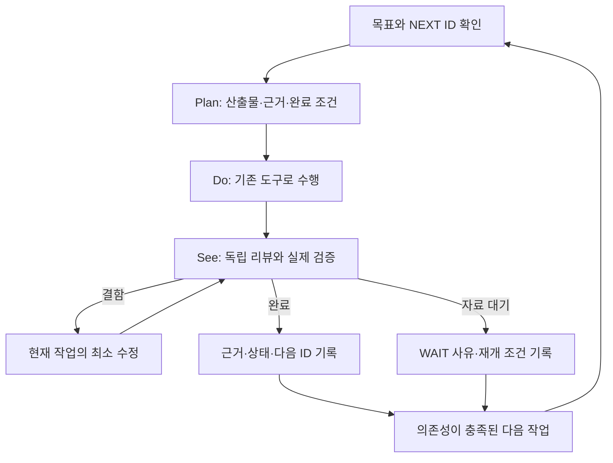

# 엔진 개선 실행 원장 — 목표·진행·리뷰·다음 작업

> **엔진 변경·개선·결함 수정·운영 및 예약·남은 작업을 관리하는 단일 원장.** 새 세션은 이 문서부터 읽고 모든 작업을 ID·우선순위·상태·근거·NEXT에 연결한다. 개별 계획·PR·운영 영수증은 이 원장에 연결하는 상세 근거이며, 별도 문서에 독립된 우선순위 목록을 만들지 않는다. 과거 문서의 미완료 체크박스를 모두 새 작업으로 되살리지 않는다. 이 문서의 날짜 도래나 체크 완료가 주문·배포·새 구독의 승인을 대신하지 않는다.

**Goal:** 좋은 종목을 고르고 실제로 진입할 수 있는 시점을 판단해, 거래·데이터·LLM 비용 후 순수익을 개선한다. 현재 과제는 **KIS와 Toss를 함께 사용하는 자료 경로의 실효성을 확인하고 필요한 소비자에 연결하는 것**이다.

**Architecture:** 기존 도구·원장·예약을 재사용한다. 한 작업마다 Plan → Do → See를 마친 뒤 다음 작업 ID를 명시한다. 기술 개발, 운영 적용, 실측 효과, 경제성 검증을 별도 열로 관리한다.

**Tech Stack:** 기존 Python 엔진·pytest·JSONL 판독기·cron/systemd, 이 Markdown 실행 원장. 별도 작업관리 앱이나 유료 AI 자동 실행기는 만들지 않는다.

**Spec:** 사용자 2026-10-24 요청, [기존 수익성 일정](../superpowers/plans/2026-10-14-profitability-priority-schedule.md), [Toss/KIS 설계](../superpowers/specs/2026-10-23-kis-toss-read-offload-design.md), [현재 실측 계획](../superpowers/plans/2026-10-24-live-readout.md).

## 1. 현재 위치와 이번 작업의 끝

2026-10-24 **12:47 KST** 설치·보존 대조 기준, **22:22 KST R01 자연 실행 후속** 반영(최초 M00와 검증 중 사고는 아래 기록 참조):

- 설치 당시 운영 `44483017`·PID3167991·active. 검증 중 의도하지 않은 1회 재시작과 복구는 [O01](#o01)에 기록했다. O01 소스는 PR #256 병합 `186bc542`에서 별도 설치했고 본체 HEAD는 유지했다. 최신 main 문서와 운영 checkout을 구분한다.
- PR #250 KIS 조회 보완, #252 Toss 보고 helper는 배포됐다. #253 배포 영수증, #254 판독 도구도 병합됐다. #254의 전체9,052검사·PR CI와 병합 후 main CI가 통과했다.
- 현재 Toss는 **16:00 장후 보고에 `/api/v1/prices` REST 가격을 제공하는 경로**다. 별도의 v2 WebSocket 관측 코드가 있어도 장중 스캐너·진입 판단에 병행 연결됐다는 뜻은 아니다.
- 현재 보고의 KIS 조회는 연결되지 않아 Toss의 직접 대체 대상은 pykrx/Naver다. **보고 성공을 KIS 웹소켓 제한 해소나 종목 선정 향상으로 보고하지 않는다.**
- 10월26일 읽기 전용 cron7개 설치 완료, 실제 실행은 대기다. Toss 보고 승인 범위는10월26~30일16:00–16:05, 만료10월30일16:06 KST다. 후보0·휴장·구형 cohort는 성공 표본이 아니다.
- O01은 12:47에 22시 cron 한 줄을 보고 전용 고정 실행으로 교체했다. 설치 전후 PID/InvocationID·보호 5파일·다른 cron 9줄·10/26 고정 파일 450개를 대조했다. 설치 중 추가 재시작은 없었다. [R01 후속](#r01-22시)에서 자연22:00 실행 rc0·Telegram HTTP200 성공 로그를 확인했다. 실제 모바일 수신·가독성은 미확인이다.

**현재 주 과제와 NEXT:** O01 운영 적용과 T02 역할 검토를 마쳤다. **10/26 T03/T04** 실측으로 기존 연결을 인수하고, T05의 추가 적용 필요성을 결정한다. 현재 의미를 보존하는 추가 대체 후보는 없다. 적합한 후보가 없으면 T05를 보류하고 T06 통합 리뷰 → E01 선정·진입 평가로 복귀한다. 별도 보고·청소 개선이 이 주 과제를 대체하지 않는다.

사용자10/24 후속 승인으로 [E01 기존 자료 분석](#e01-offline)을 선행했다.104후보 연결과 ACK 잠금 대기 재현은 완료했다. 경제성은 WAIT이며10/26 고정 실측을 유지한다. E01 복귀 시 이 분석을 반복하지 않고 확인된 단일 개선 후보의 설계 순서를 판단한다.

완료는 “Toss 코드가 있다”가 아니라 **어느 소비자의 어떤 요청을 대신했는지, 원자료/시각/결측을 보존했는지, 실패 때 기존 기능이 유지되는지**가 확인된 상태다. 그 뒤 선정·진입·청산 개선으로 복귀한다.

## 2. 바꾸지 않는 평가 기준

1. 종목 선정과 진입 시점을 분리한다. 실시간 자료·여러 원천은 검증할 강점이며, 일봉 백테스트만으로 무효라고 단정하거나 실시간이라는 이유만으로 우위라고 판정하지 않는다.
2. 전체 KODEX200을 주 비교로 유지하고, 사전 정의한 반도체 제외·현금·업종·엔진 버전·국면을 보조 분석으로 병기한다. 최근 결과에 유리하게 지수나 기간을 소급 교체하지 않는다.
3. 자료 경로의 요청 절감·정확성, 가격 이동, 체결 가능성, 실제 순손익은 각각 다른 결과다. 결측은0 또는 정상으로 채우지 않는다.
4. 실제 현금 부족·매수 중지를 유지한다. 사용자가 철회한 가상1,000만원·모의투자를 다시 시작하지 않는다. 현금 부족을 이유로 선정 입력 점검까지 멈추지는 않는다.
5. 월 LLM USD100·기존 저비용 전환/월초 정책을 유지한다. 과거 비용 불명은 사용자 결정인 `log_and_continue`와 `actual=null`을 보존하며 추가 제출을 다시 선행 조건으로 만들지 않는다.
6. 매일 기술 결함은 고칠 수 있다. 전략 임계값·모델·청산 방식은 결과를 본 뒤 여러 개를 함께 최적화하지 않는다. 기존 유료 R1·새20일 관측·매수 재개는 이 원장으로 자동 활성화되지 않는다.

## 3. 이전 작업의 완료 범위

`구현 완료`는 경제성 검증 완료와 다르다. 아래는 주제별 현재 상태이며 세부 변경 이력은 링크에서 확인한다.

| 작업 묶음 | 구현·적용 | 실제 확인한 것 | 아직 남은 것 / 연결 ID |
|---|---|---|---|
| KIS 직접 오류 피드백·분석 일봉 캐시 | [#250·배포 완료](../superpowers/plans/2026-10-23-kis-toss-read-offload.md) | 회귀/전체검사, 정상 기동·계수 노출 | 실제 스캔 요청/적중/제한 오류·자료 나이/후보 결측: **T03** |
| Toss 보고 연결·별도 helper | [#252·배포/활성화 완료](../superpowers/plans/2026-10-24-toss-report-runtime.md) | 실제 계정의 무접속 설치 검사·설정 보존 | 첫 실제 API·보고 가격 소비·전달: **T04**; 장중/WS 분산: **T02/T05** |
| KIS 차분·Toss 당일 판독 | [#254·병합/별도 설치 완료](../superpowers/plans/2026-10-24-live-readout.md) | 전체9,052검사·독립 리뷰·localhost 스모크·후보0 판독 | 10월26일 예약 결과: **T03/T04** |
| 선정 입력·수급·지표 전달 | [수정/검증 및 후속 반영](../reviews/selection-input-followthrough-2026-10-21.md) | 10/19 반환41건 중 미관측 수급 감점 회피3건·계열 보너스 차이1건; 순위 변화 없음 | 전체 원천의 추가 성과/탈락 후보 모집단: **E02** |
| 판단/호가/장 상태·차단 전 후보 관측 | [10/22 판독 완료](pregate-capture-2026-10-22.md#10월22일-실측-판독--완전-원장과-보조-가격-쌍-4개) | 완전 원장42,487기록·반환19·상위5·보조 가격쌍4. 모두regime 차단 | strict 장 상태 unknown·order_ready/실제 체결 없음. 순수익null: **E01** |
| 주문/체결 귀속·동일 진입 청산 비교 | [귀속 반영](../reviews/order-attribution-2026-10-18.md)·[오프라인 첫 청산 도구](../reviews/first-exit-replay-2026-10-18.md) | 합성 수명주기/실제 ExitManager 첫 판단 재생 | 신규 실거래 표본·PRICE 경로·체결 비용에 의한 우위: **E03** |
| LLM 입력·역할·예산·timeout fallback | [역할 검토](../research/engine-model-allocation-2026-10-15.md)·[비용 불명 정책 배포](../research/gemini-timeout-fallback-2026-10-17.md) | 호출 계약/예산/폴백 검사와 제한된 자격 확인 | 동일 자료·응답 뒤 가격·비용 후 모델 우위, R1 disabled: **E04**. 옛 자동 전환은 **O01** |
| 전문가·미장·아침/장후·복기 보고 | [본문·모바일·결측 보완 배포](../superpowers/plans/2026-10-22-report-content.md) | 생성·일부 API 수락·캐시 결합·정상 종료 | 실제 모바일 수신, 후보 있는 날/주간 표본 내용: **R01** |
| 계좌 순수익·벤치마크 | [수집/대사 도구와 결측표](account-baseline-status-2026-10-13.md) | 과거 주문/체결·권리 수집, 추정 청산29건의 경제적 대사 | 시작NAV·완전 입출금·권리 실지급/세전후·운영비·현재 버전 귀속: **A01**. 계좌 순손익/TWR null |
| 서버/에이전트 산출물 정리 | 과거 정리 이력과 이번 예약 목록은 별개 | 이번에는 파일 삭제 없음 | 자동 보존 만료3건·새 Toss namespace·소비된 timer 정합화: **O02** |

## 4. 순서와 의존성

상태는 `READY`(착수 가능), `DOING`(수행 중), `REVIEW`(검토 중), `WAIT`(명시 조건 대기), `DONE`(해당 산출물 인수), `DEFERRED`(의도적 보류)만 쓴다. `WAIT`에는 기다릴 사건/시각과 재개 행동을 반드시 적는다. 초기 문서 작업 M00은 이 원장이 main에 병합되면 DONE으로 전이하고 NEXT=O01이다. 별도 상태 문서만을 위한 배포/PR 반복 없이 GitHub 병합 영수증으로 확인하며, 다음 작업의 첫 기록에서 표기도 갱신한다.

| 순서 / ID | 상태 | 산출물·착수 조건 | Plan → Do → See / 완료 조건 | 다음 |
|---|---|---|---|---|
| 0 **M00 통합 실행 원장** | DONE | 이번 문서·기존 작업/예약 대조·세션 진입 규칙 | 목적/완료 범위/누락/권한을 독립 검토 → 문서 검사 → 커밋/푸시/PR 통합. 최종 통합 여부는 해당 PR 기록 | O01 |
| 1 **O01 옛 자동 전환 정비** | DONE(구현·설치) | [PR #256](https://github.com/qwq-partners/qwq-ai-trader/pull/256)·12:47 고정 보고 전용 예약 설치 완료. 자연 발송은 R01 | `llm_migration_monitor.py`의 자동 설정 쓰기/재시작을 보고 전용으로 제한하는 최소 변경안 → 운영 설정·예산·보고 보존 회귀 → 독립 중요 리뷰 → 검증된 운영 적용. 완료는 실행 경로에서 자동 쓰기/재시작이 없고 기존 예약과10/26 고정 조건이 보존된 것. 원래 상태 파일을 조작해 우회하지 않음 | T03/T04; 자연22시 R01 |
| 2 **T02 KIS/Toss 역할 확정** | DONE | [소비자 역할표](../superpowers/plans/2026-10-23-kis-toss-read-offload.md#t02) 검토 완료. 현재 의미 보존 가능한 추가 대체 후보 없음; 미래 영구 불가 결론은 아님 | 현재 KIS 소비자/요청종류/빈도와 Toss REST·WS 지원 근거를 매핑. 시각·시장/수정주가 기준·자료 깊이·TTL·실패 동작·권한/기간을 표로 고정. **대체 후보1개 또는 대체 불가 사유**를 리뷰하면 완료. 이미 연결된 보고를 장중 분산으로 세지 않음 | T03/T04 결과 후 T05 |
| 3 **T03 실제 KIS 스캔 판독** | WAIT | 10/26 09:25/09:50 기록과16:12 자동 차분 | 동일 실행·계수 완전성 → TR/source/component별 시도/거절과 분석 적중/합치기/호출 비교 → 후보/자료 나이/결측 대조. 동일 구간 중복 조회 회피와 부하 보정 전후 절감률을 구분. 불충족이면 원인/최소 후속1개를 리뷰 | T04/T05 |
| 4 **T04 Toss 실제 사용 인수** | WAIT | 10/26 아침08:25 cohort·16:00 보고·16:12 판독 | 당일 원래 순위/종목/시각 → 정확한slot/attempt/terminal → 유효 quote의 실제 보고 사용·기존 조회 폴백·API 수락 → 수신 내용 대조. 단계별 확인 범위를 기록. `excluded` terminal은 quote 자체 실패와 구분. 원장 성공만으로 완료 금지 | T05 또는 결함수정1개 |
| 5 **T05 병행 소비자1개 적용(조건부)** | WAIT | T02 역할 표와 T03/T04 검토 결과. 새 목적/기간에 기존 권한이 적용되는지 확인 | 승인 범위 안에 실제 부담/자료 의미를 만족하는 후보가 있을 때만 소비자1개 설계/구현 → 실패·지연·TTL·재연결/중단·비용 회귀 → 독립 리뷰/전체검사 → 고정 적용·짧은 실측. 후보 부재/효과 불명은 DEFERRED, 새 권한 필요는 WAIT로 남긴다. **그 경우도 T06을 진행**하며 확대를 강제하지 않음 | T06(미적용 결론 포함) |
| 6 **T06 자료 경로 통합 리뷰** | WAIT | T03/T04 검토와 T05의 적용 또는 미적용 결정 | KIS 주 경로/Toss 보조·실제 호출 회피·결측·지연·폴백·비용과 선정 결과 보존을 리뷰. 확대/현행 보고 전용 유지/철회/자료 불충분을 명시. **T05가 미적용이어도 E01로 복귀**한다. 이는 Toss 장중 분산 성공이 아니며 미완료 범위·재개 조건은 T05에 남김 | E01로 주 과제 전환 |
| 7 **E01 진입 가격·차단 원인** | 기존 자료 분석 DONE; 경제성 WAIT | [104후보 연결·ACK 잠금 대기 재현](#e01-offline). 사용자10/24 승인으로 분석만 선행, 운영 고정 조건 유지 | regime81/cash23은 기록된 첫 차단. strict 장 상태 충족0·10/22 보조4쌍을 구분. 다음 단일 설계 후보는 관리형 관측 구독 ACK 대기의 수신 루프 차단 해소; 실제 지연·체결·비용 효과는 미확인 | T03/T04→조건부T05→T06 뒤 개선 설계; 경제성 E02/E03 |
| 8 **E02 어떤 종목이 좋은가** | WAIT(경제성); F1/F2 개발·중요 리뷰 DONE·미배포; [W1](#e02-w1) 개발·전체검사·중요 리뷰 DONE·미배포 | [입력/원천 매핑](../reviews/selection-source-map-2026-10-24.md)·수급 연속성 F1/전략 후보 누락 F2 전체검사/중요 리뷰 완료, 최종 통합은 해당 PR 영수증. 경제성은 E01 비교 자료 필요 | 같은 모집단에서 원천 하나 제거 또는 계열 가중 하나만 비교. 시점·선택/거절·중복정보·결측·동일 진입/청산/비용을 보존. 반환 상위5개로 전체 원천 기여를 단정하지 않음 | T03/T04; 경제성 E03 |
| 9 **E03 같은 진입의 청산 비교** | WAIT | 실제 진입 identity·PRICE 경로·설정/ATR·체결/비용 | 기존 도구로 첫 판단과 실행/체결/비용을 분리. 복합 trailing/ATR/사이징 floor 등을 동시에 변경하지 않음. 입력 결측이면 설정 변경 없이 남김 | E04; A01과 연결 |
| 10 **E04 모델·추론 비교** | WAIT | 동일 입력·응답 뒤 시세·입장 조건·비용 한도 | 역할 하나·대안 하나, 지연 후 실제 가능한 가격/회피손실/놓친 기회/불명 비용까지 비교. 공개 벤치마크 순위나 응답 일치율로 거래 모델 승격 금지. R1 재개 조건을 확인한 뒤에만 제한 호출 | E05 |
| 11 **E05 순수익 통합 판정** | WAIT | E01~04의 유효 결과 + A01 | 선정→진입→크기→체결→청산→총비용→계좌/동시간 지수 흐름 리뷰. 다음 적용 가설1개 또는 효과 미입증/중단을 결정. 매수 재개는 별도 사용자 결정 | 다음 가설1개 |

실측 대기 중 **T02 역할표 → O02 비삭제 사전점검 → A01 기존 자료 결측 대사**를 진행했다. T02와 A01의 로컬 대사는 완료했고, O02는 보존기한 도래와 삭제 전 참조 재확인이 남아 있다. 새 증거 없이 같은 검사를 반복하지 않는다. 이는 완료 근거를 앞당기는 준비이며 주 과제 교체가 아니다. 구현 중인 주 작업은1개로 제한하고, 독립 읽기/리뷰만 병렬화한다.

10/24 추가 승인으로 E01의 기존 자료 분석도 선행 완료했다. 표본/원장 제약을 유지한 분석이며 T03/T04의 미래 실측을 대체하지 않는다.

### 기한·병행 트랙

| ID | 상태 / 기한 | 해야 할 일과 완료 조건 |
|---|---|---|
| **D01 개발 CLI 협업** | DONE(로그인·제한 호출·역할 규칙·사용 검증), 계속 적용 | [가짜 도구 응답 재현·수락 계약 보완](#d01-사용-검증). 실제 모델·도구 제한·합산 worker≤3·작성/승인 분리. 실행 성공과 유효 리뷰/내용 수락을 구분한다. 자동 배포 권한이나 도구 사용 샌드박스 확보를 뜻하지 않음 |
| **L01 엔진 CLI 타당성** | 검토 DONE / 엔진 적용 DEFERRED | 장후 연구1개가 비교 후보. 실시간 API 유지, 구독/증분비·지연·구조화 결과·현재 예산/판단 원장 계약을 먼저 검증. 선택 시 E04와 연결하며 현재 T03/T04→T06→E01 주 순서를 바꾸지 않음 |
| **R01 보고 인수** | WAIT(미확인 수신·표본); 10/24 22시 실행/API 확인 DONE | [22시 자연 실행](#r01-22시)은 rc0·HTTP200 로그까지 확인, 모바일 수신·가독성은 대기. 07:00 사진2장·본문,07:30 결합,08:25 후보,16:00 장후,16:30 전문가,20:30 복기/주간 중 아직 미확인인 항목만 다음 자연 발송에서 점검. 후보0/거래0이면 경제 표본 확인은 미완료. 새 디자인 변경은 실제 결함이 있을 때만 하며 T04와 중복 기록하지 않음 |
| **A01 계좌·기준선 대사** | WAIT(경제성 입력); 기존 로컬 대사 DONE | READY 범위는 이미 수집한 KIS 주문/체결/권리와 기존 CLI로 빠진 기간/항목을 확정하는 것. 신규 계좌 API 실조회는 지원/보존 범위·전송 한도·실행창·기존 승인 범위를 확인한 별도 Do 이후에만 진행한다. API로 얻을 수 없는 시작NAV·외부 흐름·권리 지급/세전후·운영비만 추가 증빙 대상으로 남김. 자료가 없으면 계좌 순손익/TWR은null |
| **O02 만료·예약 정리** | WAIT(기한·삭제 전 참조 재확인), 사전점검 DONE | 10/26 점검 후 표시된 cron7개만 정리.10/30 16:06 Toss 승인 만료/송신 종료 확인.11/1·5·6 옛 관측 retention의 정확한 대상/보존/현재 참조·진행 작업을 **삭제 전** 대조. 새 Toss 보고 namespace는11/29 16:06 기한의 별도 제한된 정리 절차 필요. starts/token/unknown/승인·계좌 원장은 삭제 대상으로 확대하지 않음. 검토/설치/실삭제 영수증은 분리 |

## 5. 예약 원장 — 설치와 실제 실행 구분

2026-10-24 확인한 범위는 ubuntu/root crontab, system/user timer, `/etc/crontab`·cron 디렉터리, 저장소 workflow와 봇 스케줄러다. root crontab 없음, user timer/시스템 cron에 추가 QWQ 작업 없음. GitHub는 PR/main 검증이며 배포 예약이 아니다. 봇 내부 항목은 코드/설정 계약이고, 각각의 미래 발송 성공은 아직 확인하지 않았다.

| 종류 | KST 시각 | 현재 상태 / 주의 | 담당 |
|---|---|---|---|
| ubuntu cron | 매일22:00 `qwq-llm-report-only/20261024/run-nightly.sh` | 12:47 보고 전용 고정본으로 교체. 10/24 22:00:01 자연 시작·rc0·22:00:03 HTTP200 성공 로그 확인. 실제 모바일 수신 미확인. 설정/상태 쓰기·모델 승격·재시작 경로 없음 | O01 완료 / R01 부분 인수 |
| ubuntu cron | 평일16:00 / 일요일09:00 `shadow_report.py` | 등록됨. 각각1일/7일·Telegram 보고. 과정 품질 알림이며 신규 유료 모델 비교/순수익 검증 아님 | R01 |
| ubuntu cron4개 | **10/26 09:25·09:50·15:59·16:10** | 고정 `f8ef32eb`로 로컬 계수 기록. 설치 완료, 실실행 대기 | T03 |
| ubuntu cron3개 | **10/26 16:12** | 스캔 차분·보고 차분·Toss 당일slot. 설치 완료, 실실행 대기 | T03/T04 |
| 봇 내부 | 08:25/16:00 후보 보고 | Toss helper는10/26~30의16:00–16:05·당일 cohort 조건. 별도 시스템 timer로 자동 WS를 켜는 작업이 아님 | T04 |
| 봇 내부 | 07:00 미장,07:30/13:00/16:30 전문가,20:30 복기/원장 등 | 기존 일정 유지. 휴장·데이터·이미 실행 여부 조건은 기존 스케줄러 적용. 불필요한 시험 발송/유료 재호출 금지 | R01/A01 |
| system timer | **11/1 09:46:10** | `qwq-entry-capture-retention-20261101.timer` waiting → 10/2 관측 retention service | O02 |
| system timer | **11/5·11/6 09:34:10** | 각각11/5·11/6 retention timer waiting → 10/6·10/7 관측 retention service | O02 |
| system timer | 과거10/2·6·7·8·14·15·16·22 capture,10/16 premarket3개 | enabled/elapsed, 다음 실행 시각 없음. 미래 수집 예약으로 세지 않으며 원본/소비 기록을 보존 | O02 |
| system service | 과거 Toss observer | disabled/inactive. 새 보고 helper와 별개, 재시작하지 않음 | O02 |

10/26 작업은 정확한 날짜/분·운영 HEAD `44483017`·소스 지문을 검사하며 결과를 덮어쓰지 않는다. 파일 부재는0건이나 실패 확정이 아니므로 가드/로그부터 확인한다. cron 항목은 자동 삭제되지 않는다. 판독 결과 경로는 `~/.local/state/qwq-live-readout/20261026/`, 설치/통합 영수증은 `~/.local/share/qwq-live-readout/20261026/`다. 이번 예약 감사의 비공개 근거는 `~/.local/state/qwq-task-audit/20261024/schedule-audit.json`이다. 금액·자격·원문 cron은 이 문서에 넣지 않는다.

**자동화 경계:** 예약된 것은 기록/JSON 판독까지다. 미래의 독립 AI 리뷰·코드 수정·다음 PR을 실행할 에이전트 예약은 없다. 활성 세션에서는 아래 규칙으로 이어가며, 세션이 종료되면 다음 세션이 같은 원장에서 재개한다.

## 6. 완료 → 리뷰 → 다음 작업 규칙



1. 시작할 때 이 문서, 관련 마지막 영수증, 실제 main/운영 버전, 예약 충돌을 확인한다. 변경할 작업 ID·원래 목표에 미치는 영향·완료 조건을 한 문단으로 선언한다.
2. 리뷰 지적은 우선 현재 작업의 하위 수정으로 처리한다. 별도 목적의 발견은 ID/우선순위/기한/의존성을 붙여 대기열에 넣는다. 실제 주문·비용·데이터 유실·무단 재시작 위험만 주 작업을 선점하며, 중단한 ID와 복귀 조건을 남긴다.
3. 구현자 검사 후 독립 리뷰를 받는다. 돈/권한/상태 일관성/운영 변경은 독립 중요 리뷰, 문서는 근거·정합성 리뷰면 된다. 실제 모델 metadata가 없으면 요청 모델과 분리해 미확인으로 기록한다. 같은 diff를 이유 없이 재리뷰하거나 검증된 도구를 다시 만들지 않는다.
4. 결함 수정 후 해당 실패와 영향 범위를 검증한다. 제품 코드 변경에는 관련/전체 검사·비밀 검사·CI를 적용한다. 문서만 바뀌면 링크·상태·diff·비밀 검사를 하고 저장소 필수 CI를 따른다. 문서만을 위해 운영을 재배포하지 않는다.
5. 완료 보고에는 **달라진 기능 / 검증 근거 / 남은 한계 / 운영·예약 변경 여부 / NEXT ID**를 남긴다. 리뷰 승인과 실제 운영 효과는 별도다. 입력 결측을 확인한 작업은 결측표 작성만 DONE이고 경제성 작업은 WAIT로 둔다.
6. 원장·체크포인트·관련 문서를 같은 PR에서 갱신하고 커밋/푸시한다. PR/CI/병합의 최종 상태는 GitHub 영수증을 따른다. 같은 완료 기록을 여러 파일 머리에 계속 복제하지 않는다.
7. 승인된 범위이고 의존성이 충족된 다음 READY 작업은 새 “ㄱㄱ”를 기다리지 않고 이어간다. 새로운 주문·권한 확대·파괴적 삭제 등 기존 범위를 넘는 작업은 구체안과 이유를 제시한다. 과거 고정 예약을 몰래 다시 맞추거나 재사용하지 않는다.
8. 후보0 또는 자료 불충족 때20일 수집부터 늘리지 않는다. 이번 보고 승인의 남은10/26~30 슬롯으로 충족 가능한지 먼저 검토한다. **10/30 만료 시에는 표본이 없어도 유지/추가 자료/중단 결정을 기록**하고 자동 연장하지 않는다. 계좌 증빙은 하루마다 같은 결측을 다시 조사하지 않는다.

### 작업별 기록 양식

기존 상세 계획을 링크하고 아래 한 블록만 이 원장에 추가한다. 긴 로그/코드는 기존 영수증에 둔다.

```text
ID / 날짜 / 담당 / 상태:
PLAN: 원래 목표에 필요한 이유, 산출물, 입력·의존성, 완료/중단 조건
DO: 변경 파일·PR/고정 SHA 또는 읽은 자료, 운영/예약 변경 유무
SEE: 테스트/실측, 독립 리뷰 결과·모델 확인 수준, 잔여 결측/한계
DECISION: 완료 / 최소 수정 / WAIT / 중단 (구현·배포·효과를 각각 표시)
NEXT: 작업 ID, 착수/재개 조건, 중단한 주 과제로 돌아갈 지점
```

## 7. 이번 정리 기록과 다음 세션

**M00 / 2026-10-24 / coordinator / DONE**

- **Plan:** 흩어진 미완료 목록을 재검증해 Toss 병행 사용에서 순수익 검증까지 한 실행 순서로 묶는다.
- **Do:** main `eb4f9923` 기준 주제별 완료 범위·cron10개·미래 retention3개·과거 elapsed timer·봇 내부 일정 대조. 현재22시 자동 전환 충돌을 새 O01로 등록. 운영/예약 변경0.
- **See:** 두 자료 감사와 별도 독립 문서 리뷰 요청 Sol/high, 실제 모델/effort metadata 미노출. 수익성 감사의 최초 cwd 착오를 정정했고 인용한 tracked 파일은 `44483017..eb4f9923` 차이0임을 확인했다. 문서 리뷰의 T05 필수 관문 P1·A01 실행범위/일시적 PR 개수 P2를 반영해 재승인(APPROVE, 새 차단 지적0)을 받았다. 추가 상대 링크/앵커20개·작업 ID15개·diff·비밀 검사 통과, 운영 PID/cron 불변. 제품 코드는 변경하지 않았으며 최종 CI/통합은 이 변경 PR의 근거를 따른다.
- **통합:** PR [#255](https://github.com/qwq-partners/qwq-ai-trader/pull/255), main `603d2ee0`, CI9,052검사 통과.
- **Next:** **O01**. 그다음 **T02**,10/26 기록 도래 시 **T03/T04**. 주 과제의 인수 **T06** 뒤 **E01**로 돌아간다.

다음 세션용 지시:

> 최신 main의 `docs/operations/execution-roadmap.md`를 읽고 마지막 NEXT ID부터 Plan→Do→See로 이어가라. 운영 checkout이 옛 문서일 수 있으므로 main 문서와 실제 운영 SHA를 구분하라. 이미 완료된 구현은 재개발하지 말고 미확인인 실제 효과만 확인하라. 현재 주 과제는 Toss/KIS 병행 자료 경로이며 O01/T02는 완료, 다음은10/26 T03/T04→조건부T05→T06→E01이다. 예약·매수 중지·USD100·가상자금 미사용을 보존하고, 각 작업 리뷰 뒤 상태/근거/NEXT를 갱신하라. 조건 충족 다음 작업은 같은 세션에서 이어가되 새로운 외부 실행 권한을 이 문서에서 추론하지 마라.

## 8. 자동으로 되살리지 않을 항목

- 가상1,000만원/모의투자, 사용자가 미적용으로 정한 실시간 RAG: **취소/미적용 유지**.
- 새20일 관측·유료 R1·매수 재개: **조건 미충족/별도 결정**, 달력만으로 시작하지 않음.
- ETF Core·3분할·H4·복합 trailing A/B·Rule3-3 완화·사이징 floor0.50: **가설/보류**. E01~05에서 선택한 단일 가설에 해당할 때만 근거와 별도 설계로 재개한다. 기존 H1~H3 부정 결과를 현재 버전의 보편적 실패나 새 가설 성공으로 바꾸지 않는다.
- 에이전트 캐시/과거 worktree 대규모 삭제·보고서 취향상 재디자인: 현재 주 과제의 선행 조건이 아님. 자원 문제/구체적 결함과 보존 검증이 있을 때만 별도 ID로 다룬다.

## O01

2026-10-24 / coordinator / DONE(구현·설치), 자연 실행/API R01 확인·모바일 수신 WAIT

- **Plan:** 현재 경제성/예산 정책과 충돌하는 옛22시 자동 모델 전환을 보고 전용으로 정비한다. 설정/상태 쓰기·재시작 함수를 제거하고 기존 자료 요약·알림은 유지한다. 결과 일치율은 정확도/순수익 증거가 아니며 추가 수집·모델 변경을 권하지 않는다.
- **Do:** `scripts/llm_migration_monitor.py`와 격리 회귀를 수정했다. PR [#256](https://github.com/qwq-partners/qwq-ai-trader/pull/256)의 CI 성공 뒤 `186bc542`를 12:47:26 KST 고정 5파일 artifact로 별도 설치하고 기존 22시 cron 한 줄만 교체했다. 운영 HEAD와10/26 판독 예약은 유지했다.
- **검증 사고:** 12:14:51 KST 기존 코드 RED 시험의 마지막 케이스에서 `subprocess.run` 대역이 누락되어 운영 봇이1회 재시작됐다(PID3125313→3167991). coordinator 실수이며 정상 계획 실행으로 취급하지 않는다. 공통 fixture의 명령 차단을 보완했다. 운영 HEAD `44483017`, 보호4파일 지문·cron10개 불변, 복구ready/미완료 원장0 확인. `NRestarts=0`은 수동 재시작 부재의 근거가 아니다.10/26 계수 비교는 그날 두 스냅샷의 동일 실행 여부로 판단하며 이번 전후 계수를 비교하지 않는다. 비공개 근거 `~/.local/state/qwq-task-audit/20261024/o01-test-incident.json`.
- **See:** 관련 회귀에서 자동 전환 재현 뒤 보고 전용 동작을 확인했다. 실제 JSONL 손상3건을 포함해23개 통과·격리 위반0, 고정5파일 합성 smoke 통과. 독립 중요 리뷰 요청Astra/xhigh, 실제 모델/effort 미노출; 파서 예외/설치 실패 보류 P2 2건 수정 후 미해결0 승인. 최종 전체9,075 passed/2 skipped/2 xfailed·격리 위반0·문법/비밀 검사 통과(825.19초). 첫 전체 실행은 리뷰 수정 반영을 위해2,168통과 시점에 중단했으며 최종 성공과 구분한다. PR CI도 9,075 passed/2 skipped/2 xfailed(487.65초)로 성공했다. 설치 후 별도 대조에서 PID/InvocationID·보호 5파일·상태·다른 cron 9줄·10/26 artifact 450파일·사용자 override를 보존했고 manifest/권한 검사가 통과했다. 이 설치 중 추가 재시작과 시험 알림 발송은 없었다.
- **Evidence:** 설치 영수증 `~/.local/state/qwq-llm-report-only/20261024/install-receipt.json`, 별도 대조 `~/.local/state/qwq-task-audit/20261024/o01/post-install-verification.json`, 로그 `~/.local/state/qwq-llm-report-only/20261024/nightly.log`. source manifest `2f61bcaa6bf51e477bdda0ccade8b3570fbbfb7a10f115da3ee0dcce45952c52`, wrapper `054c42c7c0fb74228d79315212ea42813110d1b4928acb57e754292344a19f45`. 운영 checkout의 옛 monitor는 다음 본체 배포 전까지 수동 실행하지 않는다.
- **Next:** T02 역할표 검토 완료,10/26 **T03/T04**. 자연22시 종료 코드·Telegram API 수락은 아래 **R01**에서 확인했다. 실제 수신은 별도로 남기며 설치 성공으로 대체하지 않는다.

<a id="r01-22시"></a>
### R01 — 10월24일22시 보고 전용 자연 실행

- **Plan:** 설치한 고정 보고의 첫 자연 실행을 읽기 전용으로 확인한다. 종료·API 수락·실제 수신을 분리하고 시험 발송이나 추가 모델 호출을 하지 않는다.
- **Do:** 22:22 KST에 기존 `nightly.log`와 설치 영수증·고정 소스를 대조했다.22:00:01 시작,22:00:03.209 발송 성공 로그1건, `llm_report_exit=0`1건이다. source5파일 manifest 검사rc0·wrapper 지문·crontab 전체 지문은 설치 시와 동일하다. 운영 HEAD `44483017`, 기존 PID3167991 존재/작업 경로와 override의 미커밋 수정 표기도 확인했다. override 내용 지문·systemctl/InvocationID·현재 active 상태는 이번에 재조회하지 않았다.
- **See:** 고정 Telegram 소스의 성공 로그는 HTTP200 분기와 연결된다. 응답 본문·message_id·실제 모바일 수신/가독성은 보존 근거가 없어 미확인이다. 본문은 `shadow 로그 없음`과 과거 상태/현재 모델의 구분, 정확도·순수익 증거가 아니라는 한계를 명시한다. 비교 자료 부재를 이유로 유료 비교나 모델 승격을 시작하지 않는다. 이번 확인에서 운영·설정·예약 변경, 재시작, 시험 발송·유료 LLM 호출0이다.
- **Evidence:** 비공개 `~/.local/state/qwq-task-audit/20261024/r01-nightly/natural-execution.json`. 기존 원본 로그와 설치 영수증을 변경하지 않았다. 제품 코드 변경은 없으며 문서 검사·독립 리뷰·CI/통합 결과는 이 후속 PR을 따른다.
- **Next:** R01 전체는 WAIT다. 아직 미확인인 자연 보고/모바일 수신만 후속 확인하며 주 과제를 막지 않는다.10/26 08:25 cohort → 09:25/09:50 KIS 스캔 계수 → 15:59 계수/16:00 보고/16:10 계수 → 16:12 차분·slot 판독, **T03/T04→조건부 T05→T06→E01** 순서를 유지한다.

<a id="r01-delivery-status"></a>
### R01 — 주간 보고 전송 결과 전달

2026-10-25 / coordinator / 구현·독립 리뷰 DONE, 운영 미적용; 전체검사/CI·통합은 이 변경 PR 영수증

- **Plan:** 00:26 KST 점검에서 오늘09:00/22:00은 아직 실행 전이다. cron10개·22시 고정본·10/26 판독7개와 원래 source 지문을 대조했다. `shadow_report.py`는 `send_alert()`의 false를 버리고 완료 문구/rc0을 남기는 구조여서 이를 무접속 재현 후 수정한다. 실제 당일 전송 실패를 확인한 것은 아니다.
- **설계 선택:** 로그 문구를 외부 wrapper가 추정하는 방식 대신 기존 notifier의 bool을 CLI까지 전달한다. 성공만 완료/rc0, false·예외는 실패/rc1, `--telegram` 없는 출력은 rc0·발송/환경 로딩 없음이다. 예외는 클래스명만 남긴다. 추가 재시도·다른 알림 채널·보고 내용/평가 기준 변경은 없다.
- **Do 순서:** 실제 CLI의 성공·false·예외·출력 전용 회귀를 먼저 실패 확인 → `scripts/shadow_report.py` 최소 수정 → 관련/전체 검사·비밀 검사 → 독립 리뷰 → 문서/커밋/PR 통합. 상세 근거는 [보고 후속](../superpowers/plans/2026-10-22-report-content.md#r01-delivery-status)과 비공개 `~/.local/state/qwq-task-audit/20261025/`에 보존한다.
- **See:** 실제 CLI의 실패 반환·미확인·예외3건이 rc0으로 끝나는 실패를 재현했다(3 failed/2 passed). 최소 수정 후 신규5건과 기존 본문/22시 보고를 포함한 관련56 passed/rc0·격리 위반0. 독립 Sol/high 리뷰 APPROVE·P0/P1/P2 0, 실제 model/effort metadata 미노출. 관련 회귀5건도 독립 통과했다. 전체 verify·필수 CI가 모두 성공한 뒤 병합하며 최종 결과는 이 변경 PR 영수증을 따른다.
- **운영/Next:** 운영 HEAD/cron은 유지한다. 오늘09:00에는 기존 코드가 실행되므로 `[전송 완료]`나 rc0만으로 수락 판정하지 않는다. 자연 성공/실패 로그가 없으면 미확인으로 남긴다. 수정의 운영 적용은10/26 T03/T04 고정 실측 뒤 통합 적용 검토에 포함하고, 본래 T03/T04→조건부T05→T06→E01 순서를 유지한다.

## T02

2026-10-24 / coordinator / DONE

- **Plan:** KIS 소비자와 Toss 지원·시각·시장·가격 기준·TTL·실패/권한 계약을 대조해 추가 대체1개 또는 부적격 근거를 확정한다.
- **Do:** [역할표](../superpowers/plans/2026-10-23-kis-toss-read-offload.md#t02)에 캐시/직접 일봉·실시간/실행·수급/시장자료와 Toss REST/WS를 구분했다. 공개 명세만 재조회했고 시세·토큰·계좌 API와 운영 설정 변경은0이다.
- **See:** 분석 일봉의 공급자 교체 초안은 KIS 원주가와 Toss 수정주가 기본값·시장·오늘 행의 의미가 달라 **미적격으로 정정**했다. 직접 소비자/부분반환과 공개 REST호가를 추가했다. 분석/독립 문서 리뷰 요청Sol/high, 실제 모델/effort 미노출; P1 2건·P2 1건 반영 후 재승인, WS 연결 추가의 한정 검토도 승인됐다.
- **Decision:** T02 산출물 DONE, KIS 요청 절감·Toss 장중 연결·순수익 효과는 미판정. T05는 T03/T04와 자료 동등성 검토를 기다리며, 후보가 없으면 DEFERRED→T06→E01로 복귀한다.
- **Next:** 10/26 **T03/T04**. O01의 실제 설치 상태는 위 기록을 따른다.

## O02

비삭제 사전점검 — 2026-10-24

- **Plan:** 이미 예약된 보존기한 작업이 정확한 과거 cohort만 대상으로 삼는지 확인한다. 이번에는 삭제·timer 변경·새 정리 작업 설치를 하지 않는다.
- **Do:** systemd timer/service와 날짜별 BindReadOnlyPaths·고정 deployment/retention 소스를 읽었다.11/1 09:46:10→10/2 cohort,11/5 09:34:10→10/6,11/6 09:34:10→10/7로 연결되고 각각 승인 retention_at보다10초 뒤 실행된다. 세 경로는 `/var/lib/qwq-toss-observer/cohorts/<각 plan hash>/observations.jsonl`이며 새 보고 namespace `/var/lib/qwq-toss-report`와 별개다.
- **See:** 고정 소스는 기한·서비스 비활성·sender lock·소유권/경로 검증 후 해당 observations 파일만 지우고 retention 영수증을 남긴다. 원문/계좌/auth/starts를 넓게 삭제하는 경로는 이번 검토 범위에서 없다. 일반 사용자로는 메타데이터 접근이 거부됐으나 기존 서비스 계정의 읽기 전용 stat으로3개 대상의 존재·소유UID997·0600과 크기3,603,165/4,298,388/9,010,436바이트를 확인했다. 원문을 읽거나 권한을 변경하지 않았다. 삭제 시점의 활성 참조는 다시 확인해야 한다. 실행 코드의 범위 검토를 실삭제 승인/완료로 표시하지 않는다.
- **Decision:** 비삭제 사전점검 DONE, **O02는 WAIT(기한·삭제 전 참조 재확인)**.11/1 전에 실제 실행 계정으로 대상 존재/보존·활성 참조/진행 작업을 확인하고, 필요한 과거 평가 입력을 근거 없이 지우지 않는다. 소비된10/26 cron7개 제거는 실제 판독 뒤, 새 Toss namespace11/29 정리 절차는10/30 만료 확인과 함께 준비한다.
- **Evidence:** `~/.local/state/qwq-task-audit/20261024/o02-preflight.json`, `o02-targets.json`. 설치/삭제 영수증은 아직 없다.

## A01

기존 자료 대사 — 2026-10-24

- **Plan:** 새 계좌 호출이나 사용자 재요청 전에 이미 확보한 자료의 무결성과 남은 입력을 구분한다.
- **Do:** 기존 권리 수집 manifest23파일의 바이트/sha256을 모두 재검증했고 기존 기준선 JSON도10/13 지문과 같다. 요청 기간2025-01-01~2026-10-01,22창(complete3·empty19),8행(03코드7·04코드1),금액 파싱 불가0을 기존 문서와 대조했다. 새 시장/계좌 API 호출0, 금액·계좌 식별자 공개0이다.
- **See:** 이번에 확인한 자료는 늘어나지 않았다. 원장 손상과 자료 결측은 다르다. 2024년 이하 보존범위, 권리코드 의미·배정금액의 지급/세전후, 시작 순자산·완전 외부 입출금·운영비·현재 버전 귀속은 기존 미해결 상태다. 실현손익과 추정 청산29건의 경제적 대사를 계좌 순수익/TWR로 바꾸지 않는다.
- **Decision:** **A01의 기존 자료 대사 DONE / 경제성 입력 WAIT**. 관련 증빙·확인 가능한 API 계약이 새로 확보될 때 재개하며 같은 결측을 매일 재조회하지 않는다. `account_net_profit`/`account_twr`은null 유지한다.
- **Evidence:** `~/.local/state/qwq-task-audit/20261024/a01-local-reconciliation.json` 및 [기존 기준선 문서](account-baseline-status-2026-10-13.md). 이 확인은 로컬 원본23파일과 기존 기준선에 한정하며 모든 가능한 과거 자료를 조사했다는 뜻이 아니다.

### 10월24일 후속 문서 통합 검증

O01 설치·T02 역할표·O02/A01 대사의 상태와 NEXT를 8개 문서 및 비식별 영수증에 대조했다. 독립 문서 리뷰 요청 Sol/high, 실제 모델/effort metadata 미노출. CHANGELOG의 대상 파일 존재 확인 문구를 정정한 뒤 APPROVE, 미해결 P0/P1/P2 0건이다. 새 상대 링크/앵커13개·변경 파일 비밀 패턴·diff 검사를 통과했다. 제품 코드 변경은 없으며, 커밋/푸시/최종 CI·통합 결과는 이 문서 변경 PR을 따른다. 비공개 검토서: `~/.local/state/qwq-task-audit/20261024/task-followthrough-final-review.md`.


## E02 입력 점검

위키 입력 후속은 [E02-W1](#e02-w1)에 기록한다. 이 하위 작업은 T03/T04 대기 중 기존 입력을 정비하며 주 순서를 변경하지 않는다.

2026-10-24 / coordinator / 입력 매핑·F1/F2 개발/중요 리뷰 DONE, 운영 미배포, 경제성 WAIT

- **Plan:** T03/T04 실측 대기 중 장중/배치 선정 원천을 읽기 전용 매핑한다. 이번 점검에서 발견한 **E02-F1 수급 연속성**만 최소 수정한다. 기존 `_record_supply_demand`는 양성 기록만 남겨 확인 공백·후보 누락 뒤에도 과거 가점을 유지한다. 현재 스캔의 참여 표시가 없는 종목의 연속 이력만 끊고, 3회 시작·회당2점·최대15점·일자 초기화·36개 상한을 유지한다. 공백을 순매도/0으로 간주하거나 별도 감점을 주지 않는다.
- **Do:** 실제 `screen_all`과 수급 기록/가점 메서드를 사용하는 합성 재현에서 5 failed / 3 passed를 확인했다. 원천/관련 없는 외부 보정은 대역이고 운영 상태·외부 네트워크 접근0이다. 코드 변경 전 실패 근거는 `~/.local/state/qwq-task-audit/20261024/e02/red.log`다.
- **See:** 신규8건을 포함한 관련173 passed, 전체 verify9,083 passed/2 skipped/2 xfailed·rc0(735.40초), 문법/비밀 검사·격리 위반0. 독립 Claude Opus/high 리뷰는 실제 `claude-opus-5` 응답/terminal 성공을 확인했고 실효 effort는 미노출이다. 첫88KB 검토는180초 제한으로 미완료; 좁힌 코드 검토133.717초 뒤 정책 ID/기존 관측 문맥59.087초 대조로 APPROVE/P0/P1 0을 받았다. 로그 보완은 비차단, 부재 판정 전용 ID 변경 요청은 과거 원장 호환 근거로 철회됐다. 호출 횟수/보고 폴백 한계를 문서에 반영했고 나머지 경미한 정리 의견은 같은 보고서에 보류했다. 최종 CI/통합은 이 변경 PR 영수증을 따른다.
- **운영/비용 경계:** 운영과10/26 고정 HEAD/예약은 유지하며 배포하지 않는다. 개발 검토의 두 완료 호출 표시 추정비는 합계 약$0.6244이며 첫 timeout 비용과 실제 추가 청구액은null이다. 이를 엔진 원장에0 또는 확정 청구액으로 합산하지 않는다. 현행 캐시의 같은 응답 재사용을 새 순매수 사건으로 검증한 것으로 주장하지 않는다.
- **입력 매핑:** [장중/배치 근거와 한계](../reviews/selection-source-map-2026-10-24.md)를 작성했다. 장중은 coordinator, 배치는 Sol/high가 독립 분석했으며 실제 served model/effective effort는 미노출이다. 원천 편입/내부 거절 전체 모집단과 공급자 원시각 공백을 확인했다. 기존10/19 한정 산술을 새 수익 실험으로 재집계하지 않았다.
- **F1 통합:** [PR #259](https://github.com/qwq-partners/qwq-ai-trader/pull/259), main `abd8040c`에 병합했다. CI도9,083 passed/2 skipped/2 xfailed로 통과했다. 이 통합은 운영 반영을 뜻하지 않는다.
- **Next:** 아래 F2 검증/통합 뒤 본래 T03/T04→조건부 T05→T06→E01 순서로 돌아간다. 수정의 실제 선정/순수익 영향은 개발 검증과 별개다.

<a id="e02-w1"></a>
### E02-W1 — 위키 실사용·리서치 수집일

2026-10-24 / coordinator / 개발·관련/전체 검사·중요 리뷰 DONE, 운영 미배포

- **Plan:** 사용자 요청으로 위키 실제 소비와 오래된 근거를 점검. 연구행만 기존30일 기준으로 제한하고 거래 교훈·원문을 보존한다. [설계·재현·검증 정본](../reviews/wiki-context-audit-2026-10-24.md).
- **Do:** KST 수집일0~30일 연구행, 연도 누락/미래/잘못날짜 제외, 최신 연구행 우선 전달·역사자료 표시. 팀300자/전체600자 상한·매매/위험 정책·주간 파일 직접읽기는 유지한다.
- **See:** 수정 전11건 실패, 수정 뒤 새15건 포함 관련66검사 통과·운영 상태/외부 네트워크 접근0. 최종 전체9,108검사·문법/비밀 검사와 독립 중요 리뷰 통과. 최종 CI/통합은 이 변경의 PR 영수증을 따른다. 위키 문맥 사용6/120건은 수익 기여가 아니다.
- **NEXT:** 운영 `44483017`·10/26 고정 예약 유지. T03/T04→조건부T05→T06→E01 복귀. E04 동일입력 비교에서 위키의 선택/진입·응답 지연·비용 기여를 평가하며 새 수집/유료 비교를 자동 시작하지 않는다.

### E02-F2 — 비활성 전략의 후보 점유 제거

2026-10-24 / coordinator / 개발·중요 리뷰 DONE, 최종 CI/통합은 해당 PR 영수증, 운영 미배포

- **Plan:** `abd8040c`에서 실제 RSI2/SEPA 필터를 동시 통과하는 같은 종목과 BatchAnalyzer 설정 배선을 재현한다. 활성 후보만 VCP 제외 집합·종목 중복 제거에 참여시킨다. 전략 임계값/점수·활성 전략 간 우선순위·VCP 후단 복구 정책은 유지한다.
- **Do:** 신규10건 중 수정 전8 failed/2 passed. 합성 설정 RSI2=false/SEPA=true인데 RSI2 행만 반환되고 소비자에서 삭제되어 SEPA 생성기가 빈 목록을 받는 것을 확인했다. 비활성 전략의 VCP 차단도 재현했다. SwingScreener에서 필터 호출 전에 enabled를 적용했다. 누락 기본값은 기존 배치 소비자와 동일하게 RSI2=false/SEPA=true, VCP 독립라인=true를 유지한다. config None/빈 dict/키 누락과 명시 false를 회귀로 구분했다.
- **See:** 관련250 passed/rc0, 운영 상태·외부 네트워크 접근 시도0. 전체 verify9,093 passed/2 skipped/2 xfailed·rc0(732.67초), 문법/비밀 검사·격리 위반0이다. 독립 Claude Opus/high 중요 리뷰는 APPROVE/P0/P1 0이다. 최초58KB 검토는180초 제한으로 미완료였고,29KB로 범위를 줄인 검토137.699초와 지연 import 문맥 확인31.053초는 정상 완료됐다. 테스트 patch 타깃 지적은 생성자 내부 import 근거로 해소했다. 실제 응답 모델은 `claude-opus-5`, 실효 effort는 미노출이다. 두 완료 호출의 표시 추정비 합계 약$0.5001, 최초 timeout 비용과 실제 추가 청구액은null이며 엔진 확정 비용으로 합산하지 않는다. Sol/high의 설정/문서 검토는 차단 발견0이며 두 표현 보완을 반영했다. 실제 모델·실효 effort metadata는 미노출이다. 근거는 `~/.local/state/qwq-task-audit/20261024/e02-f2/`에 남긴다.
- **경계:** RSI2와 SEPA가 모두 활성인 경우 score0 동점의 RSI2 우선·한 종목 한 후보를 유지한다. 활성 SEPA가 나중에 점수 미달이어도 VCP로 복구하지 않는 기존 정책도 그대로다. VCP=false는 독립 후보만 끄며 코드상 탐지/캐시/오버레이 경로는 보존한다(신규 회귀의 직접 검증은 독립 후보 off). 운영 프로세스의 실효 설정/dirty override는 이번에 조회하지 않았다. VCP만 활성일 때 배치 분석기가 시작되지 않는 기존 런처 조건은 범위 밖이다. 실제 발생 빈도·복구 후보 수·수익 영향은 미확인이다.
- **운영/NEXT:** 운영 `44483017`과10/26 예약을 유지한다. F1/F2는 배포하지 않았으며 T03/T04 고정 실측 뒤 통합 적용 시점을 정한다. 최종 CI/통합 결과는 이 변경 PR 영수증을 따르며, 통합 뒤 T03/T04→조건부 T05→T06→E01로 복귀한다.

<a id="e01-offline"></a>
## E01 — 기존 자료 분석 선행

2026-10-24 / coordinator / 분석 DONE, 제품 수정 미착수·경제성 WAIT

- **Plan:** 사용자 승인으로10/19~22 원장·기존 판독을 연결해 비교 가능 범위와 진입 준비 지연을 확정한다. 원래 시점/버전·표본 제한을 유지하고 새 수집·정책 변경 없이 수행한다.
- **Do:** [상세 분석](../research/entry-readiness-offline-2026-10-24.md). 5스캔104후보를 선정 근거·첫 차단·선언 소스로 연결, 원본/사본 지문·해시 체인·study/window/frame 검증·원시 독립 재집계를 수행했다. 기존19일 게이트·20일 strict·22일 strict/보조 후보 결과 일치,21일 불완전 판독 거부 유지다.
- **See:** 기록된 regime81/cash23·signal_created0, strict 상태 충족0·22일 보조4쌍. 구독15개 전송은2.106~2.129초, 같은 잠금의 ACK 처리가 묶음 뒤로 지연되는 구조를 실제 클래스/Event로 재현했다.22일5위 allocation→CNT received6.418303초의 남은 원인은 미확정이며 앞선 전송 시간을 빼서5초 통과로 바꾸지 않는다.1위 준비 전/후 ask차이+0.234192%는 가격 기준 변화 사례이며 실제 슬리피지/수익이 아니다.
- **Decision:** 다음 개선 후보1개는 요청 간격·상한·세대/불명 상태를 보존하며 ACK 대기의 수신 루프 차단을 줄이는 설계다. 제품 변경은 미착수이며 독립 중요 리뷰·검증 후 적용을 판단한다. 모델 고급화·점수/시장 방어 완화·새 관측 기간 연장은 이번 근거로 선택하지 않는다.
- **Evidence/검증:** 비공개 `~/.local/state/qwq-task-audit/20261024/e01-offline/`. 소스 분석·재현 제안은 요청Sol/high·실제 metadata 미노출; coordinator가 실제 venv·logger로 무접속 재현rc0을 별도 확인했다. 독립 최종 문서 리뷰 요청Sol/high·실제 metadata 미노출, APPROVE/P0/P1 0. 비차단 P2의 strict 장 상태 표현을 명료화했다. 문서 검사·CI/통합은 이 후속 PR 영수증을 따른다. 원본/기존 결과 보존·추가 API/유료 LLM/주문/재시작/배포0이다.
- **NEXT:** R01의 아직 미확인 자연 보고는 별도 확인. 본래10/26 **T03/T04→조건부T05→T06** 뒤 E01 단일 개선 설계로 연결한다. 기존104건 분석을 반복하지 않으며 E02~E05 경제성 입력 결측을 유지한다.

## D01/L01

2026-10-24 / coordinator / 개발 협업 적용·타당성 검토 완료, 엔진 도입 DEFERRED

- **Plan:** 사용자가 다시 로그인한 Claude를 Codex와 함께 활용하고, 엔진 API를 CLI로 대체할 가치가 있는지 현재 호출 계약으로 판단한다. 개발 생산성과 거래 판단의 안정성·순수익을 구분한다.
- **Do:** 현재 호스트의 Claude Max/Codex ChatGPT 로그인 상태와 CLI 버전을 확인했다. Codex Sol/high에 코드 계약 분석, Claude Opus/high에 도구 없는 별도 설계 검토를 병렬 배정했다. [역할 분담·공식 근거·비교 후보](local-development.md#cli-collaboration)를 기록했다. 운영 코드·설정·예약·배포 변경0이다.
- **See:** Claude 호출 exit0/terminal success, 응답·usage metadata에 실제 `claude-opus-5`, 도구/MCP0, 76.610초. 요청 high의 실효 effort는 미노출이다. 표시 비용 약$0.19739는 실제 추가 청구액이 아니며 actual=null. Codex 분석은 요청 Sol/high, 실제 metadata 미노출. CLI를 전면 대체하지 않는 권고는 채택하되, 비용 불명 전면 차단 권고는 기존 사용자 `log_and_continue`와 충돌해 채택하지 않았다. 이번 개발 검토는 엔진 품질/속도 A/B 시험이 아니다.
- **Decision:** D01의 개발·리뷰 협업은 즉시 적용한다. L01은 검토 완료, 제품 적용 DEFERRED. `POST_EXIT_RESEARCH`의 운영 밖 고정 입력 재생이 가장 작은 후속 후보이며, 현재 진입8~12초·포지션 판단·예산·decision_available_at 계약은 기존 API로 유지한다.
- **문서 검증:** 독립 Sol/high 문서 리뷰 APPROVE(P0/P1 0). 비차단 P2인 미검증 컨테이너 배치 암시를 “호스트에서 사용 가능한 CLI”로 정정했다. 새 상대 링크/앵커10개·비밀 패턴·diff 검사 통과, 제품 코드 변경 없음. 검토서는 위 비공개 경로의 `independent-docs-review.md`, 인증 재확인은 `cli-auth-check.json`이다. 최종 CI/커밋/통합은 이 문서 변경 PR을 따른다.
- **Next:** 본래 **T03/T04→조건부 T05→T06→E01**. L01 실험을 선택할 때만 E04의 역할 하나 비교로 연결하며 새20일 수집/유료 R1/배포를 자동 시작하지 않는다. 실제 로그인·한도는 이후 배정 때 재확인하며 이번 성공을 영구 가용성으로 보지 않는다.

<a id="d01-사용-검증"></a>
### D01 사용 검증 — 가짜 도구 응답과 리뷰 수락

- **Plan:** 사용자 별도 요청으로 최근 Claude 시간 초과와 부적합 응답을 조사한다. 최대3회·Opus/high·도구/MCP0·인증/권한 유지, coordinator가 실제 호출하고 Sol/high는 독립 읽기 분석을 담당한다. 제품 코드·운영·예약은 변경하지 않는다.
- **Do:** [상세 보고](../reviews/claude-cli-usage-audit-2026-10-24.md). CLI2.1.310·Max 로그인·실제 Opus 응답 확인. 과거와 같은 입력으로 가짜 Glob/결과 텍스트를 재현했다. 같은 입력에 정적 검토/출력 계약을 추가한 경우와 결함 있는 소스의 제어 실험을 비교했다.
- **See:** 3회 모두 실행 완료·실제 `claude-opus-5`, 실효 effort 미노출.43.692초 재현은 내용 거부;40.535초 후속과22.076초 결함 검토는 각각 APPROVE/REQUEST_CHANGES 내용이지만 단일 JSON 코드블록 때문에 원래 형식 검사 실패. 원본을 보존한 별도 정규화 검사에서는 적합했다. 오프라인 계약9+정규화10건, 알려진 반례2개 확인. 과도한 P0 분류는 채택하지 않았다. 표시 추정비 합계$0.428506·실제 증분 비용null, 엔진 원장 변경0.
- **Decision:** [호출·수락 계약](local-development.md#claude-result-contract)을 필수로 적용한다. 실행/형식/내용 판정 분리, 가짜 실행 결과 거부, 명확한 정적 검토 역할, 단일 코드블록의 제한된 처리와 원본 보존. 비공개 진단 실행기를 공용 자동화 구현 완료로 세지 않는다. 과거 부적합 응답으로 병합한 사실은 없고 독립 대체 리뷰 근거를 유지한다.
- **독립 검토/통합:** Sol/high 읽기 분석·최종 문서 리뷰 APPROVE(P0/P1/P2 0), 요청 모델/effort 외 실제 metadata 미노출. 새 링크/앵커13개·diff/비밀 패턴 검사 통과. 보고서는 비공개 근거 폴더의 `independent-audit.md`/`independent-doc-review.md`이며 최종 CI/통합은 이 변경 PR 영수증을 따른다. 제품 코드 변경 없음·운영 미배포.
- **NEXT:** 기존 **T03/T04→조건부 T05→T06→E01**. 이번 결과만으로 엔진 CLI 도입·추가 유료 실험·도구 권한 확대를 시작하지 않는다.

<a id="d01-opus55"></a>
### D01 모델 선택 — 구독 CLI Opus5.5

- **Plan:** 사용자 승인에 따라 개발 Claude 호출을 Opus5.5/high 우선으로 변경한다. 모델 가용성을 작은 정적 검토로 확인한 뒤 호스트 라우팅 정본·프로젝트 문서를 갱신하고 새 세션의 지침 전달을 확인한다. 최대2회·각120초·표시 비용 상한$1·도구/MCP0, 엔진·운영·예약 변경 없음.
- **Do/See:** 기존 Max 구독 CLI2.1.310의 실제 `claude-opus-5-5` 응답 확인, 첫 결함 검토12.442초·새 세션 정책 전달22.259초·둘 다 process0/terminal success. 단일 JSON 코드블록 정규화 후 각각 REQUEST_CHANGES/APPROVE 내용 적합을 확인했다. 원래 진단 rc1과 원본을 보존한다. 요청 high·실효 effort 미노출, 표시 추정비 합계$0.1607428·실제 추가 청구액null. 전달 시험은 safe mode의 명시 stdin 주입이며 자동 파일 탐색 검증이 아니다.
- **적용/검토:** 호스트 정본의 Claude 역할2곳과 날짜별 선택 근거를 갱신했다. 기존 entry2파일의 정본 참조·불변과 Codex TOML 파싱/불변 확인. 최초 독립 Sol/high 리뷰의 오래된 별칭 허용·권한 범위 문구·effort 표현3건을 반영하고 재승인받았다. 두 번째 Claude 호출이 지적한 “Claude 배정에만 적용” 범위 명확화도 독립 최종 APPROVE 뒤 반영했다. 새 링크/앵커7개·입력/응답/실행기 지문·diff/비밀 패턴을 검사한다. 비공개 근거는 `~/.local/state/qwq-task-audit/20261024/opus55-qualification/`이며 CI/통합은 이 변경 PR 영수증을 따른다. 실제 모델·실효 effort가 미노출인 native 리뷰는 요청 Sol/high로만 기록한다.
- **Decision:** 새 호출은 `claude-opus-5-5`를 명시한다. 과거 Opus5 실측과 Fable 거절 폴백 이력을 소급 변경하지 않는다. 모델 신원 확인과 리뷰 정확성·최종 수락을 구분하며 도구 사용 샌드박스 확보로 해석하지 않는다. [현재 선택·역할표](local-development.md#claude-opus55).
- **NEXT:** 검증/문서 통합 후 **T03/T04→조건부 T05→T06→E01** 복귀. 엔진 API 모델이나 대화형 사용자의 저장된 CLI 기본값은 이 작업 범위가 아니다.
