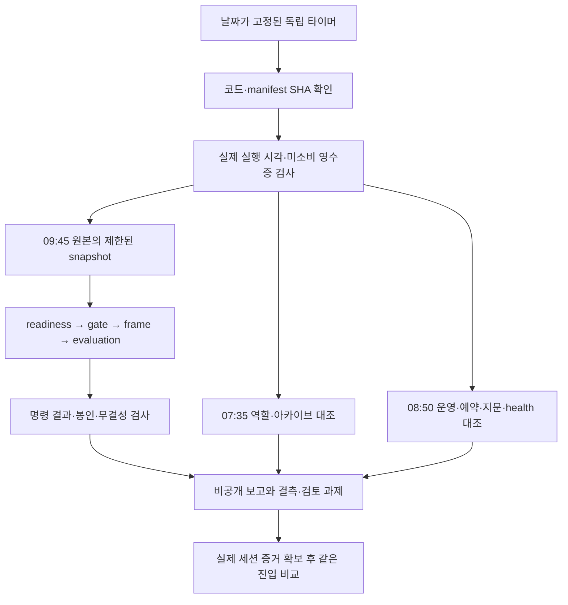

# 10월16일 장전 후속 작업 — 실행 정본

## 목적과 경계

종목 선정·진입 시점·비용 후 순수익을 개선하기 위한 후속 작업이다. 거래 엔진 운영 `de6c5bf7`와 09:10 활성화/09:15~09:41 관측은 유지한다. 이 변경은 저장소 밖에 설치하는 독립 판독·점검 도구와 연구 계약이며 거래 봇 배포·재시작이 필요하지 않다. 연구/운영 결과, 설치/예약/실행을 구분한다.

## PLAN → DO → SEE

| 항목 | DO | SEE / 남은 실제 확인 |
|---|---|---|
| 자동 판독 | [단발 판독기](deterministic-capture-readout.md): 고정 4개 CLI, 입력 snapshot, 날짜/once/지문/용량·시간·출력 제한, 비공개 결과 | 합성 봉인/미봉인 E2E·실패/중복/과대/링크 시험. 실제 판독은 09:45 예정이며 실행 상태는 아래 설치 기록으로 구분 |
| 아침 보고 | `report_premarket_check.py`: 당일 07:00 이후~실제 판독시각의 감사 기록을 역할별 대조. 공급자·전송·정책·거절·요청/실제 모델·STOP·usage·토큰·지연·비용 확인 | 미래/과거/중복/손상 기록을 성공으로 취급하지 않음. `call_metadata_verified`는 모델 성능/내용 정확도/사용자 수신 증거가 아님 |
| 발송 연결 | 당일 아카이브 generated version/hash와 dispatch reference를 대조하고 미래 발송 제외 | 앱의 `sent` 기록만 확인. 직접 수신 확인 아님; 새 발송 없음 |
| 장전 점검 | 고정 운영 HEAD/PID, 코드·설정·study 지문, 기존 타이머, 매수 중지·미소비 receipt·디스크, 로컬 봇 health의 연결/복구/pending 확인 | 로컬 메모리 상태이며 거래소 미체결 실조회는 아님. 점검 실패 시 운영을 자동 수정하거나 기존 관측을 취소하지 않음 |
| 계좌 측정 | [23파일·8권리·29청산 집합 재대사](../research/premarket-account-measurement-2026-10-16.md) | 결측의 원천·집합·비용 의미 확정. 시작 NAV/외부흐름/권리 지급·운영비 증빙이 없어 계좌 총수익/TWR null 유지 |
| 선정·청산 | [현재 소스 감사·결과 전 고정 계약](../research/premarket-selection-exit-2026-10-16.md) | 수급 unknown 감점·중복 원천 가산 후보 확인. 초기 손절/900초 보유 비교의 중간 호가 공백 5초 초과는 unknown. 실제 전략 변경 없음 |
| 모델 비교 | [R1 현재 가격·지문·입장 조건 재감사](../research/premarket-model-comparison-2026-10-16.md) | 10시도/쌍, 예약 상한 $0.5374550/쌍·총$10.7491000, 기존 고정 기간 유지. 비교는 OFF, 실호가/장 상태/외부 진입 근거 대기 |

## 독립 점검 실행 구조

예약 기능을 제공하는 앱 도구가 이 세션에 없고 사용자 manager는 Linger=no여서 로그아웃 이후 지속을 보장하지 못한다. 계정 정책을 바꾸지 않고 시스템 manager의 별도 타이머를 사용하며 서비스의 User/Group은 ubuntu다. 기존 수집 타이머와 거래 봇 unit은 수정하지 않는다.

| 이름 | 2026-10-16 KST 예정 | 허용 실행 창 | 결과 |
|---|---|---|---|
| `qwq-premarket-roles-20261016.timer` | 07:35 | 07:35~07:45 | `roles/result.json` |
| `qwq-premarket-preopen-20261016.timer` | 08:50 | 08:50~08:59 | `preopen/result.json` |
| `qwq-premarket-readout-20261016.timer` | 09:45 | 09:45~10:00 | `readout/summary.json` 및 4개 진단 |

고정 코드/manifest: `~/.local/share/qwq-premarket-20261016/`. 개인 결과/로그: `~/.local/state/qwq-premarket-20261016/`(0700, 파일0600). 세 서비스 모두 실행 전 `bundle.sha256`로 코드와 manifest를 검사한다. 검토한 unit 정본은 `scripts/ops/systemd/premarket-20261016/`이다. 환경을 비우고 고정 PATH/TZ와 빈 HOME으로 실행하며 원래 토큰·환경변수를 하위 명령에 전달하지 않는다. 장전 설정 보존 검사에는 `.env`의 SHA-256도 포함한다. 파일 바이트를 해시만 하고 값 파싱·환경 로딩·내용 출력·API 인증에는 사용하지 않으며 지문 manifest도 비공개다. 점검기는 경로가 명시된 파일과 localhost health만 읽고, 판독기는 고정된 파일 분석만 한다.

타이머에는 연도·날짜·Asia/Seoul을 명시하고 `Persistent=false`, 재시작 없음이다. 호스트가 해당 시각 꺼져 있었다면 뒤늦게 성공했다고 기록하지 않는다. 도구 자체의 날짜/시간 창과 영속 attempted 영수증이 두 번째 실행을 거부한다. 기존 attempted/원본을 삭제하는 재시도는 하지 않는다.

실행 서비스는 `TimeoutStartSec=480`, CPU 50%, `MemoryHigh=512M`, `MemoryMax=768M`, Nice10, core dump 금지다. 판독기 내부의 입력256MiB/가상주소공간2GiB 상한이 그 크기의 JSON 분석 성공을 보장하지 않는다. 호스트 보호 한도를 넘으면 실패 영수증/로그를 보존하며 자동으로 한도를 늘리지 않는다.

새 LLM/API 호출·주문·텔레그램 발송은 없다. 이 예약은 AI 세션 자동 재개가 아니다. 보고서의 실패·결측과 사람 검토 과제를 남기는 자동화다. 09:41 이후 봉인과 판단 기록 최종성을 동일시하지 않으며, 수익성/운영 승격 플래그는 항상 false다.

## 설치·검증 기록

아래는 최종 검증·설치 시 갱신한다. 현재 실제 관측 결과는 없다.

- 구현/관련 검증: 판독45건 + 점검12건 통합57 passed(rc0), 외부/운영 접근 시도0. 판독 관련186·선정 관련68·모델/청산244 추가 검증.
- 독립 중요 리뷰: Astra/xhigh 요청, 실제 모델/effort metadata 미노출. [최종 리뷰](../reviews/premarket-followthrough-2026-10-16.md)는 소스/설치 APPROVE, 미해결 P0/P1/P2 0이다. 미래 발송 오인·호출 출처 누락·중복 집계·실패 영수증·청산 정책 스키마 지적을 수정하고 재확인했다.
- 전체 verify: **6690 passed / 2 skipped / 2 xfailed**, rc0, 243.95초. 문법/비밀정보 검사 통과, 외부·운영 접근 시도0. CI/commit/push/예약 설치는 이어서 기록한다. 운영 재배포 대상 아님.

## 다음 판독

07:35와08:50 결과를 먼저 확인하고, 09:45 `summary.json`의 실제 명령 종료·입력 지문·봉인 검증 결과를 읽는다. 이어 readiness → gate trace → frame diagnostics → 미검토 evaluation bundle 순서다. 월 전체 판단을 단독 조인해 분모를 확대하지 않는다. 필요한 실제 호가 ID별 session review가 확보된 뒤, 원래 study cutoff를 유지하면서 실제 새 검토시각으로 청산 대조를 수행한다. 누락을 0수익·무신호로 채우지 않는다.

일별 기술 오류는 바로 수정 후보로 기록하되, 같은 날 결과에 맞춰 선정 점수·손절·모델을 동시에 조정하지 않는다. 경제적 가설은 하나씩 별도 버전으로 비교한다. 주간 post-exit 실제 실행 창은 소스 기준 **토요일09:30~09:44**이며 과거 문서의09:00은 현 코드와 다르다.

## 코드·프로세스 통합 흐름

이 흐름에는 모델 API·주문 제출·매수 중지 해제·봇 재시작·실험 enable로 가는 경로가 없다. 외부 흐름/원본 또는 미래 시점이 필요한 작업은 보고서에서 미완료로 남긴다.
