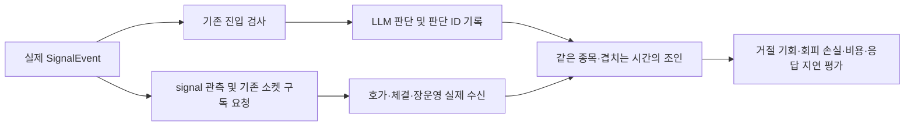

# 판단 뒤 첫 호가 — 수신 시각 보정과 다음 실측 (2026-10-13)

## PLAN — 목적·범위

목적은 **좋은 종목을 언제 사야 거래비용·LLM 비용·응답 지연을 제하고 수익이 남는지** 검증할 자료를 만드는 것이다. 자료 충족을 체결 가능성이나 수익성으로 바꾸어 읽지 않는다.

기준 main은 PR #184의 `7037717`이며 판단 기록(PR #183)과 조인은 병합됐지만 운영에 배포되지 않았다. 운영은 `161b394`이고 10월14일08:55 활성화/09:00~09:05 기술 파일럿의 소스·설정 지문이 고정돼 있다. **파일럿 종료·봉인 상태 확인 전 운영 HEAD/설정/예약을 바꾸지 않는다.** 이번 작업은 격리 worktree의 코드·문서·오프라인 검증이다.

확인한 결함은 두 가지다. 호가를 원장에 복사한 `observed_at`을 실제 프레임 수신 시각처럼 사용하면, 판단 전에 받은 호가를 판단 뒤 호가로 고르거나 호가 이후 도착한 상태를 붙일 수 있다. 판단 기록기는 daemon 큐를 사용하지만 runner 종료에서 drain을 호출하지 않아 마지막 판단이 유실될 수 있다.

## DO — 시간 계약

보고서 스키마는 `decision-quote-join-v2`, `time_basis=local_received_at`이다.

| 항목 | v2 계약 |
|---|---|
| 판단 경계 | 명시 시간대가 있는 `decision_available_at` |
| 호가 선택 | 같은 종목의 `provenance.received_at > decision_available_at` 중 첫 수신. 먼저 고른 뒤 품질을 검사하며 나쁜 첫 호가를 좋은 다음 호가로 바꾸지 않음 |
| 상태 연결 | 같은 connection_id·generation에서 호가 **수신 전** 채널별 마지막 `received_at`. 채널 필드는 합치지 않음 |
| 원천 보존 | 호가/상태 수신 시각, 관측 복사 시각, 호가 거래소 시각 각각 보존. 로컬 수신을 거래소 순서라고 부르지 않음 |
| 지연 | `delay_seconds`=호가 수신−판단, `delivery_delay_seconds`=복사−판단, `capture_delay_seconds`=복사−수신. 수신 지연 또는 복사 지연이 한도를 넘으면 stale |
| 오류 | 수신 누락/형식 오류/시간대 없음 또는 수신>복사면 해당 종목 평가 불가. 과거 `observed_at`의 naive UTC 호환 계약을 수신 시각에 소급하지 않음 |
| 동률 | 첫 호가 동률, 최신 같은 채널 상태 동률, 호가/상태 수신 동시각은 순서 불명으로 평가 불가. 더 최신의 유일한 상태가 있으면 과거 상태 동률은 해소 |
| 구자료 | aware 수신 시각이 없는 원장은 observed_at으로 대체하지 않음. 해시·완전성 통과도 시간 근거를 대신하지 못함 |

검증된 완전한 원장·양수 ask/수량·지연·장운영 필수 raw 필드 조건도 그대로 적용한다. `evaluable`은 위 자료 충족이며 정상 연속매매·실제 체결·순수익의 인증이 아니다. 원천 생성자의 실제 시계 계약도 확인했다: WS 프레임에서 수신 시각을 한 번 잡고, BOOK callback의 관측 복사는 그 뒤에 생긴다. 상태 행은 같은 프레임 수신 시각을 기록한다.

## DO — 정상 종료의 기록 보존

LLM 요청 정리 뒤 `close_decision_recorder(timeout=5.0)`로 기존 singleton만 닫는다. submit/close는 같은 짧은 lock으로 수락 경계를 고정하고, 이후 제출은 `dropped_closed`/경고/ID별 결과에 남긴다. 종료 sentinel이 가득 찬 큐에 들어가지 못하는 문제를 피하고 worker가 남은 기록을 처리한 뒤 종료한다. 큐 get timeout과 마지막 submit/close 사이 경합도 회귀 검사로 고정했다.

async 대기는 executor 없이 event loop를 양보한다. 수락된 기록 전부 written이고 스레드가 끝났을 때만 성공이며, 파일 상한·쓰기 실패·시간 초과는 경고 후 나머지 종료 처리를 이어간다. 늦은 제출 거절과 큐 포화는 별도 손실 카운터다. SIGKILL/전원 장애/장기 디스크 정지나 외부 코드가 shutdown 태스크 자체를 강제로 취소하는 경우의 무손실 보장은 아니다. 실제 런처의 SIGTERM/SIGINT는 종료 event를 설정하며 shutdown 태스크를 취소하지 않는다. 두 신호를 종료 중 반복 전달하는 등록 핸들러 시험으로 마지막 LLM 기록 저장을 확인했다. 거래 판단·모델·호출·예산·매수 중지 정책에는 변경이 없다.

## 다음 실제 관측의 흐름

- 다음 작은 실측은 기존 `runner-signal-window-v1`과 `channels.market_state_evidence=true`를 사용한다. 신호 발행 전에 관측 hook이 실행돼 LLM보다 먼저 구독을 요청한다. ACK는 비동기이므로 실제 수신 시작을 별도 확인한다.
- `runner-order-ready-window-v1`만 사용하면 LLM 거절·수량0·리스크 탈락 뒤의 자료가 빠진다. 모델 비교 분모를 위해 신호 단계부터 남기고 order_ready 탈락도 유지한다. H1 주문 준비 가격 실험의 계약과는 구분한다.
- LLM은 기존 점수·국면·중복/보유/예산 등 게이트를 통과한 신호에만 호출된다. 표본을 만들려고 임계값·매수 중지를 바꾸지 않는다. 판단0건이면 실제 미도달 사유를 보고한다.
- 10월14일 파일럿은 `161b394`로 실행하므로 새 판단 기록이 없다. 이후 배포한 판단을 그 파일럿에 소급 조인할 수 없다. **기록기 배포만으로 실측 쌍이 생기지도 않는다.** 새 관측 창에서 두 기록이 같은 종목·시간에 겹쳐야 한다.
- 새 날짜·고정 SHA·설정/연구 지문·수집 상한·단발 활성화는 파일럿 결과와 배포 후에 확정한다. 기존 예약을 연장·재사용하지 않는다. 현재 새 실측 및 새20일은 미예약이다.

## SEE — 검증과 통합 상태

- TDD: 원래 구현에서 시간 관련 15개 반례 실패, 상태 최신 선택/동률 2개 추가 반례 실패 후 보정했다.
- 독립 일반 리뷰: 요청 `gpt-5.6-sol/high`, 실제 모델 메타데이터 미노출. 조인 27검사 통과·차단 이슈 없음. 이후 strict 원장→CLI round-trip, 시간대 정규화, 과거 동률 해소와 타 종목 오류 격리 검사를 보강했다.
- 종료 기록기 구현: 별도 worktree/base7037717, Astra/high 요청(실제 모델 메타데이터 미노출), 독립 승인 역할과 분리했다. coordinator가 변경을 검사·통합했다.
- 중요 변경 독립 리뷰: 도구 없는 소스 전용 Claude Opus5/xhigh 요청, 두 회차 모두 응답/terminal `modelUsage`에서 **실제 claude-opus-5 확인**, 실효 effort는 미노출. 1차의 조건부 취소 지적은 실제 main→signal→stop→shutdown 경로와 두 신호 회귀 검사를 제출해 2차 APPROVE로 종결했다. 임의 외부 task 취소·핸들러 내부 예외·강제 종료는 무손실 보장 범위 밖이다.
- 별도 개발 리뷰 비용은 두 회차 합계 USD1.128145이며 운영 월100 예산 원장을 변경하지 않았다. 소스 리뷰는 테스트 재실행을 대신하지 않는다.
- KST 조인/판단/종료 관련68검사 통과 후 SIGTERM/SIGINT 2건 추가 포함 종료14검사 통과. 최종 UTC 통합 verify는 **5443 passed / 2 skipped / 2 known xfailed / 기존 pykrx warning1**, rc0·문법/비밀정보 검사 통과, 운영 상태/외부 네트워크 접근0. 필수 CI·병합 결과는 이 변경의 PR 기록을 따른다. 로컬 검증은 외부 API·운영 자격증명을 사용하지 않는다.

## 우선순위와 완료 조건

| 순서 | 다음 행동 | 완료 근거 |
|---|---|---|
| 1 | 조인 시간 수정·정상 종료 기록 drain 검증·리뷰·병합 | 회귀/전체/비밀 검사, 독립 리뷰, 동일 head CI |
| 2 | 10월14일 기존 기술 파일럿 결과 확인 | 봉인/누락/실제 상태·호가/연결 세대/용량/봇 건강. 실패/미수신이면 UNKNOWN 유지 |
| 3 | 파일럿 종료 확인 후 장외 고정 SHA 배포 | 기존 배포기 verify/재시작/health/롤백, 기존 예산·매수 중지·계좌 상태 보존 |
| 4 | signal 단계의 작은 동시 관측 설치·실측 | 실제 판단 ID↔같은 종목 응답 뒤 첫 호가↔당시 장 상태 최소1쌍, 누락·거절 분모 확인 |
| 병행 | KIS 계좌 권리 조회 및 계좌 기준선 | [공식 조사/결측](../operations/account-baseline-status-2026-10-13.md). 조회 완료·보존범위·금액 의미를 확인 후 기존 순수익 계산기에 입력 |
| 5 | 같은 입력·역할의 모델/추론 수준 비교 | 월100 잔여/예약 반영 호출 상한을 먼저 계산. 잘못 거절한 기회·회피 손실·호출 전체 비용·응답 후 가격을 같이 비교 |
| 6 | 선정·진입·청산 단일 가설과 새 기간 평가 | 전체 KODEX200 및 대칭 반도체 제외 보조 비교, 버전/국면/현금/업종/청산/비용 분해. 동일 진입의 청산 대조 |

20일을 기다려야 오류를 고치는 것은 아니다. 매일 자료 품질·장애·비용은 수정/점검하고, 경제성 가설을 바꾸면 새 버전과 이후 기간으로 분리한다. 과거 관측을 반복 최적화해 표본 밖 성과로 부르지 않는다.
