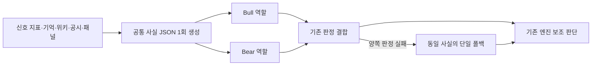

# 71차 — 진입 LLM 공통 입력과 실측 전 남은 공백

## PLAN — 모델보다 먼저 같은 사실을 전달한다

목적은 좋은 종목과 진입 시점을 고르는 과정에서 결측을 악재로 오인하거나 모델마다 다른 자료를 보고 비교하는 오류를 줄이는 것이다. [68차 우선순위](llm-and-observation-priorities-2026-10-12.md)와 [70차 예산 정책](monthly-budget-economy-2026-10-12.md)을 이어받았다. 이번 범위는 진입 교차검증의 입력 결함 수정이며 전체 P1 실측 완료가 아니다.

원인 세 가지를 확인했다. 외국인 수급 None과0이 모두 `-`로 전달됐다. 실시간 스크리너의 `atr_pct`는 입력에 없고 `atr_14`만 읽었다. 종목 노트와 패널 결합 국면은 단일 폴백에만 들어가 Bull/Bear가 받는 자료와 달랐다.

## DO — 공통 사실과 역할 지시를 분리한다

`src/core/entry_llm_context.py`는 `entry-llm-input-v1` JSON을 만든다. cross_validator에서 한 번 생성한 `<entry_facts>` 사실 블록을 Bull·Bear·단일 폴백에 그대로 전달한다. 전체 프롬프트는 서로 다르다. 직접 AdversarialValidator를 부르는 경로도 같은 포맷을 사용하며 기존 extra_context는 보존한다.

- 외국인 수급은 순매수/순매도/0/미측정을 구분한다. 비유한 수·bool·계약 없는 숫자 문자열은 invalid/null이다. 값0을 결측으로 바꾸지 않는다.
- `atr_14`와 `atr_pct`는 프로젝트 공급부가 정의한 퍼센트 값으로 각각 표시한다. 둘이 다르면 임의로 하나를 선택하지 않는다. RSI·PER·MA200 거리도 결측/잘못된 값과0을 구별한다.
- 기억·위키·종목 노트·공시·패널 위험을 같은 입력에 포함한다. 문자열 존재는 provided이며 내용의 정확성·위험 해소 인증이 아니다. 비어 있으면 unavailable로 표시한다.
- 원천 관측시각은 아직 확보되지 않아 null이다. 현재 시각을 대신 넣어 실시간·최신 근거처럼 보이지 않는다. 수급의 단위도 원천 전체를 인증하지 않았으므로 source_unit_unverified로 표시한다.
- 역할 프롬프트·판정 파서·호출 수·모델·추론 설정·예산·시간제한·실패 처리·엔진의 거절 시 수량 배율은 유지한다. **입력의 내용은 달라지므로 모델 응답 및 그에 따른 보조 판단 결과는 달라질 수 있다.** 수익 향상을 입증한 변경으로 표현하지 않는다.

추가 API 호출은 없다. 합성 예시(005930/momentum/90/foreign=None/atr_pct=2.5/bear)의 공통 사실 UTF-8 크기는 기존138바이트에서1652바이트다. 이것은 실제 토큰/청구액/하루 호출량이 아니다. 원래부터 존재하던 참고자료 길이에 종목 노트가 추가되므로 입력 비용은 늘 수 있으며 기존 월100/일5 예약·정산이 전체 프롬프트에 적용된다. 유료 모델 비교는 아직 켜지 않았다.

## SEE — 확인한 범위

- 수정 전 새 검사12실패/4통과로 결측/0 오표시와 공통 포맷 부재를 재현했다. 첫 수정 뒤 관련37검사 통과, 추가 경계 포함 KST 관련147검사 통과·검사 격리 가드가 보고한 운영 상태/외부 네트워크 접근 시도0.
- 실제 Bull/Bear/단일 폴백을 거치는 합성 응답으로 공통 사실 일치, 종목 노트/결합 국면 전달, 기존 승인·거절·우회와 호출 횟수를 검사했다. 외부 API를 호출한 성능 비교가 아니다.
- 리뷰 보완 뒤 최종 로컬 전체 **5182 passed /2 skipped /2 known xfailed**(163.44초), 문법·비밀정보 검사 통과. KST 관련147검사도 다시 통과했다. 기존 pykrx deprecation 경고1건은 남는다. 독립 중요 변경 재리뷰·CI·운영 결과는 확정 기록으로 추가하며, 이 로컬 결과를 배포 완료로 읽지 않는다.

## 다음 우선순위 — 대기만 하면 해결되지 않는 부분

1. **종목별 장 상태 수집 경로 구현:** 현재 KRX63열 호가는 MARKET_CLS_CODE를 보존하지만 정규장2는 VI·정지·단일가 부재의 증명이 아니다. 체결 파서는 장운영/정지 원문을 버리고 후보 관측은 BOOK만 배정한다. 공식 고정 스키마에 맞는 체결 상태와 장운영 사건을 호가·연결 generation·수신/거래소/영업일에 연결해 봉인해야 한다. 공급자 sequence가 없으면 없다고 기록한다.
2. **상태 수집의 독립성·용량 검증:** 한 후보의 BOOK/상태용 PRICE/장운영 채널을 배정할 때3개 자원을 모두 계산하고 초기 상태·재연결·역순·지연·시장 불일치는 UNKNOWN으로 둔다. 상태용 체결은 엔진 시세/전략/주문 콜백이나 운영 구독 보유로 승격하지 않는다. KIS 소켓은 봇 하나만 사용한다는 사용자 확인을 다음 설계의 운영 제약으로 유지하며(이번 패치의 강제·실측 범위 아님) 별도 소켓을 임의로 켜지 않는다.
3. **한 종목 작은 실측(현재 실행 준비 미완료):** 기존 관측 런타임은 dry-run을 거부하므로 단순 실행 옵션 변경으로 무주문 수집이 된다고 주장하지 않는다. 기존 단일 연결에서 수집 전용 경로와 한정 프로필을 구현·검증한 뒤 정규장에 진입/+900초 두 호가의 상태 근거를 확인한다. 주문 준비0이면 명시 기술 표본으로 시험하되 H1 수익 표본에 편입하지 않는다.
4. **공통 입력의 완전한 재생·모델 비교:** 이번 포맷을 바탕으로 원천 시각/신호·판단ID/버전/요청·응답/비용을 영속 연결한다. 같은 사실에 역할까지 고정한 모델·추론 비교와 응답 이후 최초 매수 가능 호가를 평가한다. 현재 Bull/Bear는 역할이 다르므로 같은 사실을 받는다는 이유만으로 모델 성능 A/B라고 부르지 않는다.
5. **새 관측과 일별 개선:** 상태·비용·실효 설정·채널·새 설치기 검증 후 아직 관측하지 않은 날짜로 등록한다. 기존10/13~11/9는 미등록 후보이며 이번에 시작하지 않았다. 기술 오류는 매일 고치고 경제성 변경은 버전별 하나씩 고정한다.

코드 경로는 `kis_websocket.py`, `quote_subscription.py`, `entry_observation.py`, `entry_observation_journal.py`, `entry_evaluation_bundle.py`다. 별도 세션 검토가 없으면 UNREVIEWED라는 현재 평가기의 경계를 유지한다. 실제 호가 쌍·응답 후 체결 가능 가격·순수익·KODEX200 초과수익은 이번에 검증되지 않았다.

역할: 코디네이터가 구현·통합, 요청 Sol/high의 독립 작업자가 장 상태 수집 공백을 읽기 전용 분석했다(실제 모델/유효 effort 미노출). 중요 입력 변경의 최종 리뷰는 별도 실제 모델 증거를 남긴다.

### 독립 리뷰의 처리와 적용 범위

첫 중요 변경 리뷰는 실제 Claude Opus5(xhigh 요청, 유효 effort 미노출)의 CHANGES_REQUESTED였다. 도구0·정상 종료·실제 모델 메타데이터를 확인했다. 문자열 필드 직렬화 호환성과 참고자료의 구분자 삽입 두 반례를 추가 검사2실패로 재현하고, 기존 문자열 변환·JSON 내 `<` 이스케이프로 보완했다. 점수100점 척도를 명시하고 실제 일일 호출 계수도 검사한다. 구분자 이스케이프를 프롬프트 주입의 완전한 차단이라고 주장하지 않는다.

공급 코드를 추가 대조했다. 실시간 스크리너는 indicators 안에 atr_pct/foreign_net_buy/per를 실제로 넣으므로 이번 경로에 적용된다. 상위 metadata만 있는 다른 생산자, `rsi` 별칭, 기관 수급/PBR의 추가 입력은 이번6지표 포맷의 범위 밖이며 후속 원천 연결에 포함한다. 모든 전략의 모든 지표를 정비했다고 주장하지 않는다. 일반 위키는500자, 종목 노트는600자로 이미 제한되며 추가 종목 노트가 무제한이라는 리뷰 전제는 성립하지 않는다. 메모리/공시의 기존 길이·신선도 계약은 별도 확인 항목이며 이번에 무조건 잘라 위험 근거를 없애지 않았다.

`common_context`는 동일 호출자가 만든 내부 사실 블록의 전달 인자다. 외부에서 임의 문자열·다른 종목 블록을 받는 인증 인터페이스가 아니다. 소스 사용 귀속의 기존3키와 판단ID·완전 재생 기록 확장은 후속이며, 문자 자료가 없는 것은 검증 성공이 아니다.
