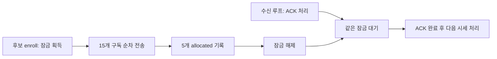

# E01 — 기존 후보 자료의 연결과 진입 준비 지연

좋은 종목과 실제 가능한 진입 시점을 비용 후 성과로 연결하기 위한 오프라인 분석이다.
10월19~22일 보존 자료의 후보104건을 선정 근거·첫 차단·당시 소스와 연결했다.
**새로 확인한 개선 후보는 관측용 구독 전송 중 잠금이 ACK 처리를 기다리게 하는 구조다.**
실제 클래스로 이 순서를 재현했다. 이를 제거하면 순수익이 개선된다는 증거는 아직 없다.

작업 상태·우선순위는 [실행 원장 E01](../operations/execution-roadmap.md#e01-offline)을 따른다.
이번에 선행한 범위는 기존 자료 분석이며, 운영·10/26 고정 예약·매수 중지·월USD100은 변경하지 않았다.

## Plan → Do → See

| 단계 | 수행·완료 조건 | 결과 |
|---|---|---|
| Plan | 기존4일 입력을 보존하고 날짜·스캔·후보 identity로 연결. 표본/시각 의미를 분리 | 새 관측·모의자금·정책 변경 없이 수행 |
| Do | 원장 해시 체인·study/window/frame 연결 검증, 원래 판독 결과와 대조, 원시 JSONL 독립 재집계 | 5스캔·104후보 발생 건수와 선정 최종점수 일치 |
| Do | 요청→배정→ACK→첫 BOOK/CNT 시각 분해, 소스와 무접속 재현 대조 | 로컬 ACK 잠금 대기를 재현; 서버·거래 발생 대기의 정확한 분해는 불가 |
| See | 가격 비교 가능 범위·결측·다음 단일 개선 가설 확정 | 자료 연결 완료. 경제성·체결 가능성 미판정, 제품 코드는 변경하지 않음 |

## 1. 날짜·버전·분모를 합치지 않는다

| 날짜 | 당시 선언 소스 | 반환 후보 발생 건수 | 기록된 첫 차단 | 원장 | 가격 비교 범위 |
|---|---|---:|---|---|---|
| 10/19 | `ba29b903` | 41, 두 스캔·23종목 | regime 41 | complete | LLM 입장 방식; 후보 호가0, 보조 정책 미선언 |
| 10/20 | `89537b32` | 21, 첫 스캔 | regime 21 | complete | 상위5 호가 쌍, strict 장 상태 충족0; 보조 정책 미선언 |
| 10/21 | `d5dd37bc` | 23, 첫 스캔 | cash 23 | **incomplete** | 상위5 배정; 상태19,000건 상한으로 정식 가격 판독 거부 |
| 10/22 | `84fc2b3a` | 19, 첫 스캔 | regime 19 | complete | 상위5 호가 쌍, strict 충족0; 사전 선언된 보조 가격 쌍4 |

104는 날짜·스캔별 후보 발생 건수다. 독립적인104종목이나 하루 전체 기회 수가 아니다.
기록된 regime81/cash23과 선정 근거104건을 연결했고 기록된 signal_created는0이다.
10/21의 trace coverage는 원장 불완전 때문에 false이며, 기록된23건의 원인만 설명한다.
다른 날짜에서 cash 이후 단계는 도달하지 않았으므로 현금 충분/부족을 추정하지 않는다.
서로 다른 버전·관측 정책·시장국면을 한 수익률이나 승률로 합치지 않는다.

현재 정식 reader로 10/19 게이트 후보 결과,10/20 strict 후보 결과,
10/22 strict·보조 후보 결과를 다시 계산해 원래 결과와 일치함을 확인했다.
10/21은 `sealed complete undropped journal required` 거부를 유지했다.
10/20에 나중에 만든 보조 정책을 소급 적용하거나10/21을 성공 표본으로 바꾸지 않았다.
complete는 해당 원장 보존의 뜻이며 `stream_complete=null`, 출처 인증·저장매체 영속성 미확정을 유지한다.

## 2. 요청 묶음과 배정 뒤 기다림은 다른 구간이다

5종목×BOOK/CNT/MKO의15개 요청은 기본0.15초 간격으로 직렬 전송된다.
`requested`는 `send_json` 완료 후 기록이고,5개의 후보 `allocated`는 전체 전송 뒤 기록된다.
BOOK 키의 allocated 하나는 세 채널 묶음을 나타내며 첫 BOOK 송신/ACK 시각과 다르다.

| 날짜 | 첫→마지막 requested | scan→5위 allocated | 5위 allocated→첫 CNT received | 5위 CNT ACK→첫 CNT received |
|---|---:|---:|---:|---:|
| 10/20 | 2.106246초 | 2.250159초 | 6.292668초 | 6.274375초 |
| 10/21 | 2.107203초 | 2.272682초 | 2.103544초 | 2.025965초 |
| 10/22 | 2.128830초 | 2.263111초 | 6.418303초 | 6.373518초 |

10/21은 상한 소진 전의 초기 기록만 지연 진단에 사용했다. 이것은 정식 가격 평가 통과가 아니다.
표의 순위5는 각 날짜의 순위이며 동일 종목의 반복 실험으로 해석하지 않는다.

### 코드와 재현으로 확인한 로컬 대기

아래 구조는 `enable_quote_observation()`으로 coordinator를 설치한 **관리형 관측 경로**에 해당한다.
기본 feed의 owner는 None이다. 일반 운영 시세 경로에서도 같은 지연이 발생한다고 확인한 것은 아니다.

[구독 coordinator](../../src/data/feeds/quote_subscription.py)의 `enroll()`은 같은 잠금을 잡은 채
`_reconcile()`의15개 전송을 기다린다. `handle_ack()`도 이 잠금이 필요하다.
[수신 루프](../../src/data/feeds/kis_websocket.py)는 한 메시지의 `_handle_message()`를 기다린 후
다음 메시지를 읽으며, JSON ACK 처리에서 `handle_ack()`를 기다린다.
따라서 전송 중 ACK가 먼저 처리되면 뒤의 시세 처리가 묶음 전송 종료까지 지연될 수 있다.
이 두 파일은 비교한10/19~22 선언 소스와 분석 기준 main 사이에 내용 차이가 없다.

실제 `QuoteSubscriptionCoordinator`·버퍼와 가짜 전송만 사용해 마지막 전송을 Event로 막았다.
막힌 동안 requested14/allocated0/ACK0, 잠금 보유·ACK 태스크 미완료를 확인했다.
해제 뒤 requested15→allocated5(sequence22~26)→ACK1(sequence27) 순서로 끝났다.
이 시험은 간격0으로 **잠금 순서**만 재현한다. 실제2.1초는 원장과 기본 간격 코드에서 확인한 값이다.
분석자의 bare Python 실행은 의존성 부족으로 실패했고, coordinator는 프로젝트 venv와 실제 loguru로
별도 재실행해 rc0을 확인했다. 제품 클래스 대역이나 외부 접속은 사용하지 않았다.

다만 모든 입력이 항상 막힌다는 뜻은 아니다. ACK보다 먼저 읽힌 데이터는 잠금 없이 처리될 수 있다.
이 재현은 로컬 구조의 증거이며, 당시 서버 ACK 도착 시각이나 손실 원인을 증명하지 않는다.

### 수신 시각의 한계

`received_at`은 소켓에 바이트가 도착한 시각이 아니라 `_handle_message` 진입 시각이다.
`observed_at-received_at`은 그 이후 파싱·기록 구간이며 이전 수신 큐/잠금 대기는 포함하지 않는다.
ACK는 별도 received_at을 보존하지 않는다. 따라서 requested→ACK 차이를 네트워크 지연으로 단정할 수 없다.

10/22 5위 CNT는 allocation→received **6.418303초**, allocation→observed **6.418784초**다.
두 시각 차이0.000481초만으로 전체 로컬 대기가 짧았다고 할 수 없다.
5초 준비 창은 이미 전송이 끝난 allocated부터 시작하므로,
앞선2.128830초를 빼면 이 후보가 통과한다는 계산도 틀리다.
남은 기다림에는 다음 체결 발생·공급자/네트워크·수신 큐가 함께 포함되며 정확한 원인은 미확정이다.

## 3. 관측된 가격과 실제 진입 가능 가격을 구분한다

10/22의 기존 사전 계약을 통과한 보조4쌍만 같은 선정 근거에 연결했다.
첫 qualifying CNT 뒤의 **첫 BOOK**을 고정하며 유리한 후속 호가를 골라 바꾸지 않는다.

| 원래 순위 | 당시 최종점수 | 최초 BOOK→보조 기준 BOOK, 관측 시각 차이 | 그 사이 ask 변화 | 보조 ask→900초 뒤 bid 변화 |
|---|---:|---:|---:|---:|
| 1 | 100.0000 | 0.008973초 | +0.234192% | +0.233645% |
| 2 | 89.1165 | 0.462733초 | 0% | +0.398406% |
| 3 | 84.6639 | 0.004429초 | 0% | -0.902527% |
| 4 | 60.1963 | 0.223225초 | 0% | -0.796359% |
| 5 | 59.2679 | 미산출 | 미산출 | 준비 창 CNT 결측으로 미산출 |

1위는 두 관측 호가의 ask 차이가 약0.2342%였다. 이는 준비 전 가격을 사용하면 분석 기준 가격이
실제로 달라지는 사례다.0.009초의 거래소 가격 움직임, 실제 슬리피지 또는 실현 손실로 해석하지 않는다.
4개 결과만으로 높은 점수의 우위·시장 방어 해제·선정 원천의 예측력을 판정하지 않는다.
상위5에 들지 않은14개는 호가를 구독하지 않았고, 원천 기준시각도 미확정이다.
따라서 선정 순위/원천별 제거 비교에 필요한 전체 후보 결과가 없으며 가격이 없는 후보를0수익으로 채우지 않는다.

모든 수치는 수수료·세금·수량·주문 지연·시장 충격을 반영한 수익률이 아니다.
VI/장운영 상태unknown, 실제 진입·체결 가능성not_evaluated,
`account_return`·`net_pnl=null`, `profitability_pass`·`production_eligible=false`를 유지한다.

## 4. 다음 개선 하나와 필요한 입력

**다음 설계 후보는 요청 간격을 유지하면서 ACK 대기가 관리형 관측 수신 루프를 막지 않게 하는 구독 상태 처리다.**
임계값이나 종목 점수를 바꾸기 전에, 이 로컬 구조를 한 가지 개선 후보로 다룬다.
이번 분석에서 잠금을 임의로 제거하거나 새로운 비동기 태스크를 제품에 추가하지 않았다.

착수 시 완료 조건은 다음과 같다.

- 같은15개 요청·전송 간격·등록 상한을 유지하고 ACK/데이터 처리가 묶음 종료에 묶이지 않는 것을 무접속 시험으로 확인.
- 송신 결과 불명·ACK 거절/순서 변경·취소·중단·재연결 세대·해제와 보유 종목 시세 전달을 보존.
- 기존 allocated 기준5초 정책과 원장 순서를 바꾸는 경우 별도 계약으로 명시. 과거4쌍을 늘려 성공으로 재분류하지 않음.
- 독립 중요 리뷰·관련/전체 검사 후 운영 반영을 결정. 실제 지연·유효 가격 개선은 새 증거로 별도 평가.

경제성으로 넘어가려면 원래 후보 identity·당시 버전/설정·각 자료 기준시각·실제 첫 차단과 함께,
판단 완료 뒤 가격/장 상태·의도 수량/동시 자본·비용·이후 가격 경로가 같은 시점 기준으로 필요하다.
이번 표본에는 LLM 진입 판단·실제 주문의 연결이 없어 E03 청산 또는 E04 모델 비교 입력으로 승격하지 않는다.
새로운 유료 LLM 호출·20일 관측·모의투자는 자동 후속으로 시작하지 않는다.

10/26 **T03/T04→조건부 T05→T06**의 고정 실측을 보존하고, 이후 E01에서는 이 분석을 다시 만들지 않고
위 단일 개선 후보의 적용 순서를 판단한다. scan 전 원천 완료 후 반환까지8.33~14.71초 구간도 관측되지만
구간별 세부 계측이 없어 특정 API/계산에 귀속하거나 두 번째 최적화를 동시에 시작하지 않는다.

## 검증·재현 근거

비공개 `~/.local/state/qwq-task-audit/20261024/e01-offline/`에 분석 스크립트,
104건 연결표, 시각·분모 요약, 입력 지문, 원시 재집계, 무접속 재현과 소스 검토를 보존한다.
원본과 판독 사본의 원장/study 지문을 대조했고 분석 전후 원본·manifest·기존 결과 지문도 동일했다.
분석 실행기는 socket 연결·subprocess/os.system을 차단했다. 계좌 금액·종목별 원문은 Git에 넣지 않는다.
소스 분석은 요청 Sol/high, 실제 model/effort metadata는 미노출이다.
최종 독립 리뷰·문서 검사·CI/병합은 이 변경 PR의 영수증을 따른다. 제품 코드 변경·운영 재배포는 없다.

## 10월25일 선행 개선 설계·실행 계획

사용자가 대기 없이 가능한 개선을 먼저 개발하도록 승인했다. 위 분석은 당시 결과로 보존하고,
현재 개발 상태는 [원장 E01-ACK](../operations/execution-roadmap.md#e01-ack)를 따른다.
기존 Python/asyncio 구현을 수정하며 운영 `44483017`·10/26 고정 실측은 유지한다.

**선택:** ACK 전체를 별도 큐에 보류하면 ACK 상태 갱신은 여전히 묶음에 묶인다.
송신/상태 잠금을 전면 분리하면 모든 수요 변경·재연결 경로를 수정해야 한다.
따라서 기존 잠금은 수요 변경/송신 직렬화에 유지하고, ACK는 같은 이벤트 루프에서
await 없는 상태 전이로 처리한다. 후속 송신만 한 개의 합쳐진 reconcile 작업에 맡긴다.
이는 coordinator의 구현 선택이며 요청 간격·상한을 완화하는 개선이 아니다.

**계약:**
- ACK 도착 시 자기 요청의 송신이 아직 끝나지 않았으면 그 요청의 완료 Event만 기다린다.
  성공 `requested` 또는 실패 `unknown` 기록 뒤 Event를 깨운다. 다른 채널의 송신 묶음은 기다리지 않는다.
  깨어난 뒤 세대·연결·Registration 및 요청 Event identity·pending을 재검사한다.
- 송신 실패/취소는 기존 unknown·슬롯 점유·불완전 원장을 유지한다. 조기 ACK로 되살리지 않는다.
  자체 요청 대기는 기존 send timeout/취소 계약에 의존하며 취소를 무시하는 송신의 절대 시간 보장은 추가하지 않는다.
- ACK 후 reconcile은 generation에 묶인 단일 작업이다. 실행 중 새 ACK는 dirty 표시로 합치며
  송신/요청 간격·41건 상한·운영 우선순위는 기존 잠금 안에서 보존한다.
  enrollment 작업8개 한도와 별개로 소유하고 종료 시 취소·회수한다. 잠금 보유 중 worker를 await하지 않는다.
- `handle_ack()` 반환은 ACK 처리 완료이며 후속 송신 완료는 아니다. 해제 후 대기 운영 채널의
  재등록은 다음 이벤트 루프 실행부터 시작한다. ACK별 무제한 태스크나1초 유지보수 대기만으로 대체하지 않는다.
- requested→ACK와 unsubscribe_requested→released 순서, 전체 송신 뒤 allocated 기준 및5초 준비 창은 유지한다.
  ACK/호가는 allocated 이전에 기록될 수 있지만 과거 가격 쌍을 소급 재분류하지 않는다.
- 일반 owner=None 시세 경로와 초기 연결 start 이후에야 수신을 시작하는 구조는 변경하지 않는다.

**구현·검증 순서 (단일 작업):**
1. `tests/test_quote_subscription_progress.py`에 실제 coordinator/feed와 Event 송신을 사용한 실패 회귀를 추가한다.
   15개 중 마지막 송신을 막은 상태에서 앞선 ACK와 BOOK가 처리되는지 확인한다.
2. 조기 ACK→송신 성공/실패/취소, 해제 ACK→느린 후속 송신 중 수신 진행, dirty 재조정,
   중복/거절/오래된 세대, 종료·재연결, 기존 요청 간격과 상한을 검증한다.
3. `src/data/feeds/quote_subscription.py`만 최소 수정한다. 요청 완료 Event와 단일 reconcile 소유권을 추가하고
   기존 수신 함수·평가 reader·정책은 수정하지 않는다. 실제 reader로 새 기록 순서도 대조한다.
4. 관련/전체 verify·비밀 검사 → 작성자와 다른 중요 리뷰 → 문서/PR/CI 통합.
   개발 완료와 운영 적용·실제 지연/순수익 개선은 분리한다.

**검토 초점:** 조기 ACK의 원장 순서, 실패 후 슬롯 부활, ACK 중첩의 lost wakeup,
이전 세대 작업의 신규 연결 송신, 취소/종료 뒤 남는 작업을 각각 시험으로 고정한다.

**개발 검증(10/25):** 기존 관련54검사 통과 후 새7검사는 기존 코드에서4 failed/3 passed였다.
수정 후 신규17건을 포함한 관련94검사 통과·운영 상태/외부 네트워크 접근 시도0건이다.
실제 feed 수신 함수와 평가 reader를 사용해15번째 송신을 막은 상태에서도 앞선 ACK/BOOK가
처리되고 requested→ACK 순서가 유지됨을 확인했다. 실패/취소/timeout, 해제 후 후속 송신 중 수신,
dirty 재실행, pacing 유지, 실제 disconnect, 대기 중 옛 ACK의 재연결 격리와 시작 전 worker 취소도 검사했다.
기존 해제 검사는 후속 송신 Event를 기다리도록 갱신했다. 이는 합성 무접속 검증이며
실제 지연 감소량·체결 가능성·순수익 증거가 아니다. 전체9,134검사·독립 Claude Opus5.5 최종 승인 및 CI/통합 근거는 원장 E01-ACK를 따른다.
