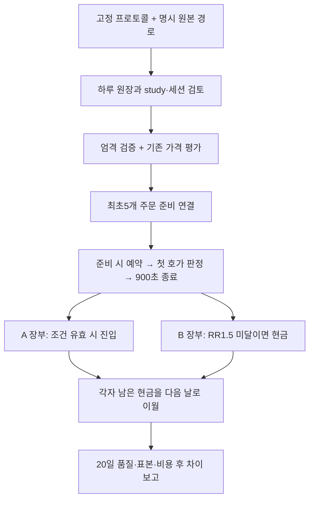

# 66차 — H1 여러 날짜·동시 자본 평가

목적은 **현재 엔진이 고른 종목을 첫 호가에서 그대로 살 때(A)보다, 비용 후 계획 손익비1.5 이상일 때만 같은 수량으로 사는 방식(B)이 순손익을 개선하는지** 평가하는 것이다. 이번 작업은 그 비교에 필요한 오프라인 계산과 검증이다. 실관측20일, 수익 우위, 매수 재개를 완료했다는 뜻은 아니다.

[기존 H1 계약](h1-entry-price-contract-2026-10-11.md) · [구현 계획](../superpowers/plans/2026-10-11-h1-multiday-capital.md) · [앞선 운영 배포](next-observation-design-2026-10-11.md#65차--주문-준비-호가-배정과-운영-배포).

## PLAN — 같은 자본으로 비교한다

기존 하루1스캔 평가기는 이미 정해진 기간/표본용이다. 새 H1에는 여러 스캔의 실제 주문 준비 최초5개와 사전 고정20일을 연결하는 별도 프로토콜을 사용한다. 단순히 기회별 수익을 합치면 동시에 같은 현금을 반복 사용할 수 있으므로, A/B에 동일 시작 현금을 주고 예약·진입·종료 순서대로 계산한다.

- 새 프로토콜 `h1-multiday-protocol-v1`은 연구/정책 지문·평가 세대·합성/실관측 구분·고정 시각·정확히20개 날짜·달력 근거·자본 모형·RR1.5·왕복 각0/10/30bps·예약 배수1.015를 명시한다. 첫 관측일 전에 고정해야 하며 주말/중복/정렬 오류를 거절한다. 달력 원천과 휴장일의 진위는 해시만으로 인증하지 않는다.
- 모든 날짜의 코드/설정/비용/수집 정책이 같아야 한다. 기존 정책 정규화를 재사용해 날짜별 검증된 식별자/경로/시각만 분리한다. 코드와 엔진이 다른 기간을 현재 버전과 같은 표본으로 합치지 않는다.
- 실거래 엔진·사이징·손절/청산·매수 중지를 바꾸지 않는다. 새 수집 study·날짜 예약·설치는 다음 단계다. 마지막 확인 운영 소스는65차 `32f52dd`이며 이번 오프라인 기능은 봇 재시작을 필요로 하지 않는다.

## DO — 코드와 처리 흐름

| 단계 | 입력과 동작 | 주요 출력/거절 |
|---|---|---|
| 명시 입력 | `scripts/evaluate_h1_multiday.py`가 manifest에 적힌 절대 경로만 하루씩 읽음 | 원본 변경 없음, JSON 결과는 표준 출력 |
| 계약 검증 | `h1_multiday_evaluation.py`:20일·정책·epoch·시간·수집 버전·원본 SHA 연결 | 날짜 재사용/정책 혼합/미래 자료 거절 |
| 원본 재평가 | 기존 `build_evaluation_bundle`: 최초 호가·세션 검토·정수 수량·자본/비용·900초 markout 검증 | 무효 첫 호가를 나중 좋은 호가로 교체하지 않음 |
| 표본 연결 | 검증된 `order_ready_admitted`와 signal/order identity를 유일하게 연결 | 전체 후보/스캔/배정 사유와 미할당 유지 |
| 시간순 계산 | `h1_capital_replay.py`:각 민감도별 독립 A/B 장부 | 예약·자본 차단·현금 생략·진입·미판정 구분 |
| 판독 |20일 종료 뒤 일별/합계 대리 손익·비용·자본 점유·비교 가능 건수 | 기간 전에는 품질 보고만, 실수익/계좌/벤치마크 자동 통과 없음 |

### 자본과 결측의 의미

시작 자본은 **처음 선정된 주문의 검증된 내부 스냅샷**이다. 시작 현금0원도 유효하다. 음수 현금/전략 잔여는 누락이 아니라 배정 여력이 없다는 증거다. `seed_rule=first_admitted_nonnegative_capacity`로 원래 음수를 결과에 보존하고 가상 시작 배정액만 max(0, 잔여)로 고정한다. 원래 시점의 음수 한도는 그대로 유지해 진입을 차단한다. 첫 근거가 없으면 나중에 좋은 스냅샷으로 대신하지 않는다. 최초 전략 잔여 한도를 고정하고 현금을 다음 날로 이월한다. 매일 시작 금액을 채워 넣지 않는다.

주문 준비부터 첫 호가까지 기준가격×수량×1.015를 예약한다. 첫 호가에서 예약금을 해제하고, 원래 시점의 내부 한도와 가상 장부의 잔여 한도를 각각 검사한다. 원래 잔여에서 가상 점유를 다시 빼지 않는다. 비용 포함 현금·시장가1.3/현금게이트1.001·전략/종목 비중·건별 위험 조건을 적용한다. 종료 호가가 기록된 시각/sequence에만 매도 비용을 뺀 금액을 돌려준다. 같은 시각의 뒤쪽 종료를 앞쪽 진입 자본으로 쓰지 않는다.

준비 시점에 자본 부족이 확정되면 진입하지 않으므로 이후 사용하지 않은 호가가 없어도0원이다. 예약은 통과했지만 첫 호가에서 원래 자본 한도 초과가 확인된 경우도 예약을 그 시점에 해제하고 양쪽0원으로 남긴다. 이는 자료 결측과 구분하며 비교쌍으로 세지 않는다. 진입에 필요한 자료가 불명하거나 실제 가상 진입 뒤 종료 자료가 없으면 해당 장부를 미판정으로 두며 다음 날에도 재개하지 않는다. B가 유효하게 가격 조건 미달로 생략했다면 A의 종료 자료가 없어도 그 기회의 B는0원이다. 미판정 원인/최초 발생 날짜·주문 키를 남긴다.

하루가 누락되거나 원장이 불완전하면 양쪽 평가를 억제한다. 원장이 선언 시작 전에 열리고 선언 종료 이후 봉인됐는지 확인한다. 주문 준비가 있는 날도 **모든 스캔의 원천 실행 완료**가 필요하다. 주문 준비0인 날을 버리거나 자료 누락을0원으로 바꾸지 않는다. 디스크의 유효한 봉인으로 과거 writer의 fsync 자체를 인증할 수는 없다.

### 실행 인터페이스

프로젝트 Python으로 `scripts/evaluate_h1_multiday.py --input /절대경로/manifest.json`을 실행한다. manifest는 `protocol`, `days`, `as_of` 세 키만 허용한다. `days` 각 항목은 `date`, `study_path`, `journal_path`, `max_journal_bytes`를 요구하며, 세션 검토를 주면 `session_review_path`, `max_review_bytes`도 명시한다.

manifest/study는4MiB, 하루 원장은 최대512MiB, 세션 검토는 최대256MiB 안에서 호출자가 더 작은 한도를 정한다. 최종 경로의 심볼릭 링크·비정규 파일·중복 JSON 키·비유한 값·상한 초과·상대 원본 경로를 거절한다. 오류 시 성공 JSON을 쓰지 않고 종료코드2를 반환한다. 파일 크기 상한은 메모리 상한과 같지 않다.20일 원장을 동시에 적재하지 않고 하루 결과의 작은 표본만 보존한다.

## SEE — 검증과 통합 리뷰

- 새 모듈 부재와 경계 결함에서 실패를 먼저 확인했다. 초기 원본 연결에서 기존 PnL의 원 단위 반올림과 실제 Decimal 현금 차이를 발견해, 현금을 반올림 PnL로 바꾸지 않고 표시 손익과의 일관성만 검사했다.
- 독립 리뷰에 따라 모든 스캔의 원천 상태, 조기 봉인/늦은 개방,0원/음수 잔여 근거, 첫 호가의 확정 자본 차단,RR/민감도 명시, 잘못된 숫자 입력, 미판정 원인 보존을 보완했다. 자본 차단 후 불필요한 호가 결측은 알려진0원이라는 인과 계약도 명시했다.
- 합성20일 fixture: 전체 후보80/배정60이어도 전략 잔여50만원에 겹친 예약253,750원씩을 모두 넣을 수 없다. 실제 비교 가능 사례는20건, 자본 차단40건이다.0bps에서 A −260,860원/B0원이라는 손계산을 재현한다. B가0원이므로 양수 조건을 통과하지 않는다.
- 별도 합성 자본 근거를 넓혀60쌍이 가능한 경우에는 B−A **−226,660원**이다. 회피 손실뿐 아니라 놓친 이익을 함께 계산한다. 이 값들은 코드 검증용이며 우리 계좌의 실적이 아니다.
- 최종 소스 관련 검사: UTC66 passed(8.79초), 독립 KST66 passed(14.64초), 운영 상태·외부 네트워크 접근0. 근거 없는 `cash`/`capital_blocked` 선언과 진입/차단 혼합 입력도 거절한다.
- 최종 전체 `verify.sh`: **4840 passed /2 skipped /2 known xfailed**,169.87초, Python 문법·비밀정보 검사 통과. 외부 라이브러리 pykrx의 기존 deprecation warning1개이며 운영/외부 접근0. 새 로컬 링크11개와 diff 공백 검사도 통과했다.
- 독립 종결 리뷰 **승인**: 원래 한도/가상 잔여 분리, 음수 잔여 보존, 첫 호가 자본 차단의 정확한 원천 경로, 이전 미판정 이후 알려진 개별0원, 첫 원인 보존, CLI 입력 방어를 확인했다.
- 초기 전체 검증 중 seed 계약을 보완하여 구 모듈/새 fixture가 섞인17실패 실행은 폐기했다. 이후 리뷰 보완 시에는 전체 실행을 먼저 중단했다. 최종 판정은 소스를 고정한 새 전체 실행만 사용한다.

### 대용량 처리 확인

합성14스캔×100후보,335,340호가(60초 최대4,140건), 총338,175행을 사용했다. 각 자식 프로세스는 주소공간1,342,177,280바이트(1.25GiB), 단계별300초로 제한했다. 한도를 올려 재통과시키지 않았다.

| 경로 | 시간 | 최대 RSS | 결과 |
|---|---:|---:|---|
| 원장 수집 |73.070초|357,457,920B|누락0·봉인/fsync 완료|
| 별도 엄격 판독 |52.147초|819,073,024B|338,175행·계약 검증 완료|
| 별도 판독→기존 bundle |181.243초|1,113,010,176B|1,400후보/민감도3개 처리 완료|
| 별도 판독→새 H1 다일 연결기 |153.108초|1,124,536,320B|14스캔/1,400후보/배정5개·20일 결과 출력|

기존 수집 용량 fixture는 합성 신호7개와 gate의 signal_id/outcome이 서로 맞지 않아 최초 bundle 호출이 거절됐다. 수집 소스를 바꾸지 않고 임시 fixture에서 그7개 trace를 실제 합성 신호에 맞추고, 나머지 unknown trace의 signal_created 단계를 제거했다. 원장 시작/종료 시각도 합성 START 직전/END로 고정했다. 실패 자료를 보존한 뒤 수정 fixture에서 같은 한도로 재검증했다.

세션 검토를 의도적으로 주지 않았으므로 이 대용량 자료의 비교쌍은0, 경제성은 미판정이다. **용량 확인은 순손익 증거가 아니다.** 근거는 `/tmp/qwq-h1-multiday66-capacity-probe/`의 `probe.py`, `full-report.json`(초기 거절), `corrected-full-report.json`(수정 fixture)이며 사용한 기존 fixture 소스는 `scripts/qualify_order_ready_window_capacity.py`다. 실제 호가 빈도·동시 운영 부하·전체20일 원장을 실측한 것은 아니다.

새 H1 연결기도 별도 자식에서 전체 원장을 처리하고 종료코드0으로 완료했다. 임시 메모리에서 합성 study의 quote age만5→1초로 맞추고 원장 study 해시를 새 study에 연결했으며, 원본 파일/소스는 변경하지 않았다.20일 중19일을 의도적으로 누락했고 첫 합성일도 경제성 관측 완전성에 미달하여 **quality failures20·비교쌍0·손익null·suppressed**가 나왔다. 이를 완전한 경제성 원장 처리나20일 수익 실증으로 표현하지 않는다.

해당 검증의 첫 시도는 종료 오류를 보존하지 못해 판정 불가다. 다음 시도에서는 평가기 반환 뒤 보조 요약기가 존재하지 않는 `status` 키를 읽어 실패했다. 요약 코드를 수정하고 **반환 원본부터 저장**하도록 한 최종 새 실행만 통과 근거로 쓴다. `/tmp/qwq-h1-multiday66-capacity-probe/h1-wrapper-final-report.json`, `h1-wrapper-final.exit`(0), `h1-wrapper-raw-report.json`에 보존했다. 원본 결과 SHA256은 `f086da57427b32bbe7f2de0e8f524e62c5159dce35f9ba863764a00ad9feec55`다. 마지막 세 실행은 평가기 소스 수정 없이 검증 도구만 보완했다.

리뷰 역할은 코디네이터 통합, Terra/high 요청의 장부 구현·용량 측정, Sol/high 요청의 독립 검토로 분리했다. 원본 base는 `0dbcdca`, 구현자는 분리된 worktree를 사용했다. native 도구가 실제 모델/유효 effort를 노출하지 않아 실제 값은 미확인이다. 별도 공급자 검토로 표기하지 않는다.

### 결과의 한계

이 계산은 내부 스냅샷 한도 안의 가상 자본 비교다. 계좌 전체 자본·수동 보유·기존 같은 종목 보유·가중 슬롯·일일 거래 횟수·업종 한도를 완전히 재현하지 않는다.900초 bid에 전량 청산했다고 가정하므로 실제 손절/익절/부분 체결·정산은 별도다. 표시 낙폭은 실현 시점 대리 자산의 낙폭이며 장중 평가손익의 최대 낙폭이 아니다. `capital_seconds`는 진입 후 취득원가×보유 초의 합이며 예약 대기 시간은 그 지표에 포함하지 않는다(예약은 실제 가용 자본 차단에 반영).

20일 완료/각 민감도30건/B>0/B−A>0은 최소 대리 조건이다. 통계적 유의성이나 엔진 순수익 보장이 아니다. 합성 자료에는 항상 `synthetic_diagnostic_only`, 실제 계좌 수익/전체 KODEX200/대칭 반도체 제외 비교에는 현재 `null`, 매매 승격에는 `false`를 쓴다. 세션·달력·비용 근거의 해시도 원천 사실 자체를 인증하지 않는다.

## 다음 우선순위

1. **새 관측 입력과 설치안:** 적용 비용 근거·운영 코드/설정·채널 여유·최초5개·고정20거래일/국면 분류·각 날짜 수집/세션 검토 경로를 함께 확정한다. 옛 once/영수증을 재사용하지 않는다. 자료와 검증 준비 뒤 실제 설치/예약을 진행한다.
2. **실자료 판독:** 선정 후보→신호→수량/자본→주문 준비→첫 호가→비용 후 결과를 연결한다. 주문 준비0이면 그 원인을 보고하며 위험 한도를 자동으로 완화하지 않는다.
3. **수익 개선 판단:** H1의 회피 손실/놓친 이익·일별 편차·비용·자본 차단을 확인한다. 이어 같은 진입의 실제 청산 대조와 계좌 현금 흐름, 동일 시간/노출의 KODEX200 및 양쪽 동일 범위 반도체 제외 비교를 연결한다. 실제로 이익을 남기는 개선만 다음 전략 후보로 삼는다.

## 통합 상태의 기준

소스/로컬 검증과 독립 리뷰는 위 근거로 완료했다. 필수 `verify` 통과와 main 병합 여부는 이 변경의 GitHub PR 기록을 정본으로 삼는다. 운영 엔진에서 새 분석 모듈을 import하는 경로는 없고, 실제 실행은 새 CLI를 명시 호출할 때만 이루어진다. 운영 체크아웃을 이 분석 도구 때문에 교체하거나 재시작하지 않는다.
