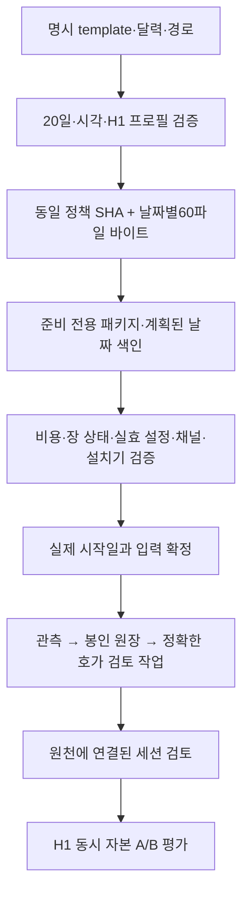

# 67차 — H1 관측 입력 준비와 수집 전 확인

목적은 **엔진이 고른 종목을 어느 가격·시점에 진입해야 비용 후 이익이 나아지는지** 검증하는 것이다. [66차 평가기](h1-multiday-capital-2026-10-12.md)는 계산을 지원하지만 실제 평가 가능한 자료까지 확보한 것은 아니다. 이번에는20일 입력을 동일 조건으로 만드는 도구와 구체적인 준비본을 만들고, 수집 전에 남은 공백을 확인한다.

**현재 단계는 준비이며 새 관측 설치·예약·사전등록 완료가 아니다.** 10월13일~11월9일은 달력과 파일 연결을 검증하는 후보 날짜다. 장 상태 자료와 설치 준비를 마치기 전에20일 평가 기간을 시작하지 않는다. 시작일이 바뀌면 아직 관측하지 않은 새 날짜와 실제 고정 시각으로 다시 만든다. 지난 날짜로 소급하지 않는다.

## PLAN — 계산 가능한 표본을 확보한다

[H1 계약](h1-entry-price-contract-2026-10-11.md)의 첫 호가 A/B·원래 수량·900초 bid·RR1.5·각 방향0/10/30bps는 유지한다. 구현 범위는 오프라인 입력 생성이다. [구현 계획](../superpowers/plans/2026-10-12-h1-observation-inputs.md).

새 준비 도구는 명시한 template/달력/목적 경로만 받아20개 study·manifest·once의 정확한 바이트와 SHA, 제안 프로토콜, 날짜별 입력 색인을 출력한다. 실제 파일 설치, 활성화 설정, 타이머 등록 기능은 없다. `installation_ready=false`와 외부 근거 확인 항목을 항상 남긴다. 실행 가능한 JSON 생성과 원천 사실의 인증을 혼동하지 않는다.

## DO — 준비 조건과 확인 결과

| 항목 | 이번 확인 | 설치/경제성에 남은 조건 |
|---|---|---|
| 날짜 | 기존 평가기는 첫 날짜00:00 KST 이전 고정을 요구. 후보10/13~11/9의 평일20개를 명시 | 거래소 예외 일정과 준비 완료 후 실제 시작일 확정. 이번 날짜는 예약이 아님 |
| 수집 | order-ready v1,09:00~10:05 접수/10:21 종료,14스캔,적격 최초5개 | 장 상태 증거를 포함한 실제 후보1건의 진입/900초 자료 연결 검증 |
| 자원 | 앞선 검증의 buffer400000·queue8192·batch256·512MiB·64KiB·lease5100초 적용 | 현재 운영 채널·동시 메모리 부하 확인. 합성 용량 시험이 이를 대신하지 않음 |
| 소스/설정 | 운영 체크아웃32f52dd와 추적된 Python 소스233파일 지문, 디스크 설정2개 지문 확인 | 실제 메모리 설정·당일 readiness는 새로 검증해야 함. 이번에 PID/헬스 점검하지 않음 |
| 비용 | 공개 KRX 주식 요율과 기존 비공개 KIS 대사 원본 확인 | 계좌/API 우대·유효일·상품별 적용 확인. 공개 가정으로 실제 계좌 순수익을 주장하지 않음 |
| 국면 | study에 사전 선언한 위험 게이트 통과/차단/미측정 기준을 포함 | 상승/횡보/하락 시장 분류와 다르며 국면별 경제성 보고는 미구현 |
| 설치기 | 옛10/8 설치·활성화기는 날짜/버전/경로가 고정돼 있음 | 새 프로필과 날짜별 영수증/drop-in 전환을 구현·독립 검토해야 함 |

### 달력과 비용 원천

이번 읽기 전용 소스 목록은 `src/`의 추적 Python 파일과 `scripts/run_trader.py`233개다. 2026-10-12 준비 폴더의 `source-inventory.json` SHA256은 `39f4a996cd2b0b9ef1c89d0f10ef55831b7e76e321666a2b382912cf07aa7e67`이다. 설정은 `default.yml`/`evolved_overrides.yml`의 바이트를 고정했으며 메모리상의 실효 설정 인증은 아니다. 기존 관측 파일과 설정의 전후 대사도 준비 폴더에 남긴다.

2026-10-12에 [KRX의10월 휴장 안내](https://trn.krx.co.kr/corebbs5/BHPTRN0301/view?bbsSeq=150)와 [우주항공청2026년 월력요항](https://www.kasa.go.kr/prog/bbsArticle/BBSMSTR_000000000010/view.do?bbsId=BBSMSTR_000000000010&nttId=B000000001860Pe2zT3)을 확인했다. 이 자료와 주말 제외로 만든20개 후보 날짜는 **11월 거래소 예외 운영까지 인증한 달력이 아니다**. 원문 바이트/취득 시각/해시와 한계를 비공개 준비 폴더에 보존했다.

[한국투자증권 공개 요율표](https://www.truefriend.com/main/customer/guide/_static/TF04ae010000.jsp?templet-bypass=true)의 BanKIS KRX 주식 수수료0.0140527%와 KOSPI/KOSDAQ 매도세 합계0.20%를 참조 가정으로 쓴다. 수수료표 기준일은2025-10-27, 세금표는2026-01-01이다. KRX/NXT 열을 매수/매도 차이로 읽지 않는다. ETF/ETN/KONEX/NXT에는 이 가정을 그대로 적용하지 않으며 상품 범위가 확인되지 않은 후보는 실제 비용 평가에 사용할 수 없다.

기존 KIS 조회/계좌 대사의 원본과 비용 검증 기록은 존재한다. 이번에는 그 저장된 검증 항목과 구조를 확인했으며 실제 금액을 재대사하거나 새로운 API 조회를 하지 않았다. 과거 날짜×종목별 합계 대사와 미래 API 계좌의 수수료 약정은 다르다. 원본·잔고·주문 identity·상세 금액은 Git과 작업자에게 제공하지 않았다. [실제 비용 대사의 범위](current-engine-observed-cost-next-step-2026-10-02.md).

### 가장 먼저 해결할 공백: 호가 당시 장 상태

현재 원장은 호가·수신 시각·연결/구독 상태를 보존하지만, 임의 종목의 해당 시점이 연속매매였다는 충분한 상태 근거를 보존하지 않는다. 현재 평가기는 시계나 VI 기록 부재로 연속매매를 추정하지 않는다. 진입과900초 뒤 호가 모두 세션 검토가 필요하므로, 이것이 없으면20일 수집 뒤에도 비교쌍0이 될 수 있다.

- [KIS 공식 VI 조회 예제](https://github.com/koreainvestment/open-trading-api/blob/208279102f43fd0c0f15fcf66c9e5a5adda27050/examples_llm/domestic_stock/inquire_vi_status/inquire_vi_status.py)는 날짜별 발생/해제 이력을 조회할 수 있지만 조회 성공만으로 모든 예외가 완전하게 포함됐다고 보장하지 않는다.
- [KIS 공식 실시간 정의](https://github.com/koreainvestment/open-trading-api/blob/208279102f43fd0c0f15fcf66c9e5a5adda27050/examples_user/domestic_stock/domestic_stock_functions_ws.py)는 KRX 체결의 장운영/거래정지 필드와 별도 장운영 채널을 제공한다. 필드명만으로 코드값 의미·초기 상태·누락 없는 상태 구간을 인증할 수는 없다.
- [KRX VI 이력](https://data.krx.co.kr/contents/MDC/STAT/issue/MDCSTAT224.jsp), [거래정지 이력](https://data.krx.co.kr/contents/MDC/STAT/issue/MDCSTAT213.jsp), [단기과열](https://data.krx.co.kr/contents/MDC/STAT/issue/MDCSTAT225.jsp), [초저유동성](https://data.krx.co.kr/contents/MDC/STAT/issue/MDCSTAT223.jsp)은 예외 대조에 사용한다. 사후 조회에서 항목이 없다는 이유만으로 앞선 임의 시점의 정상 장 상태를 채우지 않는다.

따라서 다음 구현은 **공식 코드표에 근거한 동시점 상태 원천의 보존·연결**이다. 초기 상태가 없거나 연결이 끊겼거나 원천이 충돌하면 `UNKNOWN`이다. 그 뒤 소규모 수집에서 실제 후보의 진입/+900초 두 호가를 `entry-session-review-v1`로 검토할 수 있는지 확인한다. 확인 전에는20일 경제성 관측을 개시하지 않는다. 추가 채널이 필요하면 기존41개/운영 여유10개 한도 안에서 배정·유량을 다시 검증한다.

다음 변경의 수용 조건은 다음과 같다.

1. 공식 코드표의 원문·버전·시장 범위를 보존한 뒤 상태값을 해석한다. 필드 이름이나 다른 거래소 코드표를 가져와 정상값을 추정하지 않는다.
2. 종목·KRX 채널·연결 identity/generation·수신/거래소 시각·원천 sequence를 가격과 함께 연결한다. 초기 상태 부재, 재연결 공백, 순서 역전, 지연, 서로 다른 시장, 예외 상태는 정상 연속매매로 이어 붙이지 않는다.
3. 예외 통지만 오는 채널을 구독했다는 사실은 초기 정상 상태의 증거가 아니다. 기존 실시간 원천의 상태 필드 보존을 먼저 검토하고, 필요한 추가 채널만 용량 검증에 포함한다.
4. 합성 시험에서 정상/VI/정지/단일가/미측정, 첫 무효 호가를 뒤 호가로 대체하지 않음,900초 경계, 누락된 원천을 검사한다. 원천을 수집하는 경로가 주문·사이징·계좌 위험 판정을 바꾸지 않는지도 독립 리뷰한다.
5. 짧은 실측은 **상태 연결 기능의 검증**이다. 주문 준비0 때문에 자료 경로조차 시험하지 못하면 별도로 명시한 한 종목의 두 시점 호가로 기술 검증할 수 있다. 이 자료를 H1 주문 준비 표본·수익 증거로 편입하거나 위험 게이트를 완화하지 않는다.

상태 원천을 추가하면 연구 정책/소스 SHA가 바뀔 수 있다. 그러므로 이번 준비본을 최종 입력처럼 고정해 둔 채 새 소스를 덧붙이지 않고, 검증 후 새 epoch/날짜/지문으로 전체 입력을 다시 생성한다.

### 입력과 처리 흐름

일자별 manifest는 최종 배치 경로를 가리키며 검증용 임시 envelope만 staged study를 가리킨다. study 자체를 설치 중 다시 쓰지 않는다. 생성 직후 평가 manifest의 `days`는 빈 배열이다. 미래 원장을 만들어 넣거나 예정된 날을 관측 완료로 세지 않는다. 제안 프로토콜을 품질 평가기에 넣으면20일 모두 예정/미관측이고 경제성 판단은 억제돼야 한다.

실행 인터페이스는 프로젝트 Python의 `scripts/prepare_h1_observation.py --input /절대경로/request.json`이다. CLI는 현재 aware 시각을 사용하며 과거 시각을 지정하는 옵션이 없다. 라이브러리의 시각 인자는 합성 시험과 호출자 주입용이며 신뢰된 시계 인증은 아니다. 목적 경로가 포함된 패키지를 표준 출력으로 내보낼 뿐 그 경로에 쓰지 않는다. 운영 체크아웃에서 자동으로 실행되거나 설정을 읽는 경로도 없다.

위험 게이트 국면 기준은 기존 `entry-gate-trace-v1/regime`의 `pass`/`fail`을 각각 `downside_gate_passed`/`downside_gate_blocked`, 미도달·결측·잘못된 값은 `unknown`으로 읽는다. 종목/호가의 수익을 보고 국면을 정하지 않는다. 이 객체는20일 정책 SHA에 포함되지만 현재 평가기가 국면별 손익을 자동 산출하지는 않는다.

## SEE — 검증과 통합 기록

- 새 모듈이 없을 때 실패하는 시험부터 작성한 뒤 구현했다. 독립 검토에서 날짜 목록 alias, CLI manifest 키, 구조 오류 처리, opaque 참조의 임의 날짜 치환을 보완했다. 후보 분모100개와 호가 배정5개를 분리하는 회귀도 추가했다.
- 첫 독립 검토 이후 코디네이터가 gate 후보 수/소스/설정이 다른 입력을 준비기는 통과시키고 CapturePlan은 거절하는 차이를 재현했다. 세 실패 회귀를 먼저 확인한 뒤 같은 연결 검사를 준비기에 추가했다. 최종 관련 검사는 UTC38(2.15초)/독립 KST38(2.38초), 이전 H1 평가기/CLI 관련40(15.81초)도 통과했다. 최종 변경 재리뷰 **승인/P0·P1·P2 0건**, 운영 상태/외부 접근0·diff 검사 통과. 최초 잘못된 `.venv` 경로 실행은127로 실패했고 정해진 `venv`의 통과 결과만 근거로 썼다. 최종 수정 후 전체 verify는 **4878 passed /2 skipped /2 known xfailed**(156.95초), 문법·비밀정보 검사 통과, 운영 상태/외부 네트워크 접근 시도0건이다. 초기4875검사 대신 이 결과를 통합 근거로 사용한다.
- 실제 명시 준비 입력으로 CLI를 실행했다.2026-10-12 **19:57:57 KST**에 제안 패키지를 생성했고,60개 파일의 바이트/해시·20개 독립 원장/영수증 경로를 확인했다. staged study를 임시 envelope로 읽은 **CapturePlan20개 모두 통과**했다.
- 생성한 빈 평가 manifest를 기존 `evaluate_h1_multiday.py`로 실제 읽었다.20일 모두 `planned_missing`, `quality_only`/`suppressed`, 세 민감도 손익차 모두null이다. 미관측 자료를0원 또는 완료로 취급하지 않았다. 마지막 연결 검사 보완 후 같은 입력/원래 준비 시각으로 재생성해 패키지 전체가 동일함도 확인했다.
- 운영 체크아웃32f52dd, 기존10/8 study/manifest/once, 디스크 설정2개 전후 지문은 동일했다. 이번에 운영 API·계좌 조회·systemctl·배포·재시작·예약을 실행하지 않았다.

준비 근거는 Git 밖의 `/home/ubuntu/.local/share/qwq-private/h1-preparation-20261012/`에 보존했다. `request.json`, `package.json`, `staged/`, `evaluation-manifest.json`, `quality-report.json`, `validation.json`과 달력/비용 원천이 있다. 패키지 SHA256은 `ab4b2ffaa2a6b94fa2876f4ee9a47874acb467a5856850d87502d12264fa6919`, 제안 정책 SHA256은 `1161d78977a72c1687cce80c0fc37cedd7e05ecc8cd040003f702c3580e9c971`이다. **제안 프로토콜의 시각/해시가 최종 사전등록이나 설치 승인을 의미하지 않는다.**

역할은 코디네이터 통합/비공개 입력 확인, Terra/high 요청의 격리 구현, Sol/high 요청의 원천/설치 감사와 독립 소스 검토로 분리했다. 실제 모델과 유효 effort는 도구가 노출하지 않아 미확인이고 교차 공급자 리뷰로 표기하지 않는다.

## 다음 우선순위

1. **장 상태 근거 수집 설계·구현·검증:** 공식 코드표, 초기 상태/연결 공백, quote identity와 시간 구간, 원천 저장, 채널 용량. 소규모 수집에서 실제 entry/+900초 한 쌍의 평가 가능성을 먼저 확인한다.
2. **적용 근거와 설치 준비 완료:** 계좌 비용 적용 범위·실효 설정·달력·현재 채널/동시 부하, 새 프로필의 설치/날짜 전환/실패 보존을 검증한다. 기존10/8 once/영수증을 재사용하지 않는다.
3. **새20일 사전등록·설치·관측:** 준비 후 아직 관측하지 않은 날짜를 고정한다. 기간 중 결과는 품질만 확인하고 무신호/누락일을 버리지 않는다. 버전/정책 변경 시 별도 집단으로 분리한다.
4. **비용 후 개선 검토:** H1의 회피한 손실과 놓친 이익·자본 차단을 보고, 같은 진입의 실제 청산 대조와 계좌 현금흐름, 전체 KODEX200/대칭 반도체 제외 비교로 이어간다.900초 가격 대리치를 계좌 순수익이나 지수 초과수익으로 승격하지 않는다.

이번 작업은 오프라인 준비 도구이므로 운영 배포·재시작이 필요하지 않다. 실시간 엔진을 개선하는 다음 변경은 위1번의 별도 소스/용량 검증을 거쳐 적용한다.
