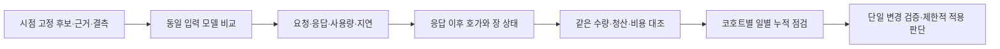

# 68차 — LLM와 호가 관측의 통합 우선순위

## Plan — 목적은 비용 후 순수익 개선

좋은 종목을 고르고 실제 매수 가능한 가격·시점에 들어가는 능력을 평가한다. 실시간 자료와 여러 후보 원천은 유용한 입력이지만 그 자체가 수익 우위의 증명은 아니다. 일봉 백테스트로 실시간 엔진의 모든 능력을 판정하지 않고, 당시 엔진 버전·국면·후보 분모를 보존해 비교한다.

**결정한 순서:** 호출·평가 목표·비용 정비 → 공통 판단 입력과 동시점 장 상태 → 작은 실제 수집 및 동일 입력 모델 비교 → 응답 이후 가격을 포함한 비용 후 평가 → 제한적 적용과 일별 검토. H1의20일은 확증 관측 기간이며 결함 수정의 대기 기간이 아니다.

사용자의 매일 개선 제안은 채택한다. 다만 하루 수익이 낮다는 이유로 점수·손절·모델을 동시에 바꾸지 않는다. 오류·결측·용량 문제는 즉시 고치고, 경제성 변경은 한 번에 하나씩 별도 코호트로 고정한다. 매수 중지 해제는 이 문서로 실행되지 않는다.

## Do — 이번 변경

1. **호출 전달**: GPT-6의 추론 제어를 실제 요청에 전달하고, Gemini thinking_level도 연결한다. 지원하지 않는 모델/옵션 조합은 전송 전에 거절한다. 모델을 자동 업그레이드하거나 서로 다른 공급자의 추론 옵션을 임의 번역하지 않는다.
2. **비용**: Gemini visible+thought 토큰을 합산하고, OpenAI completion에 이미 포함된 reasoning은 중복 합산하지 않는다. 빈 응답·재시도·fallback·기존 shadow의 개별 시도를 집계한다. 요청/서버 모델·종료 사유·지연·추론 토큰은 추가 메타데이터다. 모델의 실제 추론 기본값은 보고받지 않았으므로 추정하지 않는다.
3. **평가 목표**: `avg_pnl_pct × 거래 수 ÷ 일수`를 계좌 일수익으로 표시하던 계산과 일1% 목표를 제거한다. 거래 표본 통계와 미측정 계좌 성과를 구분한다. LLM 실패 시 손절 축소/진입 점수 상향/거래 확대 제안을 만들던 fallback을 기권으로 바꾼다. 제안 응답 스키마와 하위 검증 경로는 유지한다.
4. **관측**: metadata-only audit는 명시 audit_dir 주입 때만 쓰며 기본 비활성이다. 기존 본문 로그는 그대로다. 이번 구현만으로 운영 토큰/지연이 수집되기 시작했다고 해석하지 않는다.
5. **호출자 호환성**: 리서치팀이 OpenAI 전용 minimal 옵션을 Gemini에도 넘기던 경로를 발견했다. 공급자별로 옵션을 분리해 Gemini 기본 추론은 유지하고 원장에 쓰는 옵션도 실제 요청과 맞췄다. 실제 transport를 거치는 가짜HTTP 테스트에서 양측 응답을 확인했다. 토론 프롬프트/합의 판정/모델은 변경하지 않았다.

`daily_budget`는 유한 비음수 USD를 읽고0이면 요청하지 않는다. 단가는 표준 공개 요율 추정이며 캐시 할인은 보수적으로 미반영한다. Flash-Lite preview는 같은 계열의 공개 단가를 참조한 추정이며 실제 청구 alias 확인이 아니다. 알 수 없는 모델 단가/전송 뒤 미상 사용량은 후속 유료 요청을 보류한다. 이 정책은 호출 가용성에도 영향을 준다. **프로세스 내 사후 비용 제한**이므로 동시 요청·재시작·미상 청구까지 막는 엄격한 전역 상한으로 부르지 않는다.

호출자의8/12/15초 제한 등으로 취소된 전송도 미상 사용량으로 집계하고 취소 예외는 그대로 전달한다. 따라서 한 번의 전송 후 타임아웃/취소도 그 프로세스의 이후 LLM 요청을 당일 보류할 수 있다. 명확한 구조의 생성 전4xx거절은 별도 비과금 **추정 정책**으로 분리해 fallback을 허용하며 감사 비용/미보고 토큰은None이다. 실제 청구0원으로 확정하지 않는다.5xx·응답 형태 불명·불완전 사용량은 이 예외에 넣지 않는다. 재시작으로 제한을 우회하는 절차는 두지 않는다.

## API 비용 사전 계산

2026-10-12 공개 표준 요율, 텍스트 입력/출력, 1M토큰당 USD. [OpenAI 가격](https://developers.openai.com/api/docs/pricing), [Gemini 가격](https://ai.google.dev/gemini-api/docs/pricing). 출력 가정은 **추론 토큰을 포함한 과금 출력**이다. 아래는 실제 청구액이나 운영 호출량 실측이 아닌 비교 규모 예산이다. 개발용 AI 리뷰 비용과 별개다.

| 역할/모델 후보 | 입력/출력 단가 | 기본 하루 호출 | 호출당 입력/출력 | 하루 소계 |
|---|---:|---:|---:|---:|
| 가벼운 분류, Gemini3.1 Flash-Lite 계열 | $0.25 / $1.50 |150|1,500 /500|$0.16875|
| 제한적 정밀 평가, GPT-6.1 Sol |$2 /$10|20|4,000 /3,000|$0.76000|
| 저빈도 깊은 복기, GPT-6 Astra |$10 /$50|2|8,000 /6,000|$0.76000|

합계$1.68875/일, 재시도/편차20% 가정 **$2.0265/일**. 동일 부하22일$44.583,30일$60.795다. 주말의 실제 스케줄은 이 가정과 다를 수 있다. 현재 heavy인 GPT-5.6 Sol($4/$20)을 가운데 행에 그대로 쓰면 해당 소계$1.52로, 총액은20% 포함 **$2.9385/일**이다. 따라서 고급 모델 배치를 바꾸기 전에 실제 입력·과금 출력 분포를 확인해야 한다.

스트레스 가정은 light300회×4,000/1,000, Sol40회×8,000/8,000, Astra4회×16,000/16,000이다. 각각$0.75+$3.84+$3.84,20% 포함 **$10.116/일**로 현재 기본$5를 넘는다. 토큰 상한과 호출 수를 함께 제한해야 한다. 고추론은 비용만이 아니라 대기 중 가격 변화도 늘릴 수 있어 일괄 승격하지 않는다.

이 모델들은 **비교 후보**다. 실제 계정에서의 가용성·응답 지연·투자 판단 우위는 검증하지 않았으며 운영 설정을 변경하지 않았다. [OpenAI 추론 파라미터](https://developers.openai.com/api/docs/guides/latest-model), [Gemini3 thinking](https://ai.google.dev/gemini-api/docs/generate-content/gemini-3), [Gemini3.8 옵션 및 한시 요율](https://ai.google.dev/gemini-api/docs/generate-content/latest-model)을 기준으로 요청 계약을 검증한다.

## 다음 순서와 완료 조건

| 우선순위 | Plan | Do | See/완료 조건 |
|---|---|---|---|
|P0 이번 결함 정비|잘못된 목표·누락 비용 제거|호출/비용/목표 코드와 회귀 시험|독립 리뷰+전체 verify 통과; 아래 검증 기록|
|P1 공통 입력·실측 준비|가격 비교의 유효성 확보|원천 시각/결측/코호트/신호 identity와 장 상태를 동시 저장; 공식 상태 코드표·초기 상태·연결 공백 확인|소규모 실제 수집에서 진입/+900초 호가에 모두 상태 근거 연결. VI 이벤트 부재를 정상으로 대체하지 않음|
|P2 같은 입력 모델 비교|고추론의 순효과 확인|현행 대조+후보 하나, 동일 입력 고정·bounded shadow. task/decision ID로 요청/응답/호가 연결|API 비용·오류·기권·p50/p95지연과 응답 **이후** 매수 호가/수량/스프레드로 비용 후 비교. 늦은 응답은 과거 좋은 가격 사용 금지|
|P3 일별 검토와 적용|변동 시장에서 신속하게 오류 교정|고정 버전 기준 누적+최근 국면 별도 표시. 선정/진입/청산 대조, 변경 하나씩|순손익·손실 회피·놓친 기회·현금·회전율·낙폭 병기. 적용 범위/일손실/종목한도/즉시 복귀를 먼저 구체화|

P1에서1~3일 정도의 작은 pilot을 **기술 준비 목표**로 삼되 달력 경과만으로 통과하지 않는다. 유효 사례가 없으면 병목을 좁힌다. H1고정20일은 P1수용 후 시작하며 날짜/비용/설정/채널/새 설치기 검증을 거친다. 옛10/13~11/9준비본은 미등록 후보이며 자동 시작하지 않는다. 기존 최소 표본 규칙/BacktestGate를 이 문서로 완화하지 않는다. 자료 기반 소규모 적용안이 마련되면 변경 범위와 중단 조건으로 따로 판단한다.

P1 준비 정적 감사에서 `kis_websocket.py`의 체결 파서는 거래소 시각과 장운영/거래정지 원문을 버리고, 호가 파서는 시각·hour code·연결 identity를 보존하는 것을 확인했다. 후보 배정은 BOOK만 추가하며 체결 구독은 운영 종목에 한정돼 있다. 따라서 체결 metadata 보존만으로 모든 후보의 상태가 확보됐다고 볼 수 없다. [KIS 공식 샘플](https://github.com/koreainvestment/open-trading-api/blob/208279102f43fd0c0f15fcf66c9e5a5adda27050/examples_user/domestic_stock/domestic_stock_functions_ws.py)만으로 부족했던 값별 설명은 아래 공개 문서 원문에서 일부 확보했다. 초기 정상 상태·유실 없는 구간은 아직 미확인이다. Sol/high 요청의 읽기 전용 감사이며 실제 모델 메타데이터는 미노출이었다.

### P1 공식 원천 확보 — 2026-10-12 21:13 KST

KIS 공개 가이드가 자체적으로 읽는 `/api/apis/public/detail`을 **인증·계좌 API 없이** 조회했다. 검색에 노출된 샘플의 열 이름에 의존하지 않고 공급자의 값 설명을 확인했다.

- [체결 정의 H0STCNT0](https://apiportal.koreainvestment.com/api/apis/public/detail?accessUrl=%2Ftryitout%2FH0STCNT0): `NEW_MKOP_CLS_CODE`는 두 자리 구성이며 앞자리2가 장중, 뒷자리0이 보통이다. `TRHT_YN`은 Y/N 정지 여부다. `HOUR_CLS_CODE`는0/A/B/C/D를 구분하고 C는09시 이후 예상/VI를 포함한다. 이 값들만으로 모든 시점의 연속매매가 증명되는 것은 아니다.
- [호가 정의 H0STASP0](https://apiportal.koreainvestment.com/api/apis/public/detail?accessUrl=%2Ftryitout%2FH0STASP0): 같은 hour code 설명이 있으며 마지막 `STCK_DEAL_CLS_CODE`는 삭제된 미사용 값이다. 이 열을 새 정상장 증거로 쓰지 않는다.
- [장운영 정의 H0STMKO0](https://apiportal.koreainvestment.com/api/apis/public/detail?accessUrl=%2Ftryitout%2FH0STMKO0): `MKOP_CLS_CODE`112는 개장,121은 마감 동시호가 시작 등 사건 코드다. 종목 상태58/59는 거래정지/단기과열 분류다. 문서는 VI 발생/해제 때 수신한다고 설명하므로 구독 직후의 정상 초기값 또는 모든 예외의 완전한 통지가 보장됐다고 볼 수 없다. 단일가 관련 일부 코드는 원문에도 `???`이며, `VI_CLS_CODE`의 적용 여부를 활성 구간 판정으로 바로 바꾸지 않는다.

원문 응답 바이트·수집 시각·SHA256 색인은 Git 밖 `/home/ubuntu/.local/share/qwq-research/public-kis-status-20261012/index.json`에 보존했다. 체결/호가/장운영 응답 SHA는 각각 `833b105418e98807d3e24753f97ed008e0f5f6972a0937a1a0f40d252543624d`, `a22543dd4a1c64c01210eef281203771da0d1d58e2e7d4c08643c35a3fc60ff3`, `4c76c54995ff112312ecf9e98f4f194d6edfe2f0749300b8639c10ff0d40c3f5`다. 상위 문서 수정일과 개별 필드 수정일은 다르므로 응답 원문/지문을 기준으로 고정한다. 다음 구현은 이 근거의 원문 보존·연결이며, 자동 정상 판정 및 실제 한 쌍 확보는 아직 미완료다.

## 매일 볼 결과와 수정 규칙

- **기술**: 후보·신호·호가·상태·LLM 요청 연결 누락, 미래자료 혼입, 오류/취소, 미상 비용, API 사용량. 결함 수정은 새 코드/입력 버전을 남긴다.
- **경제성**: 전체 적격 후보 분모에서 통과/거절/기권을 모두 추적한다. 잘못 거절한 상승뿐 아니라 거절해 회피한 손실도 같은 시각·수량·비용·청산 규칙으로 대조한다. 결측은0손익이 아니다.
- **시장/엔진**: 현재 완성도·국면을 과거와 분리한다. 전체 KODEX200과 사전 정의된 반도체 제외 진단을 함께 표시한다. 수익이 좋은 업종을 사후 삭제해 기준을 유리하게 바꾸지 않는다.
- **변경**: 하루 손익은 진단 자료다. 확증 판정은 정한 시점/규칙으로 하고, 중간 통계가 좋다는 이유만으로 관측을 끝내지 않는다. 불리한 안전/품질 징후에는 조기 중단 가능하다.

## 코드와 프로세스 연결

이번에 고친 부분은 공용LLM 호출/집계와 전략 복기의 잘못된 목표다. 입력 패킷 전체·decision ID 연결·장 상태 수집·가격 연계 비교기는 **다음 구현**이다. 기존 일일 복기/주간 배분/EOD청산/후보 재정렬 등 다른 LLM 소비자가 모두 정비됐다는 의미가 아니다. 특히 EOD청산은 직접 매도 시점에 영향을 주므로 입력·기권·실행 영향 검토에서 우선한다.

## See — 검증 기록

- 전략가 테스트: 수정 전9실패/3통과 → 수정 후12통과, 실제 실패/잘못된JSON 경로와 양/음 성과 표본 검증. 외부 네트워크·운영 상태 접근0.
- 호출부 테스트: 최초37실패 재현, 취소/생성 전 거절을 포함한 최종70검사 통과. 통합 신규82검사 UTC/KST 각각 통과·격리 위반0. 취소를 다른 예외 클래스로 바꾸면 asyncio timeout 변환이 깨지는 반례를 고쳐 원래 취소 객체를 보존했다.
- 공식 요율 재대조로 gpt-5-mini에 대형 모델의 장문 배수를 잘못 적용하던1사례를 RED로 재현해 수정했다. 이 단계 통합83검사 UTC/KST 통과. 리서치팀의 실제 공급자 호출1사례도 실패→통과로 확인했고 T11기존 관련 포함85검사가 통과했다. 아래 최종 결과는 후속 리뷰 보완을 포함한다.
- 최종 관련 검사 **UTC205통과/KST205통과**, 운영 상태·외부 네트워크 접근 시도0건. 최종 전체 `verify.sh`는 **4999 passed /2 skipped /2 known xfailed**(166.00초)이며 문법·비밀정보 검사도 통과했다. pykrx의 기존 deprecation 경고1건은 남았다. 이전4989검사 대신 이 결과가 마지막 코드 변경의 근거다.
- 실제 수집·새20일·paid 모델 비교·운영 배포·순수익 판정은 아직 수행하지 않았다.

### 1차 독립 리뷰의 처리 근거

실제 `claude-opus-5`로 확인한 도구 비활성 리뷰(xhigh 요청)는 수정 요청이었다. 구현자와 별도 공급자의 소스 검토이며 리뷰어가 테스트를 실행한 것은 아니다. 다음 근거를 확인해 보완한다.

- Gemini의 출력 토큰0 생략은 [공식 proto](https://github.com/googleapis/googleapis/blob/master/google/ai/generativelanguage/v1beta/generative_service.proto)의 비optional int32 및 [UsageMetadata](https://ai.google.dev/api/generate-content#UsageMetadata)를 확인했다. 출력이 없다는 근거가 있는0과 자료 자체가 없는 unknown을 분리하며, 존재하지만 깨진 값/합계 불일치를 정상으로 채우지 않는다.
- 오류 본문을 제외하되 허용된 오류 코드와 HTTP상태를 남긴다. shadow 태스크의 강참조/종료 시 취소 집계를 보강한다. 완료 전 동시 실행의 예산 초과 가능성은 앞서 명시한 사후 제한의 한계다.
- 설정 모델의 단가/옵션 지원 사전 점검, 잘못된 seed의 전송 전 거절, fallback 생략 사유를 보완한다. 미지의 미래 모델을 접두사로 지원한다고 간주하지 않는다.
- `src/`·`scripts/` 전수 검색에서 `get_usage_summary`/`budget_remaining_usd`의 외부 제품 소비자는 없었다. `StrategyAdvice` 평가/신뢰도는 `dashboard/data_collector.py`에서 표시 자료로 읽고, `strategy_evolver.py:_get_llm_suggestion`은 빈 parameter_adjustments면None으로 끝난다. 별도 daily_reviewer의 평가 형식과 혼동하지 않는다.
- 명시 추론 옵션 호출자는 adversarial_validator의 OpenAI경로와 ResearchTeam이다. 후자의 Gemini호환성 회귀를 위와 같이 수정했다. 미지원 명시 옵션은ValueError라는 계약을 문서화한다.
- 새 audit만 본문 미기록이며 기존 본문 로그는 별도다. 동기 감사I/O의 지연은 활성화 전 검증 항목이다. 새 `LLMManager.close()`는 shadow 취소·집계 후 세션을 닫지만 애플리케이션 종료 경로 연결은 아직 없어 shadow 활성화 전에 연결해야 한다. fallback에 과거 losing_patterns/issue권고를 재삽입하는 것은 이번 기권 목적에 필수적이지 않아 유지하지 않는다.

### 재리뷰와 후속 경계

2차 독립 리뷰는 실제 `claude-opus-5`가 **APPROVE**했으며 도구 사용/테스트 실행은 없었다. 비차단 권고 중 두 항목은 추가로 재현·수정했다. 연결 전 `ClientConnectorError`는 미전송으로 분리하되 일반 socket 오류·응답 유실·timeout·취소는 미상으로 유지한다(두 공급자 연결 실패2RED/나머지6PASS →8GREEN). 모순되거나 불완전한 토큰 사용량은 알려진 비용 소계에 넣지 않는다(두 공급자2RED →2GREEN); 전체 비용 미상과 후속 보류는 유지한다. 이 마지막 변경도 별도 delta 리뷰에서 **APPROVE**했다. assistant/result 메타데이터의 실제 모델은 두 종결 리뷰 모두 `claude-opus-5`, 요청 xhigh, 유효 effort는 미확인이다. 도구 위반·타임아웃 없이 완료했고 작성자와 별도 공급자의 소스 검토다. 리뷰어가 전체 검사를 실행한 것은 아니며 조정자가 위 최종4999검사 결과를 확인했다.

통합 전 운영 체크아웃은 `32f52dd7a253f54807d9c6b30f1897dc57e8991f`이며 기존 `config/evolved_overrides.yml` 변경은 건드리지 않았다. 운영 서비스 상태를 새로 점검하거나 재시작하지 않았다. 커밋/PR과 필수 CI·머지 상태는 해당 PR 기록을 따른다.

비차단 후속은 P1/P2 준비에서 추적한다: 새 비교 원장의 서버 모델/종료/토큰·decision ID 연결, OpenAI visible 토큰 해석, API 오류와 스키마 오류의 진단 구분, 불필요한 구 함수 정리, 알려지지 않은 kwargs의 허용 계약. 레거시 비GPT5/6 경로의 `temperature=None`은 현행 설정에서는 도달하지 않으며 해당 모델의 지원/단가 확인 전 교체하지 않는다. 메타데이터 감사의 부하와 소유자의 close 연결을 검증하기 전 유료 shadow를 켜지 않는다.
