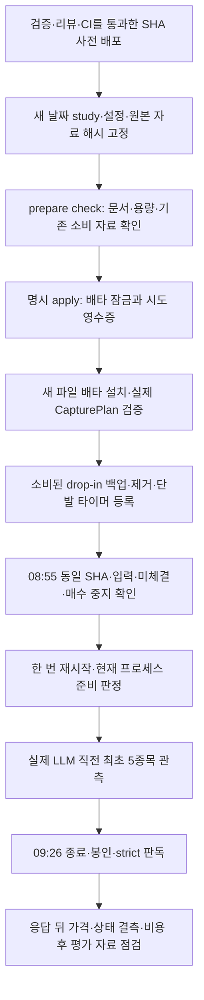

# 최초 LLM 판단 5종목의 단발 관측 설치 — 2026-10-14

## PLAN — 목적과 고정 범위

종목 선정과 진입 시점의 개선이 비용 후 수익으로 이어지는지 확인하려면, 실제 LLM 판단과 그 응답 뒤 호가를 같은 기간에 수집해야 한다. 이번 변경은 그 작은 실측의 설치 경로다. 매수 재개·모델 교체·유료 비교 실행·수익성 승인이나 새 20일 관측 시작을 포함하지 않는다.

- 기준 main `68c2bbb59d20a05d63bf00f6cdf6f9725ae55010`, profile `20261015-llm-window-v1`, epoch `2026-10-15-engine-llm-window-v1`.
- 개발상 고정 후보 일정: **10월15일 08:55~08:57 KST 활성화**, 09:00~09:10 실제 LLM 직전 입장, 09:26 종료. 실제 예약은 아직 없다. 날짜가 지나면 이 계약을 재사용하지 않는다.
- 기본 KR 스크리닝 5분 주기·초기 대기·처리 시간을 고려해 입장을 10분으로 잡는다. 최초 5종목, 반복 종목은 기존 슬롯, 여섯째는 미배정이다. 마지막 입장 뒤 16분은 진입 호가+900초를 위한 여유이나 응답/호가 지연에 따른 결측까지 없애지는 못한다.
- `rest_market_state_evidence:true`와 두 장 상태 채널을 명시한다. REST 원문은 계속 UNKNOWN이며 VI 무사건이나 구독 ACK를 정상 시장 증거로 사용하지 않는다.

## DO — 코드와 절차

`scripts/ops/entry_capture_prepare_20261015.py`는 기존 날짜의 설치기와 분리했다. 고정 경로·타이머·study/manifest/소스/설정 해시, 기존 10월14일 소비 영수증을 대조한다. 준비 단계는 배포·봇 재시작을 하지 않는다. `--check`는 payload 검증이며 실제 runtime 의미 검증을 완료했다는 뜻이 아니다. `--apply`의 타이머 등록 전 두 정적 검사에서 사전 배포된 Python의 `CapturePlan.load()`를 ubuntu 권한으로 실행한다. 실패 시 신규 타이머를 해제하고 시도 영수증은 보존해 자동 재시도를 막는다.

`scripts/ops/entry_capture_activate.py`의 새 고정 분기는 **old_head==new_head**만 허용한다. 기존 파일럿/과거 날짜의 계약은 유지한다. 활성화기는 한 번 재시작 뒤 현재 프로세스의 준비 정보를 확인하고 실패했다고 재시작을 반복하지 않는다. 실패 후 상태 파일과 봇을 운영자가 점검해야 한다.

`ObservationRuntime.install()`은 REST 보존을 명시한 LLM 계약에서 정지 피드의 운영 구독 수요를 먼저 초기화한다. 소켓/API를 새로 시작하지 않는다. 로컬 readiness는 RiskManager→관측 owner→버퍼→구독 callback→writer의 실제 객체 연결과 실제 자원 설정을 반환한다. 새 profile은 다음을 검사한다.

- 실제 LLM 입장 연결, REST 보존, 상태 수집, 고정 시각/자원/레코드 할당이 일치할 것.
- 운영 수요가 초기화되었고 **운영 채널+후보 최대15채널+운영 여유10≤41**일 것. 외부 예약0에서 운영 수요16까지 준비 가능하다. 후보 미정 단계에서는 미래 후보 ACK를 요구하지 않는다.
- 연결 전 generation0의 실제 미연결 상태, 또는 현재 피드·소켓이 살아 있고 운영 ACK가 완료된 상태일 것. 이전 ACK가 남은 연결 종료 중에는 거부한다.
- writer 장애·종료·드롭·명시 불완전 사유가 없을 것. 개장 전 스캔이 아직 없다는 사실만으로 준비 실패시키지는 않는다.

준비 완료는 실제 호가 수신·정상 장 상태·체결 가능성·순수익 입증과 별개다. 운영 주문 경로와 월 $100 예산, KR 매수 중지, 비교 작업자 기본 OFF는 이번 변경으로 바꾸지 않는다.

## 용량과 설치 전 남은 자원 검증

호가50,000·상태50,000·기타8,000·스캔 근거804건, 버퍼/큐 각110,000, 단일 레코드65,536바이트, batch64로 고정한다. 원장 상한은 `110000×(65536+2048)+2048 = 7,434,242,048`바이트다. 원장 파일시스템의 비예약 가용 공간을 설치 최초/잠금 후/타이머 등록 직전에 검사하며, 하한은 여유1GiB를 포함한 **8,507,983,872바이트**다.

파일럿 5분/1종목 호가903·상태856건을 26분/5종목으로 단순 환산하면 각각23,478·22,256건이다. 50,000은 이 참고치 약2배일 뿐 최대 유량의 증거가 아니다. 자원 상한은 선할당 크기가 아니며 원장 상한으로 RAM 안전을 증명할 수 없다. **최대 유량/RSS 검증 및 실제 설치 당시 자원 여유 확인은 남아 있다.** 도구도 `memory_safety_verified:false`를 반환한다. 자원 확인 없이 설치 준비 완료로 승격하지 않는다.

운영 study의 수수료·자본 숫자는 이번에 생성하지 않았다. 테스트 숫자는 합성이다. 실제 study 생성 시 소스 SHA와 설정 지문의 계산 기준, 수수료/자본 근거, 기준 고정시각을 기록해야 한다. 자료 부족은 null/결측 판정을 유지하며 임의 값으로 채우지 않는다.

## SEE — 검증과 리뷰

- 관련 기존 baseline 481 passed / 2 skipped, rc0. 새 준비 API 누락 반례가 실패한 뒤 실제 projection을 구현했다.
- 독립 중간 리뷰가 실제 피드 종료와 구독 소유자 잠금 사이의 오래된 ACK 승격(P2)을 재현했다. 동일 종료 경계의 회귀를 실패 상태에서 추가하고 현재 피드·소켓 상태 검사로 수정했다.
- 통합 관련6파일 **539 passed / 2 skipped**, rc0(12.91초). 한국 시간대 신규2파일 **166 passed**, rc0(4.91초).
- `TZ=UTC PYTHONDONTWRITEBYTECODE=1 QWQ_VERIFY_PYTHON=/home/ubuntu/projects/qwq-ai-trader/venv/bin/python bash scripts/dev/verify.sh`: **6288 passed / 2 skipped / 2 xfailed / 3 warnings**, rc0(229.72초). 문법·비밀정보 검사 통과, 운영 상태/외부 네트워크 접근 시도0. 로그는 개발 환경 `/tmp/qwq-llm-installer-full-verify.txt`, `/tmp/qwq-llm-installer-targeted.txt`, `/tmp/qwq-llm-installer-kst.txt`.
- 중간 리뷰어가 연결 종료 수정 후 실제 경계3검사를 재실행해3 passed(rc0), 해당P2 종결·추가P1/P2 없음. 독립 최종 리뷰의 완료 여부·실제 모델·판정과 CI/병합 상태는 PR 정본에서 확인한다. 시험 통과만으로 병합 승인을 대신하지 않는다.
- 준비 설치기 작업자·중간 리뷰어는 각각 요청 Astra/high, 실제 모델/실효 effort metadata 미노출. 역할과 작업트리를 분리했고 코디네이터가 diff와 실제 검증 증거를 대조한다. 최종 critical review는 별도 제공자에 정제된 소스만 전달한다. 최초 외부 A/B 검토는 각각360.8/361.1초 절대 기한에서 중단됐다(직전 모델 진행0.9/1.8초, 완료 판정 없음). 같은 Opus5/xhigh·권한·설정의 짧은 control은5.1초/rc0/실제Opus5로 완료됐다. 호출 불가로 간주하거나 모델을 낮추지 않고 입력을약58/55KB에서33/30KB의 변경 중심 범위로 줄였다. 시간초과 실행을 승인으로 세지 않는다.

## 다음 순서

1. 코드 통합 검사·독립 최종 리뷰·CI를 통과한 SHA 확정. 문서·커밋·PR 완료와 운영 배포를 구분한다.
2. [기존 배포 체크리스트](../operations/pilot-decision-checklist-2026-10-14.md)의 장외(15:30 이후) 최신 가드로 고정 SHA 적용. 실제 계좌 미체결·복구 상태·관측 종료·설정/KILL 보존을 다시 확인한다.
3. 자원 검증과 운영 study의 근거를 확보한 뒤 새 profile 설치·예약. 현재 계약은 개발 후보이며 자동 예약하지 않았다. 실제 설치 승인 범위는 당시 요청을 따른다.
4. 09:26 종료 뒤 완전성/봉인, 실제 판단 발생 건수, 연결 세대별 상태/REST 결측, 응답 뒤 진입 호가를 판독한다. 판단0건은 실패한 모델 성과가 아니다. 기술 결함은 매일 수정하되 성과 비교 규칙은 중간에 바꾸지 않는다.
5. 상태 의미·시점 및 비용 근거가 충족될 때 제한된 모델 비교와 순수익 평가를 진행한다. 계좌 기준선·입출금/권리 대사, 전체 KODEX200 및 사전 정의한 반도체 제외 보조 비교는 별도 남은 작업이다.

이번 개발에서 운영 서비스/타이머 조회·변경, 배포·재시작·실제 관측·증권 API·유료 애플리케이션 비교 호출은 없었다. 운영 저장소 HEAD `161b394`와 기존 `config/evolved_overrides.yml` 수정은 Git 읽기로만 확인했다.
