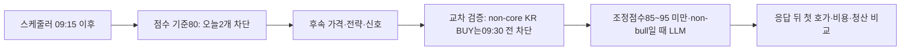

# 10월16일 실측 판독 — 선정 단계 병목과 LLM 관측 시간 오류

## 목적과 결론

좋은 종목과 진입 시점을 골라 비용 후 순수익을 개선하는 것이 목적이다. 10월16일 예약 점검·판독은 실행됐지만 가격·모델·청산의 수익 비교 표본은 생기지 않았다. **실제 반환 후보 2개는 점수 기준80에서 먼저 차단됐다.** 별도로 코드 대조에서 **LLM 앞의 KR 교차 검증은09:30 전 non-core BUY를 차단**하는데 관측 입장은09:25에 끝나는 설계 오류를 확인했다. 이 두 사실을 구분한다. 후자의 조건은 오늘 trace에 실제 도달한 차단 사유가 아니다.

어제의09:15 설치 전 검사는 스케줄러 공통 시간만 확인했고 후속 교차 검증을 빠뜨렸다. 새 설치 검사만09:30 하한으로 보완하며, 실거래 시간 가드·선정 점수·과거 원장·소비된 요청을 변경하지 않는다. 과거 봉인 자료는 기존 해석 계약으로 계속 읽는다.

## PLAN → DO → SEE

| 순서 | 수행 | 확인 결과 |
|---|---|---|
| 예약 실행 대조 | systemd 실행 시각·종료코드와 비공개 결과 대조 | 07:35 역할 감사,08:50 장전 점검,09:45~09:45:13 판독 모두 rc0 |
| 실제 자료 검증 | 고정 study·원장 지문, strict 리더, 선정/게이트 보고 재생 | 봉인된 창 complete·드롭0, 재생한 후보/점수/게이트 행이 자동 판독과 동일 |
| 선정 가설 첫 비교 | 전날 고정한 known-family 출현 보너스만 대조 | 반환 후보2개 모두 원천1개/계열1개/보너스0이므로 점수 변경0; 수익 효과는 미확정 |
| 가격·청산·모델 비교 | 실제 입력 충족 확인 | LLM시작0·신호0·order_ready0·후보 호가0·비교쌍0. 손익은 null |
| 시간 오류 수정 | 신규 LLM 설치 검사에 후속09:30 조건 반영 | 구현·시험·리뷰·최종 통합 상태는 아래 검증 기록 참조 |

## 실행 및 운영 근거

- 07:35 감사: `report_one_line`와 `morning_brief` 각1행, 요청/실제 모델 `gemini-3.1-flash-lite`, minimal·성공 STOP·usage/비용 확인. 지연은 각각 약1.37초/3.02초, 두 행 추정 비용 합계 **USD0.00138825**다. 월 전체 지출·공급자 청구서 또는 내용 정확도/수익성 평가가 아니다.
- 13:17 월 예산 원장을 SQLite 읽기 전용으로 확인했다. 한도USD100, 10월 정산 추정USD1.3435385·예약0·불명0·상한위반0·저장 정책normal·미전송 알림0이다. 원장 초기화/정산 변경은 없고 공급자 청구 확정액은 아니다.
- 아침 보고는 생성 version/hash와 앱의 sent 기록이 일치한다. 사용자 수신 확인을 의미하지 않는다. 금요일의 주간 post-exit는 실행 대상이 아니며 토요일09:30~09:44가 실제 실행 창이다.
- 08:50 점검: 보호 지문334개 일치, 당시 PID1879257·NRestarts0, KR 매수 중지·미소비 상태·로컬 연결/복구 정상. 기존09:10 활성화가09:10:06 봇을 재기동한 뒤 PID1928482로 바뀌었다. 활성화 영수증은 complete·restart_attempted=true·rollback=not_needed·toss_attempted=false다. 이는 기존 예약 동작이며 이번 후속 작업의 재시작이 아니다.
- 13시대 재확인: 운영 HEAD `de6c5bf7`, PID1928482·NRestarts0·active, 보호 지문334개 불변. 로컬 health는 연결/복구ready·broker/risk/journal pending0·미귀속0. 이는 봇 메모리이며 거래소 미체결 실조회가 아니다.
- 원장 `engine.jsonl`: 4,385,444바이트, SHA-256 `9695ad22a194288174ea03d2ec246755104708678ca92fb804e8115543978440`. study SHA는 `39957565351aaab0ef4c4ce7f8461206118cb0af09719536a0bb7f0686d22024`로 전날 계약과 일치한다.
- 비공개 실제 재생/비교 결과: `~/.local/state/qwq-premarket-20261016/followthrough/evidence.json`(0600), SHA-256 `138789d131ab9aed7e6fc3959dea4d56eac6b97ddbd66d64972322a442d02ef1`. 자동 판독 결과와 원본은 보존했다.

## 관측 모집단과 첫 차단

09:16:30 스캔은2후보,09:21:40 스캔은0후보를 반환했다. 두 스캔의 반환 후보 전체가 분모이며 스크리너 내부 탈락 종목까지 포함한 전체 발굴 모집단은 아니다.

| 익명 후보 | 단일 원천 점수×가중치 | 병합 후 보정 합계 | 최종 점수 | 실제 기준 | 스캔 등락률 | 실제 첫 차단 |
|---|---:|---:|---:|---:|---:|---|
| C1 | 90×0.5=45 | -30 | 15 | 80 | +10.40% | score |
| C2 | 84.27×0.5=42.135 | -34 | 8.135 | 80 | +8.09% | score |

둘 다 `premarket_gap` 한 항만 있고 정규화는 clamp다. 두 후보의 원천 수를 known-family 수로 바꾸어도1→1이며 보너스0·점수 불변이다. **단일 원천의 가중 점수 최대45와 최종 점수 상한을 혼동하지 않는다.** 다른 보정의 가점이나 다른 모집단의 정규화가 최종 점수를 바꿀 수 있다.

보정 합계를0으로 놓는 단순 산술에서도45/42.135로80에 못 미치지만, 이는 수급 감점 제거의 인과적 재생이 아니다. 보정에는 여러 가감점·하한·실패/미평가가 섞여 있어 -30/-34를 특정 결함 하나의 영향으로 귀속할 수 없다.

실제 `scan_change` 단계는 not_reached다. 다만 기록된 등락률을 동일 코드의09시대 상한5%에 **단독 대입**하면 둘 다 초과한다. 점수만 완화하면 진입이 가능하다고 말할 수 없다. 이 계산은 후속 조건 전체 재생·실시간 호가 검증·실제 주문 가능성의 증거가 아니다.

원장 기록은 `scan`2, `selection_basis`2, `entry_gate_trace`2, `quote_subscription`7, `ws_quote`4,995개다. **4,995개 호가 중 반환 후보와 교집합은0**이다. LLM시작·후보 배정·장 상태 레코드도0이다. 프레임 진단의 available0/gap0은 후보 수신 수요가 없던 범위이므로 소켓 전체가 무결하거나 연속매매 상태였다는 증거가 아니다.

판단 파일 부재는 LLM시작0과 별도로 보존한다. `decision_recording_finality=unverified`, 전체 시장/시간대 커버리지와 저장매체 영속성은 미확정이다. 후보에 실제 호가가 없으므로 session review를 만들어 채우거나, 비교 불가를0수익/현금으로 바꾸지 않는다.

## 선정 입력에서 확인한 문제

두 스캔 모두 기관/외국인은 `cached_empty`, Naver 세 원천은 `not_called`다. 첫 스캔의 수급 캐시 경과시간은 약365초다. 이는 해당 후보의 순매수0 또는 음수 증거가 아니다. 코드에서는 양의 순위 명단에 들어온 경우에만 수급 boolean이 true가 되고, 나머지 false가 SPDI·개인단독매수 감점에 재사용된다(`kr_screener.py`의 `_apply_spdi_filter`, `screen_all` 개인단독매수 절). **미관측과 관측된 비양수의 의미가 합쳐지는 결함은 남아 있다.**

별도 운영 로그에서 유니버스 제외11개→최종2개, 다음 스캔 제외14개→최종0개를 확인했다. 이 로그는 원장에 없는 종목별 전체 탈락 경로를 복원하는 근거가 아니며 숫자를 원천별 인과 기여로 합산하지 않는다. 점수가 낮아 최종 반환0개가 된 것으로도 해석하지 않는다.

다음 선정 변경은 `positive / observed_nonpositive / unobserved`와 보정별 전후 점수·적용/미평가 사유를 함께 기록하는 **관측 전용 변경**이 먼저다. 순위 미등장·빈 캐시·실패를 observed_nonpositive로 승격하지 않는다. 같은 입력에서 하나의 수급 감점 처리만 shadow로 비교하고 실제 점수·기준은 고정한다. 전체 원천 제거의 인과적 손익 비교는 필요한 시점별 입력이 없어 계속 미준비다.

## 시간 경로와 수정 범위

`src/core/cross_validator.py`의09:00~09:29 하드 가드는 `src/core/engine.py`의 LLM 분기보다 먼저 실행된다. `CapturePlan.validate()`만 신규 LLM 입장 창 전체를09:30~15:01 KST 안으로 제한한다. 기존 markout 종료 여유와 다른 수집 형식은 유지한다. `validate_window_contract`와 봉인 리더에는 새 설치 하한을 넣지 않아 과거09:15 관측을 다시 읽을 수 있어야 한다.

09:30 이후라도 초기 시간 감점·85≤조정점수<95·시장 regime에 따라 LLM 호출이 없을 수 있다. 시간 하한 충족은 실제 표본 발생을 보장하지 않는다. 관측을 위해 진입 점수/시간 가드를 풀거나 유료 판단을 강제로 생성하지 않는다.

## 검증·통합 기록

- 구현 커밋 `700494a0`: 신규 설치 하한만 수정하고5개 소스/시험 파일을 갱신했다. RED에서09:15 및09:29:59.999999(KST/UTC) 허용 반례3건이 실패했고 수정 뒤 통과했다.
- 관련 검사: UTC653 passed, KST437 passed, 각 rc0·외부/운영 접근 시도0. 과거 고정 profile 시험은 새 설치 성공으로 위장하지 않고 실제 loader/activation 거절과 역사 판독 보존을 각각 확인한다.
- [독립 중요 최종 리뷰](../reviews/llm-capture-window-2026-10-16.md): Astra/xhigh 요청, 실제 모델/실효 effort metadata 미노출·미검증. 구현자와 별도 리뷰어가 APPROVE·신규 P0/P1/P2 0으로 판정했고 독립 한정71검사·격리0을 확인했다. 교차 공급자 리뷰는 아니다.
- 수정된 현재 소스로 실제 오늘 snapshot도 읽기 전용 재생했다. 원래09:45 분석시각을 유지했고 상태·봉인·시작/판단·호가·경제성·기술 판정10항목이 기존 자동 결과와 동일했다. 새 결과는 비공개 별도 파일에 보존했으며 원본/소비 영수증은 수정하지 않았다.
- 전체 verify: **6698 passed / 2 skipped / 2 xfailed**, rc0,250.37초. 문법·비밀정보 검사 통과, 운영 상태/외부 네트워크 접근 시도0. 최종 푸시·CI·병합 여부는 이 변경 PR의 실제 검사/병합 기록으로 확인한다.

운영 코드·설정·단발 원본/영수증·월100·유료 비교OFF는 유지한다. 이 작업으로 신규 주문·모델 호출·운영 배포·재시작·예약 설치는 하지 않는다. 새 설치 사전검사와 판독 문서의 통합이며, 기존 만료 관측을 위해 봇을 재배포할 필요는 없다.

## 다음 우선순위

1. 설치 시간 방어를 통합한 뒤 다음 관측의 전체 경로를 검토한다. 후보안은09:30~09:40 입장/09:56 종료이며 **새 날짜·SHA·증거에 묶인 실제 예약은 아직 없다**. 전날 사전 고정한 연구를 과거 시각으로 소급 수정하지 않는다.
2. 수급 상태와 보정별 근거의 관측 전용 패치 → 동일 입력의 단일 변경 비교를 진행한다. 당일2후보를 보고 가중치·임계값·손절·모델을 동시에 맞추지 않는다.
3. 실제 판단·응답 이후 후보 호가·장 상태·주문 준비 근거가 생긴 표본에서 가격/청산/모델 비교를 진행한다. 계좌 전체 순수익은 시작 순자산·외부흐름·권리 지급·운영비 증빙을 별도로 채워야 한다.
