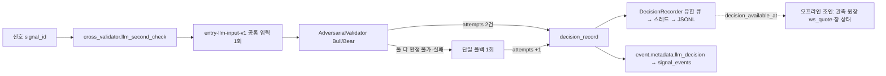

# 64차 — LLM 진입 판단의 재생 가능 기록 (llm-decision-v1)

## PLAN — 무엇이 끊겨 있었나

71차 공통 입력(`entry-llm-input-v1`)으로 Bull·Bear·단일 폴백이 같은 사실을 받지만, 어떤 판단이 어떤 입력·역할·모델로 내려졌고 비용이 얼마였으며 응답 뒤 어떤 가격이 있었는지는 서로 다른 곳에 흩어져 있었다.

| 이미 있던 것 | 끊긴 곳 |
|---|---|
| 신호 원장 `signal_events`(signal_id·G3 거절·size_trace) | LLM 판단 결과는 `llm_second_check`·`llm_budget_validation` 플래그만, 입력·응답·모델·시도 단위 없음 |
| 월 예산 원장 `reservations`(token·model·예약/정산 비용) | 어느 판단의 호출인지 연결 키 없음 |
| `LLMResponse`(요청/실제 모델·토큰·지연·예산 모드) | 호출 직후 버려짐, 영속 안 됨 |
| 관측 원장 `signal`/`ws_quote`/장 상태 | 판단 완료 시각이 없어 "응답 뒤 첫 호가" 조인 불가 |

## DO — 최소 영속 기록

`src/analytics/llm_decision_record.py` 가 판단 하나를 `llm-decision-v1` JSON 한 줄로 월별 파일 `~/.cache/ai_trader/llm_decisions/decisions-YYYY-MM.jsonl` 에 append 한다.

**기록 내용.** `decision_id`·`signal_id`·종목·전략·점수·레짐·`code_version`(applied_sha)·`context_version` / `inputs.common_context`(사실 블록 원문)·`common_context_sha256`·`source_observed_at=null`(원천 시각은 아직 없으며 현재 시각으로 채우지 않는다)·`collected_at`(공통 입력 구성 시각, 모르면 null — 판단 완료 시각으로 대체하지 않음) / `stage`(adversarial·single_fallback) / `attempts[]`: `attempt_id`·역할·공급자·요청/응답 시각·지연·요청 모델/추론 수준·**공급자가 보고한 실제 모델(없으면 `unverified`)**·토큰·`usage_known`·`billing_status`·추정 비용(단가표·사용량 보고가 있을 때만)·예산 `policy_mode/version/priority/block_reason/reservation_token`·결과 분류(success·empty·failed·timeout·budget_blocked·exception·not_sent)·역할 시스템 프롬프트 sha256·역할 접미 원문·응답 본문(2,000자 상한)+전체 sha256 / `result`(approved·confidence·reason·failed·disagreed·bull/bear) / `budget_context` / `decision_available_at` / `first_quote_after=null`.

**실제 호출 전부.** `LLMManager.complete()`/`complete_with()` 는 한 호출 동안 실제 공급자 시도(빈 응답 재시도, 공급자 폴백)마다 `_account_attempt` 지점에서 trail 1행(공급자·요청/실제 모델·전송 여부·토큰·Decimal 비용·**예약 토큰**·차단 사유·지연)을 쌓아 응답 `attempt_trail` 로 붙인다. 시도 기록의 `calls`/`calls_count`/`calls_estimated_cost_usd`/`calls_cost_complete` 가 이것이다 — 최종 응답 1건의 비용과 호출 전체 비용을 구분한다. Bull/Bear 는 역할별 완료 시각을 따로 보관해 한쪽이 전체 제한 시간을 넘겨도 먼저 끝난 쪽의 응답·비용은 남고 미완료 쪽만 `timeout` 이다.

**재생.** `common_context + role_suffix` 가 실제 전송 프롬프트와 같다(시험으로 고정). 시스템 프롬프트는 상수(`BULL_SYSTEM`·`BEAR_SYSTEM`)의 sha256 으로 버전을 식별한다. 비밀정보·계좌 식별정보는 입력에 없다(사실 블록·역할 지시·응답 본문만).

**정책.** 기록은 판단을 절대 막지 않는다 — 시도 기록 생성조차 `safe_attempt_record` 로 감싸 예외가 나면 `record_error` 행을 남기고 판정은 그대로다(거절이 fail-open 승인으로 바뀌지 않는다, 시험 고정). 신호 메타 `llm_decision.record_status` 는 **큐 수락 결과**(`queued`/`dropped_queue_full`/`dropped_closed`/`disabled`/`error`)이고 저장 완료가 아니다. 저장 결과는 기록기 `status_of(decision_id)`(`written`/`dropped_file_cap`/`write_error`, 최근 1,024건)와 월 파일로 확인하며, 큐(256)·월 파일(64MiB) 초과와 쓰기 실패는 경고 로그와 `/api/health.llm_decision_record` 통계(queued/written/dropped_*)로 드러난다. 기본 기록기는 `LLM_DECISION_RECORD=1` 일 때만 켜져 시험이 실제 홈에 쓰지 않고, 운영 런처(`run_trader` KR 초기화)가 `install_production_recorder()` 로 켠다(`LLM_DECISION_RECORD=0` 이면 끔). 재시도·폴백은 시도 단위로 각각 남고 비용은 예약 토큰으로 원장 한 행에 귀속된다(중복 합산 없음). 정상 종료는 LLM 정리 뒤 기존 기록기의 제출을 닫고 최대5초간 큐를 비운다. 늦은 제출은 `dropped_closed`로 경고·집계하며 기록기 재생성/스레드 재시작을 하지 않는다. 수락한 전량 저장과 worker 종료를 확인한 경우만 drain 성공이다. 시간 초과·파일 상한·쓰기 실패는 저장 미완료로 경고하고 다른 종료 처리를 이어간다. async 대기는 executor 없이 루프를 양보한다. daemon 작업은 제한 이후에도 남은 쓰기를 시도하지만 SIGKILL/전원 장애/오래 막힌 디스크 또는 외부 코드의 shutdown 태스크 강제 취소에서는 보존을 보장하지 않는다. 실제 SIGTERM/SIGINT 핸들러는 태스크 취소 대신 stop event로 정상 종료를 요청한다.

**응답 뒤 가격.** 별도 WebSocket 을 열지 않는다. 관측 원장의 `ws_quote`·장 상태 레코드를 `decision_available_at` 이후 실제 수신한 **첫 호가를 고른 뒤** 품질을 검사하되, ask·수량·신선도·장 상태가 부족하면 평가 불가로 남긴다. 관측 호가는 체결 보장이 아니다.

**바뀌지 않은 것.** 판단 모델·추론 수준·역할 프롬프트·판정 파서·호출 수·예산 정책·fail-open·거절 시 수량 배율. Bull/Bear 는 역할이 다르므로 이 기록을 모델 A/B 비교로 읽지 않는다.

## SEE

- 시험 `tests/test_llm_decision_record.py` 27건(교차 리뷰 1차 P1 2·P2 3, 재리뷰 P1 1·P2 3, 3차 P1 1·P2 2, 4차 P2 3 반영 포함: 미확인 사용량 None, 취소 응답 메타 보존, 실제 wait_for 타임아웃에서 폴백 trail 보존, collected_at 분리, 잘못된 시각 write_error, 취소·예외에서 trail 보존, surrogate 직렬화, 폴백 일반 예외, 기록 실패 시 거절 유지, surrogate 해시, 부분 타임아웃, trail 2행, Decimal 합·결측 None, 저장 결과 조회, health 통계): 결과 분류·모델 신원·예약 토큰·본문 절단+전체 해시·`source_observed_at` null·월별 파일·큐/파일 상한 drop·옵트인 기본값·Bull/Bear 시도 2건·편측 예외 기록·적대 기록(signal_id·재생 가능 프롬프트)·폴백 3시도·기록 실패 시 판정 불변·signal_id 없는 기록. 기존 공통 입력·예산·전송 계약 시험 포함 181건 통과, 격리 위반 0.
- 운영 미배포. 다음 관측(10월14일 09:00~09:05)은 운영 `161b394` 로 진행되며 이 기록은 그 뒤 배포 승인 시부터 쌓인다.

## 조인 도구 (65차)

`scripts/report_decision_quotes.py --decisions <decisions-YYYY-MM.jsonl> --ledger <engine.jsonl> [--study-sha256 <sha>]` 가 판단별로 `first_quote_after`(지연·ask·ask_size·bid·거래소 시각·연결/세대)와 `market_state_at_quote`(호가와 **같은 연결·세대**의 기록만, **채널 tr_id 별** 최신 1건: status·verdict·장 구분·정지·VI 코드·나이)를 붙이고 `reasons`(`ledger_unverified`·`ledger_incomplete`·`no_quote_after_decision`·`invalid_ask`·`invalid_ask_size`·`stale_quote`·`quote_provenance_missing`·`market_state_unknown`·`market_state_not_raw:<tr>`·`market_state_stale:<tr>`·`market_state_vi_channel_missing`·`market_state_fields_missing:<tr>:<fields>`·`ledger_record_time_invalid`·`decision_time_missing`)를 남긴다. 채널별 필수 필드(장운영: 정지·장운영·VI·종목상태 코드, 체결: 장 구분·정지·시간 구분)는 빈 문자열이면 근거로 치지 않고 `"0"` 은 보존한다. 시각이 손상된 레코드는 그 종목의 판단을 평가 불가로 만들고 요약에 건수를 남긴다. `--study-sha256` 으로 strict 검증한 **완전한** 원장에서만 행이 evaluable 이 될 수 있고, `evaluable` 은 자료 충족이며 체결 보장·순수익 판정이 아니다. 원장 `observed_at` 이 tz 없으면 UTC 로 읽는다(원장 계약). 장 상태 어휘는 해석하지 않으며 체결·장운영 채널의 필드를 하나로 합치지 않는다(VI 코드는 H0STMKO0 에만 있다).

## 수신 시각 보정(v2)

[후속 PDS](decision-quote-receipt-time-2026-10-13.md)가 최신 계약이다. `first_quote_after.received_at`/`delay_seconds`는 실제 수신 기준이고, `observed_at`/`delivery_delay_seconds`는 뒤늦은 복사 기준이다. `capture_delay_seconds`도 보존한다. 상태 역시 수신 시각으로 고르며 호가와 같은 수신 시각의 상태는 선후 불명이다. 수신 누락/naive/역전·첫 수신 동률은 평가 불가이고 복사 시각으로 대체하지 않는다. `observed_at`에만 과거 naive UTC 계약을 유지한다. schema는 `decision-quote-join-v2`로 바뀌었다.

PR #183/184는 병합됐으나 운영은 `161b394`로 미배포다. 10월14일 기술 파일럿에는 새 판단 기록이 없으며 이후 판단을 소급 연결하지 않는다. 이후 배포와 별도의 같은 종목·시간 관측이 모두 필요하다.

## 다음

1. 배포 뒤 첫 `llm_second_check` 에서 `signal_events.metadata.llm_decision.record_status=queued` 와 월 파일의 행을 1건 대조한다.
2. 다음 관측 자료가 생기면 위 조인 도구로 '응답 후 진입 가능 가격' 표를 내고, 부족한 행은 사유별로 보고한다.
3. 동일 입력·동일 역할의 모델/추론 비교는 이 기록을 바탕으로 비용 상한·평가 기준을 정한 뒤 별도 단계로 한다.
