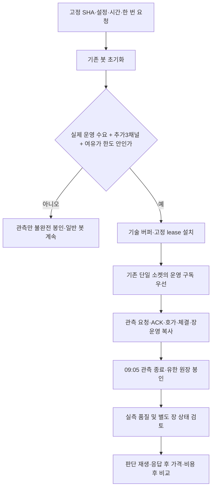

# 73차 — 한 종목 기술 파일럿과 남은 순수익 검증 작업

목표는 **좋은 종목을 유리한 시점에 실제 진입하여 거래비용·API 비용 후 순수익을 개선하는 것**이다. 관측 도구 완성이나 장 상태 수신 자체를 수익성으로 평가하지 않는다.

## Plan

[설계](../superpowers/specs/2026-10-13-market-state-pilot-design.md)와 [계획](../superpowers/plans/2026-10-13-market-state-pilot.md)에 따라 기술 파일럿을 기존 경제성 연구와 분리한다. 한 종목·최대300초·유한 메모리/큐/파일·같은 KIS 연결이며 임의 신호/주문을 만들지 않는다. 구현/독립 검증 후 장외 배포하고, 일정은 **10월14일08:55 준비 시작·08:57 시작 마감·09:00~09:05 수집**으로 고정한다. **일정의 코드 구현과 실제 설치/예약 완료는 다르며 아래 확정 기록이 우선한다.** 새20일은 여전히 미등록·미예약이다.

이번 파일럿의005490은 기존 원천 관측 경로의 기술 확인용 고정 종목이다. 추천 종목·최적 후보·경제성 모집단으로 쓰지 않는다. 장 초반5분은 채널/유량/봉인 검증이며 그 구간을 정상 연속매매라고 가정하지 않는다.

## Do — 코드와 처리 흐름

- `market_state_pilot.py`: 경제성 필드 없는 별도 기술 계약·버퍼. 스캔/신호/주문 준비를 받지 않으며 구독 증거와 선언 종목의 창 안 자료만 수집한다. 전달 시각과 실제 `received_at`을 함께 검사하여 창 이전에 받은 지연 자료/수신 시각 결측을 포함하지 않는다. 준비 중 경과 시간을 포함한 lease·시간 역행·재사용 경로·자원 한도를 검증한다.
- 런타임: 기존 정지 피드에 실제 운영 수요를 먼저 계산하고 정적 lease를 설치한다. 수요 초과 시 원장은 `pilot_channel_capacity`로 봉인하고 기존 피드/봇을 정상 기동한다. 기존 연구의 설치 실패 처리와 구분한다.
- 구독 조정기: 정적 lease를 한 번만 만들고 재연결로 종료시각을 늘리지 않는다. 일반 후보/주문 준비 경로로 파일럿 lease를 추가할 수 없다. 운영 수요 증가로 묶음이 안 들어가면 관측만 종료한다. 해제 미확인 슬롯은 재사용하지 않는다.
- loopback 준비 조회: `pilot.installed`는 실제 운영 수요를 포함한 논리 설치다. `stream_ready`는 현재 연결의 전체 운영/파일럿 ACK이며 실제 수신 수는 별도다. 08:55 장외 설치가 아직 열리지 않은09:00 소켓의 ACK/수신을 주장하지 않는다. 재연결 실패를 초기 준비로 취급하지 않는다.
- 10월14일 설치기/활성화 프로필: 전체 Python 소스·운영 HEAD·설정·입력·unit 지문을 고정한다. 소비된10월8일 자료/drop-in은 대조·백업 후 기존 설치 절차로 정리하고, 신규 단발 타이머를 미래에만 설치한다. 설치 자체는 봇을 재시작하지 않고08:55 활성화기가 한 번만 요청한다. 실패 후 자동 재시도나 토스 시작은 없다.

## 실제 구독 여유의 의미

공식 합산 한도41에서 `운영 채널 수 + 외부 예약 + 운영 여유 + 운영과 겹치지 않는 파일럿 채널 수 <= 41`이어야 한다. 정규장에서 운영 종목당 PRICE+BOOK 두 채널이다. 외부0/여유10이면 비보유 파일럿은 운영14종목 이하, 운영과 겹치는 파일럿은15종목 이하가 경계다.

독립 소스 조사 결과, 재시작 때 WS에는 보유 우선순위만 들어가고 스크리너 후보는 별도 봇 watch 목록에만 추가된다. 따라서 스크리너40개를 실효 WS 수요로 오인하지 않는다. 반대로 설정의 최대 보유 수만으로 실제 복원/수동 보유를 보장하지도 않는다. 실제 설치 직전에 계산하며 이후 증가도 관측 종료 조건이다.

기존 피드의 이론적 최대40종목은80개 채널 수요가 될 수 있다. 이 기존 상한 불일치는 관측을 위해 운영 피드를 줄여 해결하지 않는다. 현재 수요가 한도를 넘으면 관측을 건너뛰고 별도 운영 결함으로 다룬다. 루프가 없는 신규 수동 보유의 WS 편입 문제도 이번 기술 파일럿과 분리해 점검할 항목이다.

## See — 검사와 한계

새 계약·단일 fake socket·일반 봇 유지·경계14/15/16·재연결/종료·준비와 ACK 분리·단발 활성화/설치 가드를 검사한다. 최초 계약25실패, 런타임/활성화 부재·None 반환 반례·정적 경로의 주문 준비 identity 혼입을 실패로 확인한 뒤 수정했다. 설치기 worker는 Astra/high 요청·실제 모델 미노출, 소스/백로그 조사는 Sol/high 요청·실제 모델 미노출이다. 실제 시험/독립 중요 리뷰/CI/배포/예약 완료 값은 아래 확정 기록에 쓴다.

MKO 장운영 사건0건은 UNKNOWN이며 정상 상태 증명이 아니다. 원장 complete는 기록 경로의 결손 표시가 없다는 뜻이다. 호가/체결 자료가0건이어도 파일은 봉인될 수 있으므로 실제 분석은 **유효63필드 호가와47필드 체결의 창 안 존재·연결/세대·ACK·누락·수량·시간**을 별도로 확인해야 한다. 운영 영향은 건강/시세 전달과 부하를 대조하고, 응답 후 실행 가격의 경제성 검증은 후속 과제다.

## 남은 작업 — 구현과 실제 성과를 구분

| 우선순위 | 현재까지 완료 | 남은 행동과 완료 조건 |
|---|---|---|
| P0-1 짧은 실측 | 상태 파서/3채널 원천·격리 코드 배포, 이번 기술 계약/설치 경로 | 설치/예약 후 실제 호가·체결·상태·유량·누락/부하/봉인 판독. 부족하면 UNKNOWN/평가 불가 유지 |
| P0-2 계좌 기준선 | 순손익/TWR 계산기, KIS 최근 진입군 비용·열린 보유 비공개 대사 | 시작/끝NAV·현금흐름·배당/비용·계좌 밖 운영비·추정29건 identity 연결. 원화 순손익과 가능한 TWR 확정 |
| P1-1 판단 재생 | Bull/Bear/fallback 공통 사실 입력·호출 결함·월100 원장 배포 | 원천시각/decision ID·입력/역할/버전·요청/응답/모델·비용·지연을 영속 연결. 응답 뒤 최초 실행 가능 가격 확보 |
| P1-2 모델 비교 | 입력/역할/예산 정책 정비 | 현행 대 후보 하나를 같은 역할/자료로 비교. 오거절·회피손실·응답지연·API비용 포함. 비용 상한 먼저 고정 |
| P1-3 새 H1 준비 | 최초5개 order_ready 배정·다일 자본 평가기·20일 입력 준비 도구 | 실제 비용/설정/장 상태 근거가 성립하면 아직 지나지 않은 날짜로 사전등록·설치.10/13~11/9 준비본 소급 등록 금지 |
| P2-1 H1 성과 | 선정·청산 고정한 첫 호가 가격 조건 계약 | 누락/무신호일 포함20일·30비교쌍 조건,0/10/30bps 비용·동시 자본 평가. B순손익>0·B-A>0은 후보 통과이며 계좌 성과와 별도 |
| P2-2 청산 대조 | 같은 진입의 초기 손절 대 고정 시점 보유 비교기 | 실제 중간 호가·장 상태로 방어손실/반등 기회손실 비교. 전체 ExitManager 재생은 부분체결/갭/추적/자본 재사용 추가 필요 |
| P3-1 벤치마크 | 5구간 반도체 제외 가격수익 진단·공식 지수 교차 확인 | 전체KODEX200 유지+당시 구성/분배금과 대칭 반도체 제외/재가중 보조 비교. 연간429 수집을 그대로 반복하지 않음 |
| P3-2 선정 H2 | 후보 원천/점수/진입 병목 기록 | H1과 분리해 원천 중복 보너스 제거 등 하나의 선정 가설 검증. 선정·시점·현금/업종·청산·비용 기여 분리 |

계좌 기준선과 판단 재생 구현은 파일럿 결과를 기다리는 동안 병행 가능하다. 20일은 결함 수정을 미루는 기간이 아니다. 매일 기술 결함을 고치되 경제성 규칙은 버전/epoch별 하나의 가설로 고정한다. 구현된 파서·공통 입력·평가기·계좌 계산기·손절 비교기를 중복 작성하지 않는다.

근거: [계좌 비용 대사](current-engine-observed-cost-next-step-2026-10-02.md), [계좌 입력](../operations/account-net-return-input.md), [공통 입력](entry-llm-common-input-2026-10-13.md), [H1 다일 평가](h1-multiday-capital-2026-10-12.md), [H1 준비](h1-observation-preparation-2026-10-12.md), [같은 진입 청산](current-engine-exit-comparison-2026-10-02.md), [벤치마크 조사](current-engine-evaluation-2026-09-30.md), [다음 관측 설계](next-observation-design-2026-10-11.md).

## 확정 기록

1차 전체5363검사 통과 뒤 수신 시각 경계8개를 추가했다. 독립 실제 Claude Opus5/xhigh 1차 리뷰는 CHANGES_REQUESTED였다. 상위 경로가 없어도 준비 검사가 통과하던 반례를 재현해, 영수증 소비 전에 기존 상위 경로의 존재/권한/심볼릭 링크를 검증하도록 수정했다. 기존10월8일도 같은 libexec 디렉터리를 사용하므로 신규 디렉터리라는 리뷰 전제는 바로잡았다. 장외 초기화 지적은 실제 피드 생성자(CLOSED)와 보유 우선순위로 검증했고, API/소켓 없이 KRX 운영 수요와 정적 설치가 정상임을 확인했다. 잘못된 계약/원장 오류까지 무시하지 않으며 일반 봇을 유지하는 예외는 검증된 용량 부족에 한정한다. 최종 로컬 전체 **5373 passed / 2 skipped / 2 xfailed**, KST 관련 **149 passed**·운영 상태/외부 네트워크 접근0·비밀정보 검사 통과다. 독립 종결 리뷰는 실제 `claude-opus-5`/요청 xhigh(유효 effort 미노출)의 **APPROVE**로 두 지적의 해소와 수신 시각 경계 패치를 확인했다. 도구0·timeout 없음·실제 모델 메타데이터 확인, 1차 USD1.8659575/종결 USD0.6378225는 개발 리뷰 비용이며 봇 API 월 원장 비용이 아니다. CI/통합/배포/예약은 다음 단계다. 실수집·새20일·모델 우열·실제 순수익은 아직 확정하지 않았다. 매수 중지·기존 모델/매매 정책·월USD100 활성화/사용액을 보존한다.

독립 리뷰의 비차단 후속: 기존 상위 경로의 소유/심볼릭 테스트 확장, 향후 설치 경로가 겹칠 때 소유자 맵 충돌 방지, 창 밖 제외 건수와 유효 표본 수를 나눈 보고, 종료 직전 양성 경계 테스트다. 현재 설치 경로 충돌은 없고 품질 판독은 파일 complete만으로 통과시키지 않는다.
