# 모델 비교 실행 연결 — 2026-10-13

목적은 같은 후보의 판단을 개선했을 때 **응답을 기다린 뒤의 가격·실제 수량 정책·비용을 반영한 순성과**가 좋아지는지 검증하는 것이다. 승인율이나 큰 모델의 답변 품질만으로 모델을 교체하지 않는다.

## PLAN

1. 동일 비교의 중복 과금/결과 유실 방지.
2. LLM 적용 전 자본·배율·위험 입력 고정, 승인/축소/판단 불가의 수량 재생.
3. 같은 Bull 역할의 단일 변경 비교, 공통 Bear·명시 폴백·첫 호가 연결을 오프라인 검증.

기준 소스 ed624e2(PR #188). 운영161b394·10월14일08:55 활성화/09:00~09:05 파일럿·매수 중지·기존 월USD100 집계는 변경하지 않는다. 이번 작업은 코드 통합이며 운영 배포 또는 유료 비교 실행이 아니다.

## DO — 실제 연결

```mermaid
flowchart LR
  A[실제 LLM 진입 전] --> B[현금·예약·기존 배율·위험·오버레이 스냅샷]
  B --> C[기존 LLM 판단과 비동기 판단 기록]
  C --> D[명시 비교 작업자 입력]
  D --> E[고정 비교 명세·안정 시도 ID]
  E --> F[일 시도 슬롯 → 공유 월 예약]
  F --> G[단일 공급자 전송]
  G --> H[응답 저장 → 비용 정산]
  H --> I[공통 Bear + 두 Bull의 최종 판정]
  I --> J[같은 스냅샷에서 기존 사이징 함수 재생]
  J --> K[각 완료 후 첫 호가 + 공통 종료 호가 보고]
```



- `model_comparison_execution`: 요청 모델/입력/시스템/출력/추론/온도/seed/timeout/정책을 ID에 묶는다. 같은 ID의 확정 결과는 원래 시각·값으로 회수한다. 다른 입력이나 불확실한 시도를 같은 ID로 다시 보내지 않는다. 원래 월 한도/활성화 기준선을 재설정하지 않는다. SQLite BUSY/LOCKED에 한해 같은 응답 저장을 최대10회·약1초 제한 재시도한다. 실행환경은 Python3.12.3, CI는3.12다.
- `model_comparison_sizing`: recorder가 활성인 실제 검증 진입에서 한 번 수집한다. 신호와 중첩 메타의 기존 배율/별칭 관계, 현금/예약/코어/전략 한도, 손절/수수료/오버레이를 보존한다. 오버레이 조회는 캐시를 복제한 함수 환경에서 수행해 운영 캐시를 앞당겨 채우지 않는다. 재생은 **기존 `_calculate_position_size`** 를 격리 상태에서 실행한다. 0.5 거절을 적용해도 최소금액 때문에 25주→20주가 될 수 있으며 25×0.5로 대체하지 않는다.
- `model_comparison_runner`: 명시 주입하는 별도 작업자 API다. 운영 엔진이나 타이머에 연결하지 않는다. 내부 재시도/예산을 가진 `LLMManager` 대신 기존 raw OpenAI/Gemini 클라이언트를 한 번 호출한다. 빈 응답 재시도는 별도 ID/슬롯/예약을 거친다. Bear는 양쪽이 같은 응답을 공유하고 Bull만 한 제어를 바꾼다. 양쪽 역할 판정 불가일 때 사용할 폴백은 프롬프트/순서를 명시해야 한다. 누락이면 `unavailable`과 결측 사유다. 기존 단일 폴백은 성공한 빈/모호한 답도 NO로 시작하지 않으면 통과시키는 정책이다. 이를 몰래 바꾸지 않고 `verdict`(엔진 정책)와 `validation_verdict`(명시 모델 판단), `approval_basis`를 구분한다. 이 정책의 경제성 변경은 별도 가설이다.
- `scripts/report_model_comparison.py`: 명시 JSONL과 선택적 봉인 원장만 읽는다. 두 판단의 **각 완료 뒤** 첫 호가와 요청 시점+900초(기본)의 공통 종료 호가를 연결한다. raw 상태 필드 존재만으로 정상 연속매매를 확정하지 않는다.

각 arm 비용은 공통 Bear를 포함한 해당 정책의 가정 비용이며 두 arm을 합산하지 않는다. 실제 비교 지출 합계는 고유 attempt ID만 한 번씩 센다. 완료 시각과 지연은 저장/스케줄링을 포함한 작업자 벽시계 값이며 순수 공급자 추론 시간으로 해석하지 않는다. 실제 모델명과 요청명이 정확히 일치하지 않으면 별칭인지 대체인지 미검증으로 표시한다.

실제 전송에서 사용량이 보고된 비용은 저장소 단가표의 보수적 추정이며 청구서 확정액이 아니다. 공급자 실제 모델은 응답 필드만 기록하고 없으면 unverified다. 전송 전 실패를 raw 클라이언트가 증명한 경우만 0원이며, 전송 여부/비용 불명은 None과 기존 원장 차단을 유지한다.

## SEE — 검증과 현재 한계

- 가짜 공급자와 실제 임시 SQLite로 동일 비교 재실행의 추가 전송/과금0, 역할 집계·별도 재시도·명시 폴백·취소·월 예산 차단·응답 뒤 가격 선택을 검증한다.
- 실제 엔진 진입→LLM→임시 JSONL에서 판단 전 입력이 보존되고, LLM 중 현금이 바뀌어도 당시 자료 재생은 바뀌지 않는지 검증한다. 실제 주문 정책은 기존 후속 상태를 그대로 사용한다.
- 판단/호가 요약의 `approved_evaluable`은 실제 판단 실패/사용 불가를 제외한다. 엔진의 fail-open 허용 수는 `engine_allowed_evaluable`로 따로 보존한다.
- **sizing_only**: 재생은 수량 계산이며 후속 위험/동시 주문/보유 수/매수 중지/증권사 한도를 재판정하지 않는다. `executable=false`, `economic_evaluable=false`다.
- **raw 장 상태**: 정지·VI·시장 코드 원문/수신 증거는 정상 연속매매 및 체결을 인증하지 않는다. 보고서 순손익은 계속 null이다. 기존 조건부 손익 계산기로 바로 승격하지 않는다.
- 과거 자료 재생은 `offline_replay`, 실제 동시 관측으로 명시한 입력은 `paired_live_shadow`이며 현재 작업자 API의 라이브 출처는 호출자 제공(`caller_supplied_not_attested`)이다. 자동 운영 연결/출처 인증은 아직 없다.
- 스냅샷 해시는 내부 일관성/변조 검출이며 원천의 진정성이나 파일 작성자를 인증하지 않는다.
- 수량 정책 소스 지문이 바뀌면 옛 자료를 현재 코드로 조용히 재생하지 않고 거부한다.

### 최종 로컬 검증·독립 리뷰

- UTC 전체 `scripts/dev/verify.sh`: **5758 passed / 2 skipped / 2 xfailed**, rc0. Python 문법·저장소 비밀정보 검사 통과. Python3.12.3에서 실행했고 CI도3.12다.
- KST 관련 수량/복구/러너/판단 호가 검사: **147 passed**, rc0. 테스트의 운영 상태·외부 네트워크 접근 시도는 두 실행 모두0건이다.
- 폴백 선행 공백 회귀는 수정 전 실패를 재현한 뒤, 수정 후 러너33건 및 위 최종 전체/시간대 검사로 확인했다. 엔진과 동일하게 `strip()` 뒤 첫10자를 판정한다.
- 독립 중요 변경 리뷰는 도구 비활성 Claude Opus5/high 요청으로 총7회(비용2·수량2·통합3) 수행했다. 모든 완료 결과에서 실제 모델 `claude-opus-5`를 확인했다. 요청 effort와 실제 모델을 구분하며 실제 effort metadata는 미노출이다. 구현 워커의 요청은 Astra/high, 실제 모델 metadata는 미노출이다.

| 리뷰 범위 | 수정·확인과 종결 |
|---|---|
| 비용/응답 복구 | 실제 SQLite200ms 잠금에서 응답 유실 재현 후 동일 쓰기만 제한 재시도. 일반 연결 예외는 미전송 증명이 아니라는 점을 확인. Python3.11 이상 조건은 로컬/CI3.12로 충족, 코드 통합 가능 |
| 중립 수량/판단 집계 | 입력·적용 배율 분리, 캐시/로그 격리, 실패 허용과 실제 모델 승인 집계 분리. 실제 엔진 별칭 관계·시도 기록 보존을 확인, 코드 통합 가능 |
| 러너/보고서 | 수량 재생을 월 예산 쓰기 트랜잭션 밖으로 이동, 정산 실패 시 원 응답·비용 보존, 모델 불일치·시각 범위·최종 저장 실패 증거 처리. 마지막 공백 판정 수정과 읽기 전용 원장 API 소스 확인까지 재리뷰해 code-integration-ready로 종결 |

남은 제한은 이 문서의 실패·복구 및 다음 우선순위에 남긴다. 특히 정책 이전/비용 정정 명령, 실제 입력 출처 인증, 후속 진입 게이트, 연속매매·체결 증명은 아직 없다. 테스트와 통합 승인은 순수익 또는 배포 승인으로 해석하지 않는다.

이 검증은 가짜 공급자·임시 원장을 사용했다. **애플리케이션 유료 LLM/증권 API 호출0건**이며 개발용 독립 리뷰 호출과 구분한다. CI·병합 결과는 PR 검증 기록에 별도로 확정한다. 운영 배포는 이번 범위에 없다.

## 실패·복구 절차

| 상태 | 의미 | 허용되는 후속 |
|---|---|---|
| known | 응답과 월 정산 금액 일치 | 같은 ID로 기존 결과 회수; 신규 전송 없음 |
| unknown | 응답 비용 미확인 | 원본 사용량/청구 근거 대사; 0원/월초 초기화 금지 |
| pending_reconciliation | 응답은 있으나 월 정산 확정 불가 | `guard.lookup(id)`로 응답·예약 토큰 확인, 증거 대사; 자동 정산 재시도 없음 |
| pending / interrupted | 전송·결과가 불확실 | 재전송 금지, 예약/공급자 증거 확인 |
| blocked | 상한/예산 등으로 해당 ID 거부 | 같은 신호를 다음날 자동 실행하지 않음. 새 관측의 새 decision ID만 새 명세로 검토 |
| comparison_result_mismatch | 저장된 응답과 재쓰기 토큰/본문 불일치 | 덮어쓰지 않고 원본/호출 ID 대사 |
| comparison_pair_result_unpersisted | 쌍 최종 기록 저장 실패 | 예외의 `.result`에 보존된 원래 행을 별도 증거로 보관; 자동 재실행 금지 |
| pair incomplete | 쌍 실행이 끊겨 완성 보고서 없음 | 각 안정 시도 ID를 lookup해 보존 응답 점검. 자동 쌍 재실행/시각 복원 금지 |

정책은 월 원장당 하나로 고정된다. 상한·모델 집합·순서를 바꿔 재생성하거나 새 DB로 월 사용액을 우회하지 않는다. 정책 이전/증거 기반 비용 정정용 운영 명령은 아직 미구현이며, 유료 실험 설치 전에 별도 검증해야 한다. 저장장치 장애까지 응답 보존을 보장하지 않는다. 복구 불가해도 중복 전송은 허용하지 않는다.

보고 명령(읽기 전용):

```bash
python scripts/report_model_comparison.py --pairs <comparison-pairs.jsonl> \
  --ledger <sealed-engine.jsonl> --study-sha256 <study-sha256>
```

원장을 생략하면 모델/비용/수량 기록을 보고하되 호가 근거는 미검증으로 남긴다. 이 명령은 유료 호출을 실행하거나 월 원장을 생성하지 않는다.

## 다음 우선순위

1. 10월14일09:05 이후 기존 고정 파일럿 봉인·누락·장 상태 유량 판독.
2. 파일럿을 보존한 뒤 고정 SHA 배포와 새 날짜/SHA의 LLM 대상 관측 설치. 현재 작업에서는 실행하지 않는다.
3. 후속 진입 게이트/연속매매 상태 판정의 증거 계약, 실제 라이브 입력 연결·작업자 실행/종료·불명 비용 대사 절차를 검증한다. 안정 시도/쌍 식별자는 실제 결정과 일대일 연결한다.
4. 실제 완전한 비교쌍에서 제한된 **R 한 가지**(mini minimal/400 ↔ low/400)를 실행할 일 시도 상한을 사전 고정한다. 월100 안에서 운영 필수 예산을 먼저 확보한다.
5. 매일 기술 오류를 고치고, 성과 변경은 버전을 구분하여 비용·응답 지연 후 증분 손익을 누적한다. 관측20일은 오류 수정 대기 기간이 아니다.
