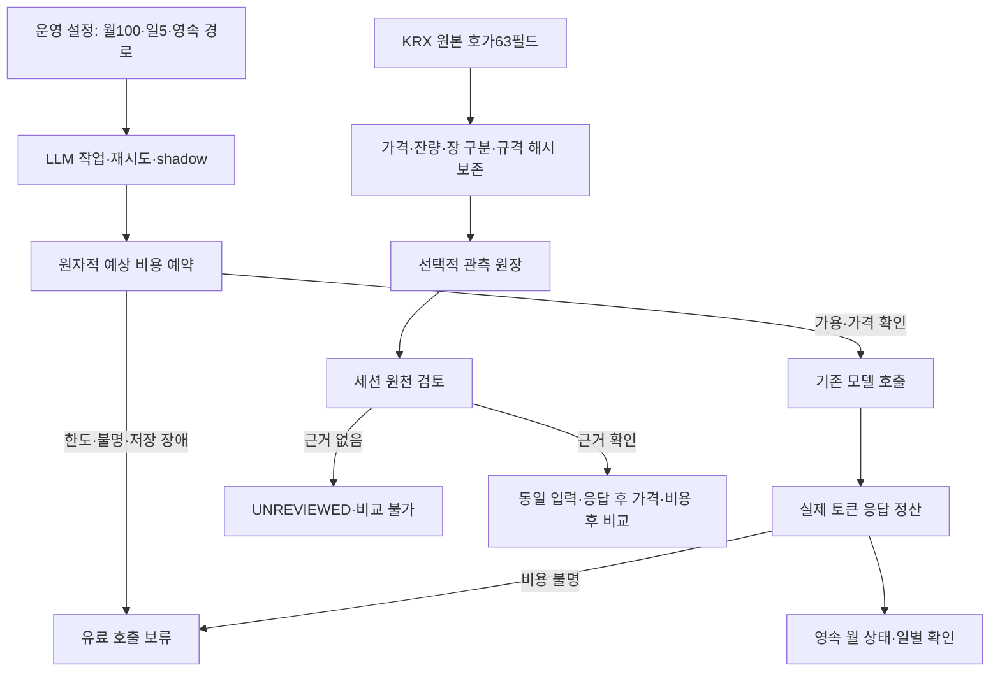

# 69차 — 월 API 예산·호가 장 상태 원천·운영 적용

## Plan — 순수익 검증을 지속할 수 있는 비용과 자료 기반

사용자가 월 최대 **USD100**, 후속 구현 및 운영배포를 승인했다. 이번 달 이전 사용액은 무시하고 이번 활성화부터 집계하라고 명시했다. 이 한도는 봇의 유료 LLM 호출을 위한 것이며 개발 에이전트, 다른 프로그램, 이전 사용액, 세금/환전 비용을 포함한 공급자 계정 전체 청구액 보장은 아니다.

우선순위는 비용 누수 방지와 호출 결함 수정 → 호가 당시 원천 보존/공통 판단 입력 → 작은 실제 검증/동일 자료 모델 비교 → 응답 이후 실제 진입 가능 가격을 포함한 순성과다. 20일을 기다려 오류를 고치는 방식은 쓰지 않는다. 기술 결함은 매일 고치고, 전략·모델의 경제성 변경은 한 번에 하나씩 버전을 고정해 누적한다.

[설계](../superpowers/specs/2026-10-12-monthly-budget-market-evidence-design.md), [실행 계획](../superpowers/plans/2026-10-12-monthly-budget-market-evidence.md).

## Do — 변경 범위

- KST 달력월 USD100과 기존 일 USD5를 함께 적용한다. 첫 활성화 기준선은0이고 시작 시각을 보존한다. 영속 경로는 `~/.local/state/qwq-ai-trader/llm-budget.sqlite3`이다. 재시작·재배포로 예산이 초기화되지 않는다.
- 각 primary/fallback/empty retry/shadow 전송 전에 입력과 출력 상한으로 보수적인 비용을 예약하고 사용량 응답으로 정산한다. 입력 바이트 기반 추정은 공급자 토크나이저/청구서의 수학적 상한 증명이 아니다. 가격 미확인·전송 후 비용 불명·중단된 예약·손상·저장 실패는 추가 유료 호출을 보류한다. 월이 바뀌어도 미확인 비용은 자동 삭제하지 않는다.
- 초기화 표식과 원장을 분리해 이미 활성화된 원장이 사라졌을 때0으로 재생성하지 않는다. 파일을 지워 예산을 리셋하지 않는다. 비용 불명은 실제 공급자 사용 내역과 대조한 별도 복구가 필요하다.
- 운영 설정의 월 한도/경로 누락·오류를 기본 무제한 설정으로 대체하지 않는다. 종료 시 이미 생성된 LLM manager를 닫아 shadow 취소/집계·HTTP 세션 정리를 수행한다.
- 월 한도에 연결되지 않은 Perplexity/Manus 유료 경로는 보류한다. Perplexity 키 존재만으로 나가던 전문가/시장 레짐 호출을 전송 전에 막고 검색 문맥 결측을 로그에 남긴다. 기존 다중 소스 중 이 검색 문맥은 줄어든다. 공급자·가격·입력 품질을 검증해 같은 원장으로 연결하는 후속 작업이 필요하다. 수동 모델 probe/snapshot 도구는 운영 루프 밖이고 이번에 실행하지 않는다.
- 정확히 KRX `H0STASP0`63필드일 때63번째 `MARKET_CLS_CODE`, 원문 필드 수, 스키마 식별자, 공식 근거 SHA, 원시 코드의 유효/불명 상태를 이벤트→관측→봉인 원장에 보존한다. 59필드·NXT·다른 길이에 KRX 위치를 재사용하지 않는다. 기존 호가/잔량·구독·주문 결과를 바꾸지 않는다.
- `2=정규`만으로 연속매매/VI 부재를 확정하지 않는다. 날짜 없는 거래소 HHMMSS의 원천 날짜도 만들지 않는다. 별도 세션 검토가 없으면 평가기는 계속 `UNREVIEWED`, 비교쌍0으로 둔다.

## 공개 근거와 비용 가정

KIS [공개 H0STASP0 규격](https://apiportal.koreainvestment.com/api/apis/public/detail?accessUrl=%2Ftryitout%2FH0STASP0)은63번째 필드1=프리,2=정규,3=애프터,5=종가를 설명한다. 2026-10-12 확보 원문 SHA는 `a22543dd4a1c64c01210eef281203771da0d1d58e2e7d4c08643c35a3fc60ff3`이다. 코드표는 호가 사이 무중단 거래 상태를 보장하지 않는다.

Perplexity [공식 전환 안내](https://docs.perplexity.ai/docs/agent-api/migrate-from-sonar/overview)는 2026-09-27 Sonar Chat Completions 지원 종료 이후 동기/스트리밍 요청이 Agent API 요청으로 변환되어 계속 처리된다고 명시한다. 호출 자체가 완전히 중단됐다는 뜻은 아니다. [현재 가격표](https://docs.perplexity.ai/docs/getting-started/pricing)는 모델 토큰과 도구별 과금 구조를 설명하므로 옛 Sonar 호출당 고정 가정으로 이번 월 한도를 인증하지 않는다.

68차의 보수적 예시(실측 아님)는 Lite150회/일, Sol20회/일, Astra2회/일의 명시 토큰 가정에20% 여유를 더해 약 USD2.03/일,30일 USD60.80이었다. 기존 heavy5.6sol을 쓰는 같은 가정은 약 USD2.94/일이다. 이번 변경은 모델을 바꾸지 않는다. 실제 호출 수·추론 토큰·지연과 거절 기회/회피 손실을 기록한 뒤 비싼 모델을 쓸 단계만 선택한다.

## 코드와 운영 흐름

예산 부족 시 각 호출자는 기존 실패 처리로 돌아간다. 이는 일부 검증의 fail-open/fail-closed 동작 자체를 통일했다는 뜻이 아니다. BUY 중지는 유지하며 매수 재개는 이 변경의 결과가 아니다.

## See — 검증·리뷰·실제 배포

- root 변경 실패 재현: 원시 장 상태/종료 연결15실패, 설정/미계측 호출7실패 후 수정. 월 예산 worker는37개 신규 회귀를 포함해 전송 관련145개 UTC/KST 통과.
- 통합 관련 UTC403개, 이후 설정 연결2건을 보강한 최종 KST405개 통과. 최종 전체 UTC **5061 passed, 2 skipped, 2 xfailed**, 기존 pykrx 경고1,163.24초. 문법/비밀정보 검사 통과·운영 파일/외부 네트워크 접근 시도0.
- 임시 파일/합성 비용의 예약+정산100회: 중앙12.58ms·p95 16.58ms·최대20.20ms, 불명0. 실제 거래 피크 부하/콜백 지연 상한을 보장하는 시험은 아니다. SQLite 동기 저장은 운영 지연 관찰 대상이다. 최초5초였던 잠금 대기는 리뷰 후0.1초로 줄여 경쟁 시 유료 호출을 보류한다.
- Sol/high 정적 감사에서 유료 우회/설정 폴백/종료 누락을 확인해 반영했고, 원시 코드만으로 평가기가 정상장을 만들지 않는 회귀도 추가했다.
- 최초 실제 `claude-opus-5`/요청 xhigh 리뷰는 CHANGES_REQUESTED. 다른 진행 중 예약의 소유권을 정산 실패 하나로 해제하는 결함, 설정 미주입 singleton, shadow 예외 이중 집계를 수정했다. 보고용 조회의 상태 변이·불필요한 Manus 전 작업 차단·잠금 대기도 보완했다. 수정본 독립 재리뷰는 진행 중이다.
- Gemini 출력 예약은 명시 출력 상한의2배 여유를 확보하되 실제 API 출력 파라미터는 바꾸지 않는다. [Google thinking 가이드](https://ai.google.dev/gemini-api/docs/thinking#token-limits-and-max_output_tokens)는 사고+응답의 합산 상한을 설명하지만 현재 Interactions 예제이며, [공식 포럼의 generateContent 답변](https://discuss.ai.google.dev/t/gemini-3-8-flash-high-does-maxoutputtokens-include-thinking-tokens/181077)은3.8 모델 사례다. 이를 배포된3.1 preview의 개별 청구 보증으로 확대하지 않고 추가 예약 여유를 둔다.
- 정적 유료 호출 감사에서 src/scripts의28개 관련 선언/호출 접점을 확인했다. 앱의 클라이언트 생성은 manager만 수행하며 공유 singleton은 설정 미주입 시 차단한다. 별도 수동 `capture_openai_snapshots.py`, `probe_openai_models.py`의 직접 OpenAI HTTP는 운영 루프 밖으로 이번에 실행하지 않는다.
- 수정본 관련 UTC/KST 각각436개, 전체 **5092 passed, 2 skipped, 2 xfailed**/160.69초·비밀정보 검사 통과·격리 위반0. 이후 원자적 복구 실패 회귀1건을 추가해 복구 도구 관련16개를 별도로 통과했다(실행 소스 불변). 최종 CI와 운영 verify는 이 추가 시험도 포함한다.
- 운영 배포는 아직 실행 전이다.

## 미확인 비용과 초기화 장애 복구 절차

자동으로 미확인 비용을0으로 바꾸거나 원장/표식을 삭제하지 않는다. `scripts/reconcile_llm_budget.py`는 기본 읽기 전용 미리보기이며 API/재시작을 수행하지 않는다.

1. 관련 공급자의 지연 집계가 끝난 사용 내역을 확보하고, 모델·시각·현재 원장의 예약 token을 대조한다. 요청별 귀속을 확정할 수 없으면 보류한다. 금액0은 명시적인 미과금 근거가 있을 때만 사용한다. 근거 파일은 Git 밖에 보존한다.
2. review JSON은 `version=llm-budget-reconciliation-v1`, 원래 `activated_at`, 비밀정보 없는 `reviewer_ref`, 근거 파일의 `evidence_sha256`, `adjustments=[{token,actual_cost_usd}]`, `clear_bound_breach`를 정확히 포함한다. 해시는 근거 파일과의 결합이지 사실 확인의 대체가 아니다.
3. 명시 `--ledger`, `--limit-usd 100`, `--review`, `--evidence`로 미리보기한다. 원래 월·시작 시각·한도와 이미 확정된 비용을 바꾸지 않으며, 살아있는 호출이 있으면 중단한다.
4. 사람이 근거와 변경 금액을 검토한 상태 지문을 `--expected-state-sha256`으로 지정하고 `--apply`할 때만 반영한다. 기존 상태가 달라지거나 재실행이면 거부된다. 미확인 행만 확정 비용으로 바꾸고 별도 대사 이력을 같은 DB transaction으로 남긴다. 상한 초과 금액도 그대로 기록하므로 월 한도 초과는 계속 차단된다.
5. 예약 추정 초과 표시를 해제하려면 모든 미확인 비용이 해소되고 명시 `clear_bound_breach=true` 및 근거 검토가 필요하다. 이전 알려진 금액은 줄이지 않는다. 프로세스의 일별 미확인 표시/저장 오류 보류는 별도로 남을 수 있으므로 승인된 운영 절차에서 정상 종료/재기동 후 원장 재독과 유료 호출 상태를 확인한다. 도구가 자동 재시작하지 않는다.
6. DB 자체 소실/손상·첫 초기화 중단은 이 도구로0 재생성하지 않는다. 원장/표식/lock 디렉터리와 로그를 보존하고 검증된 백업을 복구한다. 백업이 없으면 공급자 전체 사용 내역과 기동 이력을 대조하기 전까지 유료 호출을 보류한다. 첫 초기화의 marker→schema 사이 crash가 자동 복구되지 않는 것은 과거 원장 소실과 혼동해0으로 되돌리는 것을 막는 의도된 경계다.

현재 작업은 이 절차와 합성 시험을 추가할 뿐 실제 운영 비용을 수정하거나 차단을 임의 해제하지 않는다.

## 다음 순서와 매일 확인할 항목

1. 월 원장의 사용/예약/미확인 비용과 시작 시각, 예산 보류 때문에 누락된 판단 수를 확인한다. 미확인 비용은0으로 처리하지 않고 원장을 지우지 않는다.
2. 후보/신호 ID·시각·호가·spread·장 상태 근거·결측·전략/목표/손절을 묶는 공통 입력을 먼저 audit/shadow용으로 고정한다. 현재 raw 장 구분 코드만으로는 세션 검토 완료가 아니다.
3. 소규모 실제 관측으로 원문 길이/시각/재연결 공백·초기 상태·진입 및900초 뒤 자료 연결을 확인한다. 이 점검과 새로운20일 연구의 공식 시작을 구분한다. 새 관측은 아직 예약하지 않았다.
4. 같은 입력의 기존/상위 모델과 추론 수준을 월100 안에서 비교한다. 응답 이후 가능한 가격, 잘못 거절한 기회, 회피 손실, API 비용을 포함한다. Perplexity 검색 복구도 이 비용/입력 검증 후 같은 원장에 연결한다.
5. 실제 계좌 총수익과 KODEX200 원본, 사전 고정한 대칭 반도체 제외 비교를 병기한다. 코드 배포나 합성 시험을 순수익/지수 초과 증거로 보지 않는다.

## 에이전트 기록

- coordinator: 통합·KIS 원천·운영 연결·시험·배포 담당.
- 요청 Astra/high: 별도 동일 base worktree에서 월 예산/LLM 접점 구현. 실제 모델·유효 effort는 런타임 메타데이터 미노출 시 미확인으로 표기한다.
- 요청 Sol/high: 유료 우회 경로/설정/수명주기와 coordinator 파일의 읽기 전용 감사. 실제 모델/유효 effort 미노출.
- 최종 독립 중요 변경 리뷰는 검증된 실제 Claude Opus5, 요청 xhigh로 수행하며 결과는 See에 기록한다. 공급자 간 동의는 테스트나 실수익 증명을 대신하지 않는다.
