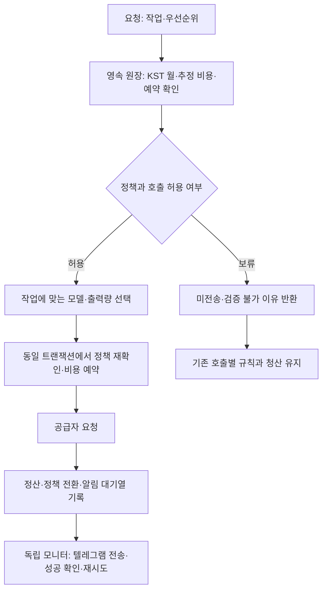

# 70차 — 월 예산 절약 전환·텔레그램·월초 복귀

## Plan — 순수익을 위한 비용 관리

목적은 좋은 종목과 진입 시점을 평가할 비용을 확보하면서 월 OpenAI/Gemini 관리 예산 USD100을 지키는 것이다. 사용자는 한도 알림, 저비용 자동 전환, 월초 리셋 및 후속 운영배포를 승인했다. USD100을 이미 쓴 뒤 유료 저비용 모델을 계속 쓰면 최대 예산을 초과하므로 **80%에서 절약, 95%에서 필수 호출만, 100%에서 모든 유료 호출 중단**으로 구체화했다.

기준은 토큰·공개 요율로 정산한 **추정 사용액 + 전송 중 예약액**이다. 공급자 전체 청구액/세금/환전/다른 프로그램/개발 에이전트 비용을 보장하는 한도가 아니다. 기존 일USD5 보조 한도도 남는다. 최초 활성화 `2026-10-12T22:35:38.845900+09:00` 및 기존 사용액을 보존하며 다시0으로 시작하지 않는다. [실행 계획](../superpowers/plans/2026-10-12-budget-economy.md).

## Do — 정책과 흐름

| 상태 | 유료 호출 | 모델/운영 영향 |
|---|---|---|
| 기본 | 월·일 한도 내 허용 | 기존 모델/추론 설정 |
| 절약:80% 도달 | 필수 판단 유지, 선택적 shadow 비교 보류 | 모닝브리프·한국/거시 전문가 한 줄 요약은 같은 공급자의 light 모델, 낮은 추론. 요약/분류 출력 최대4096이며 기존 더 작은 상한은 유지 |
| 필수:95% 도달 | 직접 진입·보유·레짐 판단만 허용 | 뉴스/테마 분류·복기·연구 등 비필수 중단. 필수 판단의 공급자·모델·추론은 유지 |
| 유료 중지:100% | 모든 유료 LLM 호출 중단 | 기존 규칙·보유 관리·매수 중지 설정 유지 |
| 비용 미확인/원장 이상 | 모든 유료 LLM 호출 보류 | 월초에도 자동 해제하지 않음;69차 대사 절차 필요 |

80/95 단계는 같은 달에 한 번 도달하면 예약 해제 후에도 되돌아가지 않는다. 100% 예약 점유로 멈췄다가 더 적은 비용으로 정산되면 필수 모드로 재개할 수 있다. 비필수 요청은 예약 후 합계가95%를 넘을 경우 미리 거절하므로 마지막5%를 보호한다. 실제로95%를 사용했다는 뜻은 아니다. 처음80%를 넘기는 호출은 진입 직전 프로필로 허용하고 이후 호출부터 절약한다.

- 필수10곳: 적대검증 Bull/Bear, 실제 ResearchTeam 판단, 단일 진입 검증, 장전 시장 판단, 가치 정성 검증, 운영 레짐 분류,15시 보유 점검, 장중 진입 검증, 배치 후보 우선순위. 이름이 research라고 실제 매매 판단을 연구로 분류하지 않았다.
- 다수 분류 작업은 이미 Gemini Lite다. 절약 모드의 실제 모델 변경은 무해한 보고 요약3곳에 한정한다. 더 높은 모델/추론의 수익 우위는 아직 미검증이다.
- 선택/예약 사이 정책 변경은 전송 전 최대3번 재선택한다. 예약에 작업·역할·정책 버전·우선순위·모델을 연결해 성과 비교에서 정책 시기를 분리한다. 프롬프트/계좌정보를 알림 원장에 넣지 않는다.
- 별도 모니터가30초마다 월 전환/알림을 확인한다. 첫 정상 기동은 조용히 시작하고, 재시작 후 이미 전달한 알림은 다시 보내지 않는다. 전송 제한60초, 소유 임대120초, 실패 재시도60초부터 최대1시간. 알림 장애와 무관하게 비용 통제는 즉시 적용한다.
- 텔레그램 성공 뒤 기록 전에 프로세스가 죽으면 같은 이벤트가 드물게 재전송될 수 있다. 정확히1회 전송 보장은 하지 않으며 이벤트 식별자와 기록/발송 시점을 구분한다. 오래된 미전송 알림을 앞질러 복귀 알림을 보내지 않는다.
- 월초에는 새달 사용액 기준으로 기본 정책을 복원하고 이력은 남긴다. 전월 알림은 월 경계의 잠정 정산/예약 내역이다. 늦게 끝난 요청은 **예약한 월**로 계속 정산되므로 전월 합계가 후에 달라질 수 있다. 여러 달 꺼져 있었다면 재기동 알림은 직전 달력월만 요약하며 더 오래된 월의 원장 이력은 별도로 조회한다.
- 기존 진입 검증은 일부 fail-open 보조 판단이다. 예산으로 검증 불가/편측 검증을 메타데이터에 남기고, 장중 검증에서 가짜 `q1/q2/q3=Y`를 만들지 않는다. 반환 bool·실제 거부시 절반 크기·매수 중지 정책을 별도로 변경하지 않는다.
- 기존 금융 정산은 먼저 커밋하고 정책/알림 관측은 별도 트랜잭션으로 갱신한다. 정책 저장 실패가 이미 확인된 비용을 롤백하지 않으며 후속 유료 admission은 정상 정책 확인 전까지 보류한다. 금융 원장은 그대로 두고 정책/알림 보조 테이블을 트랜잭션으로 추가한다. 활성화 뒤 일부 정책 테이블이 사라지면 자동 재생성 대신 보류한다. 배포는 단일 서비스 순차 교체이며 구버전/신버전을 병행 실행하지 않는다. 구버전 롤백 시 USD100 원장 가드는 유지되지만80/95 및 알림 기능은 제공하지 않는다.

## See — 검증 및 운영 결과

- 로컬 최종 후보: UTC 전체 **5164 passed·2 skipped·2 expected xfailed**, 문법/비밀정보 검사 통과. KST 관련 **199 passed**, 운영 상태/외부 네트워크 접근 시도0. 알려진 pykrx 폐기 예정 경고1은 기존 항목이다.
- 초기 전체 검사에서 테스트 가짜 모델3개의 신규 `budget_priority` 인자 누락을 확인해 명시적으로 essential 인자를 검증하도록 갱신했고 해당84검사 통과.
- 독립 실제 Claude Opus5/xhigh 1차 리뷰는 정산을 정책 오류가 롤백하는 문제 등을 지적했다. 시계 역행/정책 쓰기 실패2건을 먼저 실패 재현한 뒤 금융 정산을 보존하도록 수정했다. 읽기 전용 모델 선택, 모니터 복구/실제 Telegram 어댑터 합성 검증도 반영했다. 네이티브 Sol/high는 실제 모델/실효 effort 메타데이터가 없어 요청값으로만 기록한다.
- 독립 최종 실제 **Claude Opus5/xhigh APPROVE, P0/P1 없음**. 실제 모델은 assistant/result 메타데이터로 확인했고 실효 effort는 관측되지 않아 요청값으로만 기록한다. 구현은 Codex 측, 중요 최종 리뷰는 Claude 측이며 같은 Claude의 재리뷰를 별도의 추가 교차 제공자 검토로 세지 않는다.
- [PR #175](https://github.com/qwq-partners/qwq-ai-trader/pull/175), head `ef7e097`의 [필수 CI](https://github.com/qwq-partners/qwq-ai-trader/actions/runs/38264072264) 성공 후 merge `e096e705f4ec063c9723fe4774037f39eaae38d0` 고정. 병합 코드25개 파일의 SHA를 독립 리뷰 입력과 대조했다.
- 배포 전23:42 KST 운영27635c5·pending0·recovery ready·보호13경로 동일·매수 중지 유지. 기존 월 원장 추정USD0.01144125·불명0·예약0·최초 활성화 동일, SQLite 일관성 백업 확보. 기존 프로세스에는 이전 HTTP 오류2/재시도2가 있었으며 당시 미체결/복구 이상은 없었다. 새 프로세스의 오류와 분리한다.
- **23:45:22 KST 운영 배포 완료**: 기존 `local_deploy.sh`에 병합 SHA를 고정해 rc0, 롤백 없이 적용. 운영에서도5164 passed·2 skipped·2 expected xfailed 및 비밀정보 검사 통과.
- 운영 HEAD `e096e705f4ec063c9723fe4774037f39eaae38d0`, PID1044971·NRestarts0·active/running.23:46 점검에서 pending0·recovery ready·stale loop0·새 프로세스 HTTP21/21 성공·오류0·보호13경로 동일·매수 중지 유지. 토스/기존 관측 서비스는 비활성 그대로다.
- 최초 예산 활성화 `2026-10-12T22:35:38.845900+09:00`·월100·baseline0 보존. 누적 추정USD0.018703·진행 예약0·불명0·예약 초과0·policy normal·미전송 알림0. 초기 정상 상태의 불필요한 알림은 생성하지 않았다.
- 23:47 새 PID journal 점검: ERROR/Traceback0·예산 저장 오류0·정책 오류0·모니터 기동1·기준자본 확정1. 실제 유효 설정은 월100/일5/정책true. Telegram 실제 발송은 임계값이 없어 하지 않았으며 실체 어댑터 계약은 격리 시험으로 검증했다.
- 운영 영수증/원장 백업/독립 리뷰/검증 증거: Git 밖 `~/.local/state/qwq-deploy/budget-economy-20261012/`. 원장 백업은 증거 보존용이며 새 지출을 지우는 자동 복원에 사용하지 않는다. 후속 문서 커밋은 실행 코드 변경 없이 실제 결과를 남긴다.

### 최종 리뷰의 비차단 의견과 처리

- 정책 상태 읽기가 실패하면 이미 쌓인 알림도 보류될 수 있다. 비용 통제는 계속 보수적으로 차단하며 원장을 삭제하지 않는다. 지속 장애는 journal과 월 예산 상태를 확인한다. 알림 전송 루프 자체의 일시 오류 복구는 이번에 수정했다.
- 금융 커밋 이후 예상 밖 프로그래밍 예외가 나면 확인된 금액은 보존되지만 호출 응답이 예외로 끝날 여지는 남는다. 선언된 저장/정책 오류는 이미 회귀 시험으로 차단했다. 예외 범위 확장과 로그 통일은 후속 개선 항목이다. 해당 stdlib 경고는 운영 unit의 `StandardOutput=journal`, `StandardError=journal`에서 수집된다.
- 애매한 커밋 이후 예약 lock 파일을 자동 삭제하지 않는 보수적 동작을 유지한다. 금액/진행 요청이 없는 파일이라도 근거 없이 일괄 정리하지 않는다.
- `validation_daily_call_limit`은 일일 검증 횟수 제한으로, 월 비용 한도와 다른 사유다. 분석에서는 이유 필드로 분리하며 모두 월80/95/100 효과로 집계하지 않는다.
- 출력 상한4096은 비필수 절약 모드에 한정한다. Gemini transport는 기존에도 생략 시16000 상한을 넣으므로 오래된 caller 주석의 ‘미지정=무상한’ 설명을 근거로 예약 상한을 제거하지 않았다.

## 다음 순서

1. 매일 사용 추정액·예약·미확인·알림 실패와 누락된 입력을 점검하고 기술 결함을 수정한다. 비용 정책별 성과를 섞지 않는다.
2. 동시점 호가 장 상태와 공통 판단 입력을 작은 실제 자료로 연결한다. 정규장 코드만으로 연속매매/VI 부재를 확정하지 않는다.
3. 같은 입력의 모델·추론 비교에서 잘못 거절한 기회, 회피한 손실, API 비용, 응답 이후 실제 진입 가능한 가격을 평가한다. 경제성 변경은 한 번에 하나씩 고정한다.
4. 자료 연결이 입증되면 새 관측을 시작한다.20일은 오류 수정의 대기 기간이 아니며, 이번 비용 통제가 수익성 입증이나 실제 매수 재개를 뜻하지 않는다.
