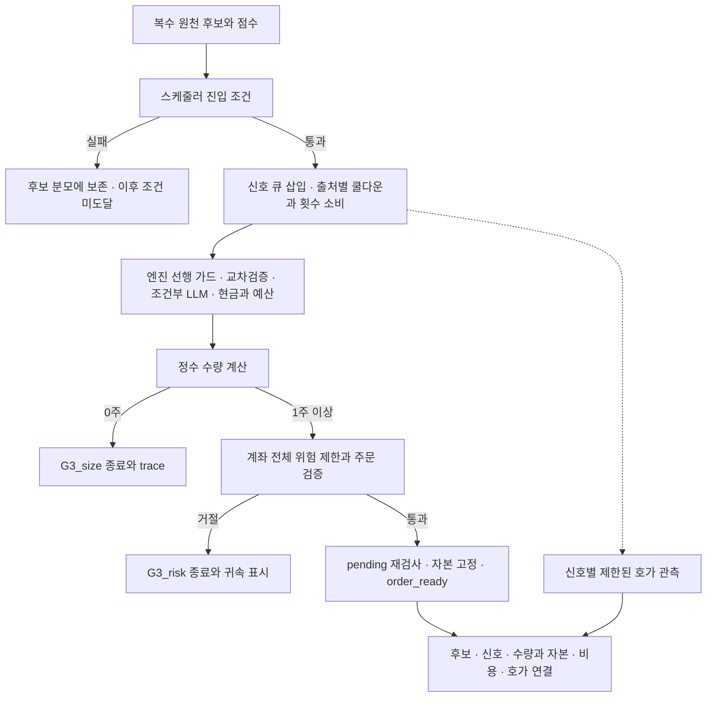

# 62차 — 인계 재검토와 다음 관측·순수익 검증 설계

> 65차 후속: 현재 운영은 `32f52dd`/PID889750이며 2026-10-11 23:32 KST 배포를 완료했다. 최신 상태는 [65차 결과](#65차--주문-준비-호가-배정과-운영-배포)를 따른다. 아래62~64차의 버전·점검 값은 당시 기록이며, H1 정의는 [H1 계약](h1-entry-price-contract-2026-10-11.md)을 따른다.

62차 당시(2026-10-11 KST) 기준 소스 `febfe1fd1b9574480101bb077130e565ebb6b3da`, 당시 운영 체크아웃 `83be6ac`. 두 버전의 `src/ scripts/ tests/` 차이는 없다. 이 문서는 설계와 기존 분석의 정정이며 **새 관측의 설치·예약이나 전략 검증 착수 기록이 아니다**.

## PLAN — 무엇을 개선하려는가

목적은 **현재 엔진이 어떤 종목을 어느 가격·시점에 매수해야 비용 후 순수익을 개선하는지** 찾는 것이다. 실시간 시세와 복수 원천 후보 선정은 검증할 강점이다. 일봉 검증만으로 그 효과를 기각하지도, 정밀한 입력만으로 수익 우위를 인정하지도 않는다. 구버전의 오류·계좌의 기존 수동 보유·현재 전략의 선택/진입/청산 효과를 분리한다.

이번 범위는 59~61차 인계의 소스·근거 검토, 다음 시간창의 계약, 판독 표5개, 가설 후보와 판정 기준이다. 운영 HEAD·설정·매수 중지·수동 보유 귀속 정책·쿨다운/횟수·once/영수증·토스 권한은 변경하지 않는다. 01:01의 서비스/PID/건강 상태는 인계의 당시 기록이며 이번에 새로 운영 점검한 값으로 쓰지 않는다.

## DO — 인계에서 확인하거나 정정한 것

| 항목 | 결과 | 후속 조치 |
|---|---|---|
| 59차 기준선/귀속 표시 | 종목별 시작 기준선과 manual 집합을 저장·복원한다. 실제 위험 게이트는 전체 포트폴리오 기준 | 아래 동일 종목 소유 전환 오류를 별도 추적. 이 진단값을 계좌 TWR이나 완전한 전략 순손익으로 사용하지 않음 |
| 60차 수량 trace/신호 연결 | `signal_id`, 수량 단계, 수량0의 `G3_size` 기록 경로 확인 | 실제 다음 BUY 행에서 연결과 누락을 확인. 사이징 전 종료면 trace가 없을 수 있음 |
| 61차 스캔 수 | 첫 신호는5번째 스캔. 이전4스캔 cooldown9건, 이후4스캔11건 | “첫6스캔 차단” 정정 |
| 61차 가상 결과 | cooldown20건의 후속 게이트는 미도달 | 신호+20·LLM+7·효과0 단정 철회. 정책 유지 이유를 효과 미확정으로 정정 |
| 비신호 자본 분모 | `available`은 비코어에서만 코어 예약금을 추가 차감 | 다른 전략/시각에 그대로 복사하지 않음. 동일 스캔도 동일 자본 상태를 보장하지 않음 |
| 새 `or {}` 표현 | 명시적 None 구분이라는 프로젝트 규칙에 어긋남 | 정상 dict에서 금융값0 손실은 미발견. 금액 오류와 구분하여 후속 소스 정리 대상으로 기록 |

### 동일 종목 소유 전환의 P2 표시 오류

`src/core/types.py`의 `manual_daily_unrealized_delta`는 현재 manual 보유에 종목별 시작 기준선을 적용하면서 시작 시점의 소유자를 확인하지 않는다. 시작 manual 종목을 빼는 두 번째 경로도 **종목 자체가 사라진 경우만** 처리한다.

아래는 실제 계좌가 아닌 합성 반례다. 시작 미실현손익−1,000,000원, 같은 종목의 종료 미실현0원, `daily_pnl=0`으로 고정했다.

| 소유 전환 | 현재 전략 귀속 표시 | 문서의 시작/현재 소유 기준으로 계산한 값 |
|---|---:|---:|
| manual → 전략 | +1,000,000 | 0 |
| 전략 → manual | 0 | +1,000,000 |

문서 정의에 맞추는 최소 수정안은 `현재 manual 미실현 합 − 시작 manual 집합의 기준선 합`을 manual 변동으로 계산하는 것이다. 두 방향의 같은 종목 전환 회귀 시험이 필요하다. **이번 문서 변경에서는 소스에 적용하지 않았다.** 귀속 정책 변경은 사용자 결정 사항이라는 인계 제약에 따라 계산 수정안과 해석상의 한계를 먼저 제시한다. 후속 소스 수정은 독립 교차 공급자 리뷰를 거친다.

이 최소 수정도 경제적 귀속 전체를 해결하지 않는다. manual 실현손익은 현재 정책상 분리하지 않으므로 `daily_pnl`에−1,000,000원이 포함되면 위 수정 후 값은 각각−1,000,000원/0원이다. 종목 키 하나만으로 혼합 보유·전환 시각·lot별 성과를 복원할 수 없다. **전환이 확인되거나 소유 이력이 불명인 날은 보고서의 귀속 신뢰도를 제한/미판정으로 표시**한다. 이 표시 오류로 전체 손실 제한이 완화되는 것은 아니다.

### 재집계의 근거와 범위

10월8일 원본을 읽기 전용으로 다시 집계했다. 원본 변경은 없다.

- study SHA256: `d2fcbbf28aa9957c0402497b982fc8d83c935f7a9853ffbd410e6969af801bb1`
- engine journal SHA256: `0d2229602be0be6432f9993daa224b9bb0e3622da764d23221e911a870c7cea8`
- 원본 위치는 기존 [58차 판독](current-engine-signal-result-2026-10-10.md)을 따른다. 계좌 원본·상세 캐시는 Git에 추가하지 않는다.
- 스캔별 정정은 [61차 정본](rejection-retry-policy-2026-10-11.md). 선행09:53 신호의 ID 연결은 이번 봉인 원장으로 증명되지 않는다.
- 10월11일 로컬 일일 상태 파일은 당일 날짜·귀속 스키마·총합 기준선 합계·manual 집합이 유효함을 확인했다. 이는 **실제 신규 거절 문구나 저녁 스냅샷 검증을 대신하지 않는다**.

## 다음 관측 창 — 날짜 미정, 설치 전 제안

### 우선안: 기존 v1로 첫 신호 이전부터 기록

| 항목 | 제안 | 이유/제약 |
|---|---|---|
| 날짜 D | 별도로 확정한 거래일 | 지금 날짜/예약을 생성하지 않음 |
| 활성화 | D 08:55 KST | 장중 재시작 없이 준비. 실제 활성화는 별도 운영 승인 후 |
| 접수 | D 09:00 이상 10:05 미만 | 기본 live_screening09:15보다 먼저 시작, 기본10:00의 다른 공유 쿨다운 경로도 판독 시 고려 |
| 종료 | D 10:21 KST | 마지막 접수 뒤900초+지연 여유. 늦은 신호는 결측 유지 |
| 스캔 | 최대14, 스캔당 후보100 | 5분 post-round sleep의 현행 설정 기준. 실제 설정/상한 초과 확인 |
| 계약 | `runner-signal-window-v1` | 기존 행 종류·검증기 유지, 새 날짜 study/지문/once는 별도 생성 |
| 후보별 호가 lease | 기존5를 용량 검토의 시작값으로 사용, lease5100초 | **전체 신호 관측 보장 아님**. 반복 종목도 신호 identity마다 소진 |
| 저장 한도 검토값 | buffer300,000·queue8,192·batch256·384MiB·행64KiB | 새 시간창의 전체 유량/메모리/불완전 봉인 시험 후 확정 |

09:15 정각부터만 기록하면 직전에 시작한 스캔이09:15 뒤 진입 조건에 도달하는 경계가 빠질 수 있다. 또 엔진은 KR 비코어 매수를09:29까지 막지만 스케줄러의 신호/30분 쿨다운 소진은 먼저 일어날 수 있다. 이 조합은09:30 이후 후보의 재평가에도 영향을 준다. **진입 시간 제한이나 소비 정책을 이번 관측 때문에 바꾸지 않는다.**

09:00 시작만으로 초기 상태가 빈 것을 증명하지 않는다. 모든 소비 경로의 실제 시작 설정과 당일 복원 횟수·사전 소비를 확인해야 한다. 기존 v1의 live_screening 후보 원장이 다른 출처의 모든 신호까지 포함한다고 가정하지 않는다. 선행 소비 ID/상태가 연결되지 않으면 `unknown_prior_state`로 남긴다.

### 설치 전 해결할 관측 용량과 대표성

1. 메타데이터는 최대14×201=2,814행으로 늘어난다. 기존23.2만 호가/4,200초 합성 사례를4,860초로 단순 비례하면 약26.8만 행이지만 **새 장초반 유량 시험 결과가 아니다**. 최대 메타데이터와 기존 운영 채널을 합친 저장/큐/메모리를 새 프로필로 검증한다.
2. 기존 lease5개가09:15 전후 거절 신호로 모두 소비되면 뒤의 유효 진입 가격은 빠질 수 있다. 따라서 이5개만으로 **수익 비교 가능 자료가 준비됐다고 판정하지 않는다**. 미할당 신호도 분모에 남긴다.
3. “14스캔×스캔당 신호5개”라서 lease를70으로 올리면 충분하다는 계산도 하지 않는다. 실시간 등록 한도41·운영 여유10·운영 채널/다른 경로·반복 종목의 공유 관계·유량을 함께 검증해야 한다. 확대가 필요하면 별도 프로필과 용량 시험을 먼저 제시한다.
4. 목적이 쿨다운 선행 상태 진단이면 제한된 호가 표본임을 명시한 v1을 쓸 수 있다. **목적이 진입가격 검증이면** 사전에 정한 적격 신호의 호가/900초 자료/수량·자본 연결을 보장할 수 있는 배정안을 확정한 뒤 설치한다. 앞선 진단 관측 성공을 수익 관측 준비 완료로 승격하지 않는다.
5. `scripts/ops/entry_capture_prepare_20261008.py`는 날짜·창·고정 입력이 묶인 이전 설치기다. 날짜만 치환해 재사용하지 않는다. 새 설치기는 source/config/kill/미체결/현재 readiness·기존 once 대사·DRY·실패 보존을 다시 검증해야 한다. 지금은 작성/실행하지 않았다.

### 대안: 늦은 창 + 선행 상태 sidecar

늦은 창이 필요하고 v1의 선행 소비 공백이 판독을 막을 때만 새 계약을 설계한다. 현재 study의 정확한 필드 집합과 원장 행 allowlist 때문에 v1에 임의 필드를 추가할 수 없다. `runner-signal-window-v2`처럼 명시적으로 버전을 구분하고 study 지문·검증기·테스트를 함께 바꿔야 한다.

필수 sidecar는 study SHA/epoch/capture ID/source/config/거래일, snapshot 시작·완료 시각, 연결된 첫 scan ID, 완전성/누락 사유, 종목별 쿨다운 만료·일일 횟수·소비 신호 ID/출처/시각/최종 결정이다. 현재 dict에는 소비 신호 ID가 없으므로 사후 최근 시각 DB 조인만으로 완전성을 주장할 수 없다. 소비 시점의 제한된 레지스트리와 같은 ID의 종료 결과가 필요하다.

스냅샷은 스케줄러의 동일 이벤트 루프에서 `await` 없이 첫 포함 스캔의 진입 조건 직전에 채취한다. 실제 scan 기록 훅의 순서를 먼저 확인하고 채취 구간·scan 연결 시각을 검증한다. 기록 편의를 위해 시각을 같게 만들지 않는다. 누락·상한 초과·다중 연결·지문 불일치는 빈 상태가 아니라 `unknown`이다. 이 대안은 **미구현**이며 우선안과 동시에 개발하지 않는다.

## 판독할 처리 흐름

현행 주요 경로의 요약이다. E 단계도 자체 거절로 종료할 수 있으며 F에 도달하지 않으면 수량 trace가 없는 것이 정상이다. 신호 로그의 `passed`는 pending 재검사보다 앞서 기록되므로 `order_ready`나 체결의 증거를 대신하지 않는다. 이 흐름을 문서화하는 것은 주문 실행 승인이 아니다.

## 다음 판독에 붙일 표5개

아래는 보고 계약이다. 실제 다음 관측의 값은 아직 없다. 공통으로 `observed / conditional / unknown` 근거 수준과 이유를 적고, 실패/결측/미도달 후보도 전체 분모에 남긴다.

| 표 | 필수 열 | 판독 규칙과 현재 한계 |
|---|---|---|
| A. 손실 거절의 귀속 | candidate/signal ID, 결정 시각, block_reason, 계좌/전략 귀속 표기, 기준선 날짜/범위, 소유 전환 여부 | 문자열 표기1건을 확인. 계좌 게이트 비율은 현재 equity 분모이며 계좌 수익률/TWR과 다름. 구조화된 신호 시점 숫자 없으면 정확한 금액 역산 금지. 유효 기준선인데 미측정이면 결함 조사; 기준선 미확보/파손이면 미측정이 정상 |
| B. 후보→수량→종료 | candidate ID, signal ID, 출처/전략, 신호·DB 시각, 행 순서/유형, 최종 gate/reason, requested_quantity, size_trace, 소비 플래그, join 상태 | 다중 penalized/passed/blocked 행을 한 신호의 순서로 연결. `passed`를 체결 성공으로 해석하지 않음. 사이징 미도달은 trace 부재가 가능. DB가 비동기이므로 행 없음은 종료 없음과 구분 |
| C. 비신호 후보의 자본 상한 | scan/candidate ID, 후보 가격 시각, 후보 전략/core 여부, 참조 자본 시각, available/max_value/strategy_remaining, 예약금 적용 조건, 상태 일치 증거, 판정 | 동시 상태·같은 예약금 정책이 증명될 때만 `price > min(available/1.3,max_value)`를 해당 상태의1주 불가로 판정. `strategy_remaining`은 같은 전략·시각만. 아니면 참조 스냅샷 조건부/미판정. 상한 이하는 매수 가능의 증명이 아님 |
| D. 재시도 억제와 사유 해소 | 차단 candidate ID, prior consuming signal ID/출처/시각, 이전 terminal reason/stop, 소비 상태, 이후 해소 조건/실측값/시각, 만료/마지막 출현, 후속 단계 도달 여부 | 이름만 일시적인 사유를 해소로 분류하지 않음. 정확한 이전 ID나 현재 해소 근거 없으면 unknown. 차단20건을 추가 신호/이익으로 세지 않음 |
| E. 저녁 귀속 스냅샷 | 실제 저장 timestamp, 거래일, account/strategy effective P&L, 기준선 확보 여부, 수동/전략 소유 연결 근거, 전환 여부 |16:00~16:15 보고 작업 뒤 저장하므로16:00 정각 값이 아님. 현재 positions 스냅샷에는 strategy가 없어 별도 소유 근거 필요. manual만 있어도 실현손익/전환 등이 있으면0이라고 단정하지 않음 |

C의 집계는 `전체 비신호 후보 = 동시 상태로 불가 확인 + 참조 상태에서만 조건부 불가 + 상한상 미배제 + 미판정`으로 중복 없이 나눈다. `상한상 미배제`는 매수 가능 후보 수가 아니다. 현재 trace는 모든 후보의 같은 시점 자본을 기록하지 않으므로 첫 관측부터 정확한 전체 분모가 나올 것으로 약속하지 않는다.

## 순수익 검증 — 사용자에게 제시한 가설 후보

인계 §5(3)에 따라 **하나만 선택받은 뒤** 미관측 기간으로 사전등록한다. 지금은 검증 미착수다.

- **H1 추천: 진입가격 조건.** 종목·수량·초기 손절/목표를 고정하고, 비용을 포함한 계획 손익비1.5 이상인 가격 조건을 만족할 때만 진입하는 안을 기존 즉시 진입과 비교한다. 기존 `entry_price_shadow.py`의 규칙을 활용한다. 계획 손익비는 실현 기대수익의 보증이 아니다. 동일 종료 규칙, 최대 대기, 신선한 호가·잔량·시점, 미체결 처리도 사전에 고정한다.
- **H2 대안: 선정의 중복 원천 보너스 제거.** 같은 정보가 여러 공급원에 반복된 경우의 점수 보너스만 제거하고, 나머지 점수·진입/청산/수량을 고정한다. 원천 provenance가 없으면 중복 여부 미판정이며 결과를 본 뒤 중복 기준을 조정하지 않는다. 재선정 후보의 가격 자료가 없으면 H2의 비교 표본을 만들 수 없다.

H1은 선정과 청산을 고정하므로 “어느 가격·시점에 들어가는가”의 효과를 먼저 분리하기 쉽다. H2와 동시에 변경하면 두 효과를 구분하기 어렵다. 기존 보유의 계좌 손실 제한을 통과하지 못한 신호에 임의 수량을 주어 매수 가능 사례로 만들지 않는다. 가상 전략 자본을 별도 정의하는 연구가 필요하면 사용자에게 정책안을 따로 제시한다.

### 사전등록에 넣을 판정 기준 제안

| 구분 | 제안 기준 |
|---|---|
| 표본/기간 | 선택·등록 이후 처음20개 적격 거래일을 고정. 비교 가능 사례30개 미만이면 증거 부족. 결과에 따라 기간/임계값을 연장·최적화하지 않음. 숫자는 최소 운영 기준 제안이며 통계적 검정력 보장이 아님 |
| 분모/실행성 | 전체 원래 후보·탈락·가상 미체결·미할당·결측을 보존. 같은 자본/동시 포지션·현금 경로로 재생. 호가가 가격에 닿았다는 이유만으로 체결을 확정하지 않음 |
| 비용 후 개선 | 가설의 비용 후 순손익>0 **및** 동일 기회 집합의 기존 방식 대비 순손익차>0. 수수료/세금은 검증된 적용값과 유효일로 고정하고 슬리피지0/10/30bps 민감도를 별도 보고. 누락을0원으로 대체하지 않음 |
| 벤치마크 | 전체 KODEX200 기준을 유지하며 **대칭 반도체 제외**를 보조 기준으로 병기. 사전 분류/당시 구성비로 양쪽에서 같은 업종을 제외·재가중하고 현금/노출/시간을 맞춤. 제외 종목·기간을 결과로 선택하지 않음. 구성/배당/시간 일치 자료 없으면 해당 비교는 미판정 |
| 버전/국면 | 소스·설정 epoch를 고정. 변경 시 별도 집단, 합산 승격 금지. 상승/횡보/하락 구분 규칙은 결과 열람 전에 고정하며 실제로 관측되지 않은 국면의 성과는 주장하지 않음 |
| 해석/승격 | 평균 외에 총순손익·낙폭·비용·기회 손실·자본 점유·일별 편차/불확실성을 함께 검토. 위 최소 조건 통과는 다음 독립 검증의 후보일 뿐 자동 실거래 승격이 아님. 계좌 전체 수익/TWR은 외부 현금 흐름을 대사한 별도 원장으로 판정 |

현재 다일 평가기 `evaluate_entry_window.py`는 하루1스캔 계약이다. 위 여러 스캔/여러 날짜의 경제성 평가를 이미 지원한다고 쓰지 않는다. 선택된 가설의 단일 종료/미체결/동시 자본 계약과 평가기 확장을 별도 계획·검증해야 한다. 당일 엔진/계좌 제한 때문에 `order_ready=0`이 반복되면 새 호가만 수집하지 말고 정책 분리 여부를 먼저 결정한다.

## SEE — 검증과 남은 순서

1. **현재 완료:** 소스 교차 검토, 원본 스캔 재집계/지문 보존, 기준선 스키마 점검, 합성 소유 전환 반례, 문서 정정과 관측/5개 표/가설 기준 제안.
2. **다음 우선순위1:** 귀속 계산의 최소 수정안 또는 전환일 미측정 처리 방식을 사용자에게 확정받고 소스 회귀·교차 공급자 리뷰. 위험 한도나 manual 실현손익 정책 변경과 분리한다.
3. **다음 우선순위2:** 가설 하나 선택 → 가설의 실행/자본/표본 계약 고정 → 호가 배정·새 창 용량·경계 시각/초기 상태 검증. 구 프로필을 그대로 자동 재예약하지 않는다.
4. **그다음:** 새 날짜 설치안/DRY와 운영 승인 → 관측 → 위5개 표 → 비용 후 평가. 관측 완료와 수익성 입증을 구분한다.

검증 기록은 아래에 완료한 결과만 추가한다. 새 예약·운영 배포·재시작은 이 문서의 완료 조건이 아니다.

### 이번 검증 결과

- 독립 소스 검토: 프로젝트 지정 `scripts/dev/codex_review.sh --branch`, 기준 `e07e18a7..febfe1f`, 읽기 전용으로 완료(rc0). P2 5건 중 분석/자본 설명을 정정했고 귀속 표시 오류와 None 표현 규칙은 소스 미수정으로 남겼다. 실행 완료는 소스 승인 판정과 다르다.
- 원장/관측 계약 감사와 별도 합성 반례 재현을 수행했다. 코디네이터도 두 방향 전환을 순수 `Portfolio` 합성 입력으로 재현했다. 운영 계좌의 실제 전환 발생을 주장하지 않는다.
- 기존 관련 시험: UTC·Asia/Seoul 각각 **25 passed**, 격리 위반0. 별도 반례 검토자의 기존 귀속 시험14개도 통과했다. 반례는 기존 시험이 놓친 결함이므로 기존 시험 통과를 오류 수정의 증거로 삼지 않는다.
- 전체 `verify.sh`: UTC **4705 passed / 2 skipped / 2 known xfailed**,148.30초, 문법·비밀정보 검사 통과, 운영 상태/외부 네트워크 접근 시도0. 기존 pykrx 경고1개. 명령은 `TZ=UTC QWQ_VERIFY_PYTHON=/home/ubuntu/projects/qwq-ai-trader/venv/bin/python bash scripts/dev/verify.sh`.
- 문서 독립 리뷰: 새 P0/P1/P2 없음, **문서만 통합 승인**. 관측 프로필 설치나 기존 소스 P2 해소 승인은 아니다. 상대 파일 링크252개·`git diff --check` 통과.
- 모델 라우팅: 기존 소스 교차 검토 요청 Astra/xhigh, 계약/반례/문서 독립 검토 요청 Sol/high. 실제 모델·유효 effort metadata는 노출되지 않아 미확인으로 기록한다. 문서 최종 리뷰는 같은 공급자이며 교차 공급자 돈 경로 승인으로 사용하지 않는다. 계약 감사의 연결 중단은 허용된1회 재요청으로 완료했다. 외부 소스 리뷰의 첫 래퍼는 probe에 작업 문맥이 섞여 중지했고, probe 분리 후 동일 모델/읽기 전용 권한으로 완료했으며 모델 fallback은 없었다.

문서 커밋·PR의 통합 상태는 해당 PR checks/Git 이력을 따른다. 운영 배포와 새 관측은 실행하지 않았다.

## 64차 — 후속 귀속 검증과 H1 계약

### PLAN

62차 다음 순서 진행 지시 후 최신 main을 확인하니 Claude의 PR #166(`5934cd2`)이 이미 병합되어 있었다. 중복 구현하지 않고 해당 수정의 시간/복원/부분 체결 경로를 재검토했다. 추천 H1은 [첫 호가 즉시 진입/생략 계약](h1-entry-price-contract-2026-10-11.md)으로 구체화했다. 운영 적용/예약은 실행하지 않는다.

### DO

지정 Codex 읽기 전용 러너의 독립 소스 리뷰에서 PR #166의 P2 두 건을 확인했다. DB의 KST naive 진입을 호스트 로컬로 해석하면 UTC 호스트에서 귀속이 달라지고, `engine.on_fill`은 기존 포지션의 누락된 진입 시각을 부분 체결 시각으로 보충할 수 있어 기준선 이후 시각이 새 포지션의 증거가 아니다. 별도 합성 검토에서는 진입 시각 None을 기존 보유로 단정하는 문제도 확인했다.

64차는 불확실한 소유 전환을 특정 전략에 배분하지 않는다. 같은 종목의 시작/현재 manual 여부가 다르면 귀속을 미측정으로 처리한다. 완전한 lot 원장을 추가하지 않고 거짓 측정치를 차단하는 한정 수정이다. 종목이 사라졌거나 새 종목이 추가됐거나 manual 여부가 그대로이면 기존 산술을 유지한다. 전체 손실 한도는 계좌 전체 값으로 계속 판정한다. 기존 timestamp 저장/복원 형식도 보존한다.

H1 감사는 현재 계산기가 ‘첫 호가에서 진입/생략’만 비교하며 기다렸다 싼 가격에 진입하는 전략을 구현하지 않음을 확인했다. gap 외 전략과 실제 청산 경로는 범위 밖이다. 조기 거절 신호가5개 lease를 소진할 수 있으므로 다음 관측은 order_ready 적격 신호에 한정한 명시 버전이 먼저 필요하다.20일/여러 스캔/동시 자본/벤치마크 통합도 기존 코드가 완료한 것으로 표시하지 않는다.

### SEE

- PR #166의 지정 소스 리뷰: `scripts/dev/codex_review.sh --branch`, `db9ddb8..5934cd2`, 읽기 전용 rc0. 요청 Astra/xhigh, 실제 모델/유효 effort 미노출. P2 두 건으로 해당 소스 승인 보류 후 위 보완으로 처리했다.
- 합성 반례: 진입 시각 없는4사례 RED, 범위를 넓힌 전환/부분 체결·게이트 검증7사례 RED를 확인했다. 보완 뒤 관련29 passed(UTC/KST), 외부 리뷰 요청에 따라 정상 비manual 전략 전환2·복수 종목 중 불명 소유1사례를 추가해 **UTC·Asia/Seoul 각각32 passed**, 격리 위반0이다. 알려진 정상 보유를 불필요하게 미측정으로 만들지 않고, 불명 종목만 빼서 합계를 측정값으로 제시하지 않음을 확인했다.
- 최종 전체 검증: `TZ=UTC QWQ_VERIFY_PYTHON=/home/ubuntu/projects/qwq-ai-trader/venv/bin/python bash scripts/dev/verify.sh` — **4723 passed / 2 skipped / 2 known xfailed**,136.41초, 기존 pykrx 경고1. 운영 상태·외부 네트워크 접근 시도0. Python 문법 검사 통과. 새 문서를 추적에 포함한 비밀정보 검사·상대 파일 링크254개와 새64차 앵커·`git diff --check` 통과.
- 교차 공급자 소스 최종 리뷰: tools/MCP 없는 별도 Claude에 정제한 소스·테스트·범위와 정식 라우팅 정책을 stdin으로 제공했다. 요청 `claude-opus-5`/xhigh, 완료 rc0, assistant/terminal `modelUsage`의 실제 모델 `claude-opus-5` 확인, 유효 effort 미노출, fallback 없음. 소스 **APPROVE**, P0 없음. 리뷰어가 비차단 후속으로 분류한 P1 두 항목은 위3개 회귀를 추가해 해소했다. 리뷰는 테스트 실행을 대신하지 않는다. 첫 좁은 범위 호출은 새 소스 결함 발견으로 코디네이터가 취소하고 확장된 최종 diff를 새로 검토했으며 공급자 실패/모델 대체가 아니다.
- 리뷰의 나머지 지적을 대조했다. 기준선 밖 manual 집합은 기존 복원 검증에서 거절하며 관련 회귀도 유지한다. 시각별 테스트는 시간대/시각을 소유 증거로 다시 쓰는 회귀 방지용으로 남겼고 단정과 다른 설명은 정정했다. 동시 스레드 동기화 안전, equity≤0 표시 구분, 숨은 장중 전환/혼합 lot와 manual 실현손익은 이번 수정의 보장 범위가 아니다. `_is_daily_loss_limit_hit`은 계좌 전체 `effective_daily_pnl`을 사용함을 소스와 회귀에서 재확인했다.
- H1 독립 감사: 기존 가격/수신/bundle/다일/구독209 passed, 격리 위반0. 문서 리뷰의 첫900초 호가 표현을 ‘첫 기록을 선택 후 검증, 무효이면 이후 호가로 교체 금지’로 수정했다. 최종 문서와 추가3개 회귀는 독립 검토 **승인**, 관련32 passed·diff 검사 통과. 요청 Sol/high, 실제 모델/유효 effort 미노출.

이후 소유자 identity가 필요해지면 별도 계약으로 구현한다. 이번 수정으로 실제 lot별 전략 성과가 복원되거나 H1의 순수익 우위가 입증되는 것은 아니다. 다음 우선순위는 H1 계약의 `order_ready` 호가 배정 버전과 전체 창 용량 구현·검증이며, 새 예약/관측으로 바로 넘어가지 않는다.

## 65차 — 주문 준비 호가 배정과 운영 배포

### PLAN

64차 완료 뒤 사용자가 다음 구현과 운영 배포를 승인했다. 이번 배포 단위는 [H1 계약](h1-entry-price-contract-2026-10-11.md)의 주문 준비 호가 배정이다. 여러 날짜 평가/동시 자본 재생/벤치마크 원자료와 신규 관측 설치는 별도 단계다. [파일·경계·배포 계획](../superpowers/plans/2026-10-11-h1-order-ready-observation.md).

### DO

새 버전 `runner-order-ready-window-v1`은 기록된 live_screening/gap BUY의 order_ready 순서로 최초5개 양의 정수 수량 신호를 고른다. 과거 signal_created v1의 결과/직렬화는 그대로다. signal_id와 order_id를 함께 보존해 같은 신호/주문의 중복은 추가 슬롯을 쓰지 않고, 같은 종목의 다른 신호는 별도 identity로 남긴다. 물리 호가 채널은 공유할 수 있다.

접수는 KST [09:00,10:05), 수집은 KST [09:00,10:21) 초안이다. max_scans14는 상한이며 실제14개 스캔 발생을 보장하지 않는다. 호가 요청은 동기 훅에서 유한 비동기 작업만 등록하고 송신/잠금을 기다리지 않는다. core engine은 변경하지 않았다. 종료 후 대기 작업은 후보 lease를 되살리지 못하며, 실패는 관측의 불완전으로 남긴다. 신규 계좌 위험 허용이나 주문 발행은 하지 않는다.

운영 채널이26개이면 여유10개를 남기고 H1의 서로 다른5개 BOOK을 수용할 수 있다.27개이면4개만 배정되며 나머지 이유와 불완전을 남긴다. 이는 등록41·외부 예약0의 산술로, 실제 채널 재고 인증이나 호가 수신/체결 보장이 아니다.

새 모드의 오프라인 검증은 신호→order_ready→배정 레코드 순서, identity·시각·사유·만료를 재계산한다. 정의한 최초5개 밖의 후보는 예상된 미할당으로 남기며, 물리 채널 부족/큐 실패는 별도 불완전이다. 하나의 candidate에 여러 신호가 연결되면 기존 경제성 계산기는 보수적으로 ambiguous로 남길 수 있으며 숫자를 강제 생성하지 않는다.

통합 흐름은 `scan/selection/gate → signal → 기존 BUY 주문 준비 훅 → order_ready → order_ready_admission → 비동기 구독 요청 → ACK/같은 연결의 실제 호가 → 봉인/연구 계약 검증 → received_input`이다. `order_ready_admission`은 대상 선정 기록이며 실제 연결 세대나 구독 성공을 뜻하지 않는다. 최초5개로 선정되어도 호가·자본·시간 조건이 부족하면 경제성 결과는 미판정이다. 불완전 원장의 필수 연결 행까지 빠진 경우 엄격 판독을 완화하지 않고 평가를 중단한다. 기록 해시는 우발적 손상 확인용이며 BUY 출처나 작성자 인증을 대신하지 않는다.

용량 시험은 새 계약의 실제 버퍼·저장·판독 경로를 합성 자료로 검사한다. 100후보×14스캔의 선정/진입 조건 기록2,814개와 준비/배정 제어 행,10개 고정 합성 호가 종목을 사용한다. 저장과 재판독은 각각 주소 공간1.25GiB 제한을 먼저 적용한 별도 프로세스에서 실행한다. 이 시험의 콜백 수는 관측 대상 선정만 증명하며, 실제 채널 배정은 별도 코디네이터 회귀로 확인한다. 생성한 행 크기의 저장 여유가 모든 행이64KiB일 때의 수용을 보장하지는 않는다.

### SEE — 완료한 검증만 기록

- 기준 d79b359의 기존 런타임/신호창/구독147 passed. 최초 구현 관련297 passed, 최초 통합238 passed(UTC/KST). 리뷰에서 실제 gap의 엄격 판독 거절·종료 시 미완료 누락·직접 잘못된 시각 예외·조기 lease 만료4건과 가격 비교 연결기2건의 RED를 확인하고 수정했다. 보완 뒤 구현자 관련306 passed, 코디네이터 관련258 passed(KST), 용량 도구6 passed. 운영 상태·외부 네트워크 접근0.
- 합성 스트레스:81분/14스캔·335,340호가+메타2,814+제어21=**338,175행**, 누락0·fsync/봉인/독립 엄격 재판독 통과. 실제 첫 호가 KST 09:00:00·마지막10:20:59, 시간 순서 유지·요청 유량 rolling60 최대4,140. 40만 버퍼/512MiB 저장 중213,920,690바이트 사용, capture RSS357,650,432/별도 reader RSS819,716,096바이트(각 주소 공간1.25GiB 상한). 저장45.10초·판독27.18초. 실제81분을 기다린 시험이나 실시간 콜백 지연 보장은 아니다. 기존30만 버퍼/70분 시험을 새 창의 근거로 재사용하지 않았다.
- 상한 초과 시험:402,836행 시도 중400,000행 저장·2,836행 누락을 정확히 불완전 봉인했다. 저널 쓰기 단계 추가 유실0(`persistence_dropped_records=0`), 별도 reader도 동일 건수/불완전 확인. RSS 저장414,904,320/판독960,282,624바이트. 이 경우 원장 구조/해시/봉인은 검사하지만 의미 계약 전체는 미검증(`records_contract_validated=false`)으로 표시한다. [스트레스 원본](order-ready-window-capacity-20261011/stress.json) · [상한 초과 원본](order-ready-window-capacity-20261011/overflow.json). 시험 CLI는 `scripts/qualify_order_ready_window_capacity.py --case stress`와 `--case overflow`이며 임시 원장은 자동 제거한다.
- 용량 도구 독립 리뷰는 차단 지적 없음으로 승인됐다. 초기 검토에서 지적한 저장/판독 프로세스 분리·유량 시간 순서·100후보 메타데이터·고유 호가ID·실제 마지막 저장 시각을 수정했다. 콜백 수로 실제 채널 성공을 주장하지 않는다.
- 배포 전 읽기 점검: 운영83be6ac/PID787781/NRestarts0, 로컬 pending0, 복구ready·journal_pending0. 실제 수집 활성화 예약은 없고 과거 보존 타이머만 있다. 10월8일 drop-in의 시작 창은 지났으며 기존 once/영수증/매수 중지/설정14경로 지문을 별도 보존했다. 로컬 pending0은 증권사 전체 미체결 대사가 아니다.

- 첫 전체 `verify.sh`: **UTC·Asia/Seoul 각각4771 passed / 2 skipped / 2 known xfailed**,146.41/146.89초, 기존 pykrx 경고1개. Python 문법·비밀정보 검사 통과, 운영 상태·외부 네트워크 접근0. 명령은 `TZ=UTC` 또는 `TZ=Asia/Seoul` 및 `QWQ_VERIFY_PYTHON=/home/ubuntu/projects/qwq-ai-trader/venv/bin/python bash scripts/dev/verify.sh`.

추가 리뷰에서 채널 부족의 엄격 재판독5개 검증을 통과했고, 숫자/None 후보 identity의 오류 분류3개 RED 뒤 타입 검증을 보완했다. 배정 카운트는 기록 성공 뒤에만 증가한다. gate CLI는 기존에도 `validate_window_contract`를 호출하므로 검증 누락 지적은 해당하지 않았고 오류 문구만 현재 버전에 맞췄다. monotonic 만료가 선언한 wall-clock 종료보다 빠르면 실제 lease가 먼저 사라지므로 불완전 처리를 유지한다. 이 보수적 판정은 작은 시계 차이에서도 표본을 제외할 수 있다.

코드 PR 작성 시점에는 최종 독립 소스 리뷰가 진행 중이며 운영83be6ac 유지·미배포다. 최종 리뷰/필수 CI 뒤 고정 SHA를 배포하고 실제 결과를 후속 문서에 기록한다. 새 수집 시작과 비용 후 수익 우위는 이 코드 배포의 완료 조건과 구분한다.

### SEE — 65차 최종 리뷰와 통합

- [PR #168](https://github.com/qwq-partners/qwq-ai-trader/pull/168): 최종 소스66fabc5, 필수 verify(run38147053897)4774 passed/2 skipped/2 known xfailed·격리 위반0 뒤 **32f52dd**로 병합했다. 로컬 최종 전체 UTC4774 passed(143.72초), 마지막 관련267 passed는 UTC/KST 각각6.73/6.54초다. 초기 전체4771에서 손상 identity3회귀가 추가됐다. 263개 상대 파일 링크·문법·비밀정보·diff 검사를 통과했다.
- 교차 공급자 소스 리뷰는 실제 `claude-opus-5`(assistant/terminal modelUsage 확인), 요청 xhigh·실효 effort 미노출·fallback 없음으로 진행했다. tools/MCP 없는 정제한 소스 입력과 정식 모델 라우팅 정책을 사용했다. 처음 발견한 실제 결함을 수정한 뒤, 큰 문맥의 최종 리뷰1회는 모델 진행이 있었지만420초 절대 시간 한도로 중단됐다. 동일 모델·권한의 짧은 제어 호출이 정상 완료함을 확인하고 관측/판독(A)과 비동기 구독(B)을 분리했다. 두 검토의 차단 지적을 실제 코드/추가 회귀와 대조한 후 **종결 리뷰 APPROVE**를 받았다. 리뷰는 테스트 실행을 대신하지 않는다.
- A의 채널 부족 판독 우려는 실제 미할당 행을 포함한 엄격 검증5개로 반증했다. 숫자/None identity 오류 분류와 배정 성공 카운터는 수정했다. 기존 gate CLI의 검증 누락 지적은 전체 소스의 직접 호출로 정정했다. B의 시계 발산 시 불완전 표시는 실제 조기 lease 제거를 숨기지 않는 보수적 계약으로 수용됐고, first5 슬롯의 실패 후 재충원은 하지 않는다. 기존 버전 포함·짧은 lease 거부를 소스로 재확인했다. 필수 배정 행이 누락되면 경제성 판독을 거절하는 계약은 유지한다.
- 네이티브 작업 라우팅은 중요 소스 구현 Astra/high, 유한 용량 도구 Terra/high, 독립 용량/문서 검토 Sol/high 요청이었다. 실제 모델/실효 effort metadata는 노출되지 않아 미확인이다. 용량/문서 검토 지적은 저장과 판독 분리·실제 시각·유량/행 수·KST 표시·버퍼 누락과 persistence 누락 구분에 반영했다.

### DO — 운영 적용

사용자의 이번 운영 배포 승인으로 병합 SHA32f52dd를 기존 `local_deploy.sh`에 고정했다. 23:28 KST 사전 점검에서 운영83be6ac/PID787781·active·NRestarts0, 로컬 pending0·브로커 연결·복구ready·정체 없음, 기존 관측 활성화 서비스4개 모두 비활성·토스 비활성을 확인했다. 보호14경로 지문은 동일했다. 현재 셸의 umask는0002로 로컬 검증과 같으며 변경하지 않았다. 처음0022만 허용한 코디네이터 사전 가드는 배포 스크립트 실행 전에 중단됐고, 실제 값을 확인한 뒤 같은 권한으로 진행했다. 기존9월29일 실패 표시가 남은 비활성 토스 보존 서비스와11월 보존 타이머는 변경하지 않았다.

### SEE — 23:32 운영 배포 완료

`local_deploy.sh`가 운영 verify **4774 passed / 2 skipped / 2 known xfailed**(142.09초, Asia/Seoul·격리 위반0)와 문법/비밀정보 검사를 통과한 뒤 **2026-10-11 23:32:04 KST** 재기동했다. 배포 rc0·롤백 없음, 운영 HEAD **32f52dd7a253f54807d9c6b30f1897dc57e8991f**, 새 PID **889750**, active/running·NRestarts0이다. 이전 PID787781은 종료됐다.

23:32:44 사후 점검: 로컬 pending0·위험관리 pending/예약 현금0·브로커 연결·복구ready(journal pending0/미귀속0/prior_unclean false)·정체 없음. 새 PID HTTP17회 성공17/재시도·각 오류0이었다. 새 PID의139개 journal 행을 UTF-8 바이트 배열까지 정규화해 검사했고 ERROR/Traceback0, 검증 잔고 기준자본 확정·DailyStats 복원 완료, 귀속 복원 실패0을 확인했다. 이 기동 확인은 실제 소유 전환일의 진단 귀속 숫자 검증을 대신하지 않는다.

설정·매수 중지·관측 입력/영수증·drop-in·토스 plan/deployment **14경로 지문 동일**. 운영 변경은 기존 미커밋 `config/evolved_overrides.yml`만 남았다. 새 study/once/활성화 예약과 실거래 주문은 만들지 않았다. 기한이 지난10월8일 once를 유지한 일반 기동이며 토스·관측 활성화 서비스는 비활성이다. 일반 코드 배포가 H1 실거래 적용이나 매수 재개를 뜻하지 않는다. 이 후속 문서 PR은 코드가 같으므로 문서 기록을 위해 다시 재기동하지 않는다.

### 다음 우선순위 — 순수익 목적에 연결

1. **여러 스캔/날짜의 평가 연결:** 첫 호가 진입/생략 H1을 동일 수량·자본/동시 점유·현금 경로로 재생하고 비용·미체결·결측을 일관되게 합산하는 평가기를 구현·검증한다. 현재 단일 기회 비교 성공을20일 평가 완료로 확대하지 않는다.
2. **새 관측의 고정 입력과 설치:** 실제 날짜·소스/설정 epoch·현재 수수료 근거·세션/채널 여유·장중 KODEX200 및 대칭 반도체 제외 자료를 확보하고 사전등록/DRY/설치 절차를 진행한다. 제외 기준은 양쪽에 대칭 적용하며 결측은 미판정이다. 이전once/성과 기간은 재사용하지 않는다.
3. **자료 이후 판독/개선 판단:** 표A~E와 H1 비용 후 순손익/기회 손실/자본 점유를 판독한다. order_ready0이 반복되면 근거 없이 매수 제한을 완화하지 않고 전략 자본/기존 보유 영향과 정책 선택을 먼저 구분한다. 새 기간의 증거가 모여야 현재 엔진의 개선 효과와 실거래 적용 여부를 판단할 수 있다.
