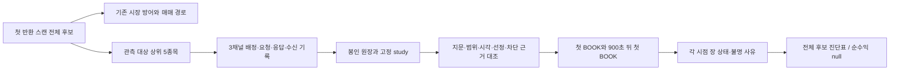

# 시장 방어 이전 후보의 가격 관측

## 목적과 범위

10월19일 v5는 반환 후보 41건이 모두 시장 방어에서 멈췄고, 후보 호가는
없었다. 다음에는 시장 방어를 완화하기 전에, 첫 스캔의 관측 대상 후보가
이후 어떻게 움직였는지 확인한다. 좋은 종목을 차단했는지와 손실을 피했는지
분리할 자료를 만드는 단계이며, 실거래 수익 개선의 증명은 아니다.

이번 구현은 **오프라인 자원 점검과 가격 판독**이다. 기존
`runner-first-scan-v4`가 남기는 자료를 사용하며, 수집기·주문·시장 방어·설정·
배포·예약은 변경하지 않는다. 날짜가 정해진 설치 파일을 만들지 않는다.

## 고정 계약

- 첫 반환 스캔 한 번만 대상으로 한다. 첫 스캔이 비었어도 다음 스캔으로
  대체하지 않는다. 반환 후보 전체가 분모다.
- 반환 순서 상위 5종목이 고정 관측 대상이다. 6위 이후는 의도적 비구독,
  상위 5개 중 실제 배정 실패는 별도 상태다. 전자를 유효 관측으로 세지 않는다.
- BOOK·체결 상태·장운영 상태 3채널로 최대 15건을 추가한다. 운영 구독,
  외부 사용, 예비 용량을 합해 실제 상한을 넘을 수 없다.
- 엄격히 검증된 저널과 study 지문·epoch·스캔 범위·선정/게이트/프레임
  계약을 대조한다. 봉인 미완료·누락·시간 역행을 성공으로 승격하지 않는다.
- 후보 확정과 구독 배정 이후의 **첫 KRX BOOK**을 기준 호가로 선택한다.
  첫 호가가 불량해도 뒤의 좋은 호가로 교체하지 않는다. 기준은 실제 주문이나
  LLM 판단이 아니라 관측 기준점이다.
- 기준 호가 관측 시각에서 900초 뒤 처음 수신한 KRX BOOK을 후속 호가로
  선택한다. 허용 지연은 5초다. 관측 종료 전 성숙 시간이 부족한 경우를
  호가 부재와 구분한다. 미래 호가는 분석 시각 이후에서 가져오지 않는다.
- 장 상태는 호가와 같은 연결·세대이고 호가보다 먼저 수신한 값만 사용한다.
  같은 수신 시각, 오래된 값, 채널 부재, VI 무사건은 정상시장 증거가 아니다.
  기존 분류기를 재사용하며 거래소 날짜/시각을 합성하지 않는다.
- 실제 가격과 상태·결측 사유를 출력하되 체결 가능성·계좌 수익·수익성 통과는
  주장하지 않는다. `account_return=null`, `profitability_pass=false`,
  `production_eligible=false`를 유지한다. 비용·수량·체결을 지어내지 않는다.

## 자원 점검과 설치 전 남은 조건

기존 first-scan-v4에는 LLM 관측 전용 512MiB 메모리 보호가 적용되지 않는다.
장 상태를 켠 경우 버퍼당 최대 레코드 크기로 계산한 저널 예산은 크게 늘고,
기존 통합 판독은 256MiB 한도가 있다. 점검 도구는 요구량과 각 검사 결과를
보여주며, 설정 숫자만 맞는다고 설치 가능으로 표시하지 않는다.

최소 산술에는 선정/게이트 전체 분모, 기준·후속 BOOK 10건, 두 시점의 두 상태
채널 20건, 한 연결의 후보 구독 수명주기와 운영 채널 수명주기를 포함한다.
첫 연결의 이 최소 시나리오를 통과해도 지속 시세·재연결·운영 이벤트 유량을
감당한다는 뜻은 아니다. `record_volume_qualified=false`를 별도로 유지한다.

실제 설치 전에는 전용 메모리 보호·준비 상태 검증, 실측에 근거한 버퍼/읽기
한도, 소비된 v5 요청과 drop-in의 안전한 교체를 구현·리뷰해야 한다. 날짜와
휴장일 확인도 그 단계에서 고정한다. 기존 LLM 판독기는 그대로 유지한다.

## PLAN → DO → SEE

PLAN: 위 입력·분모·시간·자원 계약을 고정하고 두 오프라인 도구를 구현한다.
DO: 합성 봉인 원장으로 첫 스캔·배정·호가·장 상태 연결을 검증하고 CLI를 제공한다.
SEE: 독립 리뷰, 관련 검사, 전체 verify와 비밀정보 검사를 거쳐 결과를 아래에 기록한다.

## 구현과 사용

- `scripts/assess_pregate_capture.py`: 명시한 study와 운영/외부 등록 수로 자원
  산술을 계산한다. 실제 운영 수요를 조회하지 않고 설치 파일도 만들지 않는다.
- `scripts/report_pregate_candidate_observation.py`: 검증된 봉인 원장과 같은 study로
  전체 반환 후보의 배정·기준/900초 호가·각 시점 장 상태·선정/차단 근거를 출력한다.
  불량 첫 호가를 뒤의 좋은 호가로 대체하지 않는다.

```bash
python scripts/assess_pregate_capture.py /private/study.json \
  --operational-registrations 16 --external-registrations 0
python scripts/report_pregate_candidate_observation.py \
  --study /private/study.json --journal /private/engine.jsonl \
  --as-of '<실제 분석 시각, 시간대 포함>' --max-journal-bytes 268435456
```

위 등록 수는 사용 예이며 현재 수요 확인값이 아니다. 10월19일 v5는 LLM-window
형식이므로 이 새 판독기에 넣지 않는다. 기존 v5 실측 결과를 다시 계산하거나
후보 호가가 있었던 것으로 바꾸지 않았다.



## 검증과 리뷰

- 신규 47검사, 관련 회귀 346검사 통과. 실제 CapturePlan·첫 스캔 버퍼·구독
  조정자·합성 KIS 프레임·봉인 원장을 연결해 7후보/5구독/전체분모를 확인했다.
  첫 빈 스캔, 잘못된 정책·출처/후보 상한·입장 경계, 재연결/동시각/오래된
  상태, 원본 무변경 CLI까지 포함한다. 운영 상태·외부 네트워크 접근 위반 0건.
- 독립 Sol/high 작업 리뷰에서 최소 레코드 예산과 빈 코호트의 905초 검증을
  보완했고, 재리뷰 및 전체 변경 최종 리뷰는 차단 지적 없이 APPROVE였다.
  작성자는 Terra/high, 통합은 Codex 코디네이터다. native 실제 모델 metadata는
  노출되지 않아 미검증으로 기록한다.
- 요청한 Astra/high 최종 리뷰 두 시도는 용량 오류로 완료되지 않았다.
  대체 Claude Opus5/xhigh는 인증 만료로 추론 전에 실패했다(비용 0).
  인증 설정을 바꾸지 않았고, 두 경로를 승인 근거로 세지 않는다. 이번 일반
  오프라인 변경의 최종 검토는 명시적으로 Sol/high로 변경했다. 운영 중요
  변경의 리뷰·승인이나 실제 수익성 검증을 대신하는 결과는 아니다.

- 최종 로컬 verify: **8076 passed / 2 skipped / 2 xfailed**, 8 warnings,
  394.21초, rc0. 문법·비밀정보 검사 통과, 테스트 격리 위반0.
  게시/CI/병합 결과의 정본은 이 변경 PR 본문과 checks다. 원본 작업 계획은
  이 로컬 검증 시점을 기록하며, 이후 CI를 로컬 검사로 대신하지 않는다.

이 문서는 설치 또는 실수집 영수증이 아니다.

## 남은 순서

1. 명시된 first-scan 관측의 보유 메모리 보호와 종류별 레코드 예산을 구현하고,
   5종목·3채널의 실제 생산 경로로 유량·메모리·저널/읽기 한도를 검증한다.
2. 첫 스캔의 준비 상태 판정과 소비된 v5 요청/drop-in의 소유권을 확인하는
   교체 절차를 구현·독립 리뷰한다. 과거 미소비 요청용 wrapper를 이어붙이지 않는다.
3. 그 뒤 거래일·운영 버전·현재 구독 수요를 확인하여 짧은 단발 관측을 설치한다.
   자료가 생기면 일별 누적으로 차단 후보 가격을 분석하고, 비용·실제 진입/청산
   자료가 갖춰졌을 때 순수익 개선 여부를 평가한다.
