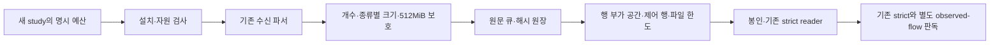

# 10월21일 실측 — 장 상태 수량 상한과 현금 차단

## 목적과 결론

> 후속 개발의 범위·검증 상태는 아래 **원문 보존 용량 보완** 절을 따른다.
> 오전 원장과 판독 결과는 수정하지 않으며, 아래 실측 내용은 당시 근거다.

목적은 종목 선정과 진입 시점을 개선하여 비용 후 순수익을 높이는 것이다.
오늘은 09:25 활성화와 09:51 봉인은 이루어졌으나 장 상태 19,000건 한도가 먼저
소진됐다. 고정 strict/보조 가격 판독은 **blocked(rc2)**이며 비교쌍 집계는 생성되지 않았다.
runner의 `net_pnl`·`account_return`은 **null**이다. 비교쌍0·수익0 또는 엔진 성능 열위로 해석하지 않는다.

원장에 남은 첫 스캔23개는 모두 시장 방어를 통과한 뒤 현금 단계에서 막혔다.
가격 관측 불완전과 실제 진입의 자본 제약은 별개다. 매수 중지·현금 하한·시장 방어를
완화하거나 모델을 교체할 근거는 생기지 않았다. 다음 개발은 기간 연장보다
**원문을 유지하는 수집 예산 정비와 고유량 검증**이 우선이다.

## PLAN → DO → SEE

| 단계 | 수행 | 결과 |
|---|---|---|
| PLAN | 예약 활성화·원장·원래 수동 판독 창 확인 | 활성화 complete, 09:55~10:30 판독은 미실행 |
| DO | 기존 입력을 보존하고 별도50분 판독 창/출력 생성 | 13:36:28~14:26:28, 사전검사rc0 |
| DO | 고정 소스로13:36:41 실제 판독1회 | 입력 계약 거부, runner blocked/rc2; 시도 보존 |
| SEE | 원본 해시 체인·study 결합과 기록된 선정/게이트 독립 진단 | 구조 검증 통과, complete=false 유지 |
| SEE | 종류별 수량·수신 시각·크기·보유 객체 크기 대조 | 저장 용량보다 market_state 개수 상한이 먼저 소진 |

## 실행과 보존 근거

- 기존 예약의 활성화 영수증은09:25:24 KST `status=complete`, `phase=complete`,
  `restart_attempted=true`, `rollback=not_needed`, `toss_attempted=false`다.
  startup once는09:25:07.644156 소비됐다. 이번 분석에서 재시작한 것이 아니다.
- 운영 HEAD `d5dd37bc83bd837f1ff2bc0e648e424a3ee22dfd`, PID2647037,
  로컬 health의 복구ready·journal pending0·매수 중지 유지를 확인했다.
- 원장 **38,096기록 / 38,098행 / 38,087,739B**,09:51:00.000541 봉인.
  `complete=false`, `incomplete_reasons=[market_state_record_limit]`,
  기록된 dropped/persistence dropped는 각각0이다. 상한 이후 저장되지 않은
  장 상태 수는 별도 계측이 없어 **불명**이다. dropped0을 누락0으로 읽지 않는다.
- 정식 reader로 study 지문·해시 체인·순서·봉인 구조·window/frame binding을
  확인했다. `durability_confirmed=false`와 출처 인증 미확정도 유지한다.
- study SHA256: `e0f58f1d922b794384efb5e8842e103cbb5b40a1d333225e2f6551cc398f9928`.
- 원장 SHA256: `c63a1c72b27e6bf5f0a5976a0174a25636078444e5f88e6fcdd9ee4a8d5f1712`.
- 고정 reader fingerprint: `a9399c7c6eacca623850a453072a33e75f9a9f6a315886aebff5448981cf560b`.
- 지연 manifest SHA256: `e5e0b278d94e36ee0f594d7584b8a74965a80833019ede7f551962ce31df1ec9`.
  원본에서 `not_before`, `not_after`, `output_dir`만 변경했고 study·정책·원장은
  바꾸지 않았다. 원래 manifest와 미소비 출력 경로도 보존한다.
- 비공개 결과:
  `/home/ubuntu/.local/state/qwq-capture-readout/20261021-pregate-v1-late-133628/`.
  독립 진단:
  `/home/ubuntu/.local/state/qwq-capture-readout/20261021-pregate-v1-analysis-1344/`.
  계좌 금액·원문 로그·종목별 가격은 Git에 싣지 않는다.

## 수집 병목: 전체 저장소와 종류별 한도를 구분한다

| 종류 | 보존 개수 | 최대 payload B | 역할 |
|---|---:|---:|---|
| BOOK | 18,991 | 687 | 기존 운영 종목의 BOOK도 포함 |
| 장 상태 | 19,000 | 917 | 모두 H0STCNT0; H0STMKO0 데이터0 |
| 구독 사건 | 58 | 334 | 배정·ACK 등 |
| 첫 스캔 | 1 | 10,123 | 09:31:47.964054, 반환23개 |
| 선정 근거 | 23 | 7,377 | 계산 근거23개 대사 |
| 진입 단계 | 23 | 1,332 | 기록된23개 모두 cash 차단 |

장 상태의 첫/마지막 기록은 **09:31:50.240638 / 09:41:21.749931**이다.
그 사이571.509293초의 평균은 `(19,000-1)/571.509293 = 33.24건/초`다.
이는 상한 전 보존 구간의 평균이며, 상한 뒤 실제 유량은 모른다.
종료 호가는09:50:59까지 남았으나900초 후 비교에 필요한 장 상태가 앞서 중단됐다.

- 삼성전자9,032건 + SK하이닉스8,078건 = **17,110/19,000(90.05%)**.
  이는 고빈도 두 종목이 공동 기록 예산을 소진시킨 현상이다. 두 종목의 선정 우열이나
  반도체 제외 벤치마크의 수익성을 입증하지 않는다.
- 관측 시각을 벽시계1초로 묶은 최대치는 상태458건·BOOK114건이다.
  지속 처리율이나 전체 원시 WS 프레임 수가 아니며 burst 시험의 입력 근거로만 쓴다.
- 기존 합성 시험은5종목×초당3 PRICE, 즉 약15 상태/초였다.
  합성 성공을 이번 실제 유량의 용량 검증으로 취급할 수 없다.
- 원장은 약36.32MiB이고, 저장된 객체를 현재 memory-guard 산식으로 다시 계산한
  합계는136,497,990B(약130.17MiB)다. 이 값은 **사후 재구성한 보유 객체 비용**이며
  당시 프로세스 RSS·최대 메모리·writer queue 사용량의 측정이 아니다.

보존 구간의 상태15필드를 비교하면 연결/세대/종목별 최초값5개 이후 값 변경은 없고,
종목×수신초 조합은1,982개다. 중복도가 높다는 진단일 뿐 삭제·샘플링 가능성 증명이 아니다.
원문 시각·최초 CNT 뒤 BOOK·상반/불량 상태·재연결 순서를 잃으면 판독이 편향될 수 있다.
이번 자료에는 축약을 적용하지 않았다.

## 진입·선정 근거의 해석

기록된 첫 스캔에서 enabled/session/engine/broker/entry_time/regime은23개 모두pass,
cash는23개 모두fail이다. score 이후 단계는 모두not_reached, signal_created0이다.
하루 전체 LLM 호출0·전체 시간 무신호를 뜻하지 않는다. 불완전 원장이므로 gate 보고서의
`source_complete=false`, `trace_coverage_complete=false`도 그대로 남긴다.

현금 값은 계좌의 현금 총액이 아니라 `get_available_cash()`의 **총자산 기준 최소
현금 보유분을 뺀 가용액**이다. 첫 스캔에 기록된 가용액은0이었다. 이후13:41~13:42
로컬 포트폴리오 응답에서는 현금이 양수이나 당시 관측한 최소 주문 기준에도 미달했다.
후속 응답은 첫 스캔 시점의 KIS 계좌 대사가 아니며 금액을 공개하지 않는다.
따라서 현금 보유분 규칙만 풀면 진입이 가능하다는 결론은 성립하지 않는다.

오늘 로그에는09:37~11:17 KIS 초당 호출 제한에 따른 잔고 조회/동기화 실패 메시지도
있었다. 첫 현금 차단보다 늦게 시작했으며, 소스는 조회 실패 시 기존 포트폴리오를
0으로 덮지 않고 갱신을 보류한다. 후속 health에서 동기화 연속 실패0·최근 성공·stale
없음을 확인했다. 이 health 응답은 봇 내부의 상태 기록이며, 첫 스캔 또는 현재 계좌를
KIS에서 새로 대사한 증거가 아니다. 이를 첫 스캔 현금0의 원인으로 단정하거나 별도
KIS 조회를 추가하지 않았다.

선정 근거는 반환23개 모두 산술 대사됐다. 그러나 원천별 데이터 시각은 여전히 미확정이고,
조회 완료·캐시·호출 안 함을 구분해야 한다. 여러 원천을 사용했다는 사실 자체를 독립된
예측력으로 해석하지 않는다. 오늘은 가격 비교가 차단되어 선정 순위와 순수익 연결을 만들지 않는다.

## 다음 작업 순서와 통과 조건

1. **원문 보존 수집 예산 정비.** 실제 평균과 burst를 분리하고, 종류별 최대 생산
   payload·원장 envelope 상한을 검증한다. 현 예산식은 각 레코드에2,048B를 더하므로
   상태 수량만 늘리면256MiB 판독 상한과 충돌한다. 예를 들어 BOOK35,000·상태65,000·
   기타512·메타201에 비메타2,048B를 주면425,283,584B로 현재 계약을 통과하지 못한다.
   envelope의 더 작은 엄밀 상한과 종류별 크기를 증명한 뒤 수량을 정한다.
2. **높은 유량과 순간 급증 합성 검증.** PRICE와 BOOK 유량을 분리하고 전체1,260초,
   상태50+/초·BOOK25+/초 및 관측된 burst를 포함한다. 900초 후까지 상태 보존,
   complete·정확한 counts·드롭0·기존 strict 보존·보조5쌍, retained512MiB와
   reader256MiB 한도, 큐 지연·재연결·상반/불량 상태를 함께 검증한다.
   합성 결과를 실시장 처리율 보장으로 승격하지 않는다.
3. **자본·API 점검을 다음 실측과 함께 유지.** 현금 총액/보유분/가용액/주문 하한과
   계좌 자료 시각을 분리하고 기존 KIS 호출의 동시성·재시도 원인을 분석한다.
   매수 중지 해제·수동 보유 청산·현금 하한 완화·추가 주문을 자동 수행하지 않는다.
4. **그 뒤 새 고정 관측.** 새 날짜·정책·SHA로 배포/설치 여부를 정한다.
   오늘 once·원장·차단 결과는 재사용/덮어쓰기하지 않는다. 원문 보존 방식이 자원 제약을
   충족하지 못할 때만 별도 정책의 상태 축약/streaming 설계를 검토한다.

이번 단계는 **실측 판독·원인 분해·다음 설계까지**다. 용량 수정 구현·고유량 시험·새 수집
예약은 아직 하지 않았다. 제품 코드·운영 설정·모델·예산 변경 및 추가 배포/재시작/주문은 없다.
문서 검증·독립 검토·PR 통합 상태는 해당 PR 영수증을 따른다.

## 문서 검증

- 원장·게이트·메모리 보호·고정 판독 실행기 관련 회귀 **152 passed /19.21초**,
  운영 상태·외부 네트워크 접근 시도0건. 제품 소스는 수정하지 않았다.
- 변경5문서의 diff 공백·새 링크·비밀정보 패턴 검사를 통과했다.
- 독립 문서 검토의 비교쌍 필드 부재와 내부 health 증거 범위 지적을 반영했다.
  요청 Sol/high, 실제 모델/유효 effort metadata는 미노출이다.
- 13:49:41 KST 원래 manifest·study·원장3개 SHA가 일치하고 원래 판독 출력은
  여전히 없다. 운영 SHA/PID·복구ready·pending0·매수 중지는 유지된다.
  전체 verify·CI·병합 상태는 PR 영수증을 따른다.

## 원문 보존 용량 보완 — PLAN → DO → SEE

### PLAN

목표는 같은 후보의 진입 시점과900초 뒤 가격을 비교할 자료를 확보하는 것이다.
`market_state`19,000건 소진에 대응하되 수신 기록을 샘플링하거나 동일 상태를 합치지 않는다.
현재 파서가 만드는 관측 레코드의 필드·시각·순서를 그대로 유지한다.
기존256MiB 판독 한도와512MiB 보유 레코드 보호를 유지한다.

기존 첫 스캔의 종류별 개수·직렬화 크기 강제에
`journal_budget_version=bounded-envelope-v1`를 명시한 새 관측만 추가한다.
종류별 byte 제한이나 개수 제한 없이 이 옵션을 쓰거나 지원하지 않는 값을 넣으면
설치 전에 거부한다. 기존 study와 LLM 관측의 계산·원장 형식은 유지한다.

### DO

`first_scan_resources.py`가 각 payload 상한과 해시·순번·JSON 키·개행의 부가 비용을
합산한다. JSON 객체 payload는 문자열로 다시 감싸지 않으므로 빈 객체 두 바이트를
뺀 행 크기가 부가 비용이다. 최대 순번은 `buffer_capacity+2`로 계산하며,
writer가 실제 행의 부가 비용과 순번을 다시 검사한다. 시작/봉인은 각각16KiB로
제한해32KiB를 별도로 확보한다. 초과하면 파일을 자르거나 정상 완료로 표시하지 않는다.
시작 정보가 이미 상한을 넘으면 파일 생성 전에 거부한다. 봉인 사유가 과도하면
미봉인으로 남으며 정상 완료로 승격하지 않는다.512MiB 보호는 보유 레코드 객체만의
한도이며 전체 RSS나 모든 임시 객체의 상한이 아니다.

예산 버전은 study 지문과 로컬 준비 응답에 묶이고 기존 원장 header에는 추가하지 않는다.
원장 단독으로 writer 예산 구현을 인증하는 기능은 아니다. 실제 새 판독에는 해당 옵션을
아는 고정 소스도 함께 준비해야 한다.

| 범주 | 개수 | payload 한도 B |
|---|---:|---:|
| 첫 스캔·선정·게이트 메타데이터 | 201 | 65,536 |
| BOOK | 35,000 | 2,048 |
| 장 상태 | 65,000 | 2,048 |
| 구독 등 나머지 | 512 | 4,096 |

버퍼/큐100,713개일 때 기록당 부가 비용은199B이고 총 상한은
**240,144,543B(약229.02MiB)**다. 종전2,048B 가산 방식은 동일 개수·payload에서
426,332,160B가 필요하다. 두 계산 모두 최대 payload 가정이며 실제 파일 크기와 다르다.
새 계산은 받아들인 원문에 대한 상한이지 모든 형태의 공급자 입력이 이 한도 안에
있다는 보장이 아니다. 큰 입력은 기존 byte 보호에서 거부하고 incomplete로 남긴다.

실행 흐름은 다음과 같다.

### SEE와 다음 실측 준비

합성 수집은1,263초 창 안에1,260개의1초 틱을 넣었다. 후보5종목의 평시 유량은
체결 상태50건/초·BOOK25건/초이고, 중간1초는458상태·114후보 BOOK으로 올렸다.
기존 운영 종목의 PRICE/BOOK 전달도 함께 실행했다. 수신 파서부터 버퍼·비동기 원장·
기존 reader와두 판독기까지 통과시키며, 임의로 기록을 줄이는 구현은 정확한 개수 검사에서
실패하도록 했다. 전체 후보 메타데이터의 합성 분모는7개이며100개 최대치 실측은 아니다.

생성된 합성 원장 자체를 별도로 읽어 확인한 결과는 다음과 같다.

| 항목 | 결과 |
|---|---:|
| 전체 기록 | 96,345 |
| 장 상태 / BOOK | 63,418 / 32,849 |
| 봉인 | complete=true·누락/저장 드롭0·불완전 사유 없음 |
| 실제 파일 크기 | 99,455,040B(약94.85MiB) |
| 저장 레코드로 재구성한 보유 메모리 | 353,851,649B(약337.46MiB) |
| 수신 초 단위 최대 후보 상태 / BOOK | 458 / 114 |

위 메모리는 파일을 읽은 뒤 같은 객체 비용 산식으로 재계산한 값이며 실제 실행 중
최고 RSS가 아니다. 테스트는 실행 중 보유 레코드 한도512MiB도 별도로 검사한다.
합성 원장의 SHA-256은`106c1a23fb83bfb8ecab097af9cdb61f92cb5ea6c74270ec4dbf97f2c81fb148`이다.
이 결과를 실시장 처리율·거래 가능성·순수익 근거로 승격하지 않는다.

전체 로컬 검증은 **8,468 passed / 2 skipped / 2 xfailed, 610.91초, rc0**였다.
문법·비밀정보 검사도 통과했고 테스트의 운영 상태·외부 네트워크 접근 시도는0건이다.
고유량 시험에서 기존 strict 결과를 그대로 보존하면서 보조 observed-flow는
분모7개 중5개의 기준/900초 호가 쌍을 연결했다. 원래19,000건 상한을 넣은 대조는
불완전 봉인으로 끝났으며, 초과 BOOK 거부 시 운영 시세 전달 유지·유니코드 원문·
순번 자릿수 경계·시작/봉인 공간 초과도 검사했다.

독립 중요 리뷰는 P0/P1/P2 추가 지적0으로, 전체 로컬 검사와최종 커밋 CI 통과를 조건으로
승인했다. 리뷰어의 별도 관련78건과시간 선행성/실제 피드2건도 통과했다.
역할별 요청은 용량 분석 `gpt-5.6-sol/high`, 유량 시험 `gpt-5.6-terra/high`,
독립 최종 리뷰 `gpt-6-astra/xhigh`였다. 실제 모델·유효 effort·fallback metadata는
노출되지 않았다. 타 공급자 교차 리뷰로 표현하지 않는다. CI와병합 상태는 PR
영수증을 따른다.

기존 원장·study·시도 영수증은
재작성하지 않는다. 이 변경으로 예약을 설치하거나 운영 체크아웃을 갱신하지 않았다.
새 실측에는 검증된 SHA와 위 명시 예산, 새 날짜·epoch·study 지문·읽기 도구를 함께
고정해야 한다.10월21일 설치기의 고정된19,000건 계약을 임의로 재사용하지 않는다.
자원 검사의 `installation_ready=false`는 유지하며, 현금/매수 중지/주문 조건은 별도다.
