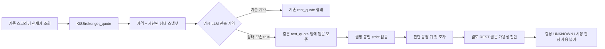

# 기존 현재가 응답의 REST 장 상태 근거 보존

## PLAN — 순수익 비교의 입력 공백을 줄인다

10월14일 파일럿의 장운영 사건 0건은 정상 거래의 증거가 아니다. 그렇다고 같은 관측을 오래 반복하면 초기 상태 문제가 해결되는 것도 아니다. 이번 범위는 **추가 증권 API 호출 없이 이미 받는 현재가 응답의 상태 원문을 보존하고, 판단 뒤 첫 호가에 대해 자료의 가용성과 결측 사유를 측정**하는 것이다.

계획은 [구현 계약](../superpowers/plans/2026-10-14-rest-market-state-evidence.md), 선행 판독은 [파일럿 정본](market-state-pilot-readout-2026-10-14.md)을 따른다. 기준 main은 `597150da590d7d68c530800367d4f9d00061b72f`다. 구현·문서 커밋은 푸시했고 [PR #191](https://github.com/qwq-partners/qwq-ai-trader/pull/191)을 만들었다. 최종 head의 CI와 병합 여부는 해당 PR이 정본이다. 운영 배포·설치·예약·유료 비교·매수 재개는 이번 구현에 포함하지 않는다.

## DO — 공식 근거와 구현 흐름

### 공식 문서에서 확인한 범위

2026-10-14 공개 [KIS 현재가 상세 규격](https://apiportal.koreainvestment.com/api/apis/public/detail?accessUrl=%2Fuapi%2Fdomestic-stock%2Fv1%2Fquotations%2Finquire-price)을 확인했다. 내려받은 원문 53,187바이트, SHA256 `cb8da9262a405b865f2f3d61261f76bfbd16c053a4cf72e1abe47108940fbbe4`, 문서 lastModified `2026-08-12T15:44:45+09:00`. 계좌 인증·시세 API 호출 없이 공개 규격만 읽었다. 고정된 [공식 예제](https://github.com/koreainvestment/open-trading-api/blob/208279102f43fd0c0f15fcf66c9e5a5adda27050/examples_llm/domestic_stock/inquire_price/chk_inquire_price.py)와도 필드 이름을 대조했다.

| 항목 | 확인한 내용 | 이번 처리 |
|---|---|---|
| TR·시장 | `FHKST01010100`, 요청 시장 `J`는 KRX | 기존 호출을 그대로 사용, NX/UN으로 바꾸지 않음 |
| 응답 종목 | `stck_shrn_iscd` | 요청 종목과 별도 보존·연결 때 일치 검사 |
| 상태 | `iscd_stat_cls_code`: 51/52/53/54/55/57/58/59 설명, 58 거래정지. 00 의미 미정의 | 어떤 값도 NORMAL로 승격하지 않음 |
| 정지·VI | `temp_stop_yn`, `vi_cls_code`, `ovtm_vi_cls_code`: 필드 존재·예시 N, 값의 시점/정상 의미는 설명 없음 | 원문만 보존. N=현재 정상/VI 해제라고 가정하지 않음 |
| 거래소 시각·순번 | 현재 상태의 as-of/순번 없음 | 둘 다 null, WS 세대도 복사하지 않음 |

단일 output 객체라는 사실은 원자적 시장 스냅샷이나 응답 시점의 최신성을 보증하지 않는다. 과거 고가/저가 날짜는 상태 as-of가 아니다. 저장 지문은 제한된 메타데이터의 무결성 보조이며 증권사 원문 인증이 아니다.

### 코드·프로세스 흐름

- `src/execution/broker/kis_kr.py`: `_api_get` 직전/반환 뒤 UTC 시각을 읽는다. 이 구간은 리미터 대기·토큰 갱신·내부 재시도를 포함한 **논리 호출 구간**이다. HTTP 전송 시작이나 거래소 시각으로 부르지 않는다. 제한된 스냅샷 생성 실패는 기존 가격 반환으로 전파하지 않는다.
- `src/analytics/kis_rest_market_state.py`: 18개 허용 scalar 필드만 보존하고 해시·종목·UTC 시각·순서를 검증한다. 원문 필드마다 최대16문자, 제어문자·비문자 값 거부. 빈 값/결측/잘못된 타입을 구분한다. 전체 API 응답은 저장하지 않는다.
- `entry_observation.py`·`entry_observation_runtime.py`·`entry_observation_journal.py`: 아래 계약을 명시한 관측만 기존 `rest_quote`에 스냅샷/기록 상태를 붙인다. `recorded`, `missing_snapshot`, `invalid_snapshot`을 구분한다. 기존 `other` 기록 몫과 바이트 한도를 사용한다. 새 요청·소켓·태스크·원장 행을 추가하지 않는다. 이전 연구의 행 형태는 보존한다.
- `decision_quote_join.py`·`scripts/report_decision_quotes.py`: strict reader가 검증한 완전 원장에서 별도 `rest_market_state_at_quote`를 생성한다. 기존 WS 채널별 상태·`evaluable`·경제성 판정은 바꾸지 않는다.

새 연구 `capture`의 기존 LLM 계약에 추가하는 필드는 `"rest_market_state_evidence": true`다. 생략이 기본 OFF다. 다른 관측 버전, false/1/문자열/null은 거부한다. 기존 봉인 원장의 연구 설정을 바꾸어 소급 활성화하지 않는다. 이 필드만 추가한다고 현재 날짜의 설치가 가능해지는 것은 아니다. **미래 날짜 설치기는 별도 작업**이다.

### 진단의 시간·결측 규칙

호가 수신시각 이전에 발행된 같은 종목 REST 기록 중 최신 `observed_at`을 사용한다. 시간대가 있는 호가 수신시각은 UTC로 변환하고 스냅샷/새 REST 발행 시각은 UTC만 허용한다. `request_started_at <= response_available_at <= observed_at <= quote received_at`을 확인한다. 최신 값이 없거나 손상됐다고 과거 정상 원문으로 대체하지 않는다. 동률·응답 순서 역전·손상 시각도 미확정이다.

신선도는 `호가 수신 - 요청 시작`을 보수적인 **로컬 경과시간 상한**으로 보고한다. 거래소 데이터 나이의 상한이라는 뜻은 아니다. 현재 보고서의 `max_state_age_seconds` 한도를 함께 적용한다(기본60초). 오래된 원문도 진단에 보일 수 있지만 `raw_available=False`다. 응답 종목 불일치·필드 결측·미검증/불완전 원장도 가용으로 세지 않는다.

보고서 요약은 `rest_raw_available`, `rest_raw_unavailable`, `rest_diagnostic_reasons`다. 분모는 입력 판단 전체다. 호가를 연결하지 못한 판단은 `no_associated_quote`, REST가 없는 호가는 `no_record_before_quote` 등으로 분리한다. **raw_available=True는 시점·종목·필드 조건을 만족한 원문이 있다는 뜻뿐**이며 상태는 항상 `UNKNOWN`, `usable_for_market_state=False`다. 원래 WS 근거 부족 사유를 지우지 않는다.

## SEE — 검증과 통합 상태

- 순수 모듈 TDD 59 실패→59 통과. 통합 초기2회귀는 수정 전 메타데이터 누락/계약 거부로 실패했다. 후속 KST 호가 연결 회귀도 실패를 확인한 뒤 UTC 정규화했다.
- 후보 `ffdc1f8` 관련6파일 **242 passed**, rc0, 운영 상태·외부 네트워크 접근 시도0. 실제 `KISBroker.get_quote` 함수의 단일 모의 요청→명시 런타임→원장 봉인→strict reader→보고 CLI 통합을 포함한다. 결측/오류에도 가격 보존·기본 OFF·원본 객체 변조 격리·미확정 상태 유지도 검사했다.
- 최초 통합 `ffdc1f8`에서 `TZ=UTC PYTHONDONTWRITEBYTECODE=1 QWQ_VERIFY_PYTHON=/home/ubuntu/projects/qwq-ai-trader/venv/bin/python bash scripts/dev/verify.sh`: **6120 passed / 2 skipped / 2 xfailed / 3 warnings**, rc0(224.28초). 문법·비밀정보 검사 통과·격리 위반0. KST 관련3파일 **105 passed**, rc0. 작업자만의 전체6106건 결과와 구분한다. 로그는 개발 환경 `/tmp/qwq-rest-state-full-verify.txt`, `/tmp/qwq-rest-state-integrated-tests.txt`, `/tmp/qwq-rest-state-kst-tests.txt`에 보존했다. 이 검증 뒤 시계 경계 소스를 수정했으므로 아래 최종 검증을 정본으로 사용한다.
- 첫 외부 리뷰는 요청/관측 모델 Claude Opus5, xhigh, 도구0으로 진행했으나 361.1초 절대 시한에 종료(rc3, 최종 결과 없음)했다. 최근 모델 진행은 종료1.1초 전까지 있었으므로 공급자 불가나 승인으로 처리하지 않았다. 같은 모델/effort/auth/권한의 짧은 대조는6.4초 rc0·실제 claude-opus-5, 표시 비용$0.0974175였다. 77,078바이트 문맥에서 중복을 덜어52,378바이트로 만든 제한된 후속 리뷰를 수행했다. 중단 호출의 최종 비용은 미확정이다.
- 중간 P1 의견의 시계 실패 경계는 재현했다: 논리 호출 전/후 시계 오류2케이스 모두 수정 전 실패했다. `1538d29`에서 시계 읽기를 선택적 메타데이터 경계에 넣어 실제 현재가 요청/반환을 보존했고 관련 **244 passed**, rc0이다. 소스 변경 때문에 통합 전체 verify를 다시 수행했다. 다른 P1 의견의 UTC 발행 가정은 실제 `entry_observation._now()=datetime.now(timezone.utc).isoformat()`과 `capture_rest_quote` 호출로 대조했다. 새 계약의 UTC 전용 조건은 유지하고 독립 종결 리뷰에 이 근거를 전달했다.
- 최종 소스 `1538d29` 전체 verify는 **6122 passed / 2 skipped / 2 xfailed / 3 warnings**, rc0(224.51초), 운영 상태·외부 네트워크 접근0, 문법·비밀정보 검사 통과다. 최종 관련244검사·KST107검사도 rc0. 최종 로그는 `/tmp/qwq-rest-state-full-final-verify.txt`, `/tmp/qwq-rest-state-integrated-final-tests.txt`, `/tmp/qwq-rest-state-final-kst-tests.txt`다. 이후 소스/시험 변경 없이 문서만 갱신한다.
- 축소한 독립 리뷰는264.5초 rc0·실제 `claude-opus-5`, 도구0, 표시 비용$0.8034475로 완료했지만 **REQUEST_CHANGES(P1 증거 요청2건)**였다. 시계 격리와 실제 UTC 생산자 근거는 수용했다. 요청은 최종 전체 검사 결과와 REST 행의 기존 집계 영향이었다. 실제 join 루프는 symbol/시각 처리 전에 ws_quote·market_state 외 kind를 건너뛴다. 소스와 별도4경우 실행(WS 상태 유/무 × REST 시각 정상/손상)으로 기존 행 필드 전체·오류 집계가 동일함을 확인했다(rc0, `/tmp/qwq-rest-state-gate-invariance.txt`). 최종 검증 결과와 함께 독립 종결 확인을 받았으며 이 중간 리뷰 완료 자체를 승인으로 취급하지 않는다.
- 비차단 P2 제안은 별도 판단했다. 오프라인 반복 정렬은 추후 규모 측정 뒤 최적화할 항목이고 실시간 매매 경로가 아니다. 경고에는 원문을 넣지 않으며 잘못된 원문 값 자체는 상태로 처리한다. dict 아닌 스냅샷은 실제 strict reader의 nested mapping 검사에서 거부되고 permissive 읽기는 미검증이라 가용으로 세지 않는다. Python3.11 미만의 Z 파싱 우려는 프로젝트 `requirements.txt`의3.11+·CI3.12·로컬3.12 범위 밖이다. 공식 의미/원천 인증 한계를 이로써 해소했다고 주장하지 않는다.
- 독립 종결 리뷰는 **APPROVE·P0/P1 0·잔여 차단 없음**, 실제 완료 모델 `claude-opus-5`, 요청 xhigh·유효 effort 미노출,43.5초 rc0·도구0·표시 비용$0.2768325다. 기존 집계 영향 우려는 실제 kind 선별 코드로 철회했고 최종 검사 증거를 수용했다. 비차단4의견의 위 판단도 수용했다. `/tmp/qwq-rest-state-opus-closure.txt`에 결과를 보존한다. 독립 리뷰는 제공된 소스/코디네이터 실행 증거 검토이며 리뷰어가 테스트를 직접 재실행한 것은 아니다. 최종 PR/CI·병합 상태는 PR 정본을 따른다.
- 순수 모듈 작업자는 요청 Astra/high, 실제 모델/유효 effort metadata 미노출. 독립 최종 리뷰는 별도 Claude Opus5/xhigh, 도구 없이 정제된 소스만 전달한다. 리뷰 비용은 개발 비용이며 애플리케이션 비교 호출은0이다.

## 다음 우선순위와 실제 수집 판정

1. **운영 적용 준비:** 검증/리뷰/CI를 통과한 고정 SHA를 정하고, 기존 [배포 체크리스트](../operations/pilot-decision-checklist-2026-10-14.md)의 15:30 이후 장외 가드를 다시 확인한다. 운영 `161b394`는 이전 판독값이며 이번 세션에서 운영을 재조회하거나 변경하지 않았다. 판단 기록과 시각 수정 배포는 여전히 별도다.
2. **명시 설치기:** 후속 [10월15일 고정 LLM 관측 설치 PDS](llm-capture-installer-2026-10-14.md)에 전용 prepare/활성화 프로필·실효 준비 투영·미래/지난 창·SHA/opt-in·소비 자료·합산 용량 검사를 구현했다. 최종 검증/리뷰 상태는 해당 문서가 정본이다. 기존10월14일 봉인과 옛 프로필은 변경하지 않는다. 실제 운영 study·자원 근거 확인·설치·예약은 별도 남은 작업이다.
3. **작은 실측:** 매수 중지·유료 비교 OFF를 유지한 채 자연 발생 판단과 기존 현재가 원문이 함께 기록되는지 확인한다. 일별 실제 판단 수, 응답 뒤 호가 수, REST 원문 가용률·결측 사유·조회 구간·지연·한도 오류를 판독한다. 판단0건은0건으로 기록하며 표본을 얻기 위해 매매 조건을 낮추지 않는다.
4. **시장 상태 의미 확정:** REST 값의 시점/VI 의미와 WS 사건 연속성의 공식 근거가 추가로 필요하다. 이 구현만으로 장 상태 공백이 해소됐다고 하지 않는다. 별도 조회는 실제 가용률 부족이 확인될 때 요청 상한·기존 제한 영향을 먼저 검토한다. 유료 비교·20일 경제성 연구 전에 시장 상태와 전체 진입/결과 호가 조건을 만족하는 실제 한 쌍이 필요하다.
5. **순수익 비교:** 같은 입력에서 모델·추론만 바꾸고 응답 이후 진입 가격·거래비용·API 비용을 차감한다. 월$100 운영 예비와 기존 사용액을 보존한다. 계좌 시작 순자산·입출금·권리 금액 대사는 병행 과제이며 결측 손익은 null이다. KODEX200 원기준과 사전 정의한 반도체 제외 보조 기준, 엔진 버전·시장 국면을 분리한다.

결함은 매일 고쳐도 된다. 경제성 가설과 측정 기준은 버전을 고정하고, 이후 새 자료에서 평가한다. 이번 작업은 원문 증거를 잃지 않게 한 것이며 수익성이나 모델 우위의 입증이 아니다.
