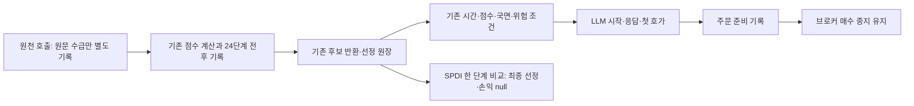

# 휴장 기간 후속 — 진입 연결 시험과 선정 점수 근거

> **운영 후속 확정(10월16일16:05 KST):** [PR #204 고정 SHA 배포·10월19일 예약·조건부 실행](../operations/selection-capture-2026-10-19.md). 배포/새 설치 완료와 실제 수집 미완료를 구분한다. 아래 미설치/후보 문구는 개발 시점 이력이다.

## 목적과 범위

종목 선정과 진입 시점을 개선해 비용 후 순수익을 높이기 위한 후속 구현이다. 10월17일은 토요일 휴장일이므로 실시간 시장 관측일로 잡지 않는다. 휴장 중 가능한 합성 검증·기록 보완을 먼저 끝낸다. 거래일 원칙은 [KRX 주식시장 안내](https://global.krx.co.kr/contents/GLB/06/0602/0602020204/GLB0602020204T1.jsp)를 따른다. 다음 실제 관측 날짜는 개장 여부·배포 SHA·자원 검증과 함께 확정한다.

기준은 PR #203/main `023e26fd`다. 이미 소비된10월16일 study·원장·once와 사전 고정 연구는 보존한다. 이번 개발은 기존 진입 점수·수급 감점·교차 검증·모델·수량·매수 중지 정책을 바꾸지 않는다.

## PLAN → DO → SEE

| 순서 | 구현 범위 | 통과 조건 |
|---|---|---|
| P0 연결 시험 | 실제 스케줄러·엔진·교차 검증·관측 callback과 임시 브로커 매수 중지를 연결한다. 외부 데이터와 시계만 합성한다. | 09:30 이후 조건을 갖춘 후보의 LLM/호가/주문 준비 기록, 시간·점수·국면·접수불명 차단, 실제 주문 전송0 |
| P1 선정 근거 | 명시 v3 관측에 수급 증거와 순서가 있는 점수 보정 기록을 추가한다. v1/v2 계약은 유지한다. | ON/OFF의 점수·순위·후보·외부 호출 수가 동일하고, 보정 합계가 기존 basis와 일치하거나 결측을 명시 |
| P1 단일 비교 | 필요한 실제 입력을 기록한 SPDI 연산 한 단계에서 미관측 감점 유무만 비교한다. | 해당 단계의 점수 차이만 제시; 최종 선정·주문·손익으로 확대하지 않음 |
| P2 다음 관측 준비 | 휴장일 제외, 전체 경로·첫 호가 지연·자원·새 날짜/SHA 검사 | 개발·합성 검증·실제 설치/예약·실수집을 구분하며 불충족 입력을 조작하지 않음 |

## 선정 근거 계약

- 기존 `selection-basis-v1/v2`는 기존 형식과 동작을 유지한다. 새 기능은 `selection-basis-v3`를 명시한 관측에서만 켠다.
- 기관/외국인별 `positive / observed_nonpositive / unobserved`를 구분한다. 제한 순위 미등장·빈 캐시·실패·미호출은 종목별0/음수의 근거가 아니다. 기존 boolean은 별도 기록한다.
- 공급자 정규화의 `int(item.get("ntby_qty", 0) or 0)`는 결측을0으로 만들 수 있다. 원문에 실제 유효 숫자가 있었음을 확인한 경우만 수급 숫자의 근거로 삼는다. 캐시가 그 근거를 보존하지 않았다면 미관측으로 남긴다.
- 기록은 기존 호출/계산 경계에서 복사한다. 추가 조회·LLM 호출·점수 재실행은 하지 않는다. 원천 시각이 없으면 현재 시각으로 채우지 않는다.
- 단계별 전후 점수·차이·실행 상태를 순서대로 남긴다. 함수가 반환했다는 사실은 내부 자료 충분성/평가 성공 증거가 아니다. 복합 단계의 합계나 실패 후 부분 변경을 특정 감점 하나로 돌리지 않는다.
- 이전 캐시 후보는 이전 계산 근거를 유지하며 현재 수급과 합치지 않는다. 관측 실패·상한 초과는 선정 흐름과 분리한다.
- SPDI 국소 비교는 같은 단계의 실제 이전 점수·등락률·플래그·수급 상태·실행 분기가 검증된 경우만 계산한다. 다른 단계·정규화·후속 게이트를 재생하지 않으므로 최종 점수/순수익은 null이다.
- `comparable`은 미관측 때문에 적용된 SPDI 부재 감점을 억제하는 한 계산을 재현할 수 있다는 뜻이다. 원문 수급이 양수여도 선정 원천의 가격/유동성 필터 등으로 기존 boolean이 false일 수 있다. 이 실험은 그 플래그를 원문 양수로 대체하지 않는다. 차이 0은 기존 정책이 적절하거나 실제 수급과 플래그가 일치한다는 판정이 아니다.

## 현재 진행 상태

구현 세 묶음을 `e25a7205`에 통합한 뒤 실제 v3 스크리너 연결 시험을 `bf78518c`로 추가했다. 전체 검사·관련 검사·자원 실측은 아래 결과를 따른다. 독립 중요 리뷰의 최종 판정과 커밋/CI는 인계 기록으로 구분한다. 운영 배포·재시작·관측 설치는 실행하지 않았다.

## SEE — 검증 근거

- 구현 코드 `e25a7205`: 전체 verify **6,875 passed / 2 skipped / 2 xfailed**, rc0,303.92초. 문법·비밀정보 검사 통과, 운영 상태/외부 네트워크 접근 시도0. 로그 `/tmp/qwq-oct16-selection-full-verify.log`.
- 후속 `bf78518c`는 테스트만 변경했다. 실제 스케줄러가 v3 플래그를 전달하고 실제 스크리너의 병합·SPDI·정규화를 거쳐 원장/보고서로 연결되는 두 반례를 추가했다. 최종 관련 KST **179 passed**, rc0,4.99초·격리0. 해당 파일 자체 UTC/KST 각각13통과. 후속 전체 CI는 PR 기록을 따른다.
- 기존 조정 점수 하한85를86으로 바꾸거나 v3 전달 플래그를 제거한 별도 변이 실험은 연결 시험에서 실패했다. 소스 파일을 변이한 채 커밋하지 않았다.
- 수급/보정 작성자 관련 UTC/KST 각각277통과. 설치 작성자 관련 UTC/KST 각각638통과·2skip, 처음 제외했던 v3 의존성 두 검사는 통합한 실제 로더/실제 준비 projection에서 UTC 및 독립 KST 모두 통과했다. 과거 설치기를 새로운 시간으로 덮어쓴 시험이 아니다.
- 일반 독립 리뷰(Sol/high 요청)는 기존 연결11검사 통과·P0/P1/P2 0. 중요 독립 리뷰(Astra/xhigh 요청)는 관련217검사·동시 스캔 수급 격리·과거 v1/v2의 새 결과/캐시 폴백 전체 보고서4경우 동일성을 확인했다. 후속 v3 연결2검사도 독립 통과했다. 최종 독립 판정은 [중요 리뷰 기록](../reviews/selection-evidence-2026-10-16.md)의 **APPROVE·P0/P1/P2 0**이다. 실제 모델/실효 effort metadata는 미노출·미검증이며 교차 공급자 리뷰는 아니다.

### 합성 자원 검증

최종 소스에서 외부 접근을 막고 기본 라이브러리를 먼저 불러온 독립 프로세스로 측정했다. 500건/초의 제한된 입력에 호가50,000·장 상태50,000·기타8,000·4스캔 메타데이터804건을 넣었다. 선정 메타데이터는 실제 스크리너가 생성한 후보100개×4회·24단계이며 원천 입력과 보조 계산은 합성이다.

| 항목 | 결과 |
|---|---|
| 수락 / 저장 / 누락 | 108,804 / 108,804 / 0 |
| 봉인 / 오류 / 불완전 사유 | 성공 / 없음 / 없음 |
| 발행 / 봉인 | 219.58초 / 0.20초 |
| 전체 처리율 | 491.42건/초 |
| 라이브러리 초기화 후 RSS / 종료 관측 RSS | 142.60 / 286.15MiB |
| 보수적 보유 객체 산정 | 370.67MiB |
| 기준 / 종료 가상 주소 공간 | 490.67 / 634.63MiB |
| 원장 크기 | 104.87MiB |
| 시험 한도 | 주소 공간768MiB·CPU180초·전체300초 |
| 운영 상태 / 외부 접근 시도 | 0 / 0 |

별도 원천 항16개×24단계×100후보 시험도 실제 생성→원장 봉인→해시 검증 리더→기존 보고서를 통과했다.101레코드, 최대 레코드23,591B로64KiB 한도 안이다. 중복 합성 원천을 사용한 형식/크기 시험이며 독립 정보원16개를 확보했다는 뜻이 아니다. 대표 전체 유량과 최대 항 단일 burst는 다른 시험이다.

첫 자원 시험은 기존384MiB 주소 공간 한도를 재사용했고,10만 건을 보유한 뒤 스크리너의 수치 연산 라이브러리를 처음 불러오다 OpenBLAS 할당 오류(rc1)로 실패했다. 작은 재현에서 라이브러리 단독 import는 성공했으나 보유 메모리를 더하면384/512MiB 한도에서 실패했다. 최종 시험은 라이브러리를 먼저 불러온 실제 기동 순서와 명시768MiB 주소 공간 한도를 사용했다. **운영의 기록 보유 한도512MiB를 변경하지 않았다.** 이 성공은500건/초 대표 부하와 명시 형식 범위이며 실제 시장 최대 유량·모든 최대 길이 필드·전체 운영 프로세스 메모리 안전을 인증하지 않는다.

원본 실행 근거: `/tmp/qwq_oct19_v3_resource_qualification.py`, `/tmp/qwq_oct19_v3_resource_final.json`, `/tmp/qwq_oct19_v3_16term_qualification.py`, `/tmp/qwq-oct19-v3-16term-evidence.json`. `~/.local/state/qwq-selection-followthrough-20261016/`에 실행 로그·스크립트·산출물과 SHA256 목록을0600으로 보존했다.

## 연결 시험의 범위

실제 `KRScheduler.run_screening` → 엔진 이벤트 큐 → RiskManager/교차 검증 → `llm_second_check`/AdversarialValidator → 판단 기록·호가 배정 → `order_ready` → KIS 브로커의 매수 중지를 연결한다. 외부 공급자 응답·시계·계좌 입력만 합성하고, 실제 HTTP 주문 경계에 도달하면 시험을 실패시킨다. 성공한 합성 Bull/Bear 응답과 판단 ID도 임시 원장에 저장한다.

검사 범위는 09:30 전 차단, 조정 점수 84/85/94/95, bull 우회, 접수불명 BUY 보류, 큐 지연으로 입장 종료 후 도착한 판단, 첫 호가로부터 900초 후 bid 선택이다. 더 이른 유리한 bid를 종료 가격으로 쓰지 않으며 종료 뒤 호가는 누락으로 남긴다. 합성 수익 숫자가 있어도 계좌 수익과 운영 적격성은 승인하지 않는다.

기본 비하이브리드 `momentum_breakout`은 배정 비중 0이라 LLM 이후 주문 준비에 도달하지 않는다. 가격 평가기는 `gap_and_go` 범위이므로 연결 시험도 neutral 국면의 해당 전략을 사용한다. 다른 전략의 자연 발생이나 실제 구독 패킷 수신·유료 모델 호출을 이 시험으로 입증하지 않는다.

## 다음 단발 관측 후보

10월19일 월요일을 후보로 하는 별도 고정 설치기를 준비한다. 10월17일 토요일에는 시장 관측을 예약하지 않는다. 아래 값은 개발 계약이며 실제 예약·배포 SHA·현재 개장 확인·운영 입력 지문을 대신하지 않는다.

| 항목 | 후보 계약 |
|---|---|
| 준비 / 허용 기동 | 10월19일 09:25 / 09:25~09:27 KST |
| 신규 입장 / 종료 | 09:30~09:40 / 10:00 KST |
| 대상 | 최대 4스캔·최초 5개 실제 LLM 검사 종목 |
| 선정 근거 | `selection-basis-v3`, 후보 100·원천 항 16·단계 24 |
| 자원 | 기존 110,000건·512MiB 보유 상한·호가/장 상태 각 50,000건 유지, lease 1,800초 |
| 이전 소비 증거 | 10월16일 once·기동 영수증·완료 status·정확한 drop-in만 대조 |

입장 종료에서 수집 종료까지 1,200초로 늘려 horizon 900초와 허용 지연 5초 외에 295초를 둔다. 첫 호가가 그보다 늦으면 여전히 완전한 표본이 없을 수 있다. 4스캔은 상한이며 스캔 완료 시각·간격·큐 지연에 따라 실제 횟수는 줄 수 있다. 최대 저장량은 실제 시장 유량이나 프로세스 전체 메모리 안전 보장이 아니다.

휴장일에도 기존 토요일 09:30~09:44 주간 복기는 별도 작업이다. 새 거래 관측과 구분하며 실제 모델·usage·완료/시한은 실행 뒤 확인한다.

## 남은 운영·실측 순서

1. 검증·리뷰·CI를 통과한 SHA를 고정하고 실제 운영 건강·소비된10월16일 증거·보호 지문·미체결·자원 여유를 대조한다. 현재 요청 범위의 개발과 실제 배포/설치를 구분한다.
2. 배포/설치 단계에서10월19일 실제 개장 여부와 새 SHA/정책/비용/자본/용량 근거로 study를 확정한다. `--check`·실제 runtime loader·가드 통과 후 단발 설치하고 다음 실행 시각과 미소비 once를 확인한다. 지금은 미설치다.
3. 실제 수집 뒤 선정/게이트 분모·LLM 응답·첫 호가 지연·장 상태·900초 가격·예산을 함께 판독한다. 수급 감점 한 단계의 비교에서 얻은 근거로 다음 정책 변경 하나를 선정한다. 자료가 없으면 그 사유를 남기고 수익0으로 치환하지 않는다.
4. 같은 진입의 청산 비교, 지수/현금/종목/비용 분해 및 계좌 NAV·외부흐름·권리/운영비 대사는 실제 입력이 충족되는 순서로 진행한다. 원래 KODEX200과 별도 반도체 제외 진단을 함께 유지한다. R1 유료 비교와 실제 매수는 여전히 활성화하지 않았다.

## 통합 인계

`c17a85fe`의 코드·시험·문서와 자원 증거를 독립 중요 리뷰어가 대조해 저장소 통합을 승인했다. 소스는 `e25a7205`, 최종 연결 시험은 `bf78518c`와 동일하다. 이 승인 이후 변경은 리뷰 원문/링크 기록뿐이며 실제 운영 배포·예약·시장 수익 판정은 포함하지 않는다. 원격 PR/병합 후 CI는 PR의 실제 검사 기록을 확인한다.
