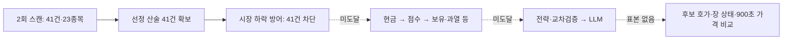

# 10월19일 v5 실측 — 시장 방어와 선정 근거

## 목적과 결론

좋은 종목과 진입 시점을 골라 **비용 후 순수익을 개선**하는 것이 목적이다. 오늘 v5 수집과 별도 지연 판독은 완료됐다. 두 스캔의 반환 후보41건(중복 제외23종목)은 모두 시장 하락 방어에서 멈췄다. LLM 시작0·후보 호가0이므로 모델·응답 후 가격·900초 bid·청산의 수익 비교는 아직 불가능하다.

반면 선정 근거41건은 산술 대사가 가능했다. 최근 수급 수정으로 **SPDI 한 단계에서3건의 미관측 수급에 대한 기존20점 감점을 피한 사실**을 확인했다. 동일 계열 출현 보너스를 제거하는 별도 계산은1건의 점수를10점 낮췄지만 순위와 점수 경계 통과 수는 바꾸지 않았다. 어느 결과도 최종 진입·체결·수익 효과는 아니다.

다음 우선순위는 LLM 고급화나 점수 완화보다 **시장 방어에 막힌 후보도 사전에 정한 방식으로 가격 결과를 관측할 수 있게 하는 설계**다. 실제 방어 조건과 매수 중지는 유지한다. 오늘 자료에 맞춰 방어 임계값을 바꾸거나 같은 수집을 무조건 반복하지 않는다.

## PLAN → DO → SEE

| 단계 | 수행 | 결과 |
| --- | --- | --- |
| PLAN | 원래10:05~10:20 수동 판독 창이 지난10:34에 세션 시작. 실제 활성화·봉인 확인 후 새 판독 경로 검토 | 원본 manifest/attempt·운영·수집 입력 보존 |
| DO | 기존 고정 소스로10:39~10:54 별도 판독 계획 준비, 사전검사 후 실제10:39:11 시작 | 네 CLI 모두rc0, `diagnostics_complete` |
| SEE | 원장 무결성·선정 산술·첫 차단·자료 결측을 대조하고 독립 소스 검토 | 봉인 complete·드롭0, 후보41건 모두regime 차단, 순수익null |
| DO/SEE | 실제 반환 집단의 점수 경계·동일 계열 보너스·SPDI 단일 단계 비교 | 다음 절의 한정 계산 완료. 매매 설정·모델·운영 변경 없음 |

## 실행·입력 근거

- 예약 활성화:09:25:00~09:25:16 KST, 서비스 결과success/rc0. 영수증 `complete`, `restart_attempted=true`, `rollback=not_needed`, `toss_attempted=false`. 시작 once는09:25:06 소비됐다. PID 변경은 이 기존 예약에 따른 것이며 이번 판독에서 재시작하지 않았다.
- 원장 생성09:25:14, 봉인10:00:00.022434. **3,573개 기록**(`ws_quote`3,482, `selection_basis`41, `entry_gate_trace`41, `quote_subscription`7, `scan`2). 시작/봉인 포함3,575행·3,417,757바이트다.
- 원장 SHA256 `c49f921f6add636c560fcb5c8944c5bbba11d327c8be4720869ff2b8bee90cbb`, study SHA256 `be9215c8eb4345a682c8912543a3e52c51944af584ea5ef0b15dd012dd2a30f4`. strict 판독의 해시 체인·study 연결 검증 통과, complete·드롭/영속 큐 드롭0이다. 저장매체 영속성(`durability_confirmed=false`)·전체 시장/시간 커버리지는 미확정이다.
- 원래 판독 manifest `1f032ec9…7a993`와 원래 output 부재는 보존했다. 새 manifest는 `~/.local/share/qwq-capture-readout/20261019-v5-late-1039/manifest.json`, SHA256 `d44457929ab1dae170708f82a589d597456dd1f985d4b1238870245abcc01342`다. 변경은 시작/종료 시각과 output 경로뿐이다. 미래 시각 주입·기존 attempt 삭제·원본 변경 없음.
- 고정 판독 소스는 기존 `20261019-v5/source-ba29b903`, fingerprint `dc1490f2c283e487f790bb326d48ba27f810c0135cae217573693d4b45349995`다. 사전검사 `preflight_ok`는 내용 검증이 아니며 실제 실행으로 별도 확인했다.
- 결과: `~/.local/state/qwq-capture-readout/20261019-v5-late-1039/`의 summary·readiness·gate-trace·frame-diagnostics·evaluation-unreviewed와 입력 사본. attempt 소비, 자동 재시도 없음.
- 추가 산술/운영 근거: `~/.local/state/qwq-oct19-followthrough/`의 `summarize.py`, `evidence-summary.json`, `operations-summary.json`. 금액·종목별 원문·계좌정보는 저장소 문서에 싣지 않는다.

## 실제 진입 경로와 점수 경계

분모는 **두 번의 반환 후보41건**이다. 동일 종목 반복을 독립 표본으로 세거나 스크리너 내부 제외 종목까지 포함한 것으로 해석하지 않는다.

| 스캔(KST) | 후보 건수 | 기록된 KOSPI / KOSDAQ / 가중 등락률 | 점수 범위 | 실제 첫 차단 |
| --- | ---: | --- | --- | --- |
| 09:31:40 | 20 | -1.74% / -0.90% / -1.404% | 17.488~66.516 | regime20건 |
| 09:36:50 | 21 | -2.29% / -1.35% / -1.914% | 17.212~77.536 | regime21건 |

위 등락률은 **봇이 해당 시점에 기록한 입력**이며 별도 거래소 원천 대사 결과가 아니다. 가중 등락률≤-1.0% 또는 어느 지수든≤-2.5%면 차단한다. 두 스캔 모두 첫 조건이 성립했다. 활성/정규장/엔진/브로커/시간 단계는41건 모두통과, 시장 단계에서41건 모두실패했다. trace coverage는 이 반환 집단에서 완전하다.

**다음 실제 게이트는 현금이며 점수는 그 뒤다.** 오늘은 둘 다 not_reached다. 현금·overnight sentiment/volatility의 당시 런타임 값은 이 후보 원장으로 복원할 수 없다. 시장 차단만 가상으로 우회하고 기록된 지수 값을 유지할 때 코드상 점수 기준 후보는75/78/80 또는85/88/90이다. 이는 시장 자체가 달랐다는 반사실이나 실제 적용 기준 확정이 아니다.

| 점수만 대입한 가정 기준 | 첫 스캔 | 둘째 스캔 | 합계 |
| --- | ---: | ---: | ---: |
| 75 | 0 | 1 | 1/41 |
| 78·80·85·88·90 각각 | 0 | 0 | 0/41 |

최고77.536점 후보의 스캔 등락률은+1.28%지만, 이 값으로 이후 실시간 가격·현금·보유·전략·교차검증 조건을 통과했다고 볼 수 없다. 과거 문서의80점 기준을 오늘 실제 기준으로 복사하지 않는다.

## 선정 수정의 실측 결과

1. **원천 다양성:** 점수 병합 항42개 중 외국인 순위38, 갭 순위3, 등락 순위1이다.40건은 원천 항1개,1건은2개지만 그 둘은 `premarket_gap`과 `kis_fluctuation_rank`의 같은 `kis_fluctuation` 계열이다. 알려진 계열 수는41건 모두1이다. 따라서 다중 소스를 호출한다는 사실이 오늘 반환 후보의 독립 정보원 다양성을 증명하지 않는다. 뉴스·공시 등의 후속 보정까지 단일 출처였다는 뜻도 아니다.
2. **동일 계열 보너스:** 사전에 검토하던 원시 출현 수→알려진 계열 수 가정을 오늘 반환 집단에 단독 대입했다. 해당1건은 보너스10→0, 최종 점수63.236→53.236이다. 두 스캔 모두clamp여서 재계산 가능한 범위이며 후보 추가/제외는 고정했다. 해당 후보 순위2위는 유지되고 다른 순위·위 표의 경계 통과 수·최고점은 불변이다. 계열 구분은 독립성 검증이 아니고 전체 원천 제거 실험도 아니다.
3. **미관측 수급 감점:** `supply_policy_shadow`41건이 비교 가능하며38건 차이0,3건은 기존 SPDI 처리보다+20점이다. 이3건은 외국인/기관 모두미관측, 기존boolean은둘다false이고 등락률은+9.51/+8.70/+9.98%였다. 현재 정책은 미관측을 순매수 부재로 간주하지 않으므로 그 단일 감점을 피했다. **SPDI 경계 차이이며 전체 최종 점수+20 또는 진입 증가로 승격하지 않는다.**
4. **근거의 한계:** 선정 산술41/41, 캐시된 전체 후보 폴백0, modifier trace complete37/41이다. 나머지4건은 기존 수급 스냅샷의 conflict를 보존한다. 기존 `same_input_shadow`는34건만 비교 가능하지만, 실제 정책 당시 근거를 기록한 새 `supply_policy_shadow`는41건이다. 두 층을 서로 덮어쓰지 않는다. 원천 시점(source_as_of)은 여전히미확정이다.

원천 조회는 두 스캔에서 관측된 failure_count0이다. 이는 모든 외부 정보가 성공·신선했다는 뜻이 아니다. 기관은 첫 스캔cached_empty, 둘째completed_empty이고, Naver3개·llm_news는not_called다. theme_news는unknown_nonempty이며 첫 외국인 원천은약373초 캐시, 둘째는실제 응답이다. 빈 응답/명단 미등장은 후보의 순매수0 또는 음수 증거가 아니다.

## 가격·모델·청산에서 계산하지 않은 것

- 호가3,482건과 후보23종목의 교집합은0. LLM 시작·후보 배정·시장 상태 레코드0, 신호 생성0·order_ready0이다. 기존 보유/관측 호가를 후보 진입 가격으로 재사용하지 않는다.
- 판단 파일 부재는 별도 사실이다. `no_llm_checks`는 봉인한 이 관측 창의 기록이며 하루 전체 무신호 증명이 아니다. `decision_recording_finality=unverified`를 유지한다.
- 프레임 진단available0/gap0은 후보 구독 수요가 없던 범위다. 소켓 전체 무결성이나 정상 연속매매 상태를 증명하지 않는다.
- 가격 비교쌍0, session evidence 결측41건, `account_return=null`, `profitability_pass=false`, `production_eligible=false`. 수익0 또는 현금 수익으로 채우지 않는다.
- 첫 청산 비교 도구(#224)는 준비됐지만 오늘 자료는 동일 진입 이후 장중 PRICE 경로가 아니다. BOOK bid를 PRICE로 바꾸거나 첫 청산 신호를 체결로 가정하지 않는다.

## 다음 작업 순서

| 순서 | PLAN | DO | SEE / 완료 기준 |
| --- | --- | --- | --- |
| 1 | 차단된 기회와 회피한 손실을 함께 측정할 수집 설계 | regime/LLM 진입 전 반환 후보에서 고정 규칙·유한 수로 관측 대상을 고르고, 당시 현금 판정·overnight 입력/유효 점수 기준의 관측 여부를 기록하는 안을 검토 | 추가 KIS REST 없이 기존 WS 용량/접속·청산 감시 우선권·중복 구독/해제·메모리 상한을 검증. 자료 부족은unknown. 새 날짜/epoch·설치 전 리뷰 필요 |
| 2 | 같은 후보·같은 시각의 비용 후 기회 비교 | 실제 후보 호가·장 상태·후속 bid가 있는 표본으로 시장 방어 유지 대조군과 **사전 고정한 한 가지 대안**만 별도 관측 비교 | 응답 지연·스프레드·수수료/세금·API 비용 포함, 미체결/불명 분리. 단일 하락일에 임계값 최적화 금지 |
| 3 | 좋은 종목/진입과 청산 효과 분리 | 동일 진입 이후 실제 PRICE 경로 확보 후 기존 첫 청산 도구 적용, 체결 자료가 있으면 주문 귀속과 연결 | 첫 신호·체결·실현순손익을 별도 판정; 일봉 결과로 장중 효과를 대체하지 않음 |
| 4 | 비교·운영 정리 | KODEX200 전체 기준과 사전 정의한 반도체 제외 보조 기준 병기, 엔진 버전/시장국면 분리. 계좌 기준선·외부흐름 결측 대사 및 소비된 drop-in 정리는 별도 경계로 관리 | 한쪽 비교대상만 사후 유리하게 바꾸지 않음. RAG 제안은 사용자 결정대로 기록만 유지 |

**1번은 다음 설계 작업이며 이번에 구현·설치·예약하지 않았다.** 기존 최초 LLM 입장 방식만 반복하면 오늘 같은 시장 방어 구간의 기회비용은 계속 관측되지 않는다. 수집 설계 변경은 거래 방어 완화와 분리해야 한다. 새20일 관측, 모델 고급화, 매수 재개는 이번 판독의 자동 후속이 아니다.

## 운영·검증·통합

- 10:41:57 KST: HEAD `ba29b903`, PID2434183·active·NRestarts0, 브로커 연결·복구ready·journal pending0·미귀속0·정체0. 로컬 pending0은 거래소 미체결 실조회가 아니다. KR 매수 중지 유지.
- 환경/기본/진화 설정3파일은10월18일 배포 전 보존 지문과 일치했다. 월USD100·기준선0·정책normal·unknown1이며 미확인 비용 로그 후 계속 정책을 바꾸지 않았다. 이번 판독은 신규 브로커/LLM 호출0, 텔레그램 발송0이다. 봇의 자체 주기 호출까지0이라고 주장하지 않는다.
- 관련 테스트311 passed, rc0,33.12초·기존fork 경고1·운영/외부 접근 시도0. 제품/시험 코드 변경은 없으며 문서만 통합한다. 독립 문서 검토에서 수치·원인 해석은 일치했고 과거 상태의 현재 표기1건을 정정했다. PR 필수 전체verify는 병합 전 확인한다.
- 새 manifest/고정 소스·실제 게이트 의미는 별도 Sol/high 요청으로 읽기 전용 검토했다. 실제 모델/실효 effort metadata 미노출로미검증이며 교차 공급자 리뷰라고 하지 않는다.
- 운영 배포·재시작·설정 변경·새 관측 예약 없음. 이번 문서와 오프라인 결과는 재배포 대상이 아니다. 만료된 판독/소비된once·drop-in을 지우거나 재사용하지 않는다.
