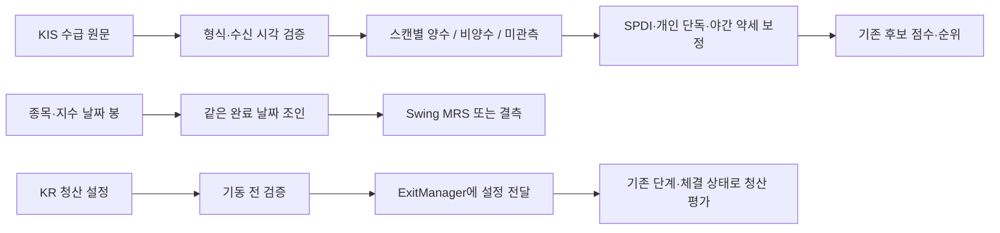

# 3자 리뷰 후속: 청산 설정과 종목 선정 입력 정비

> 이어진 [수급 근거 관측·Swing·일별 날짜 보완](supply-evidence-correctness-2026-10-18.md)은 같은 PR의 후속이다.
> 아래 Swing/새 관측 미완료와7452검증은 이 문서 기준 커밋의 이력이며, 후속 범위·통합 검증은 새 문서를 따른다.

## 목적과 범위 — PLAN

목표는 비용 후 계좌 순수익 개선이다. 이번 변경은 그 판단에 앞서 실제로 사용되지 않던
설정과 잘못 해석한 입력을 바로잡는다. 수익성 입증, 매수 재개, 새 청산 전략 채택을 뜻하지 않는다.
사용자가 승인한 순서는 청산 구현·평가 정합성 → 종목 선정 입력 → 시도/주문/체결 계측 →
동일 진입 청산 대조 → 셋업/트리거 분리 → 조건부 레짐·주문 방식·자본 정책이다.

기준 소스는 `068f94bd`이며 운영 소스 `a0bc9c94`와 코드가 같다. 별도 feature 브랜치에서
오프라인으로 작업한다. 10월19일 v4 관측은 이미 고정된 운영 소스와 입력을 사용한다.
이번 작업으로 운영 checkout, 설정, 서비스, 타이머, 매수 중지, 월100 예산을 변경하지 않는다.

## 구현 — DO

### 1. 청산 계약

- KR 초기화의 `build_kr_exit_config`가 복합 청산 활성 여부, 최소 단계, MA5 여유폭,
  전일 저가 사용 여부와 ATR 연동 활성 여부·배수·상한을 실제 ExitManager로 전달한다. 다른 기존 기본값은 보존한다.
- 잘못된 최소 단계, 유한하지 않거나 범위를 벗어난 MA5 여유폭, 활성 ATR 정책의 무효 상한·배수는
  설정 구성 시 거부한다. KR/both 초기화는 기존 최상위 설정 폴백도 포함해 토큰·브로커·시장 초기화 전에 검증하고 실패 시 중단한다.
- 비코어의 본전 보호 활성 후 트레일링도 `atr_link_cap_pct`를 넘지 않는다.
  기존 `max(ATR×1.5, effective_ts 또는 base_ts)`에 같은 상한을 적용하고, 장중 급락 상한은
  이후 더 좁은 쪽으로 적용한다. FIRST/SECOND는 고점 재설정, THIRD/TRAILING은 잔여 청산이라는
  기존 동작과 코어/ATR 정책 비활성 예외를 보존한다. 상한 적용은 FIRST/SECOND의 고점 재설정 빈도와
  이후 보유기간 판단에 영향을 줄 수 있다. 순수익 방향은 아직 알 수 없다.
- 초기 R 분모는 불변이다. 실제 유효 레짐 `trending_bear`로 전환한 뒤 고정 손절과
  ATR 동적 손절의 우선순위를 각각 시험했다. 기존 테스트의 `bear`는 무효값이라 전환이 없었다.
  ATR 동적 손절은 레짐 손절보다 우선하므로 이 시험을 약세장 손실 축소 증거로 보지 않는다.
- 일봉 평가기도 복합 청산 세 설정과 ATR 연동 세 설정을 전달·사용한다. RSI2의 MA5 여유폭 0.3% 예외를 보존하며
  계산기 버전을 `2026-10-18.composite-config`로 구분한다. 이전 결과 파일을 다시 쓰지 않는다.

**평가 정합성의 남은 범위:** 일봉 평가기는 장중 체결 순서를 재현하지 않는다. 순손익 손절과
가격 손절, 고가 접촉 익절, FIRST/SECOND 고점 재설정, 본전 보호·보유기간 평가 순서 차이가
남아 있다. 유효 설정 결과의 `supported_scope`에 `live_exit_parity=false`와 차이를 기록한다.
일봉의 THIRD→TRAILING 자동 전환과 설정 누락 시 기본값 차이(예: max_stop_pct 운영7/일봉8)도
남은 차이로 표시한다. 설정 전달 검증을 전체 운영 청산과의 동등성 또는 순수익 검증으로 해석하면 안 된다.
동일한 시각의 가격·실제 부분체결을 운영 ExitManager에 재생하는 평가는 후속 대조 실험의 선행 작업이다.

### 2. 선정 입력

- `kr-supply-absence-observed-v1`: 조회 순위에 없거나 응답 필드가 없으면 미관측이다.
  원래 `ntby_qty`가 유효한 정수였다는 근거와 단조 시계의 수신 시각을 함께 보존한다.
  외국인과 기관 양쪽 모두 유효한 0 이하 값이 있어야 수급 부재 감점을 적용한다.
  숫자 앞뒤 공백은 허용하되 콤마/실수 등은 추정 변환하지 않는다. 값이 있는데 형식이 잘못되면
  응답당 한 번 schema 상태와 건수만 경고한다(최대512 표시, 원문값 제외). 필드 부재는 미관측이다.
- 원문 근거는 스캔별로 분리하고 원천별 최대512종목, 수신 후600초로 제한한다.
  캐시를 다시 읽어도 근거의 수명은 연장되지 않는다. 기존 근거 없는 캐시의 0은 미관측이다.
  선택 관측기가 꺼지거나 실패해도 실점수는 같다. 추가 조회는 하지 않는다.
- 같은 가격 상승·수급 부재 근거의 이중 감점은 제거한다. 5% 이상 상승은 SPDI(-20),
  3% 이상 5% 미만은 기존 개인 단독 의심 항목(-15)이 담당한다.
  야간 약세의 기본 -5는 수급 미관측에도 유지하고, 관측된 수급 부재일 때만 -20을 적용한다.
- v3 관측 스키마의 SPDI shadow는 옛 flag 기반 정책이다. 새 정책이나 캐시 근거를 옛
  shadow와 비교 가능으로 승격하지 않고 `inputs_incomplete`로 둔다. 실제 단계별 점수 변화는 보존한다.
- MRS는 종목과 지수의 같은 날짜를 조인한다. KST 스캔 날짜 이전 완료 봉만 사용하며 직전
  KR 거래일 지수 봉과 종목 봉이 모두 필요하다. 중복·역순·날짜 없음·잘못된 가격·공통 이력 부족은
  MRS 결측이다. 일반 지표 캐시를 복사한 뒤 MRS를 매번 계산하므로 이전 스캔 값을 재사용하지 않는다.
  장 마감 후에도 당일 봉은 제외한다. 공급자가 당일 봉의 확정을 보증하는 필드가 없어 한 거래일
  늦은 MRS를 사용하는 의도된 제한이며, 장후 지표 신선도를 별도로 개선하기 전까지 유지한다.

원시 출현 보너스는 여전히 원시 횟수다. 여러 파생 소스를 독립 검증 횟수로 부르지 않는다.
독립 소스군 보너스와 Swing LCI의 원천별 결측/가집계 중복 정비는 이번 수급 감점 변경과 별개로 남는다.
LCI 거래량/시총 정규화나 가중치 변경의 수익 효과도 아직 검증하지 않았다. 새 `_supply_proof`는
메모리 캐시에만 있으며 기존 파일 저장 경로는 필요한 수치 필드만 선택한다. 다만 Swing/테마/보고의
기존 숫자 캐시는 미관측과0을 아직 구분하지 않으므로 새 정책이 모든 소비자에 적용됐다고 볼 수 없다.

### 연결 흐름과 적용 경계

후보 출현 횟수 보너스, 매수 허용 게이트, 주문 실행기는 이 변경에서 다시 설계하지 않는다.
청산은 신호와 체결을 구분한다. FIRST/SECOND 체결 단계와 고점 재설정 규칙을 그대로 쓰며,
일봉 평가기는 별도 근사 경로이므로 위 운영 흐름의 대체 증거가 아니다.

## 검증 — SEE

- 실패 재현 후 수정: 복합 설정 누락, 실제 활성 ATR 상한 초과, 무효 레짐 테스트,
  결측 수급 감점·중복 감점, 캐시 근거의 허위 shadow 비교, MRS 날짜 엇갈림과 캐시 잔존.
- 개별 시험: 청산133, 수급114, MRS/벤치마크83, 일봉/게이트72 passed·기존2 xfailed.
  집합이 겹치므로 합산하지 않는다. 운영 상태·외부 네트워크 접근 시도0.
- 1차 전체 검증은7387 passed/2 skipped/2 xfailed, rc0·격리0·문법/비밀검사 통과.
  독립 리뷰 보완 뒤 최종 전체 검증은 **7449 passed/2 skipped/2 xfailed**, rc0·격리0·문법/비밀검사 통과
  (289.57초, 기존 경고8건). SPDI 종목별 격리 후 마지막 전체 실행은 **7452 passed/2 skipped/2 xfailed**,
  rc0·격리0·문법/비밀검사 통과(290.84초, 기존 경고8건)다. PR CI는 해당 PR의 verify 기록을 정본으로 삼는다.
- 작업자는 요청 `gpt-6-astra/high` 2명이며 실제 모델/유효 effort 메타데이터는 미노출이다.
  구현자는 자신의 변경을 최종 승인하지 않는다.
- 작업자 한 명씩의 bare pytest 시도는 유지보수 스크립트까지 수집해 `scripts/test_new_tr.py`의
  `kis_md` fixture 오류를 냈다. 중단된 실행은 성공 근거가 아니다. 정식 검증은 저장소
  `scripts/dev/verify.sh`가 지정한 `tests/` 전체를 사용한다.

### 독립 리뷰 1차와 반영

- 요청 `claude-opus-5/xhigh`, 응답 metadata의 실제 모델 `claude-opus-5` 확인, 유효 effort는 미노출.
  도구/MCP 없는 별도 세션에 정책과 정제 소스만 전달. 성공 rc0, 개발 리뷰 비용 USD1.6115075.
- 실제 보완: 약세장 기본 -5 복원, 수급 공백 정수 호환·형식 오류 진단, ATR 세 설정 전달,
  초기 설정 사전검증. 회귀 시험은 실패를 확인한 뒤 수정했다.
- 근거로 해소: 일봉 enum은 정수0~4이며 문자열 순서 비교가 아니다. 휴장 함수는 주말도 포함한다.
  복합 단계 lookup은 none/first/second/third/trailing 모두 갖고 있다. 단계 조합25건과
  월요일·연휴 다음 거래일·장후 시험을 추가했다. 일봉의 기존 THIRD→TRAILING 자동 전환은 유지한다.
- 범위 명시: GAP 전략은 일봉 평가에서 원래 unsupported이고, 전체 청산 동등성은 별도다.
  설정 검증·순서 검증·수급 근거 보존은 순수익 향상 판정이 아니다.

### 독립 재리뷰와 잔여 P2 처리

- 2차 실제 모델 `claude-opus-5`, 요청 xhigh/유효 effort 미노출, rc0·도구 위반0, 비용USD1.5303185.
  판정은 **APPROVE (최종 전체 시험 통과 조건)**, P0/P1 없음. 7449 전체 통과로 조건을 충족했다.
  이어진 P2 보완도 아래 최종 검증과 한정 리뷰로 확인했다.
- P2-A/Minor: 설정 누락 기본값과 THIRD→TRAILING 단계 차이를 `exit_parity_gaps`에도 추가했다.
  기본값 통일은 운영 결과를 바꾸므로 공용 청산 재생 단계에서 명시적으로 비교한다.
- P2-B: SPDI 호출은 전체 스캔에서 무조건 실행되지만 내부는 전체 루프 단위 예외 처리였다.
  한 종목 오류가 뒤 종목의 유일한5% 이상 부재 감점을 누락시키지 않도록 종목별 격리를 보완했다.
  뒤 종목의 정상 양수 가점도 복원될 수 있어 변경 방향이 항상 보수적인 것은 아니다.
- P2-C/F: 새 수급 정책의 양수/비양수/미관측 및 MRS 충족률 계측을 다음 관측 스키마에 포함한다.
  상위 순매수 목록에서 양쪽 비양수가 드문 것은 부재를 추론할 권한이 있다는 뜻이 아니다.
  MRS 미관측은 현재 소비자에서 MRS 가감점0이다. 관측된 음수의 -5와 다르며, 결측에 -5를 새로
  부과하는 것은 별도 정책 가설이다. 순위 영향과 자료 충족률을 먼저 비교한다.
- P2-D: 운영 배포 전 실효 설정을 같은 순수 빌더로 검사하는 것을 필수 확인으로 남긴다.
  이번 작업은 운영 설정을 읽어 기동 적합성을 확인한 배포 승인이 아니다. KR 잘못된 청산 설정은
  both 모드도 토큰/시장 초기화 전 중단하는 계약이며 시험으로 고정했다. 숫자 문자열은 유한 양수면 허용한다.
- P2-E: 현재 소스에서 live `composite_trail_min_stage`의 생성 후 변경 경로를 찾지 못했다.
  잘못된 값을 FIRST로 조용히 바꾸는 폴백은 복구하지 않는다. 향후 동적 설정 변경은 검증 후 교체해야 한다.
- P2-G: 투자자 근거는 실제 호출의1/2와 별도 캐시 키에 묶인다. 반환행의 investor는 숫자 코드가 아닌
  표시 이름이며 현재 호출이 서로 뒤바뀐 근거는 없다. 원천 식별 강화는 다음 스키마에서 함께 정비한다.
- 추가 확인: live ExitConfig의 `__post_init__` 정의는1개이며 기존 정의를 덮어쓰지 않는다.
  휴장 조회는 유한한 날짜 집합+주말 검사다. 미래 달력 공급 방식 변경 시 반복 상한도 검토한다.

### 마지막 보완의 한정 리뷰

- 3차는 SPDI 종목별 격리와 parity 범위 표시만 검토했다. 실제 `claude-opus-5`, 요청xhigh/유효 effort
  미노출, rc0·도구 위반0, 비용USD0.2249785. 판정 **APPROVE (최종 전체 시험 rc0 조건)**, P0/P1 없음.
  7452 전체 시험 rc0로 최종 조건을 충족했다. 세 번의 개발 리뷰 기록 비용 합계USD3.3668045이며
  거래 엔진의 유료 비교 호출은 실행하지 않았다.
- 남은 비차단 의견: 전체 후보 형식 오류 시 경고가 종목 수만큼 발생하는 점은 다음 원천별 집계와
  함께 제한한다. 기존 score/reasons 중간 변경 원자성 문제는 잘못된 reasons 형식에서 가능하나
  정상 ScreenedStock의 list 계약은 유지된다. 향후 후보 입력 검증에서 함께 다루며 이번 수정이
  모든 잘못된 후보를 정제한다는 주장은 하지 않는다.
- 가점·감점 모두 뒤 후보까지 실행된다는 회귀3건을 추가했다. 추가 parity 키의 소비자 호환성은
  통합 전체 시험으로 확인했다. 이전 변경의 미해결 범위는 위 P2 처리와 다음 순서에 유지한다.

## 다음 순서와 완료 조건

1. 현재 변경의 통합 시험·독립 리뷰·문서 정비 완료. `feature/exit-selection-correctness-20261018`의
   커밋/푸시/PR로 인계한다. PR 병합·운영 배포는 별도이며 이번 운영 배포는 없다.
2. 10월19일 기존 v4 수집과 준비된 판독을 확인한다. 자동 판독은 미예약이다.
   변경 소스 배포 시에는 고정 예약과 겹치지 않는 다음 관측 epoch를 사용한다.
3. 새 수급 정책을 식별하는 관측 스키마, 원천별 Swing 수급 결측/중복,
   독립 소스군과 원시 횟수를 분리하는 점수 대조를 구현한다. 새 데이터 없이 옛 v3를 재해석하지 않는다.
4. 후보 발행, 주문 준비, 접수 결과, 최초 체결을 별도 계수로 기록한다.
   접수 불명·부분체결을 중복 진입으로 계산하지 않는 상태 계약을 먼저 시험한다.
5. 청산 평가의 남은 단계·체결 순서 차이를 공용 운영 로직 재생으로 해소한다.
   같은 진입·가격·비용·체결 순서에서 복합/ATR/보유 규칙을 한 축씩 비교한다.
6. 셋업/트리거 워치리스트, 조건부 SEPA 레짐 예외, 지정가 진입, 자본 분리의 순수익 가설은
   같은 자료로 대조한 뒤 순차 적용한다. 수동 보유의 손실을 단순 삭제하거나 사이징을 일괄50%로
   올리는 변경은 포함하지 않는다.

2번의 실수집 시각을 기다리는 동안에도3~5번의 오프라인 설계·합성 시험은 진행할 수 있다.
실자료 결측과 구현 미완료를 구분하며, 관측 기간을 무조건 늘리는 대신 매일 누적 자료로
입력 충족·실행 오류·비용을 점검하고 전략 효과는 동일 조건의 대조 결과로 판단한다.
