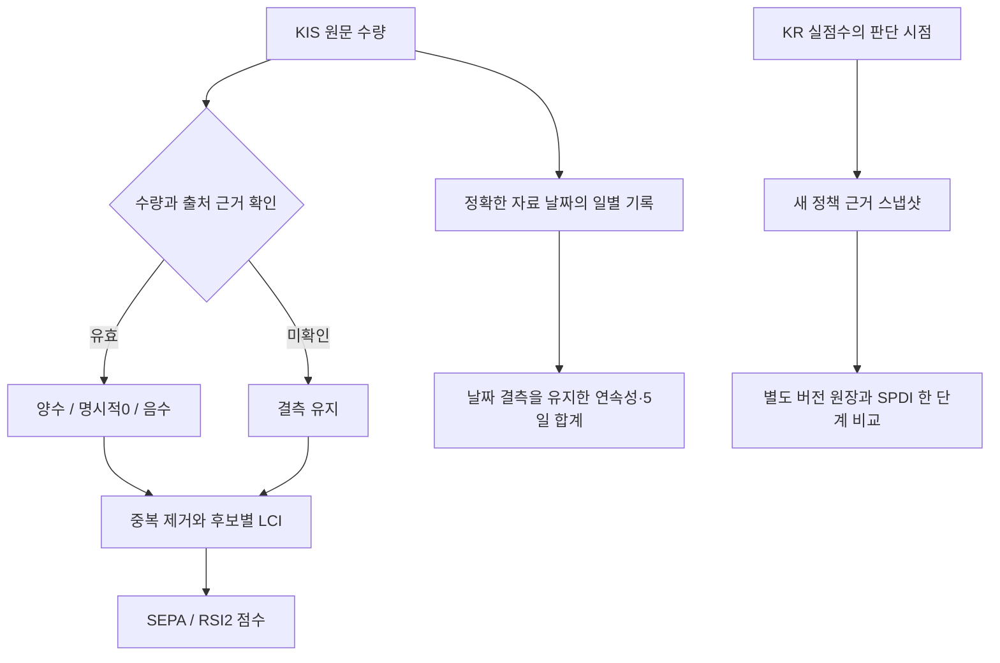

# 수급 근거 관측과 Swing 입력 보완

## PLAN — 목적과 승인 범위

목표는 어떤 종목을 언제 살지 판단하는 입력의 오류를 줄이고, 비용 후 순수익으로
평가할 수 있게 만드는 것이다. 미관측을 실제0으로 취급해 가점을 만들거나,
같은 수급을 중복 합산하는 문제를 수정한다. 새 매매 가설의 수익성을 입증한 작업은 아니다.

기준은 PR #218의 `5f0c994a`다. 기존 청산·선정 입력 정비에 이어 별도 작업 트리 두 개와
통합 작업 트리에서 진행한다. 작업자 파일 소유권을 분리하고 통합자가 검증한다.
운영 `a0bc9c94`, 설정, 매수 중지, 월100 예산 및10월19일 v4 예약은 변경하지 않는다.
예약의 v4와 이번 선정 스키마 `selection-basis-v4`는 서로 다른 버전 축이다.

## DO — 입력과 기록

### Swing 점수의 근거

- 외국계 브로커 추정과 외국인 전체 순매수는 겹칠 수 있으므로 더하지 않는다.
  기존 조회 흐름 안에서 유효한 원문 근거가 있는 수량을 선택하고, 모르는 값은 `None`으로 유지한다.
  명시적인0과 음수는 결측과 구별한다. 중복 행이 충돌하면 근거로 쓰지 않는다.
  브로커 추정 조회는 기존 폴백 진입 조건과 호출 수를 보존하기 위해 건수 진단으로 남으며 점수에는 쓰지 않는다.
- LCI는 비교 가능한 양쪽 투자자 자료가 있는 후보로 계산한다. 수급이 없는 종목이
  매도 우위 후보들의 평균과 비교되어 양의 LCI를 받는 오류를 제거한다.
  장중 자료는 코스피와 코스닥을 별도 비교 집단으로 계산한다.
  매도 압력 계산에서도 미관측 후보를0으로 분모에 넣지 않는다.
  이 비중은 관측된 후보 집합의 비중이며 전체 시장의 상승·하락 종목 비율은 아니다.
- SEPA/RSI2도 미관측을0으로 바꿔 기본 수급 가점을 주지 않는다. SEPA의 자료 연령에 따른
  점수 기준은 첫 후보의 연령을 전체에 복사하지 않고 후보별 확인된 자료에만 적용한다.
- 후속 교차검증의 기존 지표 결손 정책은 유지한다. 양쪽 수급이 모두 미관측이면
  수급 결손 감점 대상이 되며, 명시적인0은 관측된 값으로 인정한다. 따라서 미관측 가점 제거와
  기존 결손 감점의 적용으로 최종 점수가 낮아질 수 있다. 이 효과를 순수익 개선으로 단정하지 않는다.
- 수신 시각과 공급자의 자료 기준일을 분리한다. 장중 순위 자료의 공급자 기준시각은 미확인이다.
  이를 확정 일별 수급으로 부르지 않으며, 날짜가 있는 일별 응답과 구별한다.
- Swing 캐시는 별도 버전과 이름을 사용한다. 기존 스케줄러가 쓰는 숫자만 있는 캐시는
  보존하지만, 새 점수 경로에서 검증된 수급이나 명시적인0으로 승격하지 않는다.
  일별 근거는 최대31달력일 안의7거래일 이내로 제한하고, 캐시 파일은8달력일 범위에서 찾는다.
  긴 연휴 이전 파일이 이 탐색 범위 밖이면 캐시 폴백은 미관측으로 남는다.

### 일별 누적의 날짜 정합성

- 이전의 `supply_demand_YYYYMMDD` 과거 탐색 결과를 요청 날짜에 저장하던 폴백을 제거했다.
  하루 스냅샷을 여러 날의 연속 매수로 만들지 않는다.
- `supply_daily_v2_YYYYMMDD.json`은 버전·자료 날짜·출처와 투자자별 결측을 보존한다.
  과거 버전에서 날짜가 바뀌어 저장됐을 가능성이 있는 기존 파일은 읽어서 승격하거나 삭제하지 않는다.
  스케줄러의 기존 `supply_daily_YYYYMMDD` 출력은 별도 이력으로 남는다.
- 요청한 최근5거래일 순서를 유지한다. 날짜 또는 투자자별 값이 빠지면 연속 매수는 그 지점에서
  끊긴다.5일 합계·규모 가점과 가속도는 필요한5일 값이 모두 있을 때만 계산한다.
  불완전한 합계는 `null`이며 자료 보유 일수와 종목별 관측 일수를 별도로 제공한다.
- KIS 일별 조회는 원문의 유효성·자료 날짜·수신 시각 근거를 확인한다. 기존 호환 수치의0만으로
  과거 수급을 만들지 않는다. 기존 정확한 날짜의 pykrx 조회도 한 투자자 결측을0으로 채우지 않는다.
- 새 조회 종류나 부족한 종목을 채우기 위한 추가 조회 루프는 만들지 않는다. 다만 기존 캐시를
  신뢰하지 않게 되어 처음에는 기존의 캐시 미스 조회가 늘 수 있다. 이를 호출량 감소로 주장하지 않는다.

### 새 정책을 별도 형식으로 관측

- 명시 설정 `selection-basis-v4`에서만 새 payload `kr-selection-basis-v3`를 사용한다.
  기존 v1/v2/v3 설정과 과거 원장의 해석을 유지한다.10월19일 고정 입력은 자동 전환하지 않는다.
- SPDI·개인 단독·야간 레짐의 판단 시점에 실제로 사용한 수급 상태와 근거 나이를 고정한다.
  나중에 기록할 때 다시 조회하거나 TTL을 갱신하지 않는다. 공급자 기준시각은 계속 `null`이다.
- 같은 SPDI 직전 점수에서 기존 flag 정책과 관측 근거 정책을 비교한다. 실제 실행 완료와
  전후 점수 계산이 맞을 때만 그 한 단계의 차이를 표시한다. 최종 순위·진입 통과·수익 차이는
  계산하지 않으며, 입력 미완료·실행 중단을 비교 가능으로 올리지 않는다.
- 캐시 후보는 이전 기록의 버전과 생산 시각을 보존한다. 현재 스캔의 근거를 붙여 새 관측으로 만들지 않는다.

## SEE — 검증과 독립 리뷰

- 실패 재현 후 수정: 겹치는 수급 합산, 결측 종목의 양의 LCI, 미관측 기본 가점,
  전송 전 시각으로 새 응답을 미래라고 거부하던 경계, 연휴와 날짜 형식,
  중복 행의 결측 복원, 과거 하루 자료의 다일 복제·거래일 압축·오래된 준비 상태.
- 개별 검증은 Swing177건(신규48), 관측306건(신규38), 일별 수급19건 통과다.
  집합이 겹치므로 개별 전체 수를 합산하지 않는다. 신규 회귀는 총105건이다.
- 통합 로컬 `scripts/dev/verify.sh`: **7557 passed / 2 skipped / 2 xfailed**, rc0,
  301.44초·기존 경고8건. 문법·비밀정보 검사 통과, 운영 상태·외부 네트워크 접근 시도0건.
- 작업자는 요청 `gpt-6-astra/high` 두 명이며 실제 모델·유효 effort 메타데이터는 미노출이다.
  별도 작업 트리의 커밋 `b3472ace`와 `e75dee59`를 통합자가 확인 후 반영했다.
- 독립 중요 리뷰1차는 실제 `claude-opus-5`, 요청 xhigh·유효 effort 미노출,
  rc0·도구 위반0·개발 리뷰 비용USD1.9884135였다. 판정은 변경 요청이며 아래와 같이 처리했다.
  도구/MCP 없이 정제 소스와 정책만 전달했고 운영 엔진의 유료 모델 호출은 하지 않았다.

| 지적 | 확인과 처리 |
|---|---|
| P1: pandas float 수량이 전부 결측으로 사라짐 | 실제 DataFrame으로 재현. 정수값인 유한 실수만 dataframe 경계에서 정수로 복원, NaN/분수는 미관측 유지 |
| P1: nullable 소비자 호환성 | 독립 정적 호출부 점검. 교차검증·LLM 입력·거래 기억은 None 검사, JSON은 null 보존. 누적 합계의 외부 산술 소비자는 없음 |
| P1: 장중 LCI 시장 혼합 | 코스피·코스닥의 LCI가 함께 계산되는 오류 재현 후 비교 집단 키에 시장 포함. 같은 시장 대조군 보존 |
| P1: KST import 누락 가능성 | 기존 모듈 import가 이미 존재함을 확인. 코드 수정 불필요 |
| P2: 배치 전달·한도·진단 | 실제 batch wrapper의 메타데이터 전달,512/513행 및 캐시 한도 검증. 만료 LCI 로그와 중복 종목의 기준점 통계 수정 |
| P2: 기록/시각 유지 | 일별 캐시는 기존 원자적 쓰기 도구 사용. 날짜 변경 중 폴백은 최초 요청 거래일 창 유지. 새 SPDI 인덱스는 단계명으로 조회 |

수정 후 관련175검사(집합 중복 있음)가 통과했다. 추가 회귀12건을 포함한 최종 로컬
`scripts/dev/verify.sh`는 **7569 passed / 2 skipped / 2 xfailed**, rc0,
295.54초·기존 경고8건이었다. 문법·비밀정보 검사 통과, 운영 상태·외부 네트워크 접근 시도0건.
1차 전체 통과와 수정 후 최종 결과를 구분한다.

독립 중요 재리뷰는 실제 `claude-opus-5`, 요청 xhigh·유효 effort 미노출,
rc0·도구 위반0·USD0.8682385로 완료했다. 두 리뷰 비용 합계는 USD2.856652다.
판정은 **P0/P1 없음, 수정 후 전체 시험 통과 조건부 승인**이다. 소스 리뷰이며 리뷰어가
시험을 직접 실행한 결과는 아니다. 위 전체 통과로 조건을 충족했다.
`pair_basis` 소비자는 tuple 길이 해체 없이 호환성/날짜를
확인하고, 캐시 한도 시험에는 자동 `Path.home → tmp_path` 격리가 있음을 통합자가 재확인했다.
결측 후속 소비자와 기존 결손 감점의 회귀4건을 추가했다. 미관측/명시적0의 교차검증 점수,
LLM 사실 입력, 거래 기억의 저장/압축, 실제 거래 저널의 JSON 쓰기/재로드를 검증했다.
프로덕션 코드는 재리뷰 이후 바꾸지 않았다. 추가 시험은 요청 Terra/high의 별도 작업자가 작성했고,
실제 모델 메타데이터는 미노출이다. 통합자가 diff를 확인하고 관련179건을 실행해 rc0을 확인했다.
이번 후속의 신규 회귀는 총121건이다. 최종 커밋 전체 CI는 [PR #218](https://github.com/qwq-partners/qwq-ai-trader/pull/218)의 체크와 해당 HEAD를 함께 확인한다.

### 확인된 적용 한계

- 수급 근거 한도는 투자자별512종목이다. 초과 시 부분 자료를 완전하다고 쓰지 않고
  미관측으로 처리한다. 외국인·기관 합집합이512를 넘으면 Swing 캐시를 쓰지 않는다.
  경계 검증은 통과했지만 실제 전체 응답 건수는 이번 오프라인 작업에서 조회하지 않았다.
  한도 초과는 기존 응답 존재 건수와 구분되지 않아 그 스캔의 일별 폴백을 막을 수 있다.
  전용 경고·초과 건수 계측은 미구현이며 후속 보완 대상으로 남긴다.
- 기존 스케줄러는30분마다 숫자 캐시를 계속 쓰며 디렉터리도 직접 만든다.
  장중의 오늘 파일과 섹터 보정의 일별 파일은 여전히 별도 소비자가 있다. 수신 시각이 없어
  같은 날 안에서 오래된 값을 판별하지 못하는 한계는 이번 Swing 경로 변경으로 해소되지 않는다.
  예전 Swing 캐시 보조 함수는 정의만 남고 호출되지 않는다.
- 공급자의 실제 async 메서드에서 발생하는 오류는 gather의 반환 예외로 처리한다.
  존재하지 않는 공급자 메서드·잘못된 동기 인터페이스까지 호환한다는 계약은 추가하지 않았다.
- 새 기록의 시작 시각은 내부 수집 시작 표시다. 공급자의 자료 기준시각 증거가 아니다.
  실제 판단과 현재 소스 스캔 경계의 대조는 별도 검증하며, 결측 원인의 세부 구분은 아직 없다.

## 남은 작업 순서

이번 코드의 로컬 통합 검증·독립 중요 리뷰와 문서 갱신은 완료했다. 변경은 PR #218에서 관리하며,
병합·운영 배포는 미실행이다. 운영 작업 트리의 HEAD/기존 설정 수정 보존만 Git으로 재확인했고,
이번 개발 중 서비스·실계좌·예약을 새로 조회하거나 변경하지 않았다.

1. 기존10월19일 관측을 고정 소스로 수집·판독한다. 새 수급 스키마의 실수집은 별도 입력·날짜·소스 고정이 필요하다.
2. 이미 있는 후보·판단·order_ready·주문 의도·증분 체결 기록을 지속적으로 연결한다.
   새 관측기를 중복 구현하지 않고 주문에 상위 식별자를 보존하는 부분부터 시작한다.
   거절과 실패의 분모, 자료 충족률과 MRS 결측률도 함께 확인한다. 수급 한도 초과 경고와
   스케줄러 숫자 캐시의 신선도 계측은 이 자료 충족 점검의 후속 항목이다.
3. 같은 진입·가격 경로·부분체결 자료로 운영 청산기를 재생해 청산 구조를 대조한다.
   일봉 평가를 실시간 청산과 동등한 결과로 해석하지 않는다.
4. 이후 셋업/진입 트리거 분리와 조건부 레짐·주문 방식·자본 배분을 하나씩 검증한다.
   여러 원시 소스를 독립 확인 횟수로 세는 보너스, LCI 규모 정규화는 별도 가설로 남는다.

실시간 관측과 다중 소스 선정은 검증할 가치가 있는 강점이다. 이번 수정은 그 장점이 실제로
쓰이는 입력을 정리하는 단계이며, 수급 가점이나 후보 수 증가 자체를 순수익 개선으로 보지 않는다.

### 다음 계측 작업의 PLAN→DO→SEE

코드 점검상 부족한 부분은 `order_ready` 이후 지속되는 상위 판단 식별자다.
`Order`에는 candidate/signal/LLM decision 식별자가 없고, `ExecutionHistory.intent`의 고정 사실 필드도
이를 보존하지 않는다. 기존 후보·LLM 판단·호가 결합·접수/체결 원장을 다시 만들 필요는 없다.

| 순서 | PLAN / DO | SEE 완료 조건 |
|---|---|---|
| 1 | `RiskManager.on_signal`에서 후보·계획·신호·판단 ID를 한 번 복사해 주문 의도 원장에 버전 구분으로 보존 | 이전 원장 재개 가능, 새 ID 왕복 보존, 누락은 null+사유, 종목/시간으로 추정 연결 금지 |
| 2 | 기존 제출·취소 접점에서 local_order_id와 broker_order_no를 분리하고 not_sent/rejected/unknown/accepted를 연결 | 의도 중복0, 의도 없는 접수 금지, unknown 미확정 유지, 주문일·계좌 범위까지 접수 식별 |
| 3 | 기존 오프라인 대사에서 상위 판단→원장 접수→증분 execution_id→영속 거래 반영을 연결 | 두 번 부분체결 후 취소, 누적 폴링 중복, 체결 없는 취소, 응답 불명 상태를 각각 검증 |

계획 ID는 현재 shadow 근거이며 주문 허용 조건은 아니다. LLM을 거치지 않는 경로의 판단 ID는
정상적으로 없을 수 있다. KIS 체결은 누적 조회 차분이므로 거래소 개별 체결 시각이라고 부르지 않는다.
`handoff_returned`만으로 거래 DB 반영을 확정하지 않으며, 과거 주문의 누락 식별자를 재구성하지 않는다.
이 표는 다음 구현의 입력이며 이번에 주문 원장 형식을 변경했다는 뜻은 아니다.
