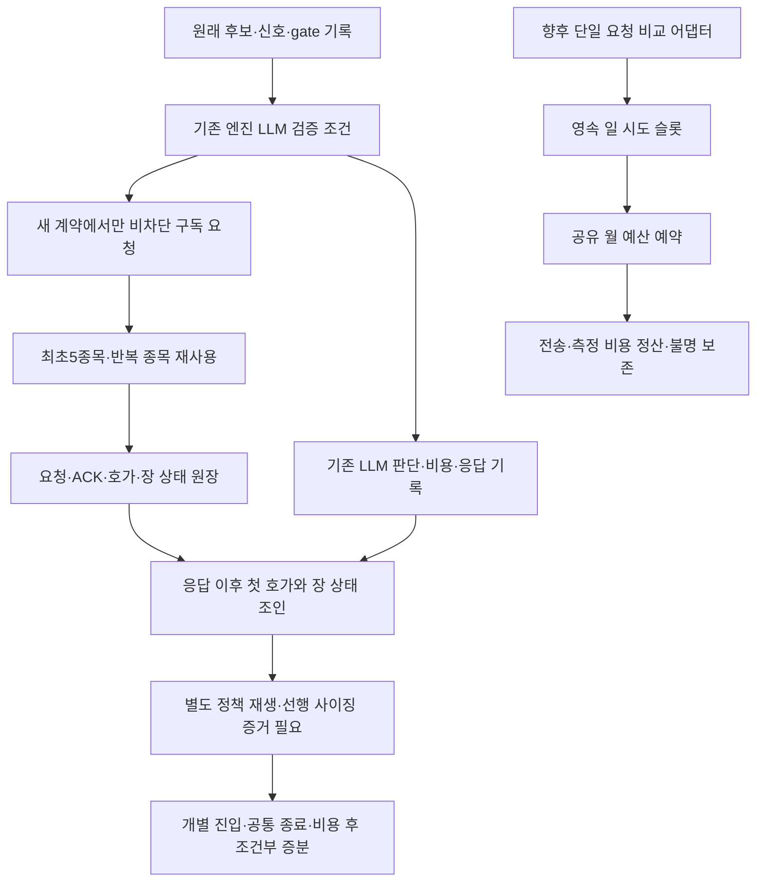

# 판단·호가 관측과 모델 비교 보완 — PLAN → DO → SEE

기준 SHA: `3ba959c456ae43bbd83830f99c9a95221a23d417`. 사용자 승인: 66차 리뷰의 세 보완 항목을 순서대로 진행(`ㄱㄱ`). 목적은 종목·진입 판단의 비용 후 증분 성과를 측정할 수 있게 하는 것이다.

## 공통 경계

- 운영 `161b394`, 수정 중인 운영 설정, 10월14일 고정 파일럿과 월USD100 기존 집계를 보존한다. 이번 단계는 배포·예약·매수 재개·유료 비교 호출을 하지 않는다.
- 구버전 관측과 기존 매매 판단·사이징·위험 한도는 유지한다. 새 LLM 대상 관측은 명시한 새 계약에서만 활성화한다.
- 자료 없음은 미측정이다. 조회 완료·봉인·테스트 통과를 체결 또는 순수익 증거로 쓰지 않는다.
- 총괄 1명, 구현 2명. 작업자는 같은 기준 SHA의 별도 worktree를 사용한다. 총괄이 경제성 계산/문서와 통합을 소유한다. 실제 모델 메타데이터가 없으면 unverified.

## 작업 1 — 관측 배정·용량

소유: Astra/high 구현자. `entry_observation*`, `quote_subscription`, 엔진의 관측 훅, 버전 인식·관련 테스트·B 문서.

- 기존 신호 생성 시점 대신 실제 LLM 보조 검증 진입 시점에서 최초 다섯 **종목**의 구독을 요청하는 새 opt-in 계약을 추가한다.
- 반복 종목은 구독을 재사용하고 신호 ID별 배정/거절을 기록한다. 요청/ACK/첫 수신을 구분하고 실제 유료 호출 여부는 판단 기록에서 확인한다.
- 호가·장 상태·기타 레코드의 명시 몫과 스캔 메타데이터 합계를 검증한다. 넘치면 원장 불완전으로 남긴다.
- 검증: 비대상 신호 다섯 개 뒤 대상 신호, 중복 종목, 여섯 번째 종목, 창 종료, 과거 계약 거부, 용량 한도, 기본 비활성 회귀.

## 작업 2 — 계산 입력·호출 예산 경계

소유: Astra/high 구현자. `model_comparison_budget`, 신규 `model_comparison_execution`, 관련 테스트.

- bool·음수·비정수·NaN/Inf 입력을 거부한다. 0과 가격 미확인 None은 보존한다.
- 명시 주입한 기존 월 원장과 불변 실험 정책에만 연결하는 단일 호출 가드를 구현한다. KST 일별 실제 시도 상한을 영속·원자적으로 차감하고, 공급자 전송 전 예약/후 정산한다.
- 취소·불명 비용은 가능한 지출을 0으로 해제하지 않는다. 각 재시도/폴백도 가드를 통과한다. 기존 LLMManager를 중첩해 이중 예약하지 않는다.
- 검증: 차단 시 전송0, 경합/재시작의 일 한도, 월 전환/기존 기준선 보존, 불명·취소 정산. 모두 임시 원장과 가짜 공급자로 실행한다.

## 작업 3 — 경제성 계약·계산

소유: 총괄. 신규 `model_comparison_outcome`/테스트와 C 문서, 공통 문서.

- 거절=0주로 바꾸지 않는다. 판단 전 동일 사이징 스냅샷을 근거로 각 판정의 **실제 정책을 재생한 최종 수량**을 입력받는다. 판단 후 수량을 나누어 기준수량을 추정하지 않는다.
- 각 응답 이후의 개별 진입 가격과 사전 고정 공통 종료 시점으로 비용 후 차이를 계산한다. 실제 사이징 재생/호가 선택 증거가 없으면 null이다.
- 기존 FeeCalculator를 사용한다. USD API 비용은 명시 환율 근거가 있을 때만 KRW에 합산한다. 산출물은 조건부 가격 대리치이며 실체결·계좌 수익·통계적 우위가 아니다.
- 같은 역할/출력 한도에서 추론만, 다음은 같은 추론에서 모델만 바꾼다. 출력 한도 변경은 별도 실험으로 둔다.
- 검증: 50주 대 100주의 증분, 같은 수량, 0주 현금, 응답 이전 가격·누락 스냅샷·비용/환율 결측의 null 처리.

## 통합 SEE

각 변경 diff/관련 시험을 확인하고 최종 전체 verify·비밀정보 검사·중요 경로 독립 리뷰를 수행한다. 리뷰 지적은 수정 뒤 해당 변경을 다시 검토한다. 문서·커밋·push·PR/CI를 완료한다. 운영 배포는 파일럿 결과 확인 후 장외 절차로 분리한다.

## 처리 흐름과 아직 연결하지 않은 부분

관측은 거래 판단을 기다리게 하지 않는다. 구독이 늦어 쌍을 놓친 경우 그대로 기록한다. `H`의 실제 중립 사이징 캡처/정책 재생과 `J`의 실공급자 연결·paired shadow 실행기는 아직 없다. 입력 검증된 조건부 계산기와 호출 예산 경계를 먼저 갖춘 단계다. 새 날짜 설치 입력/전용 설치기 연결·실효 용량은 기술 파일럿 이후 확정한다. 20일 대기는 결함 수정의 전제조건이 아니며, 매일 누적 결과는 버전/정책별로 나눠 검토한다.

## 진행 기록

- PLAN 확정. 두 구현 worktree를 분리했다. 경제성 worktree는 작업자 제한으로 사용하지 않고 총괄 worktree에서 소유한다.
- DO 구현·오프라인 검증 완료. 실제 유효 관측·사이징 재생 입력·유료 비교 실행기는 후속 단계이며, 이번 가드/계산기만으로 실험을 자동 시작하지 않는다.
- 경제성 독립 리뷰(Astra/high 요청, 실제 metadata unverified): 수수료 float/string/None과 최대 날짜 입력의 P2 두 건을 재현·수정했다. 관련26검사 통과 및 독립 재검증/범위 한정 승인. 참조·원천 인증이나 실제 수익 승인은 아니다.
- 최종 통합 UTC `QWQ_VERIFY_PYTHON=/home/ubuntu/projects/qwq-ai-trader/venv/bin/python bash scripts/dev/verify.sh`: **5606 passed / 2 skipped / 2 known xfailed**, rc0. 문법·비밀정보 검사 통과, 운영 상태/외부 네트워크 접근 시도0. 기존 pykrx deprecation warning 1건. KST 변경 관련147검사 rc0. 앞선5603 검사는 경제성 마지막 수정 전 결과이며 최종 결과로 사용하지 않는다.
- 관측/호출 예산의 source-only 교차 공급자 중요 경로 리뷰는 Claude Opus5/xhigh 요청으로 진행 중이다. 완료된 실제 model metadata/판정 확인 전에는 승인으로 세지 않는다. PR/CI·병합은 그 결과 이후다.
